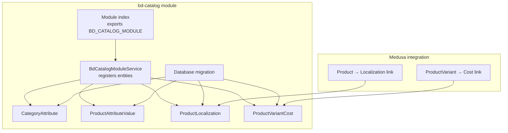
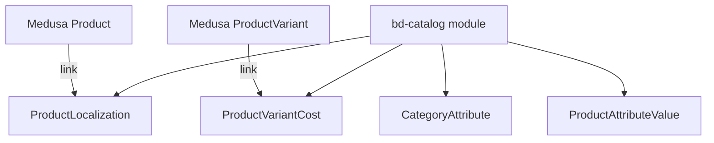
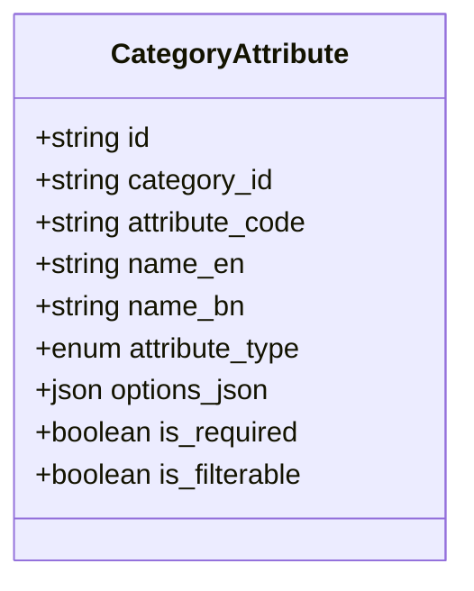
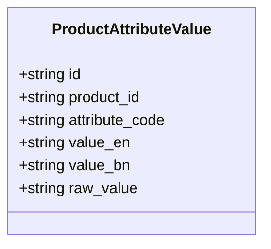
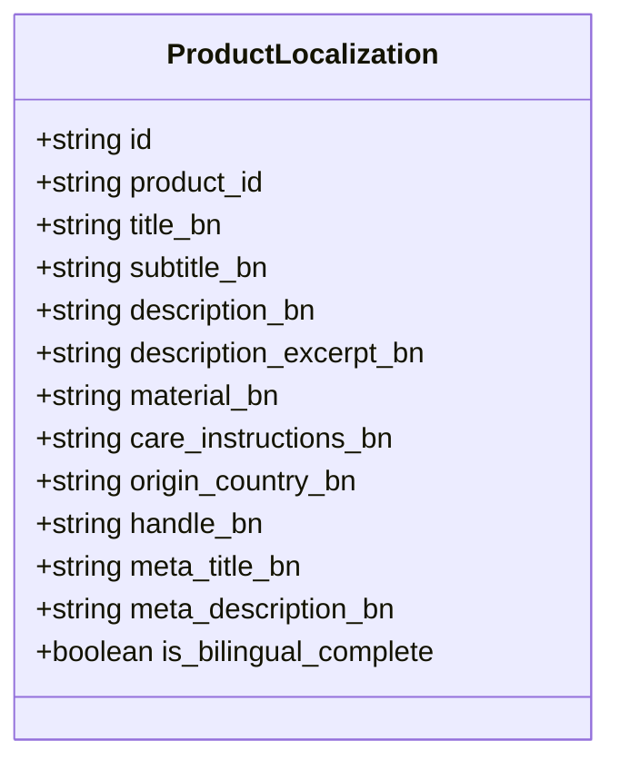
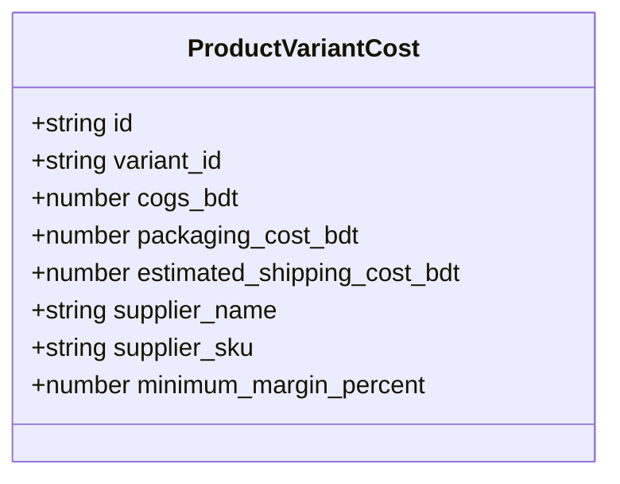
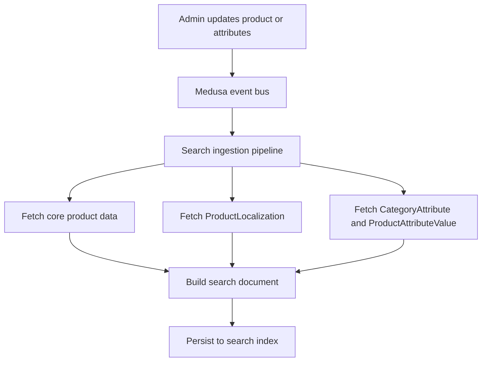
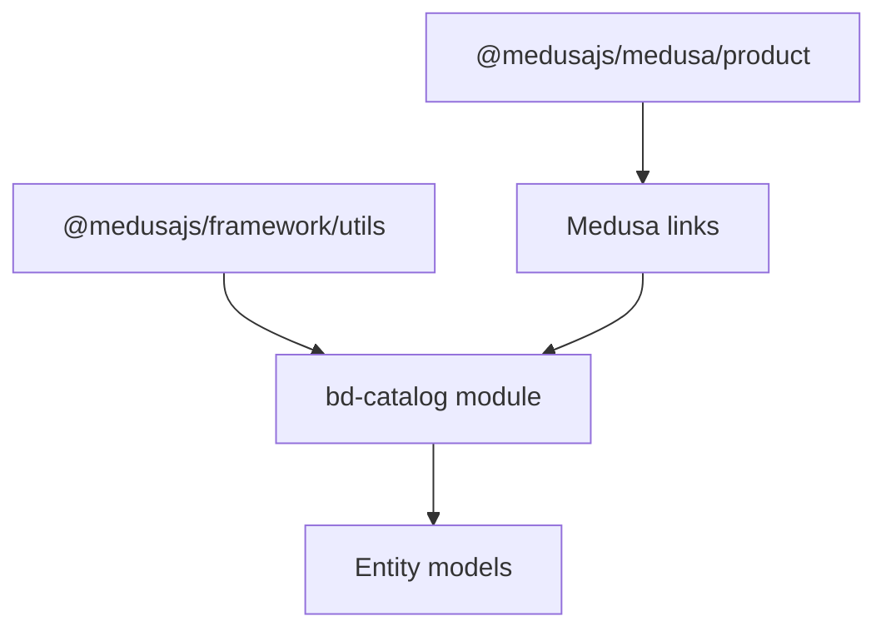

# Catalog Management Module (bd-catalog)

<cite>
**Referenced Files in This Document**
- [index.ts](file://apps/medusa/src/modules/bd-catalog/index.ts)
- [service.ts](file://apps/medusa/src/modules/bd-catalog/service.ts)
- [category-attribute.ts](file://apps/medusa/src/modules/bd-catalog/models/category-attribute.ts)
- [product-attribute-value.ts](file://apps/medusa/src/modules/bd-catalog/models/product-attribute-value.ts)
- [product-localization.ts](file://apps/medusa/src/modules/bd-catalog/models/product-localization.ts)
- [product-variant-cost.ts](file://apps/medusa/src/modules/bd-catalog/models/product-variant-cost.ts)
- [Migration20261024060539.ts](file://apps/medusa/src/modules/bd-catalog/migrations/Migration20261024060539.ts)
- [product-localization link](file://apps/medusa/src/links/product-localization.ts)
- [product-variant-cost link](file://apps/medusa/src/links/product-variant-cost.ts)
- [search product definition](file://apps/medusa/src/search/product.ts)
- [data models documentation](file://docs/data-models.md)
- [database design notes](file://database.md)
</cite>

## Table of Contents
1. [Introduction](#introduction)
2. [Project Structure](#project-structure)
3. [Core Components](#core-components)
4. [Architecture Overview](#architecture-overview)
5. [Detailed Component Analysis](#detailed-component-analysis)
6. [Dependency Analysis](#dependency-analysis)
7. [Performance Considerations](#performance-considerations)
8. [Troubleshooting Guide](#troubleshooting-guide)
9. [Conclusion](#conclusion)

## Introduction
The `bd-catalog` module extends Medusa’s product catalog for Bangladesh-specific requirements. It adds:
- A category attribute system for defining reusable, filterable product attributes per category.
- Product-level attribute values that store localized and raw values for dynamic fields such as size charts, material specifications, and regional sizing.
- Bengali-first product localization with bilingual completeness tracking.
- Variant cost tracking in Bangladeshi Taka, including cost of goods, packaging, estimated shipping, supplier details, and minimum margin configuration.

The module is implemented as a Medusa v2 module with a service backed by four entities. It links to core Medusa products and variants through Medusa’s link layer rather than duplicating product data.

## Project Structure
The module lives under `apps/medusa/src/modules/bd-catalog`. Its structure follows a standard Medusa module layout:
- Module registration exports the module name and service.
- The service registers all entity models.
- Each model defines a table schema using Medusa’s ORM model builder.
- A migration creates database tables, indexes, and constraints.
- Links connect module entities to Medusa’s product domain.

**Diagram sources**
- [index.ts:1-9](file://apps/medusa/src/modules/bd-catalog/index.ts#L1-L9)
- [service.ts:1-15](file://apps/medusa/src/modules/bd-catalog/service.ts#L1-L15)
- [category-attribute.ts:1-16](file://apps/medusa/src/modules/bd-catalog/models/category-attribute.ts#L1-L16)
- [product-attribute-value.ts:1-13](file://apps/medusa/src/modules/bd-catalog/models/product-attribute-value.ts#L1-L13)
- [product-localization.ts:1-20](file://apps/medusa/src/modules/bd-catalog/models/product-localization.ts#L1-L20)
- [product-variant-cost.ts:1-15](file://apps/medusa/src/modules/bd-catalog/models/product-variant-cost.ts#L1-L15)
- [Migration20261024060539.ts:1-37](file://apps/medusa/src/modules/bd-catalog/migrations/Migration20261024060539.ts#L1-L37)
- [product-localization link:1-9](file://apps/medusa/src/links/product-localization.ts#L1-L9)
- [product-variant-cost link:1-9](file://apps/medusa/src/links/product-variant-cost.ts#L1-L9)

**Section sources**
- [index.ts:1-9](file://apps/medusa/src/modules/bd-catalog/index.ts#L1-L9)
- [service.ts:1-15](file://apps/medusa/src/modules/bd-catalog/service.ts#L1-L15)
- [Migration20261024060539.ts:1-37](file://apps/medusa/src/modules/bd-catalog/migrations/Migration20261024060539.ts#L1-L37)

## Core Components
The module exposes one service class that inherits from Medusa’s base service and registers four entities. This gives you standard CRUD operations out of the box for:
- Category attributes
- Product attribute values
- Product localization records
- Product variant costs

Custom business logic can be added to this service later, while still benefiting from Medusa’s query builders, transactions, and event hooks.

Key responsibilities:
- Provide typed accessors for category attribute definitions.
- Store and retrieve localized product content and metadata.
- Track variant-level costs in BDT and supplier information.
- Maintain attribute values per product, supporting both English and Bangla values.

**Section sources**
- [service.ts:1-15](file://apps/medusa/src/modules/bd-catalog/service.ts#L1-L15)

## Architecture Overview
The module integrates with Medusa’s product domain through links. It does not duplicate product titles or descriptions; instead, it stores Bangladesh-specific editorial content and attributes alongside the core product record.

**Diagram sources**
- [product-localization link:1-9](file://apps/medusa/src/links/product-localization.ts#L1-L9)
- [product-variant-cost link:1-9](file://apps/medusa/src/links/product-variant-cost.ts#L1-L9)
- [service.ts:1-15](file://apps/medusa/src/modules/bd-catalog/service.ts#L1-L15)

## Detailed Component Analysis

### Category Attribute System
Category attributes define reusable field definitions per category. They support multiple input types and optional options for select-based inputs.

Important characteristics:
- Each attribute belongs to a category via `category_id`.
- Attributes have an `attribute_code` used consistently across product attribute values.
- Names are stored in both English and Bangla.
- Supported types include select, multiselect, text, and boolean.
- Optional JSON options allow dropdown choices for select-type attributes.
- Required and filterable flags control validation and storefront filtering behavior.

**Diagram sources**
- [category-attribute.ts:1-16](file://apps/medusa/src/modules/bd-catalog/models/category-attribute.ts#L1-L16)

Implementation guidance for Bangladesh-specific attributes:
- Use `attribute_code` values like `size_chart`, `material`, `fit`, `region_pricing_tier`.
- For size charts, use `options_json` to store structured size ranges or chart references.
- For materials, use text or select types depending on whether you want free-form or controlled values.
- Mark commonly filtered attributes like material or fit as filterable.

**Section sources**
- [category-attribute.ts:1-16](file://apps/medusa/src/modules/bd-catalog/models/category-attribute.ts#L1-L16)
- [Migration20261024060539.ts:5-10](file://apps/medusa/src/modules/bd-catalog/migrations/Migration20261024060539.ts#L5-L10)

### Product Attribute Values
Product attribute values attach dynamic attribute data to individual products. They mirror the attribute codes defined at the category level.

Key points:
- Each row ties a product to an attribute code.
- Values are stored in English and optionally Bangla.
- A `raw_value` field allows storing structured or machine-readable data alongside human-readable translations.
- Indexes exist on `product_id` and `attribute_code` for efficient lookups.

**Diagram sources**
- [product-attribute-value.ts:1-13](file://apps/medusa/src/modules/bd-catalog/models/product-attribute-value.ts#L1-L13)

Bangladesh-specific usage patterns:
- Size charts: store structured size mappings in `raw_value` and display-friendly text in `value_bn`.
- Material specifications: store fabric names in `value_en` and `value_bn`, with raw values for normalization.
- Regional pricing tiers: store tier identifiers in `raw_value` and readable labels in localized fields.

**Section sources**
- [product-attribute-value.ts:1-13](file://apps/medusa/src/modules/bd-catalog/models/product-attribute-value.ts#L1-L13)
- [Migration20261024060539.ts:12-15](file://apps/medusa/src/modules/bd-catalog/migrations/Migration20261024060539.ts#L12-L15)

### Product Localization
Product localization provides full Bengali editorial content for products. It complements Medusa’s native translatable fields rather than replacing them.

Supported fields include:
- Bengali title, subtitle, description, and excerpt.
- Material and care instructions in Bangla.
- Origin country defaulting to Bangladesh.
- Bengali handle for storefront slugs.
- SEO metadata in Bangla.
- A flag indicating whether the translation is complete.

**Diagram sources**
- [product-localization.ts:1-20](file://apps/medusa/src/modules/bd-catalog/models/product-localization.ts#L1-L20)

Relationship with core Medusa products:
- The module links `ProductLocalization` to Medusa’s `Product` entity.
- Native product fields remain managed through Medusa’s translation system; this module focuses on Bangladesh-specific editorial content.

Search indexing considerations:
- Some localization fields are marked searchable in the model.
- Search ingestion should include Bengali title and description when building localized search documents.

**Section sources**
- [product-localization.ts:1-20](file://apps/medusa/src/modules/bd-catalog/models/product-localization.ts#L1-L20)
- [product-localization link:1-9](file://apps/medusa/src/links/product-localization.ts#L1-L9)
- [data models documentation:74-96](file://docs/data-models.md#L74-L96)
- [database design notes:411-435](file://database.md#L411-L435)

### Product Variant Cost Tracking
Variant cost tracking captures internal cost and margin-related data per product variant in Bangladeshi Taka.

Fields include:
- COGS in BDT.
- Packaging cost in BDT.
- Estimated shipping cost in BDT.
- Supplier name and SKU.
- Minimum margin percentage.

**Diagram sources**
- [product-variant-cost.ts:1-15](file://apps/medusa/src/modules/bd-catalog/models/product-variant-cost.ts#L1-L15)

Relationship with core Medusa variants:
- The module links `ProductVariantCost` to Medusa’s `ProductVariant` entity.
- This keeps cost data separate from public pricing while enabling margin calculations.

Cost calculation patterns:
- Total internal cost can be derived from COGS, packaging, and estimated shipping.
- Margin checks can compare selling price against total internal cost and the configured minimum margin percentage.
- Supplier information supports procurement reporting and reorder workflows.

**Section sources**
- [product-variant-cost.ts:1-15](file://apps/medusa/src/modules/bd-catalog/models/product-variant-cost.ts#L1-L15)
- [product-variant-cost link:1-9](file://apps/medusa/src/links/product-variant-cost.ts#L1-L9)
- [Migration20261024060539.ts:21-23](file://apps/medusa/src/modules/bd-catalog/migrations/Migration20261024060539.ts#L21-L23)

### Service Methods and Operations
The current service extends Medusa’s base service and registers the four entities. This means it automatically provides:
- Create, update, delete, and list operations for each entity.
- Query builders for filtering by product ID, category ID, attribute code, and variant ID.
- Transactional safety when updating related records.

Recommended service extensions:
- Localized product management:
  - Upsert `ProductLocalization` for a given product ID.
  - Validate bilingual completeness based on required fields.
  - Return localized product views combining core product data with Bangla content.
- Attribute hierarchy management:
  - List category attributes by category.
  - Validate product attribute values against allowed attribute codes.
  - Normalize raw values for consistent search indexing.
- Cost calculations:
  - Compute total internal cost per variant.
  - Validate minimum margin against selling price.
  - Aggregate supplier-level cost reports.

**Section sources**
- [service.ts:1-15](file://apps/medusa/src/modules/bd-catalog/service.ts#L1-L15)

### Event Subscribers and Catalog Updates
The repository includes a placeholder subscribers directory. The bd-catalog module currently does not define its own subscriber files in the analyzed paths. Integration points for catalog updates include:
- Link-based relationships with Medusa products and variants.
- Search ingestion pipeline that reads core product data and may incorporate localization and attributes.

When implementing subscribers:
- Listen to product creation, update, and deletion events.
- Sync `ProductLocalization` and `ProductAttributeValue` changes.
- Trigger search re-indexing for affected products.
- Ensure soft-delete handling aligns with migration-defined timestamps.

**Section sources**
- [Migration20261024060539.ts:1-37](file://apps/medusa/src/modules/bd-catalog/migrations/Migration20261024060539.ts#L1-L37)

### Integration Points with Search Indexing
The search module defines product fields and ingestion logic. While the bd-catalog module does not directly implement search indexing, its entities are designed to support localized search:
- Bengali title and description fields are marked searchable in the model.
- Dynamic attributes can be mapped into indexed fields during ingestion.
- The search document transformation should include localized fields where appropriate.

**Diagram sources**
- [search product definition:43-98](file://apps/medusa/src/search/product.ts#L43-L98)
- [product-localization.ts:1-20](file://apps/medusa/src/modules/bd-catalog/models/product-localization.ts#L1-L20)
- [category-attribute.ts:1-16](file://apps/medusa/src/modules/bd-catalog/models/category-attribute.ts#L1-L16)
- [product-attribute-value.ts:1-13](file://apps/medusa/src/modules/bd-catalog/models/product-attribute-value.ts#L1-L13)

**Section sources**
- [search product definition:43-98](file://apps/medusa/src/search/product.ts#L43-L98)

## Dependency Analysis
The bd-catalog module depends on:
- Medusa framework utilities for module registration and service inheritance.
- Medusa product module through link definitions.
- PostgreSQL via Medusa’s ORM and migrations.

**Diagram sources**
- [index.ts:1-9](file://apps/medusa/src/modules/bd-catalog/index.ts#L1-L9)
- [service.ts:1-15](file://apps/medusa/src/modules/bd-catalog/service.ts#L1-L15)
- [product-localization link:1-9](file://apps/medusa/src/links/product-localization.ts#L1-L9)
- [product-variant-cost link:1-9](file://apps/medusa/src/links/product-variant-cost.ts#L1-L9)

**Section sources**
- [index.ts:1-9](file://apps/medusa/src/modules/bd-catalog/index.ts#L1-L9)
- [service.ts:1-15](file://apps/medusa/src/modules/bd-catalog/service.ts#L1-L15)
- [product-localization link:1-9](file://apps/medusa/src/links/product-localization.ts#L1-L9)
- [product-variant-cost link:1-9](file://apps/medusa/src/links/product-variant-cost.ts#L1-L9)

## Performance Considerations
- Use indexes on `product_id`, `category_id`, and `attribute_code` for efficient queries.
- Avoid duplicating large text fields; prefer linking to core product data and storing only Bangladesh-specific content.
- Keep `raw_value` structured but compact to reduce storage overhead.
- When computing variant costs, perform aggregations in the database layer where possible.
- For search indexing, batch updates and avoid unnecessary re-indexing of unchanged products.

[No sources needed since this section provides general guidance]

## Troubleshooting Guide
Common issues and resolutions:
- Missing localization records:
  - Verify that a `ProductLocalization` record exists for the product.
  - Check the `is_bilingual_complete` flag to ensure required fields are filled.
- Attribute mismatches:
  - Ensure `attribute_code` values in product attribute values match category attribute definitions.
  - Validate that select-type attributes use valid options from `options_json`.
- Cost data inconsistencies:
  - Confirm that each variant has a corresponding `ProductVariantCost` record.
  - Validate that COGS, packaging, and shipping values are non-negative.
- Search indexing gaps:
  - Confirm that localized fields are included in search document construction.
  - Ensure event-driven re-indexing runs after product or attribute updates.

**Section sources**
- [product-localization.ts:1-20](file://apps/medusa/src/modules/bd-catalog/models/product-localization.ts#L1-L20)
- [category-attribute.ts:1-16](file://apps/medusa/src/modules/bd-catalog/models/category-attribute.ts#L1-L16)
- [product-attribute-value.ts:1-13](file://apps/medusa/src/modules/bd-catalog/models/product-attribute-value.ts#L1-L13)
- [product-variant-cost.ts:1-15](file://apps/medusa/src/modules/bd-catalog/models/product-variant-cost.ts#L1-L15)

## Conclusion
The `bd-catalog` module provides a focused extension of Medusa’s catalog for Bangladesh markets. It separates editorial localization, dynamic attributes, and internal cost tracking from core product data while maintaining clean relationships through Medusa’s link layer. The current implementation offers a solid foundation for managing Bengali product content, category-driven attributes, and variant cost calculations. Future enhancements should add service-layer methods for localized product workflows, attribute validation, cost computations, and event-driven search synchronization.

[No sources needed since this section summarizes without analyzing specific files]