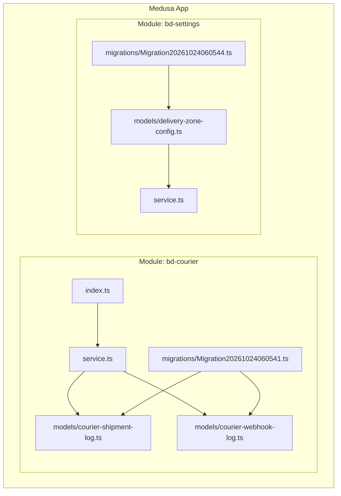
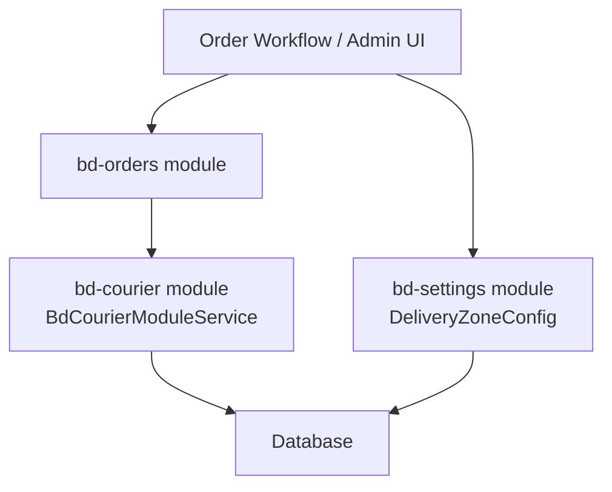
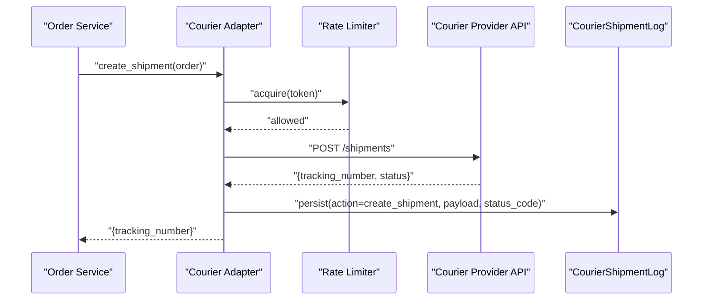
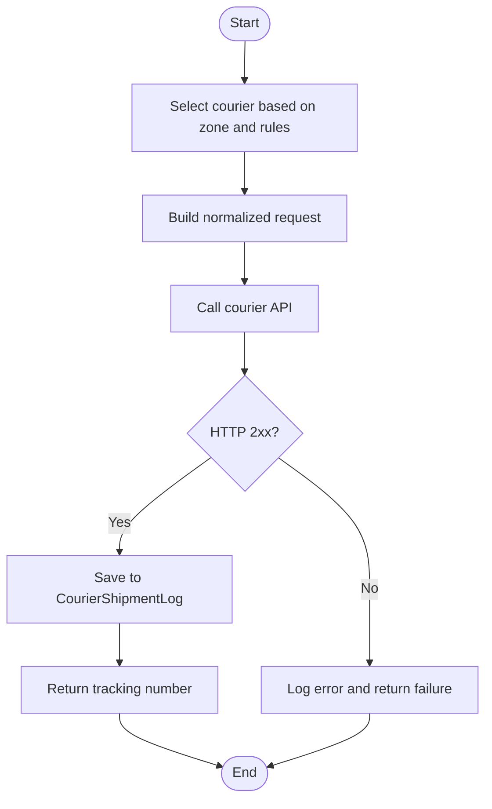
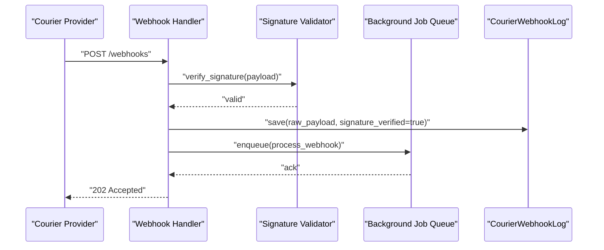
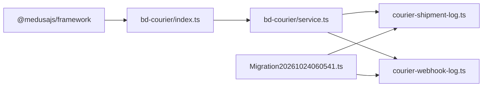

# Courier & Logistics Module (bd-courier)

<cite>
**Referenced Files in This Document**
- [service.ts](file://apps/medusa/src/modules/bd-courier/service.ts)
- [index.ts](file://apps/medusa/src/modules/bd-courier/index.ts)
- [courier-shipment-log.ts](file://apps/medusa/src/modules/bd-courier/models/courier-shipment-log.ts)
- [courier-webhook-log.ts](file://apps/medusa/src/modules/bd-courier/models/courier-webhook-log.ts)
- [Migration20261024060541.ts](file://apps/medusa/src/modules/bd-courier/migrations/Migration20261024060541.ts)
- [delivery-zone-config.ts](file://apps/medusa/src/modules/bd-settings/models/delivery-zone-config.ts)
- [service.ts](file://apps/medusa/src/modules/bd-settings/service.ts)
- [Migration20261024060544.ts](file://apps/medusa/src/modules/bd-settings/migrations/Migration20261024060544.ts)
</cite>

## Table of Contents
1. [Introduction](#introduction)
2. [Project Structure](#project-structure)
3. [Core Components](#core-components)
4. [Architecture Overview](#architecture-overview)
5. [Detailed Component Analysis](#detailed-component-analysis)
6. [Dependency Analysis](#dependency-analysis)
7. [Performance Considerations](#performance-considerations)
8. [Troubleshooting Guide](#troubleshooting-guide)
9. [Conclusion](#conclusion)

## Introduction
This document describes the bd-courier module, which provides logistics and delivery tracking capabilities for a commerce platform operating in Bangladesh. The module currently exposes:
- A Medusa module with a service layer that manages courier-related data models.
- Data models for shipment audit logs and webhook event logs.
- Integration points to external courier providers such as Steadfast, Pathao, and RedX through standardized log structures.
- Delivery zone configuration from the related settings module that maps to Bangladesh’s districts and divisions.

The module is designed to be extensible: while the current implementation focuses on logging and configuration, it provides a clear foundation for implementing courier API integrations, rate limiting, error handling, and analytics.

## Project Structure
The bd-courier module follows Medusa v2 module conventions:
- index.ts registers the module and exports its service.
- service.ts defines the module service using MedusaService with the relevant models.
- models define the database schema for shipment and webhook logs.
- migrations create and manage the underlying tables.

**Diagram sources**
- [index.ts:1-9](file://apps/medusa/src/modules/bd-courier/index.ts#L1-L9)
- [service.ts:1-11](file://apps/medusa/src/modules/bd-courier/service.ts#L1-L11)
- [courier-shipment-log.ts:1-15](file://apps/medusa/src/modules/bd-courier/models/courier-shipment-log.ts#L1-L15)
- [courier-webhook-log.ts:1-16](file://apps/medusa/src/modules/bd-courier/models/courier-webhook-log.ts#L1-L16)
- [Migration20261024060541.ts:1-23](file://apps/medusa/src/modules/bd-courier/migrations/Migration20261024060541.ts#L1-L23)
- [delivery-zone-config.ts:1-17](file://apps/medusa/src/modules/bd-settings/models/delivery-zone-config.ts#L1-L17)
- [service.ts:1-11](file://apps/medusa/src/modules/bd-settings/service.ts#L1-L11)
- [Migration20261024060544.ts:1-22](file://apps/medusa/src/modules/bd-settings/migrations/Migration20261024060544.ts#L1-L22)

**Section sources**
- [index.ts:1-9](file://apps/medusa/src/modules/bd-courier/index.ts#L1-L9)
- [service.ts:1-11](file://apps/medusa/src/modules/bd-courier/service.ts#L1-L11)
- [courier-shipment-log.ts:1-15](file://apps/medusa/src/modules/bd-courier/models/courier-shipment-log.ts#L1-L15)
- [courier-webhook-log.ts:1-16](file://apps/medusa/src/modules/bd-courier/models/courier-webhook-log.ts#L1-L16)
- [Migration20261024060541.ts:1-23](file://apps/medusa/src/modules/bd-courier/migrations/Migration20261024060541.ts#L1-L23)
- [delivery-zone-config.ts:1-17](file://apps/medusa/src/modules/bd-settings/models/delivery-zone-config.ts#L1-L17)
- [service.ts:1-11](file://apps/medusa/src/modules/bd-settings/service.ts#L1-L11)
- [Migration20261024060544.ts:1-22](file://apps/medusa/src/modules/bd-settings/migrations/Migration20261024060544.ts#L1-L22)

## Core Components
- BdCourierModuleService: A thin service class extending MedusaService, exposing CRUD operations over the courier data models. It acts as the primary integration point for other modules or workflows that need to persist shipment events and webhook events.
- CourierShipmentLog: Represents an audit trail for outbound courier actions (e.g., creating shipments, generating tracking numbers). It captures request/response payloads, status codes, and errors.
- CourierWebhookLog: Represents inbound webhook events from courier providers, including signature verification flags, processing state, and raw payload storage.

These components provide a robust foundation for integrating multiple couriers by standardizing how requests, responses, and webhook events are recorded.

**Section sources**
- [service.ts:1-11](file://apps/medusa/src/modules/bd-courier/service.ts#L1-L11)
- [courier-shipment-log.ts:1-15](file://apps/medusa/src/modules/bd-courier/models/courier-shipment-log.ts#L1-L15)
- [courier-webhook-log.ts:1-16](file://apps/medusa/src/modules/bd-courier/models/courier-webhook-log.ts#L1-L16)

## Architecture Overview
At runtime, the bd-courier module integrates with other parts of the system via Medusa’s dependency injection. Other modules can call into BdCourierModuleService to:
- Persist shipment lifecycle events.
- Record webhook events from courier APIs.
- Query logs for analytics and troubleshooting.

The delivery zone configuration lives in the bd-settings module and can be consumed by shipping calculators and checkout flows to determine rates and delivery windows based on district/division mapping.

[No sources needed since this diagram shows conceptual workflow, not actual code structure]

## Detailed Component Analysis

### BdCourierModuleService
Responsibilities:
- Exposes service methods generated by MedusaService for CourierShipmentLog and CourierWebhookLog.
- Provides a consistent interface for other modules to record courier interactions without coupling to specific provider implementations.

Usage patterns:
- Create shipment logs when calling courier APIs for order fulfillment.
- Store webhook payloads and metadata for later processing and auditing.

Extensibility:
- New courier-specific logic can be added as additional service methods or separate strategy classes that use the same log models.

**Section sources**
- [service.ts:1-11](file://apps/medusa/src/modules/bd-courier/service.ts#L1-L11)

### CourierShipmentLog Model
Purpose:
- Tracks outbound courier operations per order, capturing the courier name, action type, request/response payloads, HTTP status codes, and error messages.

Key fields:
- id: Primary key.
- order_id: Associates the log entry with an order.
- courier: Identifies the courier provider (e.g., Steadfast, Pathao, RedX).
- action: Describes the operation (e.g., create_shipment, generate_tracking_number).
- request_payload: JSON body sent to the courier API.
- response_payload: JSON body received from the courier API.
- status_code: HTTP status code returned by the courier API.
- error_message: Human-readable error details when present.

Indexes:
- order_id is indexed to optimize queries by order.

Complexity considerations:
- Storing large payloads may increase storage size; consider truncation or archival strategies for high-volume environments.

**Section sources**
- [courier-shipment-log.ts:1-15](file://apps/medusa/src/modules/bd-courier/models/courier-shipment-log.ts#L1-L15)
- [Migration20261024060541.ts:5-13](file://apps/medusa/src/modules/bd-courier/migrations/Migration20261024060541.ts#L5-L13)

### CourierWebhookLog Model
Purpose:
- Records inbound webhook events from courier providers, enabling reliable processing and auditability.

Key fields:
- id: Primary key.
- courier: Provider identifier.
- event_type: Type of webhook event (e.g., delivered, out_for_delivery).
- consignment_id: Optional courier-side consignment reference.
- tracking_code: Optional tracking number associated with the event.
- raw_payload: Full webhook payload for inspection and replay.
- signature_verified: Boolean indicating whether webhook signature validation passed.
- processed: Boolean indicating whether the event has been successfully handled.
- error_message: Error details if processing failed.

Indexes:
- consignment_id and tracking_code are indexed to support lookups during reconciliation.

Processing flow:
- Webhooks should be validated (signature check), logged, then processed asynchronously to avoid blocking incoming requests.

**Section sources**
- [courier-webhook-log.ts:1-16](file://apps/medusa/src/modules/bd-courier/models/courier-webhook-log.ts#L1-L16)
- [Migration20261024060541.ts:10-13](file://apps/medusa/src/modules/bd-courier/migrations/Migration20261024060541.ts#L10-L13)

### Delivery Zone Configuration (bd-settings)
Purpose:
- Defines delivery zones aligned with Bangladesh geography, including Dhaka-centric zones and outside-Dhaka regions.

Key fields:
- id: Primary key.
- zone_code: Enumerated zone identifier (inside_dhaka, dhaka_suburbs, outside_dhaka).
- name_en/name_bn: Localized display names.
- flat_rate_bdt: Default shipping cost for the zone.
- free_shipping_threshold_bdt: Threshold above which shipping is free.
- delivery_days_min/max: Estimated delivery window.
- is_active: Whether the zone is enabled.
- coverage_districts_json: JSON array of district identifiers covered by the zone.

Integration:
- Shipping calculators and checkout flows can query active zones to compute shipping costs and delivery estimates.

**Section sources**
- [delivery-zone-config.ts:1-17](file://apps/medusa/src/modules/bd-settings/models/delivery-zone-config.ts#L1-L17)
- [service.ts:1-11](file://apps/medusa/src/modules/bd-settings/service.ts#L1-L11)
- [Migration20261024060544.ts:5-12](file://apps/medusa/src/modules/bd-settings/migrations/Migration20261024060544.ts#L5-L12)

### Courier API Integration Patterns
Recommended approach:
- Implement a courier adapter per provider (Steadfast, Pathao, RedX) that:
  - Encapsulates API client configuration (base URL, credentials).
  - Normalizes request/response formats to align with CourierShipmentLog fields.
  - Handles provider-specific error codes and maps them to a common error representation.
  - Generates tracking numbers and returns them consistently.

Rate limiting:
- Use a token bucket or sliding window limiter around each courier client to respect provider quotas.
- Queue bulk operations and back off on 429 responses.

Error handling:
- Wrap all outbound calls in try/catch blocks.
- Log failures to CourierShipmentLog with status_code and error_message.
- Surface actionable errors to callers while preserving full context in logs.

Webhook processing:
- Validate signatures before storing or processing.
- Persist raw_payload and set signature_verified accordingly.
- Process events asynchronously and mark processed=true upon success; capture error_message on failure.

[No sources needed since this diagram shows conceptual workflow, not actual code structure]

### Shipment Creation and Tracking Number Generation
Implementation guidance:
- When creating a shipment:
  - Build a normalized request object containing order details, destination zone, and package dimensions.
  - Call the selected courier adapter.
  - Capture the response and store it in CourierShipmentLog.
  - Return the tracking number to the caller.
- For tracking number generation:
  - If the provider requires a separate endpoint, log the action as generate_tracking_number.
  - Ensure idempotency by checking existing logs for the same order and action.

[No sources needed since this diagram shows conceptual workflow, not actual code structure]

### Delivery Status Updates and Webhook Processing
Webhook ingestion flow:
- Receive webhook from courier provider.
- Verify signature; if invalid, log and reject.
- Store raw_payload and set signature_verified.
- Enqueue processing job to update order status and internal tracking records.
- Mark processed=true after successful handling; otherwise, capture error_message.

[No sources needed since this diagram shows conceptual workflow, not actual code structure]

## Dependency Analysis
The bd-courier module depends on:
- Medusa framework utilities for service scaffolding and model definitions.
- Database tables created by migrations for both shipment and webhook logs.
- The bd-settings module indirectly via shared domain concepts (zones, districts) used by shipping calculations.

**Diagram sources**
- [index.ts:1-9](file://apps/medusa/src/modules/bd-courier/index.ts#L1-L9)
- [service.ts:1-11](file://apps/medusa/src/modules/bd-courier/service.ts#L1-L11)
- [courier-shipment-log.ts:1-15](file://apps/medusa/src/modules/bd-courier/models/courier-shipment-log.ts#L1-L15)
- [courier-webhook-log.ts:1-16](file://apps/medusa/src/modules/bd-courier/models/courier-webhook-log.ts#L1-L16)
- [Migration20261024060541.ts:1-23](file://apps/medusa/src/modules/bd-courier/migrations/Migration20261024060541.ts#L1-L23)

**Section sources**
- [index.ts:1-9](file://apps/medusa/src/modules/bd-courier/index.ts#L1-L9)
- [service.ts:1-11](file://apps/medusa/src/modules/bd-courier/service.ts#L1-L11)
- [Migration20261024060541.ts:1-23](file://apps/medusa/src/modules/bd-courier/migrations/Migration20261024060541.ts#L1-L23)

## Performance Considerations
Bulk shipment operations:
- Batch requests where possible to reduce network overhead.
- Use background jobs to process large volumes of shipments asynchronously.
- Apply rate limiting per courier to avoid throttling and ensure stable throughput.

Caching strategies:
- Cache courier rate tables and zone mappings (from DeliveryZoneConfig) with short TTLs to reduce database load.
- Cache provider-specific metadata (e.g., supported districts) to minimize repeated lookups.

Monitoring and analytics:
- Track metrics such as success/failure rates per courier, average latency, and webhook processing lag.
- Use CourierShipmentLog and CourierWebhookLog for post-mortem analysis and SLA reporting.
- Set up alerts for spikes in error_message occurrences or unprocessed webhooks.

[No sources needed since this section provides general guidance]

## Troubleshooting Guide
Common issues and resolutions:
- Missing or incorrect order_id in shipment logs:
  - Ensure upstream services pass the correct order identifier when creating logs.
- Webhook signature verification failures:
  - Confirm shared secrets and algorithm configurations match the courier provider.
  - Inspect raw_payload and signature_verified fields in CourierWebhookLog.
- High error_message volume:
  - Review status_code and error_message patterns to identify provider outages or misconfigurations.
- Slow webhook processing:
  - Check background queue health and scale workers accordingly.
  - Validate that processed flag transitions correctly and error_message is captured on failures.

Operational checks:
- Verify indexes on order_id, consignment_id, and tracking_code are present to maintain query performance.
- Periodically archive old logs to keep tables performant.

**Section sources**
- [courier-shipment-log.ts:1-15](file://apps/medusa/src/modules/bd-courier/models/courier-shipment-log.ts#L1-L15)
- [courier-webhook-log.ts:1-16](file://apps/medusa/src/modules/bd-courier/models/courier-webhook-log.ts#L1-L16)
- [Migration20261024060541.ts:5-13](file://apps/medusa/src/modules/bd-courier/migrations/Migration20261024060541.ts#L5-L13)

## Conclusion
The bd-courier module establishes a solid foundation for managing logistics and delivery operations in Bangladesh. With standardized log models for shipment events and webhook events, it enables reliable integration with multiple courier providers like Steadfast, Pathao, and RedX. Coupled with the delivery zone configuration from bd-settings, the system supports accurate shipping calculations and delivery time estimates across districts and divisions. Future enhancements can focus on implementing courier adapters, robust rate limiting, caching, and advanced monitoring to improve scalability and observability.

[No sources needed since this section summarizes without analyzing specific files]