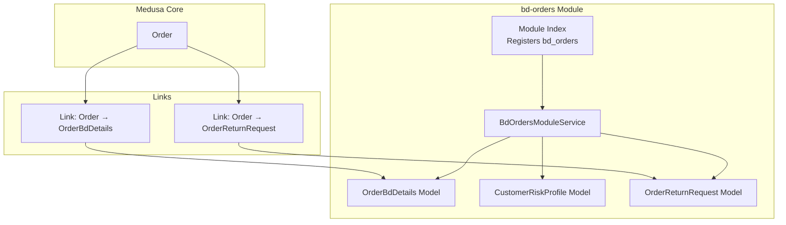
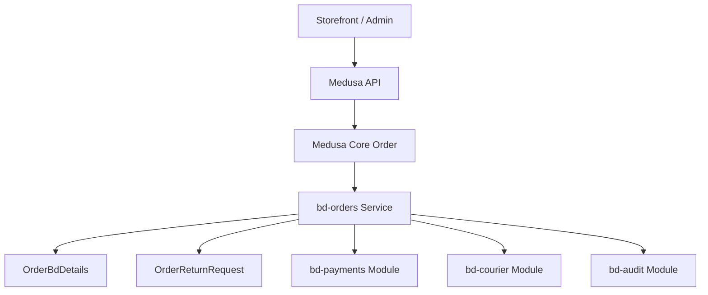
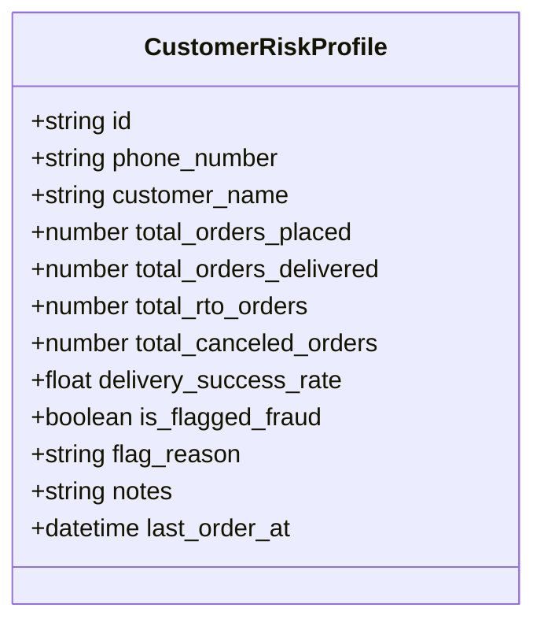
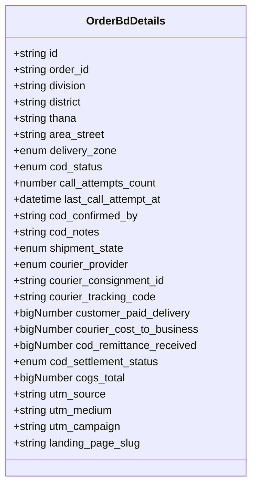
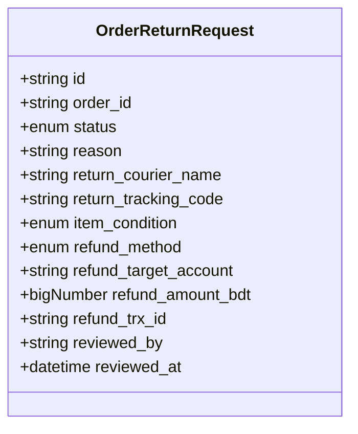
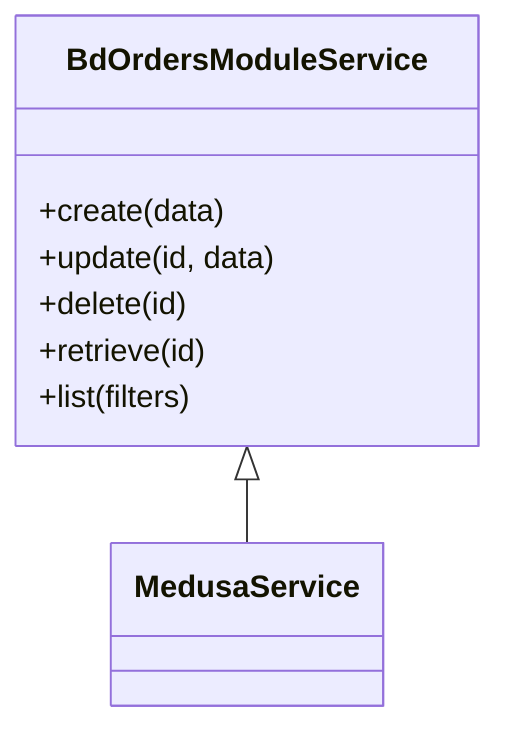
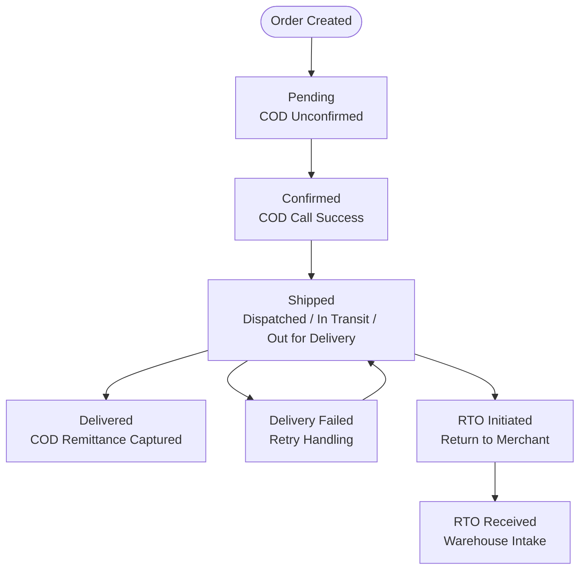
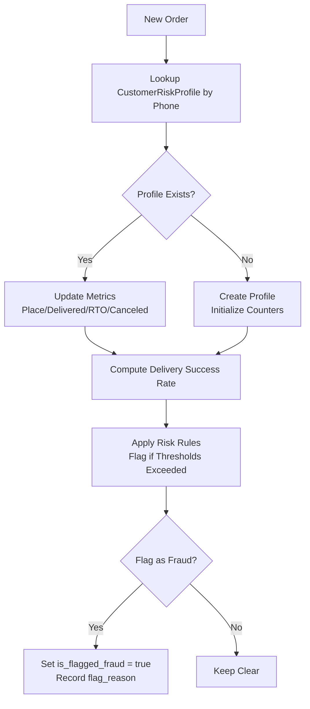
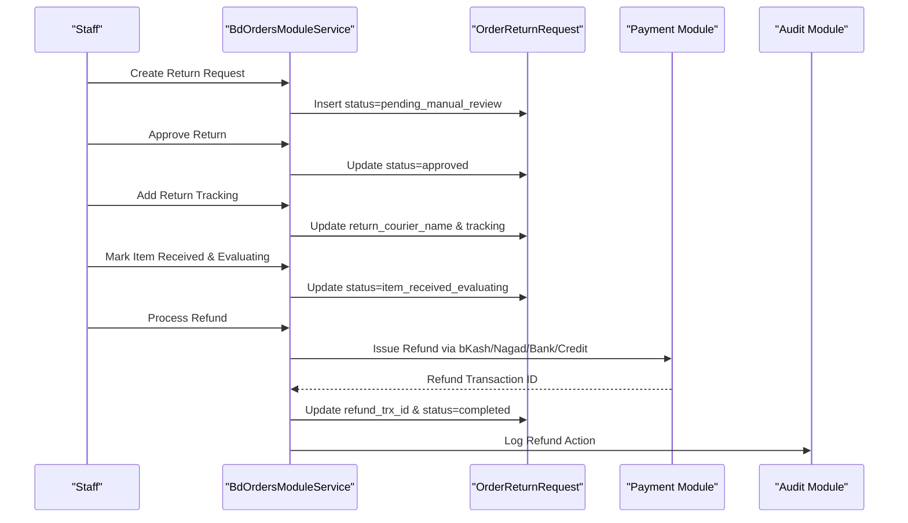
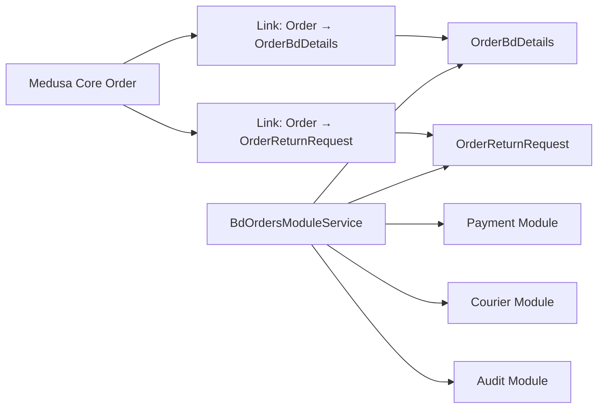

# Order Management Module (bd-orders)

<cite>
**Referenced Files in This Document**
- [index.ts](file://apps/medusa/src/modules/bd-orders/index.ts)
- [service.ts](file://apps/medusa/src/modules/bd-orders/service.ts)
- [customer-risk-profile.ts](file://apps/medusa/src/modules/bd-orders/models/customer-risk-profile.ts)
- [order-bd-details.ts](file://apps/medusa/src/modules/bd-orders/models/order-bd-details.ts)
- [order-return-request.ts](file://apps/medusa/src/modules/bd-orders/models/order-return-request.ts)
- [Migration20261024060540.ts](file://apps/medusa/src/modules/bd-orders/migrations/Migration20261024060540.ts)
- [order-bd-details link](file://apps/medusa/src/links/order-bd-details.ts)
- [order-return-request link](file://apps/medusa/src/links/order-return-request.ts)
- [data-models.md](file://docs/data-models.md)
- [dfd.md](file://dfd.md)
- [dfd-review.md](file://dfd-review.md)
- [database-review.md](file://docs/database-review.md)
- [user-journeys.md](file://user-journeys.md)
</cite>

## Table of Contents
1. [Introduction](#introduction)
2. [Project Structure](#project-structure)
3. [Core Components](#core-components)
4. [Architecture Overview](#architecture-overview)
5. [Detailed Component Analysis](#detailed-component-analysis)
6. [Dependency Analysis](#dependency-analysis)
7. [Performance Considerations](#performance-considerations)
8. [Troubleshooting Guide](#troubleshooting-guide)
9. [Conclusion](#conclusion)

## Introduction
The `bd-orders` module extends Medusa’s order domain with Bangladesh-specific order lifecycle management. It adds:
- A four-status customer-facing order workflow: pending, confirmed, shipped, delivered.
- A detailed shipment state model for operational fulfillment across 64 districts and three delivery zones.
- Customer risk profiling to support fraud prevention and return-to-origin analytics.
- Return request processing with approval, tracking, inspection, and refund workflows.
- Integration points with payment modules for cash-on-delivery settlement, courier services for delivery tracking, and audit logging for compliance.

This documentation focuses on the data models, module wiring, links to Medusa’s core order entity, and the operational flows defined by the repository’s design documents.

## Project Structure
The `bd-orders` module is a Medusa v2 custom module that registers a service and three domain models. Links connect the module’s order details and return requests to Medusa’s native order entity.



**Diagram sources**
- [index.ts:1-9](file://apps/medusa/src/modules/bd-orders/index.ts#L1-L9)
- [service.ts:1-12](file://apps/medusa/src/modules/bd-orders/service.ts#L1-L12)
- [order-bd-details link:1-9](file://apps/medusa/src/links/order-bd-details.ts#L1-L9)
- [order-return-request link:1-9](file://apps/medusa/src/links/order-return-request.ts#L1-L9)

**Section sources**
- [index.ts:1-9](file://apps/medusa/src/modules/bd-orders/index.ts#L1-L9)
- [service.ts:1-12](file://apps/medusa/src/modules/bd-orders/service.ts#L1-L12)
- [order-bd-details link:1-9](file://apps/medusa/src/links/order-bd-details.ts#L1-L9)
- [order-return-request link:1-9](file://apps/medusa/src/links/order-return-request.ts#L1-L9)

## Core Components
The module exposes:
- A module registration entry point.
- A service class extending Medusa’s base service for CRUD operations over the three models.
- Three domain models:
  - `OrderBdDetails`: Bangladesh-specific order metadata including address, COD status, shipment state, courier information, financial fields, and marketing attribution.
  - `CustomerRiskProfile`: Customer-level risk indicators based on order history, RTO behavior, and fraud flags.
  - `OrderReturnRequest`: Return request lifecycle from manual review through refund completion.

These components are persisted via MikroORM migrations and linked to Medusa’s core order entity.

**Section sources**
- [index.ts:1-9](file://apps/medusa/src/modules/bd-orders/index.ts#L1-L9)
- [service.ts:1-12](file://apps/medusa/src/modules/bd-orders/service.ts#L1-L12)
- [order-bd-details.ts:1-42](file://apps/medusa/src/modules/bd-orders/models/order-bd-details.ts#L1-L42)
- [customer-risk-profile.ts:1-19](file://apps/medusa/src/modules/bd-orders/models/customer-risk-profile.ts#L1-L19)
- [order-return-request.ts:1-28](file://apps/medusa/src/modules/bd-orders/models/order-return-request.ts#L1-L28)
- [Migration20261024060540.ts:1-31](file://apps/medusa/src/modules/bd-orders/migrations/Migration20261024060540.ts#L1-L31)

## Architecture Overview
The module integrates with Medusa’s order domain and external systems:
- **Medusa Core Order**: The central order entity is linked to BD-specific details and return requests.
- **Payment Modules**: Cash-on-delivery settlement updates flow into `cod_status`, `cod_remittance_received`, and `cod_settlement_status`.
- **Courier Services**: Shipment state transitions are driven by courier webhooks and internal fulfillment processes.
- **Audit Logging**: Compliance-critical actions should be recorded using the audit module.



**Diagram sources**
- [order-bd-details link:1-9](file://apps/medusa/src/links/order-bd-details.ts#L1-L9)
- [order-return-request link:1-9](file://apps/medusa/src/links/order-return-request.ts#L1-L9)
- [service.ts:1-12](file://apps/medusa/src/modules/bd-orders/service.ts#L1-L12)

## Detailed Component Analysis

### Data Models

#### CustomerRiskProfile
Tracks customer-level risk signals used for fraud prevention and RTO analytics. Key attributes include normalized phone number, lifetime order counts, delivery success rate, fraud flag, and last order timestamp.



**Diagram sources**
- [customer-risk-profile.ts:1-19](file://apps/medusa/src/modules/bd-orders/models/customer-risk-profile.ts#L1-L19)

**Section sources**
- [customer-risk-profile.ts:1-19](file://apps/medusa/src/modules/bd-orders/models/customer-risk-profile.ts#L1-L19)
- [data-models.md:171-192](file://docs/data-models.md#L171-L192)

#### OrderBdDetails
Holds Bangladesh-specific order context:
- Address hierarchy: division, district, thana, area/street.
- Delivery zone: inside Dhaka, Dhaka suburbs, outside Dhaka.
- COD status: not applicable, unconfirmed, confirmed, escalated, canceled.
- Shipment state: pending confirmation, ready to ship, dispatched, in transit, out for delivery, delivery failed, rto initiated, rto received, delivered.
- Courier provider and tracking identifiers.
- Financial fields: customer-paid delivery, courier cost, COD remittance, COGS.
- Marketing attribution: UTM source/medium/campaign and landing page slug.



**Diagram sources**
- [order-bd-details.ts:1-42](file://apps/medusa/src/modules/bd-orders/models/order-bd-details.ts#L1-L42)

**Section sources**
- [order-bd-details.ts:1-42](file://apps/medusa/src/modules/bd-orders/models/order-bd-details.ts#L1-L42)
- [Migration20261024060540.ts:12-15](file://apps/medusa/src/modules/bd-orders/migrations/Migration20261024060540.ts#L12-L15)

#### OrderReturnRequest
Models the return request lifecycle:
- Status progression: none, pending manual review, approved, rejected, info requested, item received evaluating, completed.
- Reason text and optional return courier/tracking.
- Item condition after receipt.
- Refund method, target account, amount, transaction ID, reviewer identity and timestamp.



**Diagram sources**
- [order-return-request.ts:1-28](file://apps/medusa/src/modules/bd-orders/models/order-return-request.ts#L1-L28)

**Section sources**
- [order-return-request.ts:1-28](file://apps/medusa/src/modules/bd-orders/models/order-return-request.ts#L1-L28)
- [Migration20261024060540.ts:17-19](file://apps/medusa/src/modules/bd-orders/migrations/Migration20261024060540.ts#L17-L19)

### Module Service
The service extends Medusa’s base service and wires the three models for standard CRUD operations. Custom business logic for order state transitions, risk assessment, and return workflow management should be implemented here or in orchestrators/workflows that consume this service.



**Diagram sources**
- [service.ts:1-12](file://apps/medusa/src/modules/bd-orders/service.ts#L1-L12)

**Section sources**
- [service.ts:1-12](file://apps/medusa/src/modules/bd-orders/service.ts#L1-L12)

### Bangladesh-Specific Order Lifecycle and Four-Status Workflow
The customer-facing order workflow maps to:
- Pending: Order created; COD may be unconfirmed; shipment state starts at pending confirmation.
- Confirmed: COD call confirmed; order moves toward fulfillment.
- Shipped: Courier consignment created; shipment state becomes dispatched/in transit/out for delivery.
- Delivered: Successful delivery; COD remittance captured; shipment state becomes delivered.

Operational shipment states provide granular control beyond the four customer-facing statuses, including retry handling and return-to-origin flows.



**Diagram sources**
- [order-bd-details.ts:16-26](file://apps/medusa/src/modules/bd-orders/models/order-bd-details.ts#L16-L26)
- [dfd.md:776-786](file://dfd.md#L776-L786)

**Section sources**
- [order-bd-details.ts:16-26](file://apps/medusa/src/modules/bd-orders/models/order-bd-details.ts#L16-L26)
- [dfd.md:776-786](file://dfd.md#L776-L786)

### Customer Risk Profiling and Fraud Prevention
Risk profiling tracks:
- Lifetime order metrics: placed, delivered, RTO, canceled.
- Delivery success rate derived from delivered vs RTO outcomes.
- Fraud flag and reason for high-risk customers.
- Last order timestamp for recency analysis.

Risk scoring should consider:
- High RTO ratio relative to delivered orders.
- Low delivery success rate.
- Frequent cancellations before dispatch.
- Recent spikes in order volume without historical trust.



**Diagram sources**
- [customer-risk-profile.ts:3-16](file://apps/medusa/src/modules/bd-orders/models/customer-risk-profile.ts#L3-L16)
- [data-models.md:171-192](file://docs/data-models.md#L171-L192)

**Section sources**
- [customer-risk-profile.ts:3-16](file://apps/medusa/src/modules/bd-orders/models/customer-risk-profile.ts#L3-L16)
- [data-models.md:171-192](file://docs/data-models.md#L171-L192)

### Return Request Processing
Return requests follow an independent workflow:
- Creation: pending manual review.
- Approval or rejection by staff.
- Tracking capture when customer provides return courier details.
- Physical receipt and evaluation at warehouse.
- Completion after refund accounting.



**Diagram sources**
- [order-return-request.ts:3-25](file://apps/medusa/src/modules/bd-orders/models/order-return-request.ts#L3-L25)
- [user-journeys.md:403-420](file://user-journeys.md#L403-L420)

**Section sources**
- [order-return-request.ts:3-25](file://apps/medusa/src/modules/bd-orders/models/order-return-request.ts#L3-L25)
- [user-journeys.md:403-420](file://user-journeys.md#L403-L420)

### Integration Points

#### Payment Modules and COD Settlement
- COD status progresses from unconfirmed to confirmed upon successful call verification.
- Upon delivery, COD remittance is recorded in `cod_remittance_received`, and `cod_settlement_status` reflects pending, partially remitted, settled, or disputed.
- Payment module integration should reconcile actual collected amounts with expected totals and handle partial collections and variances.

**Section sources**
- [order-bd-details.ts:11-15](file://apps/medusa/src/modules/bd-orders/models/order-bd-details.ts#L11-L15)
- [order-bd-details.ts:30-33](file://apps/medusa/src/modules/bd-orders/models/order-bd-details.ts#L30-L33)
- [dfd.md:770-774](file://dfd.md#L770-L774)

#### Courier Services and Delivery Tracking
- Shipment state transitions are driven by courier webhooks and internal fulfillment steps.
- Consignment creation sets `courier_provider`, `courier_consignment_id`, and `courier_tracking_code`.
- Webhook ingestion must distinguish transient delivery failures (retry) from return-to-origin initiation.

```mermaid
sequenceDiagram
participant Fulfillment as "Fulfillment"
participant Courier as "Courier API"
participant Service as "BdOrdersModuleService"
participant Details as "OrderBdDetails"
Fulfillment->>Courier : createParcel()
Courier-->>Fulfillment : consignment_id + tracking_code
Fulfillment->>Service : Persist Logistics Metadata
Service->>Details : Set courier_provider, consignment_id, tracking_code
Service->>Details : Update shipment_state -> dispatched
Courier-->>Service : Webhook DELIVERY_FAILED
Service->>Details : Update shipment_state -> delivery_failed
Courier-->>Service : Webhook RTO_INITIATED
Service->>Details : Update shipment_state -> rto_initiated
```

**Diagram sources**
- [order-bd-details.ts:16-29](file://apps/medusa/src/modules/bd-orders/models/order-bd-details.ts#L16-L29)
- [dfd.md:445-501](file://dfd.md#L445-L501)

**Section sources**
- [order-bd-details.ts:16-29](file://apps/medusa/src/modules/bd-orders/models/order-bd-details.ts#L16-L29)
- [dfd.md:445-501](file://dfd.md#L445-L501)

#### Audit Logging for Compliance
- All sensitive operations (risk flagging, COD settlement changes, return approvals/refunds, courier webhook processing) should be logged via the audit module.
- Audit entries should include actor identity, action type, affected entities, timestamps, and rationale.

**Section sources**
- [dfd.md:463-469](file://dfd.md#L463-L469)

## Dependency Analysis
The module depends on:
- Medusa Core Order for linking order details and returns.
- External courier APIs for shipment state updates.
- Payment modules for COD settlement reconciliation.
- Audit module for compliance logging.



**Diagram sources**
- [order-bd-details link:1-9](file://apps/medusa/src/links/order-bd-details.ts#L1-L9)
- [order-return-request link:1-9](file://apps/medusa/src/links/order-return-request.ts#L1-L9)
- [service.ts:1-12](file://apps/medusa/src/modules/bd-orders/service.ts#L1-L12)

**Section sources**
- [order-bd-details link:1-9](file://apps/medusa/src/links/order-bd-details.ts#L1-L9)
- [order-return-request link:1-9](file://apps/medusa/src/links/order-return-request.ts#L1-L9)
- [service.ts:1-12](file://apps/medusa/src/modules/bd-orders/service.ts#L1-L12)

## Performance Considerations
- Use indexed fields such as `phone_number` in `CustomerRiskProfile` and `courier_tracking_code` in `OrderBdDetails` for fast lookups during risk checks and tracking queries.
- Avoid heavy synchronous computations in webhook handlers; offload risk score recalculations and reporting jobs to background workers.
- Batch updates for counters (placed/delivered/RTO/canceled) to reduce write contention during peak order volumes.
- Partition or archive old audit logs and courier webhook logs to maintain query performance.

[No sources needed since this section provides general guidance]

## Troubleshooting Guide
Common issues and resolutions:
- **Phone normalization and validation**: Ensure E.164 format (`+88017...`) is enforced at the API boundary; avoid free-text variants that break matching.
- **District/thana naming variants**: Canonical codes plus bilingual display names prevent mismatches with courier masters.
- **Delivery attempt tracking**: Track `delivery_attempts_count` and `last_delivery_attempt_at` to support call center rescheduling and risk scoring.
- **SMS consent/opt-out**: Model SMS opt-out preferences separately from logs to comply with Bangladeshi regulations.
- **Conflating delivery_failed and rto_initiated**: Treat transient delivery failures as retries; only transition to RTO after repeated failures per courier policy.

**Section sources**
- [database-review.md:963-986](file://docs/database-review.md#L963-L986)
- [dfd-review.md:159-171](file://dfd-review.md#L159-L171)

## Conclusion
The `bd-orders` module provides a robust foundation for Bangladesh-specific order management within Medusa. Its data models capture essential operational details for COD settlement, courier tracking, and return processing, while the customer risk profile supports fraud prevention and RTO analytics. To fully realize the intended workflow, implement explicit service methods for order state transitions, risk assessment algorithms, and return workflow orchestration, and integrate tightly with payment, courier, and audit modules. Enforce strict input validation for Bangladeshi addresses and phone numbers, and ensure compliance through comprehensive audit logging.

[No sources needed since this section summarizes without analyzing specific files]