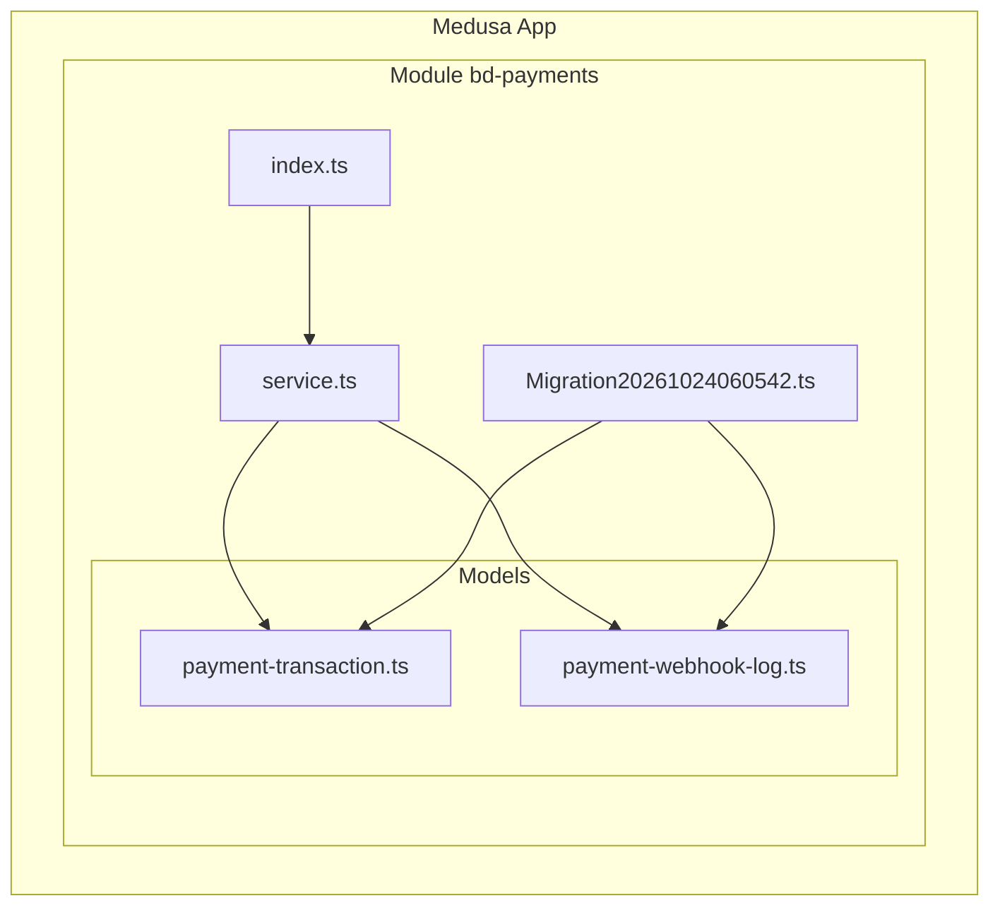
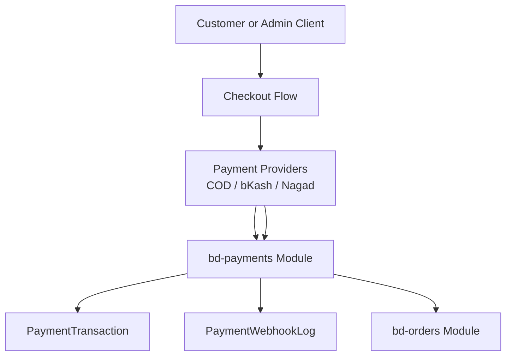
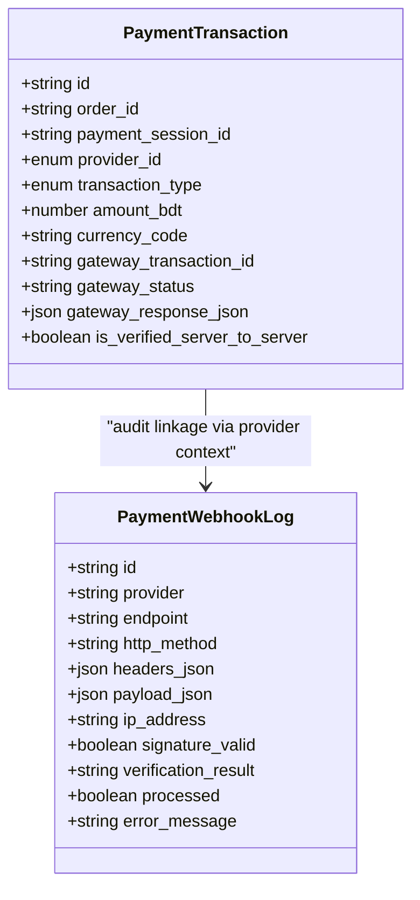
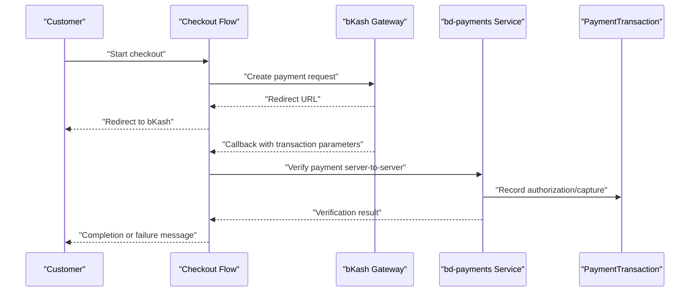
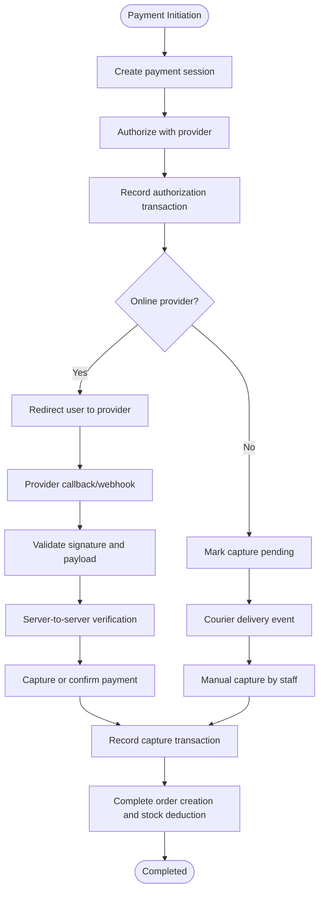
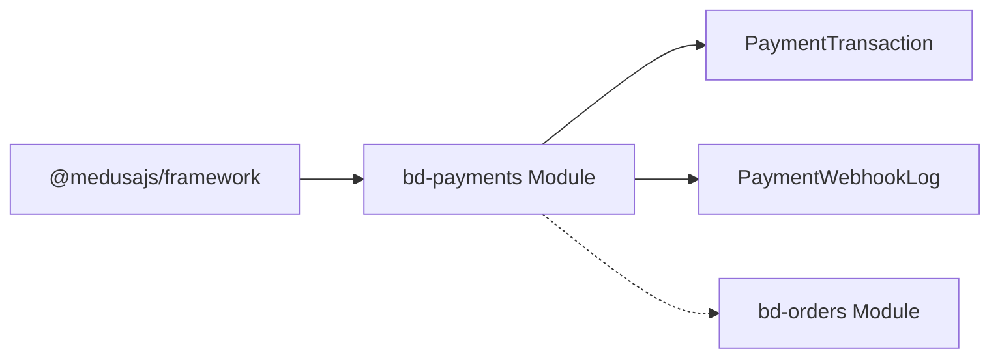
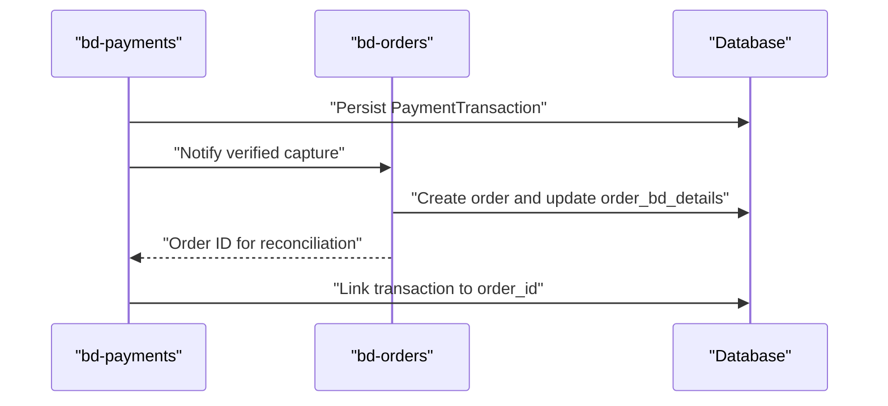

# Payment Processing Module (bd-payments)

<cite>
**Referenced Files in This Document**
- [service.ts](file://apps/medusa/src/modules/bd-payments/service.ts)
- [index.ts](file://apps/medusa/src/modules/bd-payments/index.ts)
- [payment-transaction.ts](file://apps/medusa/src/modules/bd-payments/models/payment-transaction.ts)
- [payment-webhook-log.ts](file://apps/medusa/src/modules/bd-payments/models/payment-webhook-log.ts)
- [Migration20261024060542.ts](file://apps/medusa/src/modules/bd-payments/migrations/Migration20261024060542.ts)
- [technical-plan.md](file://technical-plan.md)
- [prd.md](file://prd.md)
- [order-bd-details.ts](file://apps/medusa/src/modules/bd-orders/models/order-bd-details.ts)
- [service.ts](file://apps/medusa/src/modules/bd-orders/service.ts)
</cite>

## Table of Contents
1. [Introduction](#introduction)
2. [Project Structure](#project-structure)
3. [Core Components](#core-components)
4. [Architecture Overview](#architecture-overview)
5. [Detailed Component Analysis](#detailed-component-analysis)
6. [Dependency Analysis](#dependency-analysis)
7. [Performance Considerations](#performance-considerations)
8. [Security and Compliance](#security-and-compliance)
9. [Integration with Orders and Reconciliation](#integration-with-orders-and-reconciliation)
10. [Troubleshooting Guide](#troubleshooting-guide)
11. [Conclusion](#conclusion)

## Introduction
The `bd-payments` module is a Medusa v2 module that provides the foundation for multi-payment method support tailored to the Bangladesh market. At this stage, it defines:
- The payment data models for transaction tracking and webhook auditing.
- A Medusa service backed by those models.
- Provider-specific behavioral requirements for Cash on Delivery (COD), bKash, and Nagad.
- Security and idempotency rules for online payments.

It does not yet contain concrete provider SDK integrations for SSLCommerz or Stripe. The current codebase explicitly supports provider IDs for COD, bKash, and Nagad, while product and technical documentation references SSLCommerz and Stripe as future or external considerations.

## Project Structure
The module lives under `apps/medusa/src/modules/bd-payments` and follows the standard Medusa module layout:
- `index.ts`: Registers the Medusa module and exports its service.
- `service.ts`: Declares the module service using Medusa’s `MedusaService`.
- `models/`: Defines persistent entities for payment transactions and webhook logs.
- `migrations/`: Creates database tables and indexes for payment-related data.

**Diagram sources**
- [index.ts:1-9](file://apps/medusa/src/modules/bd-payments/index.ts#L1-L9)
- [service.ts:1-11](file://apps/medusa/src/modules/bd-payments/service.ts#L1-L11)
- [payment-transaction.ts:1-18](file://apps/medusa/src/modules/bd-payments/models/payment-transaction.ts#L1-L18)
- [payment-webhook-log.ts:1-18](file://apps/medusa/src/modules/bd-payments/models/payment-webhook-log.ts#L1-L18)
- [Migration20261024060542.ts:1-23](file://apps/medusa/src/modules/bd-payments/migrations/Migration20261024060542.ts#L1-L23)

**Section sources**
- [index.ts:1-9](file://apps/medusa/src/modules/bd-payments/index.ts#L1-L9)
- [service.ts:1-11](file://apps/medusa/src/modules/bd-payments/service.ts#L1-L11)
- [Migration20261024060542.ts:1-23](file://apps/medusa/src/modules/bd-payments/migrations/Migration20261024060542.ts#L1-L23)

## Core Components
This section documents the two primary data models and the module service.

### PaymentTransaction Model
`PaymentTransaction` records each financial action initiated against a payment provider. It captures:
- Linkage to an order and a payment session.
- Provider identity and transaction type.
- Amounts, currency, gateway identifiers, and gateway status.
- Whether server-to-server verification has been performed.
- Raw gateway response payload for auditability.

Key attributes and their purpose:
- `id`: Primary key for the transaction record.
- `order_id`: Optional link to the Medusa order once created.
- `payment_session_id`: Links to the checkout payment session during redirect flows.
- `provider_id`: Enumerated provider identifier; currently supports COD, bKash, and Nagad.
- `transaction_type`: Enumerated operation such as authorization, capture, refund, or status query.
- `amount_bdt`: Transaction amount in Bangladeshi Taka.
- `currency_code`: Defaulted to BDT.
- `gateway_transaction_id`: External provider transaction reference.
- `gateway_status`: Human-readable or provider-specific status string.
- `gateway_response_json`: Full provider response for audit and debugging.
- `is_verified_server_to_server`: Boolean flag indicating whether trusted server-side verification was completed.

Complexity notes:
- All fields are simple scalar types except JSON payloads, which enable flexible provider response storage without schema churn.
- Indexes on `order_id`, `payment_session_id`, and `gateway_transaction_id` support common lookup patterns for reconciliation and tracing.

**Section sources**
- [payment-transaction.ts:1-18](file://apps/medusa/src/modules/bd-payments/models/payment-transaction.ts#L1-L18)
- [Migration20261024060542.ts:5-10](file://apps/medusa/src/modules/bd-payments/migrations/Migration20261024060542.ts#L5-L10)

### PaymentWebhookLog Model
`PaymentWebhookLog` is an immutable-style audit log for incoming webhooks or callbacks from payment providers. It stores:
- Provider name and endpoint.
- HTTP method and headers.
- Request payload.
- Client IP address.
- Signature validation result and verification notes.
- Whether the webhook was processed successfully.
- Error messages when processing fails.

Design rationale:
- Storing raw headers and payloads enables forensic analysis of signature mismatches, malformed requests, and provider changes.
- `signature_valid` and `verification_result` make security outcomes explicit.
- `processed` prevents accidental duplicate business actions when retries occur.

**Section sources**
- [payment-webhook-log.ts:1-18](file://apps/medusa/src/modules/bd-payments/models/payment-webhook-log.ts#L1-L18)
- [Migration20261024060542.ts:12-13](file://apps/medusa/src/modules/bd-payments/migrations/Migration20261024060542.ts#L12-L13)

### BdPaymentsModuleService
The service extends Medusa’s `MedusaService` and exposes CRUD operations for both models. At present, it does not define custom business methods; provider orchestration logic should be implemented around these model operations.

Responsibilities:
- Persisting payment transactions.
- Persisting webhook audit logs.
- Providing a stable service boundary for other modules or API routes to interact with payment data.

**Section sources**
- [service.ts:1-11](file://apps/medusa/src/modules/bd-payments/service.ts#L1-L11)

## Architecture Overview
The module is intentionally lightweight at this stage. It provides persistence and a service layer, while provider-specific workflows are defined in project requirements and technical plans.

**Diagram sources**
- [service.ts:1-11](file://apps/medusa/src/modules/bd-payments/service.ts#L1-L11)
- [payment-transaction.ts:1-18](file://apps/medusa/src/modules/bd-payments/models/payment-transaction.ts#L1-L18)
- [payment-webhook-log.ts:1-18](file://apps/medusa/src/modules/bd-payments/models/payment-webhook-log.ts#L1-L18)
- [order-bd-details.ts:1-42](file://apps/medusa/src/modules/bd-orders/models/order-bd-details.ts#L1-L42)

## Detailed Component Analysis

### Data Model Relationships
The payment domain centers on two entities:
- `PaymentTransaction` represents financial events.
- `PaymentWebhookLog` represents inbound provider notifications.

**Diagram sources**
- [payment-transaction.ts:1-18](file://apps/medusa/src/modules/bd-payments/models/payment-transaction.ts#L1-L18)
- [payment-webhook-log.ts:1-18](file://apps/medusa/src/modules/bd-payments/models/payment-webhook-log.ts#L1-L18)

### Provider Implementation Patterns

#### Cash on Delivery (COD)
COD is treated as a local fulfillment-based payment method rather than an online gateway. According to the technical plan:
- Provider ID: `pp_cod`.
- Authorization succeeds immediately with an authorized state.
- Capture occurs either automatically when courier delivery confirmation is received or manually by staff.

Operational implications:
- COD transactions should record pending collection until delivery confirmation.
- Refunds for COD are typically handled through return and remittance processes rather than gateway APIs.

**Section sources**
- [technical-plan.md:535-538](file://technical-plan.md#L535-L538)
- [payment-transaction.ts:7-9](file://apps/medusa/src/modules/bd-payments/models/payment-transaction.ts#L7-L9)

#### bKash Mobile Payments
bKash integration follows a direct merchant API pattern:
- Provider ID: `pp_bkash`.
- Authorization calls the provider’s create payment flow and returns a redirect URL.
- Capture verifies completion through a server-to-server call after callback return.
- Required checks include currency and exact amount matching.
- Gateway identifiers and customer wallet information are stored in payment session data.

**Diagram sources**
- [technical-plan.md:539-544](file://technical-plan.md#L539-L544)
- [payment-transaction.ts:6-14](file://apps/medusa/src/modules/bd-payments/models/payment-transaction.ts#L6-L14)

**Section sources**
- [technical-plan.md:539-544](file://technical-plan.md#L539-L544)
- [payment-transaction.ts:1-18](file://apps/medusa/src/modules/bd-payments/models/payment-transaction.ts#L1-L18)

#### Nagad Digital Wallet
Nagad uses a cryptographic signing approach:
- Provider ID: `pp_nagad`.
- Merchant private key signs the outgoing payload.
- Initial checkout initialization triggers the provider’s checkout flow.
- Callback verification uses the provider’s public key.

Security implication:
- Signature validation must be enforced before any capture or order completion.

**Section sources**
- [technical-plan.md:545-547](file://technical-plan.md#L545-L547)
- [payment-webhook-log.ts:10-14](file://apps/medusa/src/modules/bd-payments/models/payment-webhook-log.ts#L10-L14)

#### SSLCommerz and Stripe
SSLCommerz and Stripe are referenced in broader project documentation but are not represented in the current provider enum or implementation. The PRD explicitly mandates direct merchant integration for bKash and Nagad and excludes card aggregators like SSLCommerz from Phase 1. Therefore:
- SSLCommerz and Stripe are not supported by the current `provider_id` enum.
- Any future integration must extend the provider enum and implement secure credential handling, signature validation, and idempotent capture/refund flows.

**Section sources**
- [payment-transaction.ts:7](file://apps/medusa/src/modules/bd-payments/models/payment-transaction.ts#L7)
- [prd.md:267-274](file://prd.md#L267-L274)

### Payment Initiation, Verification, Refund, and Status Query
Although the service currently exposes only model-backed CRUD, the intended lifecycle based on the data model and requirements is:

**Diagram sources**
- [payment-transaction.ts:7-14](file://apps/medusa/src/modules/bd-payments/models/payment-transaction.ts#L7-L14)
- [technical-plan.md:535-547](file://technical-plan.md#L535-L547)
- [prd.md:267-274](file://prd.md#L267-L274)

### Error Handling and Retry Mechanisms
Error handling should follow these principles derived from the models and requirements:
- Always persist webhook requests and responses for auditability.
- Mark signature validation results explicitly.
- Avoid creating duplicate orders or payments on repeated callbacks.
- Keep payment status and order status separate.
- Do not create orders before verified online payment capture.

Recommended strategies:
- Idempotency keys based on `payment_session_id` or `gateway_transaction_id`.
- Retry queues for transient network failures when calling provider APIs.
- Dead-letter logging for failed webhooks with non-recoverable errors.
- Staff-visible reconciliation views for pending captures and failed verifications.

**Section sources**
- [payment-webhook-log.ts:10-14](file://apps/medusa/src/modules/bd-payments/models/payment-webhook-log.ts#L10-L14)
- [prd.md:267-274](file://prd.md#L267-L274)

## Dependency Analysis
The `bd-payments` module depends on:
- Medusa framework utilities for service and model definitions.
- Database migrations for table creation and indexing.
- Other modules conceptually, especially `bd-orders`, for order synchronization.

**Diagram sources**
- [service.ts:1-11](file://apps/medusa/src/modules/bd-payments/service.ts#L1-L11)
- [payment-transaction.ts:1-18](file://apps/medusa/src/modules/bd-payments/models/payment-transaction.ts#L1-L18)
- [payment-webhook-log.ts:1-18](file://apps/medusa/src/modules/bd-payments/models/payment-webhook-log.ts#L1-L18)
- [service.ts:1-13](file://apps/medusa/src/modules/bd-orders/service.ts#L1-L13)

**Section sources**
- [service.ts:1-11](file://apps/medusa/src/modules/bd-payments/service.ts#L1-L11)
- [service.ts:1-13](file://apps/medusa/src/modules/bd-orders/service.ts#L1-L13)

## Performance Considerations
- Use indexed lookups on `order_id`, `payment_session_id`, and `gateway_transaction_id` for fast reconciliation queries.
- Store large provider responses in JSON columns; consider archival policies for long-term storage.
- Avoid synchronous blocking calls to provider APIs in webhook handlers; prefer background jobs where appropriate.
- Enforce strict input validation before writing to the database to reduce malformed records.
- Monitor webhook processing latency and failure rates to detect provider outages or misconfigurations.

[No sources needed since this section provides general guidance]

## Security and Compliance
Security requirements for payment data protection and PCI compliance include:
- Never trust client-side redirect parameters alone; always perform server-to-server verification.
- Validate provider signatures using provider-provided public keys or shared secrets.
- Log webhook headers, payloads, IP addresses, and verification outcomes.
- Separate sensitive credentials from application code; manage them through secure configuration.
- Restrict access to payment logs and transaction data to authorized staff.
- Maintain immutable audit trails for financial events.
- Follow PCI DSS requirements if card data ever enters the system; avoid storing raw PAN or CVV unless absolutely necessary and properly secured.

Current module support:
- `PaymentWebhookLog` captures signature validation results and verification notes.
- `PaymentTransaction` tracks whether server-to-server verification occurred.

**Section sources**
- [payment-webhook-log.ts:10-14](file://apps/medusa/src/modules/bd-payments/models/payment-webhook-log.ts#L10-L14)
- [payment-transaction.ts:14](file://apps/medusa/src/modules/bd-payments/models/payment-transaction.ts#L14)
- [prd.md:267-274](file://prd.md#L267-L274)

## Integration with Orders and Reconciliation
The payment module should synchronize with the order module carefully:
- For online payments, do not create the Medusa order before verified capture.
- Once capture is confirmed, create the order and deduct inventory.
- Keep payment status and order status decoupled.
- Use `order_bd_details` for operational statuses such as COD confirmation, shipment state, and settlement status.

**Diagram sources**
- [payment-transaction.ts:5-14](file://apps/medusa/src/modules/bd-payments/models/payment-transaction.ts#L5-L14)
- [order-bd-details.ts:1-42](file://apps/medusa/src/modules/bd-orders/models/order-bd-details.ts#L1-L42)
- [prd.md:267-274](file://prd.md#L267-L274)

**Section sources**
- [order-bd-details.ts:1-42](file://apps/medusa/src/modules/bd-orders/models/order-bd-details.ts#L1-L42)
- [prd.md:267-274](file://prd.md#L267-L274)

## Troubleshooting Guide
Common issues and diagnostic steps:

| Symptom | Likely Cause | Diagnostic Action | Resolution |
|---|---|---|---|
| Webhook never processed | Invalid signature or missing credentials | Inspect `signature_valid`, `verification_result`, and `error_message` in `PaymentWebhookLog` | Fix provider credentials, endpoint configuration, or signature algorithm |
| Duplicate payment recorded | Missing idempotency check | Check for multiple transactions with same `payment_session_id` or `gateway_transaction_id` | Implement idempotency keys and deduplication logic |
| Order created too early | Online payment not verified server-to-server | Review `is_verified_server_to_server` and capture flow | Enforce server-to-server verification before order creation |
| COD not captured | Delivery event not received or manual capture not triggered | Check courier webhook and admin actions | Configure delivery confirmation trigger or allow manual capture |
| Reconciliation mismatch | Missing or inconsistent gateway response | Compare `gateway_response_json` and `gateway_status` | Normalize provider responses and add validation |

**Section sources**
- [payment-webhook-log.ts:10-14](file://apps/medusa/src/modules/bd-payments/models/payment-webhook-log.ts#L10-L14)
- [payment-transaction.ts:11-14](file://apps/medusa/src/modules/bd-payments/models/payment-transaction.ts#L11-L14)
- [technical-plan.md:535-547](file://technical-plan.md#L535-L547)

## Conclusion
The `bd-payments` module establishes a solid foundation for Bangladesh-focused payment processing. It defines robust data models for transaction tracking and webhook auditing, and it enforces critical security and idempotency requirements for online payments. While COD, bKash, and Nagad have clear behavioral specifications, SSLCommerz and Stripe are not yet part of the supported provider set. Future work should focus on implementing provider-specific services, securing credentials, enforcing signature validation, and integrating tightly with the order module for reliable financial reconciliation.

[No sources needed since this section summarizes without analyzing specific files]