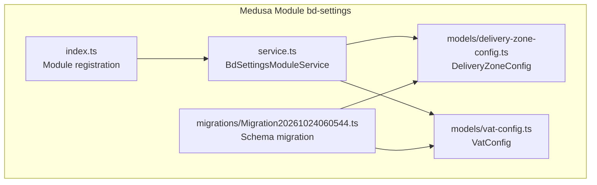
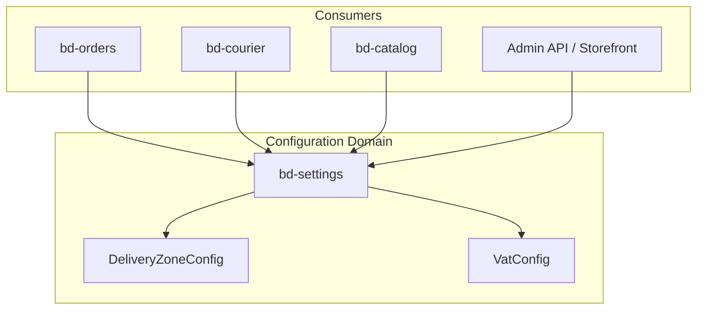
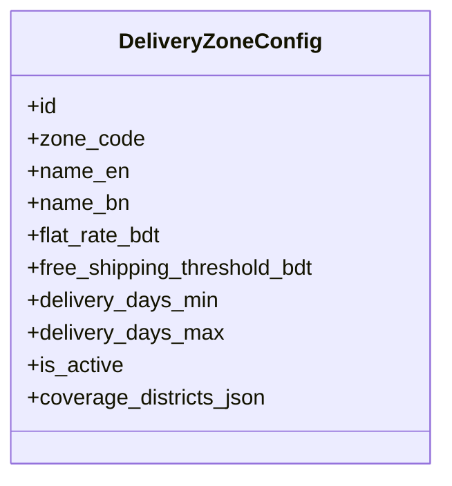
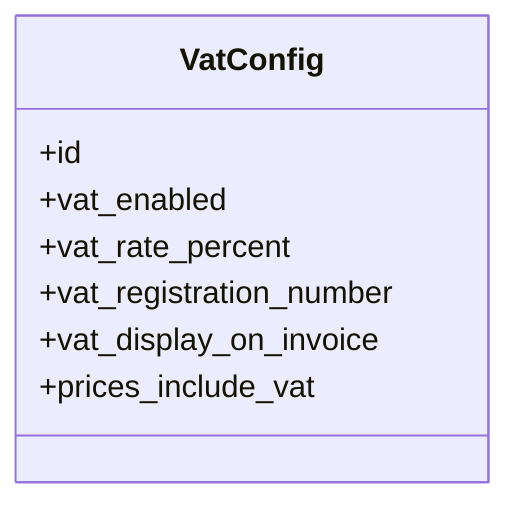
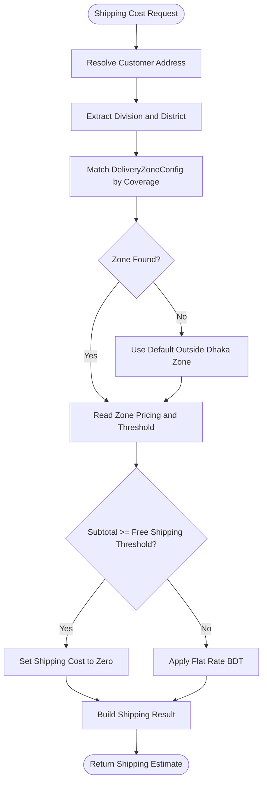
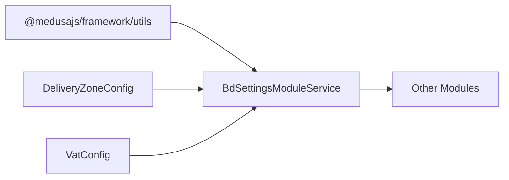
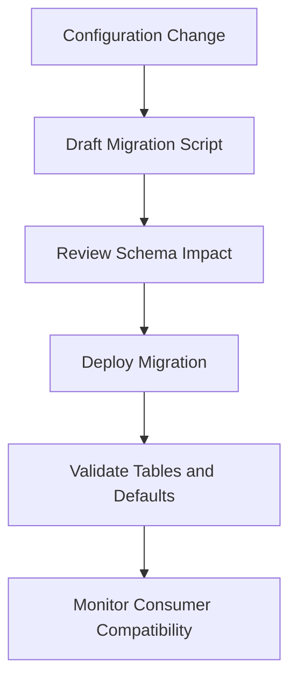
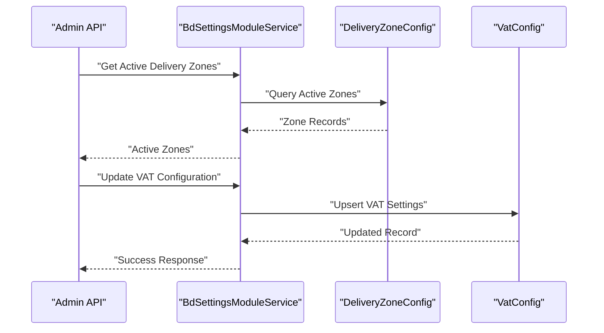

# Settings Management Module (bd-settings)

<cite>
**Referenced Files in This Document**
- [index.ts](file://apps/medusa/src/modules/bd-settings/index.ts)
- [service.ts](file://apps/medusa/src/modules/bd-settings/service.ts)
- [delivery-zone-config.ts](file://apps/medusa/src/modules/bd-settings/models/delivery-zone-config.ts)
- [vat-config.ts](file://apps/medusa/src/modules/bd-settings/models/vat-config.ts)
- [Migration20261024060544.ts](file://apps/medusa/src/modules/bd-settings/migrations/Migration20261024060544.ts)
- [prd.md](file://prd.md)
- [data-models.md](file://docs/data-models.md)
- [architecture.md](file://docs/architecture.md)
- [database.md](file://database.md)
</cite>

## Table of Contents
1. [Introduction](#introduction)
2. [Project Structure](#project-structure)
3. [Core Components](#core-components)
4. [Architecture Overview](#architecture-overview)
5. [Detailed Component Analysis](#detailed-component-analysis)
6. [Dependency Analysis](#dependency-analysis)
7. [Performance Considerations](#performance-considerations)
8. [Troubleshooting Guide](#troubleshooting-guide)
9. [Security and Compliance](#security-and-compliance)
10. [Versioning and Migration Strategy](#versioning-and-migration-strategy)
11. [Integration Points](#integration-points)
12. [Conclusion](#conclusion)

## Introduction
The `bd-settings` module is the system-wide configuration layer for Bangladesh-specific business requirements. It centralizes delivery zone definitions, shipping cost parameters, VAT behavior, and related administrative preferences. The module exposes two primary data models:

- **DeliveryZoneConfig**: Geographic delivery zones with flat shipping rates, free-shipping thresholds, service-level estimates, activity flags, and optional district coverage mappings.
- **VATConfig**: Global VAT enablement, rate percentage, registration number, invoice display preference, and pricing inclusion behavior.

At this stage, the module provides a Medusa service backed by these models. Business logic such as dynamic pricing, tax calculation engines, and regional rule evaluation should be implemented by consuming modules that depend on `bd-settings`.

## Project Structure
The module follows a standard Medusa module layout:

**Diagram sources**
- [index.ts:1-9](file://apps/medusa/src/modules/bd-settings/index.ts#L1-L9)
- [service.ts:1-11](file://apps/medusa/src/modules/bd-settings/service.ts#L1-L11)
- [delivery-zone-config.ts:1-17](file://apps/medusa/src/modules/bd-settings/models/delivery-zone-config.ts#L1-L17)
- [vat-config.ts:1-13](file://apps/medusa/src/modules/bd-settings/models/vat-config.ts#L1-L13)
- [Migration20261024060544.ts:1-22](file://apps/medusa/src/modules/bd-settings/migrations/Migration20261024060544.ts#L1-L22)

**Section sources**
- [index.ts:1-9](file://apps/medusa/src/modules/bd-settings/index.ts#L1-L9)
- [service.ts:1-11](file://apps/medusa/src/modules/bd-settings/service.ts#L1-L11)

## Core Components
This section documents the data models and the service contract exposed by the module.

### DeliveryZoneConfig
The delivery zone model defines configurable shipping zones for Bangladesh. Key aspects include:

- **Zone identity and localization**: A unique zone code and bilingual names.
- **Pricing and SLA**: Flat shipping charge, free-shipping threshold, and minimum/maximum delivery days.
- **Activity control**: An active flag to enable or disable zones without deletion.
- **Geographic mapping**: Optional JSON field for coverage districts or thanas.

Recommended usage patterns:
- Maintain one record per zone code.
- Use the activity flag to temporarily disable zones during operational changes.
- Populate coverage districts to support location-based routing and courier integration.

**Section sources**
- [delivery-zone-config.ts:1-17](file://apps/medusa/src/modules/bd-settings/models/delivery-zone-config.ts#L1-L17)
- [data-models.md:151-170](file://docs/data-models.md#L151-L170)

### VatConfig
The VAT configuration model controls global VAT behavior:

- **Enablement**: Whether VAT is currently enabled.
- **Rate**: Percentage rate applied when enabled.
- **Registration number**: Merchant VAT registration identifier.
- **Invoice display**: Whether VAT appears on invoices.
- **Price inclusion**: Whether displayed prices already include VAT.

Recommended usage patterns:
- Keep VAT disabled until legal obligations are confirmed.
- Snapshot relevant VAT fields at order/invoice time to preserve compliance history.
- Avoid duplicating rates across unrelated modules; use this module as the source of truth.

**Section sources**
- [vat-config.ts:1-13](file://apps/medusa/src/modules/bd-settings/models/vat-config.ts#L1-L13)
- [architecture.md:286](file://docs/architecture.md#L286)
- [database.md:1103](file://database.md#L1103)

### BdSettingsModuleService
The service extends the framework’s base service and registers both models. At present, it provides default CRUD capabilities through the framework rather than custom business methods. Consumers should call service methods for:

- Reading delivery zones and VAT settings.
- Updating configuration records.
- Querying active zones and applicable VAT rules.

Custom business methods can be added later to encapsulate:
- Zone selection based on address or district.
- Shipping cost computation using flat rates and thresholds.
- VAT calculation and invoice line generation.

**Section sources**
- [service.ts:1-11](file://apps/medusa/src/modules/bd-settings/service.ts#L1-L11)

## Architecture Overview
The `bd-settings` module acts as a configuration domain within the broader commerce platform. Other modules, such as orders, payments, couriers, and catalog services, consume its configuration to enforce regional rules.

**Diagram sources**
- [index.ts:1-9](file://apps/medusa/src/modules/bd-settings/index.ts#L1-L9)
- [service.ts:1-11](file://apps/medusa/src/modules/bd-settings/service.ts#L1-L11)
- [delivery-zone-config.ts:1-17](file://apps/medusa/src/modules/bd-settings/models/delivery-zone-config.ts#L1-L17)
- [vat-config.ts:1-13](file://apps/medusa/src/modules/bd-settings/models/vat-config.ts#L1-L13)

## Detailed Component Analysis

### Delivery Zone Data Model
The delivery zone model supports geographic segmentation aligned with Bangladesh market needs.

#### Class Diagram

**Diagram sources**
- [delivery-zone-config.ts:1-17](file://apps/medusa/src/modules/bd-settings/models/delivery-zone-config.ts#L1-L17)

#### Administrative Division Mapping
Bangladesh uses a four-tier hierarchy:

- Division
- District
- Upazila/Thana
- Area or Street Address

The PRD confirms capturing the division ensures unambiguous courier integration, including city ID or zone mapping for providers. The delivery zone model includes an optional JSON field for coverage districts or thanas, which can store lists used to map customer addresses to zones.

Recommended mapping strategy:
- Map each zone to one or more districts or upazilas.
- Use the division field from customer addresses to pre-filter eligible zones.
- Validate that coverage lists do not overlap unexpectedly between zones.

**Section sources**
- [prd.md:392-398](file://prd.md#L392-L398)
- [delivery-zone-config.ts:1-17](file://apps/medusa/src/modules/bd-settings/models/delivery-zone-config.ts#L1-L17)
- [data-models.md:151-170](file://docs/data-models.md#L151-L170)

### VAT Configuration Data Model
The VAT model provides a centralized place for tax-related configuration.

#### Class Diagram

**Diagram sources**
- [vat-config.ts:1-13](file://apps/medusa/src/modules/bd-settings/models/vat-config.ts#L1-L13)

#### Tax Calculation Engine Integration
Consumers should implement tax calculation logic that reads from `VatConfig`:

- If VAT is disabled, no VAT lines should appear.
- If VAT is enabled, apply the configured percentage according to whether prices include VAT.
- Include the registration number on invoices only when display is enabled.
- Snapshot VAT state at order time to preserve historical accuracy.

**Section sources**
- [architecture.md:286](file://docs/architecture.md#L286)
- [database.md:1103](file://database.md#L1103)
- [database.md:2330](file://database.md#L2330)

### Service Methods and Processing Logic
The current service is a thin wrapper around the framework’s base service. Recommended method design includes:

- Delivery zone management:
  - List active zones.
  - Get zone by code.
  - Upsert zone configuration.
  - Validate zone codes and numeric ranges.
- VAT configuration:
  - Get current VAT settings.
  - Update VAT enablement, rate, registration number, and display options.
  - Validate rate range and required fields when enabled.
- Shipping cost calculation:
  - Resolve zone from address or district.
  - Apply flat rate unless subtotal exceeds free-shipping threshold.
  - Return estimated delivery window.
- System preferences:
  - Centralize Bangladesh-specific defaults.
  - Provide getters for currency, region, and locale behavior.

[No sources needed since this diagram shows conceptual workflow, not actual code structure]

## Dependency Analysis
The module has minimal internal dependencies and serves as a foundational configuration domain.

**Diagram sources**
- [service.ts:1-11](file://apps/medusa/src/modules/bd-settings/service.ts#L1-L11)
- [delivery-zone-config.ts:1-17](file://apps/medusa/src/modules/bd-settings/models/delivery-zone-config.ts#L1-L17)
- [vat-config.ts:1-13](file://apps/medusa/src/modules/bd-settings/models/vat-config.ts#L1-L13)

**Section sources**
- [service.ts:1-11](file://apps/medusa/src/modules/bd-settings/service.ts#L1-L11)

## Performance Considerations
- Cache frequently read configuration values, especially VAT settings and active delivery zones.
- Avoid repeated database queries for zone matching by preloading zone coverage maps.
- Use indexes on commonly filtered fields such as activity status and zone code.
- Keep configuration updates transactional to prevent inconsistent reads during migrations.

[No sources needed since this section provides general guidance]

## Troubleshooting Guide
Common issues and resolutions:

- **Zone code mismatch**: Ensure zone codes match the allowed enum values.
- **Missing coverage data**: Populate `coverage_districts_json` to enable accurate zone resolution.
- **VAT not appearing on invoices**: Verify `vat_enabled` and `vat_display_on_invoice` flags.
- **Unexpected shipping charges**: Confirm free-shipping threshold and flat rate values.
- **Migration errors**: Review the migration script for table creation and index definitions.

**Section sources**
- [Migration20261024060544.ts:1-22](file://apps/medusa/src/modules/bd-settings/migrations/Migration20261024060544.ts#L1-L22)

## Security and Compliance
Sensitive configuration data requires careful handling:

- Restrict write access to admin roles.
- Audit changes to VAT configuration, especially rate and registration number updates.
- Never log sensitive fields such as VAT registration numbers.
- Enforce validation rules before persisting configuration.
- Snapshot VAT state at order time to maintain compliance history.

**Section sources**
- [vat-config.ts:1-13](file://apps/medusa/src/modules/bd-settings/models/vat-config.ts#L1-L13)
- [database.md:2330](file://database.md#L2330)

## Versioning and Migration Strategy
The module uses a Medusa migration to define schema structure:

- Creates `delivery_zone_config` and `vat_config` tables.
- Adds constraints, defaults, and indexes.
- Supports soft deletion timestamps.

Migration responsibilities:
- Add new configuration fields through versioned migrations.
- Preserve backward compatibility for existing consumers.
- Avoid destructive changes without rollback strategies.

**Diagram sources**
- [Migration20261024060544.ts:1-22](file://apps/medusa/src/modules/bd-settings/migrations/Migration20261024060544.ts#L1-L22)

**Section sources**
- [Migration20261024060544.ts:1-22](file://apps/medusa/src/modules/bd-settings/migrations/Migration20261024060544.ts#L1-L22)

## Integration Points
The `bd-settings` module integrates with other parts of the platform:

- **Shipping calculations**: Consumers resolve delivery zones and compute shipping costs using flat rates and thresholds.
- **Tax compliance**: Order and invoice modules read VAT configuration to render correct tax lines and legal information.
- **Regional business rules**: Courier integrations use division and district data to map to provider-specific zones.
- **Admin interfaces**: Admin APIs expose configuration endpoints backed by the service.

**Diagram sources**
- [service.ts:1-11](file://apps/medusa/src/modules/bd-settings/service.ts#L1-L11)
- [delivery-zone-config.ts:1-17](file://apps/medusa/src/modules/bd-settings/models/delivery-zone-config.ts#L1-L17)
- [vat-config.ts:1-13](file://apps/medusa/src/modules/bd-settings/models/vat-config.ts#L1-L13)

**Section sources**
- [service.ts:1-11](file://apps/medusa/src/modules/bd-settings/service.ts#L1-L11)
- [prd.md:392-398](file://prd.md#L392-L398)

## Conclusion
The `bd-settings` module establishes the foundation for Bangladesh-specific configuration. It defines delivery zones and VAT behavior through clear data models and a simple service layer. Future enhancements should add explicit business methods for zone resolution, shipping cost calculation, VAT computation, and validation. Consumers should treat this module as the authoritative source for regional settings and ensure compliance-sensitive operations snapshot configuration at transaction boundaries.