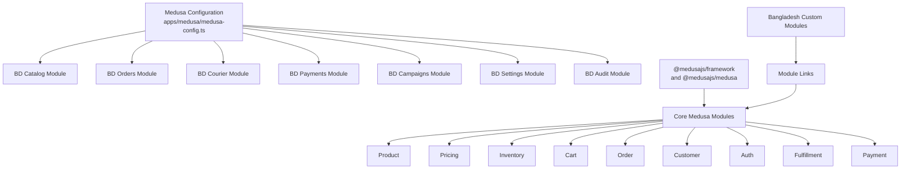
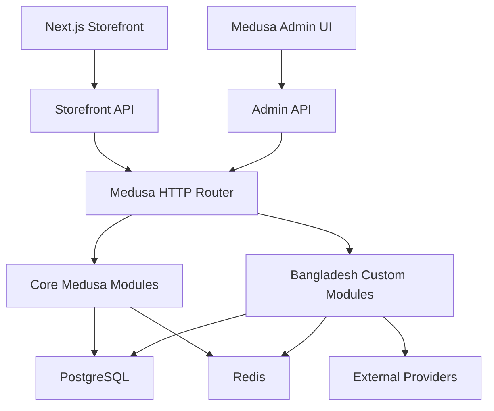
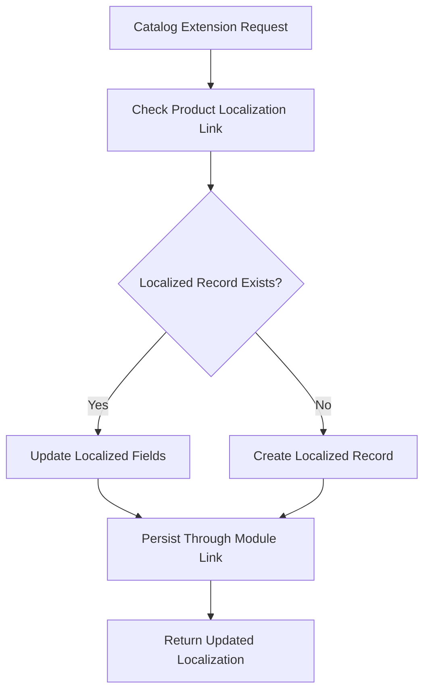
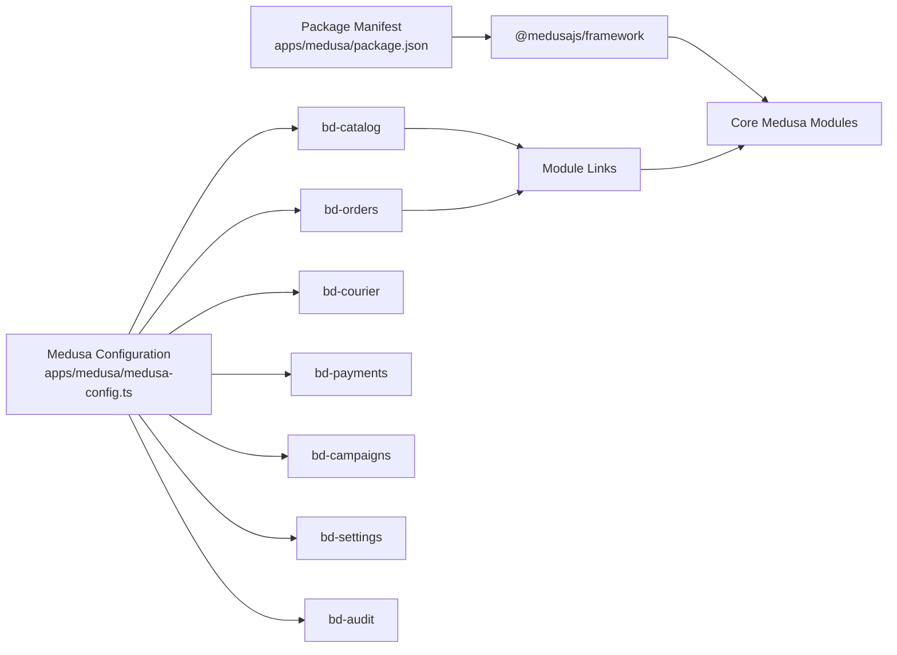

# Core Medusa Modules (Native)

<cite>
**Referenced Files in This Document**
- [architecture.md](file://docs/architecture.md)
- [agent.md](file://agent.md)
- [technical-plan.md](file://technical-plan.md)
- [package.json](file://apps/medusa/package.json)
- [medusa-config.ts](file://apps/medusa/medusa-config.ts)
- [order-bd-details.ts](file://apps/medusa/src/links/order-bd-details.ts)
- [order-return-request.ts](file://apps/medusa/src/links/order-return-request.ts)
- [product-localization.ts](file://apps/medusa/src/links/product-localization.ts)
- [product-variant-cost.ts](file://apps/medusa/src/links/product-variant-cost.ts)
</cite>

## Table of Contents
1. [Introduction](#introduction)
2. [Project Structure](#project-structure)
3. [Core Components](#core-components)
4. [Architecture Overview](#architecture-overview)
5. [Detailed Component Analysis](#detailed-component-analysis)
6. [Dependency Analysis](#dependency-analysis)
7. [Performance Considerations](#performance-considerations)
8. [Troubleshooting Guide](#troubleshooting-guide)
9. [Conclusion](#conclusion)

## Introduction
This document explains the native Medusa modules that form the foundation of the BD Commerce Platform and how Bangladesh-specific extensions must interact with them. The platform follows a Medusa-first approach: core commerce capabilities such as products, pricing, inventory, carts, orders, customers, authentication, fulfillment, and payments are owned by Medusa’s native modules. Bangladesh-specific behavior is implemented through custom modules and Module Links, never by forking or directly altering core tables.

The native modules define strict boundaries. Extensions may read core data, link additional fields, register providers, and compose workflows, but they must not mutate core schema definitions, override core module implementations directly, or duplicate authoritative business facts.

## Project Structure
At runtime, the Medusa application loads configuration from `medusa-config.ts`, which registers the Bangladesh custom modules. The package manifest declares the Medusa v2 framework and related dependencies. Architecture documentation describes the layering between presentation, API routing, core modules, Bangladesh modules, workflows, databases, and external integrations.



**Diagram sources**
- [medusa-config.ts:7-45](file://apps/medusa/medusa-config.ts#L7-L45)
- [package.json:25-38](file://apps/medusa/package.json#L25-L38)

**Section sources**
- [medusa-config.ts:7-45](file://apps/medusa/medusa-config.ts#L7-L45)
- [package.json:25-38](file://apps/medusa/package.json#L25-L38)
- [technical-plan.md:73-99](file://technical-plan.md#L73-L99)

## Core Components
The following table summarizes each native Medusa module covered by this project, its responsibility, and the strict boundary rule enforced by the BD Commerce Platform.

| Native Module | Responsibility | Strict Boundary Rule |
|---|---|---|
| `@medusajs/product` | Base product, variants, options, categories | Extend via `bd-catalog` links; do not fork core schema |
| `@medusajs/pricing` | Price sets and currency rules (BDT default) | Regional pricing managed through custom Admin Widget; do not replace core pricing engine |
| `@medusajs/inventory` | Variant stock levels and reservations | Reservations managed atomically via Medusa Inventory API |
| `@medusajs/cart` | Cart sessions, line items, discounts | Single unified cart per session; no shadow or parallel carts |
| `@medusajs/order` | Order entity, totals, line items | Extended via `order_bd_details` Module Link |
| `@medusajs/customer` | Customer identity and addresses | Phone-first authentication; email optional |
| `@medusajs/auth` | JWT issuance, password hashing, sessions | Admin auth extended with forced password change and lockout policies |
| `@medusajs/fulfillment` | Shipping options and fulfillment sets | BD zones implemented via custom fulfillment provider |
| `@medusajs/payment` | Payment collections and sessions | COD, bKash, Nagad registered as payment providers |

These rules come from the platform’s architecture documentation and agent guidelines. They ensure upgrades to Medusa remain safe because core tables and core module logic stay untouched.

**Section sources**
- [architecture.md:227-241](file://docs/architecture.md#L227-L241)
- [agent.md:86-102](file://agent.md#L86-L102)

## Architecture Overview
The BD Commerce Platform separates concerns into layers:

- Presentation layer: Next.js storefront and embedded Medusa admin UI.
- API gateway and router layer: Medusa HTTP router exposing `/store/*`, `/admin/*`, `/hooks/*`, and custom `/api/*` endpoints.
- Commerce domain layer: Core Medusa modules plus Bangladesh custom modules and workflow orchestration.
- Data and infrastructure layer: PostgreSQL, Redis, and Meilisearch.
- External integration layer: Payment gateways, courier APIs, SMS gateways, and analytics integrations.



**Diagram sources**
- [architecture.md:77-123](file://docs/architecture.md#L77-L123)
- [technical-plan.md:73-112](file://technical-plan.md#L73-L112)

## Detailed Component Analysis

### Product Module
- **Responsibility:** Defines base product entities, variants, options, and categories.
- **Boundary Rule:** Do not modify core product schema. Add Bangla localization and category attributes through the `bd-catalog` module and Module Links.
- **Extension Pattern:** Use `product-localization.ts` and `product-variant-cost.ts` links to associate localized titles, descriptions, attribute values, and variant cost data with core product IDs.
- **Forbidden Approach:** Creating new core product tables, overriding Medusa product service classes, or duplicating product identifiers outside the link model.
- **Integration Point:** `bd-catalog` reads and writes localized catalog data while referencing core product and variant IDs.



**Diagram sources**
- [product-localization.ts](file://apps/medusa/src/links/product-localization.ts)
- [product-variant-cost.ts](file://apps/medusa/src/links/product-variant-cost.ts)

**Section sources**
- [architecture.md:229-233](file://docs/architecture.md#L229-L233)
- [product-localization.ts](file://apps/medusa/src/links/product-localization.ts)
- [product-variant-cost.ts](file://apps/medusa/src/links/product-variant-cost.ts)

### Pricing Module
- **Responsibility:** Manages price sets and currency rules. The platform uses BDT as the primary currency context.
- **Boundary Rule:** Do not replace the core pricing engine. Regional pricing adjustments should be exposed through custom Admin Widgets and workflows rather than by rewriting pricing logic.
- **Extension Pattern:** Configure regional pricing display and validation in admin UI and workflows while keeping price set computation inside Medusa pricing.
- **Forbidden Approach:** Overriding core pricing services or storing alternate price columns that contradict core price sets.

**Section sources**
- [architecture.md:234](file://docs/architecture.md#L234)
- [agent.md:93-98](file://agent.md#L93-L98)

### Inventory Module
- **Responsibility:** Tracks variant stock levels and reservations.
- **Boundary Rule:** Stock changes must go through Medusa Inventory APIs so reservations remain atomic and consistent across carts and orders.
- **Extension Pattern:** Reserve stock during checkout flows and release it on cancellation or failure using Medusa inventory reservation primitives.
- **Forbidden Approach:** Directly updating stock counts in custom tables without coordinating with Medusa inventory state.

**Section sources**
- [architecture.md:235](file://docs/architecture.md#L235)
- [agent.md:86-92](file://agent.md#L86-L92)

### Cart Module
- **Responsibility:** Manages cart sessions, line items, and discounts.
- **Boundary Rule:** Maintain one unified cart per session. No shadow or parallel cart tables.
- **Extension Pattern:** Enforce BD-specific checkout rules, address validation, and delivery zone checks around the native cart flow.
- **Forbidden Approach:** Duplicating cart lines or creating separate cart stores per region or channel.

**Section sources**
- [architecture.md:236](file://docs/architecture.md#L236)
- [agent.md:88-91](file://agent.md#L88-L91)

### Order Module
- **Responsibility:** Owns the order entity, totals, line items, and core order lifecycle.
- **Boundary Rule:** Extend orders through the `order-bd-details` Module Link rather than altering core order tables.
- **Extension Pattern:** Persist Bangladesh-specific order details, risk profiles, return requests, and operational statuses in custom models linked to the core order ID.
- **Forbidden Approach:** Writing duplicate order status or amount fields that could drift from the authoritative core order record.

```mermaid
sequenceDiagram
participant Client as "Client"
participant StoreAPI as "Storefront API"
participant OrderModule as "Order Module"
participant BDOrders as "BD Orders Module"
participant Link as "Order BD Details Link"
Client->>StoreAPI : "Place order"
StoreAPI->>OrderModule : "Create order"
OrderModule-->>StoreAPI : "Order created"
StoreAPI->>BDOrders : "Persist BD-specific order details"
BDOrders->>Link : "Link to core order ID"
Link-->>BDOrders : "Link persisted"
BDOrders-->>StoreAPI : "BD details saved"
StoreAPI-->>Client : "Order confirmation"
```

**Diagram sources**
- [order-bd-details.ts](file://apps/medusa/src/links/order-bd-details.ts)

**Section sources**
- [architecture.md:237](file://docs/architecture.md#L237)
- [order-bd-details.ts](file://apps/medusa/src/links/order-bd-details.ts)

### Customer Module
- **Responsibility:** Manages customer identity and addresses.
- **Boundary Rule:** Support phone-first authentication while keeping email optional. Do not replace core customer identity logic.
- **Extension Pattern:** Add BD-specific customer metadata through custom modules and links, and enforce phone-based login flows at the API or auth extension layer.
- **Forbidden Approach:** Replacing Medusa customer storage or bypassing core authentication contracts.

**Section sources**
- [architecture.md:238](file://docs/architecture.md#L238)
- [agent.md:88-91](file://agent.md#L88-L91)

### Auth Module
- **Responsibility:** Issues JWT tokens, handles password hashing, and manages sessions.
- **Boundary Rule:** Extend admin authentication with forced password change and lockout policies without replacing core auth primitives.
- **Extension Pattern:** Implement policy hooks, middleware, or admin-side enforcement around core auth flows.
- **Forbidden Approach:** Rewriting token generation or session storage in a way that breaks Medusa’s auth contract.

**Section sources**
- [architecture.md:239](file://docs/architecture.md#L239)
- [agent.md:88-92](file://agent.md#L88-L92)

### Fulfillment Module
- **Responsibility:** Manages shipping options and fulfillment sets.
- **Boundary Rule:** Implement Bangladesh delivery zones and courier behavior through custom fulfillment providers rather than modifying core fulfillment code.
- **Extension Pattern:** Register BD-specific fulfillment providers and map zones to courier services.
- **Forbidden Approach:** Hardcoding courier logic inside core fulfillment or bypassing Medusa fulfillment state transitions.

**Section sources**
- [architecture.md:240](file://docs/architecture.md#L240)
- [technical-plan.md:83-91](file://technical-plan.md#L83-L91)

### Payment Module
- **Responsibility:** Manages payment collections and sessions.
- **Boundary Rule:** Register COD, bKash, and Nagad as payment providers through Medusa’s payment abstraction.
- **Extension Pattern:** Implement providers that follow Medusa payment provider contracts, including secure server-to-server capture and webhook handling.
- **Forbidden Approach:** Storing payment amounts or states in custom tables without syncing with core payment collection state.

**Section sources**
- [architecture.md:241](file://docs/architecture.md#L241)
- [agent.md:88-92](file://agent.md#L88-L92)

## Dependency Analysis
The BD Commerce Platform depends on Medusa v2 core modules and exposes Bangladesh-specific modules through configuration. Module Links connect custom data to core entities without introducing direct foreign-key coupling to core schemas.



**Diagram sources**
- [package.json:25-38](file://apps/medusa/package.json#L25-L38)
- [medusa-config.ts:22-44](file://apps/medusa/medusa-config.ts#L22-L44)

**Section sources**
- [package.json:25-38](file://apps/medusa/package.json#L25-L38)
- [medusa-config.ts:22-44](file://apps/medusa/medusa-config.ts#L22-L44)
- [architecture.md:66-73](file://docs/architecture.md#L66-L73)

## Performance Considerations
- Keep all multi-step mutations inside Medusa Workflows so database transactions and compensation steps remain consistent.
- Use Redis for workflow queues, event pub/sub, rate limiting, and short-lived locks such as flash-sale stock locks.
- Avoid redundant queries by relying on core Medusa services and Module Links instead of building parallel data stores.
- Ensure irreversible side effects such as SMS dispatch or external courier bookings run only after successful database commits.

[No sources needed since this section provides general guidance]

## Troubleshooting Guide
Common pitfalls when extending core Medusa modules include:

- Forgetting to use Module Links and instead adding direct foreign keys to core tables.
- Duplicating authoritative business facts such as order status, payment amount, or stock quantity.
- Bypassing Medusa Workflows for multi-step operations, leading to inconsistent state.
- Treating external webhooks as trusted input without authenticated server-to-server verification.
- Replacing core modules instead of registering adapters, providers, or widgets.

Recommended recovery actions:

- Replace direct schema modifications with custom modules and Module Links.
- Move mutable business logic into Medusa Workflows with compensation steps.
- Validate and authenticate all external callbacks before capturing payments or booking shipments.
- Keep money representation consistent: core tables use major units, while custom BD tables use paisa where required, with conversion centralized.
- Prefer native Medusa enums for order, payment, fulfillment, and return statuses; reserve custom enums for Bangladesh operational lifecycles.

**Section sources**
- [agent.md:86-102](file://agent.md#L86-L102)
- [architecture.md:66-73](file://docs/architecture.md#L66-L73)

## Conclusion
The native Medusa modules provide the authoritative commerce foundation for the BD Commerce Platform. Bangladesh-specific requirements must extend these modules through custom modules, Module Links, providers, and workflows. The strict boundary rules prevent schema forking, duplication of core facts, and unsafe overrides. Following these patterns keeps the platform compatible with Medusa upgrades while allowing local market features such as COD, bKash, Nagad, courier dispatch, and Bangla catalog localization to evolve safely.

[No sources needed since this section summarizes without analyzing specific files]