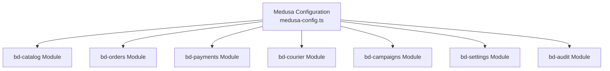
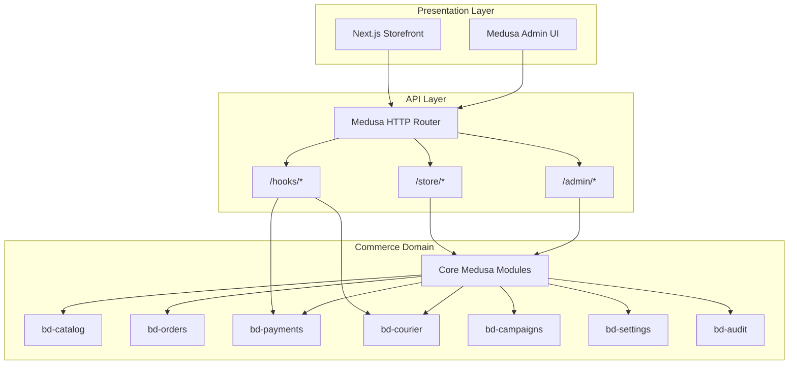
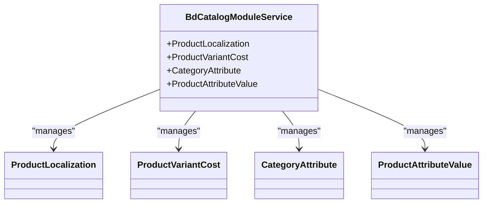
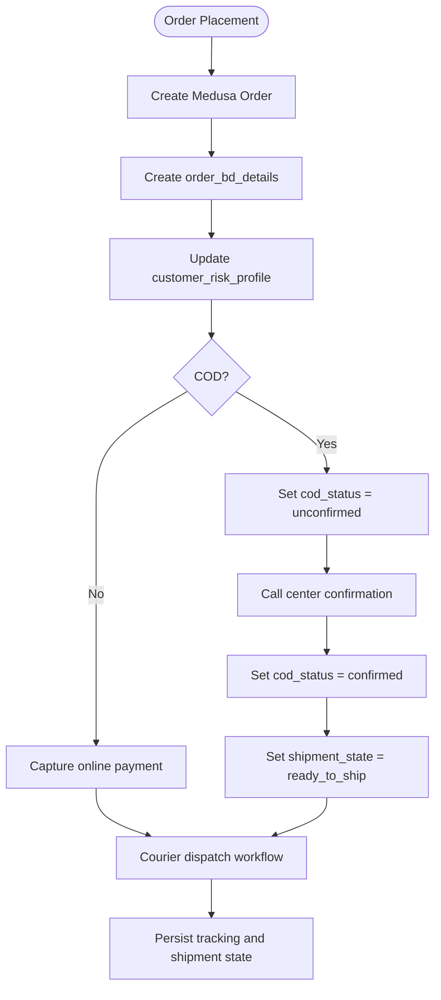
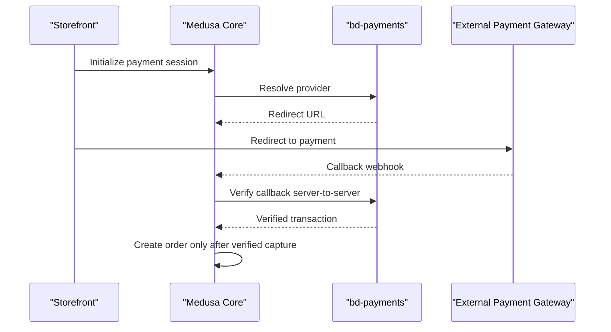
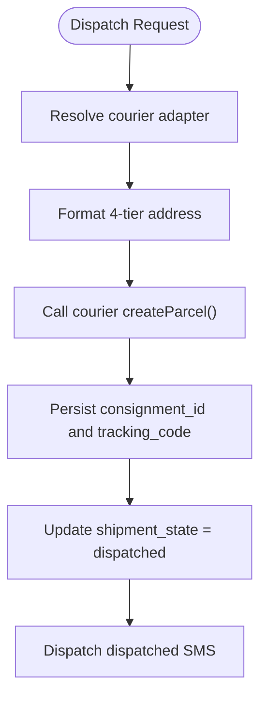
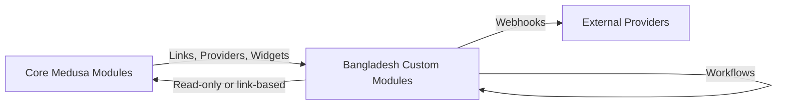
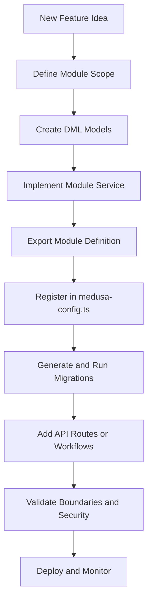

# Module Boundaries & Responsibility Map

<cite>
**Referenced Files in This Document**   
- [architecture.md](file://docs/architecture.md)
- [cross-document-verification.md](file://cross-document-verification.md)
- [data-models.md](file://docs/data-models.md)
- [technical-plan.md](file://technical-plan.md)
- [medusa-config.ts](file://apps/medusa/medusa-config.ts)
- [modules README.md](file://apps/medusa/src/modules/README.md)
- [bd-catalog/index.ts](file://apps/medusa/src/modules/bd-catalog/index.ts)
- [bd-catalog/service.ts](file://apps/medusa/src/modules/bd-catalog/service.ts)
- [bd-orders/index.ts](file://apps/medusa/src/modules/bd-orders/index.ts)
- [bd-orders/service.ts](file://apps/medusa/src/modules/bd-orders/service.ts)
- [bd-payments/index.ts](file://apps/medusa/src/modules/bd-payments/index.ts)
- [bd-payments/service.ts](file://apps/medusa/src/modules/bd-payments/service.ts)
- [bd-courier/index.ts](file://apps/medusa/src/modules/bd-courier/index.ts)
- [bd-courier/service.ts](file://apps/medusa/src/modules/bd-courier/service.ts)
- [bd-campaigns/index.ts](file://apps/medusa/src/modules/bd-campaigns/index.ts)
- [bd-campaigns/service.ts](file://apps/medusa/src/modules/bd-campaigns/service.ts)
- [bd-settings/index.ts](file://apps/medusa/src/modules/bd-settings/index.ts)
- [bd-settings/service.ts](file://apps/medusa/src/modules/bd-settings/service.ts)
- [bd-audit/index.ts](file://apps/medusa/src/modules/bd-audit/index.ts)
- [bd-audit/service.ts](file://apps/medusa/src/modules/bd-audit/service.ts)
</cite>

## Table of Contents
1. [Introduction](#introduction)
2. [Project Structure and Module Registration](#project-structure-and-module-registration)
3. [Core Medusa Modules: Ownership, Boundaries, and Rules](#core-medusa-modules-ownership-boundaries-and-rules)
4. [Bangladesh Custom Modules: Responsibilities and APIs](#bangladesh-custom-modules-responsibilities-and-apis)
5. [Module Interaction Architecture](#module-interaction-architecture)
6. [Detailed Module Analysis](#detailed-module-analysis)
7. [Dependency and Boundary Rules](#dependency-and-boundary-rules)
8. [Guidelines for Extending or Creating New Modules](#guidelines-for-extending-or-creating-new-modules)
9. [Performance and Reliability Considerations](#performance-and-reliability-considerations)
10. [Troubleshooting Guide](#troubleshooting-guide)
11. [Conclusion](#conclusion)

## Introduction
This document defines the module boundaries and responsibility map for the BD Commerce Platform. It separates Core Medusa modules from Bangladesh custom modules, documents ownership rules, API exposure, cross-module relationships, and provides architectural guidance for extending the system without breaking isolation or data integrity.

The platform follows a Medusa-first approach: core commerce logic is owned by native Medusa modules, while Bangladesh-specific operational requirements are implemented as isolated custom modules using Medusa’s module system, DML models, workflows, and event subscribers.

## Project Structure and Module Registration
The Medusa backend registers custom modules through `medusa-config.ts`. Each custom module exports a module definition and a service that exposes its data models to the Medusa runtime.

**Diagram sources**
- [medusa-config.ts:22-44](file://apps/medusa/medusa-config.ts#L22-L44)

**Section sources**
- [medusa-config.ts:1-46](file://apps/medusa/medusa-config.ts#L1-L46)
- [modules README.md:1-118](file://apps/medusa/src/modules/README.md#L1-L118)

## Core Medusa Modules: Ownership, Boundaries, and Rules
Core Medusa modules own the foundational commerce primitives. The platform must not fork or override their schemas; instead, it extends them through links, providers, widgets, and custom modules.

| Core Module | Ownership Boundary | Strict Rule |
|---|---|---|
| Product | Base product, variants, options, categories | Extend via `bd-catalog` links; do not fork core schema |
| Pricing | Price sets and currency rules (BDT-only) | Regional pricing managed through custom Admin Widget |
| Inventory | Variant stock levels and reservations | Reservations managed atomically via Medusa Inventory API |
| Cart | Cart sessions, line items, discounts | Single unified cart per session; no shadow carts |
| Order | Order entity, totals, line items | Extended via `order_bd_details` Module Link |
| Customer | Customer identity and addresses | Phone-first authentication; email optional |
| Auth | JWT issuance, password hashing, sessions | Admin auth extended with forced password change and lockout |
| Fulfillment | Shipping options and fulfillment sets | BD zones implemented via custom fulfillment provider |
| Payment | Payment collections and sessions | COD, bKash, Nagad registered as payment providers |

These rules ensure that generic commerce behavior remains stable while Bangladesh-specific behavior is encapsulated in custom modules.

**Section sources**
- [architecture.md:229-241](file://docs/architecture.md#L229-L241)

## Bangladesh Custom Modules: Responsibilities and APIs
The Bangladesh custom modules add localized catalog support, order lifecycle control, local payments, courier integration, campaigns, settings, audit logging, content management, invoices, SMS abstraction, and financial reporting.

| Custom Module | Ownership | Boundary Rule | Primary APIs / Integration Points |
|---|---|---|---|
| `bd-catalog` | Localization, category attributes, variant cost | Reads core product/category IDs; persists Bangla titles, descriptions, and dynamic attributes | Store/admin localization endpoints |
| `bd-orders` | Order extension, risk profile, return review | Linked 1:1 to Medusa order; owns four-status separation | Order details, COD confirmation, courier booking, customer risk lookup |
| `bd-payments` | Local payment providers | Providers implement Medusa provider interface; zero-orphan redirect rule | Provider callbacks verified server-to-server |
| `bd-courier` | Courier adapters and shipment logs | Invoked through workflow; maps external statuses to internal shipment state | Webhook ingestion and consignment tracking |
| `bd-campaigns` | Landing pages and marketing content | Reads live catalog and inventory; embedded checkout binds to unified cart | Landing page and content endpoints |
| `bd-reports` | Contribution profit and reconciliation | Read-only queries against PostgreSQL | Admin reports and dashboards |
| `bd-sms` | SMS gateway abstraction and templates | Final non-compensatable step in workflows/outbox | Outbound SMS dispatch |
| `bd-settings` | Delivery zones, VAT, credentials | Singleton configuration store | Admin settings endpoints |
| `bd-audit` | Append-only audit log and staff roles | Captures sensitive actions with actor, IP, old/new values | Admin audit log endpoint |
| `bd-content` | Homepage sections and policy pages | Draft/preview/publish/rollback CMS | Storefront content endpoints |
| `bd-invoices` | Invoice templates and PDF generation | Immutable invoice records compiled from historical snapshots | Admin and customer invoice download endpoints |

**Section sources**
- [architecture.md:243-301](file://docs/architecture.md#L243-L301)
- [cross-document-verification.md:119-132](file://cross-document-verification.md#L119-L132)

## Module Interaction Architecture
At runtime, the Medusa HTTP router routes requests to storefront, admin, hooks, and custom API namespaces. Custom modules interact with core modules through Medusa services, workflows, and event subscribers rather than direct database coupling.

**Diagram sources**
- [architecture.md:91-110](file://docs/architecture.md#L91-L110)

## Detailed Module Analysis

### bd-catalog
`bd-catalog` owns catalog localization and category attribute data. Its service exposes models for product localization, product variant cost, category attributes, and product attribute values. It reads core product and category identifiers and persists Bangla language fields and dynamic attributes.

**Diagram sources**
- [bd-catalog/service.ts:1-15](file://apps/medusa/src/modules/bd-catalog/service.ts#L1-L15)
- [bd-catalog/index.ts:1-9](file://apps/medusa/src/modules/bd-catalog/index.ts#L1-L9)

Responsibility summary:
- Owns localization and attribute data linked to core products and categories.
- Exposes store and admin localization endpoints.
- Must not modify core product schema directly.

**Section sources**
- [architecture.md:245-248](file://docs/architecture.md#L245-L248)
- [technical-plan.md:150-171](file://technical-plan.md#L150-L171)
- [bd-catalog/service.ts:1-15](file://apps/medusa/src/modules/bd-catalog/service.ts#L1-L15)
- [bd-catalog/index.ts:1-9](file://apps/medusa/src/modules/bd-catalog/index.ts#L1-L9)

### bd-orders
`bd-orders` extends the Medusa order with Bangladesh-specific lifecycle, risk profiling, and return review. It owns the four-status separation between core order status, payment status, shipment state, and return/refund status.

**Diagram sources**
- [architecture.md:250-261](file://docs/architecture.md#L250-L261)
- [architecture.md:700-734](file://docs/architecture.md#L700-L734)

Responsibility summary:
- Owns `order_bd_details`, `customer_risk_profile`, and return request/review data.
- Enforces immutable financial snapshots and COD settlement tracking.
- Provides admin endpoints for order details, COD confirmation, courier booking, and risk profile lookup.

**Section sources**
- [architecture.md:250-261](file://docs/architecture.md#L250-L261)
- [cross-document-verification.md:123-125](file://cross-document-verification.md#L123-L125)
- [bd-orders/service.ts:1-13](file://apps/medusa/src/modules/bd-orders/service.ts#L1-L13)
- [bd-orders/index.ts:1-9](file://apps/medusa/src/modules/bd-orders/index.ts#L1-L9)

### bd-payments
`bd-payments` owns local payment providers and payment-related logs. Providers implement Medusa’s provider interface and follow a zero-orphan redirect architecture.

**Diagram sources**
- [architecture.md:467-507](file://docs/architecture.md#L467-L507)

Responsibility summary:
- Owns payment providers such as COD, bKash, and Nagad.
- Enforces zero-trust webhooks and server-to-server verification.
- Logs payment transactions and webhook events.

**Section sources**
- [architecture.md:263-266](file://docs/architecture.md#L263-L266)
- [cross-document-verification.md:127-127](file://cross-document-verification.md#L127-L127)
- [bd-payments/service.ts:1-11](file://apps/medusa/src/modules/bd-payments/service.ts#L1-L11)
- [bd-payments/index.ts:1-9](file://apps/medusa/src/modules/bd-payments/index.ts#L1-L9)

### bd-courier
`bd-courier` owns courier adapter logic and shipment/webhook logs. It is invoked strictly through workflows and maps external courier statuses to internal shipment states.

**Diagram sources**
- [architecture.md:268-270](file://docs/architecture.md#L268-L270)
- [architecture.md:717-723](file://docs/architecture.md#L717-L723)

Responsibility summary:
- Owns courier adapters and shipment tracking logs.
- Integrates with external courier APIs and webhooks.
- Does not own core fulfillment logic; it adapts to it.

**Section sources**
- [architecture.md:268-270](file://docs/architecture.md#L268-L270)
- [bd-courier/service.ts:1-11](file://apps/medusa/src/modules/bd-courier/service.ts#L1-L11)
- [bd-courier/index.ts:1-9](file://apps/medusa/src/modules/bd-courier/index.ts#L1-L9)

### bd-campaigns
`bd-campaigns` owns landing page data and campaign-driven storefront experiences. It reads live catalog and inventory and supports embedded checkout bound to the unified cart.

Responsibility summary:
- Owns landing page model and related campaign content.
- Supports Mode A/B checkout routing and content blocks.
- Must not duplicate catalog or inventory data.

**Section sources**
- [architecture.md:272-274](file://docs/architecture.md#L272-L274)
- [cross-document-verification.md:129-129](file://cross-document-verification.md#L129-L129)
- [bd-campaigns/service.ts:1-9](file://apps/medusa/src/modules/bd-campaigns/service.ts#L1-L9)
- [bd-campaigns/index.ts:1-9](file://apps/medusa/src/modules/bd-campaigns/index.ts#L1-L9)

### bd-settings
`bd-settings` owns Bangladesh configuration, delivery zones, VAT infrastructure, and operational settings.

Responsibility summary:
- Owns singleton configuration models such as delivery zone config and VAT config.
- Provides rates, thresholds, and gateway credentials used by other modules.
- Must be read consistently across workflows and admin/storefront layers.

**Section sources**
- [architecture.md:284-286](file://docs/architecture.md#L284-L286)
- [bd-settings/service.ts:1-11](file://apps/medusa/src/modules/bd-settings/service.ts#L1-L11)
- [bd-settings/index.ts:1-9](file://apps/medusa/src/modules/bd-settings/index.ts#L1-L9)

### bd-audit
`bd-audit` owns append-only audit logging and staff role/permission data. It captures who, what, when, old/new values, IP address, and stated reason for sensitive operations.

Responsibility summary:
- Owns audit log and staff role permission models.
- Subscribes to sensitive domain changes.
- Exposes restricted admin audit log access.

**Section sources**
- [architecture.md:288-291](file://docs/architecture.md#L288-L291)
- [bd-audit/service.ts:1-11](file://apps/medusa/src/modules/bd-audit/service.ts#L1-L11)
- [bd-audit/index.ts:1-9](file://apps/medusa/src/modules/bd-audit/index.ts#L1-L9)

### Conceptual Overview of Missing Custom Modules
The repository documentation references additional custom modules such as `bd-reports`, `bd-sms`, `bd-content`, and `bd-invoices`. These modules are part of the planned architecture but may not yet be fully implemented in the current module directory structure. Their responsibilities are documented at the architectural level and should be treated as separate bounded contexts if added later.

- `bd-reports`: Read-only financial queries and contribution profit reporting.
- `bd-sms`: SMS gateway abstraction, templates, and outbox-style dispatch.
- `bd-content`: CMS for homepage sections and policy pages.
- `bd-invoices`: Server-side PDF generation and immutable invoice records.

[No sources needed since this section summarizes conceptual modules referenced by architecture documentation]

## Dependency and Boundary Rules
The platform enforces strict module boundaries to prevent tight coupling and maintain extensibility.

Key boundary rules:
- Do not fork core Medusa schemas.
- Use Medusa Module Links for cross-entity relationships.
- Keep custom business logic inside custom modules.
- Treat external webhooks as zero-trust inputs.
- Use workflows for multi-step state mutations.
- Keep SMS and notifications as final non-compensatable steps.

**Section sources**
- [architecture.md:68-73](file://docs/architecture.md#L68-L73)
- [architecture.md:336-355](file://docs/architecture.md#L336-L355)
- [architecture.md:545-565](file://docs/architecture.md#L545-L565)

## Guidelines for Extending or Creating New Modules
When adding new functionality, follow the established Medusa module pattern and BD Commerce Platform rules.

1. **Define a single-purpose module.**  
   Each module should own one clear domain, such as catalog localization, order extension, payments, courier integration, campaigns, settings, audit, content, invoices, SMS, or reports.

2. **Create DML models under `models/`.**  
   Models represent tables in PostgreSQL and integrate with Medusa’s query engine.

3. **Implement a service under `service.ts`.**  
   The service exposes the module’s models and business methods.

4. **Export the module definition under `index.ts`.**  
   Register the module name and service with Medusa.

5. **Register the module in `medusa-config.ts`.**  
   Add the module path to the modules array.

6. **Generate and run migrations.**  
   Use Medusa migration commands to apply schema changes.

7. **Expose APIs through Medusa routes or workflows.**  
   Prefer `/store/*` for public storefront operations, `/admin/*` for protected admin operations, and `/hooks/*` for provider webhooks.

8. **Avoid direct foreign-key coupling to core models.**  
   Use Medusa links and SDK calls where possible.

9. **Keep external integrations behind adapters.**  
   For example, payment providers and courier providers should be pluggable.

10. **Log sensitive operations through `bd-audit`.**  
    Capture actor, entity, action, old/new values, IP, and reason.

**Diagram sources**
- [modules README.md:7-90](file://apps/medusa/src/modules/README.md#L7-L90)
- [medusa-config.ts:22-44](file://apps/medusa/medusa-config.ts#L22-L44)

**Section sources**
- [modules README.md:1-118](file://apps/medusa/src/modules/README.md#L1-L118)
- [medusa-config.ts:1-46](file://apps/medusa/medusa-config.ts#L1-L46)

## Performance and Reliability Considerations
Module design affects performance, concurrency, and reliability.

- **Atomic inventory operations:** Inventory reservations occur during order placement, not cart addition.
- **Distributed locks:** Redis locks protect concurrent checkout on low-stock variants.
- **Idempotency:** Storefront mutations use idempotency keys to prevent duplicate orders.
- **Zero-orphan payments:** Orders are created only after verified payment capture.
- **Outbox SMS:** SMS dispatch is final and logged even if the gateway fails.
- **Immutable snapshots:** Order-time financial data prevents historical drift.
- **Rate limiting:** Endpoints are rate-limited to protect privacy and stability.

**Section sources**
- [architecture.md:402-432](file://docs/architecture.md#L402-L432)
- [architecture.md:467-507](file://docs/architecture.md#L467-L507)
- [architecture.md:545-565](file://docs/architecture.md#L545-L565)
- [architecture.md:690-693](file://docs/architecture.md#L690-L693)

## Troubleshooting Guide
Common issues and their module-level causes:

| Symptom | Likely Module | Diagnosis | Resolution |
|---|---|---|---|
| Duplicate orders on checkout | `bd-payments`, `bd-orders` | Missing idempotency or premature order creation | Ensure idempotency headers and verify payment before creating order |
| Orphaned inventory | `bd-orders`, `bd-payments` | Abandoned payment flow created order without capture | Review zero-orphan payment flow and refund/release logic |
| Incorrect shipping charge | `bd-settings`, `bd-courier` | Zone mapping or settings changed after order placement | Verify delivery fee snapshot and zone configuration |
| SMS not received | `bd-sms`, `bd-audit` | Gateway timeout or rate limit exceeded | Check SMS logs, retry queue, and rate limits |
| Audit log missing | `bd-audit` | Sensitive action not subscribed or unauthorized | Confirm subscriber registration and RBAC permissions |
| Landing page shows stale catalog | `bd-campaigns` | Cached or inconsistent catalog read | Validate cache strategy and live catalog reads |

**Section sources**
- [architecture.md:336-355](file://docs/architecture.md#L336-L355)
- [architecture.md:402-432](file://docs/architecture.md#L402-L432)
- [architecture.md:545-565](file://docs/architecture.md#L545-L565)

## Conclusion
The BD Commerce Platform separates core commerce capabilities from Bangladesh-specific extensions through well-defined module boundaries. Core Medusa modules own generic commerce primitives, while custom modules own localization, order lifecycle, local payments, courier integration, campaigns, settings, audit logging, content, invoices, SMS, and reporting. Maintaining these boundaries, using Medusa’s module system, enforcing zero-trust webhooks, and relying on workflows ensures scalability, security, and operational clarity for a Bangladesh-focused e-commerce platform.