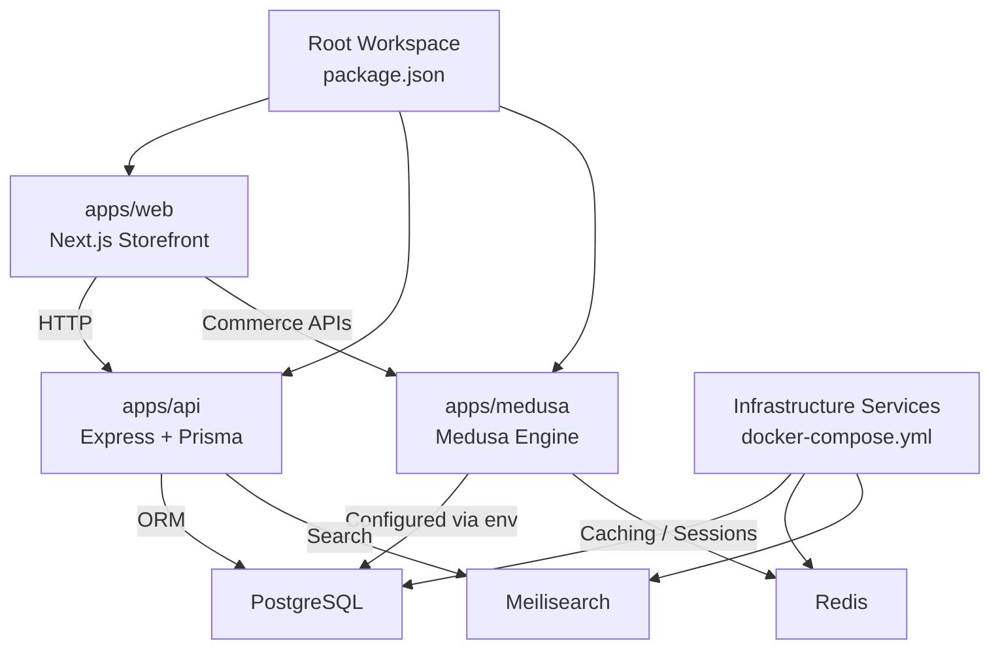
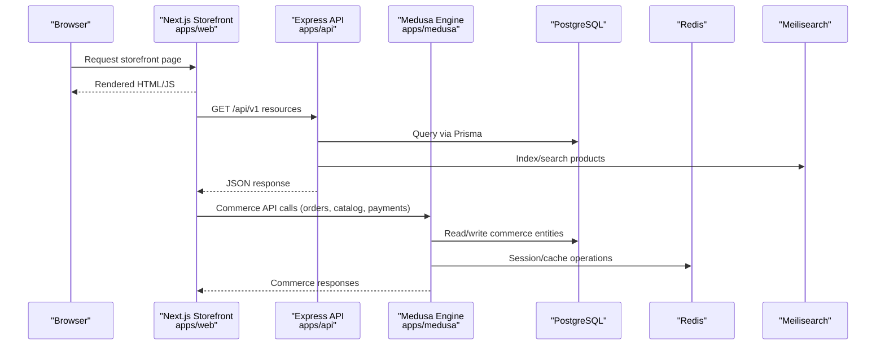
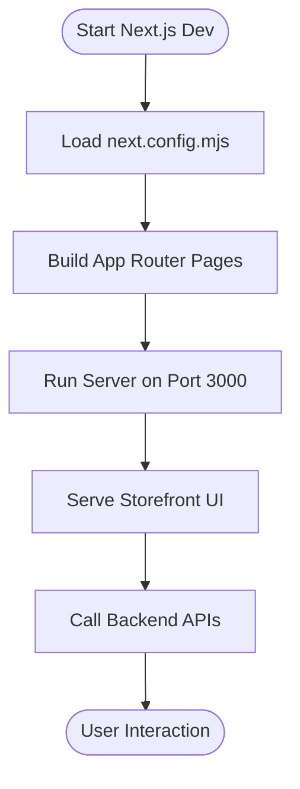
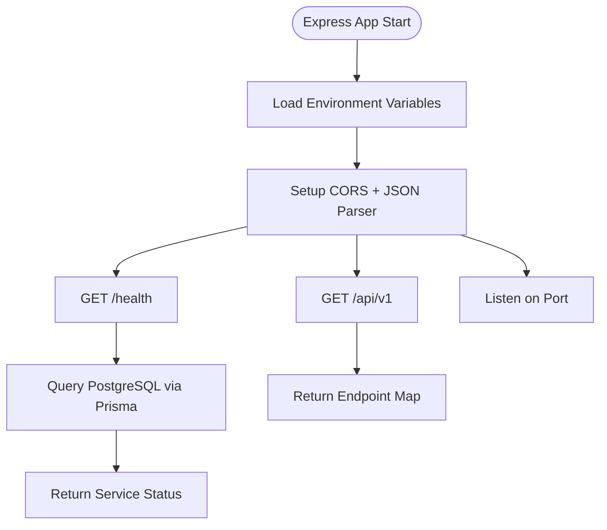
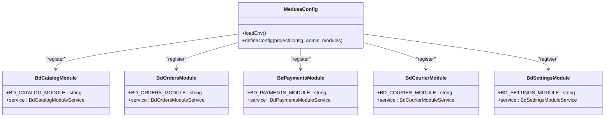
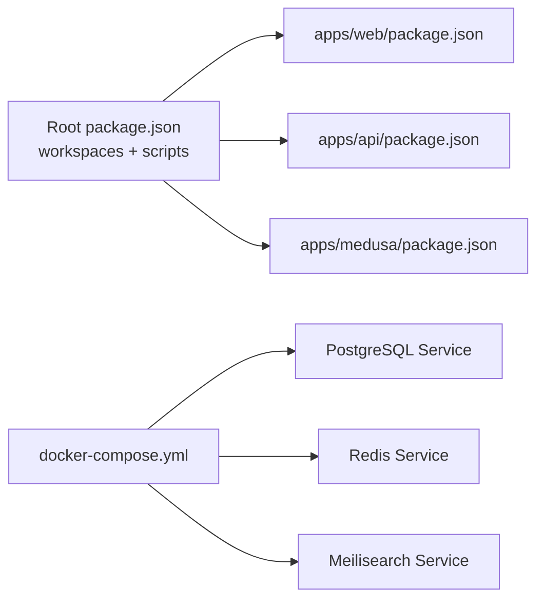

# Monorepo Structure & Directory Organization

<cite>
**Referenced Files in This Document**
- [package.json](file://package.json)
- [docker-compose.yml](file://docker-compose.yml)
- [apps/web/package.json](file://apps/web/package.json)
- [apps/web/next.config.mjs](file://apps/web/next.config.mjs)
- [apps/web/src/app/layout.tsx](file://apps/web/src/app/layout.tsx)
- [apps/web/src/app/page.tsx](file://apps/web/src/app/page.tsx)
- [apps/api/package.json](file://apps/api/package.json)
- [apps/api/src/main.ts](file://apps/api/src/main.ts)
- [apps/api/prisma/schema.prisma](file://apps/api/prisma/schema.prisma)
- [apps/medusa/package.json](file://apps/medusa/package.json)
- [apps/medusa/medusa-config.ts](file://apps/medusa/medusa-config.ts)
- [apps/medusa/src/modules/bd-catalog/index.ts](file://apps/medusa/src/modules/bd-catalog/index.ts)
- [apps/medusa/src/modules/bd-orders/index.ts](file://apps/medusa/src/modules/bd-orders/index.ts)
- [apps/medusa/src/modules/bd-payments/index.ts](file://apps/medusa/src/modules/bd-payments/index.ts)
- [apps/medusa/src/modules/bd-courier/index.ts](file://apps/medusa/src/modules/bd-courier/index.ts)
- [apps/medusa/src/modules/bd-settings/index.ts](file://apps/medusa/src/modules/bd-settings/index.ts)
</cite>

## Table of Contents
1. [Introduction](#introduction)
2. [Project Structure](#project-structure)
3. [Core Components](#core-components)
4. [Architecture Overview](#architecture-overview)
5. [Detailed Component Analysis](#detailed-component-analysis)
6. [Dependency Analysis](#dependency-analysis)
7. [Performance Considerations](#performance-considerations)
8. [Troubleshooting Guide](#troubleshooting-guide)
9. [Conclusion](#conclusion)
10. [Appendices](#appendices)

## Introduction
This document explains the monorepo structure and directory organization of the BD Commerce Platform. It covers workspace orchestration at the repository root, the separation of concerns across three applications:
- apps/web: Next.js storefront
- apps/api: Express API layer with Prisma data modeling
- apps/medusa: Medusa commerce engine with custom modules

It also documents shared configurations, dependency management strategies, development workflows, navigation guidance, adding new applications, and maintaining consistency across the monorepo.

## Project Structure
The repository is a Node.js/npm workspaces monorepo that orchestrates multiple applications under apps/. The root package.json defines workspaces for apps/* and packages/*, providing unified scripts to develop, build, and start each application. Infrastructure services (PostgreSQL, Redis, Meilisearch) are defined via docker-compose.yml.

**Diagram sources**
- [package.json:6-25](file://package.json#L6-L25)
- [docker-compose.yml:1-77](file://docker-compose.yml#L1-L77)
- [apps/web/package.json:1-28](file://apps/web/package.json#L1-L28)
- [apps/api/package.json:1-34](file://apps/api/package.json#L1-L34)
- [apps/medusa/package.json:1-61](file://apps/medusa/package.json#L1-L61)

**Section sources**
- [package.json:1-39](file://package.json#L1-L39)
- [docker-compose.yml:1-77](file://docker-compose.yml#L1-L77)

## Core Components
- apps/web (Next.js storefront): Provides the user-facing storefront using Next.js App Router, Tailwind CSS, and React. Serves as the entry point for customers and integrates with backend services.
- apps/api (Express API layer): A TypeScript-based Express server exposing REST endpoints, health checks, and Prisma-managed relational data. Integrates with PostgreSQL, Redis, and Meilisearch.
- apps/medusa (Medusa commerce engine): Headless commerce platform configured with custom business modules (catalog, orders, payments, courier, settings, audit). Uses environment-driven configuration and module registration.

Key responsibilities:
- apps/web: UI composition, metadata, static assets, client/server component boundaries.
- apps/api: Data access, validation, caching, search indexing, and basic API surface.
- apps/medusa: Commerce domain logic, module extensions, admin dashboard, and integrations.

**Section sources**
- [apps/web/package.json:1-28](file://apps/web/package.json#L1-L28)
- [apps/api/package.json:1-34](file://apps/api/package.json#L1-L34)
- [apps/medusa/package.json:1-61](file://apps/medusa/package.json#L1-L61)

## Architecture Overview
The platform follows a layered architecture:
- Presentation Layer: Next.js storefront renders pages and interacts with backend APIs.
- API Layer: Express server provides typed endpoints, database operations via Prisma, and optional search integration.
- Commerce Engine: Medusa provides headless commerce capabilities with custom modules for domain-specific features.
- Infrastructure: PostgreSQL, Redis, and Meilisearch provide persistence, caching, and search capabilities orchestrated by Docker Compose.

**Diagram sources**
- [apps/web/src/app/layout.tsx:1-22](file://apps/web/src/app/layout.tsx#L1-L22)
- [apps/api/src/main.ts:1-55](file://apps/api/src/main.ts#L1-L55)
- [apps/medusa/medusa-config.ts:1-46](file://apps/medusa/medusa-config.ts#L1-L46)
- [docker-compose.yml:1-77](file://docker-compose.yml#L1-L77)

## Detailed Component Analysis

### apps/web (Next.js Storefront)
Purpose:
- Provide a high-performance storefront using Next.js App Router.
- Configure global layout, metadata, and styling with Tailwind CSS.
- Serve as the primary user interface and integrate with backend services.

Key files:
- next.config.mjs: Enables strict mode and configures image remote patterns.
- src/app/layout.tsx: Defines root metadata and base HTML structure.
- src/app/page.tsx: Demonstrates service status and architectural highlights.

Development workflow:
- Start dev server on port 3000.
- Build production assets.
- Lint codebase.

**Diagram sources**
- [apps/web/next.config.mjs:1-15](file://apps/web/next.config.mjs#L1-L15)
- [apps/web/src/app/layout.tsx:1-22](file://apps/web/src/app/layout.tsx#L1-L22)
- [apps/web/src/app/page.tsx:1-81](file://apps/web/src/app/page.tsx#L1-L81)

**Section sources**
- [apps/web/package.json:1-28](file://apps/web/package.json#L1-L28)
- [apps/web/next.config.mjs:1-15](file://apps/web/next.config.mjs#L1-L15)
- [apps/web/src/app/layout.tsx:1-22](file://apps/web/src/app/layout.tsx#L1-L22)
- [apps/web/src/app/page.tsx:1-81](file://apps/web/src/app/page.tsx#L1-L81)

### apps/api (Express API Layer)
Purpose:
- Provide a typed REST API surface with health checks and versioned routes.
- Manage relational data using Prisma against PostgreSQL.
- Integrate with Redis and Meilisearch for caching and search.

Key files:
- src/main.ts: Express app setup, CORS, JSON parsing, health endpoint, basic routes, and server startup.
- prisma/schema.prisma: Database schema defining users, categories, products, orders, and order items.

Development workflow:
- Generate Prisma client.
- Run migrations or push schema changes.
- Start dev server with hot reload.
- Use Prisma Studio for data exploration.

**Diagram sources**
- [apps/api/src/main.ts:1-55](file://apps/api/src/main.ts#L1-L55)
- [apps/api/prisma/schema.prisma:1-152](file://apps/api/prisma/schema.prisma#L1-L152)

**Section sources**
- [apps/api/package.json:1-34](file://apps/api/package.json#L1-L34)
- [apps/api/src/main.ts:1-55](file://apps/api/src/main.ts#L1-L55)
- [apps/api/prisma/schema.prisma:1-152](file://apps/api/prisma/schema.prisma#L1-L152)

### apps/medusa (Medusa Commerce Engine)
Purpose:
- Provide headless commerce capabilities with custom modules tailored to BD Commerce requirements.
- Register and configure modules for catalog, orders, payments, courier, settings, and audit.
- Load environment variables and configure CORS, JWT, and cookie secrets.

Key files:
- medusa-config.ts: Loads environment variables, sets project config (databaseUrl, redisUrl, CORS, secrets), disables/enables admin, and registers modules.
- Module index files: Export module constants and register services for bd-catalog, bd-orders, bd-payments, bd-courier, bd-settings.

Development workflow:
- Develop with Medusa CLI (develop/start/build).
- Run migrations for module schemas.
- Execute unit/integration tests.

**Diagram sources**
- [apps/medusa/medusa-config.ts:1-46](file://apps/medusa/medusa-config.ts#L1-L46)
- [apps/medusa/src/modules/bd-catalog/index.ts:1-9](file://apps/medusa/src/modules/bd-catalog/index.ts#L1-L9)
- [apps/medusa/src/modules/bd-orders/index.ts:1-9](file://apps/medusa/src/modules/bd-orders/index.ts#L1-L9)
- [apps/medusa/src/modules/bd-payments/index.ts:1-9](file://apps/medusa/src/modules/bd-payments/index.ts#L1-L9)
- [apps/medusa/src/modules/bd-courier/index.ts:1-9](file://apps/medusa/src/modules/bd-courier/index.ts#L1-L9)
- [apps/medusa/src/modules/bd-settings/index.ts:1-9](file://apps/medusa/src/modules/bd-settings/index.ts#L1-L9)

**Section sources**
- [apps/medusa/package.json:1-61](file://apps/medusa/package.json#L1-L61)
- [apps/medusa/medusa-config.ts:1-46](file://apps/medusa/medusa-config.ts#L1-L46)
- [apps/medusa/src/modules/bd-catalog/index.ts:1-9](file://apps/medusa/src/modules/bd-catalog/index.ts#L1-L9)
- [apps/medusa/src/modules/bd-orders/index.ts:1-9](file://apps/medusa/src/modules/bd-orders/index.ts#L1-L9)
- [apps/medusa/src/modules/bd-payments/index.ts:1-9](file://apps/medusa/src/modules/bd-payments/index.ts#L1-L9)
- [apps/medusa/src/modules/bd-courier/index.ts:1-9](file://apps/medusa/src/modules/bd-courier/index.ts#L1-L9)
- [apps/medusa/src/modules/bd-settings/index.ts:1-9](file://apps/medusa/src/modules/bd-settings/index.ts#L1-L9)

## Dependency Analysis
Workspace orchestration and dependency management:
- Root package.json defines workspaces for apps/* and packages/*.
- Unified scripts enable consistent development across all applications.
- Each app maintains its own dependencies and devDependencies, ensuring isolation while sharing tooling through the workspace.

**Diagram sources**
- [package.json:6-25](file://package.json#L6-L25)
- [apps/web/package.json:1-28](file://apps/web/package.json#L1-L28)
- [apps/api/package.json:1-34](file://apps/api/package.json#L1-L34)
- [apps/medusa/package.json:1-61](file://apps/medusa/package.json#L1-L61)
- [docker-compose.yml:1-77](file://docker-compose.yml#L1-L77)

**Section sources**
- [package.json:1-39](file://package.json#L1-L39)
- [apps/web/package.json:1-28](file://apps/web/package.json#L1-L28)
- [apps/api/package.json:1-34](file://apps/api/package.json#L1-L34)
- [apps/medusa/package.json:1-61](file://apps/medusa/package.json#L1-L61)
- [docker-compose.yml:1-77](file://docker-compose.yml#L1-L77)

## Performance Considerations
- Next.js App Router enables efficient rendering and optimized asset delivery; ensure images are served from trusted domains and leverage CDN where possible.
- Express API benefits from connection pooling via Prisma and caching with Redis; validate request payloads with Zod to reduce error paths.
- Medusa modules should be kept focused and avoid heavy synchronous operations; use background jobs and workers for long-running tasks.
- Meilisearch provides fast full-text search; maintain proper indexing strategies and keep indexes updated after data mutations.

[No sources needed since this section provides general guidance]

## Troubleshooting Guide
Common issues and resolutions:
- Environment variables not loading: Ensure .env files are present at the expected locations and referenced correctly by each application.
- Database connectivity errors: Verify PostgreSQL credentials and ports; confirm Prisma client generation and migration status.
- CORS failures: Adjust STORE_CORS, ADMIN_CORS, AUTH_CORS in Medusa config and ensure frontend origins match.
- Port conflicts: Confirm default ports (web: 3000, api: 4000, medusa: 9000) are available or update configurations accordingly.
- Docker services unhealthy: Check container logs and healthcheck outputs; verify network and volume mounts.

Operational tips:
- Use root scripts to manage infrastructure: docker compose up/down/logs/ps.
- Use root scripts to run Prisma commands within the API workspace.
- Validate API health endpoint to confirm service readiness and database connectivity.

**Section sources**
- [apps/api/src/main.ts:1-55](file://apps/api/src/main.ts#L1-L55)
- [apps/medusa/medusa-config.ts:1-46](file://apps/medusa/medusa-config.ts#L1-L46)
- [docker-compose.yml:1-77](file://docker-compose.yml#L1-L77)
- [package.json:10-25](file://package.json#L10-L25)

## Conclusion
The BD Commerce Platform monorepo organizes three distinct applications with clear separation of concerns:
- apps/web delivers a modern storefront using Next.js.
- apps/api provides a robust, type-safe API backed by Prisma and integrated with PostgreSQL, Redis, and Meilisearch.
- apps/medusa extends commerce capabilities through modular architecture.

Consistent workspace orchestration, standardized scripts, and well-defined configuration files enable scalable development and deployment. Following the guidelines in this document will help maintain clarity, consistency, and performance across the platform.

[No sources needed since this section summarizes without analyzing specific files]

## Appendices

### Navigation Guidance
- Start with the root package.json to understand workspace scripts and available commands.
- Explore apps/web for UI components, layout, and routing.
- Inspect apps/api for route definitions, middleware, and Prisma models.
- Review apps/medusa for module registrations and commerce domain logic.

**Section sources**
- [package.json:1-39](file://package.json#L1-L39)
- [apps/web/src/app/layout.tsx:1-22](file://apps/web/src/app/layout.tsx#L1-L22)
- [apps/api/src/main.ts:1-55](file://apps/api/src/main.ts#L1-L55)
- [apps/medusa/medusa-config.ts:1-46](file://apps/medusa/medusa-config.ts#L1-L46)

### Adding a New Application
Steps:
- Create a new directory under apps/<name>.
- Add a package.json with name, scripts, dependencies, and devDependencies.
- Register workspace if needed (apps/* already matches new directories).
- Add root-level scripts to support dev/build/start for the new app.
- Optionally add Docker service definitions in docker-compose.yml if the app requires infrastructure.

Best practices:
- Follow naming conventions for scripts and ports.
- Keep environment variables centralized and reference them consistently.
- Maintain separate linting and testing configurations per app.

**Section sources**
- [package.json:6-25](file://package.json#L6-L25)
- [docker-compose.yml:1-77](file://docker-compose.yml#L1-L77)

### Maintaining Consistency Across the Monorepo
Recommendations:
- Standardize TypeScript versions and compiler options across apps.
- Align ESLint/Prettier rules and CI pipelines.
- Use shared configuration files in a packages/* directory when appropriate.
- Enforce consistent environment variable naming and documentation.
- Regularly audit dependencies and upgrade strategically.

[No sources needed since this section provides general guidance]