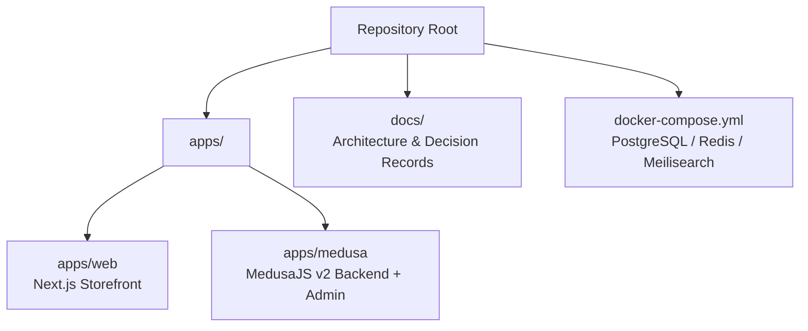
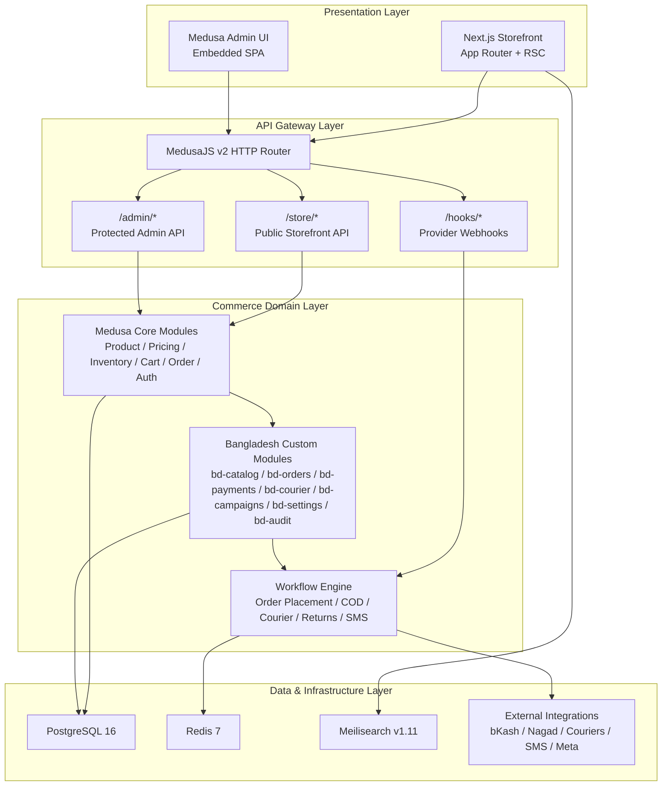
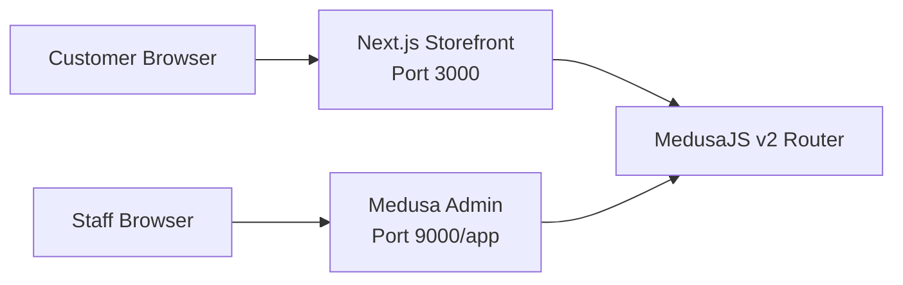
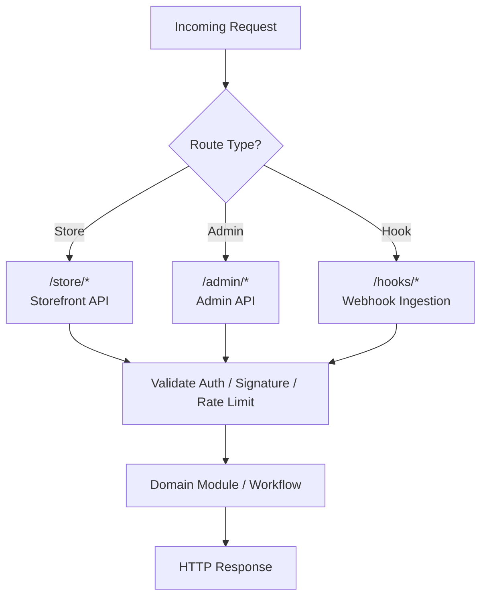
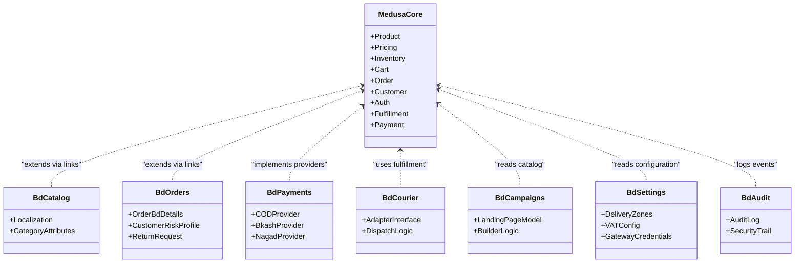
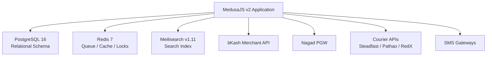
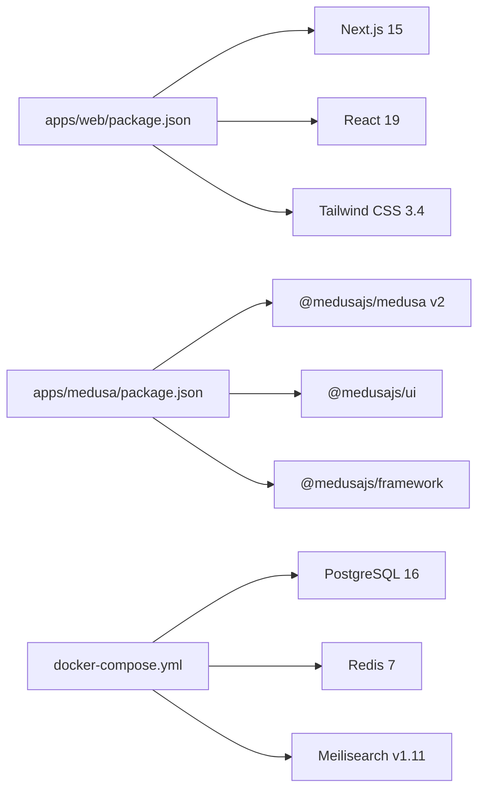

# System Overview & Guiding Principles

<cite>
**Referenced Files in This Document**   
- [prd.md](file://prd.md)
- [technical-plan.md](file://technical-plan.md)
- [architecture.md](file://docs/architecture.md)
- [architecture-decision-medusa-v2.md](file://docs/architecture-decision-medusa-v2.md)
- [medusa-config.ts](file://apps/medusa/medusa-config.ts)
- [docker-compose.yml](file://docker-compose.yml)
- [web/package.json](file://apps/web/package.json)
- [medusa/package.json](file://apps/medusa/package.json)
- [web/layout.tsx](file://apps/web/src/app/layout.tsx)
- [web/page.tsx](file://apps/web/src/app/page.tsx)
- [bd-orders/service.ts](file://apps/medusa/src/modules/bd-orders/service.ts)
- [bd-payments/service.ts](file://apps/medusa/src/modules/bd-payments/service.ts)
</cite>

## Table of Contents
1. [Introduction](#introduction)
2. [Project Structure](#project-structure)
3. [Core Components](#core-components)
4. [Architecture Overview](#architecture-overview)
5. [Detailed Component Analysis](#detailed-component-analysis)
6. [Dependency Analysis](#dependency-analysis)
7. [Performance Considerations](#performance-considerations)
8. [Troubleshooting Guide](#troubleshooting-guide)
9. [Conclusion](#conclusion)

## Introduction
BD Commerce Platform is a single-vendor B2C e-commerce solution specifically engineered for Bangladesh. It targets a single merchant operating one store, one warehouse, and one currency (BDT), while supporting Bangla and English storefronts, Cash on Delivery, direct bKash and Nagad payment flows, local delivery zones, campaign landing pages, manual return/refund review, SMS notifications, contribution-profit reporting, and audit logging.

The platform identity is intentionally narrow: it is not a multi-vendor marketplace, does not implement card payments at launch, and avoids automatic refund execution or automatic return approval. Instead, it focuses on reliable order placement, consistent catalog/cart/order data, staff-controlled operations, and infrastructure that can scale from a local development environment to production with PostgreSQL, Redis, and Meilisearch.

This document explains the system’s guiding principles, three-tier architecture, technology stack, component interactions, and why MedusaJS v2 + Next.js 15 was selected over alternatives.

**Section sources**
- [prd.md:29-73](file://prd.md#L29-L73)
- [architecture.md:44-74](file://docs/architecture.md#L44-L74)

## Project Structure
At repository level, BD Commerce Platform is organized as a monorepo with two primary application workspaces:

- `apps/web`: Next.js 15 App Router storefront.
- `apps/medusa`: MedusaJS v2 backend with embedded Admin UI and custom Bangladesh modules.
- `docs`: Authoritative architecture, decision records, and review documents.
- `docker-compose.yml`: Local infrastructure services for PostgreSQL, Redis, and Meilisearch.

**Diagram sources**
- [docker-compose.yml:1-77](file://docker-compose.yml#L1-L77)
- [web/package.json:1-28](file://apps/web/package.json#L1-L28)
- [medusa/package.json:1-61](file://apps/medusa/package.json#L1-L61)

The current storefront entry point is a minimal Next.js page describing infrastructure components, while the Medusa workspace declares the backend runtime, dependencies, and custom module registration. The root configuration file loads environment variables and registers the active Bangladesh modules.

**Section sources**
- [web/layout.tsx:1-22](file://apps/web/src/app/layout.tsx#L1-L22)
- [web/page.tsx:1-81](file://apps/web/src/app/page.tsx#L1-L81)
- [medusa/package.json:15-38](file://apps/medusa/package.json#L15-L38)
- [medusa-config.ts:1-46](file://apps/medusa/medusa-config.ts#L1-L46)

## Core Components
The platform consists of four major layers:

| Layer | Responsibility | Key Technologies |
|---|---|---|
| Presentation Layer | Customer storefront and administrative interface | Next.js 15 App Router, React 19, Tailwind CSS 3.4, Medusa Admin UI |
| API Gateway Layer | Public store APIs, protected admin APIs, provider webhooks | MedusaJS v2 HTTP router, route namespaces, CORS, JWT |
| Commerce Domain Layer | Core commerce primitives plus Bangladesh-specific business logic | Medusa core modules, custom `bd-*` modules, workflows |
| Data & Infrastructure Layer | Persistent storage, caching, search, external integrations | PostgreSQL 16, Redis 7, Meilisearch v1.11, payment/courier/SMS providers |

### Technology Stack Summary

| Area | Selected Technology | Purpose |
|---|---|---|
| Commerce Backend | MedusaJS v2 (`@medusajs/medusa@^2.0`) | Headless commerce engine, DML, workflows, embedded Admin |
| Admin UI | Medusa Admin (`@medusajs/ui`) | Native order/product management extended with Bangladesh widgets |
| Storefront | Next.js App Router 15.x | Server Components, SSR, bilingual routing, campaign landing pages |
| Styling | Tailwind CSS 3.4.x | Locked utility-first styling for mobile-first storefront |
| Database | PostgreSQL 16 | Relational integrity, snapshots, audit logs |
| Cache / Queue / Pub-Sub | Redis 7 | Workflows, distributed locks, rate limits, session lockouts |
| Search | Meilisearch v1.11 | Typo-tolerant Banglish product search |
| Runtime | Node.js 20+ LTS | Asynchronous server runtime |

**Section sources**
- [architecture.md:51-64](file://docs/architecture.md#L51-L64)
- [technical-plan.md:30-56](file://technical-plan.md#L30-L56)
- [web/package.json:12-25](file://apps/web/package.json#L12-L25)
- [medusa/package.json:25-38](file://apps/medusa/package.json#L25-L38)

## Architecture Overview
BD Commerce Platform follows a layered architecture where presentation, API routing, domain logic, and data are clearly separated.

**Diagram sources**
- [architecture.md:77-124](file://docs/architecture.md#L77-L124)
- [docker-compose.yml:1-77](file://docker-compose.yml#L1-L77)

### Why This Architecture Was Chosen
The architecture was selected because it balances enterprise-grade commerce correctness with Bangladesh operational reality:

1. **Medusa First Approach:** Generic commerce concerns such as products, variants, inventory reservations, carts, orders, and payments are handled by Medusa core rather than rebuilt.
2. **Module Isolation:** Bangladesh-specific features live in encapsulated custom modules (`bd-catalog`, `bd-orders`, `bd-payments`, `bd-courier`, `bd-campaigns`, `bd-settings`, `bd-audit`).
3. **Transactional Workflows:** Multi-step processes like order placement, COD confirmation, courier dispatch, and return/refund review use Medusa Workflows with compensation semantics.
4. **Zero-Trust External Callbacks:** Payment callbacks and courier webhooks are never trusted blindly; they require server-to-server verification before state changes.
5. **Single Source of Truth:** Storefront, campaign landing pages, and Admin tools share the same underlying catalog, pricing, cart, and inventory records.
6. **Bangladesh Operational Reality:** COD dominance, call-center confirmation, manual return inspection, 4-field status separation, and local address structure are first-class design inputs.

Alternatives considered included building a custom Express + Prisma API scaffold, using a generic headless framework without native workflows, or adopting a multi-vendor marketplace platform. Those options were rejected because they would either reinvent fragile commerce primitives, lack transactional workflow guarantees, or introduce unnecessary multi-tenant complexity for a single-vendor store.

**Section sources**
- [architecture.md:66-74](file://docs/architecture.md#L66-L74)
- [architecture-decision-medusa-v2.md:12-33](file://docs/architecture-decision-medusa-v2.md#L12-L33)
- [technical-plan.md:715-732](file://technical-plan.md#L715-L732)

## Detailed Component Analysis

### Presentation Layer: Next.js Storefront + Medusa Admin
The presentation layer has two consumers:

- **Next.js Storefront:** Mobile-first, bilingual storefront with product browsing, PDP, unified cart, checkout, guest order tracking, and campaign landing pages.
- **Medusa Admin:** Embedded administrative dashboard used by Owner, Manager, Call Center, Warehouse, and Finance roles.

**Diagram sources**
- [architecture.md:77-96](file://docs/architecture.md#L77-L96)
- [web/package.json:6-16](file://apps/web/package.json#L6-L16)
- [medusa/package.json:15-38](file://apps/medusa/package.json#L15-L38)

The storefront layout defines metadata and a minimal HTML shell, while the current homepage displays infrastructure service cards. This reflects an early-stage storefront that will evolve into a full product catalog, cart, checkout, and campaign landing page experience.

**Section sources**
- [web/layout.tsx:1-22](file://apps/web/src/app/layout.tsx#L1-L22)
- [web/page.tsx:1-81](file://apps/web/src/app/page.tsx#L1-L81)
- [architecture.md:738-763](file://docs/architecture.md#L738-L763)

### API Gateway Layer: MedusaJS HTTP Router
The API gateway layer exposes three primary route families:

| Route Family | Consumer | Security Model |
|---|---|---|
| `/store/*` | Next.js Storefront | Public or cart-token-based access, CORS-restricted, rate-limited |
| `/admin/*` | Medusa Admin | Bearer JWT, RBAC middleware, audit logged |
| `/hooks/*` | bKash, Nagad, couriers, SMS gateways | Signature/HMAC verification, zero-trust payload handling |

**Diagram sources**
- [architecture.md:91-96](file://docs/architecture.md#L91-L96)
- [architecture.md:305-355](file://docs/architecture.md#L305-L355)

The Medusa configuration file shows how database URL, Redis URL, CORS policies, JWT secret, cookie secret, Admin enablement, and custom modules are loaded. This is the central integration point between the runtime, environment, and domain modules.

**Section sources**
- [medusa-config.ts:1-46](file://apps/medusa/medusa-config.ts#L1-L46)
- [architecture.md:305-355](file://docs/architecture.md#L305-L355)

### Commerce Domain Layer: Core Modules + Bangladesh Custom Modules
The commerce domain layer separates Medusa core responsibilities from Bangladesh-specific extensions.

#### Core Medusa Responsibilities
- Product, category, variant, price set, inventory, cart, order, customer, auth, fulfillment, and payment collection.
- These are treated as native capabilities that should not be forked or reimplemented.

#### Bangladesh Custom Modules
- `bd-catalog`: Catalog localization and dynamic category attributes.
- `bd-orders`: Order extension, COD risk profile, independent return/refund status.
- `bd-payments`: COD, bKash, Nagad payment providers.
- `bd-courier`: Courier adapter interface and dispatch logic.
- `bd-campaigns`: Landing page model and builder logic.
- `bd-settings`: Delivery zones, VAT settings, SMS/gateway credentials.
- `bd-audit`: Audit log subscriber and security trail.

**Diagram sources**
- [architecture.md:227-302](file://docs/architecture.md#L227-L302)
- [bd-orders/service.ts:1-13](file://apps/medusa/src/modules/bd-orders/service.ts#L1-L13)
- [bd-payments/service.ts:1-11](file://apps/medusa/src/modules/bd-payments/service.ts#L1-L11)

The `bd-orders` service exposes models for order details, customer risk profiles, and return requests. The `bd-payments` service exposes models for payment transactions and webhook logs. Both follow the Medusa service pattern and encapsulate Bangladesh-specific data structures.

**Section sources**
- [bd-orders/service.ts:1-13](file://apps/medusa/src/modules/bd-orders/service.ts#L1-L13)
- [bd-payments/service.ts:1-11](file://apps/medusa/src/modules/bd-payments/service.ts#L1-L11)
- [architecture.md:227-302](file://docs/architecture.md#L227-L302)

### Data & Infrastructure Layer
The data and infrastructure layer provides persistence, caching, search, and external integration boundaries.

**Diagram sources**
- [docker-compose.yml:1-77](file://docker-compose.yml#L1-L77)
- [architecture.md:112-124](file://docs/architecture.md#L112-L124)

PostgreSQL stores core Medusa tables, custom BD models, audit logs, and immutable order-time snapshots. Redis handles workflow queues, event pub/sub, flash-sale stock locks, rate limiting, and account lockouts. Meilisearch indexes only allowed product fields, excluding confidential COGS and margin data.

**Section sources**
- [docker-compose.yml:1-77](file://docker-compose.yml#L1-L77)
- [architecture.md:402-464](file://docs/architecture.md#L402-L464)

### Guiding Principles in Practice

#### Medusa First Approach
Generic commerce logic is reused from Medusa core. Extensions are confined to Bangladesh-specific requirements such as COD confirmation, local payment providers, delivery zones, and return/refund policy.

#### Module Isolation
Each Bangladesh capability is implemented as a dedicated module with its own models and service boundary. Inter-module communication uses Medusa’s module link system rather than tight coupling.

#### Workflow Transactions
Multi-step state mutations are implemented as Medusa Workflows. Irreversible external actions such as SMS dispatch occur after database commitment, and failures do not silently corrupt order/payment/return state.

#### Zero-Trust External Callbacks
Payment gateway callbacks and courier webhooks are validated through signature checks and server-to-server verification queries. Incoming request payloads are never accepted as truth.

#### Bangladesh Operational Reality
The system accommodates COD-heavy operations, call-center confirmation, manual return inspection, separate delivery charges for Inside Dhaka and Outside Dhaka, and a strict four-field status model for order, payment, shipment, and return/refund.

**Section sources**
- [architecture.md:66-74](file://docs/architecture.md#L66-L74)
- [prd.md:34-42](file://prd.md#L34-L42)
- [prd.md:256-283](file://prd.md#L256-L283)
- [prd.md:418-443](file://prd.md#L418-L443)

## Dependency Analysis
The repository’s runtime dependencies reflect the chosen architecture:

- **Next.js Storefront:** Depends on Next.js 15, React 19, Tailwind CSS 3.4, and related tooling.
- **Medusa Backend:** Depends on MedusaJS v2 packages, Admin SDK/UI, framework utilities, Zod validation, and test tooling.
- **Infrastructure Services:** Defined in Docker Compose for PostgreSQL, Redis, and Meilisearch.

**Diagram sources**
- [web/package.json:12-25](file://apps/web/package.json#L12-L25)
- [medusa/package.json:25-38](file://apps/medusa/package.json#L25-L38)
- [docker-compose.yml:1-77](file://docker-compose.yml#L1-L77)

The Medusa configuration file also reveals which custom modules are currently registered: `bd-catalog`, `bd-orders`, `bd-courier`, `bd-payments`, `bd-campaigns`, `bd-settings`, and `bd-audit`. This confirms the active domain surface area of the backend.

**Section sources**
- [medusa-config.ts:22-44](file://apps/medusa/medusa-config.ts#L22-L44)

## Performance Considerations
Performance considerations are driven by Bangladesh market conditions and the platform’s technical choices:

- **Mobile-First Storefront:** The storefront targets responsive performance on mobile networks, with optimized images, localized typography, and streamlined checkout.
- **Server-Side Rendering:** Next.js App Router uses SSR and ISR for catalog and landing pages to reduce client-side load.
- **Instant Search:** Meilisearch provides fast, typo-tolerant search for Banglish queries while excluding sensitive financial fields.
- **Atomic Stock Operations:** Inventory is reserved atomically during order placement, not at cart add, preventing overselling under concurrent checkout.
- **Distributed Locks:** Redis-backed locks protect low-stock variants during high-concurrency checkout scenarios.
- **Rate Limiting:** Endpoints such as order placement, order tracking, and authentication are rate-limited to prevent abuse and SMS gateway exhaustion.
- **Contribution Profit Reporting:** Financial reports avoid misleading labels and explicitly distinguish gross sales, net sales, costs, and advertising attribution.

These characteristics make the architecture more suitable for a single-vendor Bangladeshi store than a generic marketplace or a custom-built API without transactional workflows.

**Section sources**
- [architecture.md:402-464](file://docs/architecture.md#L402-L464)
- [architecture.md:738-763](file://docs/architecture.md#L738-L763)
- [technical-plan.md:597-654](file://technical-plan.md#L597-L654)

## Troubleshooting Guide
When diagnosing BD Commerce Platform issues, start from the architectural boundaries:

1. **Storefront Cannot Reach Backend:**
   - Verify Next.js is running on port 3000.
   - Verify Medusa backend is running on port 9000.
   - Check CORS configuration in `medusa-config.ts`.
   - Confirm `NEXT_PUBLIC_MEDUSA_BACKEND_URL` is configured in the storefront environment.

2. **Database Connection Failure:**
   - Ensure PostgreSQL container is healthy.
   - Confirm `DATABASE_URL` points to the correct host, user, password, and database name.
   - Run Medusa migrations if schema is missing.

3. **Workflows or Queues Not Processing:**
   - Verify Redis container is healthy.
   - Confirm `REDIS_URL` is configured.
   - Check workflow queue keys and job logs.

4. **Search Results Missing or Slow:**
   - Verify Meilisearch container is healthy.
   - Confirm index sync is enabled and only allowed fields are indexed.
   - Ensure confidential fields such as COGS are excluded from public search indices.

5. **Payment Callback Rejected:**
   - Do not trust incoming callback body parameters.
   - Perform server-to-server verification against the provider’s execute/status endpoint.
   - Validate amount, currency, and transaction status.

6. **SMS Not Sent:**
   - Check SMS gateway credentials and template configuration.
   - Review `sms_log` for delivery failures.
   - Remember SMS failure must not roll back an already committed order.

7. **Admin Access Denied:**
   - Verify JWT configuration and session validity.
   - Check role-based permissions for the requested route.
   - Confirm forced password change and account lockout rules are not blocking access.

**Section sources**
- [medusa-config.ts:7-18](file://apps/medusa/medusa-config.ts#L7-L18)
- [architecture.md:305-355](file://docs/architecture.md#L305-L355)
- [architecture.md:402-464](file://docs/architecture.md#L402-L464)
- [architecture.md:545-566](file://docs/architecture.md#L545-L566)

## Conclusion
BD Commerce Platform is a focused, single-vendor B2C e-commerce system designed for Bangladesh. Its identity is defined by a single merchant model, BDT pricing, COD-first operations, local payment and courier realities, manual return/refund governance, and strong auditability.

The three-tier architecture—presentation layer, API gateway layer, commerce domain layer, and data/infrastructure layer—provides clear boundaries between customer-facing interfaces, routing, business logic, and persistent systems. MedusaJS v2 supplies battle-tested commerce primitives and transactional workflows, while Next.js 15 delivers a modern, mobile-first storefront. PostgreSQL, Redis, and Meilisearch provide relational integrity, concurrency control, and instant search.

This architecture was chosen because it avoids rebuilding fragile commerce logic, isolates Bangladesh-specific extensions, enforces zero-trust external callbacks, and aligns with real operational constraints such as COD confirmation, manual return inspection, and delivery zone calculations. The result is a system that prioritizes reliability, auditability, and maintainability over premature automation or marketplace complexity.