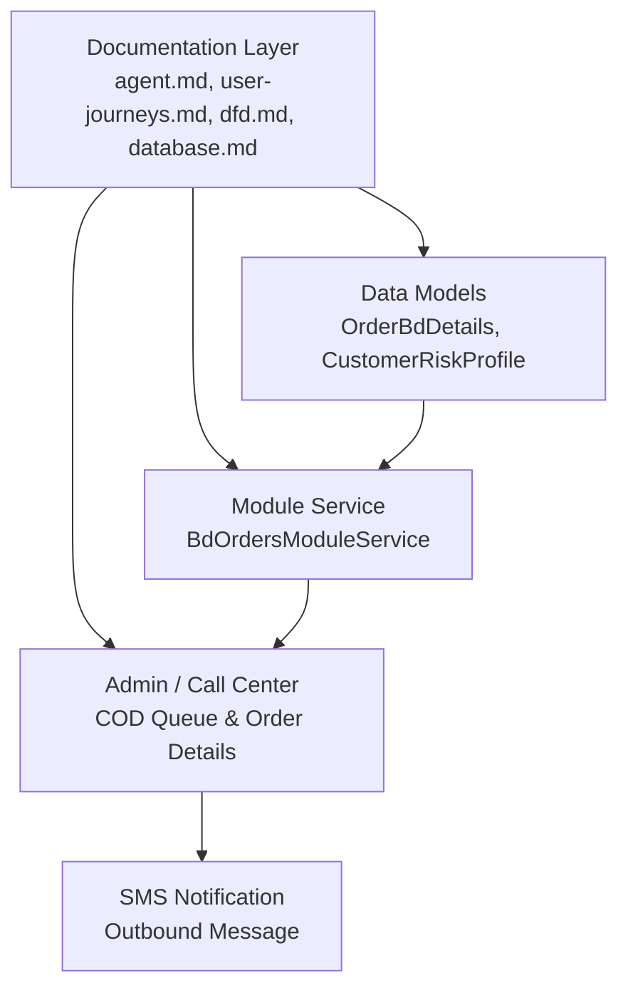
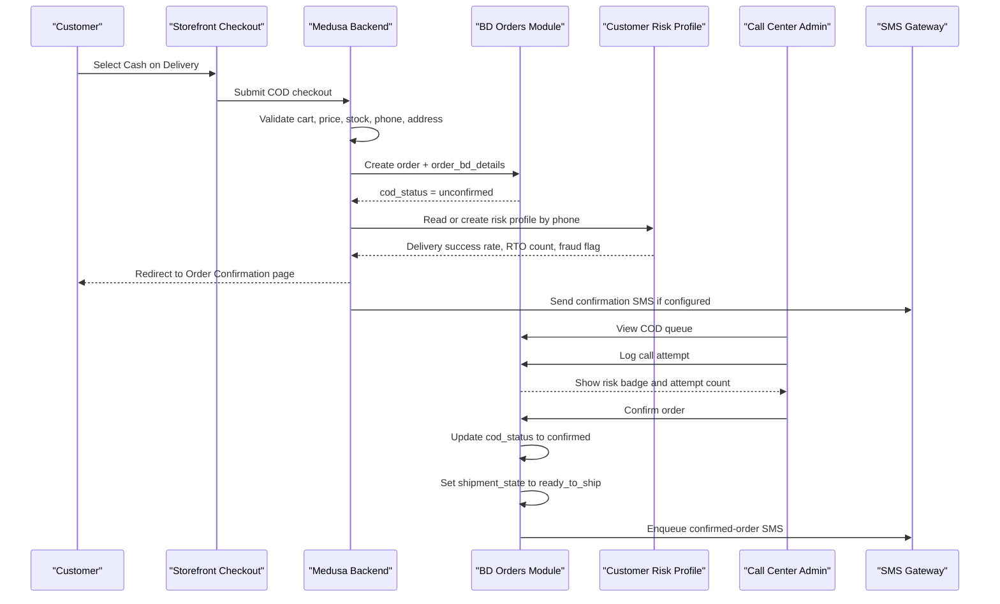
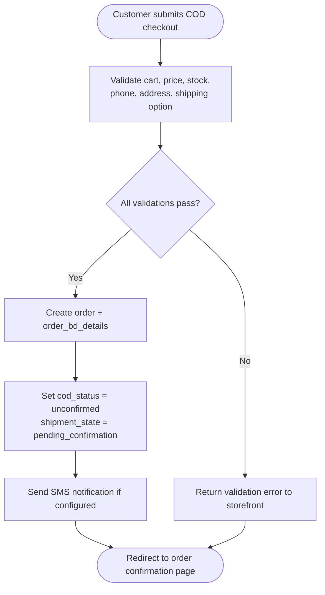
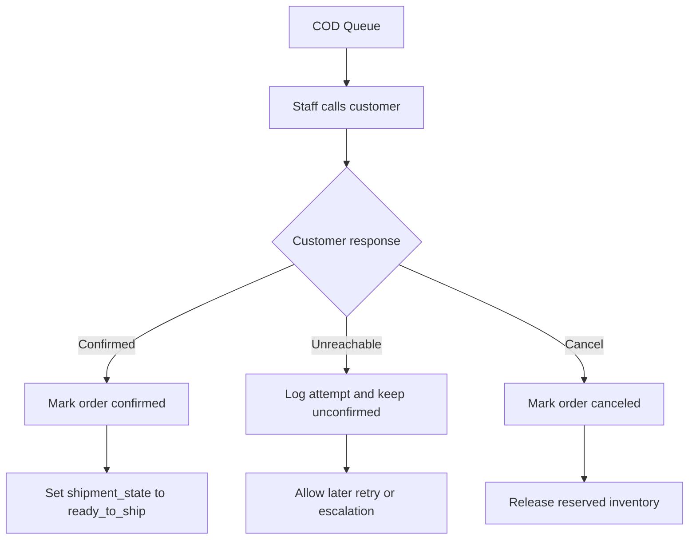
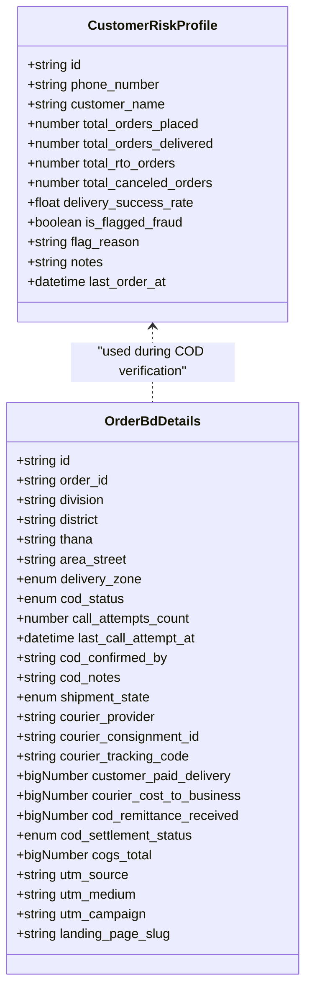
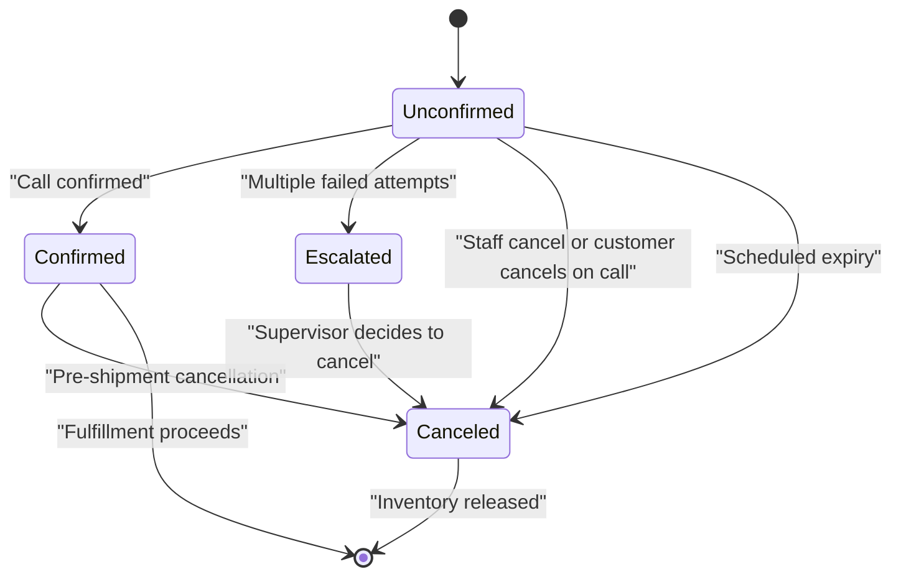
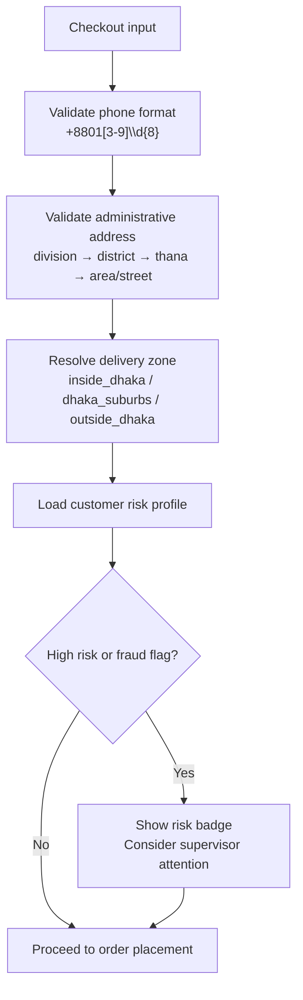
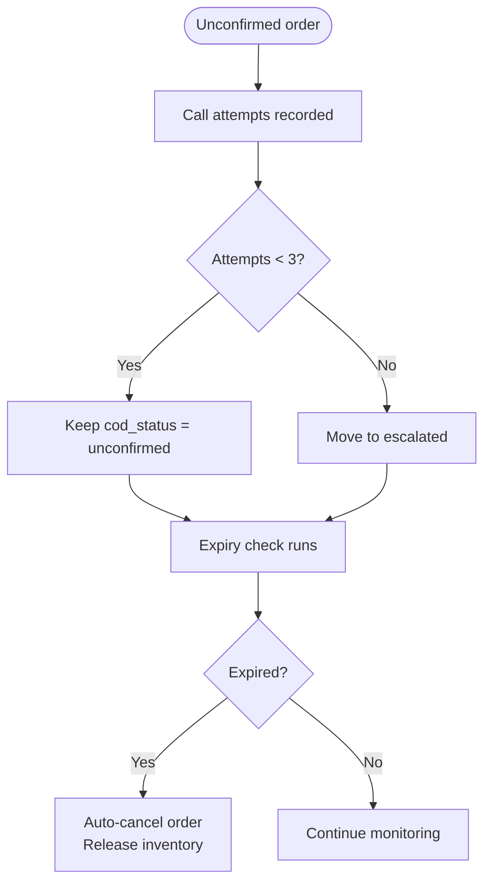
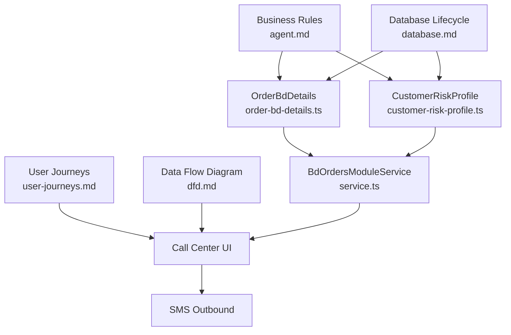

# Cash on Delivery Confirmation Workflow

<cite>
**Referenced Files in This Document**   
- [agent.md](file://agent.md)
- [user-journeys.md](file://user-journeys.md)
- [dfd.md](file://dfd.md)
- [database.md](file://database.md)
- [order-bd-details.ts](file://apps/medusa/src/modules/bd-orders/models/order-bd-details.ts)
- [customer-risk-profile.ts](file://apps/medusa/src/modules/bd-orders/models/customer-risk-profile.ts)
- [service.ts](file://apps/medusa/src/modules/bd-orders/service.ts)
</cite>

## Table of Contents
1. [Introduction](#introduction)
2. [Project Structure](#project-structure)
3. [Core Components](#core-components)
4. [Architecture Overview](#architecture-overview)
5. [Detailed Component Analysis](#detailed-component-analysis)
6. [Dependency Analysis](#dependency-analysis)
7. [Performance Considerations](#performance-considerations)
8. [Troubleshooting Guide](#troubleshooting-guide)
9. [Conclusion](#conclusion)

## Introduction
This document explains the Cash on Delivery confirmation workflow for the Bangladesh market. It focuses on how a COD order is created, verified by call center staff, assessed against customer risk data, and transitioned through its operational states. It also documents phone validation rules, address hierarchy requirements, fraud prevention signals, and the error handling path for unconfirmed orders.

The workflow is designed around four independent status dimensions:
- Order status
- Payment status
- Shipment state
- Return/refund review status

For COD, the relevant operational states are `unconfirmed`, `confirmed`, `escalated`, and `canceled` in the Bangladesh-specific order details, combined with shipment state transitions such as `pending_confirmation` and `ready_to_ship`.

## Project Structure
The COD workflow spans documentation, database models, and module service definitions:

- Business rules and Bangladesh-specific constraints are defined in the agent guide.
- Customer-facing and admin-facing behavior is described in the user journeys.
- The end-to-end data flow and escalation logic are documented in the data flow diagram.
- The canonical lifecycle and data rules are captured in the database documentation.
- The runtime schema is implemented in the Medusa module models and service.

**Diagram sources**
- [agent.md:108-145](file://agent.md#L108-L145)
- [user-journeys.md:329-341](file://user-journeys.md#L329-L341)
- [dfd.md:289-295](file://dfd.md#L289-L295)
- [database.md:2234-2255](file://database.md#L2234-L2255)
- [order-bd-details.ts:3-39](file://apps/medusa/src/modules/bd-orders/models/order-bd-details.ts#L3-L39)
- [customer-risk-profile.ts:3-16](file://apps/medusa/src/modules/bd-orders/models/customer-risk-profile.ts#L3-L16)
- [service.ts:6-10](file://apps/medusa/src/modules/bd-orders/service.ts#L6-L10)

**Section sources**
- [agent.md:108-145](file://agent.md#L108-L145)
- [user-journeys.md:329-341](file://user-journeys.md#L329-L341)
- [dfd.md:289-295](file://dfd.md#L289-L295)
- [database.md:2234-2255](file://database.md#L2234-L2255)
- [order-bd-details.ts:3-39](file://apps/medusa/src/modules/bd-orders/models/order-bd-details.ts#L3-L39)
- [customer-risk-profile.ts:3-16](file://apps/medusa/src/modules/bd-orders/models/customer-risk-profile.ts#L3-L16)
- [service.ts:6-10](file://apps/medusa/src/modules/bd-orders/service.ts#L6-L10)

## Core Components
The COD confirmation workflow relies on three core components:

| Component | Responsibility | Key Fields / Behavior |
|---|---|---|
| Bangladesh Order Details | Stores COD verification state, delivery zone, call attempts, courier information, and financial snapshots | `cod_status`, `call_attempts_count`, `last_call_attempt_at`, `delivery_zone`, `shipment_state`, `courier_provider`, `customer_paid_delivery`, `cod_settlement_status` |
| Customer Risk Profile | Tracks customer-level risk signals used during COD verification | `phone_number`, `total_orders_placed`, `total_rto_orders`, `delivery_success_rate`, `is_flagged_fraud`, `flag_reason` |
| BD Orders Module Service | Exposes CRUD operations over the above models within the Medusa module | Wraps `OrderBdDetails`, `CustomerRiskProfile`, and related models |

These components together enable:
- Creating an order with COD marked as unconfirmed.
- Recording call attempts and notes.
- Escalating orders after repeated failed contact.
- Associating risk signals with each COD verification attempt.

**Section sources**
- [order-bd-details.ts:3-39](file://apps/medusa/src/modules/bd-orders/models/order-bd-details.ts#L3-L39)
- [customer-risk-profile.ts:3-16](file://apps/medusa/src/modules/bd-orders/models/customer-risk-profile.ts#L3-L16)
- [service.ts:6-10](file://apps/medusa/src/modules/bd-orders/service.ts#L6-L10)

## Architecture Overview
The COD architecture separates customer checkout, call center verification, risk assessment, and fulfillment preparation.

**Diagram sources**
- [user-journeys.md:329-341](file://user-journeys.md#L329-L341)
- [dfd.md:289-295](file://dfd.md#L289-L295)
- [database.md:2234-2255](file://database.md#L2234-L2255)
- [order-bd-details.ts:10-15](file://apps/medusa/src/modules/bd-orders/models/order-bd-details.ts#L10-L15)
- [customer-risk-profile.ts:5-13](file://apps/medusa/src/modules/bd-orders/models/customer-risk-profile.ts#L5-L13)

## Detailed Component Analysis

### COD Verification Process
When a customer selects Cash on Delivery:
- The backend validates cart contents, prices, stock availability, phone number format, and address codes.
- An order is created with payment status unpaid and COD confirmation status unconfirmed.
- The customer is redirected to an order confirmation page explaining that the team will call to confirm the order.
- If the SMS gateway is configured, an outbound message is sent without blocking order creation.

Key implementation points:
- Phone numbers must follow E.164 format starting with `+8801[3-9]\d{8}`.
- Address fields use the 4-tier administrative hierarchy: division, district, thana, area/street.
- Delivery routing uses strict zone codes rather than free-text matching.

**Diagram sources**
- [user-journeys.md:329-341](file://user-journeys.md#L329-L341)
- [agent.md:111-122](file://agent.md#L111-L122)
- [dfd.md:289-295](file://dfd.md#L289-L295)

**Section sources**
- [user-journeys.md:329-341](file://user-journeys.md#L329-L341)
- [agent.md:111-122](file://agent.md#L111-L122)
- [dfd.md:289-295](file://dfd.md#L289-L295)

### Customer Confirmation Steps
The call center workflow is manual-first:
- Staff receives a new COD order alert.
- Staff opens the order detail, calls the customer, and records the outcome.
- Confirmed orders move toward fulfillment.
- Unreachable orders may be retried or escalated.
- Only authorized users can update COD confirmation status.
- Every update is logged in the activity timeline.

**Diagram sources**
- [user-journeys.md:762-787](file://user-journeys.md#L762-L787)
- [dfd.md:396-443](file://dfd.md#L396-L443)

**Section sources**
- [user-journeys.md:762-787](file://user-journeys.md#L762-L787)
- [dfd.md:396-443](file://dfd.md#L396-L443)

### Risk Assessment Integration
Customer risk profiling supports COD decisions by surfacing historical delivery performance and fraud signals:
- The risk profile tracks total orders placed, delivered, returned-to-origin, and canceled.
- Delivery success rate helps classify risk level.
- A fraud flag and reason field allow explicit fraud-related warnings.
- The call center queue displays risk badges so agents can prioritize or escalate high-risk orders.

**Diagram sources**
- [customer-risk-profile.ts:3-16](file://apps/medusa/src/modules/bd-orders/models/customer-risk-profile.ts#L3-L16)
- [order-bd-details.ts:3-39](file://apps/medusa/src/modules/bd-orders/models/order-bd-details.ts#L3-L39)

**Section sources**
- [customer-risk-profile.ts:3-16](file://apps/medusa/src/modules/bd-orders/models/customer-risk-profile.ts#L3-L16)
- [order-bd-details.ts:3-39](file://apps/medusa/src/modules/bd-orders/models/order-bd-details.ts#L3-L39)

### Order Status Transitions
The COD lifecycle has two important state dimensions:
- `cod_status`: not applicable, unconfirmed, confirmed, escalated, canceled
- `shipment_state`: pending_confirmation, ready_to_ship, dispatched, in_transit, out_for_delivery, delivery_failed, rto_initiated, rto_received, delivered

The canonical lifecycle is:
- Placement sets `cod_status` to unconfirmed and `shipment_state` to pending_confirmation.
- Successful call confirmation updates `cod_status` to confirmed and moves shipment state toward ready_to_ship.
- Repeated failed calls escalate the order.
- Cancellation moves both COD and shipment states to canceled and releases reserved inventory.
- Scheduled expiry checks can auto-cancel unconfirmed orders beyond the configured time window.

**Diagram sources**
- [order-bd-details.ts:10-26](file://apps/medusa/src/modules/bd-orders/models/order-bd-details.ts#L10-L26)
- [database.md:2234-2255](file://database.md#L2234-L2255)
- [dfd.md:396-443](file://dfd.md#L396-L443)

**Section sources**
- [order-bd-details.ts:10-26](file://apps/medusa/src/modules/bd-orders/models/order-bd-details.ts#L10-L26)
- [database.md:2234-2255](file://database.md#L2234-L2255)
- [dfd.md:396-443](file://dfd.md#L396-L443)

### Phone Verification, Address Validation, and Fraud Prevention
Bangladesh-specific controls include:

| Area | Requirement | Implementation Signal |
|---|---|---|
| Phone verification | All phone numbers must conform to E.164 format `+8801[3-9]\d{8}` | Storefront normalization and server-side validation; risk profile keyed by phone number |
| Address validation | Use 4-tier administrative hierarchy: division, district, thana, area/street | `division`, `district`, `thana`, `area_street` fields in order details |
| Delivery routing | Bind to administrative codes and delivery zones | `delivery_zone` enum values: inside_dhaka, dhaka_suburbs, outside_dhaka |
| Fraud prevention | Track RTO history, delivery success rate, and fraud flags | `total_rto_orders`, `delivery_success_rate`, `is_flagged_fraud`, `flag_reason` |
| Call center friction | Manual confirmation with attempt tracking before escalation | `call_attempts_count`, `last_call_attempt_at`, `cod_status` escalation |

**Diagram sources**
- [agent.md:111-122](file://agent.md#L111-L122)
- [order-bd-details.ts:6-11](file://apps/medusa/src/modules/bd-orders/models/order-bd-details.ts#L6-L11)
- [customer-risk-profile.ts:5-13](file://apps/medusa/src/modules/bd-orders/models/customer-risk-profile.ts#L5-L13)

**Section sources**
- [agent.md:111-122](file://agent.md#L111-L122)
- [order-bd-details.ts:6-11](file://apps/medusa/src/modules/bd-orders/models/order-bd-details.ts#L6-L11)
- [customer-risk-profile.ts:5-13](file://apps/medusa/src/modules/bd-orders/models/customer-risk-profile.ts#L5-L13)

### Error Handling for Unconfirmed Orders
Error and exception paths include:
- Invalid phone number blocks submission with an inline error.
- SMS failures do not block order creation; they are logged internally and can be resent manually.
- After three failed call attempts, the order moves to escalated status.
- Unconfirmed orders older than the configured expiry window are automatically canceled and have their reserved inventory released.
- Cancelling a shipped order is blocked; the system directs staff to the return-to-origin or failed-delivery workflow.

**Diagram sources**
- [user-journeys.md:343-347](file://user-journeys.md#L343-L347)
- [user-journeys.md:771-787](file://user-journeys.md#L771-L787)
- [dfd.md:396-443](file://dfd.md#L396-L443)
- [database.md:2234-2255](file://database.md#L2234-L2255)

**Section sources**
- [user-journeys.md:343-347](file://user-journeys.md#L343-L347)
- [user-journeys.md:771-787](file://user-journeys.md#L771-L787)
- [dfd.md:396-443](file://dfd.md#L396-L443)
- [database.md:2234-2255](file://database.md#L2234-L2255)

## Dependency Analysis
The COD workflow depends on:
- Documentation-driven business rules for Bangladesh market behavior.
- Database models defining COD and risk data structures.
- A Medusa module service exposing those models.
- Admin interfaces for call center operations.
- Optional SMS integration for outbound notifications.

**Diagram sources**
- [agent.md:108-145](file://agent.md#L108-L145)
- [user-journeys.md:329-341](file://user-journeys.md#L329-L341)
- [dfd.md:289-295](file://dfd.md#L289-L295)
- [database.md:2234-2255](file://database.md#L2234-L2255)
- [order-bd-details.ts:3-39](file://apps/medusa/src/modules/bd-orders/models/order-bd-details.ts#L3-L39)
- [customer-risk-profile.ts:3-16](file://apps/medusa/src/modules/bd-orders/models/customer-risk-profile.ts#L3-L16)
- [service.ts:6-10](file://apps/medusa/src/modules/bd-orders/service.ts#L6-L10)

**Section sources**
- [agent.md:108-145](file://agent.md#L108-L145)
- [user-journeys.md:329-341](file://user-journeys.md#L329-L341)
- [dfd.md:289-295](file://dfd.md#L289-L295)
- [database.md:2234-2255](file://database.md#L2234-L2255)
- [order-bd-details.ts:3-39](file://apps/medusa/src/modules/bd-orders/models/order-bd-details.ts#L3-L39)
- [customer-risk-profile.ts:3-16](file://apps/medusa/src/modules/bd-orders/models/customer-risk-profile.ts#L3-L16)
- [service.ts:6-10](file://apps/medusa/src/modules/bd-orders/service.ts#L6-L10)

## Performance Considerations
- Avoid blocking order placement on SMS delivery; log failures and allow manual resend.
- Keep call center operations lightweight: record attempt counts and timestamps rather than heavy payloads.
- Use risk profile lookups by phone number to avoid unnecessary joins across unrelated entities.
- Ensure scheduled expiry checks run efficiently and only scan unconfirmed orders beyond the configured threshold.
- Preserve immutable order-time financial snapshots to prevent re-pricing overhead during fulfillment.

## Troubleshooting Guide
Common issues and resolutions:

| Issue | Symptom | Resolution |
|---|---|---|
| Invalid phone number | Checkout submission blocked | Normalize to E.164 format and validate against Bangladesh mobile prefix rules |
| SMS not sent | No outbound message after order placement | Check SMS gateway configuration; log failure and allow manual resend |
| Order stuck in unconfirmed | No call confirmation after placement | Review call attempts; escalate after configured threshold |
| High-risk order confusion | Agent unsure whether to proceed | Inspect `delivery_success_rate`, `total_rto_orders`, and fraud flag |
| Attempting to cancel shipped order | Cancellation blocked | Use return-to-origin or failed-delivery workflow instead |
| Inventory not released | Reserved stock remains after cancellation | Verify pre-shipment cancellation path and audit logs |

**Section sources**
- [user-journeys.md:343-347](file://user-journeys.md#L343-L347)
- [user-journeys.md:771-787](file://user-journeys.md#L771-L787)
- [dfd.md:396-443](file://dfd.md#L396-L443)

## Conclusion
The Bangladesh COD confirmation workflow centers on manual call-center verification, strong phone and address validation, and risk-aware decision-making. Orders begin as unconfirmed, move to confirmed upon successful verification, escalate after repeated failed contact, and can be canceled either manually or automatically by expiry checks. The data model captures both operational state and risk signals, enabling scalable fraud prevention and reliable fulfillment preparation.