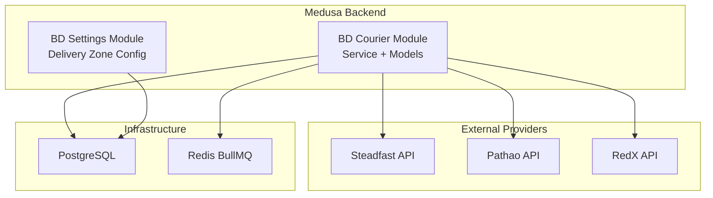
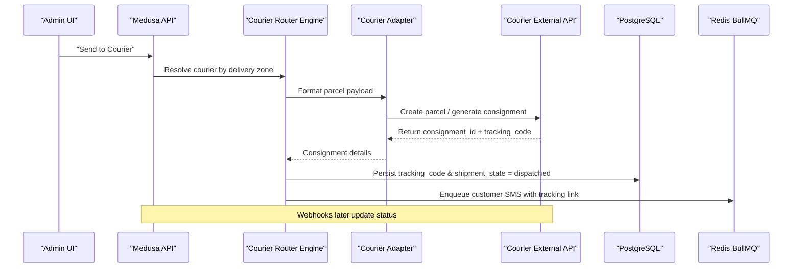
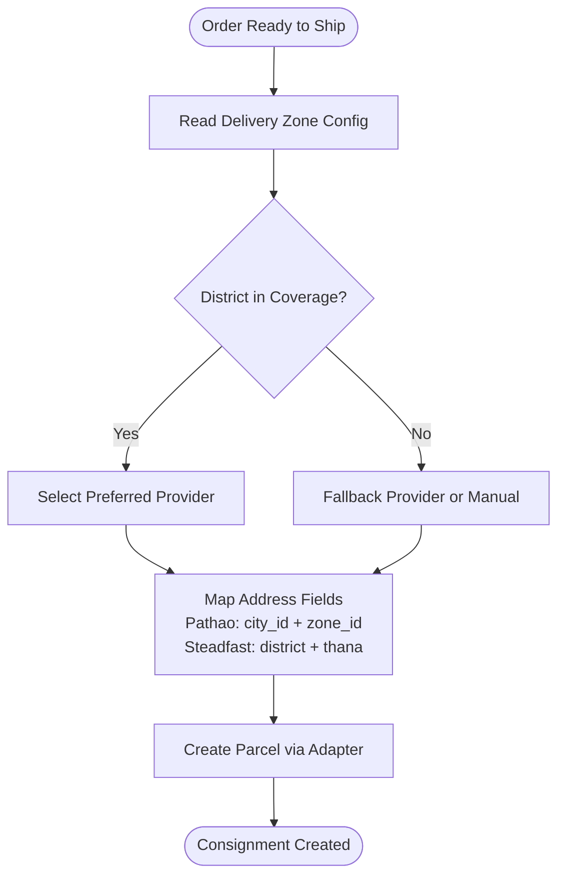
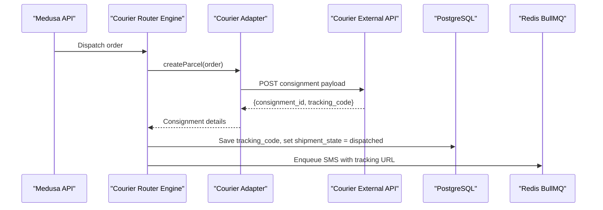
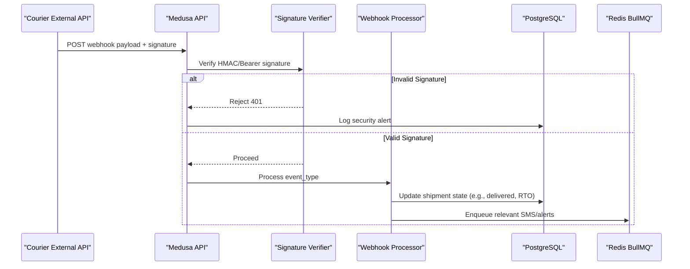
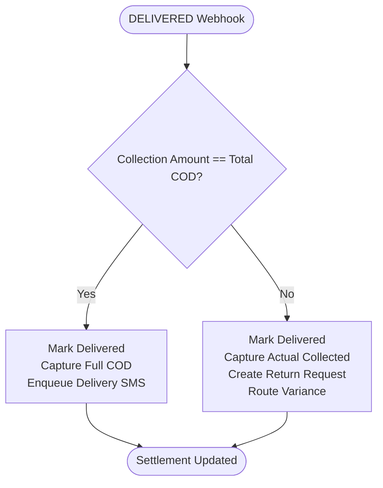
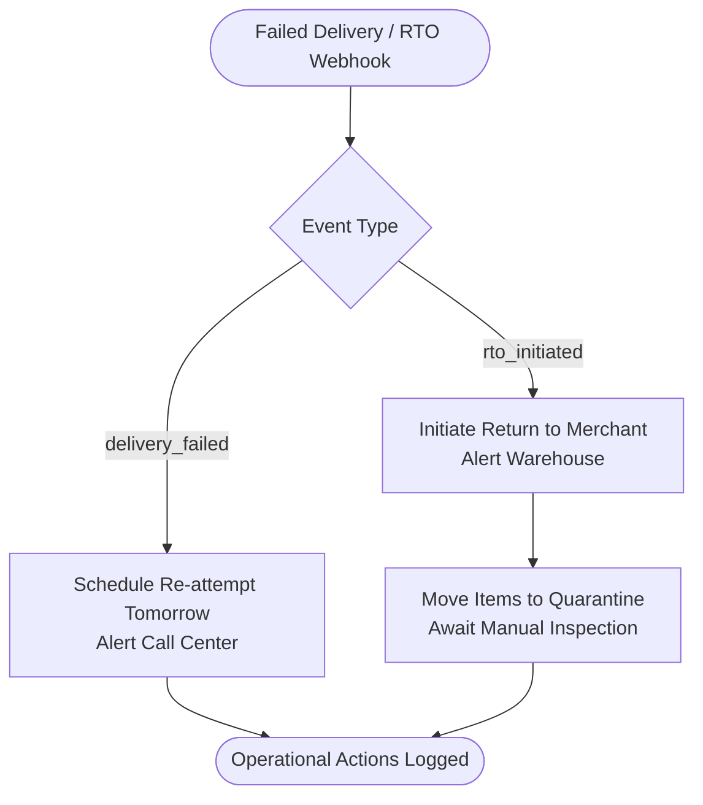
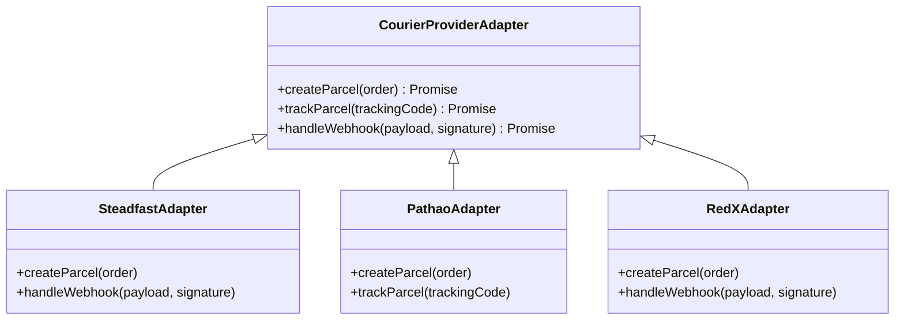
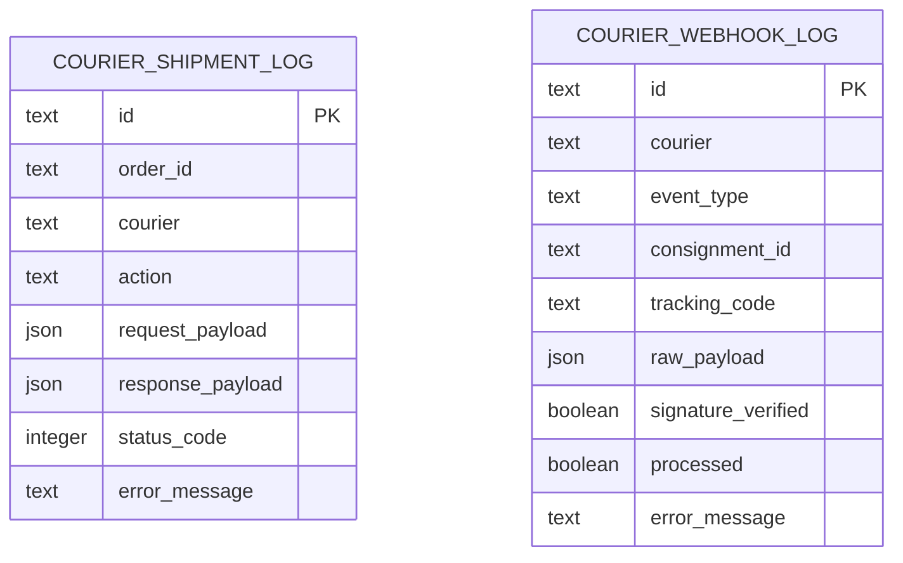
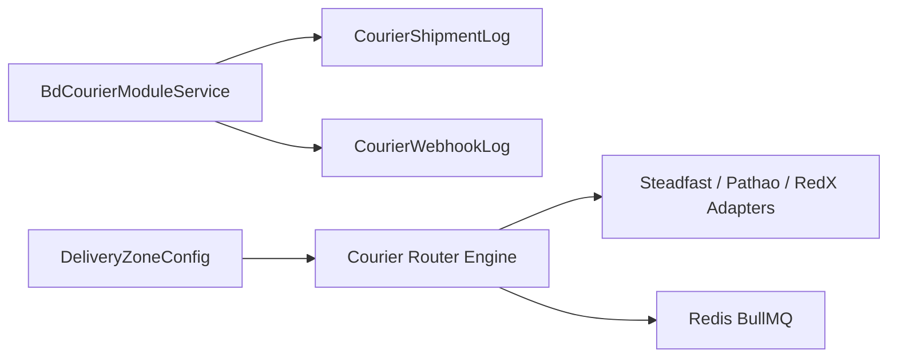

# Courier Dispatch & Tracking Workflow

<cite>
**Referenced Files in This Document**
- [service.ts](file://apps/medusa/src/modules/bd-courier/service.ts)
- [index.ts](file://apps/medusa/src/modules/bd-courier/index.ts)
- [courier-shipment-log.ts](file://apps/medusa/src/modules/bd-courier/models/courier-shipment-log.ts)
- [courier-webhook-log.ts](file://apps/medusa/src/modules/bd-courier/models/courier-webhook-log.ts)
- [Migration20261024060541.ts](file://apps/medusa/src/modules/bd-courier/migrations/Migration20261024060541.ts)
- [delivery-zone-config.ts](file://apps/medusa/src/modules/bd-settings/models/delivery-zone-config.ts)
- [dfd.md](file://docs/dfd.md)
- [technical-plan.md](file://technical-plan.md)
- [quality-checklist.md](file://quality-checklist.md)
</cite>

## Table of Contents
1. [Introduction](#introduction)
2. [Project Structure](#project-structure)
3. [Core Components](#core-components)
4. [Architecture Overview](#architecture-overview)
5. [Detailed Component Analysis](#detailed-component-analysis)
6. [Dependency Analysis](#dependency-analysis)
7. [Performance Considerations](#performance-considerations)
8. [Troubleshooting Guide](#troubleshooting-guide)
9. [Conclusion](#conclusion)

## Introduction
This document explains the courier dispatch and tracking workflow for the Bangladesh commerce platform. It covers automated courier selection based on delivery zones, shipment creation, tracking number generation, real-time status updates via webhooks, delivery confirmation processes, exception handling for failed deliveries, integration patterns with multiple couriers (Steadfast, Pathao, RedX), tracking synchronization, and delivery zone optimization.

The system is designed around a Medusa v2 module that persists courier interactions and webhook events, while higher-level design documents describe the end-to-end fulfillment flow, including order state transitions, SMS notifications, COD reconciliation, and RTO handling.

## Project Structure
The courier domain is implemented as a Medusa module under `apps/medusa/src/modules/bd-courier`. The module exposes a service backed by two core tables:
- `courier_shipment_log`: records outbound API calls to couriers during booking, cancellation, or rebooking.
- `courier_webhook_log`: records inbound webhook events from couriers for tracking and settlement.

Delivery zone configuration lives in a separate settings module and provides flat rates, free shipping thresholds, delivery day ranges, and district coverage metadata used by routing logic.

**Diagram sources**
- [service.ts:1-11](file://apps/medusa/src/modules/bd-courier/service.ts#L1-L11)
- [courier-shipment-log.ts:1-15](file://apps/medusa/src/modules/bd-courier/models/courier-shipment-log.ts#L1-L15)
- [courier-webhook-log.ts:1-16](file://apps/medusa/src/modules/bd-courier/models/courier-webhook-log.ts#L1-L16)
- [delivery-zone-config.ts:1-17](file://apps/medusa/src/modules/bd-settings/models/delivery-zone-config.ts#L1-L17)
- [technical-plan.md:549-593](file://technical-plan.md#L549-L593)

**Section sources**
- [service.ts:1-11](file://apps/medusa/src/modules/bd-courier/service.ts#L1-L11)
- [index.ts:1-9](file://apps/medusa/src/modules/bd-courier/index.ts#L1-L9)
- [courier-shipment-log.ts:1-15](file://apps/medusa/src/modules/bd-courier/models/courier-shipment-log.ts#L1-L15)
- [courier-webhook-log.ts:1-16](file://apps/medusa/src/modules/bd-courier/models/courier-webhook-log.ts#L1-L16)
- [delivery-zone-config.ts:1-17](file://apps/medusa/src/modules/bd-settings/models/delivery-zone-config.ts#L1-L17)
- [technical-plan.md:549-593](file://technical-plan.md#L549-L593)

## Core Components
- **BD Courier Module Service**: A Medusa service exposing repository methods for `CourierShipmentLog` and `CourierWebhookLog`. It is the operational entry point for logging courier interactions and webhook ingestion.
- **Courier Shipment Log Model**: Stores outbound requests and responses when creating, canceling, or updating parcels with courier providers. Includes fields for action type, payloads, HTTP status codes, and error messages.
- **Courier Webhook Log Model**: Stores inbound webhook events from couriers, including event type, consignment/tracking identifiers, raw payload, signature verification result, processing status, and error messages.
- **Delivery Zone Configuration Model**: Defines delivery zones (`inside_dhaka`, `dhaka_suburbs`, `outside_dhaka`) with pricing, thresholds, delivery windows, activity flags, and district coverage JSON.

These components together support:
- Automated courier selection using delivery zone rules.
- Shipment creation and tracking code generation.
- Webhook ingestion and status synchronization.
- Exception handling for failed deliveries and RTO flows.

**Section sources**
- [service.ts:1-11](file://apps/medusa/src/modules/bd-courier/service.ts#L1-L11)
- [courier-shipment-log.ts:1-15](file://apps/medusa/src/modules/bd-courier/models/courier-shipment-log.ts#L1-L15)
- [courier-webhook-log.ts:1-16](file://apps/medusa/src/modules/bd-courier/models/courier-webhook-log.ts#L1-L16)
- [delivery-zone-config.ts:1-17](file://apps/medusa/src/modules/bd-settings/models/delivery-zone-config.ts#L1-L17)

## Architecture Overview
The courier workflow spans three layers:
1. **Order Readiness**: Orders transition to `ready_to_ship` after payment and COD confirmation.
2. **Dispatch & Booking**: The system selects a courier adapter (Steadfast, Pathao, RedX), maps address fields, creates a parcel, and persists tracking metadata.
3. **Tracking & Settlement**: Webhooks update shipment states; full or partial COD collection is reconciled; failed deliveries trigger call center alerts or RTO workflows.

**Diagram sources**
- [technical-plan.md:549-593](file://technical-plan.md#L549-L593)
- [dfd.md:298-303](file://docs/dfd.md#L298-L303)

## Detailed Component Analysis

### Delivery Zone Optimization and Courier Selection
Delivery zones are configured centrally and include:
- Zone codes: `inside_dhaka`, `dhaka_suburbs`, `outside_dhaka`.
- Pricing: flat rate BDT and free shipping threshold.
- Delivery windows: minimum and maximum days.
- Coverage: optional district list in JSON.

Routing logic uses these attributes to select an appropriate courier provider. The technical plan defines a standardized adapter interface for Steadfast, Pathao, and RedX, enabling pluggable integrations without changing order workflows.

**Diagram sources**
- [delivery-zone-config.ts:1-17](file://apps/medusa/src/modules/bd-settings/models/delivery-zone-config.ts#L1-L17)
- [technical-plan.md:549-593](file://technical-plan.md#L549-L593)
- [dfd.md:298-303](file://docs/dfd.md#L298-L303)

**Section sources**
- [delivery-zone-config.ts:1-17](file://apps/medusa/src/modules/bd-settings/models/delivery-zone-config.ts#L1-L17)
- [technical-plan.md:549-593](file://technical-plan.md#L549-L593)
- [dfd.md:298-303](file://docs/dfd.md#L298-L303)

### Shipment Creation and Tracking Number Generation
When dispatch is initiated:
- The router resolves the correct courier adapter based on delivery zone and business rules.
- The adapter formats the parcel payload according to the provider’s schema.
- The external courier API returns a consignment ID and tracking code.
- The system persists tracking metadata and updates the order’s shipment state to `dispatched`.
- An SMS notification is enqueued to inform the customer with a tracking link.

**Diagram sources**
- [technical-plan.md:549-593](file://technical-plan.md#L549-L593)
- [dfd.md:298-303](file://docs/dfd.md#L298-L303)

**Section sources**
- [technical-plan.md:549-593](file://technical-plan.md#L549-L593)
- [dfd.md:298-303](file://docs/dfd.md#L298-L303)

### Webhook Handling for Courier Status Changes
Inbound webhooks are ingested, validated, and processed:
- Signature verification ensures authenticity.
- Event types such as `delivery_failed` and `rto_initiated` are differentiated.
- Successful webhooks update shipment states and may trigger call center alerts or warehouse actions.
- All webhook events are persisted in `courier_webhook_log` with signature verification results and processing status.

**Diagram sources**
- [courier-webhook-log.ts:1-16](file://apps/medusa/src/modules/bd-courier/models/courier-webhook-log.ts#L1-L16)
- [dfd.md:298-303](file://docs/dfd.md#L298-L303)

**Section sources**
- [courier-webhook-log.ts:1-16](file://apps/medusa/src/modules/bd-courier/models/courier-webhook-log.ts#L1-L16)
- [dfd.md:298-303](file://docs/dfd.md#L298-L303)

### Delivery Confirmation and Partial COD Collection
On delivery:
- Full COD collection marks the order as delivered and captures the full COD amount.
- Partial COD collection records actual cash collected, triggers return requests for rejected items, and routes variance to financial reconciliation.
- Webhook-driven updates ensure consistency between courier status and internal order state.

**Diagram sources**
- [dfd.md:298-303](file://docs/dfd.md#L298-L303)
- [quality-checklist.md:390-398](file://quality-checklist.md#L390-L398)

**Section sources**
- [dfd.md:298-303](file://docs/dfd.md#L298-L303)
- [quality-checklist.md:390-398](file://quality-checklist.md#L390-L398)

### Exception Handling for Failed Deliveries and RTO
Exception handling differentiates between:
- `delivery_failed`: Re-attempt next day and alert Call Center.
- `rto_initiated`: Initiate return to merchant and alert Warehouse.
- RTO received: Move items to quarantine; do not auto-restock; require manual inspection before sellable inventory adjustment.

**Diagram sources**
- [dfd.md:298-303](file://docs/dfd.md#L298-L303)
- [quality-checklist.md:390-398](file://quality-checklist.md#L390-L398)

**Section sources**
- [dfd.md:298-303](file://docs/dfd.md#L298-L303)
- [quality-checklist.md:390-398](file://quality-checklist.md#L390-L398)

### Integration Patterns with Multiple Couriers
The system supports multiple courier providers through a standardized adapter interface:
- **Steadfast**: Implements parcel booking via order creation endpoint and webhook processing.
- **Pathao**: Implements store address mapping, city/zone resolution, dispatch, and tracking.
- **RedX**: Supported via the same adapter contract.
- **Manual Fallback**: Allows staff to input custom courier name and receipt number when automation is unavailable.

**Diagram sources**
- [technical-plan.md:549-593](file://technical-plan.md#L549-L593)

**Section sources**
- [technical-plan.md:549-593](file://technical-plan.md#L549-L593)

### Data Persistence and Auditability
Two primary log models provide auditability and troubleshooting capability:
- `courier_shipment_log`: Outbound API logs with request/response payloads, status codes, and errors.
- `courier_webhook_log`: Inbound webhook logs with event type, identifiers, raw payload, signature verification, processing status, and error messages.

**Diagram sources**
- [courier-shipment-log.ts:1-15](file://apps/medusa/src/modules/bd-courier/models/courier-shipment-log.ts#L1-L15)
- [courier-webhook-log.ts:1-16](file://apps/medusa/src/modules/bd-courier/models/courier-webhook-log.ts#L1-L16)

**Section sources**
- [courier-shipment-log.ts:1-15](file://apps/medusa/src/modules/bd-courier/models/courier-shipment-log.ts#L1-L15)
- [courier-webhook-log.ts:1-16](file://apps/medusa/src/modules/bd-courier/models/courier-webhook-log.ts#L1-L16)

## Dependency Analysis
The courier module depends on:
- **Medusa Framework**: Provides service scaffolding and ORM utilities.
- **Database Layer**: PostgreSQL tables created by migrations for shipment and webhook logs.
- **Settings Module**: Delivery zone configuration used by routing logic.
- **External APIs**: Steadfast, Pathao, RedX for parcel creation and tracking.
- **Background Jobs**: Redis BullMQ for SMS and asynchronous operations.

**Diagram sources**
- [service.ts:1-11](file://apps/medusa/src/modules/bd-courier/service.ts#L1-L11)
- [courier-shipment-log.ts:1-15](file://apps/medusa/src/modules/bd-courier/models/courier-shipment-log.ts#L1-L15)
- [courier-webhook-log.ts:1-16](file://apps/medusa/src/modules/bd-courier/models/courier-webhook-log.ts#L1-L16)
- [delivery-zone-config.ts:1-17](file://apps/medusa/src/modules/bd-settings/models/delivery-zone-config.ts#L1-L17)
- [technical-plan.md:549-593](file://technical-plan.md#L549-L593)

**Section sources**
- [service.ts:1-11](file://apps/medusa/src/modules/bd-courier/service.ts#L1-L11)
- [technical-plan.md:549-593](file://technical-plan.md#L549-L593)

## Performance Considerations
- **Indexing**: Database indexes on `order_id`, `consignment_id`, and `tracking_code` improve query performance for order lookups and webhook reconciliation.
- **Idempotency**: Webhook processors should be idempotent to avoid duplicate state changes on retries.
- **Rate Limiting**: SMS and webhook endpoints should enforce rate limits to prevent overload.
- **Asynchronous Processing**: Use background jobs for non-critical tasks like SMS dispatch and reporting to keep API latency low.
- **Caching**: Cache delivery zone configurations and courier availability to reduce database and external API load.

[No sources needed since this section provides general guidance]

## Troubleshooting Guide
Common issues and resolutions:
- **Invalid Webhook Signature**: Ensure HMAC/Bearer signature validation is correctly configured per courier provider.
- **Missing Tracking Code**: Verify adapter mapping for address fields (city_id/zone_id for Pathao; district/thana for Steadfast).
- **Duplicate State Updates**: Implement idempotency keys or unique constraints on webhook processing.
- **Partial COD Discrepancies**: Review webhook payloads and reconcile actual collected amounts against expected totals.
- **RTO Inventory Flow**: Confirm quarantine placement and manual inspection steps before restocking.

Use the following logs for diagnosis:
- `courier_shipment_log`: Inspect outbound requests, status codes, and error messages.
- `courier_webhook_log`: Inspect incoming events, signature verification results, and processing outcomes.

**Section sources**
- [courier-shipment-log.ts:1-15](file://apps/medusa/src/modules/bd-courier/models/courier-shipment-log.ts#L1-L15)
- [courier-webhook-log.ts:1-16](file://apps/medusa/src/modules/bd-courier/models/courier-webhook-log.ts#L1-L16)

## Conclusion
The courier dispatch and tracking workflow integrates delivery zone configuration, multi-provider courier adapters, robust webhook ingestion, and comprehensive audit logging. It supports automated courier selection, shipment creation, tracking synchronization, and exception handling for failed deliveries and RTO flows. The modular design enables scalable integration with additional providers and maintains clear separation between operational persistence and external integrations.

[No sources needed since this section summarizes without analyzing specific files]