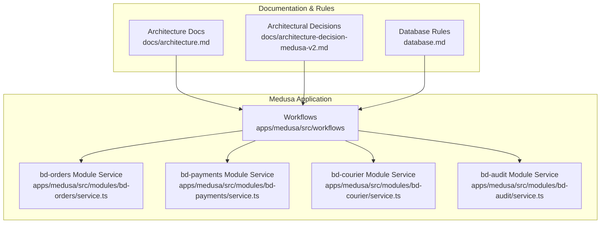
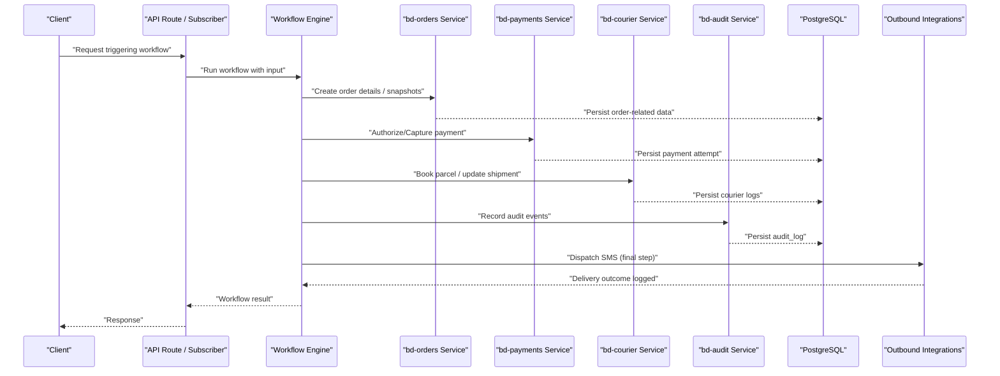
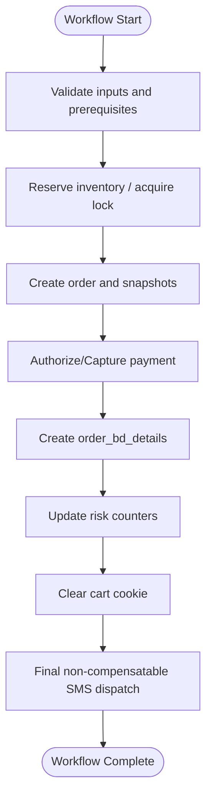
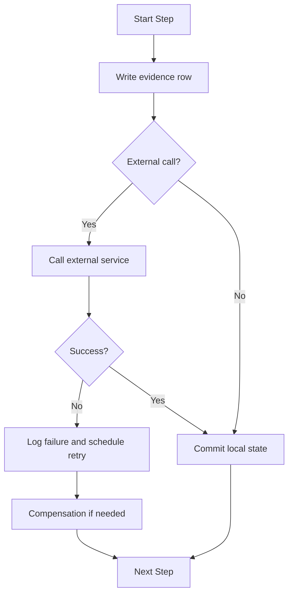
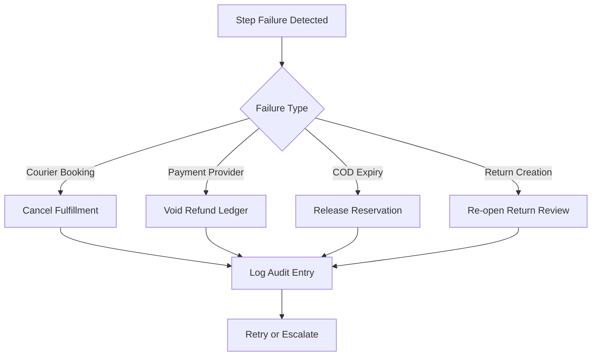
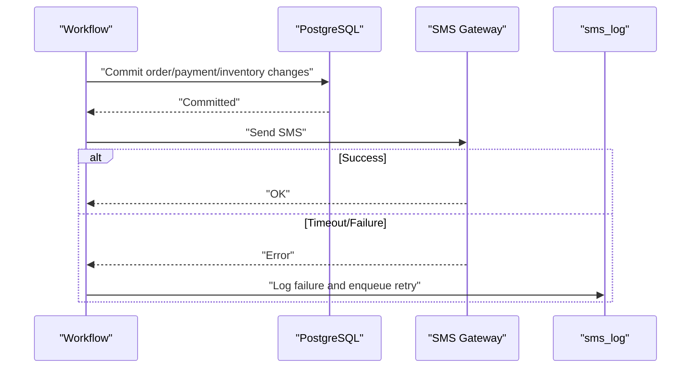
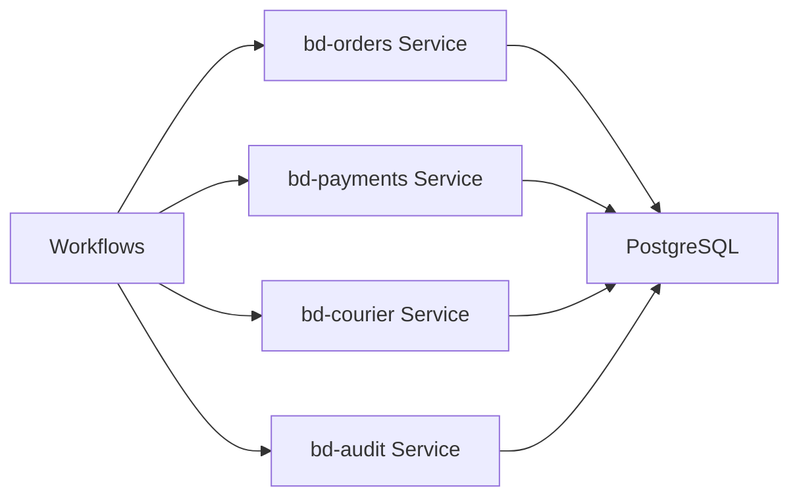

# Medusa Workflows Framework

<cite>
**Referenced Files in This Document**
- [README.md](file://apps/medusa/src/workflows/README.md)
- [architecture-decision-medusa-v2.md](file://docs/architecture-decision-medusa-v2.md)
- [architecture.md](file://docs/architecture.md)
- [database.md](file://database.md)
- [service.ts](file://apps/medusa/src/modules/bd-orders/service.ts)
- [service.ts](file://apps/medusa/src/modules/bd-payments/service.ts)
- [service.ts](file://apps/medusa/src/modules/bd-courier/service.ts)
- [service.ts](file://apps/medusa/src/modules/bd-audit/service.ts)
</cite>

## Table of Contents
1. [Introduction](#introduction)
2. [Project Structure](#project-structure)
3. [Core Components](#core-components)
4. [Architecture Overview](#architecture-overview)
5. [Detailed Component Analysis](#detailed-component-analysis)
6. [Dependency Analysis](#dependency-analysis)
7. [Performance Considerations](#performance-considerations)
8. [Troubleshooting Guide](#troubleshooting-guide)
9. [Conclusion](#conclusion)
10. [Appendices](#appendices)

## Introduction
This document explains how the BD Commerce Platform uses Medusa’s workflow engine to orchestrate complex, cross-module business operations such as order placement, COD confirmation, courier dispatch, and returns. It focuses on:
- Workflow orchestration concepts and execution model
- Step definition and compensation semantics
- Transaction boundaries and state persistence
- Integration with Medusa’s event system
- Outbox-style reliability for outbound notifications
- Monitoring, error handling, and troubleshooting strategies

The platform intentionally separates core commerce data (managed by Medusa modules) from Bangladesh-specific domain data (custom modules), using workflows to coordinate changes across both while preserving auditability and consistency.

## Project Structure
At a high level:
- Custom workflows are defined under `apps/medusa/src/workflows`.
- Business logic is implemented through Medusa custom modules under `apps/medusa/src/modules`, each exposing a service that manages its own models.
- Architectural rules, workflow definitions, SMS outbox behavior, and database constraints are documented in `docs` and `database.md`.

**Diagram sources**
- [README.md:1-82](file://apps/medusa/src/workflows/README.md#L1-L82)
- [service.ts:1-13](file://apps/medusa/src/modules/bd-orders/service.ts#L1-L13)
- [service.ts:1-11](file://apps/medusa/src/modules/bd-payments/service.ts#L1-L11)
- [service.ts:1-11](file://apps/medusa/src/modules/bd-courier/service.ts#L1-L11)
- [service.ts:1-11](file://apps/medusa/src/modules/bd-audit/service.ts#L1-L11)
- [architecture.md:696-734](file://docs/architecture.md#L696-L734)
- [architecture-decision-medusa-v2.md:24-29](file://docs/architecture-decision-medusa-v2.md#L24-L29)
- [database.md:2148-2157](file://database.md#L2148-L2157)

**Section sources**
- [README.md:1-82](file://apps/medusa/src/workflows/README.md#L1-L82)
- [architecture.md:696-734](file://docs/architecture.md#L696-L734)
- [architecture-decision-medusa-v2.md:24-29](file://docs/architecture-decision-medusa-v2.md#L24-L29)
- [database.md:2148-2157](file://database.md#L2148-L2157)

## Core Components
- Workflow SDK usage: Workflows are created with `createWorkflow` and composed of steps created with `createStep`. Steps return `StepResponse` values; workflows return `WorkflowResponse`.
- Execution entry points: Workflows can be executed from API routes, scheduled jobs, or subscribers via `.run({ input })`.
- Module services: Each custom module exposes a service extending `MedusaService`, which provides CRUD and query capabilities over its models.

Key responsibilities:
- Workflows define ordered, idempotent steps and final non-compensatable actions.
- Module services encapsulate data access for their respective domains.
- Documentation defines operational rules, failure behavior, and consistency guarantees.

**Section sources**
- [README.md:9-53](file://apps/medusa/src/workflows/README.md#L9-L53)
- [README.md:55-82](file://apps/medusa/src/workflows/README.md#L55-L82)
- [service.ts:1-13](file://apps/medusa/src/modules/bd-orders/service.ts#L1-L13)
- [service.ts:1-11](file://apps/medusa/src/modules/bd-payments/service.ts#L1-L11)
- [service.ts:1-11](file://apps/medusa/src/modules/bd-courier/service.ts#L1-L11)
- [service.ts:1-11](file://apps/medusa/src/modules/bd-audit/service.ts#L1-L11)

## Architecture Overview
The platform uses Medusa’s workflow engine to coordinate multi-step business processes across modules and external systems. The key architectural principles are:
- Ordered, idempotent steps with explicit compensation where required.
- Final non-compensatable steps for side effects like SMS dispatch.
- Event-driven integration points for asynchronous processing.
- Strong auditability and evidence logging for every cross-module write.

**Diagram sources**
- [architecture.md:696-734](file://docs/architecture.md#L696-L734)
- [database.md:2148-2157](file://database.md#L2148-L2157)
- [service.ts:1-13](file://apps/medusa/src/modules/bd-orders/service.ts#L1-L13)
- [service.ts:1-11](file://apps/medusa/src/modules/bd-payments/service.ts#L1-L11)
- [service.ts:1-11](file://apps/medusa/src/modules/bd-courier/service.ts#L1-L11)
- [service.ts:1-11](file://apps/medusa/src/modules/bd-audit/service.ts#L1-L11)

## Detailed Component Analysis

### Workflow Orchestration Model
- Workflows are composed of sequential steps. Each step should be idempotent so retries do not cause duplicate writes.
- Compensation is explicit per workflow: when a later step fails, earlier side effects must be reversed according to documented rules.
- Final steps are non-compensatable and typically represent outbound integrations such as SMS dispatch.

**Diagram sources**
- [architecture.md:696-734](file://docs/architecture.md#L696-L734)
- [database.md:2148-2157](file://database.md#L2148-L2157)

**Section sources**
- [architecture.md:696-734](file://docs/architecture.md#L696-L734)
- [database.md:2148-2157](file://database.md#L2148-L2157)

### Step Definition and Execution Patterns
- Steps are created with `createStep` and invoked within a workflow function.
- Inputs and outputs are typed at the workflow level; steps receive context and return `StepResponse`.
- Workflows are executed from API routes, jobs, or subscribers by calling `.run({ input })`.

Practical patterns:
- Define reusable steps for common operations (e.g., persisting audit entries, updating module entities).
- Compose workflows by chaining steps and returning a `WorkflowResponse` with aggregated results.
- Execute workflows synchronously from HTTP handlers or asynchronously from background jobs.

**Section sources**
- [README.md:9-53](file://apps/medusa/src/workflows/README.md#L9-L53)
- [README.md:55-82](file://apps/medusa/src/workflows/README.md#L55-L82)

### Transaction Management and State Persistence
- Cross-module writes are not one physical transaction because modules are separate.
- The workflow engine executes steps in order; each step is idempotent.
- Evidence rows are recorded for cross-module operations to enable diagnosis after partial failures.
- Status writes to native tables go through Medusa module services to ensure events fire correctly.
- Locking is handled by Medusa’s locking module for workflow-level exclusion.

**Diagram sources**
- [database.md:2148-2157](file://database.md#L2148-L2157)

**Section sources**
- [database.md:2148-2157](file://database.md#L2148-L2157)

### Integration with Medusa’s Event System
- Writing status updates through Medusa module services ensures native events are emitted.
- Subscribers can react to these events to trigger downstream workflows or async tasks.
- Audit logs and webhook logs provide observability into event-driven flows.

Best practices:
- Prefer service methods over raw SQL to preserve event emission.
- Use subscribers for lightweight, idempotent reactions to events.
- Avoid long-running work inside event handlers; delegate to workflows or jobs.

**Section sources**
- [database.md:2148-2157](file://database.md#L2148-L2157)
- [service.ts:1-13](file://apps/medusa/src/modules/bd-orders/service.ts#L1-L13)
- [service.ts:1-11](file://apps/medusa/src/modules/bd-payments/service.ts#L1-L11)
- [service.ts:1-11](file://apps/medusa/src/modules/bd-courier/service.ts#L1-L11)
- [service.ts:1-11](file://apps/medusa/src/modules/bd-audit/service.ts#L1-L11)

### Compensation Logic for Failed Operations
Compensation is explicit per workflow and tied to specific failure scenarios:
- Cancel fulfillment on booking failure.
- Void refund ledger entries on provider failure.
- Release reservation on COD expiry.
- Re-open return review if native return creation fails.

**Diagram sources**
- [database.md:2148-2157](file://database.md#L2148-L2157)

**Section sources**
- [database.md:2148-2157](file://database.md#L2148-L2157)

### Outbox Pattern for Reliable Message Processing
SMS dispatch is the final, non-compensatable step in all workflows. It triggers only after order, inventory, and payment changes have successfully committed to PostgreSQL. If an SMS gateway times out, the failure is logged in `sms_log` with a retry queue; it never rolls back an already-created order.

**Diagram sources**
- [architecture.md:545-549](file://docs/architecture.md#L545-L549)

**Section sources**
- [architecture.md:545-549](file://docs/architecture.md#L545-L549)

### Practical Examples of Workflow Creation and Execution
- Create a workflow file under `src/workflows` using `createWorkflow` and compose steps with `createStep`.
- Return structured results using `WorkflowResponse`; steps return `StepResponse`.
- Execute the workflow from an API route by importing the workflow and calling `.run({ input })`.

Reference example paths:
- Workflow definition pattern: [README.md:9-53](file://apps/medusa/src/workflows/README.md#L9-L53)
- Execution from API route: [README.md:55-82](file://apps/medusa/src/workflows/README.md#L55-L82)

**Section sources**
- [README.md:9-53](file://apps/medusa/src/workflows/README.md#L9-L53)
- [README.md:55-82](file://apps/medusa/src/workflows/README.md#L55-L82)

### Error Handling Strategies
- Idempotency: Every step must tolerate retries without duplicating side effects.
- Evidence logging: Record evidence rows for cross-module operations to diagnose partial failures.
- Retry queues: For outbound integrations, log failures and schedule retries without rolling back committed state.
- Explicit compensation: Reverse prior side effects according to documented rules when failures occur.

**Section sources**
- [database.md:2148-2157](file://database.md#L2148-L2157)
- [architecture.md:545-549](file://docs/architecture.md#L545-L549)

### Monitoring Approaches
- Audit trail: All critical actions are recorded in `audit_log` with actor, entity, action, and change context.
- Webhook and payment logs: Track inbound/outbound events and provider interactions.
- Courier logs: Persist shipment and webhook events for reconciliation.
- Operational dashboards: Monitor workflow success rates, retry queues, and SMS delivery outcomes.

**Section sources**
- [service.ts:1-11](file://apps/medusa/src/modules/bd-audit/service.ts#L1-L11)
- [service.ts:1-11](file://apps/medusa/src/modules/bd-payments/service.ts#L1-L11)
- [service.ts:1-11](file://apps/medusa/src/modules/bd-courier/service.ts#L1-L11)

## Dependency Analysis
Workflows depend on module services to perform domain operations. The following diagram shows the primary dependencies between workflows and module services.

**Diagram sources**
- [service.ts:1-13](file://apps/medusa/src/modules/bd-orders/service.ts#L1-L13)
- [service.ts:1-11](file://apps/medusa/src/modules/bd-payments/service.ts#L1-L11)
- [service.ts:1-11](file://apps/medusa/src/modules/bd-courier/service.ts#L1-L11)
- [service.ts:1-11](file://apps/medusa/src/modules/bd-audit/service.ts#L1-L11)

**Section sources**
- [service.ts:1-13](file://apps/medusa/src/modules/bd-orders/service.ts#L1-L13)
- [service.ts:1-11](file://apps/medusa/src/modules/bd-payments/service.ts#L1-L11)
- [service.ts:1-11](file://apps/medusa/src/modules/bd-courier/service.ts#L1-L11)
- [service.ts:1-11](file://apps/medusa/src/modules/bd-audit/service.ts#L1-L11)

## Performance Considerations
- Keep transactions short: Do not hold locks across external HTTP calls.
- Use advisory locks and unique constraints to prevent races (e.g., two courier bookings per order).
- Cache hot lookups (e.g., courier area mapping) with appropriate invalidation.
- Ensure idempotency keys for outbound integrations to tolerate duplicates.
- Avoid floating-point arithmetic for monetary values; use integer paisa throughout.

[No sources needed since this section provides general guidance]

## Troubleshooting Guide
Common issues and resolutions:
- Partial failure after multiple module writes: Inspect evidence rows (`payment_attempt`, `courier_event`, `webhook_event`, `audit_log`) to determine the failing step and apply compensation.
- SMS delivery failures: Check `sms_log` for gateway responses and retry queue status; confirm that order/payment/inventory commits succeeded before SMS dispatch.
- Duplicate courier bookings: Verify unique constraints and advisory locks; reconcile by external consignment ID before creating a second booking.
- Webhook processing failures: Confirm `webhook_event.processing_status = failed` and reprocess from the queue; never delete the row.
- Refund provider failures: Update `refund_ledger.status = failed` and release amount for retry with a new idempotency key.

**Section sources**
- [database.md:2168-2178](file://database.md#L2168-L2178)
- [architecture.md:545-549](file://docs/architecture.md#L545-L549)

## Conclusion
The BD Commerce Platform leverages Medusa’s workflow engine to build reliable, auditable, and compensatable business processes across modules and external systems. By enforcing idempotent steps, explicit compensation, evidence logging, and a final non-compensatable outbox-style SMS step, the platform maintains data consistency and resilience even in distributed scenarios. Module services encapsulate domain data access, while documentation codifies operational rules and failure behaviors to guide implementation and maintenance.

[No sources needed since this section summarizes without analyzing specific files]

## Appendices

### Key Workflow Definitions Summary
- Order placement: Validates cart/prices/stock, reserves inventory, creates order snapshot, processes payment, persists order details, updates risk counters, clears cart, sends SMS.
- COD confirmation: Verifies order state, logs staff confirmation, transitions statuses, sends SMS.
- Courier dispatch: Resolves adapter, formats payload, calls courier API, persists tracking, updates shipment state, sends SMS.
- Returns and refunds: Manual review pipeline with strict rules and auditability.

**Section sources**
- [architecture.md:696-734](file://docs/architecture.md#L696-L734)

### Architectural Rationale
- Medusa v2 Workflows replace fragile custom controller logic with purpose-built transactional pipelines suited for multi-system operations.

**Section sources**
- [architecture-decision-medusa-v2.md:24-29](file://docs/architecture-decision-medusa-v2.md#L24-L29)