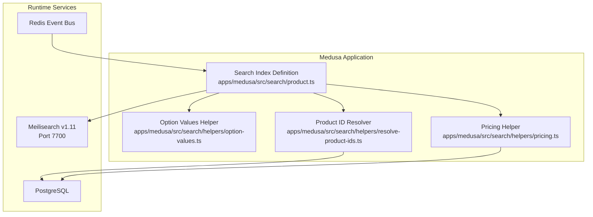
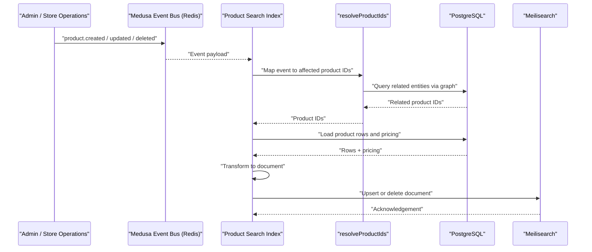
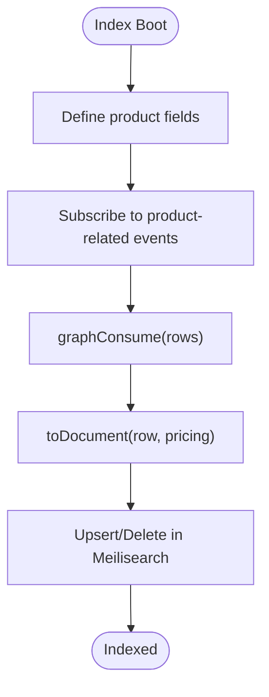
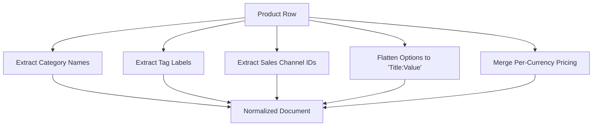
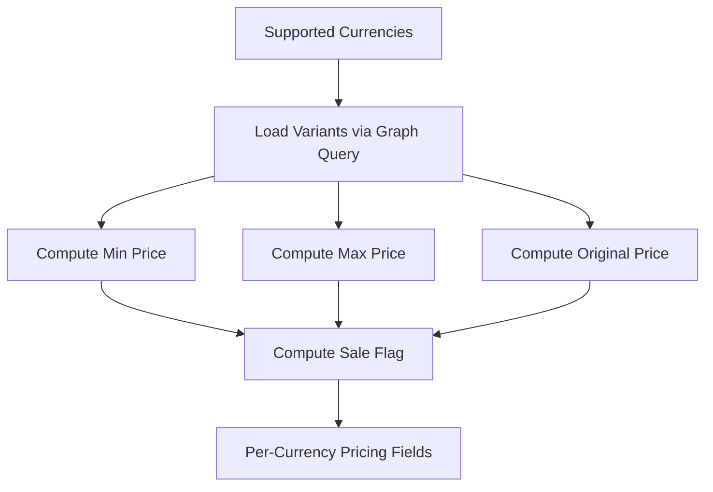
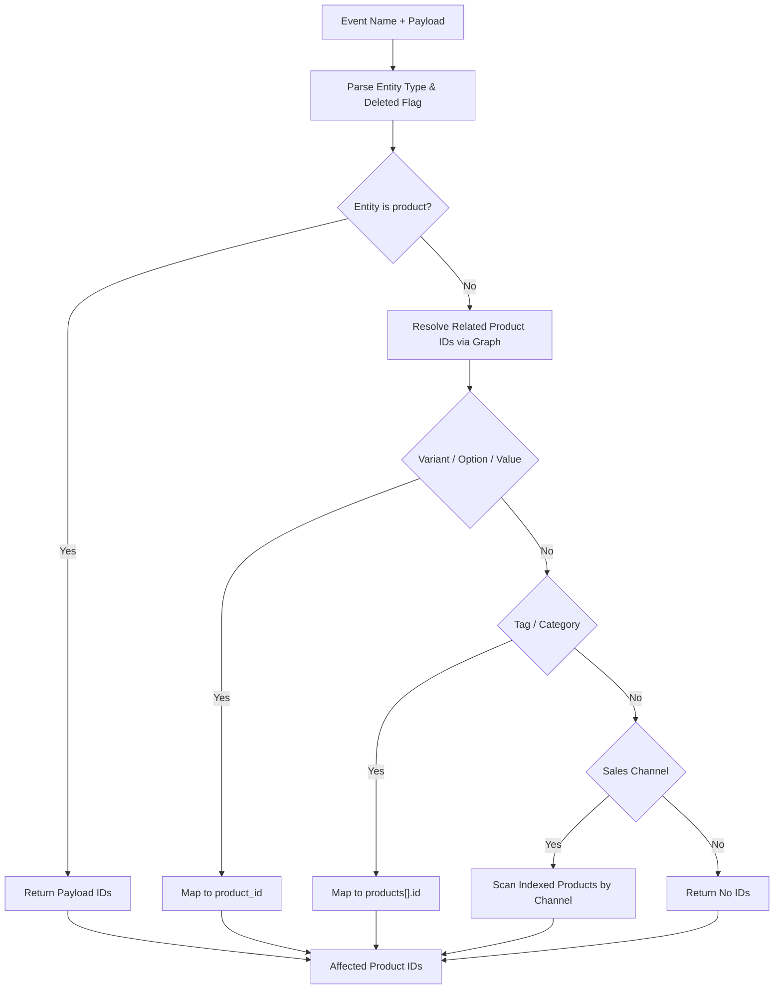
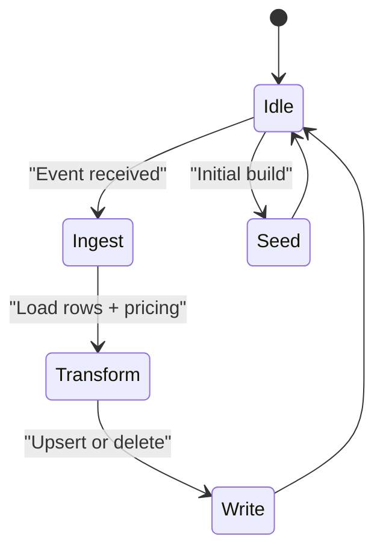
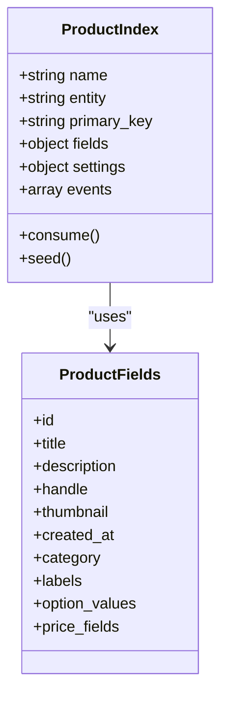
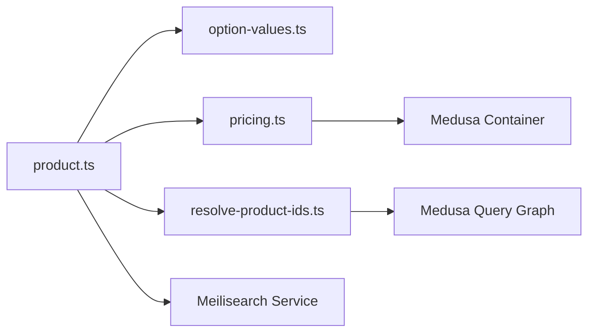

# Meilisearch Indexing Workflow

<cite>
**Referenced Files in This Document**   
- [product.ts](file://apps/medusa/src/search/product.ts)
- [option-values.ts](file://apps/medusa/src/search/helpers/option-values.ts)
- [pricing.ts](file://apps/medusa/src/search/helpers/pricing.ts)
- [resolve-product-ids.ts](file://apps/medusa/src/search/helpers/resolve-product-ids.ts)
- [docker-compose.yml](file://docker-compose.yml)
- [package.json](file://apps/api/package.json)
- [dfd.md](file://docs/dfd.md)
- [architecture.md](file://docs/architecture.md)
</cite>

## Table of Contents
1. [Introduction](#introduction)
2. [Project Structure](#project-structure)
3. [Core Components](#core-components)
4. [Architecture Overview](#architecture-overview)
5. [Detailed Component Analysis](#detailed-component-analysis)
6. [Dependency Analysis](#dependency-analysis)
7. [Performance Considerations](#performance-considerations)
8. [Troubleshooting Guide](#troubleshooting-guide)
9. [Conclusion](#conclusion)

## Introduction
This document explains how the BD Commerce Platform keeps product search results synchronized with its database using Medusa’s search indexing system and Meilisearch. It covers:

- Incremental indexing driven by Medusa events.
- Real-time search updates for product, variant, option, tag, category, and sales channel changes.
- Bulk seeding and batched ID resolution.
- Search schema mapping, faceted search configuration, and pricing fields.
- Security-focused field allowlisting and exclusion documented in project design notes.
- Troubleshooting guidance for inconsistencies, failures, and query optimization patterns.

The implementation is centered around a Medusa search index definition that transforms database rows into searchable documents and writes them to Meilisearch through Medusa’s framework utilities.

## Project Structure
The Meilisearch-related code lives under the Medusa application’s search module. The runtime environment includes Meilisearch as a Docker service, and the API package declares the Meilisearch client dependency.

**Diagram sources**
- [product.ts:150-165](file://apps/medusa/src/search/product.ts#L150-L165)
- [option-values.ts:1-30](file://apps/medusa/src/search/helpers/option-values.ts#L1-L30)
- [pricing.ts:1-177](file://apps/medusa/src/search/helpers/pricing.ts#L1-L177)
- [resolve-product-ids.ts:1-142](file://apps/medusa/src/search/helpers/resolve-product-ids.ts#L1-L142)
- [docker-compose.yml:46-64](file://docker-compose.yml#L46-L64)

**Section sources**
- [product.ts:1-166](file://apps/medusa/src/search/product.ts#L1-L166)
- [docker-compose.yml:46-64](file://docker-compose.yml#L46-L64)
- [package.json:16-23](file://apps/api/package.json#L16-L23)

## Core Components
The core indexing workflow is implemented as a single Medusa search index for products. It defines the searchable schema, event subscriptions, document transformation, and bulk ingestion behavior.

Key responsibilities:

- **Schema definition**: Declares searchable, filterable, sortable, facetable, and retrievable fields for product data.
- **Event-driven incremental indexing**: Subscribes to product lifecycle and related entity events.
- **Document transformation**: Converts database rows into Meilisearch-compatible documents, including flattened option values and per-currency pricing.
- **ID resolution**: Maps events on variants, options, tags, categories, and sales channels back to affected product IDs.
- **Bulk operations**: Uses graph-based consumption and seeding for efficient batch processing.

**Section sources**
- [product.ts:43-64](file://apps/medusa/src/search/product.ts#L43-L64)
- [product.ts:70-98](file://apps/medusa/src/search/product.ts#L70-L98)
- [product.ts:105-118](file://apps/medusa/src/search/product.ts#L105-L118)
- [product.ts:131-148](file://apps/medusa/src/search/product.ts#L131-L148)
- [product.ts:150-165](file://apps/medusa/src/search/product.ts#L150-L165)

## Architecture Overview
The indexing architecture combines Medusa’s event bus, PostgreSQL-backed entities, and Meilisearch as the search backend.

**Diagram sources**
- [product.ts:131-165](file://apps/medusa/src/search/product.ts#L131-L165)
- [resolve-product-ids.ts:75-142](file://apps/medusa/src/search/helpers/resolve-product-ids.ts#L75-L142)
- [pricing.ts:148-177](file://apps/medusa/src/search/helpers/pricing.ts#L148-L177)

### Design Notes from Repository Documentation
The repository documentation describes an additional synchronization layer that enforces strict field allowlisting and excludes confidential financial fields before writing to Meilisearch. It also documents direct document deletion on `product.deleted` without re-fetching from the database to avoid soft-delete race conditions.

**Section sources**
- [architecture.md:444-463](file://docs/architecture.md#L444-L463)
- [dfd.md:556-584](file://docs/dfd.md#L556-L584)

## Detailed Component Analysis

### Product Search Index Definition
The product index defines the searchable schema and connects it to Medusa’s ingestion pipeline.

Important aspects:

- **Fields**: Includes identifiers, text fields, categories, labels, option values, timestamps, and pricing fields spread from the pricing helper.
- **Settings**: Enables typo tolerance.
- **Events**: Subscribes to product, variant, option, option value, tag, category, and sales channel events.
- **Consumption**: Uses `graphConsume` with a source transformer and ID resolver; marks `product.deleted` as a delete operation.
- **Seeding**: Uses `graphSeed` for bulk initial indexing.

**Diagram sources**
- [product.ts:43-64](file://apps/medusa/src/search/product.ts#L43-L64)
- [product.ts:150-165](file://apps/medusa/src/search/product.ts#L150-L165)

**Section sources**
- [product.ts:43-64](file://apps/medusa/src/search/product.ts#L43-L64)
- [product.ts:150-165](file://apps/medusa/src/search/product.ts#L150-L165)

### Document Transformation Pipeline
The transformation pipeline converts raw product rows into indexed documents.

Steps:

1. Extract category names, tag labels, and sales channel IDs.
2. Flatten product options into structured strings such as `"Size:S"` and `"Color:Red"`.
3. Merge pricing data computed per currency.
4. Return a normalized document suitable for Meilisearch.

**Diagram sources**
- [product.ts:70-98](file://apps/medusa/src/search/product.ts#L70-L98)
- [option-values.ts:6-29](file://apps/medusa/src/search/helpers/option-values.ts#L6-L29)
- [pricing.ts:132-142](file://apps/medusa/src/search/helpers/pricing.ts#L132-L142)

**Section sources**
- [product.ts:70-98](file://apps/medusa/src/search/product.ts#L70-L98)
- [option-values.ts:1-30](file://apps/medusa/src/search/helpers/option-values.ts#L1-L30)
- [pricing.ts:132-142](file://apps/medusa/src/search/helpers/pricing.ts#L132-L142)

### Option Values Mapping
Option values are flattened into a single array of strings where each entry combines the option title and value. This simplifies faceting and grouping on the storefront.

Behavior:

- Skips missing option titles.
- Trims and filters empty values.
- Deduplicates entries across multiple options.

**Section sources**
- [option-values.ts:1-30](file://apps/medusa/src/search/helpers/option-values.ts#L1-L30)

### Pricing Fields and Multi-Currency Support
Pricing is handled per currency, exposing minimum price, maximum price, original price, and sale flags.

Key behaviors:

- Defines supported currencies and corresponding index fields.
- Loads calculated and original prices per variant.
- Computes min/max prices and whether a product is on sale.
- Exposes fields as filterable, sortable, and facetable where appropriate.

**Diagram sources**
- [pricing.ts:4-12](file://apps/medusa/src/search/helpers/pricing.ts#L4-L12)
- [pricing.ts:53-80](file://apps/medusa/src/search/helpers/pricing.ts#L53-L80)
- [pricing.ts:89-142](file://apps/medusa/src/search/helpers/pricing.ts#L89-L142)
- [pricing.ts:148-177](file://apps/medusa/src/search/helpers/pricing.ts#L148-L177)

**Section sources**
- [pricing.ts:1-177](file://apps/medusa/src/search/helpers/pricing.ts#L1-L177)

### Incremental ID Resolution Strategy
The ID resolver maps events to the exact set of product IDs that need reindexing.

Mapping rules:

- Product events use IDs directly from the payload.
- Variant, option, option value, tag, and category events resolve related product IDs through graph queries.
- Deleted related entities still map to their parent products using soft-deleted reads.
- Sales channel deletions scan existing indexed products filtered by sales channel IDs.

**Diagram sources**
- [resolve-product-ids.ts:8-13](file://apps/medusa/src/search/helpers/resolve-product-ids.ts#L8-L13)
- [resolve-product-ids.ts:20-38](file://apps/medusa/src/search/helpers/resolve-product-ids.ts#L20-L38)
- [resolve-product-ids.ts:45-68](file://apps/medusa/src/search/helpers/resolve-product-ids.ts#L45-L68)
- [resolve-product-ids.ts:75-142](file://apps/medusa/src/search/helpers/resolve-product-ids.ts#L75-L142)

**Section sources**
- [resolve-product-ids.ts:1-142](file://apps/medusa/src/search/helpers/resolve-product-ids.ts#L1-L142)

### Real-Time Updates vs Bulk Seeding
The index supports both real-time updates and bulk seeding:

- **Real-time updates**: Triggered by Medusa events. The index consumes changed rows, transforms them, and writes to Meilisearch.
- **Bulk seeding**: Uses `graphSeed` to rebuild the index during initialization or maintenance tasks.

**Diagram sources**
- [product.ts:105-118](file://apps/medusa/src/search/product.ts#L105-L118)
- [product.ts:150-165](file://apps/medusa/src/search/product.ts#L150-L165)

**Section sources**
- [product.ts:105-118](file://apps/medusa/src/search/product.ts#L105-L118)
- [product.ts:150-165](file://apps/medusa/src/search/product.ts#L150-L165)

### Search Schema Mapping and Faceted Search Configuration
The schema defines which fields are searchable, filterable, sortable, facetable, and retrievable.

Highlights:

- Title and description are searchable text fields.
- Category and labels are arrays used for filtering and faceting.
- Option values are searchable, filterable, and facetable.
- Timestamps are sortable.
- Typo tolerance is enabled at the index level.

**Diagram sources**
- [product.ts:43-64](file://apps/medusa/src/search/product.ts#L43-L64)
- [product.ts:150-165](file://apps/medusa/src/search/product.ts#L150-L165)

**Section sources**
- [product.ts:43-64](file://apps/medusa/src/search/product.ts#L43-L64)
- [product.ts:150-165](file://apps/medusa/src/search/product.ts#L150-L165)

### Security and Field Allowlisting
Repository design documentation specifies a strict allowlist for indexed fields and an exclusion list for confidential financial data. This protects public-facing search keys from leaking sensitive information.

Key points:

- Only explicitly allowed fields are indexed.
- Confidential fields such as cost-of-goods-sold and margin-related data are stripped.
- Dynamic attributes can be mapped under a controlled prefix.
- Soft-delete handling avoids extra database lookups when deleting documents.

**Section sources**
- [architecture.md:444-463](file://docs/architecture.md#L444-L463)
- [dfd.md:556-584](file://docs/dfd.md#L556-L584)

## Dependency Analysis
The indexing components have clear dependencies:

- The product index depends on helpers for option values, pricing, and ID resolution.
- ID resolution depends on Medusa’s query graph and search APIs.
- Pricing loading depends on Medusa’s container and graph query context.
- Meilisearch runs as a separate Docker service.
- The API package declares the Meilisearch client dependency.

**Diagram sources**
- [product.ts:1-12](file://apps/medusa/src/search/product.ts#L1-L12)
- [product.ts:150-165](file://apps/medusa/src/search/product.ts#L150-L165)
- [pricing.ts:1-3](file://apps/medusa/src/search/helpers/pricing.ts#L1-L3)
- [resolve-product-ids.ts:1-6](file://apps/medusa/src/search/helpers/resolve-product-ids.ts#L1-L6)
- [docker-compose.yml:46-64](file://docker-compose.yml#L46-L64)
- [package.json:16-23](file://apps/api/package.json#L16-L23)

**Section sources**
- [product.ts:1-12](file://apps/medusa/src/search/product.ts#L1-L12)
- [pricing.ts:1-3](file://apps/medusa/src/search/helpers/pricing.ts#L1-L3)
- [resolve-product-ids.ts:1-6](file://apps/medusa/src/search/helpers/resolve-product-ids.ts#L1-L6)
- [docker-compose.yml:46-64](file://docker-compose.yml#L46-L64)
- [package.json:16-23](file://apps/api/package.json#L16-L23)

## Performance Considerations
Based on the implementation and design notes, the following performance characteristics apply:

- **Incremental updates**: Only affected product IDs are resolved and reindexed, reducing unnecessary work.
- **Batched ID resolution**: Sales channel scans use pagination with a fixed batch size.
- **Graph-based pricing load**: Pricing is loaded once per currency for all requested product IDs.
- **Deduplicated option values**: Prevents redundant facet buckets.
- **Typo tolerance**: Improves search recall at a small indexing and query cost.
- **Field minimization**: Only necessary fields are exposed, keeping documents smaller.

Recommendations:

- Monitor event backlog if Redis or Medusa workers are slow.
- Avoid adding expensive fields to the index unless they are required for search or facets.
- Keep currency lists aligned between the index and storefront configuration.
- Use targeted filters rather than broad full-text searches on large catalogs.
- Rebuild the index periodically if background events are missed.

[No sources needed since this section provides general guidance]

## Troubleshooting Guide

### Search Results Not Updating After Product Changes
Symptoms:

- A product update does not appear in search immediately.
- Deleting a product leaves stale documents.

Likely causes:

- Events are not emitted by certain workflows.
- The ID resolver returns no IDs for a given event type.
- Meilisearch is unreachable or unhealthy.

Checks:

- Verify Medusa events are published for product, variant, option, tag, category, and sales channel changes.
- Confirm `resolveProductIds` maps the event to affected product IDs.
- Check Meilisearch health endpoint and container status.
- Review repository notes about workflows that may not emit events.

**Section sources**
- [product.ts:120-130](file://apps/medusa/src/search/product.ts#L120-L130)
- [resolve-product-ids.ts:75-142](file://apps/medusa/src/search/helpers/resolve-product-ids.ts#L75-L142)
- [docker-compose.yml:58-62](file://docker-compose.yml#L58-L62)
- [architecture.md:462-463](file://docs/architecture.md#L462-L463)

### Missing or Incorrect Facets
Symptoms:

- Category or label facets are empty.
- Option value facets show unexpected groupings.
- Price facets do not reflect expected ranges.

Likely causes:

- Category names or tag values are null or empty.
- Option titles are missing.
- Pricing data is unavailable for a currency.

Checks:

- Ensure categories and tags contain non-empty values.
- Validate option titles and values are present.
- Confirm pricing is available for configured currencies.

**Section sources**
- [product.ts:74-96](file://apps/medusa/src/search/product.ts#L74-L96)
- [option-values.ts:6-29](file://apps/medusa/src/search/helpers/option-values.ts#L6-L29)
- [pricing.ts:89-142](file://apps/medusa/src/search/helpers/pricing.ts#L89-L142)

### Stale Documents After Soft Deletes
Symptoms:

- Archived or deleted products remain searchable.

Likely causes:

- Delete events are not processed.
- Custom deletion paths bypass standard events.

Checks:

- Confirm `product.deleted` triggers document deletion.
- Follow repository guidance for direct document deletion without re-fetching.

**Section sources**
- [product.ts:162-163](file://apps/medusa/src/search/product.ts#L162-L163)
- [architecture.md:462-463](file://docs/architecture.md#L462-L463)

### Indexing Failures or Slow Builds
Symptoms:

- Bulk seeding takes too long.
- Memory pressure during ingestion.

Likely causes:

- Large batches without proper batching strategy.
- Expensive transformations or excessive fields.

Checks:

- Review batch size in ID resolution.
- Limit fields to only what is needed.
- Monitor database query performance for graph loads.

**Section sources**
- [resolve-product-ids.ts:6](file://apps/medusa/src/search/helpers/resolve-product-ids.ts#L6)
- [pricing.ts:148-177](file://apps/medusa/src/search/helpers/pricing.ts#L148-L177)

### Search Query Optimization Patterns
Recommended patterns:

- Prefer filtering on keyword and facetable fields such as category, labels, and option values.
- Use price range filters instead of full-text matching for numeric comparisons.
- Combine narrow filters with limited full-text search to reduce scoring overhead.
- Avoid returning large amounts of retrievable data unless required.
- Tune typo tolerance based on observed misspellings and performance needs.

[No sources needed since this section provides general guidance]

## Conclusion
The BD Commerce Platform uses Medusa’s search indexing system to keep product search results synchronized with PostgreSQL and expose them through Meilisearch. The implementation emphasizes:

- Incremental, event-driven indexing.
- Careful mapping of options, categories, tags, and pricing.
- Batched ID resolution and graph-based data loading.
- Security-conscious field exposure documented in repository design notes.

For reliable operation, ensure events are emitted correctly, Meilisearch remains healthy, and the index schema stays aligned with storefront requirements. When issues arise, start with event delivery, ID resolution, pricing availability, and Meilisearch health checks.

[No sources needed since this section summarizes without analyzing specific files]