# Order Placement Workflow

<cite>
**Referenced Files in This Document**
- [service.ts](file://apps/medusa/src/modules/bd-orders/service.ts)
- [order-bd-details.ts](file://apps/medusa/src/modules/bd-orders/models/order-bd-details.ts)
- [customer-risk-profile.ts](file://apps/medusa/src/modules/bd-orders/models/customer-risk-profile.ts)
- [service.ts](file://apps/medusa/src/modules/bd-payments/service.ts)
- [payment-transaction.ts](file://apps/medusa/src/modules/bd-payments/models/payment-transaction.ts)
- [payment-webhook-log.ts](file://apps/medusa/src/modules/bd-payments/models/payment-webhook-log.ts)
- [service.ts](file://apps/medusa/src/modules/bd-courier/service.ts)
- [courier-shipment-log.ts](file://apps/medusa/src/modules/bd-courier/models/courier-shipment-log.ts)
- [service.ts](file://apps/medusa/src/modules/bd-settings/service.ts)
- [delivery-zone-config.ts](file://apps/medusa/src/modules/bd-settings/models/delivery-zone-config.ts)
- [route.ts](file://apps/medusa/src/api/store/custom/route.ts)
- [route.ts](file://apps/medusa/src/api/admin/custom/route.ts)
- [database.md](file://database.md)
- [prd.md](file://prd.md)
- [dfd.md](file://dfd.md)
- [architecture.md](file://docs/architecture.md)
- [technical-plan.md](file://technical-plan.md)
</cite>

## Table of Contents
1. [Introduction](#introduction)
2. [Project Structure](#project-structure)
3. [Core Components](#core-components)
4. [Architecture Overview](#architecture-overview)
5. [Detailed Component Analysis](#detailed-component-analysis)
6. [Dependency Analysis](#dependency-analysis)
7. [Performance Considerations](#performance-considerations)
8. [Troubleshooting Guide](#troubleshooting-guide)
9. [Conclusion](#conclusion)

## Introduction
This document explains the end-to-end order placement workflow for the Bangladesh single-vendor e-commerce platform. It covers the complete lifecycle from cart validation through payment processing, order creation, courier assignment, and confirmation notifications. It also documents compensation logic, retry mechanisms, error recovery strategies, state transitions, data flows between modules, and integration points with payment gateways and courier services.

The system is built on Medusa v2 and extends it with custom Bangladesh-specific modules: orders, payments, courier, and settings. The design emphasizes zero-orphan payments, idempotent operations, strict status separation, auditability, and reliable asynchronous notifications.

## Project Structure
At runtime, the order placement flow crosses several layers:
- Storefront (Next.js) initiates checkout and payment sessions.
- Medusa backend API orchestrates workflows.
- Redis provides distributed locks, session coordination, and BullMQ queues for SMS and background tasks.
- PostgreSQL stores core commerce entities plus BD-specific extension tables.
- External systems include bKash/Nagad payment gateways and Steadfast/Pathao/RedX courier providers.

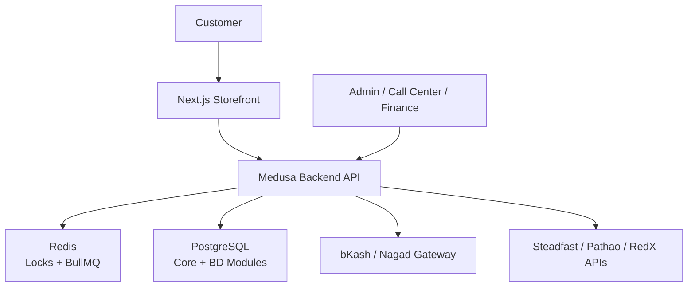

**Diagram sources**
- [dfd.md:327-394](file://dfd.md#L327-L394)
- [architecture.md:467-478](file://docs/architecture.md#L467-L478)
- [technical-plan.md:549-577](file://technical-plan.md#L549-L577)

**Section sources**
- [prd.md:95-150](file://prd.md#L95-L150)
- [architecture.md:66-73](file://docs/architecture.md#L66-L73)

## Core Components
The order placement workflow relies on four custom Medusa modules plus shared infrastructure:

- **BD Orders Module**
  - Service exposes domain models for order details, customer risk profile, and return requests.
  - `OrderBdDetails` tracks delivery zone, COD status, shipment lifecycle, courier metadata, logistics costs, and marketing attribution.
  - `CustomerRiskProfile` aggregates delivery success, RTO counts, fraud flags, and last-order timing.

- **BD Payments Module**
  - Service exposes payment transaction and webhook log models.
  - `PaymentTransaction` records provider, session linkage, transaction type, amount, gateway identifiers, gateway response, and server-to-server verification status.
  - `PaymentWebhookLog` captures raw inbound webhook evidence for audit and replay.

- **BD Courier Module**
  - Service exposes shipment logs and webhook logs.
  - `CourierShipmentLog` records outbound consignment calls, responses, HTTP status codes, and errors.

- **BD Settings Module**
  - Service exposes delivery zone configuration and VAT configuration.
  - `DeliveryZoneConfig` defines zone code, localized names, flat-rate delivery charge, free-shipping threshold, delivery day range, active flag, and coverage districts.

- **Shared Infrastructure**
  - Medusa native modules provide carts, inventory, orders, payments, fulfillment, and workflows.
  - Redis provides locking and message queuing.
  - PostgreSQL persists all durable business facts.

**Section sources**
- [service.ts:6-10](file://apps/medusa/src/modules/bd-orders/service.ts#L6-L10)
- [order-bd-details.ts:3-39](file://apps/medusa/src/modules/bd-orders/models/order-bd-details.ts#L3-L39)
- [customer-risk-profile.ts:3-16](file://apps/medusa/src/modules/bd-orders/models/customer-risk-profile.ts#L3-L16)
- [service.ts:5-8](file://apps/medusa/src/modules/bd-payments/service.ts#L5-L8)
- [payment-transaction.ts:3-15](file://apps/medusa/src/modules/bd-payments/models/payment-transaction.ts#L3-L15)
- [payment-webhook-log.ts:3-15](file://apps/medusa/src/modules/bd-payments/models/payment-webhook-log.ts#L3-L15)
- [service.ts:5-8](file://apps/medusa/src/modules/bd-courier/service.ts#L5-L8)
- [courier-shipment-log.ts:3-12](file://apps/medusa/src/modules/bd-courier/models/courier-shipment-log.ts#L3-L12)
- [service.ts:5-8](file://apps/medusa/src/modules/bd-settings/service.ts#L5-L8)
- [delivery-zone-config.ts:3-14](file://apps/medusa/src/modules/bd-settings/models/delivery-zone-config.ts#L3-L14)

## Architecture Overview
The order placement architecture separates three independent status dimensions:
- Order status
- Payment status
- Shipment status
- Return/refund status (separate from the above)

For online payments, the system intentionally avoids creating an order before successful gateway verification. For Cash on Delivery, the order is created immediately but remains unconfirmed until staff call-center confirmation.

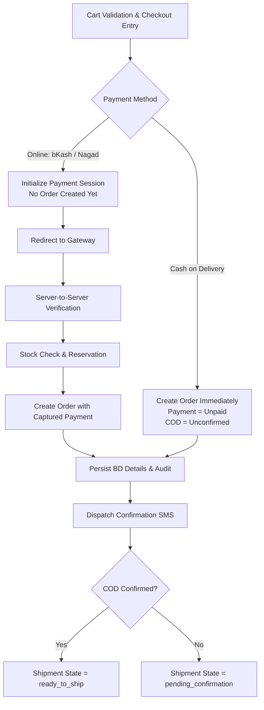

**Diagram sources**
- [architecture.md:467-478](file://docs/architecture.md#L467-L478)
- [prd.md:318-341](file://prd.md#L318-L341)
- [prd.md:762-787](file://prd.md#L762-L787)
- [database.md:2148-2157](file://database.md#L2148-L2157)

**Section sources**
- [prd.md:169-200](file://prd.md#L169-L200)
- [prd.md:267-274](file://prd.md#L267-L274)
- [prd.md:549-554](file://prd.md#L549-L554)
- [architecture.md:690-715](file://docs/architecture.md#L690-L715)

## Detailed Component Analysis

### Cart Validation and Checkout Entry
Before any payment or order creation, the system validates:
- Cart existence and activity.
- Product availability and variant selection.
- Live price and stock at checkout time.
- Duplicate submission protection via idempotency keys.
- Campaign landing page rules when applicable.

If a line item has changed price or stock since add-to-cart, the customer must acknowledge the updated state; stale prices are never silently accepted. Abandoned checkout preserves cart contents.

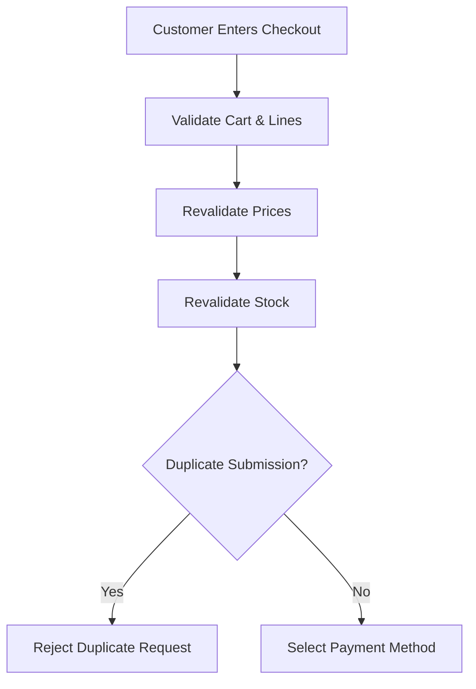

**Diagram sources**
- [prd.md:107-126](file://prd.md#L107-L126)
- [prd.md:318-327](file://prd.md#L318-L327)

**Section sources**
- [prd.md:95-150](file://prd.md#L95-L150)
- [prd.md:318-327](file://prd.md#L318-L327)

### Inventory Reservation and Stockout Handling
Inventory integrity requires atomic stock decrements at order confirmation, not at cart addition. Concurrent purchases cannot oversell stock. If stock becomes unavailable after payment capture, the system creates an unfulfillable stockout order rather than refunding automatically.

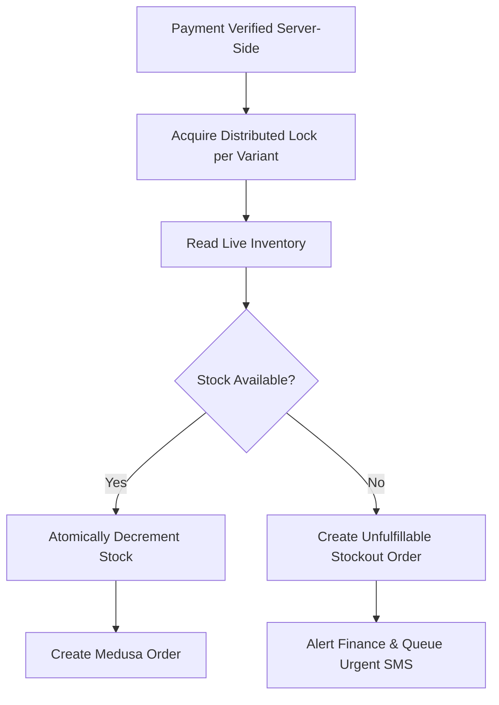

**Diagram sources**
- [dfd.md:327-394](file://dfd.md#L327-L394)
- [prd.md:194-197](file://prd.md#L194-L197)

**Section sources**
- [prd.md:194-197](file://prd.md#L194-L197)
- [dfd.md:327-394](file://dfd.md#L327-L394)

### Payment Processing
The payment workflow supports:
- bKash and Nagad direct merchant integrations.
- Zero-orphan redirect behavior: no order is created during gateway redirect.
- Strict server-to-server verification of callbacks.
- Idempotent handling of repeated webhooks.
- Dropped browser callback recovery via background polling.

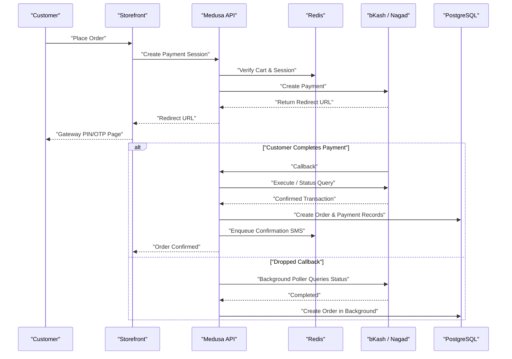

**Diagram sources**
- [dfd.md:327-394](file://dfd.md#L327-L394)
- [architecture.md:467-478](file://docs/architecture.md#L467-L478)
- [prd.md:267-274](file://prd.md#L267-L274)

**Section sources**
- [prd.md:267-274](file://prd.md#L267-L274)
- [prd.md:549-554](file://prd.md#L549-L554)
- [payment-transaction.ts:3-15](file://apps/medusa/src/modules/bd-payments/models/payment-transaction.ts#L3-L15)
- [payment-webhook-log.ts:3-15](file://apps/medusa/src/modules/bd-payments/models/payment-webhook-log.ts#L3-L15)

### Order Creation
Order creation differs by payment method:

- **Online payments:** Order creation occurs only after verified capture.
- **Cash on Delivery:** Order is created immediately with payment status unpaid and COD status unconfirmed.

The order-time snapshot includes product title, SKU, variant, unit price, discount, delivery charge, VAT, and relevant cost data. Later catalog changes do not rewrite historical order data.

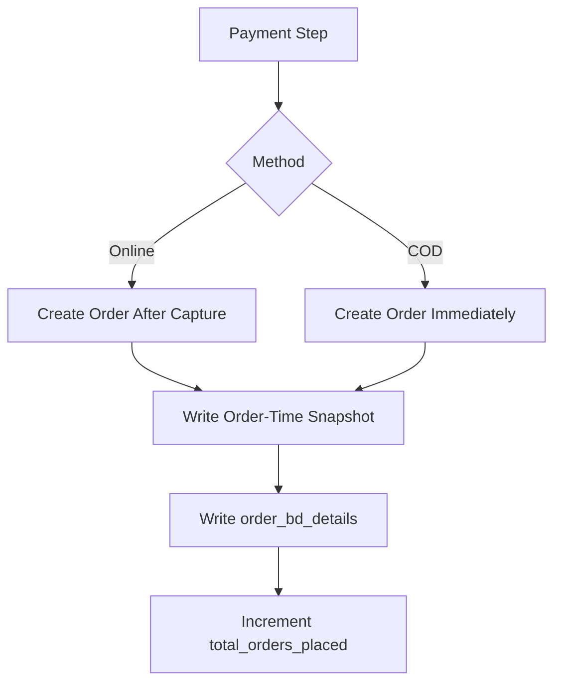

**Diagram sources**
- [prd.md:318-341](file://prd.md#L318-L341)
- [prd.md:199-200](file://prd.md#L199-L200)
- [architecture.md:690-715](file://docs/architecture.md#L690-L715)

**Section sources**
- [prd.md:169-200](file://prd.md#L169-L200)
- [prd.md:318-341](file://prd.md#L318-L341)
- [order-bd-details.ts:3-39](file://apps/medusa/src/modules/bd-orders/models/order-bd-details.ts#L3-L39)

### Courier Assignment and Dispatch
Courier assignment begins when an order reaches the ready-to-ship state. The system:
- Resolves the selected courier adapter.
- Formats the recipient address according to courier requirements.
- Calls the courier API to create a consignment.
- Persists consignment ID and tracking code.
- Updates shipment state to dispatched.
- Enqueues dispatch SMS with tracking link.

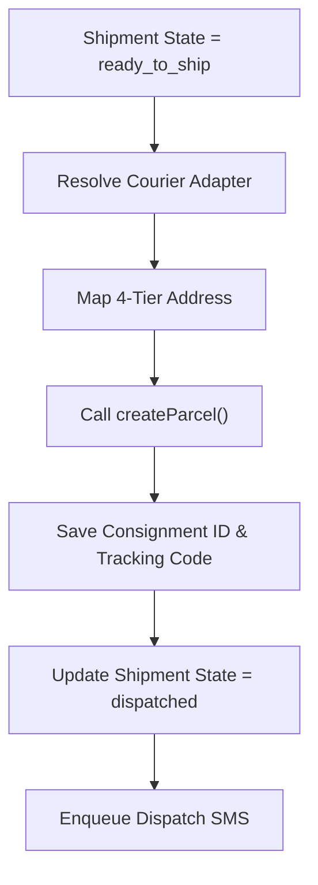

**Diagram sources**
- [technical-plan.md:549-577](file://technical-plan.md#L549-L577)
- [dfd.md:445-502](file://dfd.md#L445-L502)
- [architecture.md:717-723](file://docs/architecture.md#L717-L723)

**Section sources**
- [technical-plan.md:549-577](file://technical-plan.md#L549-L577)
- [courier-shipment-log.ts:3-12](file://apps/medusa/src/modules/bd-courier/models/courier-shipment-log.ts#L3-L12)
- [order-bd-details.ts:16-33](file://apps/medusa/src/modules/bd-orders/models/order-bd-details.ts#L16-L33)

### Confirmation Notifications
Confirmation notifications are final, non-compensatable steps executed after database commits:
- Order confirmation SMS for online payments.
- COD confirmation SMS after staff marks COD confirmed.
- Dispatch SMS with tracking link after courier booking.
- Delivery SMS after successful delivery.

SMS failures are logged and retried asynchronously; they never roll back order, payment, or fulfillment state.

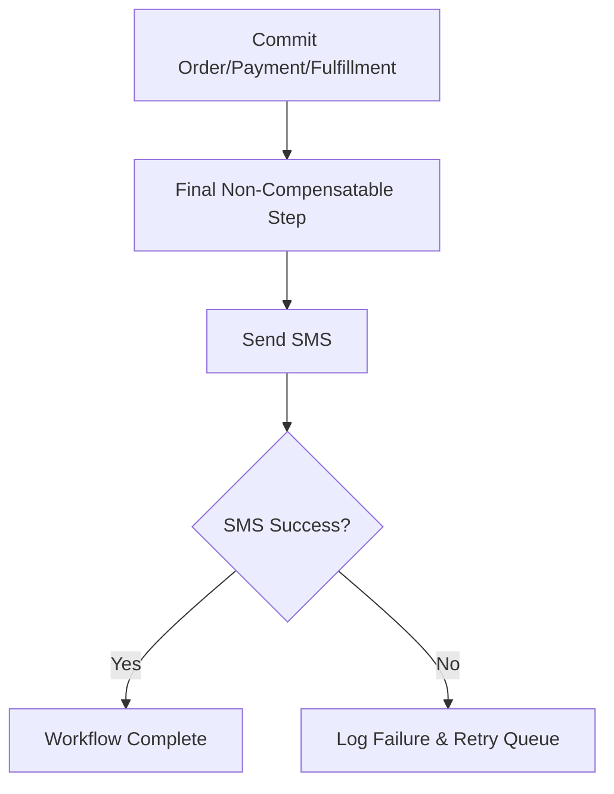

**Diagram sources**
- [architecture.md:545-549](file://docs/architecture.md#L545-L549)
- [prd.md:338-341](file://prd.md#L338-L341)

**Section sources**
- [architecture.md:545-549](file://docs/architecture.md#L545-L549)
- [prd.md:338-341](file://prd.md#L338-L341)

### Compensation Logic, Retry Mechanisms, and Error Recovery
Because Medusa modules are separate, cross-module writes are not one physical transaction. The system enforces:
- Ordered workflow execution with idempotent steps.
- Evidence rows for every cross-module step.
- Explicit compensation per workflow.
- No distributed lock across modules; workflow-level exclusion uses Medusa’s locking module.
- Outbound integrations use at-least-once semantics with idempotency keys.

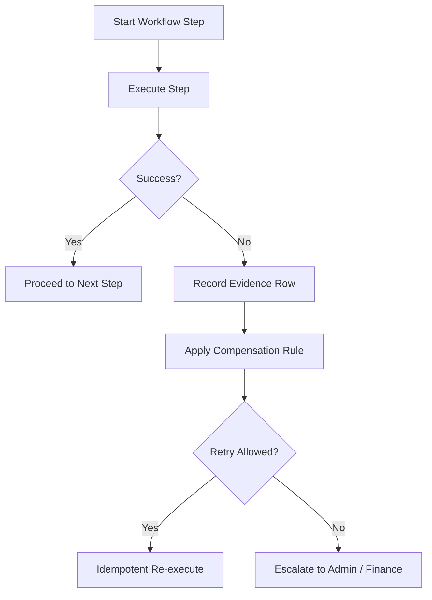

**Diagram sources**
- [database.md:2148-2157](file://database.md#L2148-L2157)

**Section sources**
- [database.md:2148-2157](file://database.md#L2148-L2157)

### Workflow State Transitions
The following states are central to the order lifecycle:

- **Order status:** Pending → Confirmed → Processing → Ready to Ship → Completed/Delivered, with Cancelled and Failed Delivery exceptions.
- **Payment status:** Unpaid, Pending, Paid, Partially Refunded, Refunded.
- **Shipment status:** Booked, Shipped, Out for Delivery, Delivered, Failed Delivery, RTO, RTO Received.
- **COD confirmation status:** Not Applicable, Unconfirmed, Confirmed, Escalated, Canceled.
- **Shipment state:** Pending Confirmation, Ready to Ship, Dispatched, In Transit, Out for Delivery, Delivery Failed, RTO Initiated, RTO Received, Delivered.

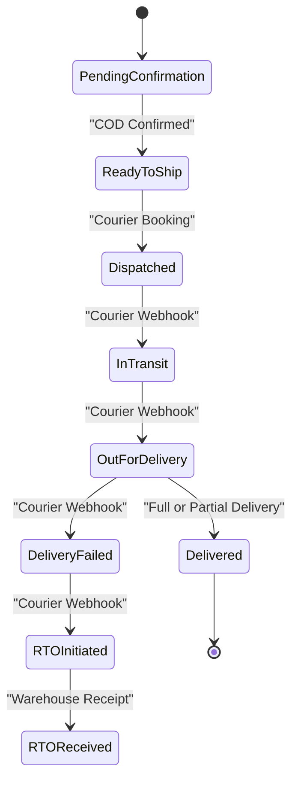

**Diagram sources**
- [order-bd-details.ts:11-33](file://apps/medusa/src/modules/bd-orders/models/order-bd-details.ts#L11-L33)
- [prd.md:175-185](file://prd.md#L175-L185)

**Section sources**
- [order-bd-details.ts:11-33](file://apps/medusa/src/modules/bd-orders/models/order-bd-details.ts#L11-L33)
- [prd.md:175-185](file://prd.md#L175-L185)

### Data Flow Between Modules
The primary data flow connects:
- Storefront to Medusa API for checkout and payment sessions.
- Medusa API to PostgreSQL for core and BD module persistence.
- Medusa API to payment gateways for redirect, execute, and status queries.
- Medusa API to courier APIs for parcel creation and webhook ingestion.
- Background workers to Redis queues for SMS and polling.

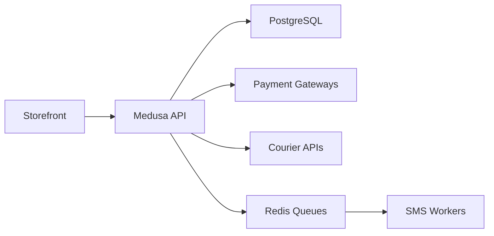

**Diagram sources**
- [dfd.md:327-394](file://dfd.md#L327-L394)
- [technical-plan.md:549-577](file://technical-plan.md#L549-L577)

**Section sources**
- [service.ts:6-10](file://apps/medusa/src/modules/bd-orders/service.ts#L6-L10)
- [service.ts:5-8](file://apps/medusa/src/modules/bd-payments/service.ts#L5-L8)
- [service.ts:5-8](file://apps/medusa/src/modules/bd-courier/service.ts#L5-L8)

### Integration Points with Payment Gateways and Courier Services
- **Payment gateways:** bKash and Nagad direct merchant APIs. Callbacks are zero-trust; verification is performed server-side. Webhooks are logged with signature validity and processing status.
- **Courier services:** Steadfast, Pathao, RedX, and manual dispatch. Adapters map regional address fields and persist consignment metadata. Webhooks distinguish delivery failure from RTO initiation.

**Section sources**
- [prd.md:267-274](file://prd.md#L267-L274)
- [payment-webhook-log.ts:3-15](file://apps/medusa/src/modules/bd-payments/models/payment-webhook-log.ts#L3-L15)
- [courier-shipment-log.ts:3-12](file://apps/medusa/src/modules/bd-courier/models/courier-shipment-log.ts#L3-L12)
- [dfd.md:445-502](file://dfd.md#L445-L502)

## Dependency Analysis
Custom modules depend on Medusa core primitives and each other indirectly through Medusa events, links, and workflows. Direct coupling is minimized; inter-module communication should use Medusa’s module link system.

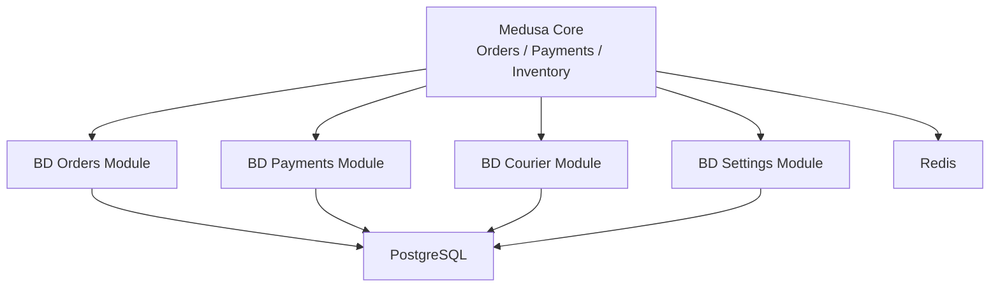

**Diagram sources**
- [architecture.md:66-73](file://docs/architecture.md#L66-L73)
- [database.md:172-200](file://database.md#L172-L200)

**Section sources**
- [architecture.md:66-73](file://docs/architecture.md#L66-L73)
- [database.md:172-200](file://database.md#L172-L200)

## Performance Considerations
- Use Redis distributed locks around inventory reservation to prevent overselling under concurrency.
- Keep outbound integrations asynchronous where possible; enqueue SMS and courier notifications into Redis/BullMQ.
- Avoid synchronous blocking on third-party APIs during checkout redirects.
- Index frequently queried fields such as order IDs, payment session IDs, gateway transaction IDs, and tracking codes.
- Separate read-heavy reporting from write paths; use projections and snapshots rather than recomputing financial totals at query time.
- Ensure money calculations use integer paisa representation and round once at boundaries.

[No sources needed since this section provides general guidance]

## Troubleshooting Guide
Common failures and recommended diagnostics:

- **Dropped payment callback:**
  - Symptom: Customer paid but no order appears.
  - Action: Run background poller for pending payment sessions older than configured TTL; query gateway status; execute order-placement workflow if completed.
  - Evidence: Payment session state, gateway transaction ID, webhook logs.

- **Post-payment stockout:**
  - Symptom: Payment captured but item out of stock.
  - Action: Create unfulfillable stockout order; alert finance; queue urgent SMS; avoid automatic refund unless authorized.
  - Evidence: Audit log entry with action type and amounts.

- **Courier webhook signature invalid:**
  - Symptom: Courier webhook rejected.
  - Action: Reject request, log security alert, verify HMAC or bearer signature, inspect headers and payload.
  - Evidence: Webhook log with signature_valid and error_message.

- **SMS gateway timeout:**
  - Symptom: Order created but confirmation SMS not sent.
  - Action: Log failure, enqueue retry, allow manual resend; never rollback order state.
  - Evidence: SMS queue status and retry attempts.

- **COD confirmation stuck:**
  - Symptom: Order remains pending confirmation.
  - Action: Verify call attempts count and last attempt timestamp; escalate unreachable cases; update COD notes.
  - Evidence: `cod_status`, `call_attempts_count`, `last_call_attempt_at`.

**Section sources**
- [dfd.md:327-394](file://dfd.md#L327-L394)
- [prd.md:762-787](file://prd.md#L762-L787)
- [payment-webhook-log.ts:3-15](file://apps/medusa/src/modules/bd-payments/models/payment-webhook-log.ts#L3-L15)
- [order-bd-details.ts:11-33](file://apps/medusa/src/modules/bd-orders/models/order-bd-details.ts#L11-L33)

## Conclusion
The order placement workflow is designed for reliability, auditability, and operational clarity in a Bangladesh-focused commerce environment. It separates order, payment, shipment, and return statuses; prevents orphan orders and inventory reservations; verifies payments server-side; handles dropped callbacks; compensates failed steps explicitly; and defers external notifications to asynchronous, non-compensatable final steps. Custom modules encapsulate BD-specific concerns while leveraging Medusa’s native capabilities for carts, inventory, orders, payments, and workflows.

[No sources needed since this section summarizes without analyzing specific files]