# Return & Refund Processing Workflow

<cite>
**Referenced Files in This Document**
- [prd.md](file://prd.md)
- [dfd.md](file://dfd.md)
- [user-journeys.md](file://user-journeys.md)
- [order-return-request.ts](file://apps/medusa/src/modules/bd-orders/models/order-return-request.ts)
- [order-return-request-link.ts](file://apps/medusa/src/links/order-return-request.ts)
- [bd-orders-service.ts](file://apps/medusa/src/modules/bd-orders/service.ts)
- [payment-transaction.ts](file://apps/medusa/src/modules/bd-payments/models/payment-transaction.ts)
- [payment-webhook-log.ts](file://apps/medusa/src/modules/bd-payments/models/payment-webhook-log.ts)
- [bd-payments-service.ts](file://apps/medusa/src/modules/bd-payments/service.ts)
</cite>

## Table of Contents
1. [Introduction](#introduction)
2. [Project Structure](#project-structure)
3. [Core Components](#core-components)
4. [Architecture Overview](#architecture-overview)
5. [Detailed Component Analysis](#detailed-component-analysis)
6. [Dependency Analysis](#dependency-analysis)
7. [Performance Considerations](#performance-considerations)
8. [Troubleshooting Guide](#troubleshooting-guide)
9. [Conclusion](#conclusion)

## Introduction
This document explains the return and refund processing workflow for the Bangladesh commerce platform. The system is intentionally manual: return requests are never automatically approved, refunds are never automatically initiated or marked completed, and all sensitive actions require authorized staff review and recording.

The lifecycle covers:
- Return request submission
- Manual approval or rejection
- Return tracking ingestion
- Physical product inspection
- Inventory restoration or quarantine
- Manual refund calculation and payment reversal recording
- Customer notification via SMS outbox
- Policy-based decision making and exception handling

The implementation uses Medusa v2 modules, custom order and payment models, and a data-flow design that separates operational status from financial and inventory state.

## Project Structure
The return and refund capability spans several areas:
- Business requirements define manual-only processing, policy configuration, and auditability.
- Data-flow documentation describes the end-to-end pipeline, including physical inspection, quarantine, restocking, and manual payout recording.
- User journeys describe Admin workflows for reviewing returns, marking refunds processed, and enforcing permissions.
- Code-level models define the return request entity and payment transaction records.
- Links connect return requests to orders.
- Services expose Medusa module services for orders and payments.

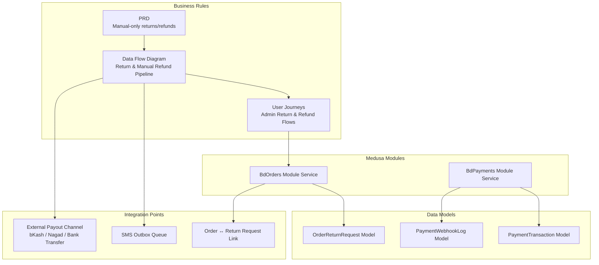

**Diagram sources**
- [prd.md:211-242](file://prd.md#L211-L242)
- [dfd.md:305-313](file://dfd.md#L305-L313)
- [user-journeys.md:848-864](file://user-journeys.md#L848-L864)
- [bd-orders-service.ts:1-13](file://apps/medusa/src/modules/bd-orders/service.ts#L1-L13)
- [bd-payments-service.ts:1-11](file://apps/medusa/src/modules/bd-payments/service.ts#L1-L11)
- [order-return-request.ts:1-28](file://apps/medusa/src/modules/bd-orders/models/order-return-request.ts#L1-L28)
- [payment-transaction.ts:1-18](file://apps/medusa/src/modules/bd-payments/models/payment-transaction.ts#L1-L18)
- [payment-webhook-log.ts:1-18](file://apps/medusa/src/modules/bd-payments/models/payment-webhook-log.ts#L1-L18)
- [order-return-request-link.ts:1-9](file://apps/medusa/src/links/order-return-request.ts#L1-L9)

**Section sources**
- [prd.md:211-242](file://prd.md#L211-L242)
- [dfd.md:305-313](file://dfd.md#L305-L313)
- [user-journeys.md:848-864](file://user-journeys.md#L848-L864)
- [bd-orders-service.ts:1-13](file://apps/medusa/src/modules/bd-orders/service.ts#L1-L13)
- [bd-payments-service.ts:1-11](file://apps/medusa/src/modules/bd-payments/service.ts#L1-L11)
- [order-return-request.ts:1-28](file://apps/medusa/src/modules/bd-orders/models/order-return-request.ts#L1-L28)
- [payment-transaction.ts:1-18](file://apps/medusa/src/modules/bd-payments/models/payment-transaction.ts#L1-L18)
- [payment-webhook-log.ts:1-18](file://apps/medusa/src/modules/bd-payments/models/payment-webhook-log.ts#L1-L18)
- [order-return-request-link.ts:1-9](file://apps/medusa/src/links/order-return-request.ts#L1-L9)

## Core Components
The return and refund workflow is built around these core components:

- **Return Request Entity**: Stores the independent return lifecycle state, reason, courier tracking, item condition, refund method, target account, refund amount, external transaction ID, and review metadata.
- **Order Link**: Connects a return request to its originating order so Admin UIs and queries can show context without mutating order status.
- **Orders Module Service**: Exposes the return request model through the Medusa service layer.
- **Payments Module Service**: Exposes payment transaction and webhook log models used for payment verification and auditability.
- **Payment Transaction Model**: Records authorization, capture, refund, and status-query events with provider details and gateway responses.
- **Payment Webhook Log Model**: Captures raw webhook payloads, signature validation results, and processing outcomes.

Key responsibilities:
- Keep return/refund status independent from order and payment statuses.
- Enforce manual review and manual refund completion.
- Support partial refunds through configurable refund amounts and methods.
- Record audit information for every sensitive action.
- Integrate with SMS outbox for customer notifications.

**Section sources**
- [order-return-request.ts:1-28](file://apps/medusa/src/modules/bd-orders/models/order-return-request.ts#L1-L28)
- [order-return-request-link.ts:1-9](file://apps/medusa/src/links/order-return-request.ts#L1-L9)
- [bd-orders-service.ts:1-13](file://apps/medusa/src/modules/bd-orders/service.ts#L1-L13)
- [payment-transaction.ts:1-18](file://apps/medusa/src/modules/bd-payments/models/payment-transaction.ts#L1-L18)
- [payment-webhook-log.ts:1-18](file://apps/medusa/src/modules/bd-payments/models/payment-webhook-log.ts#L1-L18)
- [bd-payments-service.ts:1-11](file://apps/medusa/src/modules/bd-payments/service.ts#L1-L11)

## Architecture Overview
The return and refund architecture follows a manual-first design with clear separation between operational, financial, and inventory concerns.

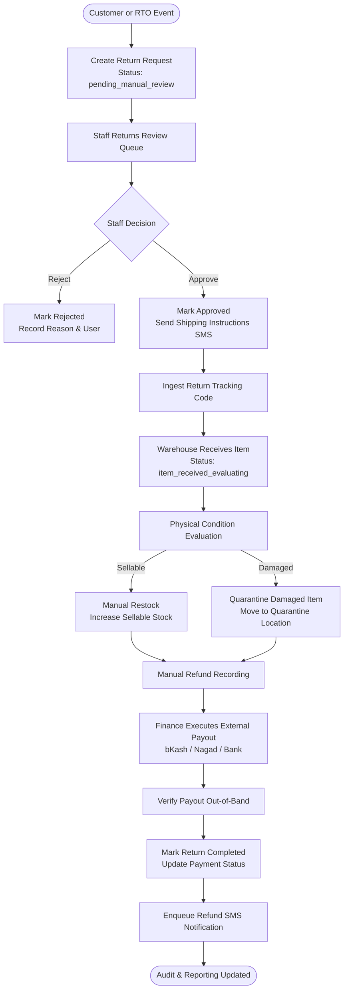

**Diagram sources**
- [dfd.md:504-554](file://dfd.md#L504-L554)
- [prd.md:225-242](file://prd.md#L225-L242)
- [user-journeys.md:848-864](file://user-journeys.md#L848-L864)

## Detailed Component Analysis

### Return Request Lifecycle
The return request lifecycle is modeled as an independent status dimension linked to an order. It progresses through clearly defined states rather than relying on automatic triggers.

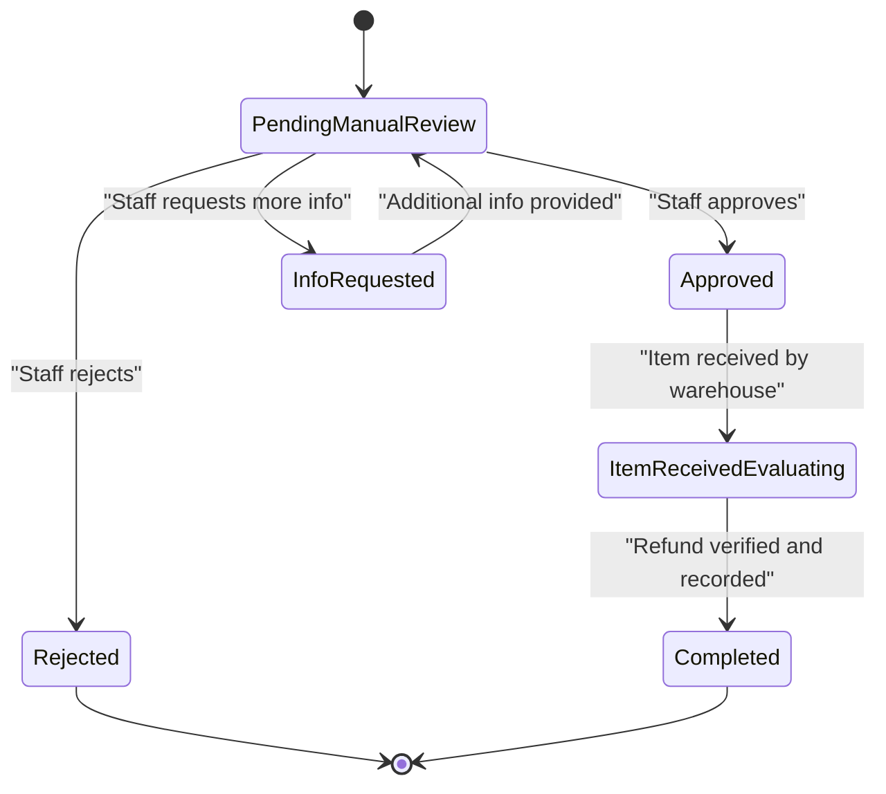

**Diagram sources**
- [order-return-request.ts:6-14](file://apps/medusa/src/modules/bd-orders/models/order-return-request.ts#L6-L14)
- [prd.md:225-242](file://prd.md#L225-L242)
- [user-journeys.md:848-864](file://user-journeys.md#L848-L864)

#### Key Fields and Their Role
- `status`: Controls the return lifecycle stage.
- `reason`: Captures why the customer requested a return.
- `return_courier_name` and `return_tracking_code`: Enable return parcel tracking.
- `item_condition`: Tracks physical inspection result.
- `refund_method`, `refund_target_account`, `refund_amount_bdt`, `refund_trx_id`: Capture manual refund execution details.
- `reviewed_by` and `reviewed_at`: Provide auditability for staff decisions.

**Section sources**
- [order-return-request.ts:1-28](file://apps/medusa/src/modules/bd-orders/models/order-return-request.ts#L1-L28)
- [prd.md:225-242](file://prd.md#L225-L242)

### Staff Approval and Rejection Workflow
Approval and rejection are strictly manual and permission-gated. A rejected request permanently retains the decision, reason, responsible user, and timestamp.

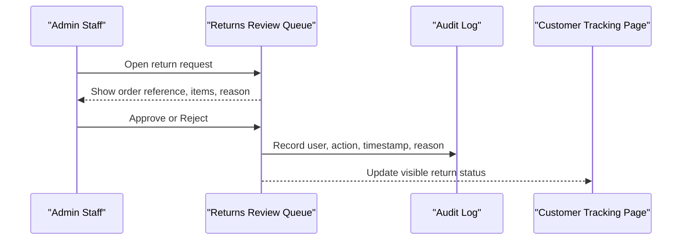

**Diagram sources**
- [user-journeys.md:848-857](file://user-journeys.md#L848-L857)
- [prd.md:225-242](file://prd.md#L225-L242)

**Section sources**
- [user-journeys.md:848-857](file://user-journeys.md#L848-L857)
- [prd.md:225-242](file://prd.md#L225-L242)

### Return Tracking and Physical Inspection
After approval, the customer ships the parcel back. The system supports ingesting a return tracking code and exposing live return tracking on the customer-facing order tracking page. Once the warehouse receives the item, a three-step physical inspection determines whether the item is sellable or damaged.

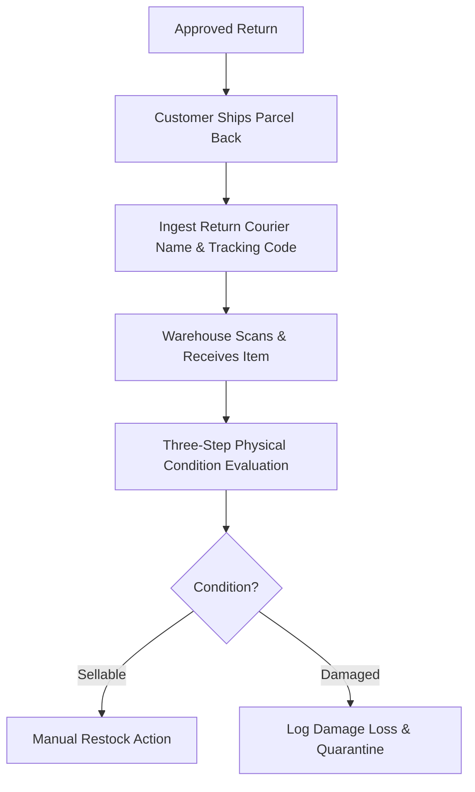

**Diagram sources**
- [dfd.md:522-542](file://dfd.md#L522-L542)

**Section sources**
- [dfd.md:522-542](file://dfd.md#L522-L542)

### Inventory Restoration and Quarantine
Inventory changes are manual and conditional:
- Sellable items are manually restocked after inspection confirms good condition.
- Damaged items are moved to a quarantine location and never automatically returned to sellable stock.
- All restock actions are logged with staff identity for auditability.

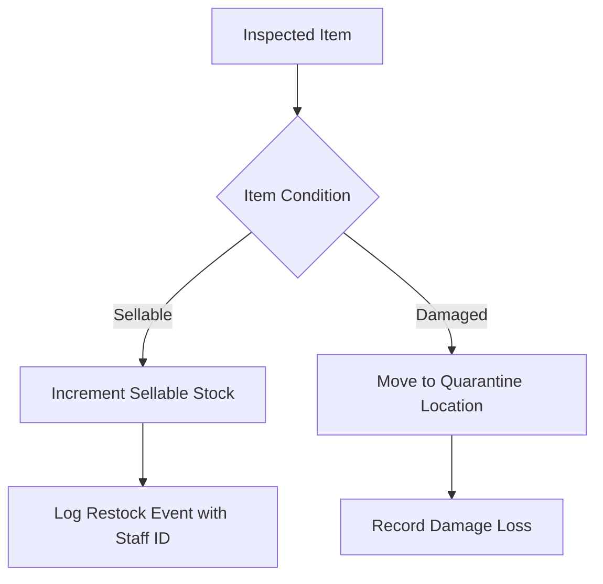

**Diagram sources**
- [dfd.md:534-542](file://dfd.md#L534-L542)
- [prd.md:240-242](file://prd.md#L240-L242)

**Section sources**
- [dfd.md:534-542](file://dfd.md#L534-L542)
- [prd.md:240-242](file://prd.md#L240-L242)

### Refund Calculation and Payment Reversal
Refunds are not automated. Finance staff execute payouts through external channels such as bKash, Nagad, or bank transfer, then verify the payout out-of-band before marking the return as completed. The system records the refund transaction ID, amount, and method, and updates the original order’s payment status as a logged event.

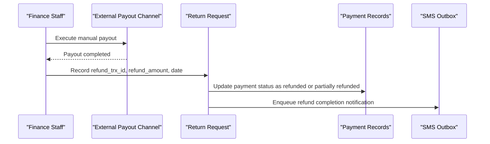

**Diagram sources**
- [dfd.md:544-554](file://dfd.md#L544-L554)
- [user-journeys.md:859-864](file://user-journeys.md#L859-L864)
- [payment-transaction.ts:3-15](file://apps/medusa/src/modules/bd-payments/models/payment-transaction.ts#L3-L15)

**Section sources**
- [dfd.md:544-554](file://dfd.md#L544-L554)
- [user-journeys.md:859-864](file://user-journeys.md#L859-L864)
- [payment-transaction.ts:3-15](file://apps/medusa/src/modules/bd-payments/models/payment-transaction.ts#L3-L15)

### Policy-Based Decision Making
Policy settings control eligibility windows, conditions, refund methods, shipping responsibility, non-returnable categories, and toggles for specific options. Removing a policy field that is already referenced by an active request requires explicit confirmation and does not retroactively change existing requests. Until the owner configures policies, relevant fields are shown as not yet configured rather than silently defaulted.

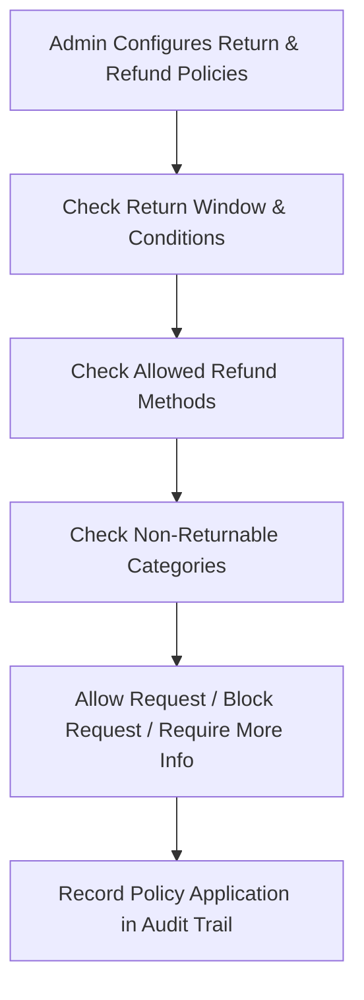

**Diagram sources**
- [prd.md:214-223](file://prd.md#L214-L223)
- [prd.md:225-242](file://prd.md#L225-L242)

**Section sources**
- [prd.md:214-223](file://prd.md#L214-L223)
- [prd.md:225-242](file://prd.md#L225-L242)

### Partial Refund Scenarios
Partial refunds are supported through the return request’s refund amount and method fields. The system allows recording a verified payout amount that may be less than the full order value, while keeping the original order’s payment status updated as partially refunded or fully refunded.

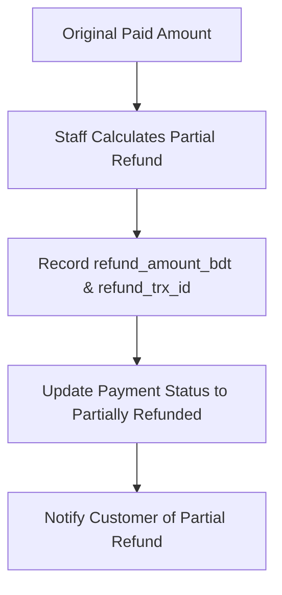

**Diagram sources**
- [order-return-request.ts:19-22](file://apps/medusa/src/modules/bd-orders/models/order-return-request.ts#L19-L22)
- [user-journeys.md:859-864](file://user-journeys.md#L859-L864)

**Section sources**
- [order-return-request.ts:19-22](file://apps/medusa/src/modules/bd-orders/models/order-return-request.ts#L19-L22)
- [user-journeys.md:859-864](file://user-journeys.md#L859-L864)

### Exception Handling for Complex Cases
Exception handling is designed around manual controls and auditability:
- Webhooks from payment providers do not automatically approve or complete returns/refunds.
- Damaged or uninspected items cannot be automatically restocked.
- Permission checks block unauthorized approvals, rejections, or refund processing.
- Policy removals referencing active requests require explicit confirmation.

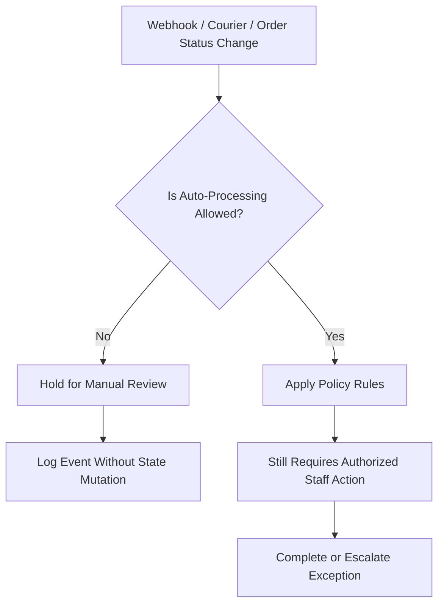

**Diagram sources**
- [prd.md:225-242](file://prd.md#L225-L242)
- [user-journeys.md:866-880](file://user-journeys.md#L866-L880)

**Section sources**
- [prd.md:225-242](file://prd.md#L225-L242)
- [user-journeys.md:866-880](file://user-journeys.md#L866-L880)

## Dependency Analysis
The return and refund workflow depends on several interconnected components:

- **Order ↔ Return Request Link**: Ensures each return request is traceable to its originating order.
- **Orders Module Service**: Provides access to order-related entities, including return requests.
- **Payments Module Service**: Provides access to payment transactions and webhook logs used for verification and audit.
- **Models**: Define the schema for return requests, payment transactions, and webhook logs.
- **External Systems**: Include payment gateways (bKash/Nagad), courier tracking, and SMS providers.

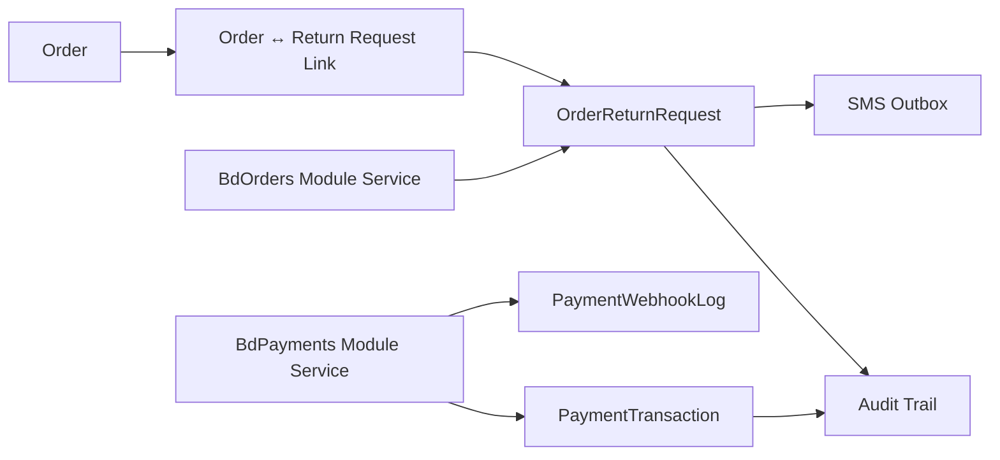

**Diagram sources**
- [order-return-request-link.ts:1-9](file://apps/medusa/src/links/order-return-request.ts#L1-L9)
- [bd-orders-service.ts:1-13](file://apps/medusa/src/modules/bd-orders/service.ts#L1-L13)
- [bd-payments-service.ts:1-11](file://apps/medusa/src/modules/bd-payments/service.ts#L1-L11)
- [order-return-request.ts:1-28](file://apps/medusa/src/modules/bd-orders/models/order-return-request.ts#L1-L28)
- [payment-transaction.ts:1-18](file://apps/medusa/src/modules/bd-payments/models/payment-transaction.ts#L1-L18)
- [payment-webhook-log.ts:1-18](file://apps/medusa/src/modules/bd-payments/models/payment-webhook-log.ts#L1-L18)

**Section sources**
- [order-return-request-link.ts:1-9](file://apps/medusa/src/links/order-return-request.ts#L1-L9)
- [bd-orders-service.ts:1-13](file://apps/medusa/src/modules/bd-orders/service.ts#L1-L13)
- [bd-payments-service.ts:1-11](file://apps/medusa/src/modules/bd-payments/service.ts#L1-L11)
- [order-return-request.ts:1-28](file://apps/medusa/src/modules/bd-orders/models/order-return-request.ts#L1-L28)
- [payment-transaction.ts:1-18](file://apps/medusa/src/modules/bd-payments/models/payment-transaction.ts#L1-L18)
- [payment-webhook-log.ts:1-18](file://apps/medusa/src/modules/bd-payments/models/payment-webhook-log.ts#L1-L18)

## Performance Considerations
- Keep return request queries indexed by order ID to support fast lookup from order detail pages.
- Avoid heavy synchronous calls during return inspection; use asynchronous SMS enqueueing for customer notifications.
- Separate read-heavy Admin queues from write-heavy refund recording operations.
- Cache policy configurations where appropriate, but invalidate caches when policy settings change.
- Ensure webhook handlers are idempotent to avoid duplicate refund or status mutations.

[No sources needed since this section provides general guidance]

## Troubleshooting Guide
Common issues and their expected behavior:

- Unauthorized approval attempt:
  - Behavior: API blocks the action and returns a permission error.
  - Cause: Staff lacks the required return-review permission.
  - Resolution: Assign the correct permission or route to an authorized user.

- Policy field removal while active requests exist:
  - Behavior: System requires explicit confirmation and does not retroactively alter open requests.
  - Cause: Policy change could break historical or active return records.
  - Resolution: Confirm removal only after resolving references or archiving affected requests.

- Payment provider webhook reports a refund-capable event:
  - Behavior: Webhook is received and logged, but return/refund status remains unchanged.
  - Cause: Manual-only requirement prevents automatic state mutation.
  - Resolution: Use the Admin return queue to manually verify and record the refund.

- Damaged item accidentally restocked:
  - Behavior: Should not occur if inspection gates restocking.
  - Cause: Bypassing the three-step inspection or incorrect manual action.
  - Resolution: Investigate audit logs, quarantine the item, and correct inventory records.

**Section sources**
- [user-journeys.md:866-880](file://user-journeys.md#L866-L880)
- [prd.md:225-242](file://prd.md#L225-L242)

## Conclusion
The return and refund workflow is intentionally manual, auditable, and policy-driven. It separates operational status from financial and inventory state, enforces role-based permissions, and integrates with external payout channels and SMS notifications without automating sensitive financial actions. The current codebase provides the foundational models, links, and service layers; business rules and Admin workflows ensure safe, verifiable handling of returns, inspections, partial refunds, and exceptions.

[No sources needed since this section summarizes without analyzing specific files]