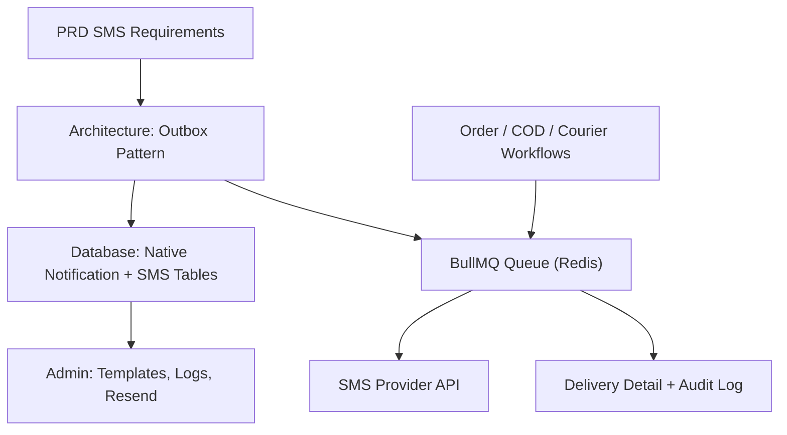
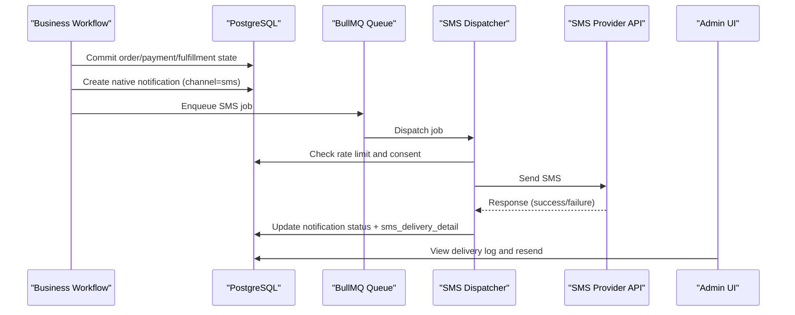
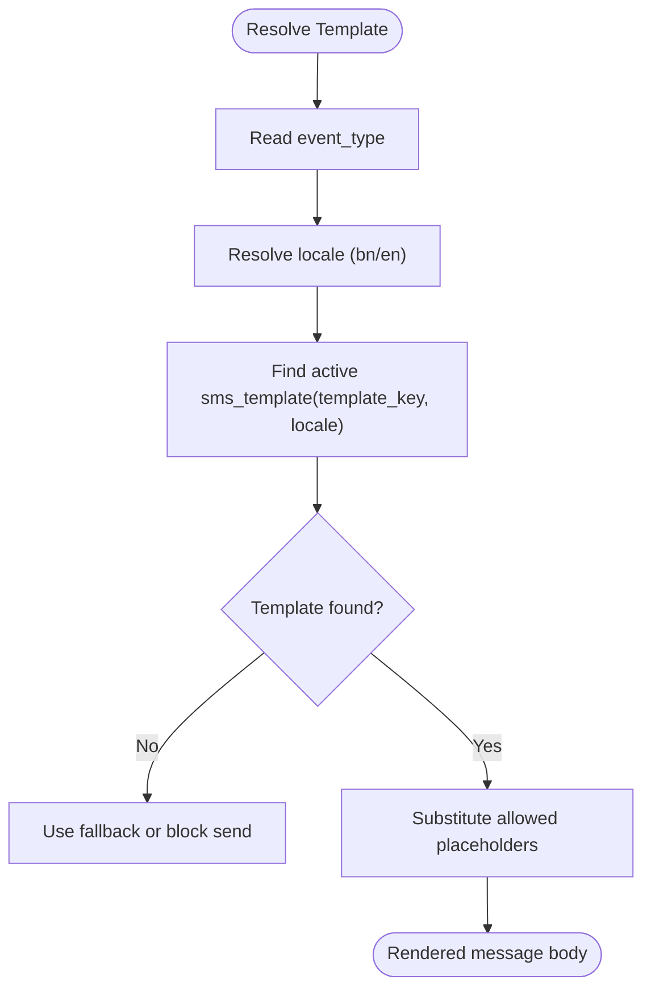
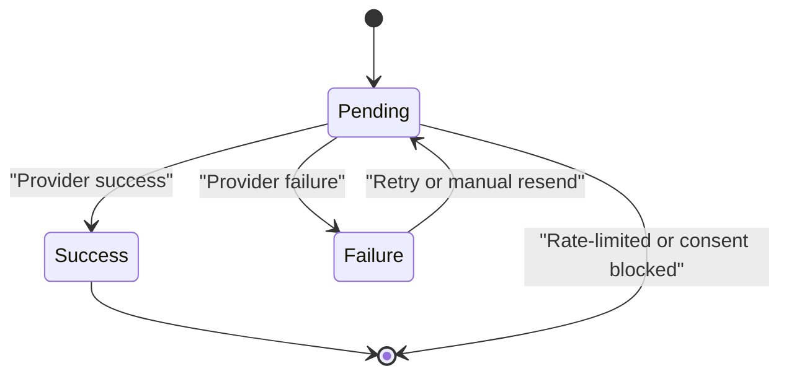
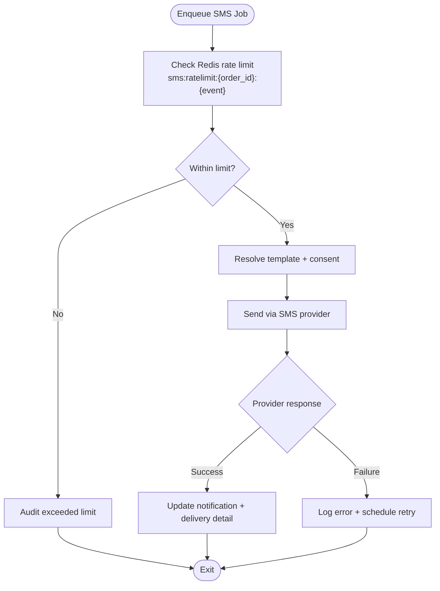
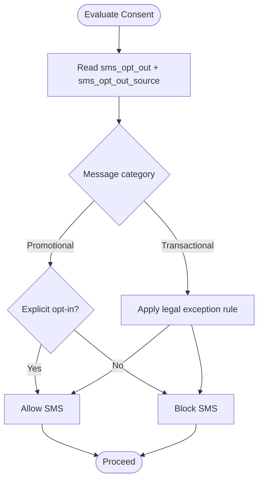
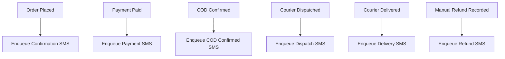
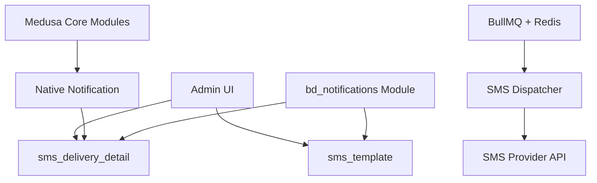

# SMS & Notification Workflow

<cite>
**Referenced Files in This Document**   
- [database.md](file://database.md)
- [architecture.md](file://docs/architecture.md)
- [dfd.md](file://dfd.md)
- [prd.md](file://prd.md)
- [agent.md](file://agent.md)
- [final-system-validation.md](file://final-system-validation.md)
</cite>

## Table of Contents
1. [Introduction](#introduction)
2. [Project Structure](#project-structure)
3. [Core Components](#core-components)
4. [Architecture Overview](#architecture-overview)
5. [Detailed Component Analysis](#detailed-component-analysis)
6. [Dependency Analysis](#dependency-analysis)
7. [Performance Considerations](#performance-considerations)
8. [Troubleshooting Guide](#troubleshooting-guide)
9. [Conclusion](#conclusion)
10. [Appendices](#appendices)

## Introduction
This document explains the SMS and notification workflow for the Bangladesh e-commerce platform. It focuses on:
- Template-based notifications using native Medusa `notification` records plus BD-specific delivery details.
- Multi-channel design where SMS is currently implemented, while email and push are supported by the same native notification foundation.
- Delivery status tracking through native notification state and custom delivery detail fields.
- Queuing via BullMQ with Redis-backed rate limiting and retry semantics.
- Localization support for Bangla and English templates.
- Integration patterns for SMS providers, consent handling, and operational constraints.
- Performance guidance for high-volume messaging.

The system treats SMS dispatch as a final, non-compensatable step that runs after order, inventory, and payment changes have been committed to PostgreSQL. Failures do not roll back business transactions; they are logged and retried or surfaced for manual resend.

**Section sources**
- [architecture.md:545-566](file://docs/architecture.md#L545-L566)
- [database.md:2347-2355](file://database.md#L2347-L2355)

## Project Structure
The SMS/notification capability spans documentation, data model, and runtime integration points:
- Business requirements define SMS as Phase 1 and specify reliability, idempotency, and admin controls.
- The canonical database design defines the native notification usage and BD-specific SMS tables.
- Architecture and DFD documents describe the outbox pattern, queue placement, and event triggers.
- Agent instructions enforce using native notification rather than a separate SMS log table.
- Sprint planning places the asynchronous BullMQ SMS dispatcher in the courier/logistics phase.



**Diagram sources**
- [prd.md:400-408](file://prd.md#L400-L408)
- [architecture.md:545-566](file://docs/architecture.md#L545-L566)
- [database.md:1267-1306](file://database.md#L1267-L1306)
- [final-system-validation.md:142-147](file://final-system-validation.md#L142-L147)

**Section sources**
- [prd.md:400-408](file://prd.md#L400-L408)
- [architecture.md:545-566](file://docs/architecture.md#L545-L566)
- [database.md:1267-1306](file://database.md#L1267-L1306)
- [agent.md:103-105](file://agent.md#L103-L105)
- [final-system-validation.md:142-147](file://final-system-validation.md#L142-L147)

## Core Components
The SMS/notification system is composed of:
- **Native notification record:** Authoritative delivery log with channel, template, data, provider data, idempotency key, status, external ID, and retry linkage.
- **BD-specific SMS delivery detail:** Masked recipient, hashed recipient, attempt number, provider code, redacted error text, timestamps, cost, and rate-limit bucket.
- **SMS template registry:** Versioned, locale-aware templates keyed by event type, with one active row per `(template_key, locale)`.
- **Queue and rate limiter:** BullMQ queues backed by Redis, with per-order-per-event rate limiting before inserting a notification.
- **Workflow triggers:** Order placement, COD confirmation, dispatch, delivery, and refund-related events enqueue SMS messages.
- **Admin controls:** Configurable SMS gateway settings, template management, delivery logs, and manual resend.

Key implementation rules:
- Do not create a standalone `sms_log`; use native `notification` plus `sms_delivery_detail`.
- SMS failures never cancel or corrupt order/payment/return state.
- Duplicate SMS for the same event should be prevented where practical.
- SMS must not be claimed operational until a gateway is configured and tested.

**Section sources**
- [database.md:1267-1306](file://database.md#L1267-L1306)
- [database.md:2347-2355](file://database.md#L2347-L2355)
- [agent.md:103-105](file://agent.md#L103-L105)
- [prd.md:400-408](file://prd.md#L400-L408)

## Architecture Overview
The SMS workflow follows an outbox pattern:
1. A business workflow commits core state to PostgreSQL.
2. An SMS notification record is created with an idempotency key.
3. A BullMQ job consumes the notification and sends it to the SMS provider.
4. Provider responses update native notification status and BD delivery detail.
5. Rate limiting prevents excessive messages per order per event.
6. Manual resend creates a new notification referencing the original.



**Diagram sources**
- [architecture.md:545-566](file://docs/architecture.md#L545-L566)
- [database.md:2347-2355](file://database.md#L2347-L2355)
- [final-system-validation.md:142-147](file://final-system-validation.md#L142-L147)

**Section sources**
- [architecture.md:545-566](file://docs/architecture.md#L545-L566)
- [database.md:2347-2355](file://database.md#L2347-L2355)

## Detailed Component Analysis

### Template-Based Notification System
Templates are stored in `sms_template`:
- Each template has a `template_key`, `event_type`, `locale`, `body_template`, optional provider template ID, version, active flag, and updater.
- Exactly one active template exists per `(template_key, locale)`.
- Placeholders are limited to safe values such as order number, amount, tracking code, return reason, and support phone.
- Bangla is the default locale; English is supported.

Template selection should resolve by:
- Event type from the workflow.
- Customer locale preference when available.
- Active template lookup.
- Placeholder substitution without exposing raw PII in logs.



**Diagram sources**
- [database.md:1267-1283](file://database.md#L1267-L1283)
- [database.md:2347-2355](file://database.md#L2347-L2355)

**Section sources**
- [database.md:1267-1283](file://database.md#L1267-L1283)
- [database.md:2347-2355](file://database.md#L2347-L2355)

### Multi-Channel Delivery Design
Currently, SMS is explicitly modeled:
- Native `notification.channel = 'sms'`.
- BD-specific delivery metadata lives in `sms_delivery_detail`.

Email and push notifications can follow the same native notification pattern:
- Use different channels (`email`, `push`).
- Extend with channel-specific delivery detail tables if BD-specific fields are needed.
- Keep template resolution and localization consistent across channels.
- Avoid duplicating core notification behavior; extend through links and additive tables.

```mermaid
classDiagram
class Notification {
+string id
+string channel
+string template
+json data
+json provider_data
+string idempotency_key
+string status
+string external_id
+string original_notification_id
}
class SmsDeliveryDetail {
+string id
+string notification_id
+string order_id
+string event_type
+string template_key
+string recipient_masked
+string recipient_hash
+int attempt_no
+string provider_code
+string error_code
+string error_message_redacted
+datetime sent_at
+datetime delivered_at
+number cost_paisa
+string rate_limit_bucket
}
class SmsTemplate {
+string id
+string template_key
+string event_type
+string locale
+string body_template
+string provider_template_id
+int version
+bool is_active
+string updated_by
}
Notification <.. SmsDeliveryDetail : "1 : 1 extension"
SmsTemplate --> Notification : "used by"
```

**Diagram sources**
- [database.md:1267-1306](file://database.md#L1267-L1306)
- [database.md:2347-2355](file://database.md#L2347-L2355)

**Section sources**
- [database.md:1267-1306](file://database.md#L1267-L1306)
- [database.md:2347-2355](file://database.md#L2347-L2355)

### Delivery Status Tracking
Delivery status is tracked at two levels:
- **Native notification status:** `pending`, `success`, `failure`.
- **BD delivery detail:** Attempt count, provider response, masked recipient, timestamps, cost, and rate-limit bucket.

Manual resend creates a new native notification referencing the original, incrementing the attempt counter in the delivery detail.



**Diagram sources**
- [database.md:1267-1306](file://database.md#L1267-L1306)
- [database.md:2347-2355](file://database.md#L2347-L2355)

**Section sources**
- [database.md:1267-1306](file://database.md#L1267-L1306)
- [database.md:2347-2355](file://database.md#L2347-L2355)

### Notification Queuing and Retry Mechanism
Queuing and retry behavior:
- SMS dispatch is enqueued asynchronously via BullMQ.
- Rate limiting uses Redis keys scoped by order and event.
- Exceeding the limit is audited rather than silently dropped.
- Gateway timeouts or failures are logged; retries are handled through native notification retry linkage.
- Manual resend increments attempts and preserves auditability.



**Diagram sources**
- [database.md:2347-2355](file://database.md#L2347-L2355)
- [final-system-validation.md:142-147](file://final-system-validation.md#L142-L147)

**Section sources**
- [database.md:2347-2355](file://database.md#L2347-L2355)
- [final-system-validation.md:142-147]

### Localization Support for Bangla and English
Localization rules:
- SMS templates support `bn` and `en` locales.
- Bangla is the default locale.
- Bilingual content is used across SMS templates, invoice text, CMS pages, and other BD-facing content.
- Machine translation requires review before publishing; failed translations are tracked.

Implementation guidance:
- Select template by customer locale preference when available.
- Store rendered output only in logs in redacted form.
- Never mask phone numbers inside templates; masking applies to logs and exports.

**Section sources**
- [database.md:1267-1283](file://database.md#L1267-L1283)
- [database.md:2368-2381](file://database.md#L2368-L2381)
- [database.md:2347-2355](file://database.md#L2347-L2355)

### Integration Patterns with SMS Providers
Integration expectations:
- Admin configures provider credentials, sender ID, and gateway settings.
- The system must not claim SMS is operational until a provider is configured and tested.
- Provider responses update native notification status and BD delivery detail.
- Costs, provider codes, and redacted errors are recorded for reconciliation and debugging.

Recommended provider adapter contract:
- Input: rendered message, recipient E.164 phone, provider template ID if applicable.
- Output: success/failure, provider reference, cost, and normalized error code.
- Idempotency: rely on native notification `idempotency_key` to prevent duplicate sends.

**Section sources**
- [prd.md:400-408](file://prd.md#L400-L408)
- [database.md:1267-1306](file://database.md#L1267-L1306)
- [database.md:2347-2355](file://database.md#L2347-L2355)

### Notification Preferences Management
Consent and preferences:
- Customer identity stores SMS opt-out flags, opt-out timestamp, and opt-out source.
- Transactional messages may still respect opt-out except legally required notices.
- Promotional SMS requires explicit opt-in.
- Opt-out via SMS keyword sets the opt-out source accordingly.

Preference evaluation flow:
1. Read customer SMS opt-out status.
2. Determine message category (transactional vs promotional).
3. Apply legal exceptions where documented.
4. Block or allow SMS dispatch based on policy.



**Diagram sources**
- [database.md:2347-2355](file://database.md#L2347-L2355)

**Section sources**
- [database.md:2347-2355](file://database.md#L2347-L2355)

### Workflow Triggers and Event Mapping
SMS triggers include:
- Order placed.
- Order paid.
- COD confirmed.
- Dispatched.
- Out for delivery.
- Delivered.
- Manual refund recorded.

These align with the broader workflow definitions where SMS is the final non-compensatable step after core state is committed.



**Diagram sources**
- [architecture.md:551-561](file://docs/architecture.md#L551-L561)
- [dfd.md:445-502](file://dfd.md#L445-L502)

**Section sources**
- [architecture.md:551-561](file://docs/architecture.md#L551-L561)
- [dfd.md:445-502](file://dfd.md#L445-L502)

## Dependency Analysis
The SMS/notification subsystem depends on:
- **Medusa native modules:** notification, translation, rbac, tax, fulfillment, order, payment.
- **Custom modules:** bd_notifications for SMS templates and delivery detail.
- **External systems:** SMS provider APIs.
- **Infrastructure:** PostgreSQL for durable state, Redis for rate limiting and BullMQ queue storage.



**Diagram sources**
- [database.md:1267-1306](file://database.md#L1267-L1306)
- [database.md:1439-1463](file://database.md#L1439-L1463)
- [final-system-validation.md:142-147](file://final-system-validation.md#L142-L147)

**Section sources**
- [database.md:1267-1306](file://database.md#L1267-L1306)
- [database.md:1439-1463](file://database.md#L1439-L1463)
- [final-system-validation.md:142-147](file://final-system-validation.md#L142-L147)

## Performance Considerations
For high-volume SMS messaging:
- Use BullMQ workers with controlled concurrency to avoid overwhelming SMS providers.
- Enforce Redis-based rate limits per order and event to prevent bursts.
- Batch template resolution and placeholder substitution where possible.
- Cache provider configuration and active templates within worker process boundaries, with invalidation on template updates.
- Monitor provider latency and error rates; implement exponential backoff with jitter for retries.
- Redact sensitive data in logs to reduce I/O overhead and security exposure.
- Partition or archive delivery detail rows over time according to retention policy.
- Ensure indexes on `order_id`, `event_type`, `recipient_hash`, and `created_at` support reporting and dedupe queries.

[No sources needed since this section provides general guidance]

## Troubleshooting Guide
Common issues and resolutions:
- **Duplicate SMS:** Verify native notification `idempotency_key` and dedupe logic; check whether multiple workflows triggered the same event.
- **Rate limit exceeded:** Inspect Redis bucket `sms:ratelimit:{order_id}:{event}`; confirm audit entries for exceeded limits.
- **Consent blocked:** Review `customer_identity.sms_opt_out` and message category; ensure transactional exceptions are applied correctly.
- **Provider failure:** Check `error_code` and `error_message_redacted` in `sms_delivery_detail`; validate provider credentials and sender ID.
- **Missing template:** Ensure an active template exists for the selected `template_key` and `locale`; verify Bangla default and English fallback.
- **Manual resend not appearing:** Confirm new native notification references `original_notification_id` and `attempt_no` incremented.

Operational checks:
- Validate that SMS is not marked operational until provider configuration is complete.
- Confirm that SMS failures do not rollback order/payment/return state.
- Verify that phone masking is applied only to logs/exports, not message bodies.

**Section sources**
- [prd.md:400-408](file://prd.md#L400-L408)
- [database.md:1267-1306](file://database.md#L1267-L1306)
- [database.md:2347-2355](file://database.md#L2347-L2355)

## Conclusion
The SMS and notification workflow is built around Medusa’s native notification system, extended with BD-specific SMS templates and delivery details. It uses an outbox pattern with BullMQ queuing, Redis rate limiting, and robust retry semantics. Localization supports Bangla and English, while consent and legal exceptions govern delivery. The design avoids duplicating core notification behavior, keeps SMS failures isolated from business transactions, and provides admin controls for templates, logs, and resends. For production scale, focus on worker concurrency, provider resilience, caching, indexing, and observability.

[No sources needed since this section summarizes without analyzing specific files]

## Appendices

### Appendix A: Key Data Model Summary for SMS Notifications
- `sms_template`: Versioned, locale-aware SMS templates keyed by event type.
- `sms_delivery_detail`: BD-specific delivery metadata linked 1:1 to native notification.
- Native `notification`: Authoritative delivery log with channel, template, data, provider data, idempotency, status, external ID, and retry linkage.

**Section sources**
- [database.md:1267-1306](file://database.md#L1267-L1306)
- [database.md:2347-2355](file://database.md#L2347-L2355)