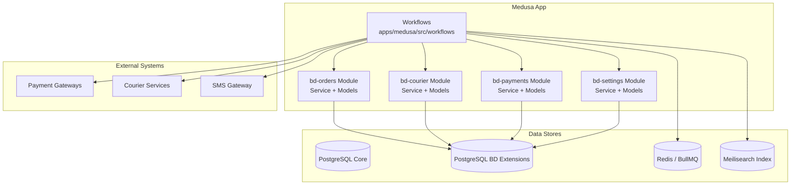
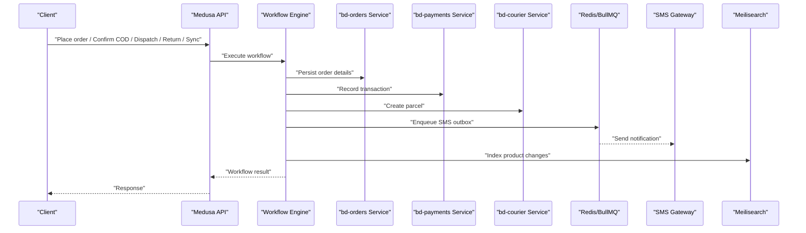
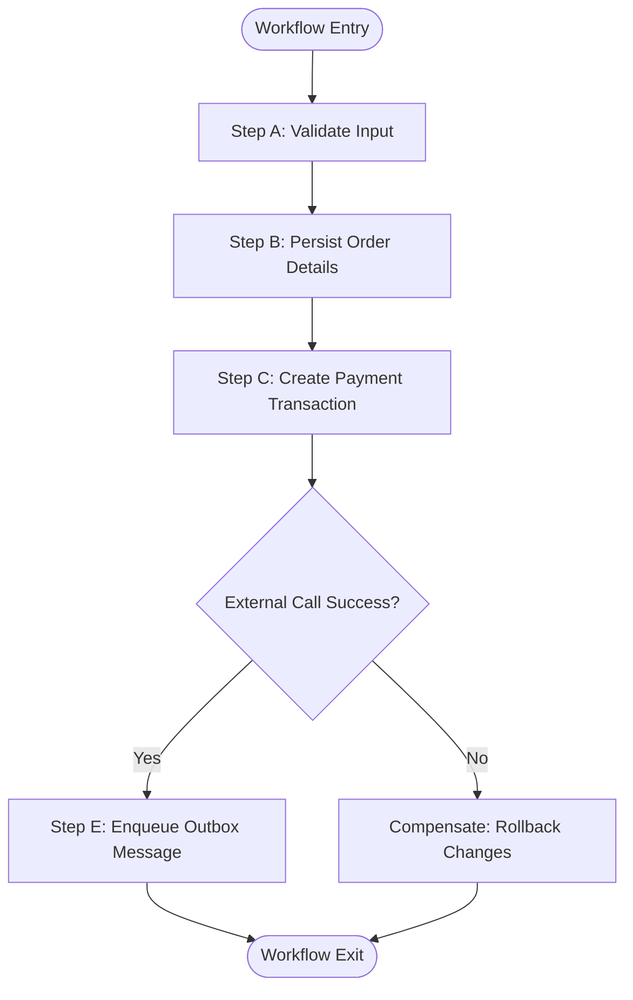
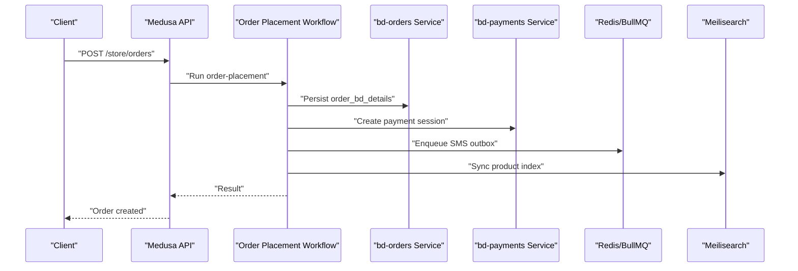
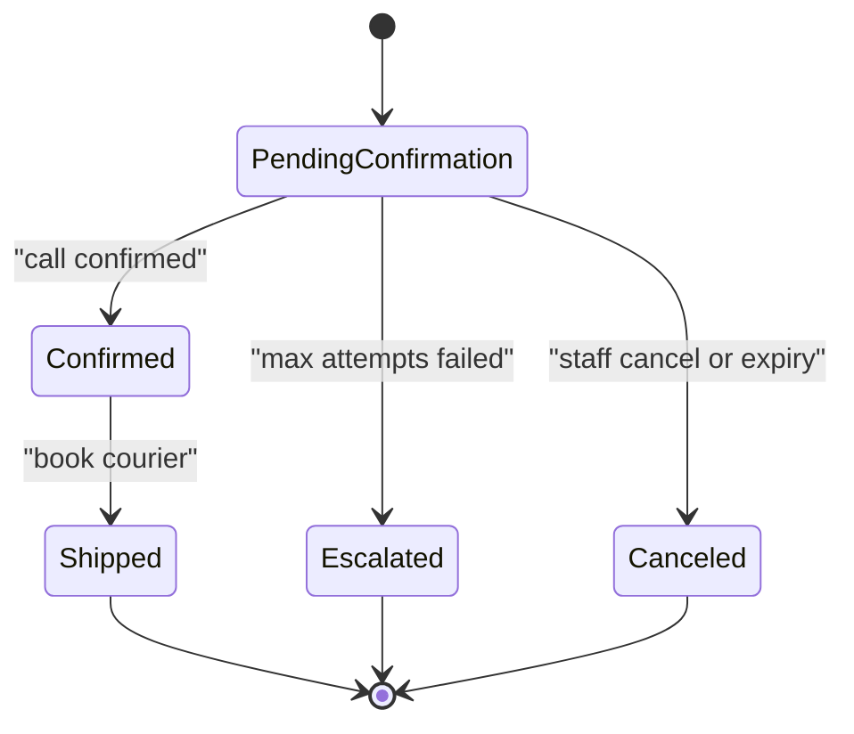
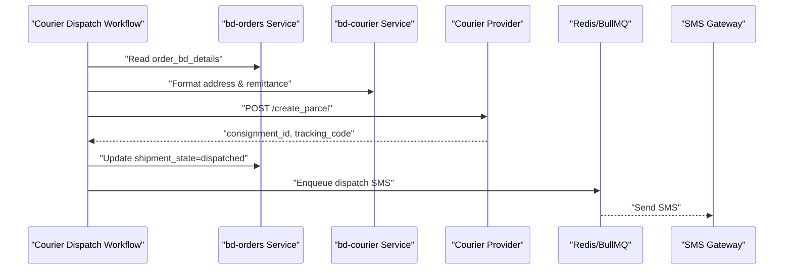
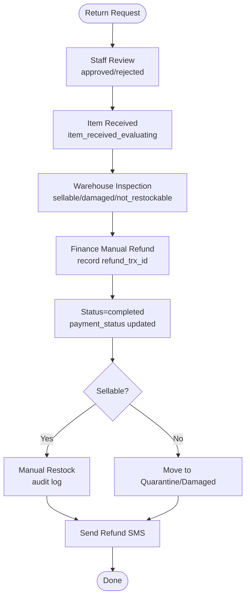
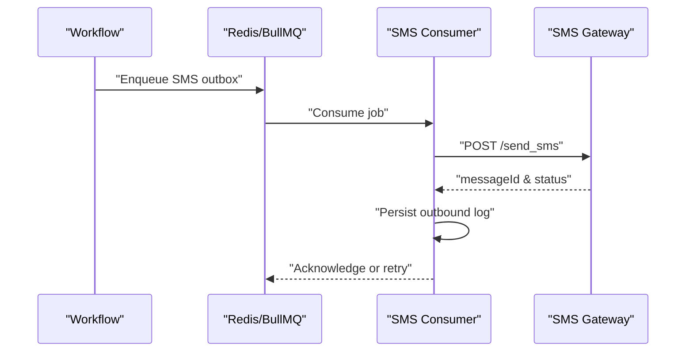
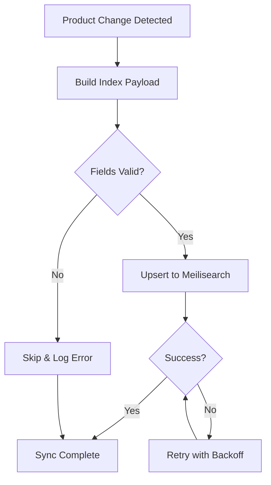
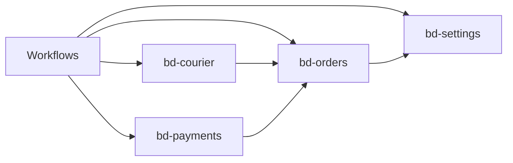

# Workflow Engine & Transactional Processes

<cite>
**Referenced Files in This Document**
- [apps/medusa/src/workflows/README.md](file://apps/medusa/src/workflows/README.md)
- [apps/medusa/src/modules/bd-orders/service.ts](file://apps/medusa/src/modules/bd-orders/service.ts)
- [apps/medusa/src/modules/bd-orders/models/order-bd-details.ts](file://apps/medusa/src/modules/bd-orders/models/order-bd-details.ts)
- [apps/medusa/src/modules/bd-orders/models/order-return-request.ts](file://apps/medusa/src/modules/bd-orders/models/order-return-request.ts)
- [apps/medusa/src/modules/bd-courier/service.ts](file://apps/medusa/src/modules/bd-courier/service.ts)
- [apps/medusa/src/modules/bd-courier/models/courier-shipment-log.ts](file://apps/medusa/src/modules/bd-courier/models/courier-shipment-log.ts)
- [apps/medusa/src/modules/bd-payments/service.ts](file://apps/medusa/src/modules/bd-payments/service.ts)
- [apps/medusa/src/modules/bd-payments/models/payment-transaction.ts](file://apps/medusa/src/modules/bd-payments/models/payment-transaction.ts)
- [apps/medusa/src/modules/bd-settings/service.ts](file://apps/medusa/src/modules/bd-settings/service.ts)
- [apps/medusa/src/modules/bd-settings/models/delivery-zone-config.ts](file://apps/medusa/src/modules/bd-settings/models/delivery-zone-config.ts)
- [docs/architecture.md](file://docs/architecture.md)
- [dfd.md](file://dfd.md)
- [database.md](file://database.md)
</cite>

## Table of Contents
1. [Introduction](#introduction)
2. [Project Structure](#project-structure)
3. [Core Components](#core-components)
4. [Architecture Overview](#architecture-overview)
5. [Detailed Component Analysis](#detailed-component-analysis)
6. [Dependency Analysis](#dependency-analysis)
7. [Performance Considerations](#performance-considerations)
8. [Troubleshooting Guide](#troubleshooting-guide)
9. [Conclusion](#conclusion)

## Introduction
This document explains the workflow engine and transactional processes for BD Commerce Platform, focusing on Medusa Workflows, compensation logic, outbox pattern, and reliability guarantees. It covers six major workflows: order-placement, cod-confirmation, courier-dispatch, return-refund, sms-notification, and meilisearch-sync. The documentation provides step-by-step execution flows, error handling strategies, retry mechanisms, monitoring approaches, diagrams, state transitions, and troubleshooting guides.

## Project Structure
The platform is a Medusa v2 application with custom modules under `apps/medusa/src/modules`. Workflows are defined under `apps/medusa/src/workflows` following Medusa’s framework conventions. Operational data is persisted in PostgreSQL via module models, while transient queues and locks use Redis (BullMQ). External integrations include payment gateways, courier services, SMS gateways, and Meilisearch.

**Diagram sources**
- [apps/medusa/src/workflows/README.md:1-82](file://apps/medusa/src/workflows/README.md#L1-L82)
- [apps/medusa/src/modules/bd-orders/service.ts:1-13](file://apps/medusa/src/modules/bd-orders/service.ts#L1-L13)
- [apps/medusa/src/modules/bd-courier/service.ts:1-11](file://apps/medusa/src/modules/bd-courier/service.ts#L1-L11)
- [apps/medusa/src/modules/bd-payments/service.ts:1-11](file://apps/medusa/src/modules/bd-payments/service.ts#L1-L11)
- [apps/medusa/src/modules/bd-settings/service.ts:1-11](file://apps/medusa/src/modules/bd-settings/service.ts#L1-L11)
- [dfd.md:150-270](file://dfd.md#L150-L270)

**Section sources**
- [apps/medusa/src/workflows/README.md:1-82](file://apps/medusa/src/workflows/README.md#L1-L82)
- [dfd.md:150-270](file://dfd.md#L150-L270)

## Core Components
- Medusa Workflows SDK: Defines steps and workflows; executed from API routes, jobs, or subscribers.
- bd-orders module: Order lifecycle, COD status, shipment state, returns.
- bd-courier module: Courier booking, webhook logs, shipment logs.
- bd-payments module: Payment transactions and gateway logs.
- bd-settings module: Delivery zones and VAT configuration.
- Outbox and queues: SMS notifications and background tasks via Redis/BullMQ.
- Search sync: Product indexing to Meilisearch.

Key responsibilities:
- Workflows orchestrate multi-step operations with idempotent steps and compensations.
- Modules encapsulate domain entities and persistence.
- Outbox ensures reliable delivery of asynchronous events.
- Audit and logs provide traceability across systems.

**Section sources**
- [apps/medusa/src/workflows/README.md:1-82](file://apps/medusa/src/workflows/README.md#L1-L82)
- [apps/medusa/src/modules/bd-orders/service.ts:1-13](file://apps/medusa/src/modules/bd-orders/service.ts#L1-L13)
- [apps/medusa/src/modules/bd-courier/service.ts:1-11](file://apps/medusa/src/modules/bd-courier/service.ts#L1-L11)
- [apps/medusa/src/modules/bd-payments/service.ts:1-11](file://apps/medusa/src/modules/bd-payments/service.ts#L1-L11)
- [apps/medusa/src/modules/bd-settings/service.ts:1-11](file://apps/medusa/src/modules/bd-settings/service.ts#L1-L11)

## Architecture Overview
The system uses Medusa Workflows to coordinate business processes across modules and external systems. Data consistency is achieved through database transactions within steps, idempotency keys, and outbox patterns for async messaging. Reliability is reinforced by retries, audit logging, and explicit state transitions.

**Diagram sources**
- [apps/medusa/src/workflows/README.md:1-82](file://apps/medusa/src/workflows/README.md#L1-L82)
- [dfd.md:150-270](file://dfd.md#L150-L270)

## Detailed Component Analysis

### Medusa Workflows Framework
- Workflows are composed of steps that encapsulate atomic operations.
- Steps can be retried automatically by the framework when failures occur.
- Compensation logic is implemented by defining compensating steps that reverse prior actions if later steps fail.
- Execution is triggered from API routes, scheduled jobs, or subscribers.

**Diagram sources**
- [apps/medusa/src/workflows/README.md:1-82](file://apps/medusa/src/workflows/README.md#L1-L82)

**Section sources**
- [apps/medusa/src/workflows/README.md:1-82](file://apps/medusa/src/workflows/README.md#L1-L82)

### Order-Placement Workflow
Purpose:
- Validate cart and address, reserve inventory, create payment session, persist order details, enqueue SMS outbox, and optionally trigger search sync.

Execution steps:
1. Validate input and resolve delivery zone using settings.
2. Acquire stock lock (Redis) and decrement inventory atomically.
3. Create payment session and record initial transaction.
4. Persist order_bd_details with initial states.
5. Enqueue SMS outbox for order confirmation.
6. Trigger product index update to Meilisearch if catalog changed.

Error handling:
- Inventory reservation failure: rollback and return error.
- Payment session creation failure: compensate inventory reservation and notify.
- SMS enqueue failure: retry via BullMQ with backoff.

Retry mechanism:
- BullMQ job retries with exponential backoff.
- Idempotency keys prevent duplicate orders.

Monitoring:
- Audit log entries for order placement.
- Metrics for success/failure rates and latency.

**Diagram sources**
- [apps/medusa/src/modules/bd-orders/models/order-bd-details.ts:1-42](file://apps/medusa/src/modules/bd-orders/models/order-bd-details.ts#L1-L42)
- [apps/medusa/src/modules/bd-payments/models/payment-transaction.ts:1-18](file://apps/medusa/src/modules/bd-payments/models/payment-transaction.ts#L1-L18)
- [apps/medusa/src/modules/bd-settings/models/delivery-zone-config.ts:1-17](file://apps/medusa/src/modules/bd-settings/models/delivery-zone-config.ts#L1-L17)
- [dfd.md:150-270](file://dfd.md#L150-L270)

**Section sources**
- [apps/medusa/src/modules/bd-orders/models/order-bd-details.ts:1-42](file://apps/medusa/src/modules/bd-orders/models/order-bd-details.ts#L1-L42)
- [apps/medusa/src/modules/bd-payments/models/payment-transaction.ts:1-18](file://apps/medusa/src/modules/bd-payments/models/payment-transaction.ts#L1-L18)
- [apps/medusa/src/modules/bd-settings/models/delivery-zone-config.ts:1-17](file://apps/medusa/src/modules/bd-settings/models/delivery-zone-config.ts#L1-L17)
- [dfd.md:150-270](file://dfd.md#L150-L270)

### COD-Confirmation Workflow
Purpose:
- Manage call center confirmation, escalation, and expiry handling for Cash on Delivery orders.

State transitions:
- pending_confirmation → confirmed → shipped
- pending_confirmation → escalated (after max attempts without confirmation)
- pending_confirmation → canceled (staff cancel or expiry)

Execution steps:
1. On order placement, set cod_status = pending_confirmation and cod_expires_at.
2. Track call attempts; increment attempt_no per call.
3. If attempts exceed threshold, mark escalated.
4. On confirmation, write cod_collectable_paisa once.
5. On dispatch, transition shipment_state to dispatched.

Error handling:
- Duplicate confirmation: idempotent check prevents double writes.
- Expiry handling: cron job auto-cancels expired orders and releases reservations.

Retry mechanism:
- Reminder calls scheduled via BullMQ with configurable intervals.

Monitoring:
- Audit logs for each call attempt and state change.
- Dashboard metrics for confirmation rate and escalation rate.

**Diagram sources**
- [database.md:2234-2255](file://database.md#L2234-L2255)
- [apps/medusa/src/modules/bd-orders/models/order-bd-details.ts:1-42](file://apps/medusa/src/modules/bd-orders/models/order-bd-details.ts#L1-L42)

**Section sources**
- [database.md:2234-2255](file://database.md#L2234-L2255)
- [apps/medusa/src/modules/bd-orders/models/order-bd-details.ts:1-42](file://apps/medusa/src/modules/bd-orders/models/order-bd-details.ts#L1-L42)

### Courier-Dispatch Workflow
Purpose:
- Book courier, format address, create parcel, persist tracking info, update shipment state, and send dispatch SMS.

Execution steps:
1. Resolve selected courier adapter.
2. Format recipient 4-tier address and parcel COD remittance amount.
3. Call courier API create_parcel.
4. Persist consignment_id and tracking_code in order_bd_details.
5. Update shipment_state to dispatched.
6. Dispatch Dispatched SMS via outbox.

Error handling:
- Courier API failure: retry with backoff; log request/response in courier_shipment_log.
- Address validation failure: abort and notify staff.

Retry mechanism:
- BullMQ job retries for courier API calls.
- Webhook processing retries for DELIVERY_FAILED events.

Monitoring:
- Courier webhook logs and shipment logs for observability.
- SLA metrics for dispatch time and success rate.

**Diagram sources**
- [docs/architecture.md:717-737](file://docs/architecture.md#L717-L737)
- [apps/medusa/src/modules/bd-courier/models/courier-shipment-log.ts:1-15](file://apps/medusa/src/modules/bd-courier/models/courier-shipment-log.ts#L1-L15)
- [apps/medusa/src/modules/bd-orders/models/order-bd-details.ts:1-42](file://apps/medusa/src/modules/bd-orders/models/order-bd-details.ts#L1-L42)

**Section sources**
- [docs/architecture.md:717-737](file://docs/architecture.md#L717-L737)
- [apps/medusa/src/modules/bd-courier/models/courier-shipment-log.ts:1-15](file://apps/medusa/src/modules/bd-courier/models/courier-shipment-log.ts#L1-L15)
- [apps/medusa/src/modules/bd-orders/models/order-bd-details.ts:1-42](file://apps/medusa/src/modules/bd-orders/models/order-bd-details.ts#L1-L42)

### Return-Refund Workflow
Purpose:
- Handle manual return inspection and refund processing with strict rules: no automated payouts or restocks.

Execution steps:
1. Staff logs return request -> status = pending_manual_review.
2. Authorized staff reviews -> approved or rejected (audit logged).
3. Customer returns item -> staff marks item_received_evaluating.
4. Warehouse inspects -> selects sellable, damaged, or not_restockable.
5. Finance executes external payment transfer and inputs verified refund_trx_id, amount, date.
6. Status -> completed; payment_status updated accordingly.
7. If sellable, staff triggers manual restock with audit log.
8. Send Refund Completed SMS.

Error handling:
- Duplicate refund trx_id: idempotent check prevents double refunds.
- Invalid refund amount: validation and staff correction required.

Retry mechanism:
- SMS outbox retries for refund notifications.

Monitoring:
- Audit logs for review, inspection, and refund actions.
- Variance reporting for cash discrepancies.

**Diagram sources**
- [docs/architecture.md:725-735](file://docs/architecture.md#L725-L735)
- [apps/medusa/src/modules/bd-orders/models/order-return-request.ts:1-28](file://apps/medusa/src/modules/bd-orders/models/order-return-request.ts#L1-L28)

**Section sources**
- [docs/architecture.md:725-735](file://docs/architecture.md#L725-L735)
- [apps/medusa/src/modules/bd-orders/models/order-return-request.ts:1-28](file://apps/medusa/src/modules/bd-orders/models/order-return-request.ts#L1-L28)

### SMS-Notification Workflow (Outbox Pattern)
Purpose:
- Ensure reliable delivery of SMS notifications using an outbox table and BullMQ queue.

Execution steps:
1. Workflow enqueues SMS message into Redis/BullMQ outbox.
2. Consumer reads template and checks hourly rate limit.
3. POST to SMS gateway with Bangla text.
4. Persist outbound log in sms_log.
5. Retry failed sends with backoff.

Error handling:
- Rate limiting: throttle and retry after window expires.
- Gateway errors: retry with exponential backoff; alert on persistent failures.

Reliability guarantees:
- At-least-once delivery via outbox and queue retries.
- Idempotency keys prevent duplicate messages.

Monitoring:
- Metrics for sent/succeeded/failed counts.
- Alerting on sustained failures.

**Diagram sources**
- [dfd.md:247-253](file://dfd.md#L247-L253)

**Section sources**
- [dfd.md:247-253](file://dfd.md#L247-L253)

### Meilisearch-Sync Workflow
Purpose:
- Keep Meilisearch index consistent with product catalog changes.

Execution steps:
1. Detect product changes (allowlist + category attributes).
2. Build payload for indexing.
3. Upsert documents into Meilisearch.
4. Log sync results and handle partial failures.

Error handling:
- Network errors: retry with backoff.
- Schema mismatch: validate fields before indexing.

Monitoring:
- Sync duration and error rates.
- Index health checks.

**Diagram sources**
- [dfd.md:255-262](file://dfd.md#L255-L262)

**Section sources**
- [dfd.md:255-262](file://dfd.md#L255-L262)

## Dependency Analysis
Modules depend on shared infrastructure:
- bd-orders depends on settings for delivery zones and payments for transaction records.
- bd-courier depends on orders for shipment context and persists logs.
- bd-payments depends on orders for transaction association and logs gateway responses.
- Workflows orchestrate cross-module operations and external integrations.

**Diagram sources**
- [apps/medusa/src/modules/bd-orders/service.ts:1-13](file://apps/medusa/src/modules/bd-orders/service.ts#L1-L13)
- [apps/medusa/src/modules/bd-courier/service.ts:1-11](file://apps/medusa/src/modules/bd-courier/service.ts#L1-L11)
- [apps/medusa/src/modules/bd-payments/service.ts:1-11](file://apps/medusa/src/modules/bd-payments/service.ts#L1-L11)
- [apps/medusa/src/modules/bd-settings/service.ts:1-11](file://apps/medusa/src/modules/bd-settings/service.ts#L1-L11)

**Section sources**
- [apps/medusa/src/modules/bd-orders/service.ts:1-13](file://apps/medusa/src/modules/bd-orders/service.ts#L1-L13)
- [apps/medusa/src/modules/bd-courier/service.ts:1-11](file://apps/medusa/src/modules/bd-courier/service.ts#L1-L11)
- [apps/medusa/src/modules/bd-payments/service.ts:1-11](file://apps/medusa/src/modules/bd-payments/service.ts#L1-L11)
- [apps/medusa/src/modules/bd-settings/service.ts:1-11](file://apps/medusa/src/modules/bd-settings/service.ts#L1-L11)

## Performance Considerations
- Use Redis for instant stock locks to avoid contention during checkout.
- Batch Meilisearch updates to reduce index churn.
- Configure BullMQ concurrency limits per workflow to balance throughput and resource usage.
- Cache delivery zone configurations to minimize DB reads.
- Implement circuit breakers for external APIs (courier, SMS, payment gateways).

## Troubleshooting Guide
Common issues and resolutions:
- Order placement fails due to inventory shortage:
  - Check stock levels and reservation locks.
  - Verify idempotency key uniqueness.
- COD order escalates unexpectedly:
  - Review call attempt logs and cron schedules.
  - Adjust operational_settings.cod_expiry_hours and cod_max_call_attempts.
- Courier booking fails:
  - Inspect courier_shipment_log for request/response payloads.
  - Retry with backoff; validate address formatting.
- SMS not delivered:
  - Check rate limits and outbound logs.
  - Retry failed jobs; verify SMS gateway credentials.
- Meilisearch sync errors:
  - Validate field mappings and allowlist configuration.
  - Monitor sync metrics and reindex if necessary.

Monitoring and observability:
- Audit logs for all critical actions.
- Metrics for workflow success/failure, latency, and queue depth.
- Alerts for sustained failures and SLA breaches.

**Section sources**
- [apps/medusa/src/modules/bd-courier/models/courier-shipment-log.ts:1-15](file://apps/medusa/src/modules/bd-courier/models/courier-shipment-log.ts#L1-L15)
- [apps/medusa/src/modules/bd-payments/models/payment-transaction.ts:1-18](file://apps/medusa/src/modules/bd-payments/models/payment-transaction.ts#L1-L18)
- [database.md:2234-2255](file://database.md#L2234-L2255)
- [dfd.md:247-262](file://dfd.md#L247-L262)

## Conclusion
BD Commerce Platform leverages Medusa Workflows to implement robust, auditable, and reliable business processes. By combining step-level transactions, compensation logic, outbox patterns, and structured state machines, the platform ensures consistency across order placement, COD confirmation, courier dispatch, return-refund, SMS notifications, and Meilisearch synchronization. Proper monitoring, retry mechanisms, and audit trails provide strong operational visibility and resilience against failures.