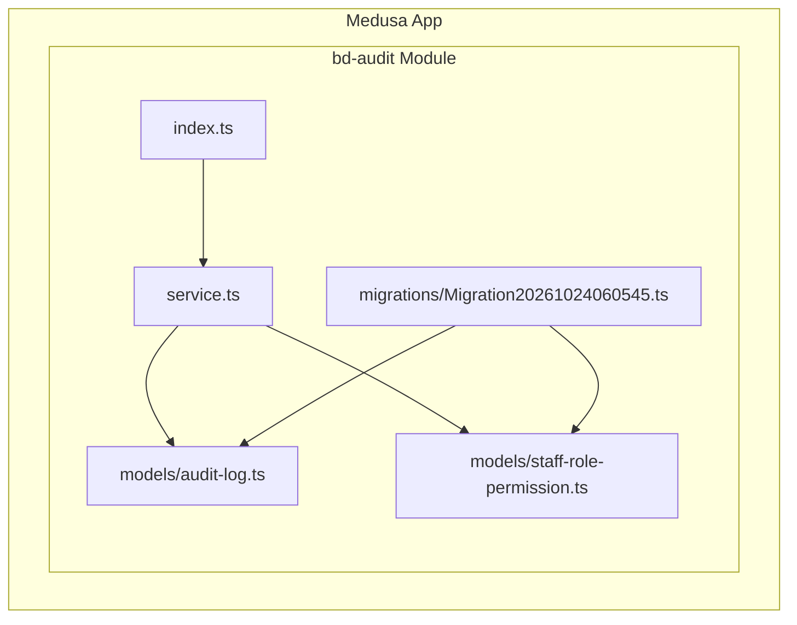
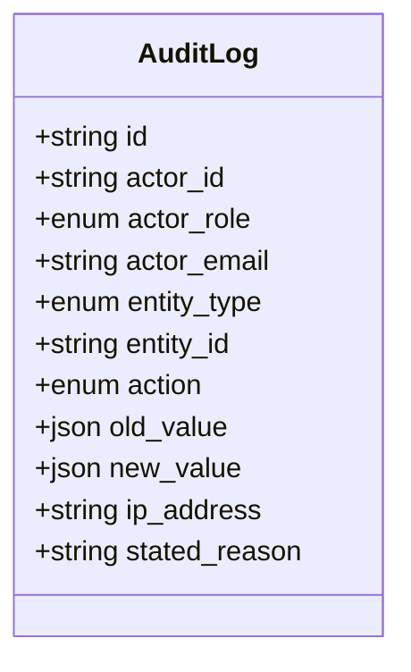
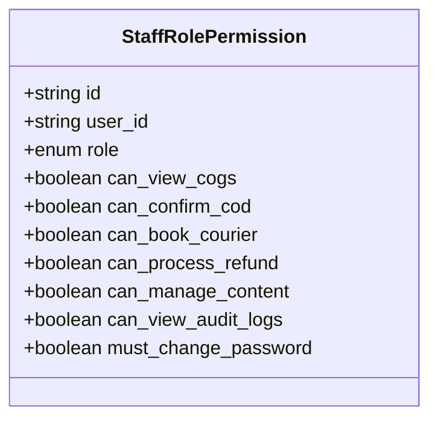
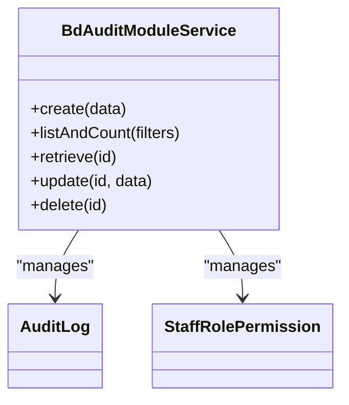
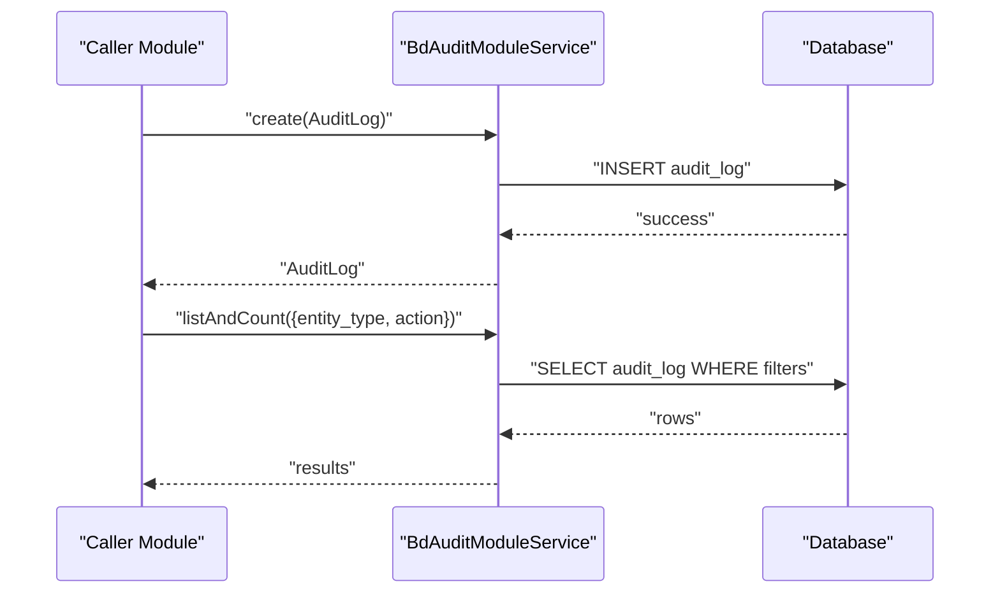
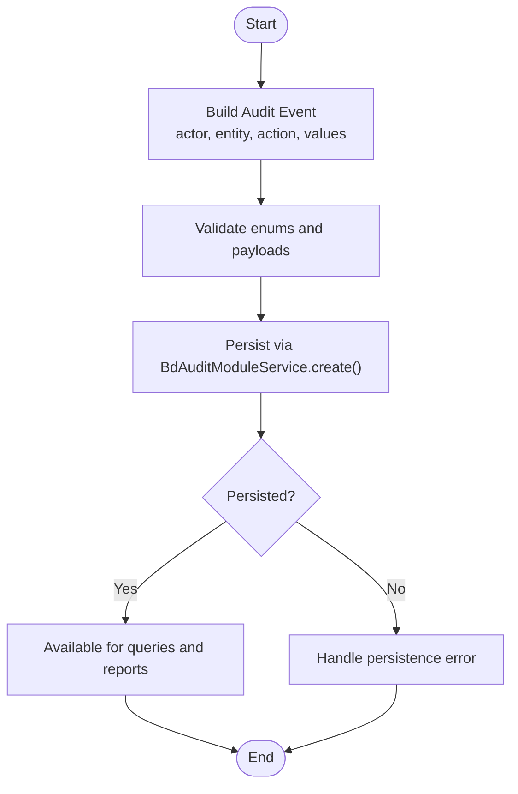
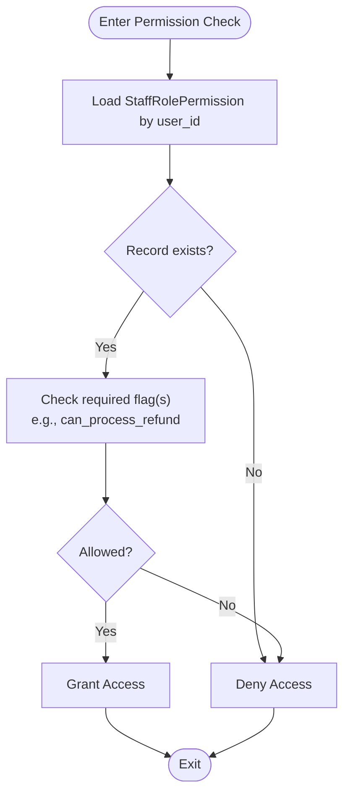
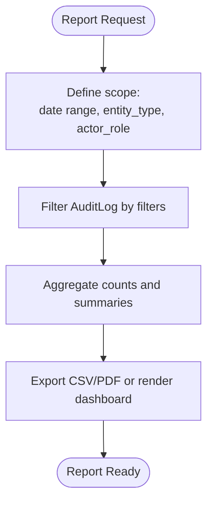
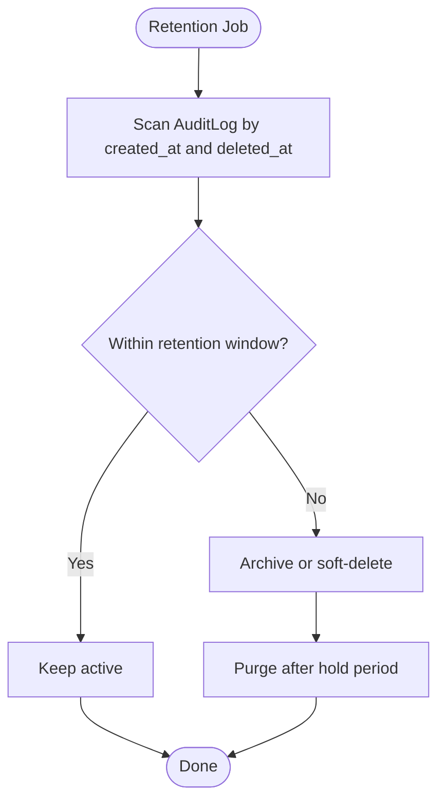
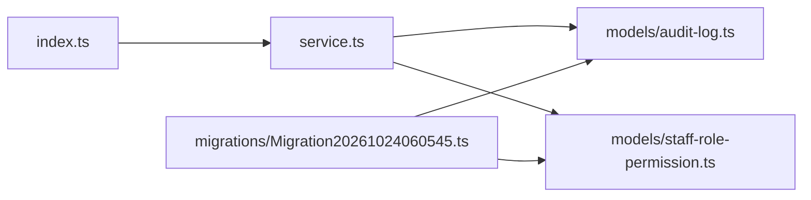

# Audit & Compliance Module

<cite>
**Referenced Files in This Document**
- [audit-log.ts](file://apps/medusa/src/modules/bd-audit/models/audit-log.ts)
- [staff-role-permission.ts](file://apps/medusa/src/modules/bd-audit/models/staff-role-permission.ts)
- [service.ts](file://apps/medusa/src/modules/bd-audit/service.ts)
- [index.ts](file://apps/medusa/src/modules/bd-audit/index.ts)
- [Migration20261024060545.ts](file://apps/medusa/src/modules/bd-audit/migrations/Migration20261024060545.ts)
</cite>

## Table of Contents
1. [Introduction](#introduction)
2. [Project Structure](#project-structure)
3. [Core Components](#core-components)
4. [Architecture Overview](#architecture-overview)
5. [Detailed Component Analysis](#detailed-component-analysis)
6. [Dependency Analysis](#dependency-analysis)
7. [Performance Considerations](#performance-considerations)
8. [Troubleshooting Guide](#troubleshooting-guide)
9. [Conclusion](#conclusion)
10. [Appendices](#appendices)

## Introduction
The Audit & Compliance Module provides security and compliance capabilities for the platform. It records immutable audit events across business entities, manages staff roles and permissions for access control, and exposes a service layer that can be extended to generate compliance reports and enforce retention policies. The module is implemented as a Medusa v2 module with two primary domain models: AuditLog and StaffRolePermission.

Key goals:
- Track who changed what, when, and why across critical entities.
- Enforce least-privilege access through role-based permissions.
- Provide a foundation for regulatory reporting and data retention strategies.

## Project Structure
The module lives under apps/medusa/src/modules/bd-audit and follows a standard Medusa module layout:
- models: Domain model definitions for audit logs and staff permissions.
- service.ts: Service class exposing repository-like operations for both models.
- index.ts: Module registration exporting the module name and service.
- migrations: Database migration creating tables and indexes.

**Diagram sources**
- [index.ts:1-9](file://apps/medusa/src/modules/bd-audit/index.ts#L1-L9)
- [service.ts:1-11](file://apps/medusa/src/modules/bd-audit/service.ts#L1-L11)
- [audit-log.ts:1-43](file://apps/medusa/src/modules/bd-audit/models/audit-log.ts#L1-L43)
- [staff-role-permission.ts:1-17](file://apps/medusa/src/modules/bd-audit/models/staff-role-permission.ts#L1-L17)
- [Migration20261024060545.ts:1-26](file://apps/medusa/src/modules/bd-audit/migrations/Migration20261024060545.ts#L1-L26)

**Section sources**
- [index.ts:1-9](file://apps/medusa/src/modules/bd-audit/index.ts#L1-L9)
- [service.ts:1-11](file://apps/medusa/src/modules/bd-audit/service.ts#L1-L11)

## Core Components
This section documents the domain models and service layer that power audit logging and permission management.

### Domain Model: AuditLog
AuditLog captures detailed change events for system entities. It includes actor identity, entity context, action type, before/after snapshots, and optional contextual metadata such as IP address and stated reason.

Key characteristics:
- Actor identification: actor_id, actor_role, actor_email.
- Entity context: entity_type, entity_id.
- Action taxonomy: create, update, delete, status_transition, refund_recorded, restocked, quarantined, consignment_booked, consignment_canceled, failed_login, account_lockout, password_reset.
- Change details: old_value, new_value (JSON).
- Contextual fields: ip_address, stated_reason.
- Indexing: actor_id, entity_type, entity_id, action are indexed for efficient querying.

**Diagram sources**
- [audit-log.ts:3-40](file://apps/medusa/src/modules/bd-audit/models/audit-log.ts#L3-L40)

**Section sources**
- [audit-log.ts:1-43](file://apps/medusa/src/modules/bd-audit/models/audit-log.ts#L1-L43)

### Domain Model: StaffRolePermission
StaffRolePermission defines per-user role and fine-grained permissions. It supports a default role and multiple boolean flags controlling access to sensitive features like COGS visibility, COD confirmation, courier booking, refunds, content management, and audit log viewing. It also supports a mandatory password change policy.

Key characteristics:
- Identity: user_id (unique per user).
- Role: owner, manager, staff, call_center, warehouse, finance.
- Permissions: can_view_cogs, can_confirm_cod, can_book_courier, can_process_refund, can_manage_content, can_view_audit_logs.
- Security policy: must_change_password.

**Diagram sources**
- [staff-role-permission.ts:3-14](file://apps/medusa/src/modules/bd-audit/models/staff-role-permission.ts#L3-L14)

**Section sources**
- [staff-role-permission.ts:1-17](file://apps/medusa/src/modules/bd-audit/models/staff-role-permission.ts#L1-L17)

### Service Layer: BdAuditModuleService
BdAuditModuleService extends MedusaService with AuditLog and StaffRolePermission, providing built-in CRUD and query helpers. Custom business logic for auditing and permission enforcement should be added here or via composed services.

Responsibilities:
- Persisting audit events.
- Reading and filtering audit logs for compliance queries.
- Managing staff role and permission records.
- Hosting custom methods for permission checks and report generation.

**Diagram sources**
- [service.ts:5-8](file://apps/medusa/src/modules/bd-audit/service.ts#L5-L8)
- [audit-log.ts:3-40](file://apps/medusa/src/modules/bd-audit/models/audit-log.ts#L3-L40)
- [staff-role-permission.ts:3-14](file://apps/medusa/src/modules/bd-audit/models/staff-role-permission.ts#L3-L14)

**Section sources**
- [service.ts:1-11](file://apps/medusa/src/modules/bd-audit/service.ts#L1-L11)

## Architecture Overview
At runtime, other modules record audit events by invoking BdAuditModuleService. Permission checks can consult StaffRolePermission to enforce feature-level access. The module is registered under BD_AUDIT_MODULE and integrates with the Medusa application lifecycle.

**Diagram sources**
- [service.ts:5-8](file://apps/medusa/src/modules/bd-audit/service.ts#L5-L8)
- [Migration20261024060545.ts:5-16](file://apps/medusa/src/modules/bd-audit/migrations/Migration20261024060545.ts#L5-L16)

## Detailed Component Analysis

### Audit Logging Workflow
This workflow shows how a caller records an audit event and retrieves it later for reporting.

Implementation guidance:
- Use AuditLog.actor_role and AuditLog.action enums to keep logs consistent.
- Store only necessary JSON diffs in old_value/new_value to reduce storage.
- Include ip_address and stated_reason for high-risk actions.

**Section sources**
- [audit-log.ts:3-40](file://apps/medusa/src/modules/bd-audit/models/audit-log.ts#L3-L40)
- [service.ts:5-8](file://apps/medusa/src/modules/bd-audit/service.ts#L5-L8)

### Staff Permission Checking Mechanism
A typical permission check reads StaffRolePermission for the current user and evaluates required flags.

Implementation guidance:
- Centralize permission checks in BdAuditModuleService or a shared authorization helper.
- Combine role-based defaults with explicit boolean flags for least privilege.
- Log denied attempts as AuditLog with action failed_login or account_lockout where appropriate.

**Section sources**
- [staff-role-permission.ts:3-14](file://apps/medusa/src/modules/bd-audit/models/staff-role-permission.ts#L3-L14)
- [service.ts:5-8](file://apps/medusa/src/modules/bd-audit/service.ts#L5-L8)

### Compliance Report Generation
Compliance reports typically aggregate audit events by time windows, actors, entities, and actions.

Implementation guidance:
- Add a generateComplianceReport method to BdAuditModuleService.
- Use database-side aggregation where possible to minimize memory usage.
- Respect data retention policies when selecting date ranges.

[No sources needed since this section describes conceptual implementation patterns]

### Data Retention Policy for Audit Logs
Retention policies determine how long audit logs are kept and how they are archived or purged.

Implementation guidance:
- Use AuditLog.deleted_at for soft deletes and indexing for efficient scans.
- Implement a scheduled job to archive/purge based on organizational policy.
- Ensure audit trails remain tamper-evident; avoid hard deletes without approval workflows.

**Section sources**
- [Migration20261024060545.ts:7-12](file://apps/medusa/src/modules/bd-audit/migrations/Migration20261024060545.ts#L7-L12)

## Dependency Analysis
The module’s internal dependencies are minimal and well-scoped:
- index.ts registers the module and exports its service.
- service.ts composes the two models.
- Migration20261024060545.ts creates tables and indexes aligned with the models.

**Diagram sources**
- [index.ts:1-9](file://apps/medusa/src/modules/bd-audit/index.ts#L1-L9)
- [service.ts:1-11](file://apps/medusa/src/modules/bd-audit/service.ts#L1-L11)
- [audit-log.ts:1-43](file://apps/medusa/src/modules/bd-audit/models/audit-log.ts#L1-L43)
- [staff-role-permission.ts:1-17](file://apps/medusa/src/modules/bd-audit/models/staff-role-permission.ts#L1-L17)
- [Migration20261024060545.ts:1-26](file://apps/medusa/src/modules/bd-audit/migrations/Migration20261024060545.ts#L1-L26)

**Section sources**
- [index.ts:1-9](file://apps/medusa/src/modules/bd-audit/index.ts#L1-L9)
- [service.ts:1-11](file://apps/medusa/src/modules/bd-audit/service.ts#L1-L11)
- [Migration20261024060545.ts:1-26](file://apps/medusa/src/modules/bd-audit/migrations/Migration20261024060545.ts#L1-L26)

## Performance Considerations
High-frequency audit operations require careful design to avoid bottlenecks:
- Batch writes: Group multiple audit events into transactions or batch inserts where supported.
- Asynchronous logging: Offload heavy audit writes to background jobs if synchronous calls become a bottleneck.
- Selective payload: Avoid storing large JSON blobs in old_value/new_value; store references or hashes when possible.
- Index utilization: Leverage existing indexes on actor_id, entity_type, entity_id, and action for common queries.
- Partitioning and archiving: Consider partitioning by time and moving older records to cold storage.
- Read optimization: Pre-aggregate metrics for dashboards and compliance views.

[No sources needed since this section provides general guidance]

## Troubleshooting Guide
Common issues and resolutions:
- Duplicate user permissions: Ensure user_id uniqueness in StaffRolePermission; the migration enforces a unique index.
- Missing audit indexes: Verify that audit_log indexes exist for actor_id, entity_type, entity_id, action, and deleted_at.
- Soft-delete behavior: AuditLog and StaffRolePermission include deleted_at; ensure queries filter out soft-deleted rows.
- Enum mismatches: Validate that actor_role, entity_type, and action values match defined enums to prevent constraint errors.

Operational checks:
- Confirm module registration under BD_AUDIT_MODULE.
- Validate migration execution created both tables and indexes.
- Test permission checks against known user roles and flags.

**Section sources**
- [Migration20261024060545.ts:5-16](file://apps/medusa/src/modules/bd-audit/migrations/Migration20261024060545.ts#L5-L16)
- [staff-role-permission.ts:3-14](file://apps/medusa/src/modules/bd-audit/models/staff-role-permission.ts#L3-L14)
- [audit-log.ts:3-40](file://apps/medusa/src/modules/bd-audit/models/audit-log.ts#L3-L40)

## Conclusion
The Audit & Compliance Module establishes a robust foundation for security tracking and access control. With clearly defined domain models, a concise service layer, and targeted database indexes, it enables reliable audit logging, granular permission checks, and extensible compliance reporting. Extending BdAuditModuleService with custom methods will streamline integration across the platform while maintaining performance and regulatory readiness.

[No sources needed since this section summarizes without analyzing specific files]

## Appendices

### Example: Implementing Custom Audit Logs
Steps:
- Determine the triggering operation and map it to an AuditLog.action enum.
- Capture actor context (actor_id, actor_role, actor_email) from the authenticated session.
- Record entity context (entity_type, entity_id) and relevant changes (old_value, new_value).
- Optionally capture ip_address and stated_reason for high-risk actions.
- Persist via BdAuditModuleService.create().

Reference paths:
- [audit-log.ts:3-40](file://apps/medusa/src/modules/bd-audit/models/audit-log.ts#L3-L40)
- [service.ts:5-8](file://apps/medusa/src/modules/bd-audit/service.ts#L5-L8)

### Example: Managing Staff Permissions
Steps:
- Create or update StaffRolePermission for a user with the desired role and flags.
- Enforce must_change_password for newly onboarded users.
- Restrict sensitive features using boolean flags such as can_process_refund and can_view_audit_logs.

Reference paths:
- [staff-role-permission.ts:3-14](file://apps/medusa/src/modules/bd-audit/models/staff-role-permission.ts#L3-L14)
- [service.ts:5-8](file://apps/medusa/src/modules/bd-audit/service.ts#L5-L8)

### Example: Generating Compliance Reports
Steps:
- Define report scope (date range, entity types, actor roles).
- Query AuditLog using listAndCount with filters.
- Aggregate results and export or visualize them.
- Integrate with a scheduled job for periodic report generation.

Reference paths:
- [service.ts:5-8](file://apps/medusa/src/modules/bd-audit/service.ts#L5-L8)
- [audit-log.ts:3-40](file://apps/medusa/src/modules/bd-audit/models/audit-log.ts#L3-L40)