# Business Modules

<cite>
**Referenced Files in This Document**
- [apps/medusa/src/modules/bd-catalog/index.ts](file://apps/medusa/src/modules/bd-catalog/index.ts)
- [apps/medusa/src/modules/bd-catalog/service.ts](file://apps/medusa/src/modules/bd-catalog/service.ts)
- [apps/medusa/src/modules/bd-orders/index.ts](file://apps/medusa/src/modules/bd-orders/index.ts)
- [apps/medusa/src/modules/bd-orders/service.ts](file://apps/medusa/src/modules/bd-orders/service.ts)
- [apps/medusa/src/modules/bd-payments/index.ts](file://apps/medusa/src/modules/bd-payments/index.ts)
- [apps/medusa/src/modules/bd-payments/service.ts](file://apps/medusa/src/modules/bd-payments/service.ts)
- [apps/medusa/src/modules/bd-courier/index.ts](file://apps/medusa/src/modules/bd-courier/index.ts)
- [apps/medusa/src/modules/bd-courier/service.ts](file://apps/medusa/src/modules/bd-courier/service.ts)
- [apps/medusa/src/modules/bd-campaigns/index.ts](file://apps/medusa/src/modules/bd-campaigns/index.ts)
- [apps/medusa/src/modules/bd-campaigns/service.ts](file://apps/medusa/src/modules/bd-campaigns/service.ts)
- [apps/medusa/src/modules/bd-settings/index.ts](file://apps/medusa/src/modules/bd-settings/index.ts)
- [apps/medusa/src/modules/bd-settings/service.ts](file://apps/medusa/src/modules/bd-settings/service.ts)
- [apps/medusa/src/modules/bd-audit/index.ts](file://apps/medusa/src/modules/bd-audit/index.ts)
- [apps/medusa/src/modules/bd-audit/service.ts](file://apps/medusa/src/modules/bd-audit/service.ts)
- [apps/medusa/src/modules/README.md](file://apps/medusa/src/modules/README.md)
</cite>

## Table of Contents
1. [Introduction](#introduction)
2. [Project Structure](#project-structure)
3. [Core Components](#core-components)
4. [Architecture Overview](#architecture-overview)
5. [Detailed Component Analysis](#detailed-component-analysis)
6. [Dependency Analysis](#dependency-analysis)
7. [Performance Considerations](#performance-considerations)
8. [Troubleshooting Guide](#troubleshooting-guide)
9. [Conclusion](#conclusion)

## Introduction
This document provides comprehensive documentation for the BD Commerce Platform’s business modules implemented as Medusa v2 custom modules. It covers:
- Catalog management (product categorization and attributes)
- Order processing (lifecycle extensions and risk profiling)
- Payment processing (multi-provider integration via transactions and webhooks)
- Courier & logistics (delivery tracking and webhook logging)
- Campaign management (landing pages)
- Settings management (system configuration such as delivery zones and VAT)
- Audit module (compliance logging and staff permissions)

Each module follows a consistent structure with a service class that exposes domain entities, enabling extension points for API routes, workflows, and integrations.

## Project Structure
The BD Commerce Platform implements seven custom modules under apps/medusa/src/modules. Each module includes:
- index.ts: Module registration exporting a unique module key and service binding
- service.ts: Service class extending MedusaService with domain models
- models/: Domain entity definitions used by the service
- migrations/: Database migration snapshots and scripts

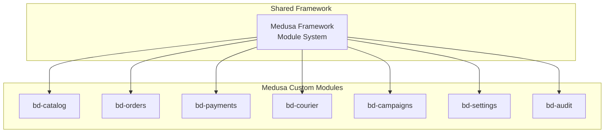

**Diagram sources**
- [apps/medusa/src/modules/bd-catalog/index.ts:1-9](file://apps/medusa/src/modules/bd-catalog/index.ts#L1-L9)
- [apps/medusa/src/modules/bd-orders/index.ts:1-9](file://apps/medusa/src/modules/bd-orders/index.ts#L1-L9)
- [apps/medusa/src/modules/bd-payments/index.ts:1-9](file://apps/medusa/src/modules/bd-payments/index.ts#L1-L9)
- [apps/medusa/src/modules/bd-courier/index.ts:1-9](file://apps/medusa/src/modules/bd-courier/index.ts#L1-L9)
- [apps/medusa/src/modules/bd-campaigns/index.ts:1-9](file://apps/medusa/src/modules/bd-campaigns/index.ts#L1-L9)
- [apps/medusa/src/modules/bd-settings/index.ts:1-9](file://apps/medusa/src/modules/bd-settings/index.ts#L1-L9)
- [apps/medusa/src/modules/bd-audit/index.ts:1-9](file://apps/medusa/src/modules/bd-audit/index.ts#L1-L9)

**Section sources**
- [apps/medusa/src/modules/README.md:1-118](file://apps/medusa/src/modules/README.md#L1-L118)

## Core Components
Each module exposes a service class that extends MedusaService and binds its domain models. The module index files export a stable module key used to resolve services at runtime.

- bd-catalog: Service binds ProductLocalization, ProductVariantCost, CategoryAttribute, ProductAttributeValue
- bd-orders: Service binds OrderBdDetails, CustomerRiskProfile, OrderReturnRequest
- bd-payments: Service binds PaymentTransaction, PaymentWebhookLog
- bd-courier: Service binds CourierShipmentLog, CourierWebhookLog
- bd-campaigns: Service binds LandingPage
- bd-settings: Service binds DeliveryZoneConfig, VatConfig
- bd-audit: Service binds AuditLog, StaffRolePermission

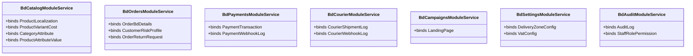

**Diagram sources**
- [apps/medusa/src/modules/bd-catalog/service.ts:1-15](file://apps/medusa/src/modules/bd-catalog/service.ts#L1-L15)
- [apps/medusa/src/modules/bd-orders/service.ts:1-13](file://apps/medusa/src/modules/bd-orders/service.ts#L1-L13)
- [apps/medusa/src/modules/bd-payments/service.ts:1-11](file://apps/medusa/src/modules/bd-payments/service.ts#L1-L11)
- [apps/medusa/src/modules/bd-courier/service.ts:1-11](file://apps/medusa/src/modules/bd-courier/service.ts#L1-L11)
- [apps/medusa/src/modules/bd-campaigns/service.ts:1-9](file://apps/medusa/src/modules/bd-campaigns/service.ts#L1-L9)
- [apps/medusa/src/modules/bd-settings/service.ts:1-11](file://apps/medusa/src/modules/bd-settings/service.ts#L1-L11)
- [apps/medusa/src/modules/bd-audit/service.ts:1-11](file://apps/medusa/src/modules/bd-audit/service.ts#L1-L11)

**Section sources**
- [apps/medusa/src/modules/bd-catalog/service.ts:1-15](file://apps/medusa/src/modules/bd-catalog/service.ts#L1-L15)
- [apps/medusa/src/modules/bd-orders/service.ts:1-13](file://apps/medusa/src/modules/bd-orders/service.ts#L1-L13)
- [apps/medusa/src/modules/bd-payments/service.ts:1-11](file://apps/medusa/src/modules/bd-payments/service.ts#L1-L11)
- [apps/medusa/src/modules/bd-courier/service.ts:1-11](file://apps/medusa/src/modules/bd-courier/service.ts#L1-L11)
- [apps/medusa/src/modules/bd-campaigns/service.ts:1-9](file://apps/medusa/src/modules/bd-campaigns/service.ts#L1-L9)
- [apps/medusa/src/modules/bd-settings/service.ts:1-11](file://apps/medusa/src/modules/bd-settings/service.ts#L1-L11)
- [apps/medusa/src/modules/bd-audit/service.ts:1-11](file://apps/medusa/src/modules/bd-audit/service.ts#L1-L11)

## Architecture Overview
The platform uses Medusa’s module system to encapsulate domain logic. Each module:
- Registers itself with a unique module key
- Exposes a service class bound to domain models
- Provides extension points for API routes, workflows, and external integrations

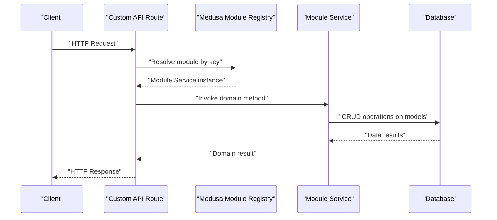

[No sources needed since this diagram shows conceptual workflow, not actual code structure]

## Detailed Component Analysis

### Catalog Management Module (bd-catalog)
Purpose:
- Manage product categorization and attributes
- Support product localization and variant cost tracking

Domain Models:
- ProductLocalization
- ProductVariantCost
- CategoryAttribute
- ProductAttributeValue

Service Implementation:
- BdCatalogModuleService extends MedusaService and binds the above models

API Endpoints:
- Not defined in this repository; extendable via custom API routes using the module key

Integration Patterns:
- Use the module service to create, update, and query catalog-related data
- Extend search or pricing logic by leveraging ProductVariantCost and ProductLocalization

Usage Example:
- Resolve the bd_catalog module from the request scope and call service methods to manage categories and attributes

Configuration Options:
- No module-specific configuration is exposed in the provided files

Customization Guidelines:
- Add new attribute types by extending CategoryAttribute and ProductAttributeValue
- Localize products by creating ProductLocalization records per language/region

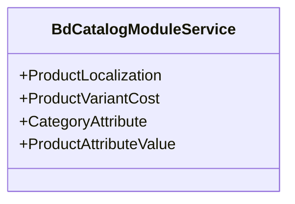

**Diagram sources**
- [apps/medusa/src/modules/bd-catalog/service.ts:1-15](file://apps/medusa/src/modules/bd-catalog/service.ts#L1-L15)

**Section sources**
- [apps/medusa/src/modules/bd-catalog/index.ts:1-9](file://apps/medusa/src/modules/bd-catalog/index.ts#L1-L9)
- [apps/medusa/src/modules/bd-catalog/service.ts:1-15](file://apps/medusa/src/modules/bd-catalog/service.ts#L1-L15)

### Order Processing Module (bd-orders)
Purpose:
- Extend order lifecycle with BD-specific details
- Track customer risk profiles and return requests

Domain Models:
- OrderBdDetails
- CustomerRiskProfile
- OrderReturnRequest

Service Implementation:
- BdOrdersModuleService extends MedusaService and binds the above models

API Endpoints:
- Not defined in this repository; extendable via custom API routes using the module key

Integration Patterns:
- Attach BD-specific metadata to orders via OrderBdDetails
- Evaluate and store risk scores in CustomerRiskProfile during checkout
- Manage returns through OrderReturnRequest

Usage Example:
- Resolve the bd_orders module and use service methods to create/update order details and risk profiles

Configuration Options:
- No module-specific configuration is exposed in the provided files

Customization Guidelines:
- Implement risk scoring rules and persist outcomes in CustomerRiskProfile
- Integrate with Medusa’s order workflows to trigger risk checks and return flows

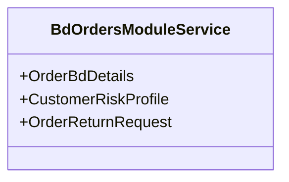

**Diagram sources**
- [apps/medusa/src/modules/bd-orders/service.ts:1-13](file://apps/medusa/src/modules/bd-orders/service.ts#L1-L13)

**Section sources**
- [apps/medusa/src/modules/bd-orders/index.ts:1-9](file://apps/medusa/src/modules/bd-orders/index.ts#L1-L9)
- [apps/medusa/src/modules/bd-orders/service.ts:1-13](file://apps/medusa/src/modules/bd-orders/service.ts#L1-L13)

### Payment Processing Module (bd-payments)
Purpose:
- Record payment transactions and webhook logs for multi-provider integration

Domain Models:
- PaymentTransaction
- PaymentWebhookLog

Service Implementation:
- BdPaymentsModuleService extends MedusaService and binds the above models

API Endpoints:
- Not defined in this repository; extendable via custom API routes using the module key

Integration Patterns:
- Create PaymentTransaction records when initiating payments
- Ingest provider webhooks and persist them as PaymentWebhookLog for auditability

Usage Example:
- Resolve the bd_payments module and use service methods to record transactions and process webhook events

Configuration Options:
- No module-specific configuration is exposed in the provided files

Customization Guidelines:
- Implement provider adapters that write transaction states and webhook payloads
- Ensure idempotency when handling repeated webhook events

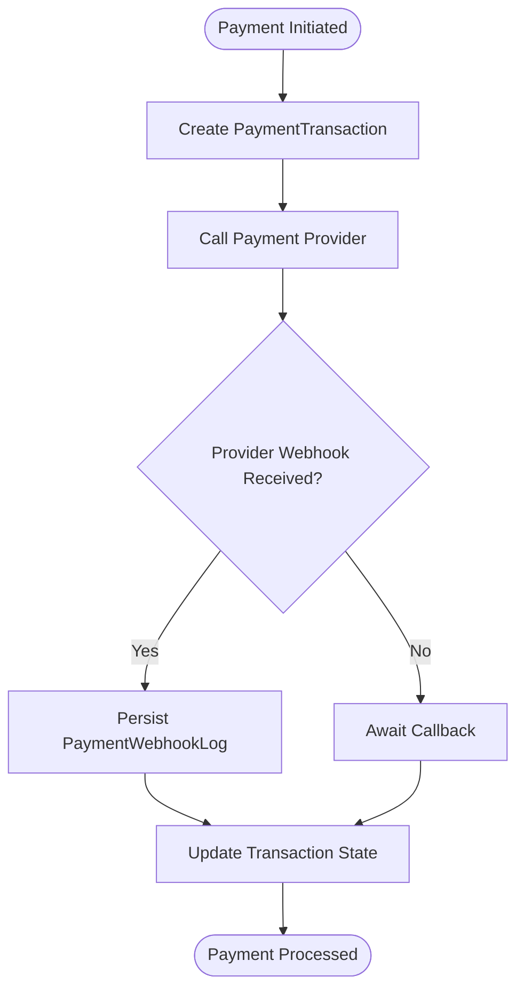

**Diagram sources**
- [apps/medusa/src/modules/bd-payments/service.ts:1-11](file://apps/medusa/src/modules/bd-payments/service.ts#L1-L11)

**Section sources**
- [apps/medusa/src/modules/bd-payments/index.ts:1-9](file://apps/medusa/src/modules/bd-payments/index.ts#L1-L9)
- [apps/medusa/src/modules/bd-payments/service.ts:1-11](file://apps/medusa/src/modules/bd-payments/service.ts#L1-L11)

### Courier & Logistics Module (bd-courier)
Purpose:
- Track shipments and log courier webhooks for delivery visibility

Domain Models:
- CourierShipmentLog
- CourierWebhookLog

Service Implementation:
- BdCourierModuleService extends MedusaService and binds the above models

API Endpoints:
- Not defined in this repository; extendable via custom API routes using the module key

Integration Patterns:
- Create shipment logs when dispatching orders
- Consume courier webhooks to update delivery status and persist logs

Usage Example:
- Resolve the bd_courier module and use service methods to manage shipment logs and webhook ingestion

Configuration Options:
- No module-specific configuration is exposed in the provided files

Customization Guidelines:
- Implement courier adapters to normalize tracking events
- Enforce idempotent updates based on webhook identifiers

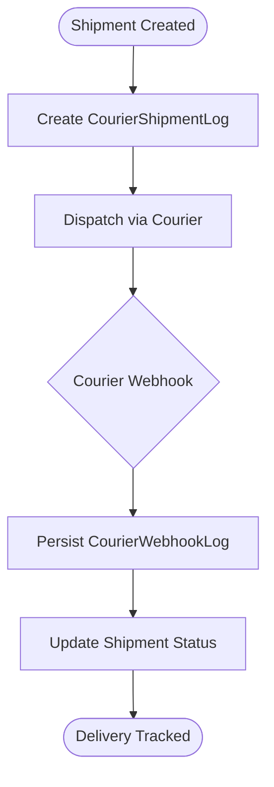

**Diagram sources**
- [apps/medusa/src/modules/bd-courier/service.ts:1-11](file://apps/medusa/src/modules/bd-courier/service.ts#L1-L11)

**Section sources**
- [apps/medusa/src/modules/bd-courier/index.ts:1-9](file://apps/medusa/src/modules/bd-courier/index.ts#L1-L9)
- [apps/medusa/src/modules/bd-courier/service.ts:1-11](file://apps/medusa/src/modules/bd-courier/service.ts#L1-L11)

### Campaign Management Module (bd-campaigns)
Purpose:
- Manage landing pages for marketing campaigns

Domain Models:
- LandingPage

Service Implementation:
- BdCampaignsModuleService extends MedusaService and binds LandingPage

API Endpoints:
- Not defined in this repository; extendable via custom API routes using the module key

Integration Patterns:
- Create and publish landing pages associated with campaigns
- Serve campaign content via custom storefront routes

Usage Example:
- Resolve the bd_campaigns module and use service methods to manage landing page records

Configuration Options:
- No module-specific configuration is exposed in the provided files

Customization Guidelines:
- Extend LandingPage with SEO fields, scheduling, and targeting rules
- Integrate with CMS or headless content pipelines

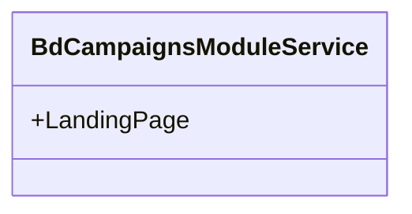

**Diagram sources**
- [apps/medusa/src/modules/bd-campaigns/service.ts:1-9](file://apps/medusa/src/modules/bd-campaigns/service.ts#L1-L9)

**Section sources**
- [apps/medusa/src/modules/bd-campaigns/index.ts:1-9](file://apps/medusa/src/modules/bd-campaigns/index.ts#L1-L9)
- [apps/medusa/src/modules/bd-campaigns/service.ts:1-9](file://apps/medusa/src/modules/bd-campaigns/service.ts#L1-L9)

### Settings Management Module (bd-settings)
Purpose:
- Store system-wide configuration such as delivery zones and VAT settings

Domain Models:
- DeliveryZoneConfig
- VatConfig

Service Implementation:
- BdSettingsModuleService extends MedusaService and binds the above models

API Endpoints:
- Not defined in this repository; extendable via custom API routes using the module key

Integration Patterns:
- Read delivery zone and VAT configurations during checkout and shipping calculations
- Provide admin endpoints to update settings

Usage Example:
- Resolve the bd_settings module and use service methods to retrieve or update configuration records

Configuration Options:
- No module-specific configuration is exposed in the provided files

Customization Guidelines:
- Add new configuration entities as needed (e.g., tax rules, shipping rates)
- Validate settings changes and propagate updates to dependent processes

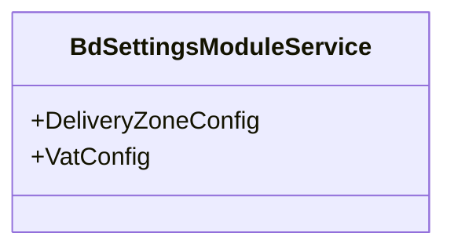

**Diagram sources**
- [apps/medusa/src/modules/bd-settings/service.ts:1-11](file://apps/medusa/src/modules/bd-settings/service.ts#L1-L11)

**Section sources**
- [apps/medusa/src/modules/bd-settings/index.ts:1-9](file://apps/medusa/src/modules/bd-settings/index.ts#L1-L9)
- [apps/medusa/src/modules/bd-settings/service.ts:1-11](file://apps/medusa/src/modules/bd-settings/service.ts#L1-L11)

### Audit Module (bd-audit)
Purpose:
- Maintain compliance logs and staff role-permission mappings

Domain Models:
- AuditLog
- StaffRolePermission

Service Implementation:
- BdAuditModuleService extends MedusaService and binds the above models

API Endpoints:
- Not defined in this repository; extendable via custom API routes using the module key

Integration Patterns:
- Emit AuditLog entries for critical operations across modules
- Enforce access control using StaffRolePermission

Usage Example:
- Resolve the bd_audit module and use service methods to log actions and check permissions

Configuration Options:
- No module-specific configuration is exposed in the provided files

Customization Guidelines:
- Standardize audit event schemas and retention policies
- Integrate permission checks into middleware or workflows

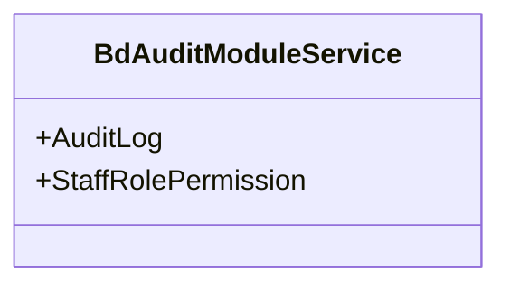

**Diagram sources**
- [apps/medusa/src/modules/bd-audit/service.ts:1-11](file://apps/medusa/src/modules/bd-audit/service.ts#L1-L11)

**Section sources**
- [apps/medusa/src/modules/bd-audit/index.ts:1-9](file://apps/medusa/src/modules/bd-audit/index.ts#L1-L9)
- [apps/medusa/src/modules/bd-audit/service.ts:1-11](file://apps/medusa/src/modules/bd-audit/service.ts#L1-L11)

## Dependency Analysis
Modules are independent and do not import each other directly. They rely on Medusa’s module registry and database layer via MedusaService.

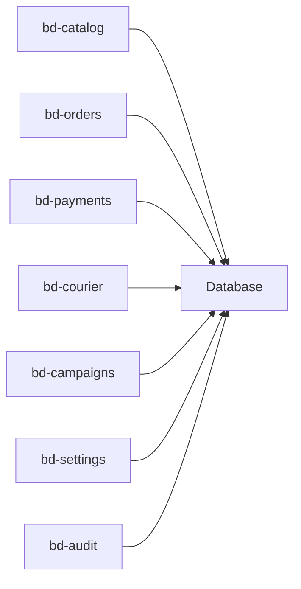

**Diagram sources**
- [apps/medusa/src/modules/bd-catalog/service.ts:1-15](file://apps/medusa/src/modules/bd-catalog/service.ts#L1-L15)
- [apps/medusa/src/modules/bd-orders/service.ts:1-13](file://apps/medusa/src/modules/bd-orders/service.ts#L1-L13)
- [apps/medusa/src/modules/bd-payments/service.ts:1-11](file://apps/medusa/src/modules/bd-payments/service.ts#L1-L11)
- [apps/medusa/src/modules/bd-courier/service.ts:1-11](file://apps/medusa/src/modules/bd-courier/service.ts#L1-L11)
- [apps/medusa/src/modules/bd-campaigns/service.ts:1-9](file://apps/medusa/src/modules/bd-campaigns/service.ts#L1-L9)
- [apps/medusa/src/modules/bd-settings/service.ts:1-11](file://apps/medusa/src/modules/bd-settings/service.ts#L1-L11)
- [apps/medusa/src/modules/bd-audit/service.ts:1-11](file://apps/medusa/src/modules/bd-audit/service.ts#L1-L11)

**Section sources**
- [apps/medusa/src/modules/bd-catalog/service.ts:1-15](file://apps/medusa/src/modules/bd-catalog/service.ts#L1-L15)
- [apps/medusa/src/modules/bd-orders/service.ts:1-13](file://apps/medusa/src/modules/bd-orders/service.ts#L1-L13)
- [apps/medusa/src/modules/bd-payments/service.ts:1-11](file://apps/medusa/src/modules/bd-payments/service.ts#L1-L11)
- [apps/medusa/src/modules/bd-courier/service.ts:1-11](file://apps/medusa/src/modules/bd-courier/service.ts#L1-L11)
- [apps/medusa/src/modules/bd-campaigns/service.ts:1-9](file://apps/medusa/src/modules/bd-campaigns/service.ts#L1-L9)
- [apps/medusa/src/modules/bd-settings/service.ts:1-11](file://apps/medusa/src/modules/bd-settings/service.ts#L1-L11)
- [apps/medusa/src/modules/bd-audit/service.ts:1-11](file://apps/medusa/src/modules/bd-audit/service.ts#L1-L11)

## Performance Considerations
- Prefer batch operations when updating multiple related records (e.g., bulk attribute values)
- Index frequently queried fields in domain models (e.g., order IDs, transaction IDs, shipment IDs)
- Avoid heavy computations in synchronous API handlers; offload to background jobs where appropriate
- Cache read-heavy settings (e.g., delivery zones, VAT rules) with invalidation strategies

[No sources needed since this section provides general guidance]

## Troubleshooting Guide
Common issues and resolutions:
- Module resolution errors: Ensure the correct module key is used when resolving services from the request scope
- Migration mismatches: Regenerate and run migrations after modifying domain models
- Webhook idempotency: Deduplicate incoming webhook events using unique identifiers before state updates
- Permission denials: Verify StaffRolePermission mappings align with intended access controls

**Section sources**
- [apps/medusa/src/modules/README.md:92-118](file://apps/medusa/src/modules/README.md#L92-L118)

## Conclusion
The BD Commerce Platform’s business modules provide a modular foundation for catalog, orders, payments, logistics, campaigns, settings, and audit capabilities. Each module exposes a service bound to domain models, enabling extensibility through custom API routes, workflows, and integrations. Follow the customization guidelines to extend functionality while maintaining consistency and reliability across the platform.

[No sources needed since this section summarizes without analyzing specific files]