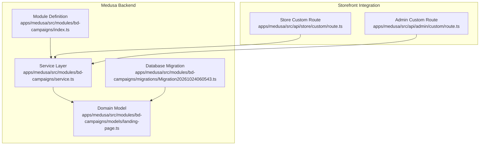
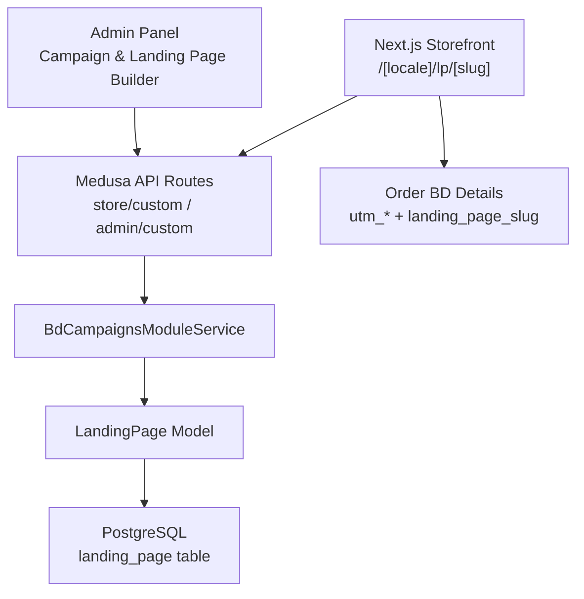
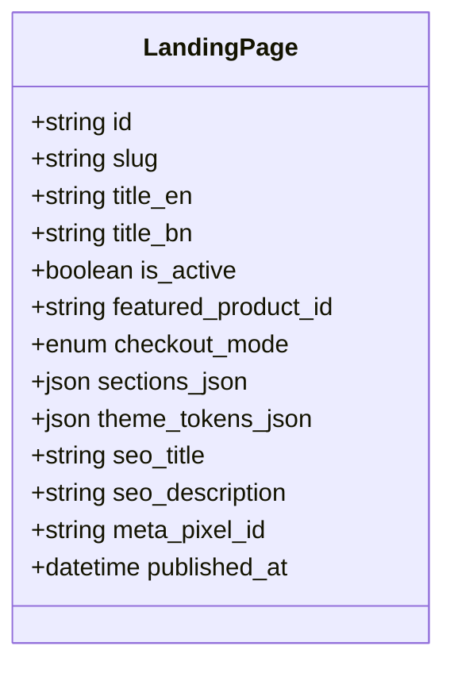
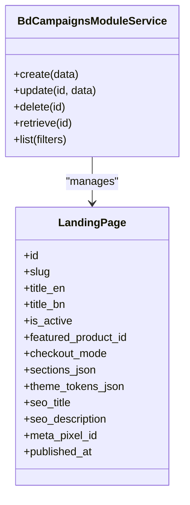
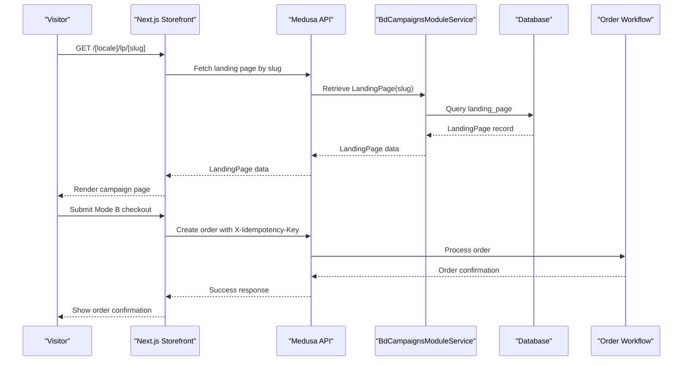
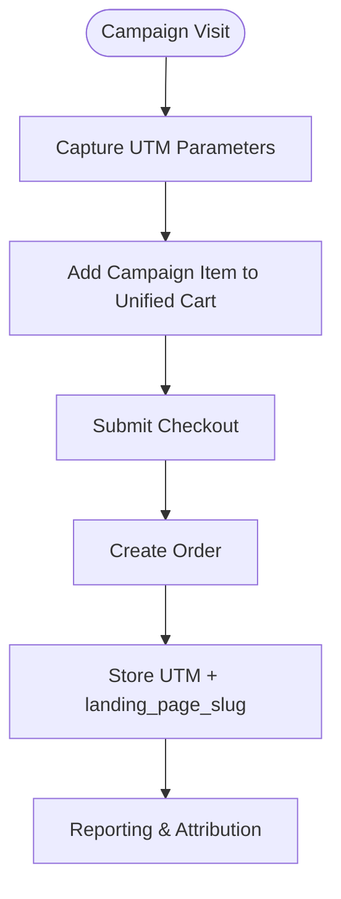
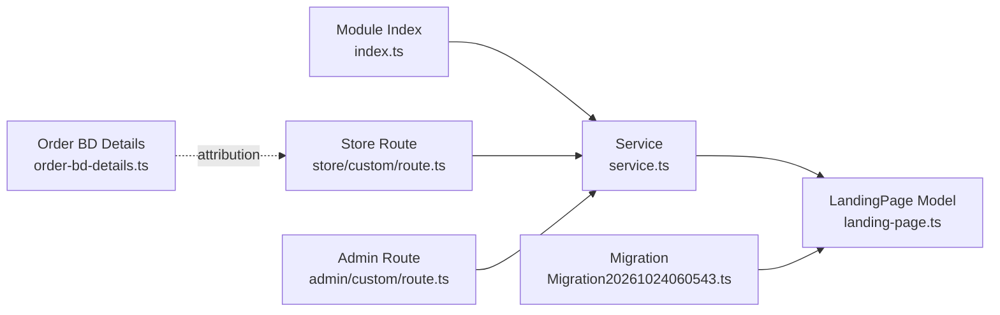

# Campaign Management Module

<cite>
**Referenced Files in This Document**
- [landing-page.ts](file://apps/medusa/src/modules/bd-campaigns/models/landing-page.ts)
- [service.ts](file://apps/medusa/src/modules/bd-campaigns/service.ts)
- [index.ts](file://apps/medusa/src/modules/bd-campaigns/index.ts)
- [Migration20261024060543.ts](file://apps/medusa/src/modules/bd-campaigns/migrations/Migration20261024060543.ts)
- [order-bd-details.ts](file://apps/medusa/src/modules/bd-orders/models/order-bd-details.ts)
- [route.ts](file://apps/medusa/src/api/store/custom/route.ts)
- [route.ts](file://apps/medusa/src/api/admin/custom/route.ts)
- [data-models.md](file://docs/data-models.md)
- [architecture.md](file://docs/architecture.md)
- [prd.md](file://prd.md)
</cite>

## Table of Contents
1. [Introduction](#introduction)
2. [Project Structure](#project-structure)
3. [Core Components](#core-components)
4. [Architecture Overview](#architecture-overview)
5. [Detailed Component Analysis](#detailed-component-analysis)
6. [Dependency Analysis](#dependency-analysis)
7. [Performance Considerations](#performance-considerations)
8. [Troubleshooting Guide](#troubleshooting-guide)
9. [Conclusion](#conclusion)
10. [Appendices](#appendices)

## Introduction
The Campaign Management Module provides the backend foundation for marketing campaigns, landing page building, direct checkout integration, and campaign analytics tracking. It centers on a `LandingPage` domain model that stores structured page content, SEO metadata, theme tokens, featured promotional products, and checkout behavior. The module integrates with the Medusa commerce platform as a custom module, exposes service operations through a generated service class, and connects to the Next.js storefront via a dedicated campaign route. Orders originating from campaigns preserve campaign context such as the landing page slug and UTM parameters for attribution reporting.

This documentation explains:
- How the landing page builder data model is designed.
- How the service layer exposes campaign operations.
- How the storefront renders campaign pages and supports direct checkout.
- How orders capture campaign attribution.
- Practical examples for creating campaigns, building landing pages, and configuring direct checkout flows.
- SEO considerations and performance optimization strategies for high-traffic promotional content.

## Project Structure
The Campaign Management Module lives under the Medusa backend as a custom module:

**Diagram sources**
- [index.ts:1-9](file://apps/medusa/src/modules/bd-campaigns/index.ts#L1-L9)
- [service.ts:1-9](file://apps/medusa/src/modules/bd-campaigns/service.ts#L1-L9)
- [landing-page.ts:1-20](file://apps/medusa/src/modules/bd-campaigns/models/landing-page.ts#L1-L20)
- [Migration20261024060543.ts:1-17](file://apps/medusa/src/modules/bd-campaigns/migrations/Migration20261024060543.ts#L1-L17)
- [route.ts:1-9](file://apps/medusa/src/api/store/custom/route.ts#L1-L9)
- [route.ts:1-9](file://apps/medusa/src/api/admin/custom/route.ts#L1-L9)

**Section sources**
- [index.ts:1-9](file://apps/medusa/src/modules/bd-campaigns/index.ts#L1-L9)
- [service.ts:1-9](file://apps/medusa/src/modules/bd-campaigns/service.ts#L1-L9)
- [landing-page.ts:1-20](file://apps/medusa/src/modules/bd-campaigns/models/landing-page.ts#L1-L20)
- [Migration20261024060543.ts:1-17](file://apps/medusa/src/modules/bd-campaigns/migrations/Migration20261024060543.ts#L1-L17)
- [route.ts:1-9](file://apps/medusa/src/api/store/custom/route.ts#L1-L9)
- [route.ts:1-9](file://apps/medusa/src/api/admin/custom/route.ts#L1-L9)

## Core Components
The Campaign Management Module consists of three primary backend components:

- **Module definition:** Registers the module name and service so Medusa can load it.
- **Service layer:** Extends the framework service generator to expose CRUD and query operations for the `LandingPage` entity.
- **Domain model:** Defines the database schema for campaign landing pages, including multilingual titles, active state, featured product reference, checkout mode, structured sections, theme tokens, SEO fields, tracking pixel ID, and publication timestamp.

Additionally, the migration ensures the `landing_page` table exists with appropriate constraints and indexes.

Key responsibilities:
- Persist structured landing page content.
- Enforce unique slugs and soft-delete awareness through indexes.
- Provide a service API for reading, creating, updating, and querying campaign pages.
- Support Mode B direct checkout configuration through the `checkout_mode` field.
- Enable SEO metadata and optional Meta Pixel tracking per campaign.

**Section sources**
- [index.ts:1-9](file://apps/medusa/src/modules/bd-campaigns/index.ts#L1-L9)
- [service.ts:1-9](file://apps/medusa/src/modules/bd-campaigns/service.ts#L1-L9)
- [landing-page.ts:1-20](file://apps/medusa/src/modules/bd-campaigns/models/landing-page.ts#L1-L20)
- [Migration20261024060543.ts:1-17](file://apps/medusa/src/modules/bd-campaigns/migrations/Migration20261024060543.ts#L1-L17)

## Architecture Overview
The campaign architecture spans the Medusa backend, the Next.js storefront, and order attribution:

**Diagram sources**
- [architecture.md:738-756](file://docs/architecture.md#L738-L756)
- [route.ts:1-9](file://apps/medusa/src/api/store/custom/route.ts#L1-L9)
- [route.ts:1-9](file://apps/medusa/src/api/admin/custom/route.ts#L1-L9)
- [service.ts:1-9](file://apps/medusa/src/modules/bd-campaigns/service.ts#L1-L9)
- [landing-page.ts:1-20](file://apps/medusa/src/modules/bd-campaigns/models/landing-page.ts#L1-L20)
- [order-bd-details.ts:1-42](file://apps/medusa/src/modules/bd-orders/models/order-bd-details.ts#L1-L42)

The storefront uses an SSR + ISR strategy for `/[locale]/lp/[slug]`, enabling fast initial rendering and periodic revalidation for campaign pages. Mode B embedded direct checkout binds to the unified cart and submits through the standard server-side order workflow with idempotency protection.

**Section sources**
- [architecture.md:738-756](file://docs/architecture.md#L738-L756)
- [prd.md:145-152](file://prd.md#L145-L152)

## Detailed Component Analysis

### LandingPage Domain Model
The `LandingPage` model defines the core data structure for campaign landing pages. It includes:
- Unique slug-based routing.
- Multilingual titles (`title_en`, `title_bn`).
- Active status flag.
- Featured product reference for promotional offers.
- Checkout mode selection: embedded, modal, or redirect.
- Structured JSON sections for the landing page builder.
- Controlled design tokens for theming.
- SEO title and description.
- Optional Meta Pixel ID for campaign-specific analytics.
- Publication timestamp for scheduling.

**Diagram sources**
- [landing-page.ts:1-20](file://apps/medusa/src/modules/bd-campaigns/models/landing-page.ts#L1-L20)
- [data-models.md:280-302](file://docs/data-models.md#L280-L302)

Complexity notes:
- Slug uniqueness is enforced at the database level with a conditional unique index excluding soft-deleted rows.
- JSON fields allow flexible layout and theme configuration without schema migrations for every UI change.
- Enum validation restricts checkout modes to supported values.

**Section sources**
- [landing-page.ts:1-20](file://apps/medusa/src/modules/bd-campaigns/models/landing-page.ts#L1-L20)
- [Migration20261024060543.ts:1-17](file://apps/medusa/src/modules/bd-campaigns/migrations/Migration20261024060543.ts#L1-L17)
- [data-models.md:280-302](file://docs/data-models.md#L280-L302)

### Service Layer Implementation
The service extends the framework’s service generator and registers the `LandingPage` model. This provides:
- Standardized CRUD operations.
- Query helpers for filtering by slug, active status, and other fields.
- A consistent API surface for both admin and storefront integrations.

**Diagram sources**
- [service.ts:1-9](file://apps/medusa/src/modules/bd-campaigns/service.ts#L1-L9)
- [landing-page.ts:1-20](file://apps/medusa/src/modules/bd-campaigns/models/landing-page.ts#L1-L20)

Operational patterns:
- Use slug-based retrieval for storefront routes.
- Filter by `is_active` and `published_at` when serving live campaign pages.
- Validate `checkout_mode` before rendering checkout blocks.

**Section sources**
- [service.ts:1-9](file://apps/medusa/src/modules/bd-campaigns/service.ts#L1-L9)

### Storefront Integration and Direct Checkout Flow
The storefront renders campaign pages at `/[locale]/lp/[slug]` using SSR + ISR. For Mode B (embedded direct checkout), the flow binds to the unified cart and submits through the standard order workflow with idempotency headers.

**Diagram sources**
- [architecture.md:738-756](file://docs/architecture.md#L738-L756)
- [prd.md:145-152](file://prd.md#L145-L152)
- [route.ts:1-9](file://apps/medusa/src/api/store/custom/route.ts#L1-L9)
- [service.ts:1-9](file://apps/medusa/src/modules/bd-campaigns/service.ts#L1-L9)

Checkout rules:
- Mode B adds the campaign offer to the existing shared cart by default.
- Existing cart items are preserved; no silent clearing.
- Idempotency prevents duplicate orders on retries or double-clicks.
- Expired, unpublished, sold-out, or invalid campaign offers are blocked.

**Section sources**
- [architecture.md:738-756](file://docs/architecture.md#L738-L756)
- [prd.md:145-152](file://prd.md#L145-L152)

### Analytics Tracking and Attribution
Campaign analytics rely on preserving campaign context in orders:
- UTM source, medium, and campaign fields exist in order details.
- The landing page slug is stored alongside order details for attribution.
- Meta Pixel ID can be configured per campaign for event tracking.

**Diagram sources**
- [order-bd-details.ts:1-42](file://apps/medusa/src/modules/bd-orders/models/order-bd-details.ts#L1-L42)
- [prd.md:145-152](file://prd.md#L145-L152)

**Section sources**
- [order-bd-details.ts:1-42](file://apps/medusa/src/modules/bd-orders/models/order-bd-details.ts#L1-L42)
- [prd.md:145-152](file://prd.md#L145-L152)

### Examples

#### Creating a Marketing Campaign
Steps:
1. Define a unique slug for the campaign URL.
2. Set English and optional Bengali titles.
3. Choose a checkout mode: embedded, modal, or redirect.
4. Attach a featured product ID for the promotional offer.
5. Configure structured sections for the landing page builder.
6. Optionally set theme tokens for controlled styling.
7. Add SEO title and description.
8. Optionally add a Meta Pixel ID for campaign-specific tracking.
9. Set the publication timestamp to schedule the campaign.

Validation:
- Ensure the slug is unique among active records.
- Validate that the featured product exists and is available if required by business rules.
- Confirm checkout mode matches intended UX.

**Section sources**
- [landing-page.ts:1-20](file://apps/medusa/src/modules/bd-campaigns/models/landing-page.ts#L1-L20)
- [data-models.md:280-302](file://docs/data-models.md#L280-L302)

#### Building a Landing Page
Approach:
- Use the `sections_json` field to define block layouts such as hero, bundle, reviews, and call-to-action sections.
- Apply `theme_tokens_json` to control colors, fonts, and spacing consistently.
- Keep media assets within hosting limits and validate file types and sizes.
- Publish only after validating links to products/categories and ensuring stock/pricing availability.

Builder best practices:
- Avoid arbitrary CSS injection; use controlled tokens.
- Reuse section templates for consistency across campaigns.
- Validate link integrity before publishing.

**Section sources**
- [landing-page.ts:1-20](file://apps/medusa/src/modules/bd-campaigns/models/landing-page.ts#L1-L20)
- [architecture.md:823-838](file://docs/architecture.md#L823-L838)

#### Setting Up Direct Checkout Flows
Mode B configuration:
- Set `checkout_mode` to `embedded`.
- Bind the embedded checkout form to the visitor’s existing cart.
- Display the campaign item alongside pre-existing cart items.
- Submit with an idempotency key to prevent duplicate orders.
- Block stale or invalid offers at checkout time.

Integration points:
- Storefront route `/[locale]/lp/[slug]` renders the page and checkout block.
- API routes forward requests to the campaign service and order workflow.

**Section sources**
- [architecture.md:738-756](file://docs/architecture.md#L738-L756)
- [prd.md:145-152](file://prd.md#L145-L152)

## Dependency Analysis
The module has clear boundaries and minimal coupling:

**Diagram sources**
- [index.ts:1-9](file://apps/medusa/src/modules/bd-campaigns/index.ts#L1-L9)
- [service.ts:1-9](file://apps/medusa/src/modules/bd-campaigns/service.ts#L1-L9)
- [landing-page.ts:1-20](file://apps/medusa/src/modules/bd-campaigns/models/landing-page.ts#L1-L20)
- [Migration20261024060543.ts:1-17](file://apps/medusa/src/modules/bd-campaigns/migrations/Migration20261024060543.ts#L1-L17)
- [route.ts:1-9](file://apps/medusa/src/api/store/custom/route.ts#L1-L9)
- [route.ts:1-9](file://apps/medusa/src/api/admin/custom/route.ts#L1-L9)
- [order-bd-details.ts:1-42](file://apps/medusa/src/modules/bd-orders/models/order-bd-details.ts#L1-L42)

Coupling and cohesion:
- The service depends only on the `LandingPage` model.
- Routes depend on the service rather than directly on the database.
- Order attribution is decoupled via separate fields in order details.

Potential circular dependencies:
- None observed; imports are unidirectional from routes to service to model.

External dependencies:
- Medusa framework utilities for models and services.
- PostgreSQL via MikroORM migrations.
- Next.js storefront for rendering and checkout integration.

**Section sources**
- [index.ts:1-9](file://apps/medusa/src/modules/bd-campaigns/index.ts#L1-L9)
- [service.ts:1-9](file://apps/medusa/src/modules/bd-campaigns/service.ts#L1-L9)
- [landing-page.ts:1-20](file://apps/medusa/src/modules/bd-campaigns/models/landing-page.ts#L1-L20)
- [Migration20261024060543.ts:1-17](file://apps/medusa/src/modules/bd-campaigns/migrations/Migration20261024060543.ts#L1-L17)
- [route.ts:1-9](file://apps/medusa/src/api/store/custom/route.ts#L1-L9)
- [route.ts:1-9](file://apps/medusa/src/api/admin/custom/route.ts#L1-L9)
- [order-bd-details.ts:1-42](file://apps/medusa/src/modules/bd-orders/models/order-bd-details.ts#L1-L42)

## Performance Considerations
For high-traffic promotional content:
- Use SSR + ISR for campaign pages to balance freshness and speed.
- Cache landing page data at the edge where possible.
- Limit heavy image payloads and optimize media delivery.
- Avoid synchronous blocking operations during page rendering.
- Validate and sanitize inputs early to reduce unnecessary processing.
- Use selective queries (e.g., fetch by slug) to minimize database load.
- Monitor revalidation intervals and adjust based on traffic patterns.
- Ensure idempotent checkout submissions to prevent redundant order processing.

[No sources needed since this section provides general guidance]

## Troubleshooting Guide
Common issues and resolutions:
- Duplicate slug errors: Ensure slugs are unique among active records; the migration enforces a conditional unique index.
- Soft-delete visibility: Queries should exclude deleted rows; the migration creates an index scoped to non-deleted records.
- Invalid checkout mode: Only embedded, modal, or redirect are allowed; reject unsupported values.
- Missing featured product: Validate product existence and availability before publishing.
- Stale campaign pricing: Block checkout if the offer is expired, unpublished, or out of stock.
- Duplicate orders: Verify idempotency keys are sent with checkout submissions.
- Analytics gaps: Confirm UTM parameters and landing page slug are captured in order details.

**Section sources**
- [Migration20261024060543.ts:1-17](file://apps/medusa/src/modules/bd-campaigns/migrations/Migration20261024060543.ts#L1-L17)
- [prd.md:145-152](file://prd.md#L145-L152)
- [order-bd-details.ts:1-42](file://apps/medusa/src/modules/bd-orders/models/order-bd-details.ts#L1-L42)

## Conclusion
The Campaign Management Module provides a robust foundation for marketing campaigns, landing page construction, direct checkout integration, and campaign attribution. Its domain model captures structured content, SEO metadata, and checkout behavior, while the service layer offers a clean API for operations. The storefront integrates seamlessly with SSR + ISR and unified cart semantics, ensuring safe and efficient Mode B checkout flows. Order details preserve campaign context for analytics and reporting. With careful attention to SEO, input validation, idempotency, and performance tuning, the module supports high-converting, high-traffic promotional experiences.

[No sources needed since this section summarizes without analyzing specific files]

## Appendices

### API Endpoints Reference
Current placeholder endpoints:
- Store custom route returns a success status.
- Admin custom route returns a success status.

These serve as extension points for future campaign-specific APIs.

**Section sources**
- [route.ts:1-9](file://apps/medusa/src/api/store/custom/route.ts#L1-L9)
- [route.ts:1-9](file://apps/medusa/src/api/admin/custom/route.ts#L1-L9)