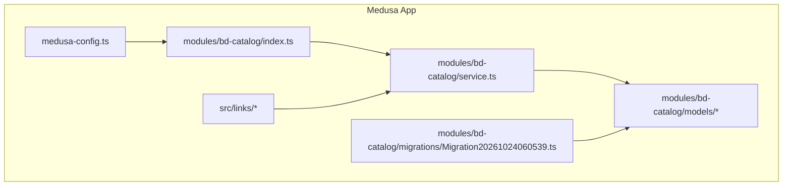
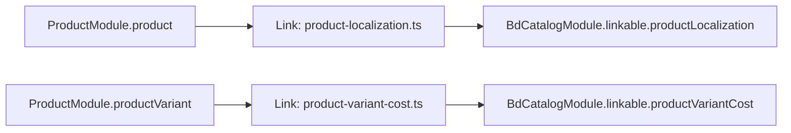
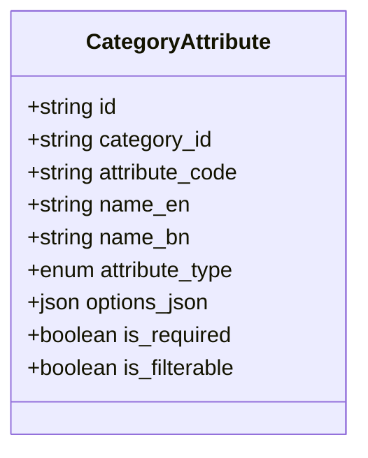
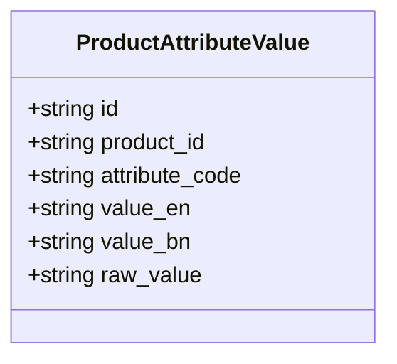
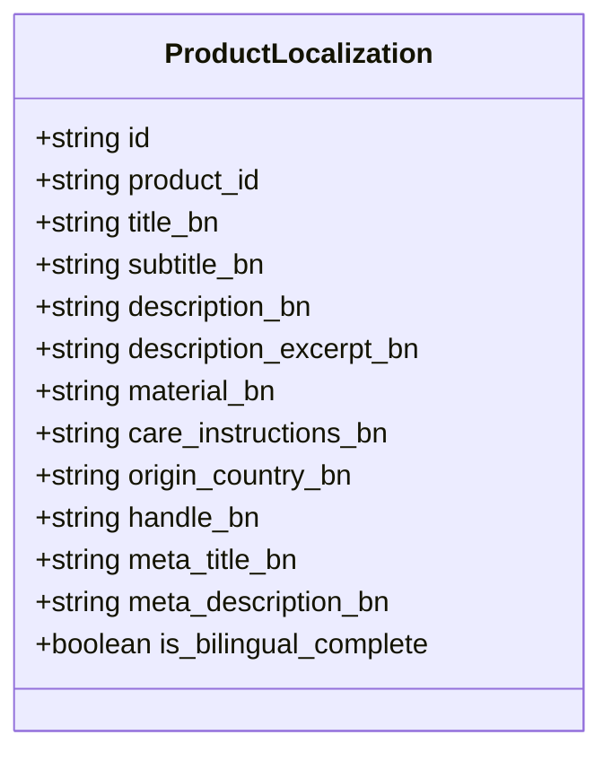
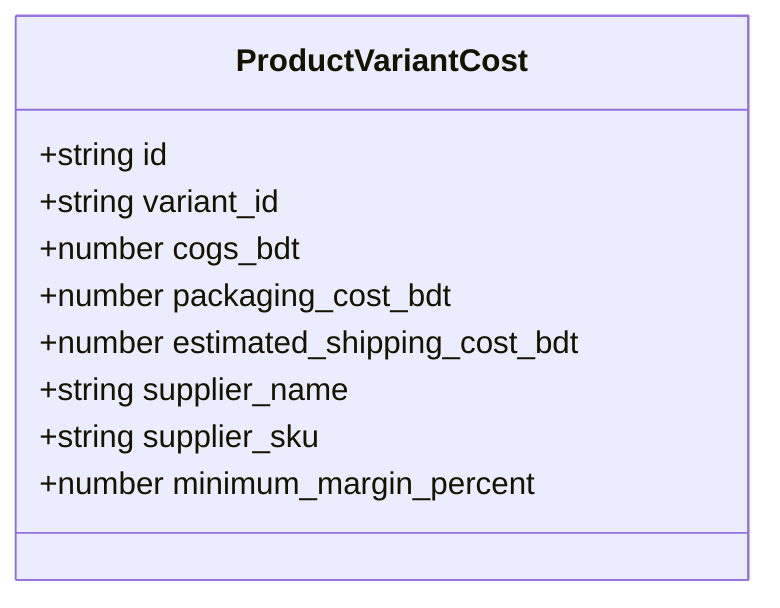
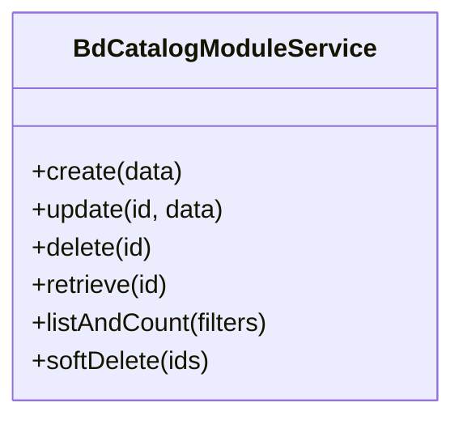
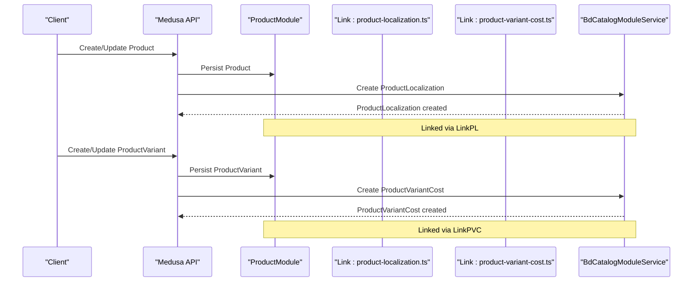
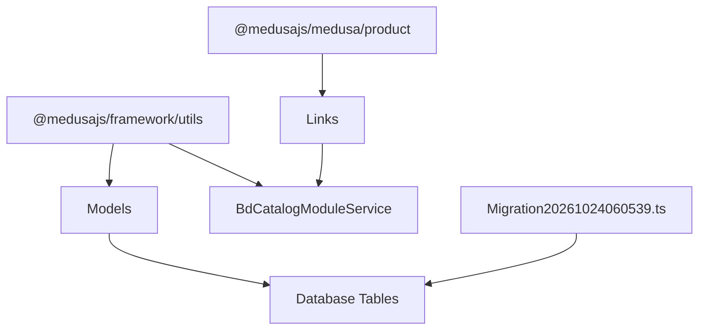

# Catalog Management Module

<cite>
**Referenced Files in This Document**
- [medusa-config.ts](file://apps/medusa/medusa-config.ts)
- [index.ts](file://apps/medusa/src/modules/bd-catalog/index.ts)
- [service.ts](file://apps/medusa/src/modules/bd-catalog/service.ts)
- [category-attribute.ts](file://apps/medusa/src/modules/bd-catalog/models/category-attribute.ts)
- [product-attribute-value.ts](file://apps/medusa/src/modules/bd-catalog/models/product-attribute-value.ts)
- [product-localization.ts](file://apps/medusa/src/modules/bd-catalog/models/product-localization.ts)
- [product-variant-cost.ts](file://apps/medusa/src/modules/bd-catalog/models/product-variant-cost.ts)
- [Migration20261024060539.ts](file://apps/medusa/src/modules/bd-catalog/migrations/Migration20261024060539.ts)
- [product-localization.ts](file://apps/medusa/src/links/product-localization.ts)
- [product-variant-cost.ts](file://apps/medusa/src/links/product-variant-cost.ts)
</cite>

## Table of Contents
1. [Introduction](#introduction)
2. [Project Structure](#project-structure)
3. [Core Components](#core-components)
4. [Architecture Overview](#architecture-overview)
5. [Detailed Component Analysis](#detailed-component-analysis)
6. [Dependency Analysis](#dependency-analysis)
7. [Performance Considerations](#performance-considerations)
8. [Troubleshooting Guide](#troubleshooting-guide)
9. [Conclusion](#conclusion)
10. [Appendices](#appendices)

## Introduction
This document describes the Catalog Management Module that extends Medusa’s core catalog with:
- Hierarchical product categorization and flexible attribute management
- Localization support for Bangla and English content
- Variant cost tracking to enable pricing strategies and margin control
- Integration points with Medusa’s Product module via links

The module provides domain models, a service layer, database migrations, and link definitions to connect with Medusa’s product and product variant entities.

## Project Structure
The Catalog Management Module is implemented as a Medusa module under apps/medusa/src/modules/bd-catalog. It includes:
- Module registration and service wiring
- Domain models for attributes, localization, and variant costs
- Database migration defining tables and indexes
- Links to integrate with Medusa’s Product module

**Diagram sources**
- [medusa-config.ts:22-25](file://apps/medusa/medusa-config.ts#L22-L25)
- [index.ts:1-8](file://apps/medusa/src/modules/bd-catalog/index.ts#L1-L8)
- [service.ts:1-14](file://apps/medusa/src/modules/bd-catalog/service.ts#L1-L14)
- [Migration20261024060539.ts:5-24](file://apps/medusa/src/modules/bd-catalog/migrations/Migration20261024060539.ts#L5-L24)
- [product-localization.ts](file://apps/medusa/src/links/product-localization.ts)
- [product-variant-cost.ts](file://apps/medusa/src/links/product-variant-cost.ts)

**Section sources**
- [medusa-config.ts:22-25](file://apps/medusa/medusa-config.ts#L22-L25)
- [index.ts:1-8](file://apps/medusa/src/modules/bd-catalog/index.ts#L1-L8)

## Core Components
The module exposes four primary domain models and a service that wires them into Medusa’s ORM and query layer.

- CategoryAttribute: Defines category-scoped attributes (e.g., select, multiselect, text, boolean), including localized names and filterability flags.
- ProductAttributeValue: Stores per-product values for defined attributes, supporting bilingual values and raw value storage.
- ProductLocalization: Holds Bangla translations and metadata for products, including searchable fields and completeness flag.
- ProductVariantCost: Tracks cost components and supplier details per product variant, enabling margin calculations.

The service class extends MedusaService and registers all models, exposing standard CRUD operations and queries through the module service.

**Section sources**
- [category-attribute.ts:1-16](file://apps/medusa/src/modules/bd-catalog/models/category-attribute.ts#L1-L16)
- [product-attribute-value.ts:1-13](file://apps/medusa/src/modules/bd-catalog/models/product-attribute-value.ts#L1-L13)
- [product-localization.ts:1-20](file://apps/medusa/src/modules/bd-catalog/models/product-localization.ts#L1-L20)
- [product-variant-cost.ts:1-15](file://apps/medusa/src/modules/bd-catalog/models/product-variant-cost.ts#L1-L15)
- [service.ts:1-14](file://apps/medusa/src/modules/bd-catalog/service.ts#L1-L14)

## Architecture Overview
The module integrates with Medusa’s Product module using link definitions. These links establish relationships between:
- Product ↔ ProductLocalization
- ProductVariant ↔ ProductVariantCost

**Diagram sources**
- [product-localization.ts:1-9](file://apps/medusa/src/links/product-localization.ts#L1-L9)
- [product-variant-cost.ts:1-9](file://apps/medusa/src/links/product-variant-cost.ts#L1-L9)

## Detailed Component Analysis

### Domain Model: CategoryAttribute
Purpose:
- Define reusable attributes at the category level
- Support multiple attribute types and options
- Provide localized display names and filtering capabilities

Key aspects:
- Indexed by category_id and attribute_code for efficient lookups
- Attribute type enum constrains input semantics
- Options stored as JSON for dynamic option sets
- Flags for required and filterable behavior

**Diagram sources**
- [category-attribute.ts:1-16](file://apps/medusa/src/modules/bd-catalog/models/category-attribute.ts#L1-L16)

**Section sources**
- [category-attribute.ts:1-16](file://apps/medusa/src/modules/bd-catalog/models/category-attribute.ts#L1-L16)

### Domain Model: ProductAttributeValue
Purpose:
- Store attribute values for individual products
- Support bilingual values and raw representation

Key aspects:
- Indexed by product_id and attribute_code for fast retrieval
- Bilingual fields for English and Bangla values
- Raw_value field preserves original or structured data

**Diagram sources**
- [product-attribute-value.ts:1-13](file://apps/medusa/src/modules/bd-catalog/models/product-attribute-value.ts#L1-L13)

**Section sources**
- [product-attribute-value.ts:1-13](file://apps/medusa/src/modules/bd-catalog/models/product-attribute-value.ts#L1-L13)

### Domain Model: ProductLocalization
Purpose:
- Manage Bangla translations and SEO metadata for products
- Track completeness of bilingual content

Key aspects:
- Searchable fields for title and description in Bangla
- Fields for subtitle, excerpt, material, care instructions, origin country, handle, meta tags
- Boolean flag indicating if bilingual content is complete

**Diagram sources**
- [product-localization.ts:1-20](file://apps/medusa/src/modules/bd-catalog/models/product-localization.ts#L1-L20)

**Section sources**
- [product-localization.ts:1-20](file://apps/medusa/src/modules/bd-catalog/models/product-localization.ts#L1-L20)

### Domain Model: ProductVariantCost
Purpose:
- Track cost components and supplier information per product variant
- Enable margin calculations and pricing strategy

Key aspects:
- Numeric fields for COGS, packaging, and estimated shipping costs in BDT
- Supplier name and SKU for traceability
- Minimum margin percentage to guide pricing decisions

**Diagram sources**
- [product-variant-cost.ts:1-15](file://apps/medusa/src/modules/bd-catalog/models/product-variant-cost.ts#L1-L15)

**Section sources**
- [product-variant-cost.ts:1-15](file://apps/medusa/src/modules/bd-catalog/models/product-variant-cost.ts#L1-L15)

### Service Layer: BdCatalogModuleService
Responsibilities:
- Exposes CRUD and query operations for all registered models
- Integrates with Medusa’s ORM and query builder
- Provides linkable entities for Product and ProductVariant integration

Implementation pattern:
- Extends MedusaService with model registrations
- Inherits default methods for create, update, delete, list, retrieve, and soft-delete behaviors

**Diagram sources**
- [service.ts:1-14](file://apps/medusa/src/modules/bd-catalog/service.ts#L1-L14)

**Section sources**
- [service.ts:1-14](file://apps/medusa/src/modules/bd-catalog/service.ts#L1-L14)

### API Endpoints and Usage Patterns
- The module does not define custom REST endpoints; it relies on Medusa’s generated endpoints for its entities via the service layer.
- Typical usage patterns:
  - Create a CategoryAttribute to define an attribute for a category
  - Assign ProductAttributeValue entries to a product based on its category’s attributes
  - Create ProductLocalization entries for each product to provide Bangla content
  - Create ProductVariantCost entries for each product variant to track costs and margins

Example workflows (conceptual):
- Creating a product with attributes:
  - Define CategoryAttribute(s) for the target category
  - Create ProductAttributeValue records linking product_id and attribute_code with bilingual values
- Managing localized content:
  - Create or update ProductLocalization for a product_id with Bangla fields
  - Set is_bilingual_complete when all required fields are populated
- Handling variant pricing:
  - Create ProductVariantCost for a variant_id with cost fields and minimum margin percent
  - Use these values to compute suggested retail prices and validate margins

[No sources needed since this section provides conceptual usage patterns]

### Integration with Medusa’s Core Catalog
Links establish relationships between Medusa’s Product/ProductVariant and the module’s entities:
- Product ↔ ProductLocalization
- ProductVariant ↔ ProductVariantCost

**Diagram sources**
- [product-localization.ts:1-9](file://apps/medusa/src/links/product-localization.ts#L1-L9)
- [product-variant-cost.ts:1-9](file://apps/medusa/src/links/product-variant-cost.ts#L1-L9)
- [service.ts:1-14](file://apps/medusa/src/modules/bd-catalog/service.ts#L1-L14)

**Section sources**
- [product-localization.ts:1-9](file://apps/medusa/src/links/product-localization.ts#L1-L9)
- [product-variant-cost.ts:1-9](file://apps/medusa/src/links/product-variant-cost.ts#L1-L9)

## Dependency Analysis
The module depends on:
- Medusa framework utilities for models and service base
- Medusa Product module for link definitions
- Database schema defined by the migration

**Diagram sources**
- [category-attribute.ts:1-16](file://apps/medusa/src/modules/bd-catalog/models/category-attribute.ts#L1-L16)
- [product-attribute-value.ts:1-13](file://apps/medusa/src/modules/bd-catalog/models/product-attribute-value.ts#L1-L13)
- [product-localization.ts:1-20](file://apps/medusa/src/modules/bd-catalog/models/product-localization.ts#L1-L20)
- [product-variant-cost.ts:1-15](file://apps/medusa/src/modules/bd-catalog/models/product-variant-cost.ts#L1-L15)
- [service.ts:1-14](file://apps/medusa/src/modules/bd-catalog/service.ts#L1-L14)
- [Migration20261024060539.ts:5-24](file://apps/medusa/src/modules/bd-catalog/migrations/Migration20261024060539.ts#L5-L24)
- [product-localization.ts:1-9](file://apps/medusa/src/links/product-localization.ts#L1-L9)
- [product-variant-cost.ts:1-9](file://apps/medusa/src/links/product-variant-cost.ts#L1-L9)

**Section sources**
- [medusa-config.ts:22-25](file://apps/medusa/medusa-config.ts#L22-L25)
- [Migration20261024060539.ts:5-24](file://apps/medusa/src/modules/bd-catalog/migrations/Migration20261024060539.ts#L5-L24)

## Performance Considerations
- Indexing:
  - category_attribute uses indexes on category_id and attribute_code for fast attribute resolution per category
  - product_attribute_value uses indexes on product_id and attribute_code for efficient per-product attribute retrieval
  - product_localization uses index on product_id for quick localization lookup
  - product_variant_cost uses unique index on variant_id to ensure one-to-one mapping
- Search optimization:
  - Bangla title and description fields in product_localization are marked searchable to support full-text search scenarios
- Data volume:
  - For large catalogs, batch operations should be used when creating many ProductAttributeValue or ProductLocalization records
  - Avoid excessive joins; prefer querying by indexed foreign keys and leveraging Medusa’s query filters

**Section sources**
- [category-attribute.ts:1-16](file://apps/medusa/src/modules/bd-catalog/models/category-attribute.ts#L1-L16)
- [product-attribute-value.ts:1-13](file://apps/medusa/src/modules/bd-catalog/models/product-attribute-value.ts#L1-L13)
- [product-localization.ts:1-20](file://apps/medusa/src/modules/bd-catalog/models/product-localization.ts#L1-L20)
- [product-variant-cost.ts:1-15](file://apps/medusa/src/modules/bd-catalog/models/product-variant-cost.ts#L1-L15)
- [Migration20261024060539.ts:5-24](file://apps/medusa/src/modules/bd-catalog/migrations/Migration20261024060539.ts#L5-L24)

## Troubleshooting Guide
Common issues and resolutions:
- Missing localization or attributes:
  - Ensure ProductLocalization exists for each product and ProductAttributeValue entries exist for assigned attributes
- Duplicate variant costs:
  - product_variant_cost enforces uniqueness on variant_id; attempts to create duplicates will fail
- Incomplete bilingual content:
  - Use is_bilingual_complete flag to indicate readiness; validate required fields before marking complete
- Query performance:
  - Verify that queries use indexed fields (product_id, attribute_code, category_id, variant_id)
  - Avoid scanning non-indexed columns in large datasets

**Section sources**
- [product-localization.ts:1-20](file://apps/medusa/src/modules/bd-catalog/models/product-localization.ts#L1-L20)
- [product-attribute-value.ts:1-13](file://apps/medusa/src/modules/bd-catalog/models/product-attribute-value.ts#L1-L13)
- [product-variant-cost.ts:1-15](file://apps/medusa/src/modules/bd-catalog/models/product-variant-cost.ts#L1-L15)
- [Migration20261024060539.ts:5-24](file://apps/medusa/src/modules/bd-catalog/migrations/Migration20261024060539.ts#L5-L24)

## Conclusion
The Catalog Management Module enhances Medusa’s catalog with robust attribute management, localization support, and variant cost tracking. Its design leverages Medusa’s service layer and link system to integrate seamlessly with the Product module. Proper indexing and careful data modeling ensure scalability for large catalogs while maintaining flexibility for multi-language content and pricing strategies.

## Appendices

### Database Schema Summary
Tables and key constraints:
- category_attribute: PK id; indexes on category_id, attribute_code; check constraint on attribute_type
- product_attribute_value: PK id; indexes on product_id, attribute_code
- product_localization: PK id; index on product_id; searchable fields for Bangla title/description
- product_variant_cost: PK id; unique index on variant_id; numeric cost fields and margin settings

**Section sources**
- [Migration20261024060539.ts:5-24](file://apps/medusa/src/modules/bd-catalog/migrations/Migration20261024060539.ts#L5-L24)