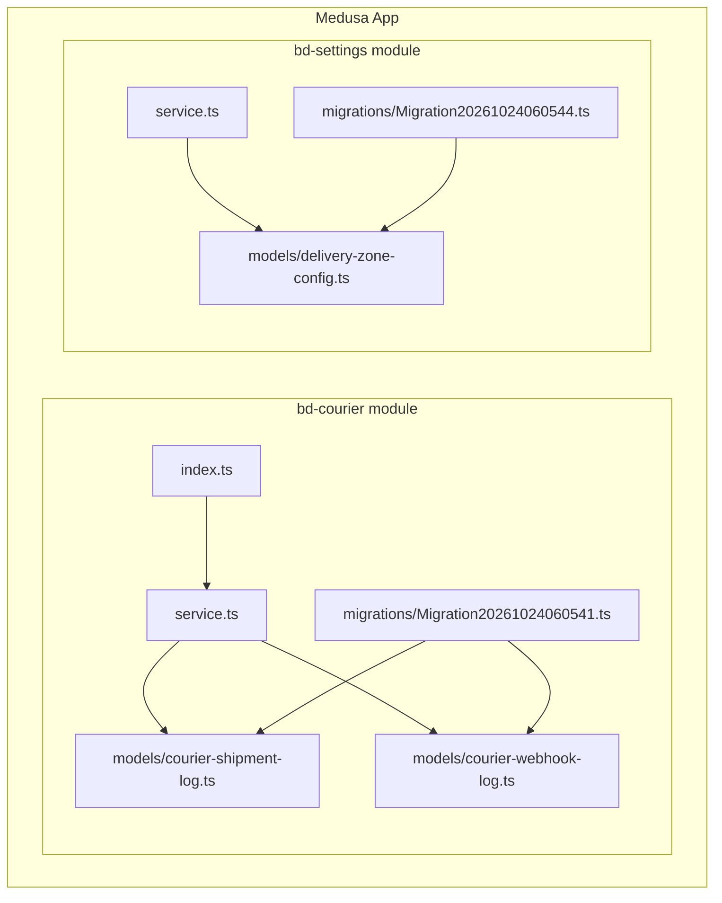
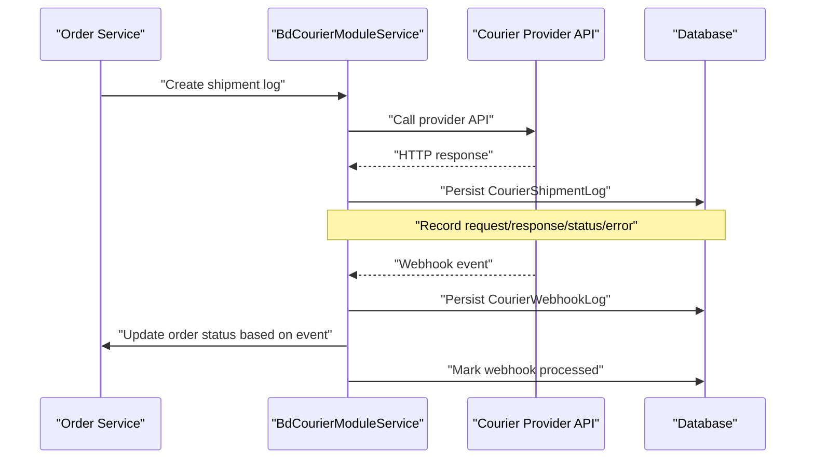
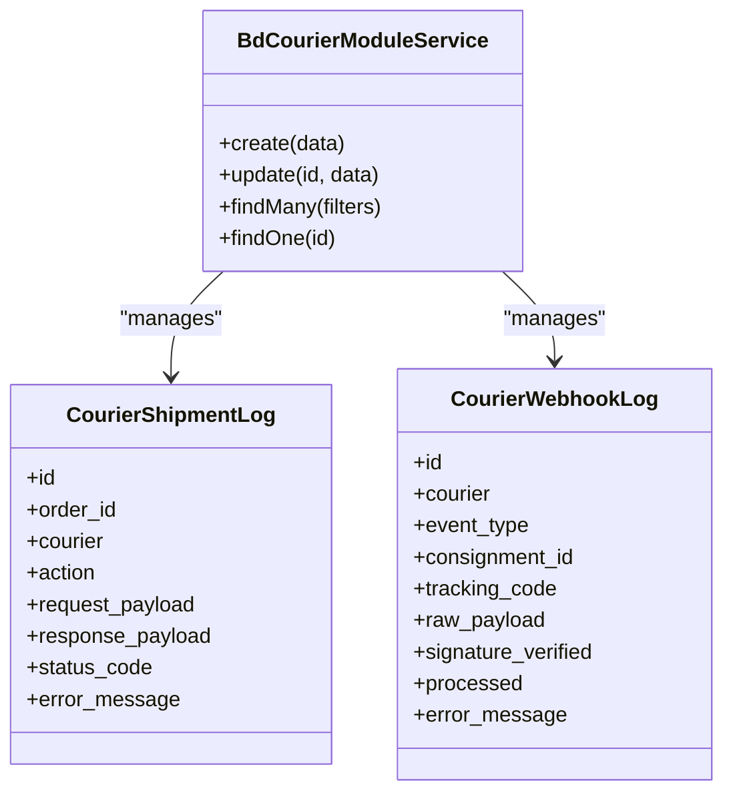
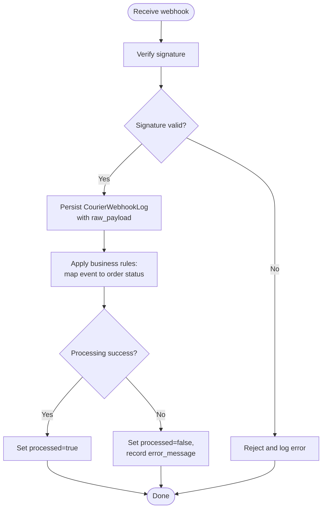
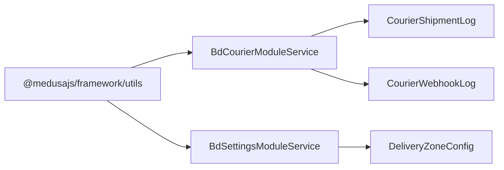

# Courier & Logistics Module

<cite>
**Referenced Files in This Document**
- [index.ts](file://apps/medusa/src/modules/bd-courier/index.ts)
- [service.ts](file://apps/medusa/src/modules/bd-courier/service.ts)
- [courier-shipment-log.ts](file://apps/medusa/src/modules/bd-courier/models/courier-shipment-log.ts)
- [courier-webhook-log.ts](file://apps/medusa/src/modules/bd-courier/models/courier-webhook-log.ts)
- [Migration20261024060541.ts](file://apps/medusa/src/modules/bd-courier/migrations/Migration20261024060541.ts)
- [delivery-zone-config.ts](file://apps/medusa/src/modules/bd-settings/models/delivery-zone-config.ts)
- [service.ts](file://apps/medusa/src/modules/bd-settings/service.ts)
- [Migration20261024060544.ts](file://apps/medusa/src/modules/bd-settings/migrations/Migration20261024060544.ts)
</cite>

## Table of Contents
1. [Introduction](#introduction)
2. [Project Structure](#project-structure)
3. [Core Components](#core-components)
4. [Architecture Overview](#architecture-overview)
5. [Detailed Component Analysis](#detailed-component-analysis)
6. [Dependency Analysis](#dependency-analysis)
7. [Performance Considerations](#performance-considerations)
8. [Troubleshooting Guide](#troubleshooting-guide)
9. [Conclusion](#conclusion)
10. [Appendices](#appendices)

## Introduction
This document describes the Courier & Logistics Module that provides:
- A domain model and persistence layer for courier shipment logs and webhook logs
- A Medusa module service to manage these entities
- Delivery zone configuration for shipping rates, thresholds, and delivery windows
- Guidance for integrating multiple courier providers (Steadfast, Pathao, RedX), tracking shipments, and processing webhooks for real-time delivery updates

The current codebase establishes the data models, migrations, and module scaffolding. It does not yet include concrete provider integrations or webhook endpoints; this guide explains where and how to extend them.

## Project Structure
The Courier & Logistics functionality is implemented as a Medusa module under apps/medusa/src/modules/bd-courier, with related delivery zone configuration in apps/medusa/src/modules/bd-settings.

**Diagram sources**
- [index.ts:1-9](file://apps/medusa/src/modules/bd-courier/index.ts#L1-L9)
- [service.ts:1-11](file://apps/medusa/src/modules/bd-courier/service.ts#L1-L11)
- [courier-shipment-log.ts:1-15](file://apps/medusa/src/modules/bd-courier/models/courier-shipment-log.ts#L1-L15)
- [courier-webhook-log.ts:1-16](file://apps/medusa/src/modules/bd-courier/models/courier-webhook-log.ts#L1-L16)
- [Migration20261024060541.ts:1-23](file://apps/medusa/src/modules/bd-courier/migrations/Migration20261024060541.ts#L1-L23)
- [delivery-zone-config.ts:1-17](file://apps/medusa/src/modules/bd-settings/models/delivery-zone-config.ts#L1-L17)
- [service.ts:1-11](file://apps/medusa/src/modules/bd-settings/service.ts#L1-L11)
- [Migration20261024060544.ts:1-22](file://apps/medusa/src/modules/bd-settings/migrations/Migration20261024060544.ts#L1-L22)

**Section sources**
- [index.ts:1-9](file://apps/medusa/src/modules/bd-courier/index.ts#L1-L9)
- [service.ts:1-11](file://apps/medusa/src/modules/bd-courier/service.ts#L1-L11)
- [courier-shipment-log.ts:1-15](file://apps/medusa/src/modules/bd-courier/models/courier-shipment-log.ts#L1-L15)
- [courier-webhook-log.ts:1-16](file://apps/medusa/src/modules/bd-courier/models/courier-webhook-log.ts#L1-L16)
- [delivery-zone-config.ts:1-17](file://apps/medusa/src/modules/bd-settings/models/delivery-zone-config.ts#L1-L17)
- [service.ts:1-11](file://apps/medusa/src/modules/bd-settings/service.ts#L1-L11)
- [Migration20261024060541.ts:1-23](file://apps/medusa/src/modules/bd-courier/migrations/Migration20261024060541.ts#L1-L23)
- [Migration20261024060544.ts:1-22](file://apps/medusa/src/modules/bd-settings/migrations/Migration20261024060544.ts#L1-L22)

## Core Components
- Courier Shipment Log: Records outbound requests and responses when interacting with courier APIs, including status codes and error messages.
- Courier Webhook Log: Captures inbound webhook events from couriers, including event type, consignment/tracking identifiers, raw payload, signature verification result, and processing status.
- Delivery Zone Config: Defines delivery zones with flat rates, free shipping thresholds, delivery day ranges, active flags, and coverage districts.

These components are exposed through Medusa services generated by the framework’s MedusaService helper.

**Section sources**
- [courier-shipment-log.ts:1-15](file://apps/medusa/src/modules/bd-courier/models/courier-shipment-log.ts#L1-L15)
- [courier-webhook-log.ts:1-16](file://apps/medusa/src/modules/bd-courier/models/courier-webhook-log.ts#L1-L16)
- [delivery-zone-config.ts:1-17](file://apps/medusa/src/modules/bd-settings/models/delivery-zone-config.ts#L1-L17)
- [service.ts:1-11](file://apps/medusa/src/modules/bd-courier/service.ts#L1-L11)
- [service.ts:1-11](file://apps/medusa/src/modules/bd-settings/service.ts#L1-L11)

## Architecture Overview
At runtime, the module exposes two primary concerns:
- Outbound logistics: Create shipment logs when calling courier APIs for label creation, pickup scheduling, or tracking queries.
- Inbound logistics: Persist webhook payloads from couriers and mark them as processed after business logic updates order statuses.

**Diagram sources**
- [service.ts:1-11](file://apps/medusa/src/modules/bd-courier/service.ts#L1-L11)
- [courier-shipment-log.ts:1-15](file://apps/medusa/src/modules/bd-courier/models/courier-shipment-log.ts#L1-L15)
- [courier-webhook-log.ts:1-16](file://apps/medusa/src/modules/bd-courier/models/courier-webhook-log.ts#L1-L16)

## Detailed Component Analysis

### Domain Model: CourierShipmentLog
Purpose:
- Track every outbound interaction with a courier provider during shipment lifecycle operations.

Key fields:
- id: Primary key
- order_id: Indexable reference to the originating order
- courier: Provider identifier (e.g., Steadfast, Pathao, RedX)
- action: Operation name (e.g., create_shipment, track_shipment)
- request_payload: JSON snapshot of the outgoing request
- response_payload: JSON snapshot of the incoming response
- status_code: HTTP status returned by the provider
- error_message: Optional error details

Indexes:
- order_id for fast lookup by order
- deleted_at for soft-delete queries

Complexity:
- O(1) insert/update
- O(log n) lookup by order_id due to index

Usage patterns:
- Before calling a courier API, create a log entry with action and request_payload
- After receiving the response, update response_payload and status_code
- On failure, populate error_message

**Section sources**
- [courier-shipment-log.ts:1-15](file://apps/medusa/src/modules/bd-courier/models/courier-shipment-log.ts#L1-L15)
- [Migration20261024060541.ts:5-8](file://apps/medusa/src/modules/bd-courier/migrations/Migration20261024060541.ts#L5-L8)

### Domain Model: CourierWebhookLog
Purpose:
- Capture and audit inbound webhook events from courier providers for delivery status updates.

Key fields:
- id: Primary key
- courier: Provider identifier
- event_type: Event category (e.g., delivered, out_for_delivery)
- consignment_id: Optional provider-side consignment identifier
- tracking_code: Optional tracking number
- raw_payload: Full webhook body for replayability
- signature_verified: Whether provider signature validation passed
- processed: Whether downstream processing completed successfully
- error_message: Optional error details if processing failed

Indexes:
- consignment_id and tracking_code for efficient lookups
- deleted_at for soft-delete queries

Complexity:
- O(1) insert/update
- O(log n) lookup by consignment_id or tracking_code

Processing flow:
- Receive webhook
- Validate signature and persist raw_payload
- Run business logic to update orders
- Mark processed=true and record any errors

**Section sources**
- [courier-webhook-log.ts:1-16](file://apps/medusa/src/modules/bd-courier/models/courier-webhook-log.ts#L1-L16)
- [Migration20261024060541.ts:10-13](file://apps/medusa/src/modules/bd-courier/migrations/Migration20261024060541.ts#L10-L13)

### Service Layer: BdCourierModuleService
Responsibilities:
- Exposes CRUD operations for CourierShipmentLog and CourierWebhookLog via MedusaService
- Provides a stable integration point for other modules to log courier interactions and webhook events

Design notes:
- The service currently delegates all persistence to the framework-generated methods
- Extend this service to add higher-level operations such as:
  - createShipmentLog(orderId, courier, action, requestPayload)
  - updateShipmentLog(id, responsePayload, statusCode, errorMessage)
  - createWebhookLog(courier, eventType, consignmentId, trackingCode, rawPayload, signatureVerified)
  - processWebhook(webhookId): validate, transform, update orders, mark processed

**Diagram sources**
- [service.ts:1-11](file://apps/medusa/src/modules/bd-courier/service.ts#L1-L11)
- [courier-shipment-log.ts:1-15](file://apps/medusa/src/modules/bd-courier/models/courier-shipment-log.ts#L1-L15)
- [courier-webhook-log.ts:1-16](file://apps/medusa/src/modules/bd-courier/models/courier-webhook-log.ts#L1-L16)

**Section sources**
- [service.ts:1-11](file://apps/medusa/src/modules/bd-courier/service.ts#L1-L11)

### Delivery Zone Management: DeliveryZoneConfig
Purpose:
- Define delivery zones with pricing rules and delivery time estimates.

Key fields:
- id: Primary key
- zone_code: Enumerated zone identifier (inside_dhaka, dhaka_suburbs, outside_dhaka)
- name_en, name_bn: Localized names
- flat_rate_bdt: Default flat rate
- free_shipping_threshold_bdt: Threshold for free shipping
- delivery_days_min, delivery_days_max: Estimated delivery window
- is_active: Enable/disable zone
- coverage_districts_json: Optional list of districts covered by the zone

Indexes:
- Unique constraint on zone_code
- deleted_at for soft-delete queries

Complexity:
- O(1) insert/update
- O(log n) lookup by zone_code

Usage patterns:
- Calculate shipping cost using flat_rate_bdt unless cart total >= free_shipping_threshold_bdt
- Estimate delivery days between min and max
- Restrict available zones by coverage_districts_json

**Section sources**
- [delivery-zone-config.ts:1-17](file://apps/medusa/src/modules/bd-settings/models/delivery-zone-config.ts#L1-L17)
- [Migration20261024060544.ts:5-9](file://apps/medusa/src/modules/bd-settings/migrations/Migration20261024060544.ts#L5-L9)

### Webhook Processing Flow
Conceptual flow for handling courier webhooks:

[No sources needed since this diagram shows conceptual workflow, not actual code structure]

## Dependency Analysis
The bd-courier module depends on:
- Medusa framework utilities for service generation
- Database schema defined by migrations

The bd-settings module depends on:
- Medusa framework utilities for service generation
- Database schema defined by migrations

**Diagram sources**
- [service.ts:1-11](file://apps/medusa/src/modules/bd-courier/service.ts#L1-L11)
- [service.ts:1-11](file://apps/medusa/src/modules/bd-settings/service.ts#L1-L11)
- [courier-shipment-log.ts:1-15](file://apps/medusa/src/modules/bd-courier/models/courier-shipment-log.ts#L1-L15)
- [courier-webhook-log.ts:1-16](file://apps/medusa/src/modules/bd-courier/models/courier-webhook-log.ts#L1-L16)
- [delivery-zone-config.ts:1-17](file://apps/medusa/src/modules/bd-settings/models/delivery-zone-config.ts#L1-L17)

**Section sources**
- [service.ts:1-11](file://apps/medusa/src/modules/bd-courier/service.ts#L1-L11)
- [service.ts:1-11](file://apps/medusa/src/modules/bd-settings/service.ts#L1-L11)

## Performance Considerations
For high-volume shipping operations:
- Use batched writes for bulk shipment logs and webhook logs to reduce database round-trips
- Partition or archive old logs periodically to keep query performance optimal
- Leverage existing indexes on order_id, consignment_id, and tracking_code for fast lookups
- Avoid synchronous external calls in hot paths; prefer background jobs for heavy transformations
- Cache delivery zone configurations in memory with short TTLs to minimize repeated reads
- Implement retry policies with exponential backoff for transient network failures
- Rate-limit outbound API calls per provider to respect quotas and avoid throttling

[No sources needed since this section provides general guidance]

## Troubleshooting Guide
Common issues and resolutions:
- Failed outbound API calls:
  - Inspect CourierShipmentLog.error_message and status_code
  - Retry failed actions with backoff and circuit breaker patterns
- Invalid webhook signatures:
  - Check signature_verified flag and error_message
  - Ensure correct secret configuration and timestamp validation
- Unprocessed webhooks:
  - Review processed flag and error_message
  - Re-run processing for failed records after fixing upstream issues
- Incorrect delivery charges:
  - Validate DeliveryZoneConfig.is_active and thresholds
  - Confirm coverage_districts_json matches customer location

Operational checks:
- Monitor webhook backlog by querying unprocessed CourierWebhookLog entries
- Alert on high error rates in CourierShipmentLog by status_code and error_message patterns
- Periodically verify delivery zone settings against business rules

**Section sources**
- [courier-shipment-log.ts:1-15](file://apps/medusa/src/modules/bd-courier/models/courier-shipment-log.ts#L1-L15)
- [courier-webhook-log.ts:1-16](file://apps/medusa/src/modules/bd-courier/models/courier-webhook-log.ts#L1-L16)
- [delivery-zone-config.ts:1-17](file://apps/medusa/src/modules/bd-settings/models/delivery-zone-config.ts#L1-L17)

## Conclusion
The Courier & Logistics Module provides a solid foundation for multi-provider delivery logistics:
- Persistence models for shipment and webhook logs
- A Medusa service to manage these entities
- Delivery zone configuration for pricing and delivery windows

To complete the feature set, implement:
- Provider adapters for Steadfast, Pathao, and RedX
- Webhook endpoints that validate signatures and update orders
- Higher-level service methods in BdCourierModuleService to orchestrate logging and processing

[No sources needed since this section summarizes without analyzing specific files]

## Appendices

### Integrating a New Courier Provider
Steps:
- Create a provider adapter class implementing a common interface (e.g., createShipment, trackShipment)
- Use BdCourierModuleService to persist CourierShipmentLog before and after each API call
- Map provider-specific statuses to internal statuses
- Register the provider in configuration and select it based on delivery zone rules

Example references:
- Logging outbound calls: [courier-shipment-log.ts:1-15](file://apps/medusa/src/modules/bd-courier/models/courier-shipment-log.ts#L1-L15)
- Service extension point: [service.ts:1-11](file://apps/medusa/src/modules/bd-courier/service.ts#L1-L11)

### Tracking Shipments
Flow:
- Query CourierShipmentLog by order_id to retrieve last known status
- If needed, call provider tracking API and update response_payload and status_code
- Return consolidated tracking timeline to the caller

Example references:
- Shipment log fields: [courier-shipment-log.ts:1-15](file://apps/medusa/src/modules/bd-courier/models/courier-shipment-log.ts#L1-L15)

### Handling Delivery Webhooks
Flow:
- Validate signature and persist CourierWebhookLog
- Transform event into internal state changes
- Update order status and mark processed=true
- Handle errors by recording error_message and keeping processed=false

Example references:
- Webhook log fields: [courier-webhook-log.ts:1-16](file://apps/medusa/src/modules/bd-courier/models/courier-webhook-log.ts#L1-L16)