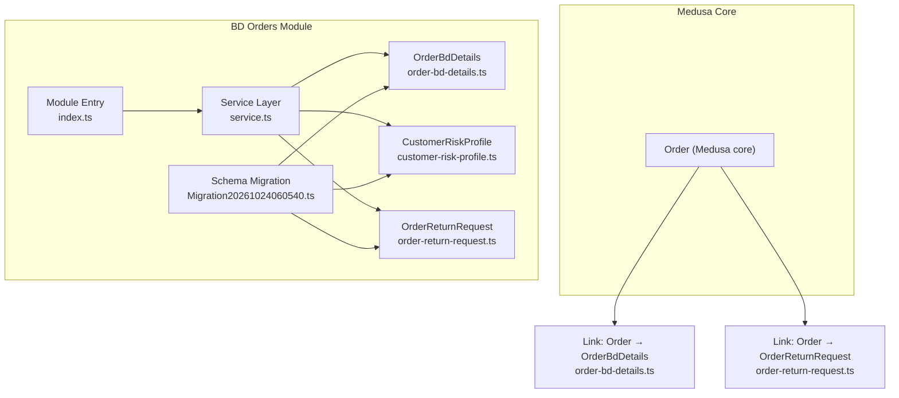
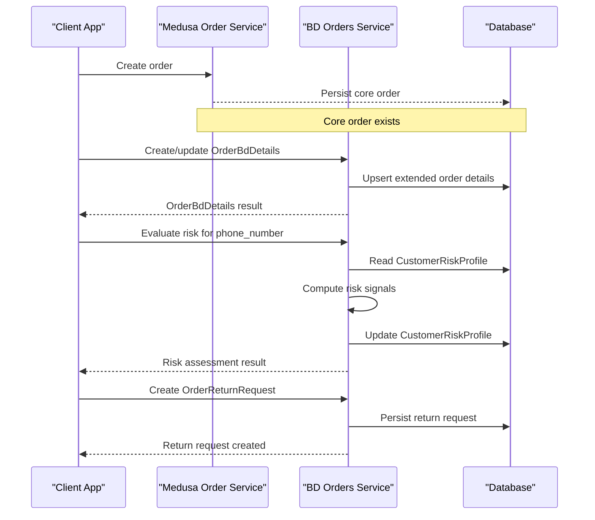
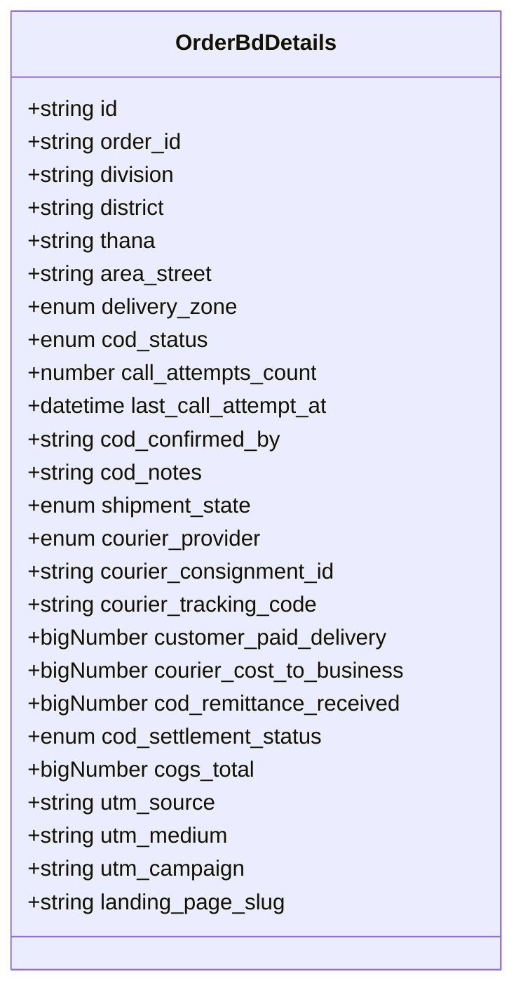
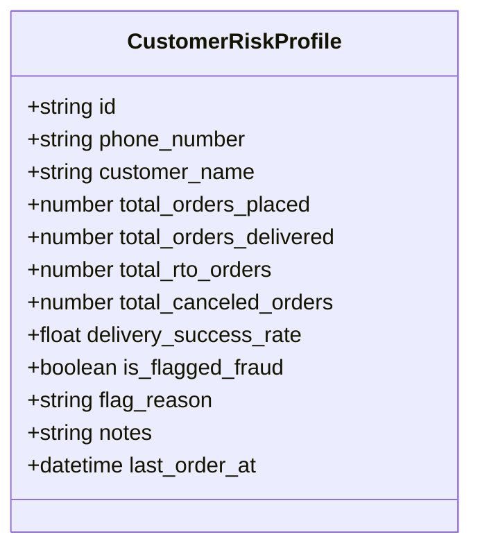
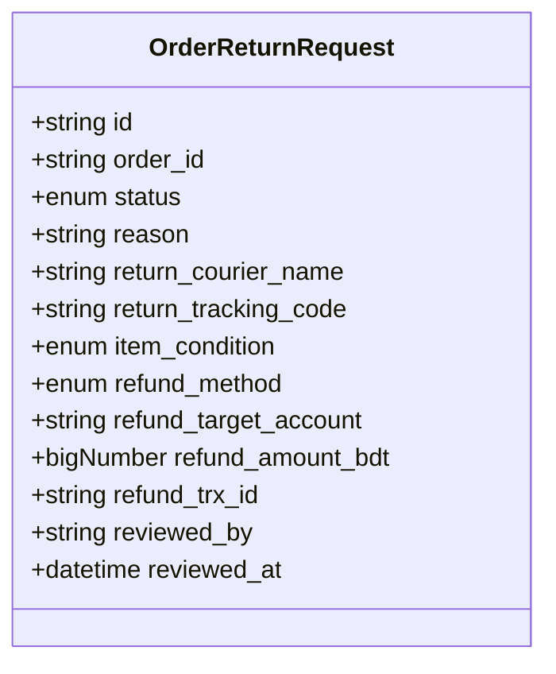
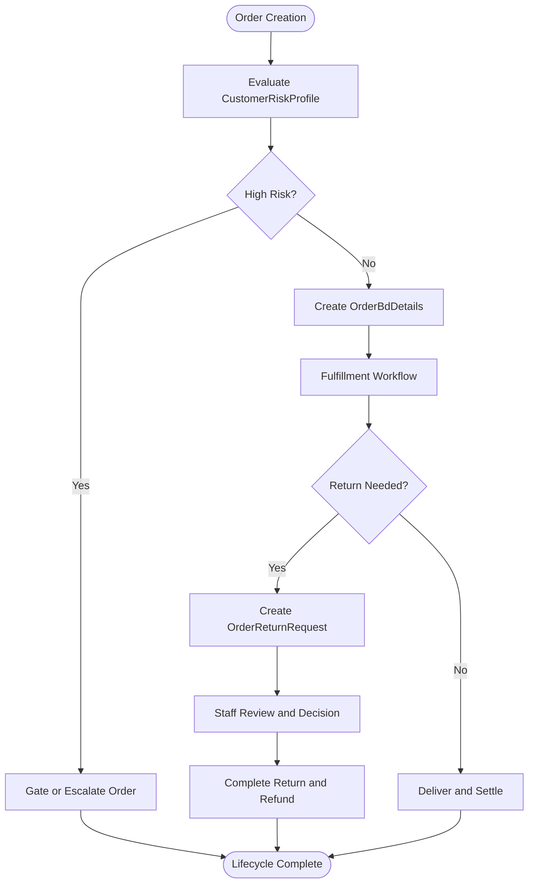
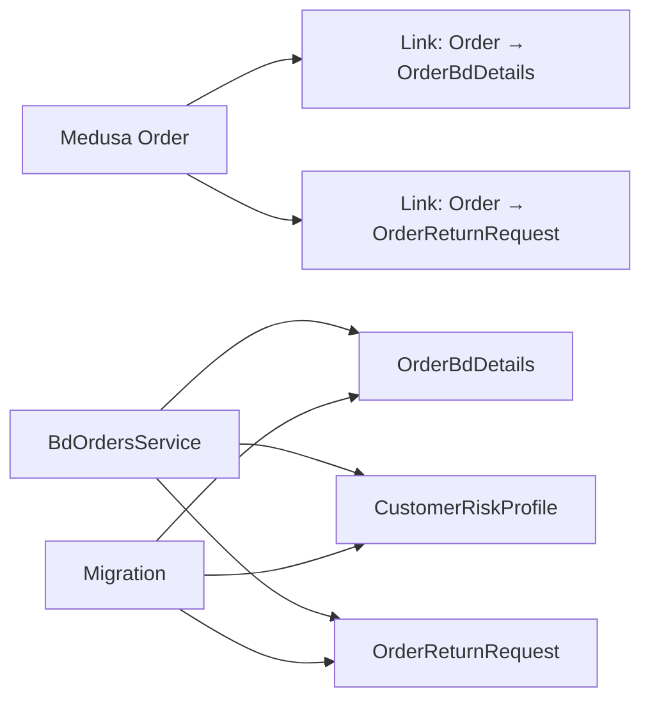

# Order Processing Module

<cite>
**Referenced Files in This Document**
- [index.ts](file://apps/medusa/src/modules/bd-orders/index.ts)
- [service.ts](file://apps/medusa/src/modules/bd-orders/service.ts)
- [order-bd-details.ts](file://apps/medusa/src/modules/bd-orders/models/order-bd-details.ts)
- [customer-risk-profile.ts](file://apps/medusa/src/modules/bd-orders/models/customer-risk-profile.ts)
- [order-return-request.ts](file://apps/medusa/src/modules/bd-orders/models/order-return-request.ts)
- [Migration20261024060540.ts](file://apps/medusa/src/modules/bd-orders/migrations/Migration20261024060540.ts)
- [order-bd-details link](file://apps/medusa/src/links/order-bd-details.ts)
- [order-return-request link](file://apps/medusa/src/links/order-return-request.ts)
- [data-models.md](file://docs/data-models.md)
- [database.md](file://database.md)
- [prd.md](file://prd.md)
</cite>

## Table of Contents
1. [Introduction](#introduction)
2. [Project Structure](#project-structure)
3. [Core Components](#core-components)
4. [Architecture Overview](#architecture-overview)
5. [Detailed Component Analysis](#detailed-component-analysis)
6. [Dependency Analysis](#dependency-analysis)
7. [Performance Considerations](#performance-considerations)
8. [Security and Compliance Considerations](#security-and-compliance-considerations)
9. [Troubleshooting Guide](#troubleshooting-guide)
10. [Conclusion](#conclusion)

## Introduction
This document explains the Order Processing Module that extends Medusa’s core order domain with Bangladesh-specific order details, customer risk profiling for fraud prevention, return request handling, and extended order data management. It covers the complete order lifecycle from creation to fulfillment, including COD verification, shipment state transitions, courier integration metadata, risk scoring inputs, and structured return workflows. The module is implemented as a Medusa v2 custom module with typed models, a generated service layer, and links to the built-in order entity.

## Project Structure
The relevant code lives under `apps/medusa/src/modules/bd-orders` and is connected to the rest of the system through Medusa links:

- Module entry point exports the module name and registers the service.
- Models define the domain entities: extended order details, customer risk profile, and return requests.
- A thin service class inherits CRUD capabilities from Medusa’s base service.
- Links connect the module entities to Medusa’s core order model.
- Migration files enforce database schema, constraints, indexes, and soft-delete behavior.

**Diagram sources**
- [index.ts:1-9](file://apps/medusa/src/modules/bd-orders/index.ts#L1-L9)
- [service.ts:1-13](file://apps/medusa/src/modules/bd-orders/service.ts#L1-L13)
- [order-bd-details.ts:1-42](file://apps/medusa/src/modules/bd-orders/models/order-bd-details.ts#L1-L42)
- [customer-risk-profile.ts:1-19](file://apps/medusa/src/modules/bd-orders/models/customer-risk-profile.ts#L1-L19)
- [order-return-request.ts:1-28](file://apps/medusa/src/modules/bd-orders/models/order-return-request.ts#L1-L28)
- [Migration20261024060540.ts:1-19](file://apps/medusa/src/modules/bd-orders/migrations/Migration20261024060540.ts#L1-L19)
- [order-bd-details link:1-9](file://apps/medusa/src/links/order-bd-details.ts#L1-L9)
- [order-return-request link:1-9](file://apps/medusa/src/links/order-return-request.ts#L1-L9)

**Section sources**
- [index.ts:1-9](file://apps/medusa/src/modules/bd-orders/index.ts#L1-L9)
- [service.ts:1-13](file://apps/medusa/src/modules/bd-orders/service.ts#L1-L13)
- [order-bd-details.ts:1-42](file://apps/medusa/src/modules/bd-orders/models/order-bd-details.ts#L1-L42)
- [customer-risk-profile.ts:1-19](file://apps/medusa/src/modules/bd-orders/models/customer-risk-profile.ts#L1-L19)
- [order-return-request.ts:1-28](file://apps/medusa/src/modules/bd-orders/models/order-return-request.ts#L1-L28)
- [Migration20261024060540.ts:1-19](file://apps/medusa/src/modules/bd-orders/migrations/Migration20261024060540.ts#L1-L19)
- [order-bd-details link:1-9](file://apps/medusa/src/links/order-bd-details.ts#L1-L9)
- [order-return-request link:1-9](file://apps/medusa/src/links/order-return-request.ts#L1-L9)

## Core Components
The module exposes three primary domain entities and a lightweight service:

- **OrderBdDetails**: Extended order attributes for Bangladesh operations, including delivery zone, COD status, call attempts, shipment state, courier provider and tracking, financial fields such as delivery charges, courier cost, COD remittance, settlement status, COGS, and marketing attribution.
- **CustomerRiskProfile**: Phone-keyed risk projection used for fraud prevention and operational decisions. It tracks lifetime order counts, RTO and canceled orders, delivery success rate, fraud flagging, reasons, notes, and last order timestamp.
- **OrderReturnRequest**: Structured return workflow with statuses ranging from pending manual review to completed, including reason, return courier and tracking, item condition, refund method and target account, refund amount, optional transaction ID, and audit fields for reviewer identity and time.

The service class extends Medusa’s base service and provides default CRUD operations for these entities. Business logic for order state transitions, risk evaluation, and return processing should be implemented by extending this service or orchestrating it from higher-level services or workflows.

**Section sources**
- [order-bd-details.ts:1-42](file://apps/medusa/src/modules/bd-orders/models/order-bd-details.ts#L1-L42)
- [customer-risk-profile.ts:1-19](file://apps/medusa/src/modules/bd-orders/models/customer-risk-profile.ts#L1-L19)
- [order-return-request.ts:1-28](file://apps/medusa/src/modules/bd-orders/models/order-return-request.ts#L1-L28)
- [service.ts:1-13](file://apps/medusa/src/modules/bd-orders/service.ts#L1-L13)

## Architecture Overview
The module integrates with Medusa’s core order domain via links. When an order is created, business logic can create or update its corresponding `OrderBdDetails`. Customer risk profiles are maintained per phone number and updated based on order outcomes. Return requests are attached to orders and follow a staff-managed workflow.

**Diagram sources**
- [order-bd-details link:1-9](file://apps/medusa/src/links/order-bd-details.ts#L1-L9)
- [order-return-request link:1-9](file://apps/medusa/src/links/order-return-request.ts#L1-L9)
- [service.ts:1-13](file://apps/medusa/src/modules/bd-orders/service.ts#L1-L13)

## Detailed Component Analysis

### Domain Model: OrderBdDetails
`OrderBdDetails` captures Bangladesh-specific order context and fulfillment metadata. Key areas include:

- Address and geography: division, district, thana, area/street, delivery zone.
- COD operations: status, call attempts, last attempt timestamp, confirmation owner, notes.
- Shipment lifecycle: states from pending confirmation through delivered, including failed delivery and RTO stages.
- Courier integration: provider, consignment ID, tracking code.
- Financials: customer-paid delivery charge, courier cost to business, COD remittance received, COD settlement status, COGS total.
- Marketing attribution: UTM source, medium, campaign, landing page slug.

**Diagram sources**
- [order-bd-details.ts:1-42](file://apps/medusa/src/modules/bd-orders/models/order-bd-details.ts#L1-L42)

Operational implications:
- Use `shipment_state` to drive fulfillment workflows and courier integrations.
- Track COD verification through `cod_status`, call attempts, and confirmation metadata.
- Record courier tracking and provider for logistics visibility and reconciliation.
- Maintain financial fields for profitability analysis and settlement reporting.

**Section sources**
- [order-bd-details.ts:1-42](file://apps/medusa/src/modules/bd-orders/models/order-bd-details.ts#L1-L42)
- [Migration20261024060540.ts:1-19](file://apps/medusa/src/modules/bd-orders/migrations/Migration20261024060540.ts#L1-L19)

### Domain Model: CustomerRiskProfile
`CustomerRiskProfile` is a phone-keyed projection used for fraud prevention and risk-based decisions. It aggregates historical order metrics and flags potentially abusive accounts.

Key aspects:
- Identity: phone number (unique), optional customer name.
- Counters: total orders placed, delivered, RTO, canceled.
- Derived metric: delivery success rate.
- Fraud controls: boolean flag and reason text.
- Operational notes and last order timestamp.

**Diagram sources**
- [customer-risk-profile.ts:1-19](file://apps/medusa/src/modules/bd-orders/models/customer-risk-profile.ts#L1-L19)

Design guidance:
- Treat phone normalization as a prerequisite before lookup or upsert.
- Update counters and success rate when order outcomes change (delivered, RTO, canceled).
- Use `is_flagged_fraud` and `flag_reason` to gate risky orders during checkout or payment.

**Section sources**
- [customer-risk-profile.ts:1-19](file://apps/medusa/src/modules/bd-orders/models/customer-risk-profile.ts#L1-L19)
- [Migration20261024060540.ts:1-19](file://apps/medusa/src/modules/bd-orders/migrations/Migration20261024060540.ts#L1-L19)
- [data-models.md:171-192](file://docs/data-models.md#L171-L192)
- [database.md:566-588](file://database.md#L566-L588)

### Domain Model: OrderReturnRequest
`OrderReturnRequest` formalizes the return/refund process with clear statuses and audit fields.

Key aspects:
- Status progression: none, pending manual review, approved, rejected, info requested, item received evaluating, completed.
- Reason and return logistics: reason text, return courier name, tracking code.
- Item inspection: condition enum values.
- Refund configuration: method, target account, amount, optional transaction ID.
- Audit: reviewer identity and timestamp.

**Diagram sources**
- [order-return-request.ts:1-28](file://apps/medusa/src/modules/bd-orders/models/order-return-request.ts#L1-L28)

Workflow alignment:
- Follow the PRD-suggested flow: submitted → pending manual review → staff decision → approval/rejection → manual handling → completion.
- Capture item condition upon receipt; never auto-restock damaged or uninspected items.

**Section sources**
- [order-return-request.ts:1-28](file://apps/medusa/src/modules/bd-orders/models/order-return-request.ts#L1-L28)
- [Migration20261024060540.ts:1-19](file://apps/medusa/src/modules/bd-orders/migrations/Migration20261024060540.ts#L1-L19)
- [prd.md:236-242](file://prd.md#L236-L242)

### Service Layer: Order State Management, Risk Assessment, and Return Processing
The current service is a thin wrapper around Medusa’s base service. To implement the required lifecycle logic:

- Order state management:
  - Extend the service with methods to transition `shipment_state` safely, validating allowed transitions and recording audit information.
  - Integrate with courier events to update tracking codes and states.
  - Update COD-related fields when call center confirms or escalates.

- Risk assessment algorithms:
  - Implement a function that reads `CustomerRiskProfile` for the order’s phone number and computes risk signals using counters and success rate.
  - Apply rules to set or update `is_flagged_fraud` and `flag_reason`.
  - Expose a risk evaluation endpoint or hook that returns a risk score or decision for downstream gating.

- Return processing workflows:
  - Provide methods to create, review, approve, reject, and complete return requests.
  - Enforce status transitions and require reviewer identity and timestamps.
  - Coordinate with inventory and finance systems when refunds are processed.

**Diagram sources**
- [service.ts:1-13](file://apps/medusa/src/modules/bd-orders/service.ts#L1-L13)
- [customer-risk-profile.ts:1-19](file://apps/medusa/src/modules/bd-orders/models/customer-risk-profile.ts#L1-L19)
- [order-bd-details.ts:1-42](file://apps/medusa/src/modules/bd-orders/models/order-bd-details.ts#L1-L42)
- [order-return-request.ts:1-28](file://apps/medusa/src/modules/bd-orders/models/order-return-request.ts#L1-L28)

Implementation recommendations:
- Add explicit validation for enum fields to prevent invalid state transitions.
- Use transactions when updating multiple related entities (e.g., risk profile and order details).
- Log all sensitive changes to an audit trail, especially for risk flags and return approvals.

**Section sources**
- [service.ts:1-13](file://apps/medusa/src/modules/bd-orders/service.ts#L1-L13)
- [prd.md:236-242](file://prd.md#L236-L242)

## Dependency Analysis
The module depends on Medusa’s core order domain and exposes its own entities through links. The service depends on the three models. Migrations ensure schema consistency and indexing.

**Diagram sources**
- [order-bd-details link:1-9](file://apps/medusa/src/links/order-bd-details.ts#L1-L9)
- [order-return-request link:1-9](file://apps/medusa/src/links/order-return-request.ts#L1-L9)
- [service.ts:1-13](file://apps/medusa/src/modules/bd-orders/service.ts#L1-L13)
- [Migration20261024060540.ts:1-19](file://apps/medusa/src/modules/bd-orders/migrations/Migration20261024060540.ts#L1-L19)

Coupling and cohesion:
- Low coupling to core order via links; high cohesion within the module’s domain.
- Clear separation between data models and service layer.
- Migration artifacts keep schema aligned with model definitions.

Potential risks:
- If business logic remains only in the thin service, future extensions may scatter orchestration across controllers or external services.
- Ensure consistent use of phone normalization to avoid duplicate risk profiles.

**Section sources**
- [order-bd-details link:1-9](file://apps/medusa/src/links/order-bd-details.ts#L1-L9)
- [order-return-request link:1-9](file://apps/medusa/src/links/order-return-request.ts#L1-L9)
- [service.ts:1-13](file://apps/medusa/src/modules/bd-orders/service.ts#L1-L13)
- [Migration20261024060540.ts:1-19](file://apps/medusa/src/modules/bd-orders/migrations/Migration20261024060540.ts#L1-L19)

## Performance Considerations
- Indexing:
  - `courier_tracking_code` is indexed for fast logistics lookups.
  - `order_return_request.order_id` is indexed for efficient retrieval of returns per order.
  - `customer_risk_profile.phone_number` has a unique partial index for performance and uniqueness enforcement.
- Numeric precision:
  - Monetary fields use big numbers; ensure consistent precision handling in application logic to avoid rounding issues.
- Query patterns:
  - Prefer filtering by phone number for risk profile lookups.
  - Use pagination for listing returns and extended order details in admin interfaces.

[No sources needed since this section provides general guidance]

## Security and Compliance Considerations
- Risk profiling security:
  - Normalize and validate phone numbers before querying or creating profiles.
  - Restrict access to fraud flags and reasons to authorized roles.
  - Mask sensitive notes in exported reports and logs.
- Audit trails:
  - Record who reviewed return requests and when.
  - Log status transitions for shipments and COD verification.
  - Integrate with the platform’s audit module to capture actor, entity type, action, and changed values.
- Compliance:
  - Retain evidence for fraud decisions and return approvals.
  - Ensure refund records are reconciled with payment systems and settlement processes.
  - Follow regional requirements for data retention and privacy.

**Section sources**
- [order-return-request.ts:1-28](file://apps/medusa/src/modules/bd-orders/models/order-return-request.ts#L1-L28)
- [customer-risk-profile.ts:1-19](file://apps/medusa/src/modules/bd-orders/models/customer-risk-profile.ts#L1-L19)
- [database.md:566-588](file://database.md#L566-L588)

## Troubleshooting Guide
Common issues and resolutions:

- Duplicate risk profiles:
  - Symptom: Multiple rows for the same phone number.
  - Resolution: Normalize phone numbers consistently and rely on the unique partial index; investigate migration execution and application-side deduplication.

- Invalid shipment state transitions:
  - Symptom: Attempting to move from an invalid previous state to a new state.
  - Resolution: Validate transitions against the defined enum sequence and log attempts for investigation.

- Return request stuck in pending review:
  - Symptom: No reviewer or timestamp recorded.
  - Resolution: Require reviewer identity and timestamp on approval/rejection; surface pending reviews in admin dashboards.

- COD settlement discrepancies:
  - Symptom: Remittance received does not match expected amounts.
  - Resolution: Reconcile `cod_remittance_received` with payment/settlement records and mark disputes if necessary.

**Section sources**
- [Migration20261024060540.ts:1-19](file://apps/medusa/src/modules/bd-orders/migrations/Migration20261024060540.ts#L1-L19)
- [order-bd-details.ts:1-42](file://apps/medusa/src/modules/bd-orders/models/order-bd-details.ts#L1-L42)
- [order-return-request.ts:1-28](file://apps/medusa/src/modules/bd-orders/models/order-return-request.ts#L1-L28)

## Conclusion
The Order Processing Module provides a robust foundation for Bangladesh-specific order operations, risk-aware order handling, and structured return workflows. Its domain models clearly separate extended order details, customer risk projections, and return requests. The current service layer offers a clean starting point for implementing stateful order management, risk evaluation, and return processing. By extending the service with validated transitions, risk algorithms, and audit-driven workflows, the platform can achieve secure, compliant, and operationally effective order fulfillment.