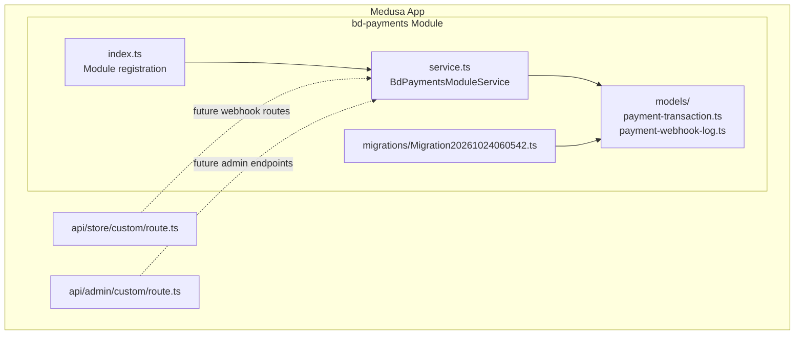
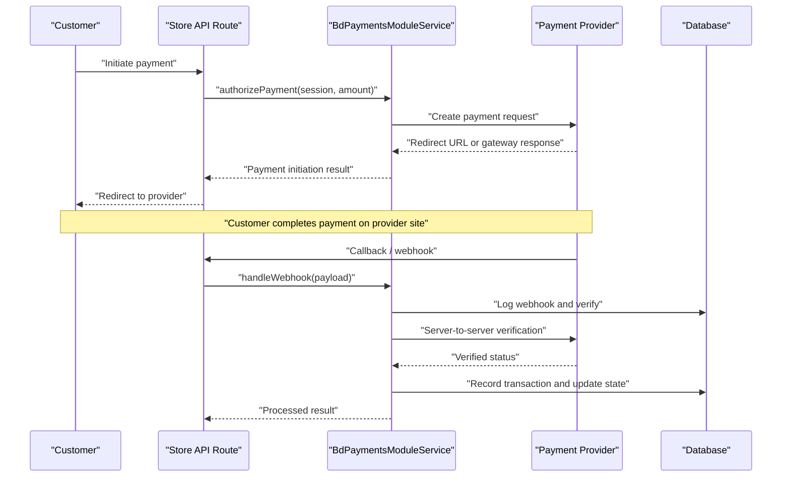
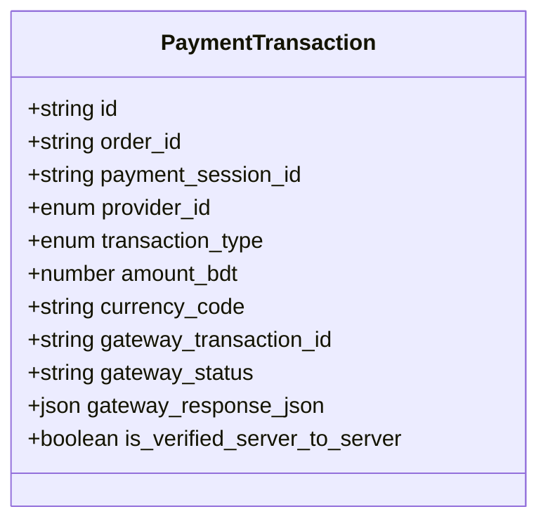
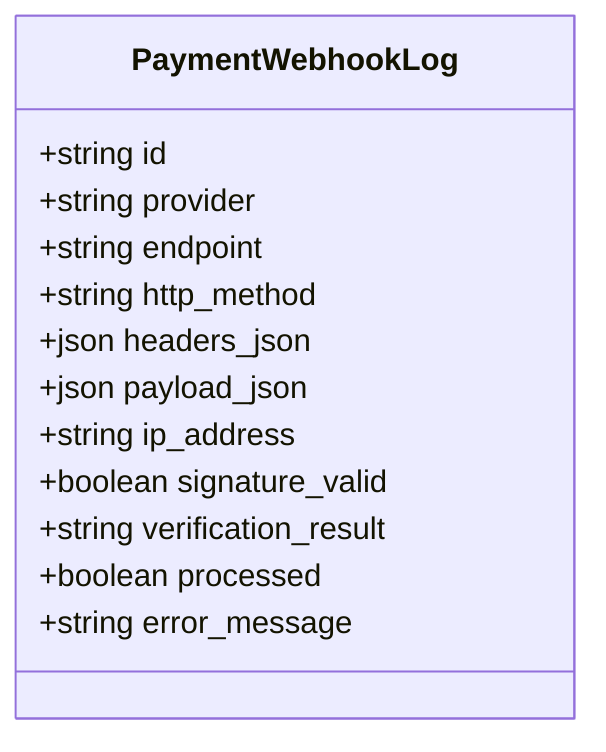
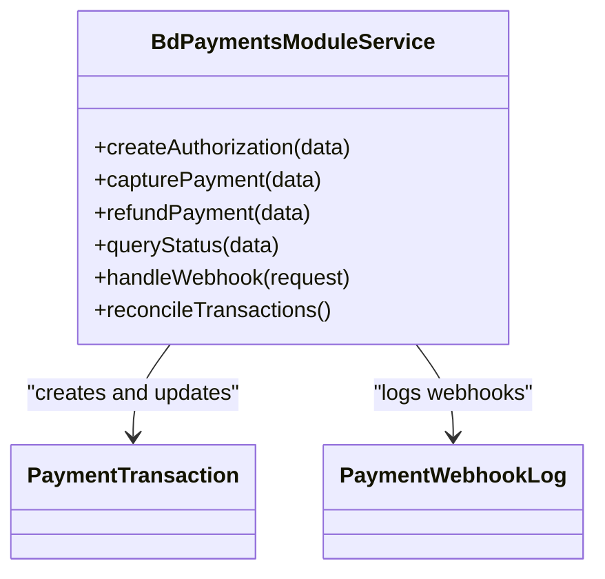
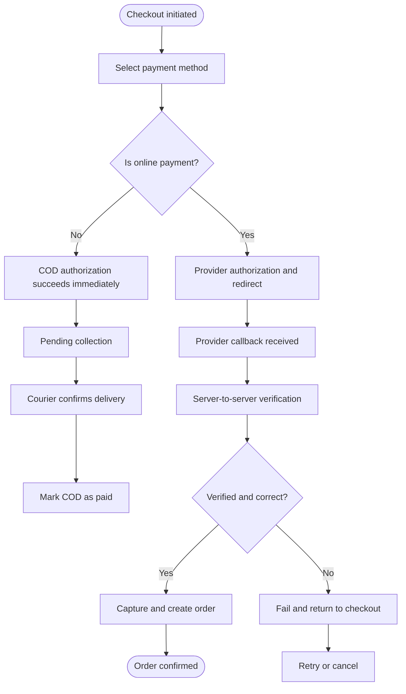
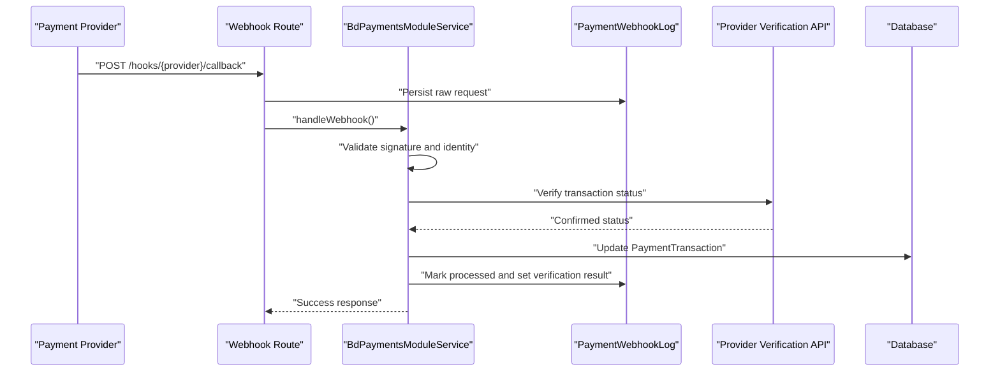
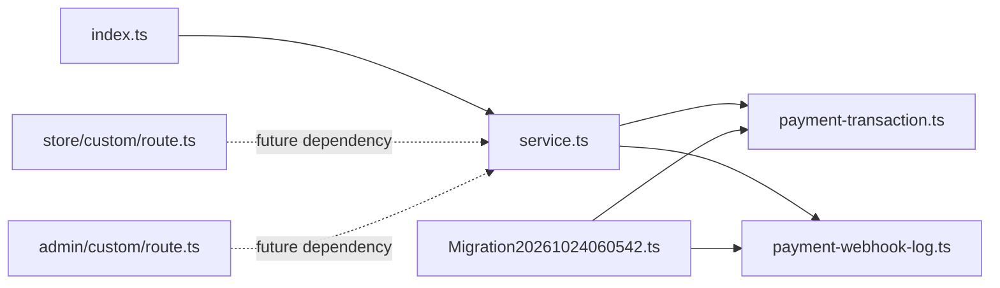

# Payment Processing Module

<cite>
**Referenced Files in This Document**
- [payment-transaction.ts](file://apps/medusa/src/modules/bd-payments/models/payment-transaction.ts)
- [payment-webhook-log.ts](file://apps/medusa/src/modules/bd-payments/models/payment-webhook-log.ts)
- [service.ts](file://apps/medusa/src/modules/bd-payments/service.ts)
- [index.ts](file://apps/medusa/src/modules/bd-payments/index.ts)
- [Migration20261024060542.ts](file://apps/medusa/src/modules/bd-payments/migrations/Migration20261024060542.ts)
- [technical-plan.md](file://technical-plan.md)
- [prd.md](file://prd.md)
- [data-models.md](file://docs/data-models.md)
</cite>

## Table of Contents
1. [Introduction](#introduction)
2. [Project Structure](#project-structure)
3. [Core Components](#core-components)
4. [Architecture Overview](#architecture-overview)
5. [Detailed Component Analysis](#detailed-component-analysis)
6. [Dependency Analysis](#dependency-analysis)
7. [Performance Considerations](#performance-considerations)
8. [Security and PCI Compliance](#security-and-pci-compliance)
9. [Troubleshooting Guide](#troubleshooting-guide)
10. [Conclusion](#conclusion)
11. [Appendices](#appendices)

## Introduction
This document describes the Payment Processing Module for the bd-commerce-platform. The module provides a Medusa v2 module that models payment transactions, logs payment webhooks, and exposes a service layer intended to abstract multiple payment providers.

At this stage, the repository contains:
- Domain models for `PaymentTransaction` and `PaymentWebhookLog`.
- A database migration creating both tables with indexes.
- A Medusa module registration and a basic service class.
- Product requirements and technical planning documents describing supported provider behaviors, including Cash on Delivery (COD), bKash, Nagad, and future extensibility for SSLCommerz and Stripe.

The current codebase does not yet implement actual provider SDK calls or webhook route handlers; it establishes the data model, module structure, and documented integration expectations.

**Section sources**
- [index.ts:1-9](file://apps/medusa/src/modules/bd-payments/index.ts#L1-L9)
- [service.ts:1-11](file://apps/medusa/src/modules/bd-payments/service.ts#L1-L11)
- [prd.md:267-274](file://prd.md#L267-L274)
- [technical-plan.md:535-547](file://technical-plan.md#L535-L547)

## Project Structure
The payment processing functionality is implemented as a Medusa module under `apps/medusa/src/modules/bd-payments`:

**Diagram sources**
- [index.ts:1-9](file://apps/medusa/src/modules/bd-payments/index.ts#L1-L9)
- [service.ts:1-11](file://apps/medusa/src/modules/bd-payments/service.ts#L1-L11)
- [payment-transaction.ts:1-18](file://apps/medusa/src/modules/bd-payments/models/payment-transaction.ts#L1-L18)
- [payment-webhook-log.ts:1-18](file://apps/medusa/src/modules/bd-payments/models/payment-webhook-log.ts#L1-L18)
- [Migration20261024060542.ts:1-23](file://apps/medusa/src/modules/bd-payments/migrations/Migration20261024060542.ts#L1-L23)
- [route.ts:1-9](file://apps/medusa/src/api/store/custom/route.ts#L1-L9)
- [route.ts:1-9](file://apps/medusa/src/api/admin/custom/route.ts#L1-L9)

**Section sources**
- [index.ts:1-9](file://apps/medusa/src/modules/bd-payments/index.ts#L1-L9)
- [service.ts:1-11](file://apps/medusa/src/modules/bd-payments/service.ts#L1-L11)
- [Migration20261024060542.ts:1-23](file://apps/medusa/src/modules/bd-payments/migrations/Migration20261024060542.ts#L1-L23)

## Core Components
The module’s core components are:

| Component | Purpose | Current State |
|---|---|---|
| `PaymentTransaction` model | Records authorization, capture, refund, and status query events per payment session or order. | Defined and migrated. |
| `PaymentWebhookLog` model | Ingests raw webhook requests, signature verification results, and processing outcomes. | Defined and migrated. |
| `BdPaymentsModuleService` | Base service exposing CRUD over the two models via Medusa’s service framework. | Minimal scaffold. |
| Module entry point | Registers the module with Medusa under `bd_payments`. | Present. |
| Database migration | Creates `payment_transaction` and `payment_webhook_log` tables with indexes. | Present. |

### Supported Provider IDs
The domain currently enumerates:
- `pp_cod` — Cash on Delivery.
- `pp_bkash` — bKash direct merchant integration.
- `pp_nagad` — Nagad direct merchant integration.

SSLCommerz and Stripe are not yet represented in the model enum. They can be added when implementation begins.

**Section sources**
- [payment-transaction.ts:3-15](file://apps/medusa/src/modules/bd-payments/models/payment-transaction.ts#L3-L15)
- [Migration20261024060542.ts:5-13](file://apps/medusa/src/modules/bd-payments/migrations/Migration20261024060542.ts#L5-L13)
- [technical-plan.md:535-547](file://technical-plan.md#L535-L547)

## Architecture Overview
The payment architecture follows a layered approach:

1. **Store API layer**: Future checkout and webhook routes will live here.
2. **Module service layer**: Encapsulates payment logic and provider abstraction.
3. **Domain models**: Persist transaction records and webhook audit logs.
4. **External payment providers**: COD workflow, bKash, Nagad, and future gateways.

**Diagram sources**
- [service.ts:1-11](file://apps/medusa/src/modules/bd-payments/service.ts#L1-L11)
- [payment-transaction.ts:3-15](file://apps/medusa/src/modules/bd-payments/models/payment-transaction.ts#L3-L15)
- [payment-webhook-log.ts:3-15](file://apps/medusa/src/modules/bd-payments/models/payment-webhook-log.ts#L3-L15)
- [prd.md:267-274](file://prd.md#L267-L274)

## Detailed Component Analysis

### Domain Model: PaymentTransaction
`PaymentTransaction` captures one atomic payment event tied to an order or payment session.

Key fields and intent:
- `id`: Primary key.
- `order_id`: Optional link to an order once created.
- `payment_session_id`: Link to Medusa’s payment session during checkout.
- `provider_id`: Enumerated provider identifier.
- `transaction_type`: Authorization, capture, refund, or status query.
- `amount_bdt`: Amount in Bangladeshi Taka.
- `currency_code`: Default BDT.
- `gateway_transaction_id`: External provider reference.
- `gateway_status`: Raw provider status string.
- `gateway_response_json`: Full provider response payload.
- `is_verified_server_to_server`: Indicates whether server-side verification was performed.

Complexity considerations:
- Each provider action should create at least one transaction record.
- Idempotency should rely on `payment_session_id`, `gateway_transaction_id`, and `transaction_type`.
- Auditability depends on preserving `gateway_response_json` while avoiding sensitive card data storage.

**Diagram sources**
- [payment-transaction.ts:3-15](file://apps/medusa/src/modules/bd-payments/models/payment-transaction.ts#L3-L15)

**Section sources**
- [payment-transaction.ts:1-18](file://apps/medusa/src/modules/bd-payments/models/payment-transaction.ts#L1-L18)
- [Migration20261024060542.ts:5-10](file://apps/medusa/src/modules/bd-payments/migrations/Migration20261024060542.ts#L5-L10)

### Domain Model: PaymentWebhookLog
`PaymentWebhookLog` is an immutable audit log for incoming provider callbacks.

Key fields and intent:
- `id`: Primary key.
- `provider`: Provider name used for routing and filtering.
- `endpoint`: Webhook path such as `/hooks/bkash/callback`.
- `http_method`: HTTP method of the incoming request.
- `headers_json`: Request headers for debugging and security checks.
- `payload_json`: Raw body or query parameters.
- `ip_address`: Originating IP address.
- `signature_valid`: Whether signature or credential validation passed.
- `verification_result`: Human-readable summary of verification.
- `processed`: Whether downstream processing succeeded.
- `error_message`: Failure reason if processing failed.

This model supports compliance, troubleshooting, and replay analysis without storing sensitive payment credentials.

**Diagram sources**
- [payment-webhook-log.ts:3-15](file://apps/medusa/src/modules/bd-payments/models/payment-webhook-log.ts#L3-L15)

**Section sources**
- [payment-webhook-log.ts:1-18](file://apps/medusa/src/modules/bd-payments/models/payment-webhook-log.ts#L1-L18)
- [data-models.md:261-279](file://docs/data-models.md#L261-L279)
- [Migration20261024060542.ts:12-13](file://apps/medusa/src/modules/bd-payments/migrations/Migration20261024060542.ts#L12-L13)

### Service Layer: BdPaymentsModuleService
The service extends Medusa’s service base and registers both models. It currently provides default CRUD behavior and is the place where payment provider abstractions should be implemented.

Recommended responsibilities:
- `createAuthorization`: Create initial transaction and provider request.
- `capturePayment`: Perform provider capture after successful verification.
- `refundPayment`: Initiate refunds and record refund transactions.
- `queryStatus`: Poll provider status and reconcile local state.
- `handleWebhook`: Validate, log, and process provider callbacks.
- `reconcileTransactions`: Background job to reconcile pending transactions.

**Diagram sources**
- [service.ts:1-11](file://apps/medusa/src/modules/bd-payments/service.ts#L1-L11)
- [payment-transaction.ts:3-15](file://apps/medusa/src/modules/bd-payments/models/payment-transaction.ts#L3-L15)
- [payment-webhook-log.ts:3-15](file://apps/medusa/src/modules/bd-payments/models/payment-webhook-log.ts#L3-L15)

**Section sources**
- [service.ts:1-11](file://apps/medusa/src/modules/bd-payments/service.ts#L1-L11)

### Payment Transaction Lifecycle
The lifecycle is defined by product requirements and technical planning:

**Diagram sources**
- [technical-plan.md:535-547](file://technical-plan.md#L535-L547)
- [prd.md:267-274](file://prd.md#L267-L274)

**Section sources**
- [technical-plan.md:535-547](file://technical-plan.md#L535-L547)
- [prd.md:267-274](file://prd.md#L267-L274)

### Webhook Handling Flow
Webhooks must never trust client-side redirects alone. The system must perform trusted server-to-server verification before updating payment or order state.

**Diagram sources**
- [payment-webhook-log.ts:3-15](file://apps/medusa/src/modules/bd-payments/models/payment-webhook-log.ts#L3-L15)
- [payment-transaction.ts:3-15](file://apps/medusa/src/modules/bd-payments/models/payment-transaction.ts#L3-L15)
- [prd.md:267-274](file://prd.md#L267-L274)

**Section sources**
- [prd.md:267-274](file://prd.md#L267-L274)
- [data-models.md:261-279](file://docs/data-models.md#L261-L279)

### Provider Integration Examples

#### Cash on Delivery (COD)
- Provider ID: `pp_cod`.
- Authorization succeeds immediately with an authorized-like state.
- Capture occurs when delivery is confirmed or manually marked as paid.
- No external gateway transaction ID is required unless the courier system provides one.

Implementation guidance:
- Create a `authorization` transaction on checkout.
- Transition to `capture` upon delivery confirmation.
- Log courier webhook or admin action in related audit systems.

**Section sources**
- [technical-plan.md:535-547](file://technical-plan.md#L535-L547)
- [payment-transaction.ts:7-14](file://apps/medusa/src/modules/bd-payments/models/payment-transaction.ts#L7-L14)

#### bKash Direct Merchant Integration
- Provider ID: `pp_bkash`.
- Authorization calls provider’s payment creation endpoint and returns a redirect URL.
- Capture executes provider’s execute-payment flow after callback verification.
- Required stored values include gateway transaction identifiers and wallet references.

Implementation guidance:
- Redirect only creates a payment session; do not create an order until verified capture.
- On callback, call provider’s execute or status API before capturing.
- Record all responses in `gateway_response_json` for audit.

**Section sources**
- [technical-plan.md:535-547](file://technical-plan.md#L535-L547)
- [prd.md:267-274](file://prd.md#L267-L274)

#### Nagad Direct Merchant Integration
- Provider ID: `pp_nagad`.
- Generates cryptographic payloads signed with merchant private keys.
- Handles initialization and verification using provider public keys.

Implementation guidance:
- Sign outgoing payloads securely.
- Verify incoming signatures using provider public keys.
- Reject requests with invalid signatures and log them.

**Section sources**
- [technical-plan.md:535-547](file://technical-plan.md#L535-L547)

#### SSLCommerz and Stripe
These providers are not yet modeled in the current enum. When integrating:
- Add new provider IDs to `provider_id`.
- Implement provider-specific authorization, capture, refund, and status query flows.
- Extend webhook handling for provider-specific callback formats.
- Ensure PCI scope reduction by avoiding sensitive card data in application logs.

**Section sources**
- [payment-transaction.ts:7-7](file://apps/medusa/src/modules/bd-payments/models/payment-transaction.ts#L7-L7)

### Managing Transaction States
Recommended state transitions:
- `authorization` → `capture` on verified success.
- `authorization` → `refund` when refunding.
- `status_query` used for reconciliation and polling.
- `gateway_status` reflects provider-reported status.
- `is_verified_server_to_server` ensures only trusted confirmations advance state.

Idempotency rules:
- Do not duplicate payments for repeated webhooks.
- Use composite keys such as `payment_session_id` + `transaction_type` + `gateway_transaction_id` for deduplication.
- Mark webhook logs as `processed` only after successful business outcome.

**Section sources**
- [payment-transaction.ts:7-14](file://apps/medusa/src/modules/bd-payments/models/payment-transaction.ts#L7-L14)
- [payment-webhook-log.ts:11-14](file://apps/medusa/src/modules/bd-payments/models/payment-webhook-log.ts#L11-L14)
- [prd.md:267-274](file://prd.md#L267-L274)

## Dependency Analysis
The module has low coupling at present:
- The module index registers the service.
- The service references both models.
- The migration defines the persisted schema.
- Store and admin API routes are placeholders and do not yet depend on the payment service.

**Diagram sources**
- [index.ts:1-9](file://apps/medusa/src/modules/bd-payments/index.ts#L1-L9)
- [service.ts:1-11](file://apps/medusa/src/modules/bd-payments/service.ts#L1-L11)
- [payment-transaction.ts:1-18](file://apps/medusa/src/modules/bd-payments/models/payment-transaction.ts#L1-L18)
- [payment-webhook-log.ts:1-18](file://apps/medusa/src/modules/bd-payments/models/payment-webhook-log.ts#L1-L18)
- [Migration20261024060542.ts:1-23](file://apps/medusa/src/modules/bd-payments/migrations/Migration20261024060542.ts#L1-L23)
- [route.ts:1-9](file://apps/medusa/src/api/store/custom/route.ts#L1-L9)
- [route.ts:1-9](file://apps/medusa/src/api/admin/custom/route.ts#L1-L9)

**Section sources**
- [index.ts:1-9](file://apps/medusa/src/modules/bd-payments/index.ts#L1-L9)
- [service.ts:1-11](file://apps/medusa/src/modules/bd-payments/service.ts#L1-L11)
- [Migration20261024060542.ts:1-23](file://apps/medusa/src/modules/bd-payments/migrations/Migration20261024060542.ts#L1-L23)

## Performance Considerations
- Keep webhook handlers fast and idempotent; perform heavy reconciliation asynchronously if needed.
- Indexes already exist for frequently queried fields such as `order_id`, `payment_session_id`, and `gateway_transaction_id`.
- Avoid logging sensitive data in `gateway_response_json`; mask tokens, CVV, PAN, and secrets.
- Use pagination and time-bounded queries for reconciliation jobs.
- Prefer batch operations for bulk status queries and refunds.

[No sources needed since this section provides general guidance]

## Security and PCI Compliance
Security requirements are explicitly defined in the product requirements:

- Online payments must be verified server-side through provider APIs, not by trusting browser redirects or screenshots.
- Webhook endpoints must validate signatures and identities before processing.
- Repeated webhooks must be handled idempotently.
- Payment status and order status must remain separate.
- Orders must not be created before verified capture for online payments.

PCI considerations:
- Do not store sensitive authentication data such as full card numbers, CVV, or magnetic stripe data.
- Use provider-hosted checkout or tokenization where possible.
- Restrict access to webhook logs and transaction payloads.
- Encrypt secrets and credentials at rest and in transit.
- Apply strict input validation, rate limiting, and IP allowlisting where applicable.

**Section sources**
- [prd.md:267-274](file://prd.md#L267-L274)
- [payment-webhook-log.ts:11-14](file://apps/medusa/src/modules/bd-payments/models/payment-webhook-log.ts#L11-L14)

## Troubleshooting Guide
Common issues and diagnostics:

| Symptom | Likely Cause | Diagnostic Action |
|---|---|---|
| Duplicate payments created | Non-idempotent webhook processing | Check `PaymentWebhookLog.processed` and deduplicate by session and gateway ID. |
| Payment shows authorized but not captured | Missing server-to-server verification | Inspect `is_verified_server_to_server` and provider verification logs. |
| Webhook fails signature check | Invalid signature or wrong public key | Review `signature_valid`, `verification_result`, and provider configuration. |
| Order created too early | Checkout flow violated requirement | Confirm order creation happens only after verified capture. |
| Refund not reflected | Missing refund transaction or provider failure | Search `transaction_type = refund` and inspect `gateway_status`. |

Operational steps:
- Query `PaymentWebhookLog` by provider and endpoint to find failed or unprocessed webhooks.
- Use `PaymentTransaction.gateway_transaction_id` to correlate with provider dashboards.
- Re-run reconciliation jobs for pending or inconsistent states.
- Mask sensitive fields before exporting logs.

**Section sources**
- [payment-webhook-log.ts:3-15](file://apps/medusa/src/modules/bd-payments/models/payment-webhook-log.ts#L3-L15)
- [payment-transaction.ts:3-15](file://apps/medusa/src/modules/bd-payments/models/payment-transaction.ts#L3-L15)
- [prd.md:267-274](file://prd.md#L267-L274)

## Conclusion
The Payment Processing Module provides a solid foundation for multi-provider payment handling within the bd-commerce-platform. The domain models and migration establish clear auditability for transactions and webhooks, while the service layer is positioned to encapsulate provider abstractions.

Current priorities for completion:
- Implement provider-specific authorization, capture, refund, and status query flows for COD, bKash, and Nagad.
- Add webhook route handlers with signature verification and idempotent processing.
- Extend provider enums for SSLCommerz and Stripe when ready.
- Enforce PCI-safe logging and secure secret management.
- Build reconciliation and monitoring around `PaymentTransaction` and `PaymentWebhookLog`.

[No sources needed since this section summarizes without analyzing specific files]

## Appendices

### Data Model Reference Summary
- `PaymentTransaction`: Captures provider actions, amounts, statuses, and verification flags.
- `PaymentWebhookLog`: Captures raw webhook metadata, signature verification, and processing results.

**Section sources**
- [payment-transaction.ts:3-15](file://apps/medusa/src/modules/bd-payments/models/payment-transaction.ts#L3-L15)
- [payment-webhook-log.ts:3-15](file://apps/medusa/src/modules/bd-payments/models/payment-webhook-log.ts#L3-L15)
- [data-models.md:261-279](file://docs/data-models.md#L261-L279)