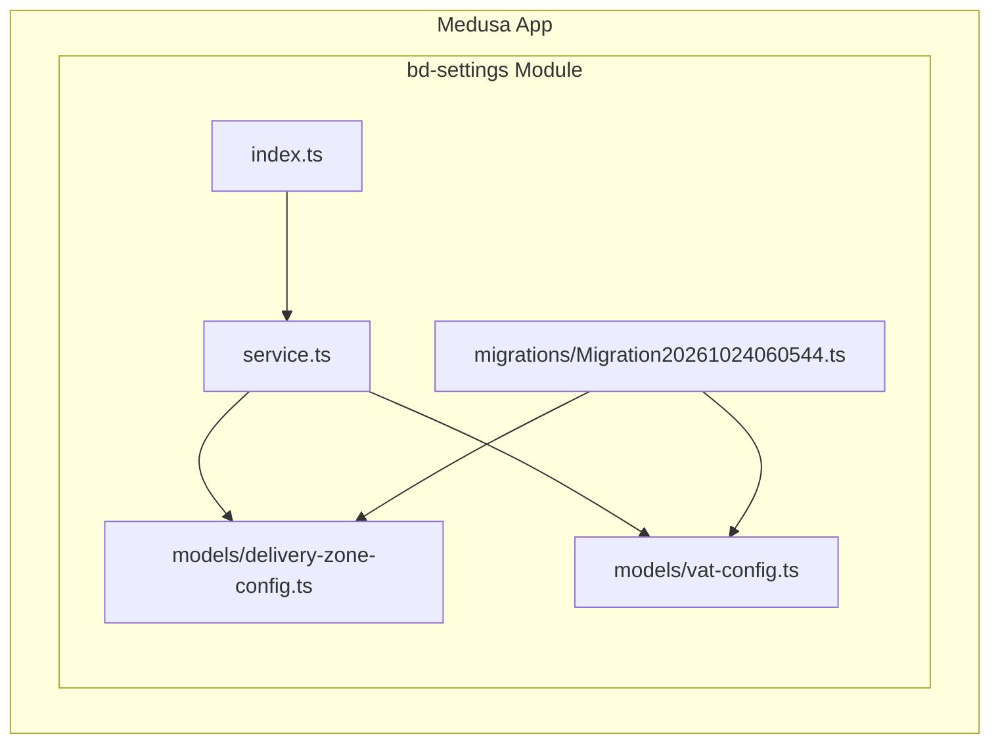
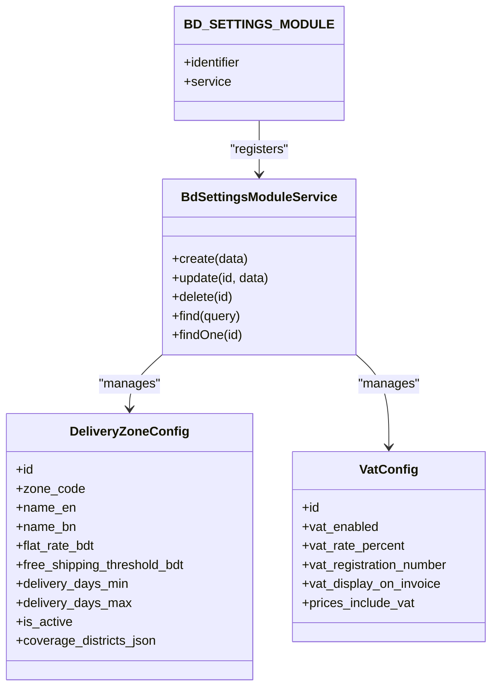
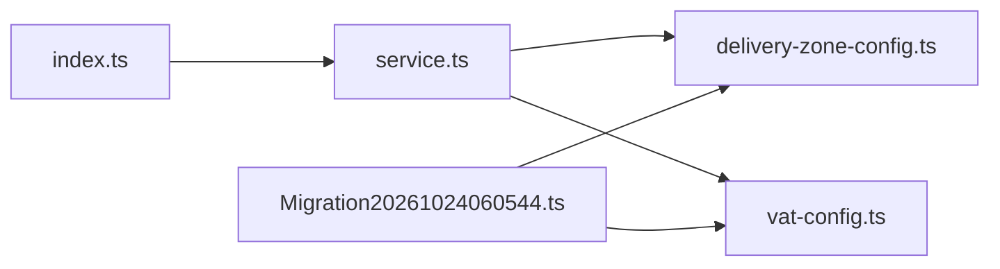

# Settings Management Module

<cite>
**Referenced Files in This Document**   
- [delivery-zone-config.ts](file://apps/medusa/src/modules/bd-settings/models/delivery-zone-config.ts)
- [vat-config.ts](file://apps/medusa/src/modules/bd-settings/models/vat-config.ts)
- [service.ts](file://apps/medusa/src/modules/bd-settings/service.ts)
- [index.ts](file://apps/medusa/src/modules/bd-settings/index.ts)
- [Migration20261024060544.ts](file://apps/medusa/src/modules/bd-settings/migrations/Migration20261024060544.ts)
</cite>

## Table of Contents
1. [Introduction](#introduction)
2. [Project Structure](#project-structure)
3. [Core Components](#core-components)
4. [Architecture Overview](#architecture-overview)
5. [Detailed Component Analysis](#detailed-component-analysis)
6. [Dependency Analysis](#dependency-analysis)
7. [Performance Considerations](#performance-considerations)
8. [Troubleshooting Guide](#troubleshooting-guide)
9. [Conclusion](#conclusion)

## Introduction
This document describes the Settings Management Module responsible for:
- Delivery zone configuration covering Bangladesh (inside Dhaka, Dhaka suburbs, and outside Dhaka).
- VAT and tax settings to ensure compliance with local requirements.
- System preference management through a Medusa module service.

The module defines domain models for delivery zones and VAT configuration, exposes a service layer for CRUD operations, and includes database migrations that enforce constraints and indexes.

## Project Structure
The Settings Management Module is implemented under the Medusa application as a feature module:
- Models define the data schema for delivery zones and VAT configuration.
- The module index registers the module and its service.
- A migration creates tables, constraints, and indexes.

**Diagram sources**
- [index.ts:1-9](file://apps/medusa/src/modules/bd-settings/index.ts#L1-L9)
- [service.ts:1-11](file://apps/medusa/src/modules/bd-settings/service.ts#L1-L11)
- [delivery-zone-config.ts:1-17](file://apps/medusa/src/modules/bd-settings/models/delivery-zone-config.ts#L1-L17)
- [vat-config.ts:1-13](file://apps/medusa/src/modules/bd-settings/models/vat-config.ts#L1-L13)
- [Migration20261024060544.ts:1-22](file://apps/medusa/src/modules/bd-settings/migrations/Migration20261024060544.ts#L1-L22)

**Section sources**
- [index.ts:1-9](file://apps/medusa/src/modules/bd-settings/index.ts#L1-L9)
- [service.ts:1-11](file://apps/medusa/src/modules/bd-settings/service.ts#L1-L11)

## Core Components
- DeliveryZoneConfig model: Represents delivery zones across Bangladesh with rates, thresholds, delivery windows, activity flags, and coverage districts.
- VatConfig model: Stores VAT enablement, rate, registration number, display preferences, and pricing behavior.
- BdSettingsModuleService: Provides standard CRUD operations over both models via Medusa’s service base.
- Module registration: Exposes the module identifier and wires the service.

Key responsibilities:
- Define strongly-typed configuration entities.
- Provide a service interface for reading and writing settings.
- Ensure database schema consistency via migrations.

**Section sources**
- [delivery-zone-config.ts:1-17](file://apps/medusa/src/modules/bd-settings/models/delivery-zone-config.ts#L1-L17)
- [vat-config.ts:1-13](file://apps/medusa/src/modules/bd-settings/models/vat-config.ts#L1-L13)
- [service.ts:1-11](file://apps/medusa/src/modules/bd-settings/service.ts#L1-L11)
- [index.ts:1-9](file://apps/medusa/src/modules/bd-settings/index.ts#L1-L9)

## Architecture Overview
The module follows a layered approach:
- Data Layer: Migrations create tables and constraints.
- Domain Layer: Models define entity schemas.
- Service Layer: Service extends Medusa’s base to expose CRUD methods.
- Integration Layer: Module index registers the service and module ID.

**Diagram sources**
- [delivery-zone-config.ts:1-17](file://apps/medusa/src/modules/bd-settings/models/delivery-zone-config.ts#L1-L17)
- [vat-config.ts:1-13](file://apps/medusa/src/modules/bd-settings/models/vat-config.ts#L1-L13)
- [service.ts:1-11](file://apps/medusa/src/modules/bd-settings/service.ts#L1-L11)
- [index.ts:1-9](file://apps/medusa/src/modules/bd-settings/index.ts#L1-L9)

## Detailed Component Analysis

### Delivery Zone Configuration
Purpose:
- Configure nationwide delivery zones for Bangladesh.
- Support flat-rate shipping, free shipping thresholds, delivery time windows, and district-level coverage.

Domain model highlights:
- Zone code enumeration ensures consistent zone definitions: inside Dhaka, Dhaka suburbs, and outside Dhaka.
- Numeric fields store BDT-based rates and thresholds.
- Delivery window fields define minimum and maximum delivery days.
- Activity flag controls whether a zone is active.
- Coverage districts stored as JSON for flexible district lists.

Validation and integrity:
- Database migration enforces zone_code values via a check constraint.
- Unique index on zone_code prevents duplicate zones.
- Soft delete support via deleted_at column.

Operational guidance:
- Create one record per zone code.
- Use coverage_districts_json to list applicable districts.
- Keep is_active true only for operational zones.

Example configuration scenarios:
- Inside Dhaka: lower delivery days, moderate flat rate, specific districts.
- Dhaka Suburbs: slightly higher delivery days and rate.
- Outside Dhaka: broader coverage, longer delivery window, higher threshold for free shipping.

**Section sources**
- [delivery-zone-config.ts:1-17](file://apps/medusa/src/modules/bd-settings/models/delivery-zone-config.ts#L1-L17)
- [Migration20261024060544.ts:5-12](file://apps/medusa/src/modules/bd-settings/migrations/Migration20261024060544.ts#L5-L12)

### VAT Configuration
Purpose:
- Manage VAT compliance settings including enablement, rate, registration number, invoice display, and pricing behavior.

Domain model highlights:
- vat_enabled toggles VAT calculation.
- vat_rate_percent stores the percentage applied.
- vat_registration_number captures legal registration details.
- vat_display_on_invoice controls visibility on invoices.
- prices_include_vat indicates whether displayed prices include VAT.

Compliance considerations:
- Ensure vat_rate_percent aligns with current regulations.
- Maintain accurate vat_registration_number for invoicing and reporting.
- Use prices_include_vat consistently across storefront pricing.

Example setup steps:
- Enable VAT and set the correct rate.
- Add the registration number for official invoices.
- Decide whether prices include VAT and adjust display accordingly.

**Section sources**
- [vat-config.ts:1-13](file://apps/medusa/src/modules/bd-settings/models/vat-config.ts#L1-L13)
- [Migration20261024060544.ts:11-12](file://apps/medusa/src/modules/bd-settings/migrations/Migration20261024060544.ts#L11-L12)

### Service Layer Implementation
Responsibilities:
- Provide standardized CRUD operations for DeliveryZoneConfig and VatConfig.
- Leverage Medusa’s service base to handle persistence, validation hooks, and lifecycle events.

Usage patterns:
- Read current settings for delivery zones and VAT.
- Update configurations during business rule changes.
- Delete or deactivate records as needed.

Extensibility:
- Override service methods to add custom validation, caching, or audit logging.
- Integrate with other modules by injecting dependencies into the service constructor.

**Section sources**
- [service.ts:1-11](file://apps/medusa/src/modules/bd-settings/service.ts#L1-L11)

### Module Registration
Purpose:
- Register the bd_settings module and bind the service.

Key points:
- Module identifier is exported for configuration and integration.
- Service wiring enables dependency injection throughout the app.

**Section sources**
- [index.ts:1-9](file://apps/medusa/src/modules/bd-settings/index.ts#L1-L9)

## Dependency Analysis
Internal relationships:
- The service depends on both models to provide persistence operations.
- The module index depends on the service to register it within Medusa.
- The migration depends on the models’ schema to create compatible database structures.

External dependencies:
- Medusa framework utilities and ORM migrations.

Potential coupling:
- Tight coupling between service and models; changes to model fields require corresponding updates in usage and validation logic.
- Migration must remain synchronized with model definitions.

**Diagram sources**
- [index.ts:1-9](file://apps/medusa/src/modules/bd-settings/index.ts#L1-L9)
- [service.ts:1-11](file://apps/medusa/src/modules/bd-settings/service.ts#L1-L11)
- [delivery-zone-config.ts:1-17](file://apps/medusa/src/modules/bd-settings/models/delivery-zone-config.ts#L1-L17)
- [vat-config.ts:1-13](file://apps/medusa/src/modules/bd-settings/models/vat-config.ts#L1-L13)
- [Migration20261024060544.ts:1-22](file://apps/medusa/src/modules/bd-settings/migrations/Migration20261024060544.ts#L1-L22)

**Section sources**
- [service.ts:1-11](file://apps/medusa/src/modules/bd-settings/service.ts#L1-L11)
- [index.ts:1-9](file://apps/medusa/src/modules/bd-settings/index.ts#L1-L9)
- [Migration20261024060544.ts:1-22](file://apps/medusa/src/modules/bd-settings/migrations/Migration20261024060544.ts#L1-L22)

## Performance Considerations
Caching strategies:
- Cache frequently accessed settings such as VAT rate and delivery zone rules at the application level using an in-memory cache or external cache provider.
- Implement cache invalidation when settings are updated to avoid stale data.

Indexing and queries:
- Leverage existing unique and soft-delete indexes for efficient lookups.
- Prefer querying by zone_code for delivery zones and single-record reads for VAT configuration.

Optimization tips:
- Batch updates for multiple zone configurations.
- Avoid repeated recalculations by storing derived values where appropriate.

[No sources needed since this section provides general guidance]

## Troubleshooting Guide
Common issues and resolutions:
- Duplicate zone_code errors: Ensure only one active record per zone_code exists; the unique index enforces this.
- Invalid zone_code values: Only allowed values are enforced by the database check constraint.
- VAT misconfiguration: Verify vat_enabled and vat_rate_percent match regulatory requirements; confirm prices_include_vat aligns with storefront pricing strategy.
- Stale cached settings: Invalidate caches after updating settings to prevent inconsistent behavior.

Operational checks:
- Confirm migrations have been applied successfully.
- Validate that is_active flags reflect intended operational status.
- Review coverage_districts_json for completeness and accuracy.

**Section sources**
- [Migration20261024060544.ts:5-12](file://apps/medusa/src/modules/bd-settings/migrations/Migration20261024060544.ts#L5-L12)
- [delivery-zone-config.ts:1-17](file://apps/medusa/src/modules/bd-settings/models/delivery-zone-config.ts#L1-L17)
- [vat-config.ts:1-13](file://apps/medusa/src/modules/bd-settings/models/vat-config.ts#L1-L13)

## Conclusion
The Settings Management Module provides a robust foundation for managing delivery zones across Bangladesh and configuring VAT compliance. Its clear separation of concerns—models, service, and migration—supports maintainability and extensibility. By following the outlined configuration examples and performance recommendations, teams can reliably operate and evolve the system while ensuring compliance and optimal performance.

[No sources needed since this section summarizes without analyzing specific files]