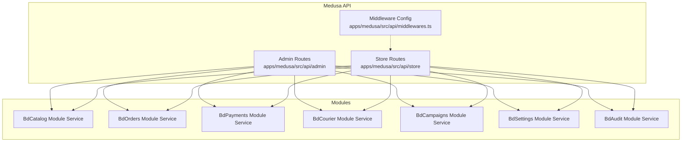
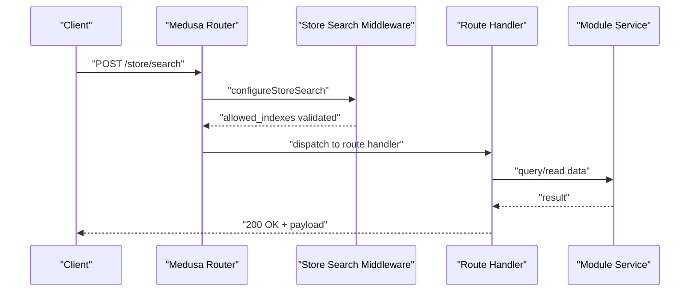
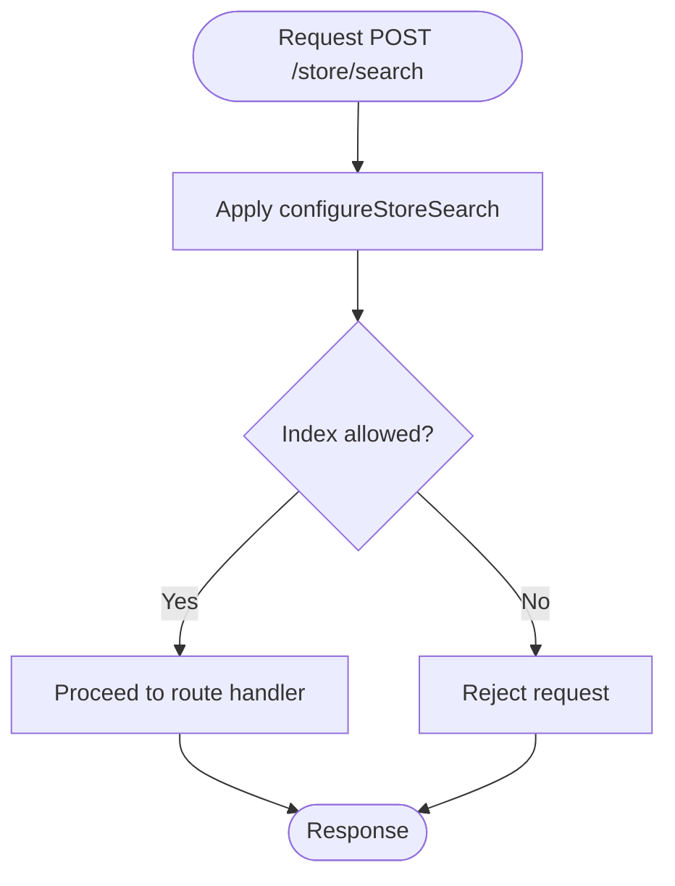
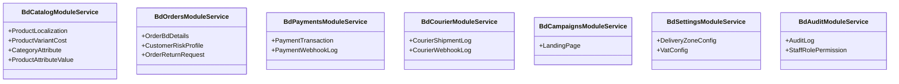
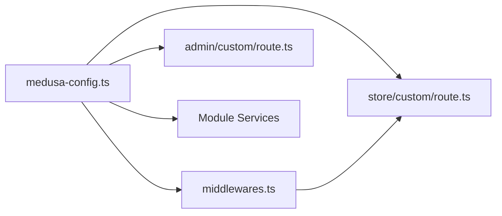

# API Endpoints & Routes

<cite>
**Referenced Files in This Document**
- [medusa-config.ts](file://apps/medusa/medusa-config.ts)
- [middlewares.ts](file://apps/medusa/src/api/middlewares.ts)
- [route.ts (Admin Custom)](file://apps/medusa/src/api/admin/custom/route.ts)
- [route.ts (Store Custom)](file://apps/medusa/src/api/store/custom/route.ts)
- [service.ts (BdCatalogModuleService)](file://apps/medusa/src/modules/bd-catalog/service.ts)
- [service.ts (BdOrdersModuleService)](file://apps/medusa/src/modules/bd-orders/service.ts)
- [service.ts (BdPaymentsModuleService)](file://apps/medusa/src/modules/bd-payments/service.ts)
- [service.ts (BdCourierModuleService)](file://apps/medusa/src/modules/bd-courier/service.ts)
- [service.ts (BdCampaignsModuleService)](file://apps/medusa/src/modules/bd-campaigns/service.ts)
- [service.ts (BdSettingsModuleService)](file://apps/medusa/src/modules/bd-settings/service.ts)
- [service.ts (BdAuditModuleService)](file://apps/medusa/src/modules/bd-audit/service.ts)
</cite>

## Table of Contents
1. [Introduction](#introduction)
2. [Project Structure](#project-structure)
3. [Core Components](#core-components)
4. [Architecture Overview](#architecture-overview)
5. [Detailed Component Analysis](#detailed-component-analysis)
6. [Dependency Analysis](#dependency-analysis)
7. [Performance Considerations](#performance-considerations)
8. [Troubleshooting Guide](#troubleshooting-guide)
9. [Conclusion](#conclusion)

## Introduction
This document describes the API endpoints and routes exposed by the Medusa commerce engine in this repository, focusing on:
- RESTful API patterns for Store and Admin routes
- Request/response schemas and conventions
- Authentication and security configuration
- Middleware behavior and search indexing constraints
- Rate limiting and versioning strategies as implemented or available in this codebase
- Examples of API consumption and integration patterns

The project follows Medusa v2 conventions with custom modules and minimal custom API routes. Most domain logic is encapsulated in module services that expose resource-like operations through Medusa’s framework.

## Project Structure
The API surface is defined under apps/medusa/src/api with two route namespaces:
- Admin routes under apps/medusa/src/api/admin
- Store routes under apps/medusa/src/api/store

Custom middleware for store search is configured centrally.

**Diagram sources**
- [middlewares.ts:1-20](file://apps/medusa/src/api/middlewares.ts#L1-L20)
- [route.ts (Admin Custom):1-9](file://apps/medusa/src/api/admin/custom/route.ts#L1-L9)
- [route.ts (Store Custom):1-9](file://apps/medusa/src/api/store/custom/route.ts#L1-L9)
- [service.ts (BdCatalogModuleService):1-15](file://apps/medusa/src/modules/bd-catalog/service.ts#L1-L15)
- [service.ts (BdOrdersModuleService):1-13](file://apps/medusa/src/modules/bd-orders/service.ts#L1-L13)
- [service.ts (BdPaymentsModuleService):1-11](file://apps/medusa/src/modules/bd-payments/service.ts#L1-L11)
- [service.ts (BdCourierModuleService):1-11](file://apps/medusa/src/modules/bd-courier/service.ts#L1-L11)
- [service.ts (BdCampaignsModuleService):1-9](file://apps/medusa/src/modules/bd-campaigns/service.ts#L1-L9)
- [service.ts (BdSettingsModuleService):1-11](file://apps/medusa/src/modules/bd-settings/service.ts#L1-L11)
- [service.ts (BdAuditModuleService):1-11](file://apps/medusa/src/modules/bd-audit/service.ts#L1-L11)

**Section sources**
- [middlewares.ts:1-20](file://apps/medusa/src/api/middlewares.ts#L1-L20)
- [route.ts (Admin Custom):1-9](file://apps/medusa/src/api/admin/custom/route.ts#L1-L9)
- [route.ts (Store Custom):1-9](file://apps/medusa/src/api/store/custom/route.ts#L1-L9)

## Core Components
- Admin custom endpoint: a simple GET route returning HTTP 200.
- Store custom endpoint: a simple GET route returning HTTP 200.
- Store search middleware: configures allowed indexes for POST /store/search.
- Module services: each module exposes a service class extending MedusaService with its models, enabling standard CRUD-like operations via Medusa’s framework.

Key implementation references:
- Admin custom route handler: [route.ts (Admin Custom):1-9](file://apps/medusa/src/api/admin/custom/route.ts#L1-L9)
- Store custom route handler: [route.ts (Store Custom):1-9](file://apps/medusa/src/api/store/custom/route.ts#L1-L9)
- Store search middleware: [middlewares.ts:1-20](file://apps/medusa/src/api/middlewares.ts#L1-L20)
- Module services:
  - BdCatalogModuleService: [service.ts (BdCatalogModuleService):1-15](file://apps/medusa/src/modules/bd-catalog/service.ts#L1-L15)
  - BdOrdersModuleService: [service.ts (BdOrdersModuleService):1-13](file://apps/medusa/src/modules/bd-orders/service.ts#L1-L13)
  - BdPaymentsModuleService: [service.ts (BdPaymentsModuleService):1-11](file://apps/medusa/src/modules/bd-payments/service.ts#L1-L11)
  - BdCourierModuleService: [service.ts (BdCourierModuleService):1-11](file://apps/medusa/src/modules/bd-courier/service.ts#L1-L11)
  - BdCampaignsModuleService: [service.ts (BdCampaignsModuleService):1-9](file://apps/medusa/src/modules/bd-campaigns/service.ts#L1-L9)
  - BdSettingsModuleService: [service.ts (BdSettingsModuleService):1-11](file://apps/medusa/src/modules/bd-settings/service.ts#L1-L11)
  - BdAuditModuleService: [service.ts (BdAuditModuleService):1-11](file://apps/medusa/src/modules/bd-audit/service.ts#L1-L11)

**Section sources**
- [route.ts (Admin Custom):1-9](file://apps/medusa/src/api/admin/custom/route.ts#L1-L9)
- [route.ts (Store Custom):1-9](file://apps/medusa/src/api/store/custom/route.ts#L1-L9)
- [middlewares.ts:1-20](file://apps/medusa/src/api/middlewares.ts#L1-L20)
- [service.ts (BdCatalogModuleService):1-15](file://apps/medusa/src/modules/bd-catalog/service.ts#L1-L15)
- [service.ts (BdOrdersModuleService):1-13](file://apps/medusa/src/modules/bd-orders/service.ts#L1-L13)
- [service.ts (BdPaymentsModuleService):1-11](file://apps/medusa/src/modules/bd-payments/service.ts#L1-L11)
- [service.ts (BdCourierModuleService):1-11](file://apps/medusa/src/modules/bd-courier/service.ts#L1-L11)
- [service.ts (BdCampaignsModuleService):1-9](file://apps/medusa/src/modules/bd-campaigns/service.ts#L1-L9)
- [service.ts (BdSettingsModuleService):1-11](file://apps/medusa/src/modules/bd-settings/service.ts#L1-L11)
- [service.ts (BdAuditModuleService):1-11](file://apps/medusa/src/modules/bd-audit/service.ts#L1-L11)

## Architecture Overview
The API architecture centers around Medusa’s HTTP layer:
- Route handlers under admin and store namespaces define public endpoints.
- Middleware config restricts and enhances specific routes (e.g., store search).
- Module services provide domain capabilities used by routes and workflows.

**Diagram sources**
- [middlewares.ts:1-20](file://apps/medusa/src/api/middlewares.ts#L1-L20)
- [route.ts (Store Custom):1-9](file://apps/medusa/src/api/store/custom/route.ts#L1-L9)
- [service.ts (BdCatalogModuleService):1-15](file://apps/medusa/src/modules/bd-catalog/service.ts#L1-L15)

## Detailed Component Analysis

### Admin API Endpoints
- GET /admin/custom
  - Method: GET
  - Path: /admin/custom
  - Authentication: Admin authentication required by default for admin routes
  - Request body: None
  - Response: HTTP 200 with empty body
  - Error handling: Framework-level error handling; no custom errors in this route

Usage example:
- curl -X GET http://localhost:9000/admin/custom -H "Authorization: Bearer <admin-token>"

**Section sources**
- [route.ts (Admin Custom):1-9](file://apps/medusa/src/api/admin/custom/route.ts#L1-L9)

### Store API Endpoints
- GET /store/custom
  - Method: GET
  - Path: /store/custom
  - Authentication: Store authentication may be required depending on global store auth settings
  - Request body: None
  - Response: HTTP 200 with empty body
  - Error handling: Framework-level error handling; no custom errors in this route

Usage example:
- curl -X GET http://localhost:9000/store/custom -H "Authorization: Bearer <customer-token>"

**Section sources**
- [route.ts (Store Custom):1-9](file://apps/medusa/src/api/store/custom/route.ts#L1-L9)

### Store Search Middleware
- Endpoint affected: POST /store/search
- Behavior:
  - Applies configureStoreSearch middleware
  - Restricts allowed indexes to product only
- Security considerations:
  - Limits which indexes can be queried via the store search endpoint
- Request/response:
  - Follows Medusa store search conventions (not defined here)
  - Only product index is permitted

**Diagram sources**
- [middlewares.ts:1-20](file://apps/medusa/src/api/middlewares.ts#L1-L20)

**Section sources**
- [middlewares.ts:1-20](file://apps/medusa/src/api/middlewares.ts#L1-L20)

### Module Services Overview
Each module defines a service class extending MedusaService with its models. These services enable standard resource operations through Medusa’s framework. The following modules are registered and their services expose domain entities:

- BdCatalogModuleService
  - Models: ProductLocalization, ProductVariantCost, CategoryAttribute, ProductAttributeValue
  - Purpose: Catalog-related data access and operations
  - Reference: [service.ts (BdCatalogModuleService):1-15](file://apps/medusa/src/modules/bd-catalog/service.ts#L1-L15)

- BdOrdersModuleService
  - Models: OrderBdDetails, CustomerRiskProfile, OrderReturnRequest
  - Purpose: Order-related data access and operations
  - Reference: [service.ts (BdOrdersModuleService):1-13](file://apps/medusa/src/modules/bd-orders/service.ts#L1-L13)

- BdPaymentsModuleService
  - Models: PaymentTransaction, PaymentWebhookLog
  - Purpose: Payment transaction and webhook logging
  - Reference: [service.ts (BdPaymentsModuleService):1-11](file://apps/medusa/src/modules/bd-payments/service.ts#L1-L11)

- BdCourierModuleService
  - Models: CourierShipmentLog, CourierWebhookLog
  - Purpose: Courier shipment and webhook logging
  - Reference: [service.ts (BdCourierModuleService):1-11](file://apps/medusa/src/modules/bd-courier/service.ts#L1-L11)

- BdCampaignsModuleService
  - Models: LandingPage
  - Purpose: Campaign landing page management
  - Reference: [service.ts (BdCampaignsModuleService):1-9](file://apps/medusa/src/modules/bd-campaigns/service.ts#L1-L9)

- BdSettingsModuleService
  - Models: DeliveryZoneConfig, VatConfig
  - Purpose: System settings such as delivery zones and VAT configuration
  - Reference: [service.ts (BdSettingsModuleService):1-11](file://apps/medusa/src/modules/bd-settings/service.ts#L1-L11)

- BdAuditModuleService
  - Models: AuditLog, StaffRolePermission
  - Purpose: Audit logging and staff role permissions
  - Reference: [service.ts (BdAuditModuleService):1-11](file://apps/medusa/src/modules/bd-audit/service.ts#L1-L11)

**Diagram sources**
- [service.ts (BdCatalogModuleService):1-15](file://apps/medusa/src/modules/bd-catalog/service.ts#L1-L15)
- [service.ts (BdOrdersModuleService):1-13](file://apps/medusa/src/modules/bd-orders/service.ts#L1-L13)
- [service.ts (BdPaymentsModuleService):1-11](file://apps/medusa/src/modules/bd-payments/service.ts#L1-L11)
- [service.ts (BdCourierModuleService):1-11](file://apps/medusa/src/modules/bd-courier/service.ts#L1-L11)
- [service.ts (BdCampaignsModuleService):1-9](file://apps/medusa/src/modules/bd-campaigns/service.ts#L1-L9)
- [service.ts (BdSettingsModuleService):1-11](file://apps/medusa/src/modules/bd-settings/service.ts#L1-L11)
- [service.ts (BdAuditModuleService):1-11](file://apps/medusa/src/modules/bd-audit/service.ts#L1-L11)

**Section sources**
- [service.ts (BdCatalogModuleService):1-15](file://apps/medusa/src/modules/bd-catalog/service.ts#L1-L15)
- [service.ts (BdOrdersModuleService):1-13](file://apps/medusa/src/modules/bd-orders/service.ts#L1-L13)
- [service.ts (BdPaymentsModuleService):1-11](file://apps/medusa/src/modules/bd-payments/service.ts#L1-L11)
- [service.ts (BdCourierModuleService):1-11](file://apps/medusa/src/modules/bd-courier/service.ts#L1-L11)
- [service.ts (BdCampaignsModuleService):1-9](file://apps/medusa/src/modules/bd-campaigns/service.ts#L1-L9)
- [service.ts (BdSettingsModuleService):1-11](file://apps/medusa/src/modules/bd-settings/service.ts#L1-L11)
- [service.ts (BdAuditModuleService):1-11](file://apps/medusa/src/modules/bd-audit/service.ts#L1-L11)

## Dependency Analysis
- Configuration:
  - CORS policies for store, admin, and auth are set in medusa-config.ts
  - JWT secret and cookie secret are configured
  - Modules are registered under the modules array
- API routing:
  - Admin and store route directories define endpoints
  - Middleware file configures store search constraints
- Module dependencies:
  - Each module service depends on its models and is registered in the application

**Diagram sources**
- [medusa-config.ts:1-46](file://apps/medusa/medusa-config.ts#L1-L46)
- [middlewares.ts:1-20](file://apps/medusa/src/api/middlewares.ts#L1-L20)
- [route.ts (Admin Custom):1-9](file://apps/medusa/src/api/admin/custom/route.ts#L1-L9)
- [route.ts (Store Custom):1-9](file://apps/medusa/src/api/store/custom/route.ts#L1-L9)

**Section sources**
- [medusa-config.ts:1-46](file://apps/medusa/medusa-config.ts#L1-L46)
- [middlewares.ts:1-20](file://apps/medusa/src/api/middlewares.ts#L1-L20)
- [route.ts (Admin Custom):1-9](file://apps/medusa/src/api/admin/custom/route.ts#L1-L9)
- [route.ts (Store Custom):1-9](file://apps/medusa/src/api/store/custom/route.ts#L1-L9)

## Performance Considerations
- Store search middleware limits allowed indexes to product, reducing query scope and improving performance.
- Using module services centralizes data access and enables consistent querying patterns.
- No explicit rate limiting is configured in the provided files; consider adding rate limiting at the gateway or using Medusa-compatible middleware if needed.

[No sources needed since this section provides general guidance]

## Troubleshooting Guide
- CORS issues:
  - Verify storeCors, adminCors, and authCors values in medusa-config.ts match your frontend origins.
  - Ensure requests include appropriate headers and credentials when required.
- Authentication failures:
  - Confirm JWT_SECRET and COOKIE_SECRET are properly set.
  - Validate tokens are included in Authorization headers for protected routes.
- Store search restrictions:
  - If POST /store/search fails due to index restrictions, ensure queries target the product index only.

**Section sources**
- [medusa-config.ts:1-46](file://apps/medusa/medusa-config.ts#L1-L46)
- [middlewares.ts:1-20](file://apps/medusa/src/api/middlewares.ts#L1-L20)

## Conclusion
This repository implements a Medusa-based commerce engine with:
- Minimal custom API routes for both Admin and Store namespaces
- Store search middleware restricting allowed indexes
- Multiple domain modules exposing services for catalog, orders, payments, courier, campaigns, settings, and audit
- Centralized configuration for CORS, JWT, and module registration

For production readiness, consider:
- Adding comprehensive error handling and validation in route handlers
- Implementing rate limiting and request throttling
- Defining explicit API versioning strategy
- Expanding custom endpoints to cover operational needs across modules

[No sources needed since this section summarizes without analyzing specific files]