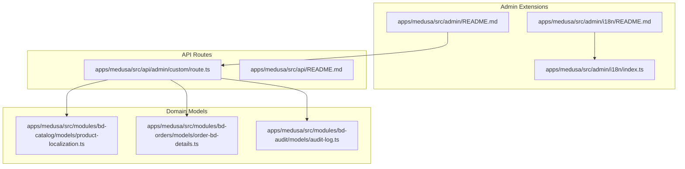
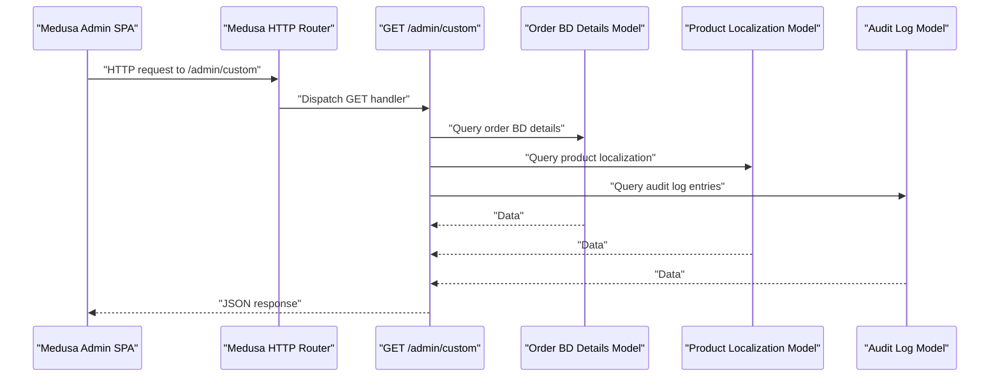
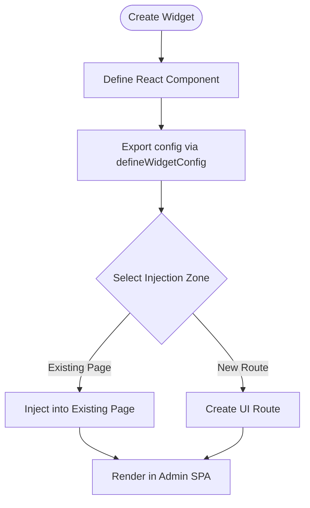
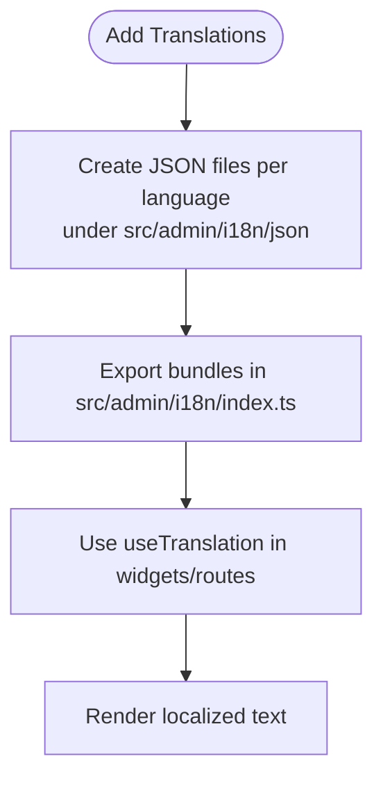
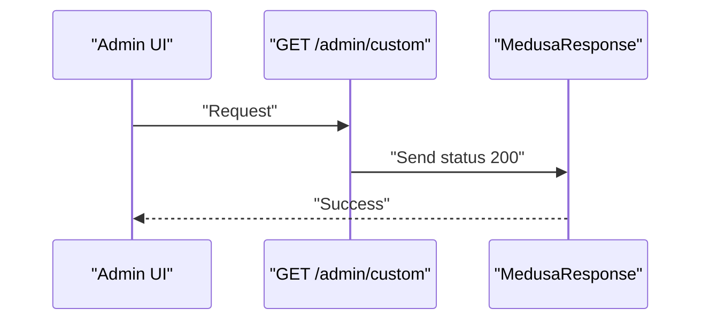
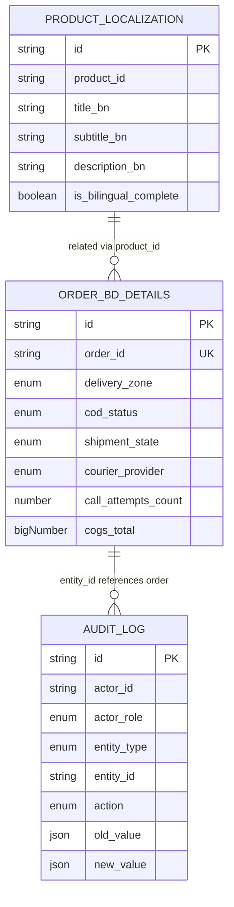
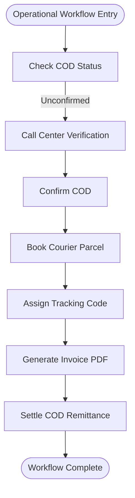
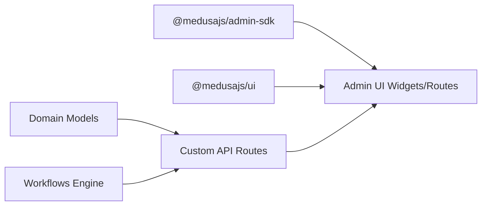

# Admin Panel Customization

<cite>
**Referenced Files in This Document**
- [apps/medusa/src/admin/README.md](file://apps/medusa/src/admin/README.md)
- [apps/medusa/src/admin/i18n/README.md](file://apps/medusa/src/admin/i18n/README.md)
- [apps/medusa/src/admin/i18n/index.ts](file://apps/medusa/src/admin/i18n/index.ts)
- [apps/medusa/src/api/admin/custom/route.ts](file://apps/medusa/src/api/admin/custom/route.ts)
- [apps/medusa/src/api/README.md](file://apps/medusa/src/api/README.md)
- [apps/medusa/src/modules/bd-catalog/models/product-localization.ts](file://apps/medusa/src/modules/bd-catalog/models/product-localization.ts)
- [apps/medusa/src/modules/bd-orders/models/order-bd-details.ts](file://apps/medusa/src/modules/bd-orders/models/order-bd-details.ts)
- [apps/medusa/src/modules/bd-audit/models/audit-log.ts](file://apps/medusa/src/modules/bd-audit/models/audit-log.ts)
- [technical-plan.md](file://technical-plan.md)
- [architecture.md](file://architecture.md)
- [docs/architecture-decision-medusa-v2.md](file://docs/architecture-decision-medusa-v2.md)
- [docs/medusa-admin-reference-audit.md](file://docs/medusa-admin-reference-audit.md)
</cite>

## Table of Contents
1. [Introduction](#introduction)
2. [Project Structure](#project-structure)
3. [Core Components](#core-components)
4. [Architecture Overview](#architecture-overview)
5. [Detailed Component Analysis](#detailed-component-analysis)
6. [Dependency Analysis](#dependency-analysis)
7. [Performance Considerations](#performance-considerations)
8. [Troubleshooting Guide](#troubleshooting-guide)
9. [Conclusion](#conclusion)
10. [Appendices](#appendices)

## Introduction
This document explains how to customize the Medusa admin panel for this project. It covers:
- Using the Medusa Admin SDK and UI primitives
- Creating custom API routes under `/admin`
- Setting up internationalization for admin extensions
- Integrating UI components and widgets
- Extending existing features, creating dashboards, and building operational interfaces
- Adding new entities, modifying workflows, and integrating external systems through the admin interface

The project uses Medusa v2 with an embedded Admin SPA, official `@medusajs/ui` design primitives, and a modular backend with custom modules for Bangladesh-specific commerce operations.

**Section sources**
- [architecture.md:77-124](file://architecture.md#L77-L124)
- [docs/architecture-decision-medusa-v2.md:19-29](file://docs/architecture-decision-medusa-v2.md#L19-L29)

## Project Structure
The relevant customization locations are:
- Admin SDK and translations: `apps/medusa/src/admin`
- Admin API routes: `apps/medusa/src/api/admin/custom`
- Domain models used by admin dashboards: `apps/medusa/src/modules/*`

**Diagram sources**
- [apps/medusa/src/admin/README.md:1-33](file://apps/medusa/src/admin/README.md#L1-L33)
- [apps/medusa/src/admin/i18n/README.md:1-58](file://apps/medusa/src/admin/i18n/README.md#L1-L58)
- [apps/medusa/src/admin/i18n/index.ts:1-1](file://apps/medusa/src/admin/i18n/index.ts#L1-L1)
- [apps/medusa/src/api/admin/custom/route.ts:1-9](file://apps/medusa/src/api/admin/custom/route.ts#L1-L9)
- [apps/medusa/src/api/README.md:1-55](file://apps/medusa/src/api/README.md#L1-L55)
- [apps/medusa/src/modules/bd-catalog/models/product-localization.ts:1-20](file://apps/medusa/src/modules/bd-catalog/models/product-localization.ts#L1-L20)
- [apps/medusa/src/modules/bd-orders/models/order-bd-details.ts:1-42](file://apps/medusa/src/modules/bd-orders/models/order-bd-details.ts#L1-L42)
- [apps/medusa/src/modules/bd-audit/models/audit-log.ts:1-43](file://apps/medusa/src/modules/bd-audit/models/audit-log.ts#L1-L43)

**Section sources**
- [apps/medusa/src/admin/README.md:1-33](file://apps/medusa/src/admin/README.md#L1-L33)
- [apps/medusa/src/api/README.md:1-55](file://apps/medusa/src/api/README.md#L1-L55)

## Core Components
- Admin SDK usage: Widgets and UI routes extend the Medusa Admin SPA. The admin README demonstrates widget creation and configuration via `defineWidgetConfig`.
- Internationalization: Admin i18n is configured using react-i18next. Translation JSON files live under `src/admin/i18n/json`, and the index exports language bundles.
- Custom API routes: File-based routing under `src/api` supports HTTP methods exported from `route.ts`. An example admin route exists at `src/api/admin/custom/route.ts`.
- Domain models: Custom modules define relational schemas consumed by admin dashboards (e.g., product localization, order BD details, audit logs).

Key implementation anchors:
- Widget example and configuration: [apps/medusa/src/admin/README.md:7-31](file://apps/medusa/src/admin/README.md#L7-L31)
- i18n setup and usage pattern: [apps/medusa/src/admin/i18n/README.md:1-58](file://apps/medusa/src/admin/i18n/README.md#L1-L58)
- Admin i18n entry point: [apps/medusa/src/admin/i18n/index.ts:1-1](file://apps/medusa/src/admin/i18n/index.ts#L1-L1)
- Admin API route handler: [apps/medusa/src/api/admin/custom/route.ts:1-9](file://apps/medusa/src/api/admin/custom/route.ts#L1-L9)
- API route documentation: [apps/medusa/src/api/README.md:1-55](file://apps/medusa/src/api/README.md#L1-L55)

**Section sources**
- [apps/medusa/src/admin/README.md:1-33](file://apps/medusa/src/admin/README.md#L1-L33)
- [apps/medusa/src/admin/i18n/README.md:1-58](file://apps/medusa/src/admin/i18n/README.md#L1-L58)
- [apps/medusa/src/admin/i18n/index.ts:1-1](file://apps/medusa/src/admin/i18n/index.ts#L1-L1)
- [apps/medusa/src/api/admin/custom/route.ts:1-9](file://apps/medusa/src/api/admin/custom/route.ts#L1-L9)
- [apps/medusa/src/api/README.md:1-55](file://apps/medusa/src/api/README.md#L1-L55)

## Architecture Overview
The admin panel integrates with the backend through protected `/admin` endpoints and consumes domain data from custom modules.

**Diagram sources**
- [apps/medusa/src/api/admin/custom/route.ts:1-9](file://apps/medusa/src/api/admin/custom/route.ts#L1-L9)
- [apps/medusa/src/modules/bd-orders/models/order-bd-details.ts:1-42](file://apps/medusa/src/modules/bd-orders/models/order-bd-details.ts#L1-L42)
- [apps/medusa/src/modules/bd-catalog/models/product-localization.ts:1-20](file://apps/medusa/src/modules/bd-catalog/models/product-localization.ts#L1-L20)
- [apps/medusa/src/modules/bd-audit/models/audit-log.ts:1-43](file://apps/medusa/src/modules/bd-audit/models/audit-log.ts#L1-L43)

**Section sources**
- [architecture.md:77-124](file://architecture.md#L77-L124)
- [docs/architecture-decision-medusa-v2.md:19-29](file://docs/architecture-decision-medusa-v2.md#L19-L29)

## Detailed Component Analysis

### Admin SDK and Widgets
- Purpose: Inject React components into existing admin pages or create new UI routes.
- Pattern: Export a component and a config object created by `defineWidgetConfig` specifying injection zones.
- Example anchor: Widget definition and zone configuration.

**Diagram sources**
- [apps/medusa/src/admin/README.md:7-31](file://apps/medusa/src/admin/README.md#L7-L31)

**Section sources**
- [apps/medusa/src/admin/README.md:1-33](file://apps/medusa/src/admin/README.md#L1-L33)

### Internationalization Setup
- Purpose: Localize admin extension labels and messages.
- Pattern: Place translation JSON files under `src/admin/i18n/json`, export them from `src/admin/i18n/index.ts`, and use `useTranslation` in widgets/routes.
- Current state: The index file is present but empty; add language bundles there.

**Diagram sources**
- [apps/medusa/src/admin/i18n/README.md:1-58](file://apps/medusa/src/admin/i18n/README.md#L1-L58)
- [apps/medusa/src/admin/i18n/index.ts:1-1](file://apps/medusa/src/admin/i18n/index.ts#L1-L1)

**Section sources**
- [apps/medusa/src/admin/i18n/README.md:1-58](file://apps/medusa/src/admin/i18n/README.md#L1-L58)
- [apps/medusa/src/admin/i18n/index.ts:1-1](file://apps/medusa/src/admin/i18n/index.ts#L1-L1)

### Custom API Routes Under /admin
- Purpose: Provide backend endpoints for admin UIs and operational tools.
- Pattern: File-based routing under `src/api`; each route file exports HTTP method handlers.
- Example: Admin route returning a simple success response.

**Diagram sources**
- [apps/medusa/src/api/admin/custom/route.ts:1-9](file://apps/medusa/src/api/admin/custom/route.ts#L1-L9)
- [apps/medusa/src/api/README.md:1-55](file://apps/medusa/src/api/README.md#L1-L55)

**Section sources**
- [apps/medusa/src/api/admin/custom/route.ts:1-9](file://apps/medusa/src/api/admin/custom/route.ts#L1-L9)
- [apps/medusa/src/api/README.md:1-55](file://apps/medusa/src/api/README.md#L1-L55)

### Data Models Used by Admin Dashboards
- Product localization model: Stores Bangla fields and bilingual completeness flag for products.
- Order BD details model: Tracks COD workflow states, courier logistics, costs, and marketing attribution.
- Audit log model: Records actor actions across entities for compliance and security.

**Diagram sources**
- [apps/medusa/src/modules/bd-catalog/models/product-localization.ts:1-20](file://apps/medusa/src/modules/bd-catalog/models/product-localization.ts#L1-L20)
- [apps/medusa/src/modules/bd-orders/models/order-bd-details.ts:1-42](file://apps/medusa/src/modules/bd-orders/models/order-bd-details.ts#L1-L42)
- [apps/medusa/src/modules/bd-audit/models/audit-log.ts:1-43](file://apps/medusa/src/modules/bd-audit/models/audit-log.ts#L1-L43)

**Section sources**
- [apps/medusa/src/modules/bd-catalog/models/product-localization.ts:1-20](file://apps/medusa/src/modules/bd-catalog/models/product-localization.ts#L1-L20)
- [apps/medusa/src/modules/bd-orders/models/order-bd-details.ts:1-42](file://apps/medusa/src/modules/bd-orders/models/order-bd-details.ts#L1-L42)
- [apps/medusa/src/modules/bd-audit/models/audit-log.ts:1-43](file://apps/medusa/src/modules/bd-audit/models/audit-log.ts#L1-L43)

### Extending Existing Features and Creating Dashboards
- Widgets can be injected into existing pages to augment functionality (e.g., adding badges, quick actions, or analytics).
- New UI routes can provide dedicated dashboards for operational tasks such as COD queue management, courier manifests, returns, content editing, and invoices.
- The reference audit confirms that all required UX patterns (tables, drawers, modals, badges) are supported by `@medusajs/ui`.

Recommended approach:
- Use widgets to enhance existing screens where appropriate.
- Create dedicated UI routes for complex operational flows requiring multiple steps and confirmations.

**Section sources**
- [apps/medusa/src/admin/README.md:1-33](file://apps/medusa/src/admin/README.md#L1-L33)
- [docs/medusa-admin-reference-audit.md:194-208](file://docs/medusa-admin-reference-audit.md#L194-L208)
- [docs/medusa-admin-reference-audit.md:253-264](file://docs/medusa-admin-reference-audit.md#L253-L264)

### Implementing Operational Interfaces
Operational interfaces should reflect real business workflows:
- COD confirmation flow: Track attempts, notes, and escalation states.
- Courier dispatch flow: Book parcels, assign tracking codes, and manage settlement.
- Audit trail: Record staff actions and system events for accountability.

**Diagram sources**
- [apps/medusa/src/modules/bd-orders/models/order-bd-details.ts:1-42](file://apps/medusa/src/modules/bd-orders/models/order-bd-details.ts#L1-L42)
- [docs/architecture-decision-medusa-v2.md:24-29](file://docs/architecture-decision-medusa-v2.md#L24-L29)

**Section sources**
- [apps/medusa/src/modules/bd-orders/models/order-bd-details.ts:1-42](file://apps/medusa/src/modules/bd-orders/models/order-bd-details.ts#L1-L42)
- [docs/architecture-decision-medusa-v2.md:24-29](file://docs/architecture-decision-medusa-v2.md#L24-L29)

### Adding New Entities and Modifying Workflows
- Add new entities using Medusa’s Data Modeling Language (`model.define`) within custom modules.
- Integrate with workflows for transactional pipelines, ensuring compensation on failures.
- Reference example shows product localization schema structure.

Implementation anchors:
- DML example and module structure: [technical-plan.md:150-171](file://technical-plan.md#L150-L171)
- Product localization model: [apps/medusa/src/modules/bd-catalog/models/product-localization.ts:1-20](file://apps/medusa/src/modules/bd-catalog/models/product-localization.ts#L1-L20)

**Section sources**
- [technical-plan.md:150-171](file://technical-plan.md#L150-L171)
- [apps/medusa/src/modules/bd-catalog/models/product-localization.ts:1-20](file://apps/medusa/src/modules/bd-catalog/models/product-localization.ts#L1-L20)

### Integrating with External Systems Through the Admin Interface
- Admin dashboards can trigger external integrations (payment gateways, courier APIs, SMS providers) via admin UI actions backed by API routes and workflows.
- Ensure signatures/HMAC verification for webhooks and secure server-to-server calls.

Integration anchors:
- External integration layer overview: [architecture.md:120-124](file://architecture.md#L120-L124)
- Workflow engine emphasis for transactional pipelines: [docs/architecture-decision-medusa-v2.md:24-29](file://docs/architecture-decision-medusa-v2.md#L24-L29)

**Section sources**
- [architecture.md:120-124](file://architecture.md#L120-L124)
- [docs/architecture-decision-medusa-v2.md:24-29](file://docs/architecture-decision-medusa-v2.md#L24-L29)

## Dependency Analysis
The admin customization depends on:
- Admin SDK and UI primitives for rendering and interaction
- API routes for data access and operations
- Domain models for structured data
- Workflows for reliable multi-step processes

**Diagram sources**
- [apps/medusa/src/admin/README.md:1-33](file://apps/medusa/src/admin/README.md#L1-L33)
- [apps/medusa/src/api/admin/custom/route.ts:1-9](file://apps/medusa/src/api/admin/custom/route.ts#L1-L9)
- [apps/medusa/src/modules/bd-orders/models/order-bd-details.ts:1-42](file://apps/medusa/src/modules/bd-orders/models/order-bd-details.ts#L1-L42)
- [docs/architecture-decision-medusa-v2.md:24-29](file://docs/architecture-decision-medusa-v2.md#L24-L29)

**Section sources**
- [apps/medusa/src/admin/README.md:1-33](file://apps/medusa/src/admin/README.md#L1-L33)
- [apps/medusa/src/api/admin/custom/route.ts:1-9](file://apps/medusa/src/api/admin/custom/route.ts#L1-L9)
- [apps/medusa/src/modules/bd-orders/models/order-bd-details.ts:1-42](file://apps/medusa/src/modules/bd-orders/models/order-bd-details.ts#L1-L42)
- [docs/architecture-decision-medusa-v2.md:24-29](file://docs/architecture-decision-medusa-v2.md#L24-L29)

## Performance Considerations
- Prefer efficient queries and pagination when exposing large datasets in admin dashboards.
- Cache read-heavy data where appropriate and invalidate caches on mutations.
- Keep API routes lightweight; offload heavy processing to workflows or background jobs.
- Use audit logs judiciously to avoid excessive write overhead.

[No sources needed since this section provides general guidance]

## Troubleshooting Guide
Common issues and resolutions:
- i18n not loading: Ensure translation JSON files exist and are exported from `src/admin/i18n/index.ts`.
- Widget not appearing: Verify the injection zone matches the target page and the widget config is correctly exported.
- API route not responding: Confirm the route file name is `route.ts` and the correct HTTP method is exported.
- Data mismatch: Validate model fields and relationships against the expected admin payload.

Actionable anchors:
- i18n setup guide: [apps/medusa/src/admin/i18n/README.md:1-58](file://apps/medusa/src/admin/i18n/README.md#L1-L58)
- Widget example: [apps/medusa/src/admin/README.md:7-31](file://apps/medusa/src/admin/README.md#L7-L31)
- API route docs: [apps/medusa/src/api/README.md:1-55](file://apps/medusa/src/api/README.md#L1-L55)

**Section sources**
- [apps/medusa/src/admin/i18n/README.md:1-58](file://apps/medusa/src/admin/i18n/README.md#L1-L58)
- [apps/medusa/src/admin/README.md:1-33](file://apps/medusa/src/admin/README.md#L1-L33)
- [apps/medusa/src/api/README.md:1-55](file://apps/medusa/src/api/README.md#L1-L55)

## Conclusion
This project leverages Medusa v2’s Admin SDK, UI primitives, and modular architecture to deliver a robust, extensible admin panel. By following the documented patterns for widgets, i18n, API routes, and domain models, teams can build high-density operational interfaces aligned with the reference admin experience while maintaining clean separation of concerns and reliable workflows.

[No sources needed since this section summarizes without analyzing specific files]

## Appendices
- Admin UI design system reference: [docs/medusa-admin-reference-audit.md:194-208](file://docs/medusa-admin-reference-audit.md#L194-L208)
- Summary of admin capabilities: [docs/medusa-admin-reference-audit.md:253-264](file://docs/medusa-admin-reference-audit.md#L253-L264)

**Section sources**
- [docs/medusa-admin-reference-audit.md:194-208](file://docs/medusa-admin-reference-audit.md#L194-L208)
- [docs/medusa-admin-reference-audit.md:253-264](file://docs/medusa-admin-reference-audit.md#L253-L264)