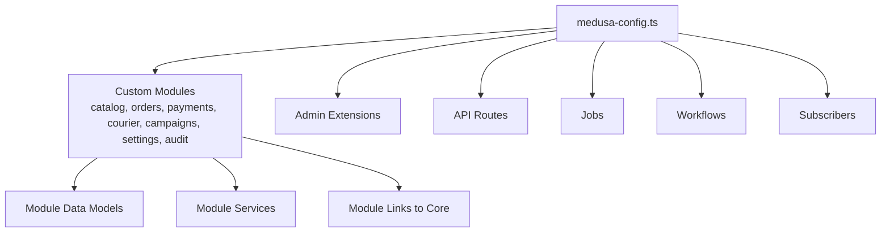
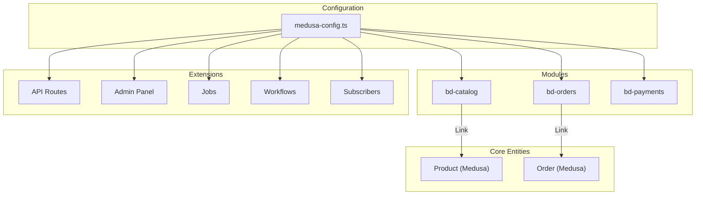
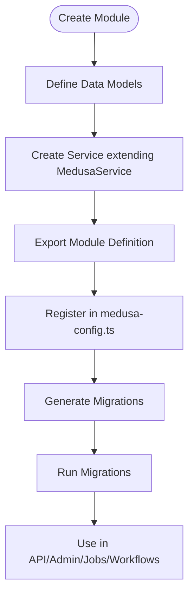
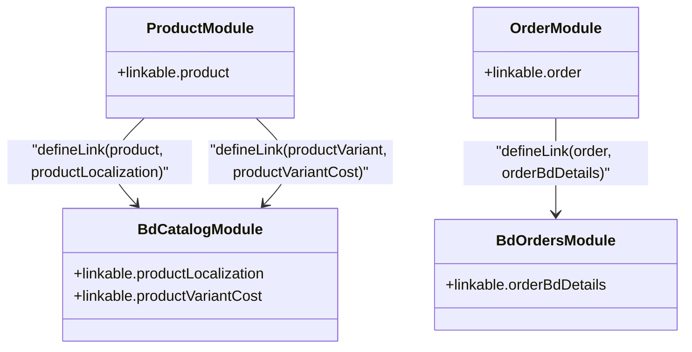
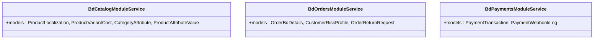
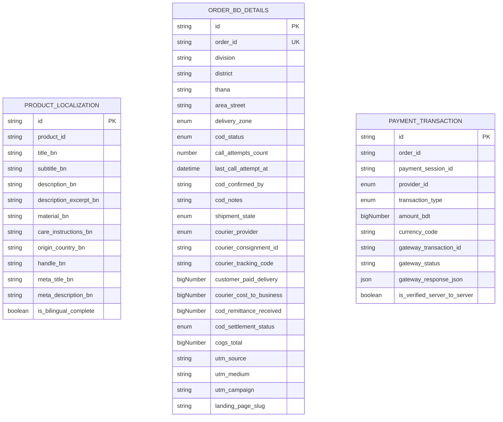
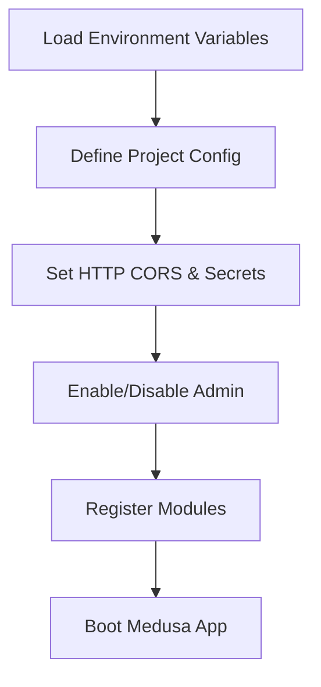
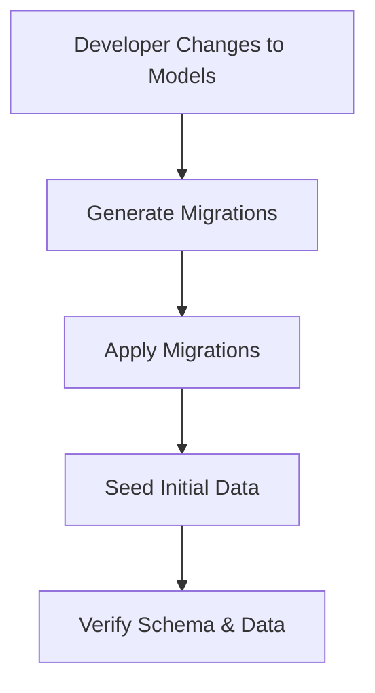
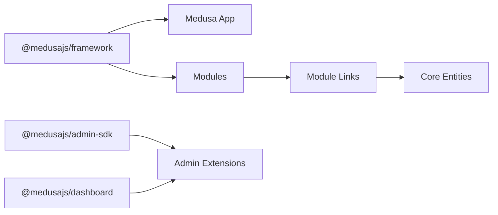

# Commerce Engine (apps/medusa)

<cite>
**Referenced Files in This Document**
- [README.md](file://apps/medusa/README.md)
- [package.json](file://apps/medusa/package.json)
- [medusa-config.ts](file://apps/medusa/medusa-config.ts)
- [modules README.md](file://apps/medusa/src/modules/README.md)
- [links README.md](file://apps/medusa/src/links/README.md)
- [bd-catalog/index.ts](file://apps/medusa/src/modules/bd-catalog/index.ts)
- [bd-catalog/service.ts](file://apps/medusa/src/modules/bd-catalog/service.ts)
- [product-localization model](file://apps/medusa/src/modules/bd-catalog/models/product-localization.ts)
- [bd-orders/index.ts](file://apps/medusa/src/modules/bd-orders/index.ts)
- [bd-orders/service.ts](file://apps/medusa/src/modules/bd-orders/service.ts)
- [order-bd-details model](file://apps/medusa/src/modules/bd-orders/models/order-bd-details.ts)
- [bd-payments/index.ts](file://apps/medusa/src/modules/bd-payments/index.ts)
- [bd-payments/service.ts](file://apps/medusa/src/modules/bd-payments/service.ts)
- [payment-transaction model](file://apps/medusa/src/modules/bd-payments/models/payment-transaction.ts)
- [order-bd-details link](file://apps/medusa/src/links/order-bd-details.ts)
- [product-localization link](file://apps/medusa/src/links/product-localization.ts)
- [product-variant-cost link](file://apps/medusa/src/links/product-variant-cost.ts)
</cite>

## Table of Contents
1. [Introduction](#introduction)
2. [Project Structure](#project-structure)
3. [Core Components](#core-components)
4. [Architecture Overview](#architecture-overview)
5. [Detailed Component Analysis](#detailed-component-analysis)
6. [Dependency Analysis](#dependency-analysis)
7. [Performance Considerations](#performance-considerations)
8. [Troubleshooting Guide](#troubleshooting-guide)
9. [Conclusion](#conclusion)
10. [Appendices](#appendices)

## Introduction
This document explains the MedusaJS v2 commerce engine implementation under apps/medusa. It focuses on the module system architecture, custom module development patterns, extension mechanisms via links, configuration structure, service layer design, admin panel integration points, workflow and event handling locations, database schema management through migrations, and testing setup. The goal is to make the system understandable for both developers and non-technical stakeholders while providing precise references to source files.

The project follows Medusa’s modular architecture: each business capability is encapsulated in a module with its own models, services, migrations, and optional links to core modules. Configuration is centralized in medusa-config.ts, and the application exposes API routes, admin extensions, jobs, workflows, and subscribers as extension points.

**Section sources**
- [README.md:35-49](file://apps/medusa/README.md#L35-L49)

## Project Structure
At a high level, the Medusa app includes:
- Application configuration and dependencies
- Custom modules for catalog, orders, payments, courier, campaigns, settings, and audit
- Links that associate core Medusa entities with custom data models
- Admin and API route scaffolding for customization
- Jobs, workflows, subscribers, and scripts for background processing and seeding

**Diagram sources**
- [medusa-config.ts:7-45](file://apps/medusa/medusa-config.ts#L7-L45)
- [modules README.md:1-118](file://apps/medusa/src/modules/README.md#L1-L118)
- [links README.md:1-26](file://apps/medusa/src/links/README.md#L1-L26)

**Section sources**
- [medusa-config.ts:7-45](file://apps/medusa/medusa-config.ts#L7-L45)
- [package.json:15-24](file://apps/medusa/package.json#L15-L24)

## Core Components
- Module definitions: Each module exports a default definition that registers a service and module name. Examples include bd-catalog, bd-orders, and bd-payments.
- Service classes: Extend MedusaService with declared models to expose CRUD operations and domain logic.
- Data models: Define tables using the framework’s model DSL, including enums, indexes, searchability, defaults, and JSON fields.
- Links: Associate core Medusa entities (e.g., Product, Order) with custom models while preserving module isolation.

Key responsibilities:
- Catalog module: Adds product localization and variant cost tracking.
- Orders module: Stores Bangladesh-specific order details, delivery zones, COD status, and logistics metadata.
- Payments module: Records payment transactions and webhook logs with provider and verification flags.

**Section sources**
- [bd-catalog/index.ts:1-9](file://apps/medusa/src/modules/bd-catalog/index.ts#L1-L9)
- [bd-catalog/service.ts:1-15](file://apps/medusa/src/modules/bd-catalog/service.ts#L1-L15)
- [product-localization model:1-20](file://apps/medusa/src/modules/bd-catalog/models/product-localization.ts#L1-L20)
- [bd-orders/index.ts:1-9](file://apps/medusa/src/modules/bd-orders/index.ts#L1-L9)
- [bd-orders/service.ts:1-13](file://apps/medusa/src/modules/bd-orders/service.ts#L1-L13)
- [order-bd-details model:1-42](file://apps/medusa/src/modules/bd-orders/models/order-bd-details.ts#L1-L42)
- [bd-payments/index.ts:1-9](file://apps/medusa/src/modules/bd-payments/index.ts#L1-L9)
- [bd-payments/service.ts:1-11](file://apps/medusa/src/modules/bd-payments/service.ts#L1-L11)
- [payment-transaction model:1-18](file://apps/medusa/src/modules/bd-payments/models/payment-transaction.ts#L1-L18)

## Architecture Overview
The system uses Medusa’s module system to isolate business domains. Configuration wires modules into the application. Links connect core entities to custom models without direct coupling. Extension points (API routes, admin, jobs, workflows, subscribers) allow customization around these modules.

**Diagram sources**
- [medusa-config.ts:22-44](file://apps/medusa/medusa-config.ts#L22-L44)
- [product-localization link:1-9](file://apps/medusa/src/links/product-localization.ts#L1-L9)
- [order-bd-details link:1-9](file://apps/medusa/src/links/order-bd-details.ts#L1-L9)

## Detailed Component Analysis

### Module System and Custom Module Development
- Module definition pattern: Export a named constant for the module ID and a default Module registration with the service class.
- Service pattern: Extend MedusaService with all models belonging to the module to enable automatic repository methods and query helpers.
- Model pattern: Use the framework’s model DSL to define fields, types, indexes, defaults, and searchability.
- Registration: Add each module to the modules array in medusa-config.ts.
- Migrations: Generate and run migrations per module to create or update database tables.

**Diagram sources**
- [modules README.md:7-90](file://apps/medusa/src/modules/README.md#L7-L90)
- [medusa-config.ts:22-44](file://apps/medusa/medusa-config.ts#L22-L44)

**Section sources**
- [modules README.md:1-118](file://apps/medusa/src/modules/README.md#L1-L118)
- [medusa-config.ts:22-44](file://apps/medusa/medusa-config.ts#L22-L44)

### Module Links and Inter-Module Associations
Links establish associations between core Medusa entities and custom models while maintaining module isolation. Examples:
- Product ↔ ProductLocalization
- Order ↔ OrderBdDetails
- ProductVariant ↔ ProductVariantCost

**Diagram sources**
- [product-localization link:1-9](file://apps/medusa/src/links/product-localization.ts#L1-L9)
- [product-variant-cost link:1-9](file://apps/medusa/src/links/product-variant-cost.ts#L1-L9)
- [order-bd-details link:1-9](file://apps/medusa/src/links/order-bd-details.ts#L1-L9)

**Section sources**
- [links README.md:1-26](file://apps/medusa/src/links/README.md#L1-L26)
- [product-localization link:1-9](file://apps/medusa/src/links/product-localization.ts#L1-L9)
- [product-variant-cost link:1-9](file://apps/medusa/src/links/product-variant-cost.ts#L1-L9)
- [order-bd-details link:1-9](file://apps/medusa/src/links/order-bd-details.ts#L1-L9)

### Service Layer Implementation
Each module provides a service class that extends MedusaService with its models. This enables consistent CRUD operations and composable queries across modules.

**Diagram sources**
- [bd-catalog/service.ts:1-15](file://apps/medusa/src/modules/bd-catalog/service.ts#L1-L15)
- [bd-orders/service.ts:1-13](file://apps/medusa/src/modules/bd-orders/service.ts#L1-L13)
- [bd-payments/service.ts:1-11](file://apps/medusa/src/modules/bd-payments/service.ts#L1-L11)

**Section sources**
- [bd-catalog/service.ts:1-15](file://apps/medusa/src/modules/bd-catalog/service.ts#L1-L15)
- [bd-orders/service.ts:1-13](file://apps/medusa/src/modules/bd-orders/service.ts#L1-L13)
- [bd-payments/service.ts:1-11](file://apps/medusa/src/modules/bd-payments/service.ts#L1-L11)

### Data Models and Schema Characteristics
- ProductLocalization: Provides Bengali-language fields for product titles, descriptions, handles, and SEO metadata; includes searchable text and boolean completeness flag.
- OrderBdDetails: Captures Bangladesh-specific logistics and financial attributes such as division/district/thana, delivery zone, COD status, call attempts, courier provider, tracking codes, delivery fees, COGS, and UTM parameters.
- PaymentTransaction: Tracks payment sessions, providers (COD, bKash, Nagad), transaction types, gateway responses, and server-to-server verification flags.

**Diagram sources**
- [product-localization model:1-20](file://apps/medusa/src/modules/bd-catalog/models/product-localization.ts#L1-L20)
- [order-bd-details model:1-42](file://apps/medusa/src/modules/bd-orders/models/order-bd-details.ts#L1-L42)
- [payment-transaction model:1-18](file://apps/medusa/src/modules/bd-payments/models/payment-transaction.ts#L1-L18)

**Section sources**
- [product-localization model:1-20](file://apps/medusa/src/modules/bd-catalog/models/product-localization.ts#L1-L20)
- [order-bd-details model:1-42](file://apps/medusa/src/modules/bd-orders/models/order-bd-details.ts#L1-L42)
- [payment-transaction model:1-18](file://apps/medusa/src/modules/bd-payments/models/payment-transaction.ts#L1-L18)

### Configuration Structure and Plugin System
- Project configuration loads environment variables and sets HTTP CORS policies, JWT secret, and cookie secret.
- Admin panel can be enabled/disabled.
- Modules are registered by path, enabling the framework to discover services and models.

**Diagram sources**
- [medusa-config.ts:1-18](file://apps/medusa/medusa-config.ts#L1-L18)
- [medusa-config.ts:19-45](file://apps/medusa/medusa-config.ts#L19-L45)

**Section sources**
- [medusa-config.ts:1-45](file://apps/medusa/medusa-config.ts#L1-L45)

### Admin Panel Customization Capabilities
- Admin SDK and dashboard packages are included as dependencies, indicating support for building custom admin features.
- The admin directory contains i18n and Vite-related configuration, suggesting extensibility for localized admin UIs and build tooling.

**Section sources**
- [package.json:25-38](file://apps/medusa/package.json#L25-L38)
- [admin i18n index](file://apps/medusa/src/admin/i18n/index.ts)

### Workflow Definitions and Event Handling Patterns
- Workflows directory exists for defining multi-step processes.
- Subscribers directory exists for event-driven reactions.
- These directories provide hooks for orchestrating state transitions and reacting to domain events.

**Section sources**
- [workflows README](file://apps/medusa/src/workflows/README.md)
- [subscribers README](file://apps/medusa/src/subscribers/README.md)

### Database Schema Management, Migration Strategies, and Data Seeding
- Migrations are generated per module and applied via CLI commands documented in the modules guide.
- Migration scripts and seeders exist under migration-scripts and scripts directories for initial data and demo products.

**Diagram sources**
- [modules README.md:78-90](file://apps/medusa/src/modules/README.md#L78-L90)
- [initial-data-seed script](file://apps/medusa/src/migration-scripts/initial-data-seed.ts)
- [seed-demo-products script](file://apps/medusa/src/scripts/seed-demo-products.ts)

**Section sources**
- [modules README.md:78-90](file://apps/medusa/src/modules/README.md#L78-L90)
- [initial-data-seed script](file://apps/medusa/src/migration-scripts/initial-data-seed.ts)
- [seed-demo-products script](file://apps/medusa/src/scripts/seed-demo-products.ts)

### Testing Approaches
- Jest-based test runner configured for unit and integration tests.
- Scripts distinguish between HTTP integration tests and module integration tests.
- Test utilities and SWC transpilation are included for efficient test execution.

**Section sources**
- [package.json:15-24](file://apps/medusa/package.json#L15-L24)
- [jest.config.js](file://apps/medusa/jest.config.js)

### Debugging Techniques
- Instrumentation file exists for observability and debugging hooks.
- Environment-driven configuration allows toggling debug behavior via environment variables.

**Section sources**
- [instrumentation.ts](file://apps/medusa/instrumentation.ts)
- [medusa-config.ts:1-18](file://apps/medusa/medusa-config.ts#L1-L18)

## Dependency Analysis
The application depends on Medusa core packages and admin/dashboard tooling. Modules are wired via configuration and linked to core entities.

**Diagram sources**
- [package.json:25-38](file://apps/medusa/package.json#L25-L38)
- [product-localization link:1-9](file://apps/medusa/src/links/product-localization.ts#L1-L9)
- [order-bd-details link:1-9](file://apps/medusa/src/links/order-bd-details.ts#L1-L9)

**Section sources**
- [package.json:25-38](file://apps/medusa/package.json#L25-L38)
- [medusa-config.ts:22-44](file://apps/medusa/medusa-config.ts#L22-L44)

## Performance Considerations
- Indexes: Several models define indexes on frequently queried fields (e.g., product_id, order_id, courier_tracking_code, gateway_transaction_id).
- Searchability: Text fields marked searchable improve full-text search performance for localized content.
- Big numbers: Financial amounts use bigNumber types to avoid precision issues.
- Enumerations: Enums constrain values and reduce validation overhead.

Recommendations:
- Ensure appropriate composite indexes where queries filter on multiple columns.
- Use pagination and selective field projection in API endpoints.
- Cache read-heavy catalog data at the application layer if needed.

[No sources needed since this section provides general guidance]

## Troubleshooting Guide
Common issues and resolutions:
- Module not found: Verify module paths in medusa-config.ts match actual directories.
- Migration errors: Regenerate migrations after model changes and ensure they are applied before starting the app.
- CORS failures: Adjust store/admin/auth CORS settings in project config to include frontend origins.
- Admin not loading: Confirm admin is enabled and dependencies are installed.

**Section sources**
- [medusa-config.ts:7-21](file://apps/medusa/medusa-config.ts#L7-L21)
- [modules README.md:78-90](file://apps/medusa/src/modules/README.md#L78-L90)

## Conclusion
The MedusaJS v2 commerce engine in apps/medusa follows a clean modular architecture with clear separation of concerns. Custom modules encapsulate domain logic and data, links integrate with core entities safely, and configuration centralizes runtime behavior. The codebase provides robust extension points for admin customization, workflows, subscribers, and API routes, along with structured migration and testing practices.

[No sources needed since this section summarizes without analyzing specific files]

## Appendices

### Example: Creating a Custom Module
Steps:
1. Define models under models/.
2. Implement a service extending MedusaService with those models.
3. Export the module definition with a unique module ID.
4. Register the module in medusa-config.ts.
5. Generate and run migrations.
6. Use the module in API routes, workflows, or admin extensions.

**Section sources**
- [modules README.md:7-90](file://apps/medusa/src/modules/README.md#L7-L90)
- [medusa-config.ts:22-44](file://apps/medusa/medusa-config.ts#L22-L44)

### Example: Extending Existing Functionality
Approach:
- Use module links to associate core entities with custom data.
- Extend services in custom modules to add domain-specific methods.
- Leverage workflows for multi-step processes and subscribers for event reactions.

**Section sources**
- [links README.md:1-26](file://apps/medusa/src/links/README.md#L1-L26)
- [workflows README](file://apps/medusa/src/workflows/README.md)
- [subscribers README](file://apps/medusa/src/subscribers/README.md)

### Example: Integrating Third-Party Services
Patterns:
- Record external interactions in dedicated models (e.g., PaymentTransaction).
- Validate and verify server-to-server callbacks before committing state.
- Log webhook payloads and statuses for auditing and troubleshooting.

**Section sources**
- [payment-transaction model:1-18](file://apps/medusa/src/modules/bd-payments/models/payment-transaction.ts#L1-L18)