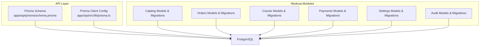
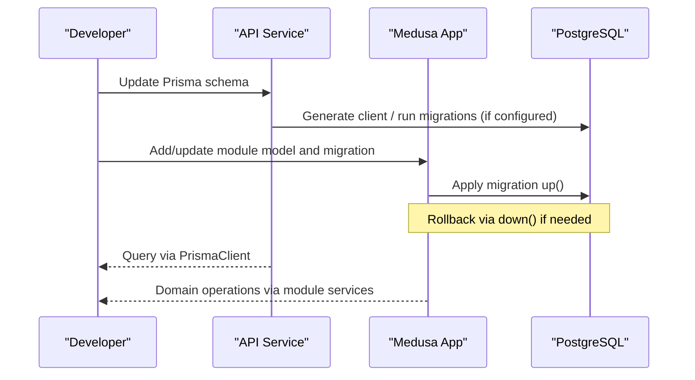
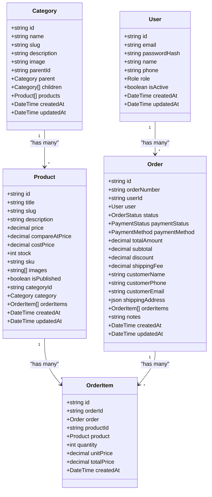
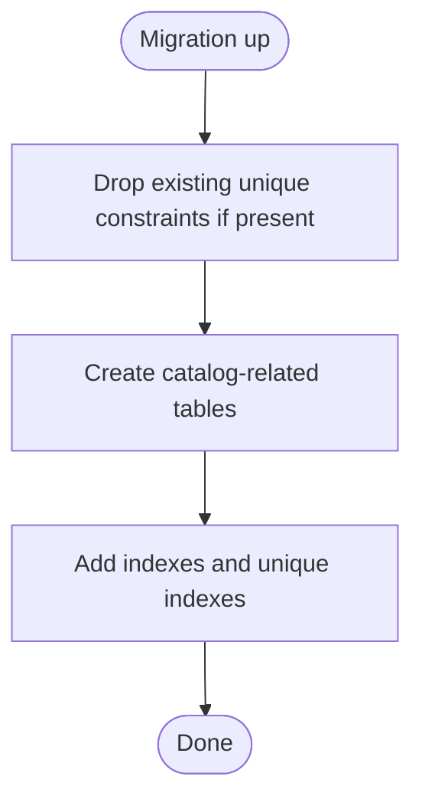
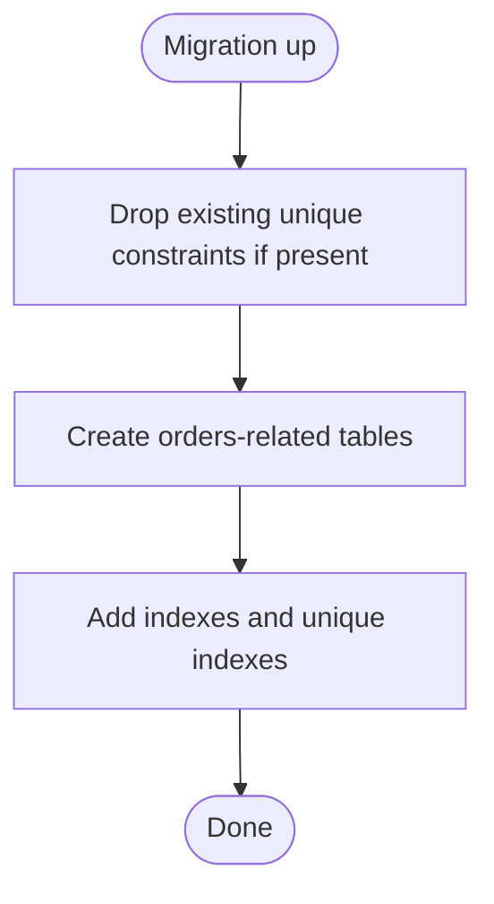
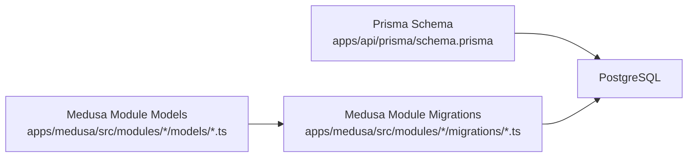

# Database Schema & Migrations

<cite>
**Referenced Files in This Document**
- [schema.prisma](file://apps/api/prisma/schema.prisma)
- [prisma.ts](file://apps/api/src/lib/prisma.ts)
- [package.json](file://apps/medusa/package.json)
- [Migration20261024060539.ts](file://apps/medusa/src/modules/bd-catalog/migrations/Migration20261024060539.ts)
- [Migration20261024060540.ts](file://apps/medusa/src/modules/bd-orders/migrations/Migration20261024060540.ts)
- [Migration20261024060541.ts](file://apps/medusa/src/modules/bd-courier/migrations/Migration20261024060541.ts)
- [Migration20261024060542.ts](file://apps/medusa/src/modules/bd-payments/migrations/Migration20261024060542.ts)
- [Migration20261024060544.ts](file://apps/medusa/src/modules/bd-settings/migrations/Migration20261024060544.ts)
- [Migration20261024060545.ts](file://apps/medusa/src/modules/bd-audit/migrations/Migration20261024060545.ts)
- [audit-log.ts](file://apps/medusa/src/modules/bd-audit/models/audit-log.ts)
- [product-attribute-value.ts](file://apps/medusa/src/modules/bd-catalog/models/product-attribute-value.ts)
- [order-bd-details.ts](file://apps/medusa/src/modules/bd-orders/models/order-bd-details.ts)
- [payment-transaction.ts](file://apps/medusa/src/modules/bd-payments/models/payment-transaction.ts)
</cite>

## Table of Contents
1. Introduction
2. Project Structure
3. Core Components
4. Architecture Overview
5. Detailed Component Analysis
6. Dependency Analysis
7. Performance Considerations
8. Troubleshooting Guide
9. Conclusion

## Introduction
This document explains the database schema design and migration management for the platform. It covers:
- Prisma integration for the API layer (PostgreSQL)
- Medusa module-level migrations using MikroORM
- Model definitions, relationships, constraints, and indexes
- Migration strategy, rollback procedures, and data seeding
- Snapshot system and version control for database changes
- Compatibility requirements and production deployment guidance

The repository uses two complementary systems:
- Prisma Client with a centralized schema for the API service
- Medusa modules with per-module migrations and model definitions

## Project Structure
The database-related code is split across:
- apps/api: Prisma schema and client configuration
- apps/medusa: Module-level models and migrations managed by Medusa’s migration tooling

**Diagram sources**
- [schema.prisma:1-152](file://apps/api/prisma/schema.prisma#L1-L152)
- [prisma.ts:1-14](file://apps/api/src/lib/prisma.ts#L1-L14)
- [Migration20261024060539.ts:1-37](file://apps/medusa/src/modules/bd-catalog/migrations/Migration20261024060539.ts#L1-L37)
- [Migration20261024060540.ts:1-31](file://apps/medusa/src/modules/bd-orders/migrations/Migration20261024060540.ts#L1-L31)
- [Migration20261024060541.ts:1-23](file://apps/medusa/src/modules/bd-courier/migrations/Migration20261024060541.ts#L1-L23)
- [Migration20261024060542.ts:1-23](file://apps/medusa/src/modules/bd-payments/migrations/Migration20261024060542.ts#L1-L23)
- [Migration20261024060544.ts:1-22](file://apps/medusa/src/modules/bd-settings/migrations/Migration20261024060544.ts#L1-L22)
- [Migration20261024060545.ts:1-26](file://apps/medusa/src/modules/bd-audit/migrations/Migration20261024060545.ts#L1-L26)

**Section sources**
- [schema.prisma:1-152](file://apps/api/prisma/schema.prisma#L1-L152)
- [prisma.ts:1-14](file://apps/api/src/lib/prisma.ts#L1-L14)
- [package.json:15-24](file://apps/medusa/package.json#L15-L24)

## Core Components
- Prisma Schema (API): Defines core entities such as User, Category, Product, Order, and OrderItem with enums, relations, indexes, and table mappings.
- Prisma Client (API): Exports a singleton PrismaClient instance with environment-aware logging.
- Medusa Module Migrations: Each module defines its own tables and constraints via MikroORM-based migrations.
- Medusa Module Models: Declarative model definitions that align with the generated migrations.

Key responsibilities:
- Centralized relational modeling and client access in the API layer
- Modular, incremental database evolution in Medusa modules
- Consistent use of JSONB fields for raw numeric precision and flexible payloads
- Indexing strategies to support common queries and soft-delete patterns

**Section sources**
- [schema.prisma:14-151](file://apps/api/prisma/schema.prisma#L14-L151)
- [prisma.ts:1-14](file://apps/api/src/lib/prisma.ts#L1-L14)
- [Migration20261024060539.ts:5-24](file://apps/medusa/src/modules/bd-catalog/migrations/Migration20261024060539.ts#L5-L24)
- [Migration20261024060540.ts:5-20](file://apps/medusa/src/modules/bd-orders/migrations/Migration20261024060540.ts#L5-L20)
- [Migration20261024060541.ts:5-14](file://apps/medusa/src/modules/bd-courier/migrations/Migration20261024060541.ts#L5-L14)
- [Migration20261024060542.ts:5-14](file://apps/medusa/src/modules/bd-payments/migrations/Migration20261024060542.ts#L5-L14)
- [Migration20261024060544.ts:5-13](file://apps/medusa/src/modules/bd-settings/migrations/Migration20261024060544.ts#L5-L13)
- [Migration20261024060545.ts:5-17](file://apps/medusa/src/modules/bd-audit/migrations/Migration20261024060545.ts#L5-L17)

## Architecture Overview
The system integrates two database toolchains:
- Prisma Client for the API service, backed by PostgreSQL
- Medusa modules with MikroORM migrations for domain-specific features

**Diagram sources**
- [schema.prisma:1-152](file://apps/api/prisma/schema.prisma#L1-L152)
- [prisma.ts:1-14](file://apps/api/src/lib/prisma.ts#L1-L14)
- [Migration20261024060539.ts:1-37](file://apps/medusa/src/modules/bd-catalog/migrations/Migration20261024060539.ts#L1-L37)
- [Migration20261024060540.ts:1-31](file://apps/medusa/src/modules/bd-orders/migrations/Migration20261024060540.ts#L1-L31)

## Detailed Component Analysis

### Prisma Integration (API)
- Datasource and generator are configured for PostgreSQL and Prisma Client JS.
- Enums define controlled values for roles, order status, payment status, and payment method.
- Core models include:
  - User: identity and role, with unique email/phone and indexes.
  - Category: hierarchical self-relation with SetNull on delete.
  - Product: belongs to Category; includes pricing, stock, SKU, images, and publish flag.
  - Order: links to User; stores totals, discounts, shipping fee, and customer details; contains OrderItems.
  - OrderItem: links to Order and Product; cascade delete from Order; restrict delete when referenced.
- Indexes are defined for frequent query paths (e.g., slug, category, price, published flag, orderNumber, userId, status, paymentStatus, createdAt).

**Diagram sources**
- [schema.prisma:14-151](file://apps/api/prisma/schema.prisma#L14-L151)

**Section sources**
- [schema.prisma:1-151](file://apps/api/prisma/schema.prisma#L1-L151)

### Prisma Client Configuration
- Singleton pattern ensures one PrismaClient instance per process.
- Logging is enabled for query/error/warn in development; only errors in production.

**Section sources**
- [prisma.ts:1-14](file://apps/api/src/lib/prisma.ts#L1-L14)

### Medusa Module Migrations and Models

#### Catalog Module
- Adds tables for category attributes, product attribute values, product localization, and product variant costs.
- Uses JSONB for raw numeric values and enforces uniqueness where appropriate.
- Includes soft-delete columns and indexes.

**Diagram sources**
- [Migration20261024060539.ts:5-24](file://apps/medusa/src/modules/bd-catalog/migrations/Migration20261024060539.ts#L5-L24)

**Section sources**
- [Migration20261024060539.ts:1-37](file://apps/medusa/src/modules/bd-catalog/migrations/Migration20261024060539.ts#L1-L37)
- [product-attribute-value.ts:1-13](file://apps/medusa/src/modules/bd-catalog/models/product-attribute-value.ts#L1-L13)

#### Orders Module
- Creates tables for customer risk profiles, order BD details, and return requests.
- Enforces unique constraints on order_id and phone_number; adds indexes for tracking codes and soft-delete.

**Diagram sources**
- [Migration20261024060540.ts:5-20](file://apps/medusa/src/modules/bd-orders/migrations/Migration20261024060540.ts#L5-L20)

**Section sources**
- [Migration20261024060540.ts:1-31](file://apps/medusa/src/modules/bd-orders/migrations/Migration20261024060540.ts#L1-L31)
- [order-bd-details.ts:1-42](file://apps/medusa/src/modules/bd-orders/models/order-bd-details.ts#L1-L42)

#### Courier Module
- Logs courier shipment actions and webhook events.
- Stores request/response payloads in JSONB and tracks signature verification and processing state.

**Section sources**
- [Migration20261024060541.ts:1-23](file://apps/medusa/src/modules/bd-courier/migrations/Migration20261024060541.ts#L1-L23)

#### Payments Module
- Records payment transactions and webhook logs.
- Captures gateway responses and verification flags; indexes for order_id, session_id, and gateway_transaction_id.

**Section sources**
- [Migration20261024060542.ts:1-23](file://apps/medusa/src/modules/bd-payments/migrations/Migration20261024060542.ts#L1-L23)
- [payment-transaction.ts:1-18](file://apps/medusa/src/modules/bd-payments/models/payment-transaction.ts#L1-L18)

#### Settings Module
- Defines delivery zone configurations and VAT settings.
- Uses JSONB for coverage districts and raw numeric values; enforces unique zone_code.

**Section sources**
- [Migration20261024060544.ts:1-22](file://apps/medusa/src/modules/bd-settings/migrations/Migration20261024060544.ts#L1-L22)

#### Audit Module
- Creates audit_log and staff_role_permission tables.
- Removes legacy unique constraint before creating new structure; indexes for actor, entity_type, entity_id, action, and deleted_at.

**Section sources**
- [Migration20261024060545.ts:1-26](file://apps/medusa/src/modules/bd-audit/migrations/Migration20261024060545.ts#L1-L26)
- [audit-log.ts:1-43](file://apps/medusa/src/modules/bd-audit/models/audit-log.ts#L1-L43)

## Dependency Analysis
- The API layer depends on Prisma Client and the PostgreSQL datasource.
- Medusa modules depend on MikroORM migrations and their respective model definitions.
- There is no direct runtime coupling between Prisma and Medusa migrations; both target the same PostgreSQL database.

**Diagram sources**
- [schema.prisma:1-152](file://apps/api/prisma/schema.prisma#L1-L152)
- [Migration20261024060539.ts:1-37](file://apps/medusa/src/modules/bd-catalog/migrations/Migration20261024060539.ts#L1-L37)
- [Migration20261024060540.ts:1-31](file://apps/medusa/src/modules/bd-orders/migrations/Migration20261024060540.ts#L1-L31)
- [Migration20261024060541.ts:1-23](file://apps/medusa/src/modules/bd-courier/migrations/Migration20261024060541.ts#L1-L23)
- [Migration20261024060542.ts:1-23](file://apps/medusa/src/modules/bd-payments/migrations/Migration20261024060542.ts#L1-L23)
- [Migration20261024060544.ts:1-22](file://apps/medusa/src/modules/bd-settings/migrations/Migration20261024060544.ts#L1-L22)
- [Migration20261024060545.ts:1-26](file://apps/medusa/src/modules/bd-audit/migrations/Migration20261024060545.ts#L1-L26)

**Section sources**
- [schema.prisma:1-152](file://apps/api/prisma/schema.prisma#L1-L152)
- [package.json:15-24](file://apps/medusa/package.json#L15-L24)

## Performance Considerations
- Use indexes strategically:
  - Prisma: indexes on frequently filtered/sorted columns (e.g., slug, categoryId, price, isPublished, orderNumber, userId, status, paymentStatus, createdAt).
  - Medusa: indexes on foreign keys, tracking codes, and soft-delete columns to optimize queries and cleanup jobs.
- Prefer JSONB for complex or evolving payloads while keeping denormalized numeric fields for performance-critical calculations.
- Avoid unnecessary cascades on large tables; prefer explicit deletes or partitioning strategies where applicable.
- Monitor query plans for high-cardinality joins (e.g., Order -> OrderItem -> Product).

[No sources needed since this section provides general guidance]

## Troubleshooting Guide
Common issues and resolutions:
- Migration conflicts due to pre-existing constraints:
  - Ensure migrations drop legacy constraints before recreating them (as seen in several module migrations).
- Soft-delete index usage:
  - Queries filtering by deleted_at should leverage provided indexes to avoid full table scans.
- Numeric precision handling:
  - Keep raw JSONB fields aligned with display fields to prevent rounding discrepancies.
- Production rollbacks:
  - Always test down() migrations in staging; ensure data preservation strategies are in place before dropping tables or columns.

**Section sources**
- [Migration20261024060539.ts:5-24](file://apps/medusa/src/modules/bd-catalog/migrations/Migration20261024060539.ts#L5-L24)
- [Migration20261024060540.ts:5-20](file://apps/medusa/src/modules/bd-orders/migrations/Migration20261024060540.ts#L5-L20)
- [Migration20261024060541.ts:5-14](file://apps/medusa/src/modules/bd-courier/migrations/Migration20261024060541.ts#L5-L14)
- [Migration20261024060542.ts:5-14](file://apps/medusa/src/modules/bd-payments/migrations/Migration20261024060542.ts#L5-L14)
- [Migration20261024060544.ts:5-13](file://apps/medusa/src/modules/bd-settings/migrations/Migration20261024060544.ts#L5-L13)
- [Migration20261024060545.ts:5-17](file://apps/medusa/src/modules/bd-audit/migrations/Migration20261024060545.ts#L5-L17)

## Conclusion
The platform combines Prisma for the API’s relational model and Medusa modules for domain-driven migrations. This separation enables clear ownership of schema changes, robust indexing strategies, and safe evolution through well-defined up/down migrations. For production deployments, follow the outlined migration workflow, validate rollbacks, and maintain alignment between model definitions and migrations.

[No sources needed since this section summarizes without analyzing specific files]

## Appendices

### Creating New Migrations
- For Medusa modules:
  - Add a new migration file under the module’s migrations directory.
  - Implement up() to create/alter tables and indexes; implement down() to reverse changes.
  - Align model definitions in the corresponding models directory.
- For Prisma:
  - Update the schema file and regenerate the client. If using Prisma migrations, generate and apply them accordingly.

**Section sources**
- [Migration20261024060539.ts:1-37](file://apps/medusa/src/modules/bd-catalog/migrations/Migration20261024060539.ts#L1-L37)
- [schema.prisma:1-152](file://apps/api/prisma/schema.prisma#L1-L152)

### Handling Schema Evolution
- Drop legacy constraints before recreating them to avoid conflicts.
- Introduce new columns with defaults and backfill data in separate steps if necessary.
- Use JSONB for flexible payloads while maintaining normalized fields for performance.

**Section sources**
- [Migration20261024060539.ts:5-24](file://apps/medusa/src/modules/bd-catalog/migrations/Migration20261024060539.ts#L5-L24)
- [Migration20261024060540.ts:5-20](file://apps/medusa/src/modules/bd-orders/migrations/Migration20261024060540.ts#L5-L20)
- [Migration20261024060544.ts:5-13](file://apps/medusa/src/modules/bd-settings/migrations/Migration20261024060544.ts#L5-L13)

### Managing Production Deployments
- Run Medusa migrations via the provided script.
- Ensure all module migrations are applied in order and verified in staging first.
- Validate that Prisma client generation and any Prisma migrations are also applied consistently.

**Section sources**
- [package.json:15-24](file://apps/medusa/package.json#L15-L24)