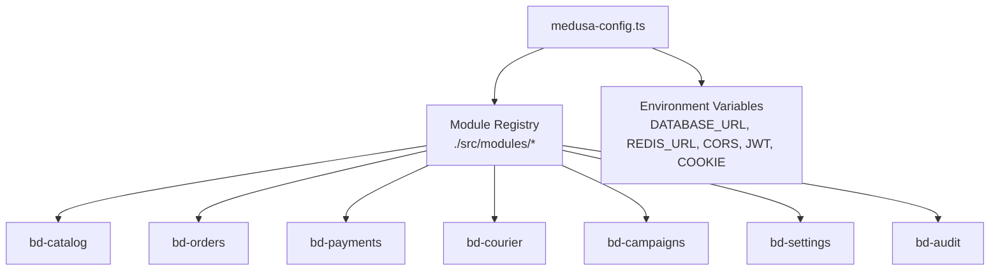
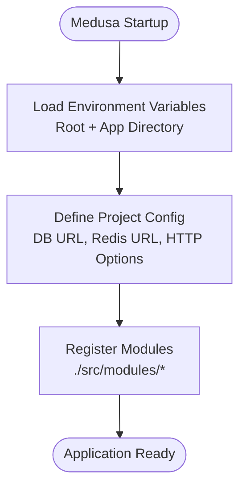
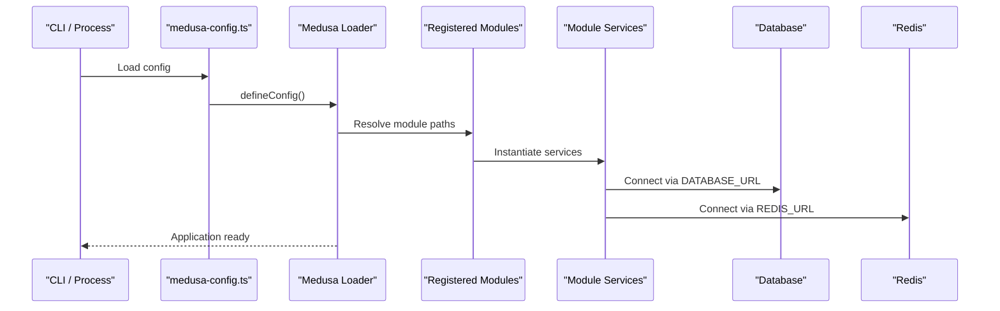
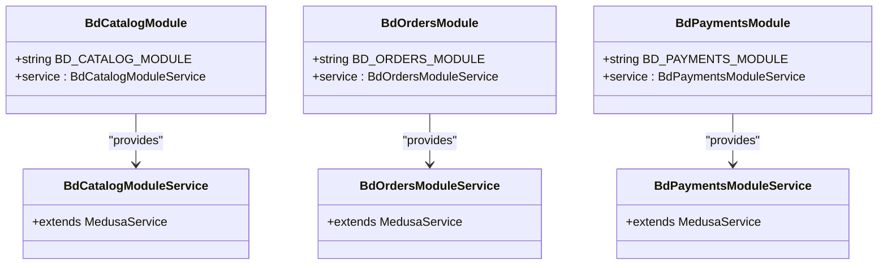
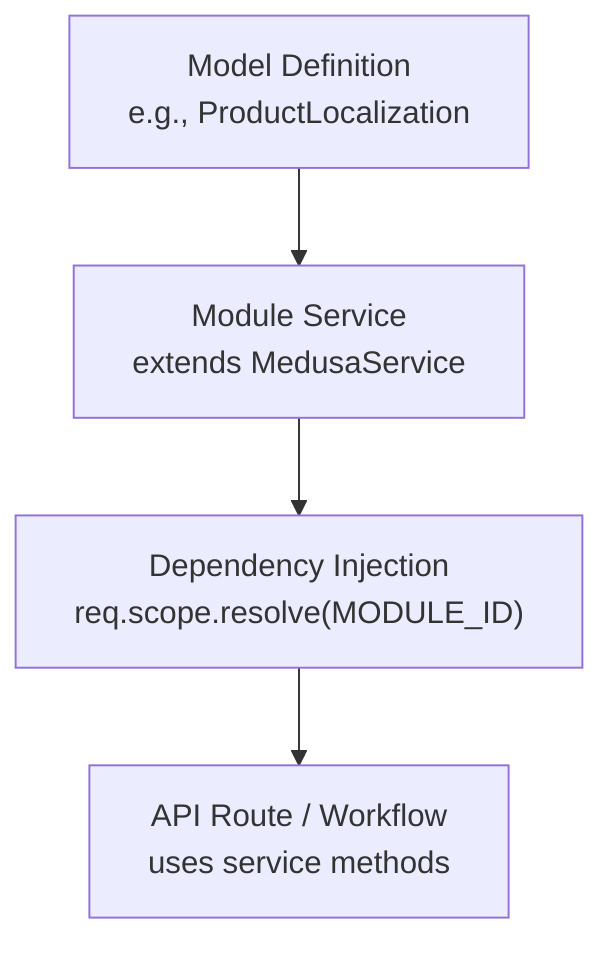
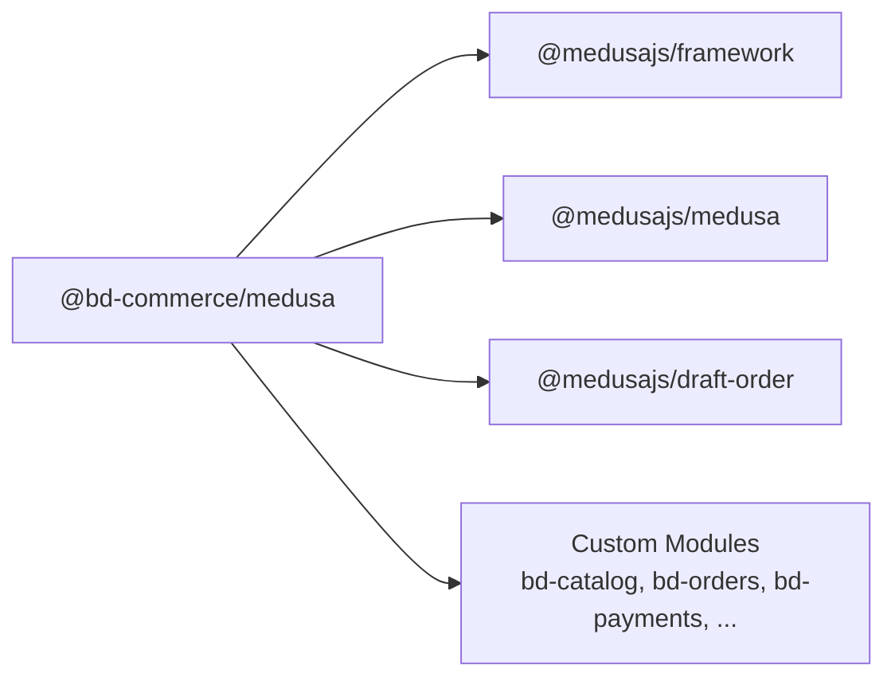

# Medusa Configuration & Setup

<cite>
**Referenced Files in This Document**
- [medusa-config.ts](file://apps/medusa/medusa-config.ts)
- [package.json](file://apps/medusa/package.json)
- [modules README.md](file://apps/medusa/src/modules/README.md)
- [bd-catalog index.ts](file://apps/medusa/src/modules/bd-catalog/index.ts)
- [bd-catalog service.ts](file://apps/medusa/src/modules/bd-catalog/service.ts)
- [product-localization model](file://apps/medusa/src/modules/bd-catalog/models/product-localization.ts)
- [bd-orders index.ts](file://apps/medusa/src/modules/bd-orders/index.ts)
- [bd-orders service.ts](file://apps/medusa/src/modules/bd-orders/service.ts)
- [bd-payments index.ts](file://apps/medusa/src/modules/bd-payments/index.ts)
- [bd-payments service.ts](file://apps/medusa/src/modules/bd-payments/service.ts)
- [architecture.md](file://docs/architecture.md)
- [instrumentation.ts](file://apps/medusa/instrumentation.ts)
</cite>

## Table of Contents
1. [Introduction](#introduction)
2. [Project Structure](#project-structure)
3. [Core Components](#core-components)
4. [Architecture Overview](#architecture-overview)
5. [Detailed Component Analysis](#detailed-component-analysis)
6. [Dependency Analysis](#dependency-analysis)
7. [Performance Considerations](#performance-considerations)
8. [Troubleshooting Guide](#troubleshooting-guide)
9. [Conclusion](#conclusion)

## Introduction
This document explains how to configure and set up the MedusaJS v2 backend for this project. It focuses on:
- The structure and behavior of `medusa-config.ts`
- Environment variables and environment-specific configuration
- Database and Redis configuration
- Service initialization and module registration
- Plugin system and custom service providers
- Development workflow, build processes, and deployment considerations
- Common configuration patterns and troubleshooting

The goal is to help you understand how Medusa loads configuration, discovers modules, initializes services, and connects to external systems like databases and caches.

## Project Structure
At a high level, the Medusa application lives under `apps/medusa`. The key configuration file is `medusa-config.ts`, which defines project-level settings, HTTP options, admin behavior, and module registration. Custom business logic is organized as Medusa modules under `src/modules`, each with models, migrations, an index definition, and a service.

**Diagram sources**
- [medusa-config.ts:7-45](file://apps/medusa/medusa-config.ts#L7-L45)

**Section sources**
- [medusa-config.ts:1-46](file://apps/medusa/medusa-config.ts#L1-L46)
- [modules README.md:1-118](file://apps/medusa/src/modules/README.md#L1-L118)

## Core Components
This section covers the core configuration elements that control how Medusa starts and operates.

### medusa-config.ts Structure
- Environment loading:
  - Loads environment variables from the repository root and the app directory based on `NODE_ENV`.
- Project configuration:
  - `databaseUrl`: Connects to PostgreSQL via a connection string.
  - `redisUrl`: Connects to Redis for caching and queues.
  - `http`:
    - `storeCors`, `adminCors`, `authCors`: Configure CORS origins for storefront, admin, and auth endpoints.
    - `jwtSecret`, `cookieSecret`: Secrets used for signing tokens and cookies.
- Admin configuration:
  - Disables or enables the admin UI.
- Module registration:
  - Declares all custom modules by their relative paths.

**Diagram sources**
- [medusa-config.ts:4-45](file://apps/medusa/medusa-config.ts#L4-L45)

**Section sources**
- [medusa-config.ts:1-46](file://apps/medusa/medusa-config.ts#L1-L46)

### Environment Variables
Key environment variables used by the backend include:
- `DATABASE_URL`: PostgreSQL connection string.
- `REDIS_URL`: Redis connection string.
- `STORE_CORS`, `ADMIN_CORS`, `AUTH_CORS`: Allowed origins for CORS.
- `JWT_SECRET`, `COOKIE_SECRET`: Signing secrets for tokens and cookies.

Additional recommended variables (from project documentation) include Meilisearch, payment gateways, SMS, and cloud storage settings. These are not directly read by `medusa-config.ts` but may be consumed by modules or integrations.

**Section sources**
- [medusa-config.ts:8-17](file://apps/medusa/medusa-config.ts#L8-L17)
- [architecture.md:915-985](file://docs/architecture.md#L915-L985)

### Database Configuration
- The database is configured through `projectConfig.databaseUrl`.
- Migrations are managed per module using Medusa’s CLI commands.
- Models define tables and fields; Medusa generates migration snapshots per module.

Best practices:
- Use a strong, unique `DATABASE_URL` per environment.
- Ensure the database user has sufficient privileges.
- Run migrations after adding or changing models.

**Section sources**
- [medusa-config.ts:8-10](file://apps/medusa/medusa-config.ts#L8-L10)
- [modules README.md:78-90](file://apps/medusa/src/modules/README.md#L78-L90)

### Redis Configuration
- Redis is configured through `projectConfig.redisUrl`.
- Used for caching and background job processing.

Recommendations:
- Provide a secure Redis URL with authentication.
- Separate Redis instances for development and production.

**Section sources**
- [medusa-config.ts:9-10](file://apps/medusa/medusa-config.ts#L9-L10)

### HTTP and Security Configuration
- CORS:
  - `storeCors`: Origins allowed to call Store API.
  - `adminCors`: Origins allowed to call Admin API.
  - `authCors`: Origins allowed for authentication flows.
- Secrets:
  - `jwtSecret`: Secret used to sign JWTs.
  - `cookieSecret`: Secret used to sign session cookies.

Security guidance:
- Never commit secrets to version control.
- Rotate secrets periodically.
- Restrict CORS to known domains in production.

**Section sources**
- [medusa-config.ts:11-17](file://apps/medusa/medusa-config.ts#L11-L17)

## Architecture Overview
The Medusa backend loads environment variables, defines project configuration, registers modules, and initializes services. Each module exposes a service class that extends `MedusaService` and declares its data models.

**Diagram sources**
- [medusa-config.ts:4-45](file://apps/medusa/medusa-config.ts#L4-L45)

## Detailed Component Analysis

### Module Registration Process
Modules are registered in `medusa-config.ts` under `modules`. Each entry points to a module directory containing:
- `index.ts`: Exports the module definition and a constant identifier.
- `service.ts`: Defines the main service extending `MedusaService`.
- `models/`: Data models defining database tables.
- `migrations/`: Migration files generated by Medusa.

Example modules in this project:
- `bd-catalog`
- `bd-orders`
- `bd-payments`
- `bd-courier`
- `bd-campaigns`
- `bd-settings`
- `bd-audit`

**Diagram sources**
- [bd-catalog index.ts:1-9](file://apps/medusa/src/modules/bd-catalog/index.ts#L1-L9)
- [bd-catalog service.ts:1-15](file://apps/medusa/src/modules/bd-catalog/service.ts#L1-L15)
- [bd-orders index.ts:1-9](file://apps/medusa/src/modules/bd-orders/index.ts#L1-L9)
- [bd-orders service.ts:1-13](file://apps/medusa/src/modules/bd-orders/service.ts#L1-L13)
- [bd-payments index.ts:1-9](file://apps/medusa/src/modules/bd-payments/index.ts#L1-L9)
- [bd-payments service.ts:1-11](file://apps/medusa/src/modules/bd-payments/service.ts#L1-L11)

**Section sources**
- [medusa-config.ts:22-44](file://apps/medusa/medusa-config.ts#L22-L44)
- [modules README.md:44-76](file://apps/medusa/src/modules/README.md#L44-L76)

### Custom Service Providers
Each module exports a service class that extends `MedusaService`. By passing model classes to `MedusaService`, Medusa automatically provides CRUD operations and query helpers for those entities.

Examples:
- `BdCatalogModuleService` manages product localization, variant costs, category attributes, and attribute values.
- `BdOrdersModuleService` manages order details, customer risk profiles, and return requests.
- `BdPaymentsModuleService` manages payment transactions and webhook logs.

**Diagram sources**
- [product-localization model:1-20](file://apps/medusa/src/modules/bd-catalog/models/product-localization.ts#L1-L20)
- [bd-catalog service.ts:1-15](file://apps/medusa/src/modules/bd-catalog/service.ts#L1-L15)
- [modules README.md:92-118](file://apps/medusa/src/modules/README.md#L92-L118)

**Section sources**
- [bd-catalog service.ts:1-15](file://apps/medusa/src/modules/bd-catalog/service.ts#L1-L15)
- [bd-orders service.ts:1-13](file://apps/medusa/src/modules/bd-orders/service.ts#L1-L13)
- [bd-payments service.ts:1-11](file://apps/medusa/src/modules/bd-payments/service.ts#L1-L11)
- [modules README.md:26-42](file://apps/medusa/src/modules/README.md#L26-L42)

### Plugin System Configuration
In this project, plugins are not explicitly declared in `medusa-config.ts`. Instead, custom functionality is implemented as local modules under `src/modules`. If you need third-party plugins:
- Install the plugin package.
- Add it to the `modules` array in `medusa-config.ts` with a `resolve` path or package name.
- Provide any required configuration options inside the module object if supported by the plugin.

For example, built-in Medusa features such as draft orders are included via dependencies in `package.json`, while custom modules are registered manually.

**Section sources**
- [medusa-config.ts:22-44](file://apps/medusa/medusa-config.ts#L22-L44)
- [package.json:25-39](file://apps/medusa/package.json#L25-L39)

### Environment-Specific Setups
- `NODE_ENV` controls which `.env` files are loaded.
- Defaults for CORS and secrets are provided in `medusa-config.ts`, but should be overridden in production.
- Recommended environment variables for databases, Redis, search, payments, and storage are documented in the architecture guide.

Patterns:
- Use separate `.env` files per environment (development, staging, production).
- Validate required variables at startup.
- Avoid committing secrets; use secret managers in production.

**Section sources**
- [medusa-config.ts:4-17](file://apps/medusa/medusa-config.ts#L4-L17)
- [architecture.md:915-985](file://docs/architecture.md#L915-L985)

## Dependency Analysis
The Medusa application depends on:
- `@medusajs/framework` and `@medusajs/medusa` for core runtime and CLI.
- Built-in features like `draft-order` via dependencies.
- Custom modules under `src/modules`.

**Diagram sources**
- [package.json:25-39](file://apps/medusa/package.json#L25-L39)
- [medusa-config.ts:22-44](file://apps/medusa/medusa-config.ts#L22-L44)

**Section sources**
- [package.json:15-39](file://apps/medusa/package.json#L15-L39)
- [medusa-config.ts:22-44](file://apps/medusa/medusa-config.ts#L22-L44)

## Performance Considerations
- Database:
  - Use appropriate indexes on frequently queried columns.
  - Monitor slow queries and adjust model definitions accordingly.
- Redis:
  - Tune cache TTLs and eviction policies.
  - Separate Redis instances for cache and queues in production.
- HTTP:
  - Restrict CORS to reduce attack surface.
  - Enable compression and caching headers where applicable.
- Observability:
  - Enable OpenTelemetry instrumentation for tracing and metrics.

[No sources needed since this section provides general guidance]

## Troubleshooting Guide
Common configuration issues and resolutions:

- Database connection failures:
  - Verify `DATABASE_URL` format and credentials.
  - Ensure the database server is reachable and the schema exists.
  - Run migrations after adding new models.

- Redis connection failures:
  - Verify `REDIS_URL` includes correct host, port, and password.
  - Check firewall rules and network access.

- CORS errors:
  - Update `STORE_CORS`, `ADMIN_CORS`, and `AUTH_CORS` to include frontend URLs.
  - Confirm browser origin matches configured origins.

- Authentication and cookie issues:
  - Ensure `JWT_SECRET` and `COOKIE_SECRET` are set and consistent across environments.
  - Rotate secrets carefully and redeploy.

- Module not found or service resolution errors:
  - Confirm the module path in `medusa-config.ts` is correct.
  - Ensure the module exports a default module definition and a service class.

- Build and start scripts:
  - Use `npm run dev` for development, `npm run start` for production-like runs, and `npm run build` to generate a production bundle.

**Section sources**
- [medusa-config.ts:8-17](file://apps/medusa/medusa-config.ts#L8-L17)
- [medusa-config.ts:22-44](file://apps/medusa/medusa-config.ts#L22-L44)
- [package.json:15-24](file://apps/medusa/package.json#L15-L24)

## Conclusion
This project uses MedusaJS v2 with a clear separation between configuration, modules, and services. The central configuration file defines environment-driven settings, HTTP security, and module registration. Custom modules encapsulate domain logic and expose services that integrate with the database and Redis. Following the patterns described here will help you extend the system safely, maintain environment-specific configurations, and troubleshoot common setup issues effectively.

[No sources needed since this section summarizes without analyzing specific files]