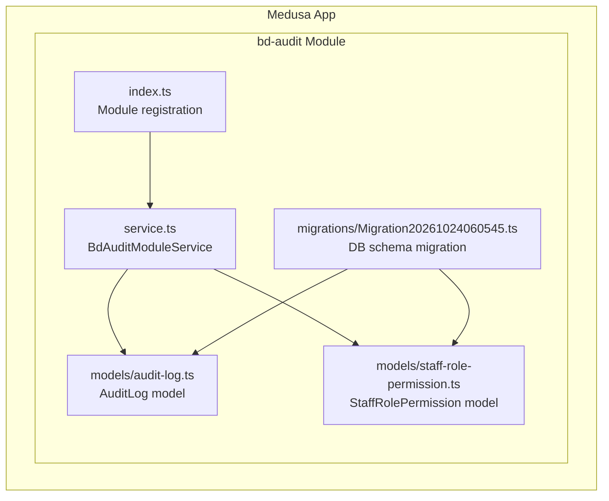
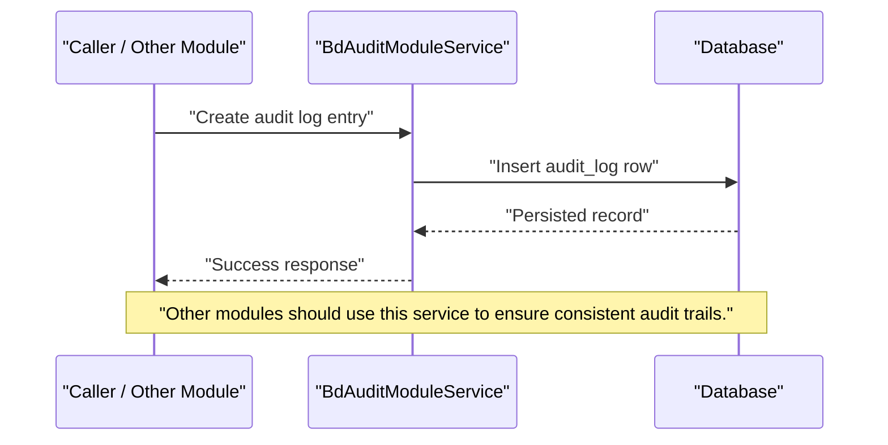
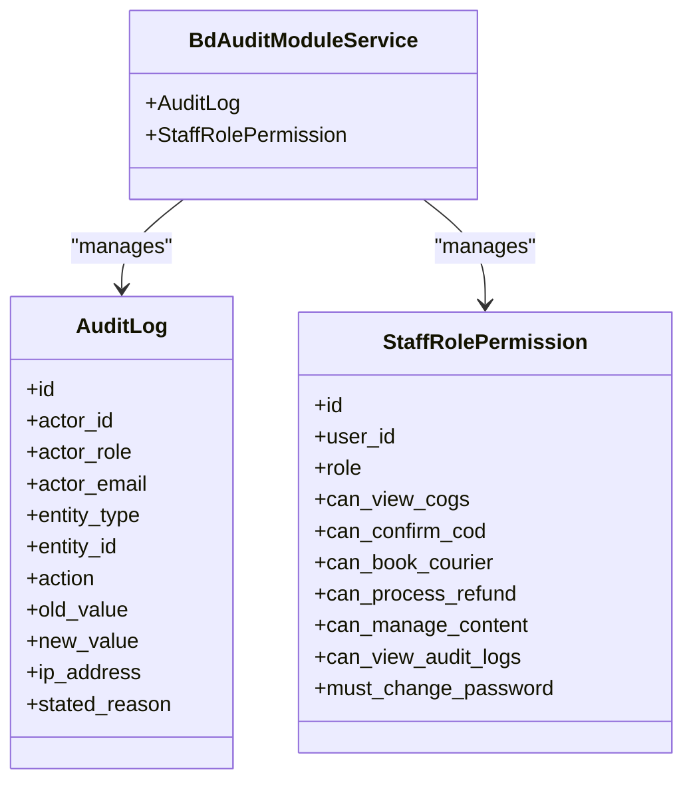
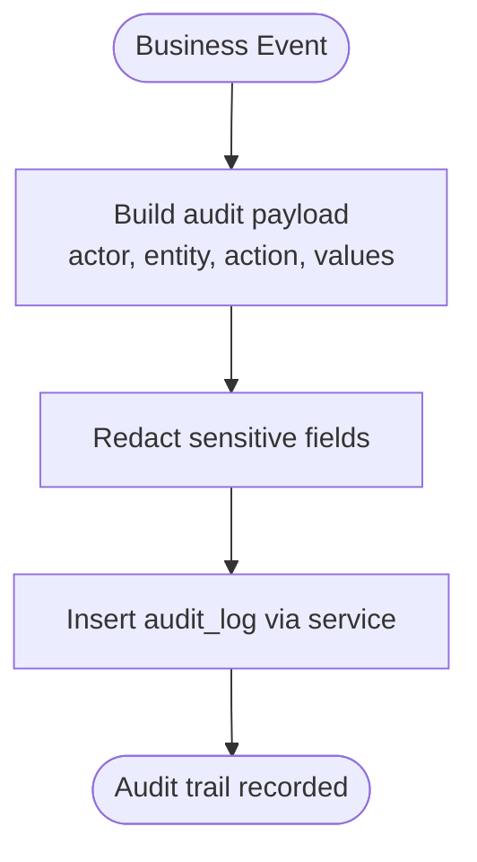
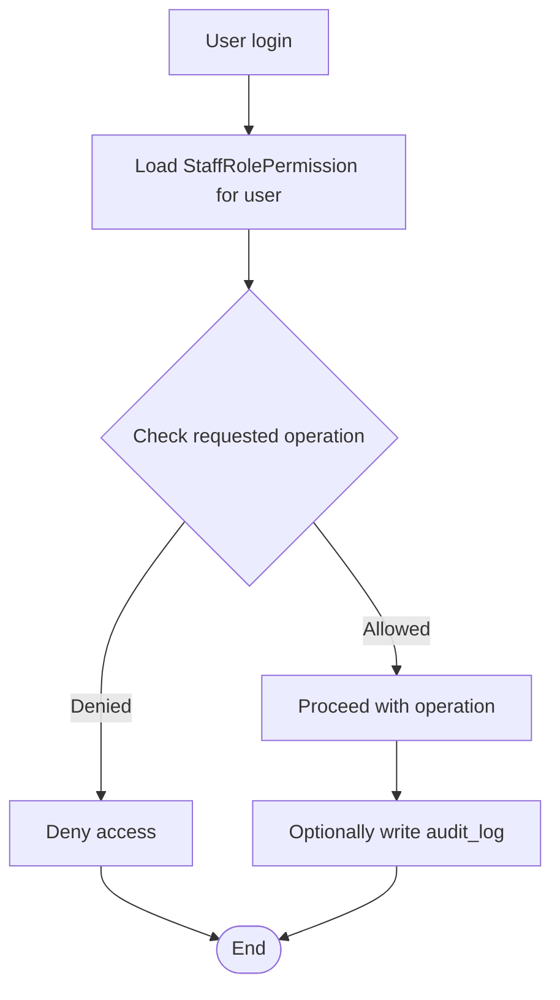
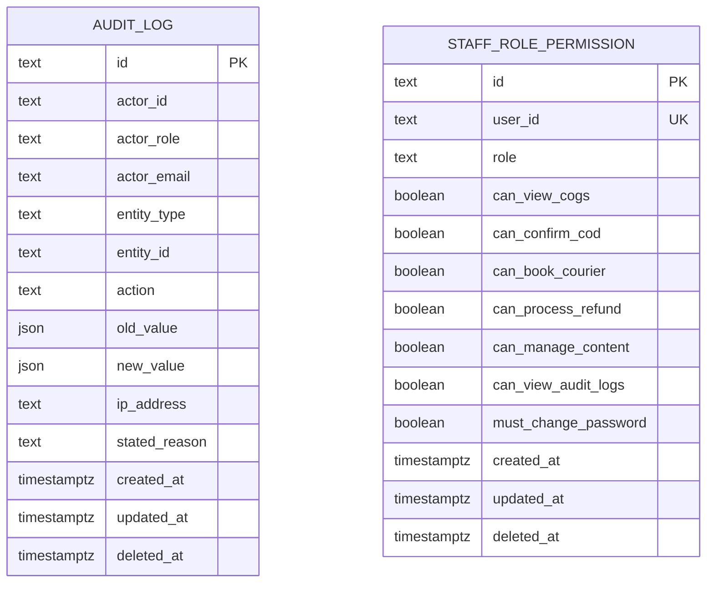
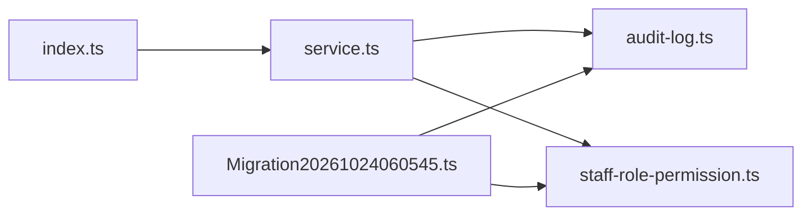

# Audit & Compliance Module

<cite>
**Referenced Files in This Document**
- [index.ts](file://apps/medusa/src/modules/bd-audit/index.ts)
- [service.ts](file://apps/medusa/src/modules/bd-audit/service.ts)
- [audit-log.ts](file://apps/medusa/src/modules/bd-audit/models/audit-log.ts)
- [staff-role-permission.ts](file://apps/medusa/src/modules/bd-audit/models/staff-role-permission.ts)
- [Migration20261024060545.ts](file://apps/medusa/src/modules/bd-audit/migrations/Migration20261024060545.ts)
- [database.md](file://database.md)
- [database-review.md](file://docs/database-review.md)
</cite>

## Table of Contents
1. [Introduction](#introduction)
2. [Project Structure](#project-structure)
3. [Core Components](#core-components)
4. [Architecture Overview](#architecture-overview)
5. [Detailed Component Analysis](#detailed-component-analysis)
6. [Dependency Analysis](#dependency-analysis)
7. [Performance Considerations](#performance-considerations)
8. [Security and Compliance Guidance](#security-and-compliance-guidance)
9. [Troubleshooting Guide](#troubleshooting-guide)
10. [Conclusion](#conclusion)

## Introduction
The BD Audit & Compliance module provides the foundation for audit logging, staff role-based permissions, and compliance-oriented data design within the Medusa application. It defines:
- An audit log model for recording who changed what, when, and why.
- A staff role permission model for fine-grained operational controls.
- Database migrations that create the underlying tables and indexes.
- A Medusa module registration exposing a service backed by these models.

This documentation explains how the module is structured, how audit trails are intended to be generated, how access control can be enforced using the provided models, and what additional security and compliance measures are required by the broader platform architecture.

## Project Structure
The module lives under `apps/medusa/src/modules/bd-audit` and follows a standard Medusa module layout:
- `index.ts`: Module registration with a stable module key and service reference.
- `service.ts`: Service class extending Medusa’s service base with the two core models.
- `models/audit-log.ts`: Audit log entity definition.
- `models/staff-role-permission.ts`: Staff role and permission flags.
- `migrations/Migration20261024060545.ts`: Migration creating `audit_log` and `staff_role_permission`.

**Diagram sources**
- [index.ts:1-8](file://apps/medusa/src/modules/bd-audit/index.ts#L1-L8)
- [service.ts:1-10](file://apps/medusa/src/modules/bd-audit/service.ts#L1-L10)
- [audit-log.ts:1-42](file://apps/medusa/src/modules/bd-audit/models/audit-log.ts#L1-L42)
- [staff-role-permission.ts:1-16](file://apps/medusa/src/modules/bd-audit/models/staff-role-permission.ts#L1-L16)
- [Migration20261024060545.ts:1-26](file://apps/medusa/src/modules/bd-audit/migrations/Migration20261024060545.ts#L1-L26)

**Section sources**
- [index.ts:1-8](file://apps/medusa/src/modules/bd-audit/index.ts#L1-L8)
- [service.ts:1-10](file://apps/medusa/src/modules/bd-audit/service.ts#L1-L10)
- [audit-log.ts:1-42](file://apps/medusa/src/modules/bd-audit/models/audit-log.ts#L1-L42)
- [staff-role-permission.ts:1-16](file://apps/medusa/src/modules/bd-audit/models/staff-role-permission.ts#L1-L16)
- [Migration20261024060545.ts:1-26](file://apps/medusa/src/modules/bd-audit/migrations/Migration20261024060545.ts#L1-L26)

## Core Components
The module exposes two primary domain concepts:

### Audit Log
The audit log captures business events across products, orders, inventory, refunds, couriers, staff users, settings, content pages, and authentication/security actions. Each record includes:
- Actor identity and role snapshot.
- Entity type and identifier being audited.
- Action performed.
- Optional before/after snapshots.
- Optional IP address and stated reason.

This model supports filtering and reporting by actor, entity, action, and time.

### Staff Role Permission
The staff role permission model stores per-user role and capability flags such as:
- Viewing cost-of-goods.
- Confirming cash-on-delivery.
- Booking courier services.
- Processing refunds.
- Managing content.
- Viewing audit logs.
- Requiring password change on next login.

These fields provide an application-level authorization surface that can be combined with Medusa’s native RBAC policies.

**Section sources**
- [audit-log.ts:1-42](file://apps/medusa/src/modules/bd-audit/models/audit-log.ts#L1-L42)
- [staff-role-permission.ts:1-16](file://apps/medusa/src/modules/bd-audit/models/staff-role-permission.ts#L1-L16)

## Architecture Overview
At runtime, other modules or API handlers should write audit records through the Medusa service layer rather than directly inserting into the database. The current service extends the Medusa service base with both models, which means it inherits CRUD-like operations over `AuditLog` and `StaffRolePermission`.

**Diagram sources**
- [service.ts:1-10](file://apps/medusa/src/modules/bd-audit/service.ts#L1-L10)
- [audit-log.ts:1-42](file://apps/medusa/src/modules/bd-audit/models/audit-log.ts#L1-L42)

The module is registered with a stable module name so other parts of the system can resolve it via dependency injection.

**Diagram sources**
- [service.ts:1-10](file://apps/medusa/src/modules/bd-audit/service.ts#L1-L10)
- [audit-log.ts:1-42](file://apps/medusa/src/modules/bd-audit/models/audit-log.ts#L1-L42)
- [staff-role-permission.ts:1-16](file://apps/medusa/src/modules/bd-audit/models/staff-role-permission.ts#L1-L16)

**Section sources**
- [index.ts:1-8](file://apps/medusa/src/modules/bd-audit/index.ts#L1-L8)
- [service.ts:1-10](file://apps/medusa/src/modules/bd-audit/service.ts#L1-L10)

## Detailed Component Analysis

### Audit Log Model
The audit log model uses enums for actor roles, entity types, and actions. This keeps audit entries structured and queryable.

Key responsibilities:
- Record who performed an action (`actor_id`, `actor_role`, `actor_email`).
- Identify what was affected (`entity_type`, `entity_id`).
- Capture what happened (`action`).
- Preserve context (`old_value`, `new_value`, `ip_address`, `stated_reason`).

Complexity considerations:
- JSON columns allow flexible snapshots but require careful redaction to avoid leaking sensitive data.
- Indexes on actor, entity type, entity ID, and action support common audit queries.

Recommended usage patterns:
- Write one audit row per significant business event.
- Use `entity_type` and `entity_id` to group related changes.
- Include `stated_reason` for high-risk actions like refunds, cancellations, or account lockouts.

**Diagram sources**
- [audit-log.ts:1-42](file://apps/medusa/src/modules/bd-audit/models/audit-log.ts#L1-L42)
- [service.ts:1-10](file://apps/medusa/src/modules/bd-audit/service.ts#L1-L10)

**Section sources**
- [audit-log.ts:1-42](file://apps/medusa/src/modules/bd-audit/models/audit-log.ts#L1-L42)

### Staff Role Permission Model
The staff role permission model centralizes operational permissions per user. It combines a coarse role with fine-grained boolean flags.

Design notes:
- `role` defaults to `staff`.
- Boolean flags enable capabilities such as viewing COGS, confirming COD, booking couriers, processing refunds, managing content, and viewing audit logs.
- `must_change_password` supports forced password rotation.

Access control guidance:
- Use `can_view_audit_logs` to gate audit log UI/API access.
- Combine role and flags with Medusa’s native RBAC policies where possible.
- Treat `owner` and `finance` as privileged roles; restrict their exposure carefully.

**Diagram sources**
- [staff-role-permission.ts:1-16](file://apps/medusa/src/modules/bd-audit/models/staff-role-permission.ts#L1-L16)
- [audit-log.ts:1-42](file://apps/medusa/src/modules/bd-audit/models/audit-log.ts#L1-L42)

**Section sources**
- [staff-role-permission.ts:1-16](file://apps/medusa/src/modules/bd-audit/models/staff-role-permission.ts#L1-L16)

### Database Migration
The migration creates:
- `audit_log` table with constraints, indexes, and timestamps.
- `staff_role_permission` table with constraints, unique index on `user_id`, and timestamps.

Important characteristics:
- Both tables include soft-delete semantics via `deleted_at`.
- Audit log indexes target frequently filtered columns.
- Staff role permission has a unique partial index scoped to active rows.

**Diagram sources**
- [Migration20261024060545.ts:1-26](file://apps/medusa/src/modules/bd-audit/migrations/Migration20261024060545.ts#L1-L26)

**Section sources**
- [Migration20261024060545.ts:1-26](file://apps/medusa/src/modules/bd-audit/migrations/Migration20261024060545.ts#L1-L26)

## Dependency Analysis
The module has minimal internal coupling:
- `index.ts` depends only on the service.
- `service.ts` depends on the two models.
- Models are independent of each other at the code level.
- The migration defines the physical schema used by both models.

External dependencies:
- Medusa framework utilities for module registration and service inheritance.
- Database engine supporting JSON columns, indexes, and soft-delete patterns.

**Diagram sources**
- [index.ts:1-8](file://apps/medusa/src/modules/bd-audit/index.ts#L1-L8)
- [service.ts:1-10](file://apps/medusa/src/modules/bd-audit/service.ts#L1-L10)
- [audit-log.ts:1-42](file://apps/medusa/src/modules/bd-audit/models/audit-log.ts#L1-L42)
- [staff-role-permission.ts:1-16](file://apps/medusa/src/modules/bd-audit/models/staff-role-permission.ts#L1-L16)
- [Migration20261024060545.ts:1-26](file://apps/medusa/src/modules/bd-audit/migrations/Migration20261024060545.ts#L1-L26)

**Section sources**
- [index.ts:1-8](file://apps/medusa/src/modules/bd-audit/index.ts#L1-L8)
- [service.ts:1-10](file://apps/medusa/src/modules/bd-audit/service.ts#L1-L10)

## Performance Considerations
- Audit log writes should be lightweight and fast. Avoid large JSON payloads unless necessary.
- Prefer targeted filters (`actor_id`, `entity_type`, `entity_id`, `action`) because indexes exist on those columns.
- For large-scale auditing, consider partitioning or archival strategies aligned with retention policies.
- Do not store secrets, full payment payloads, or unredacted PII in `old_value`/`new_value`.

[No sources needed since this section provides general guidance]

## Security and Compliance Guidance

### Audit Trail Generation
To generate compliant audit trails:
- Create an audit log entry whenever a protected business event occurs.
- Include actor identity, role snapshot, entity type, entity ID, and action.
- Store only redacted before/after values for non-finance viewers.
- Record IP address and stated reason for high-risk actions.

Example workflow for creating an audit log:
1. Identify the actor and their role.
2. Determine the entity type and ID.
3. Choose the appropriate action from the allowed set.
4. Build redacted old/new snapshots.
5. Insert the audit log through the service.

**Section sources**
- [audit-log.ts:1-42](file://apps/medusa/src/modules/bd-audit/models/audit-log.ts#L1-L42)
- [service.ts:1-10](file://apps/medusa/src/modules/bd-audit/service.ts#L1-L10)

### Managing User Permissions
To manage staff permissions:
- Assign a base role to each staff user.
- Set boolean flags based on job responsibilities.
- Gate audit log access using `can_view_audit_logs`.
- Enforce password rotation using `must_change_password`.

Example workflow for updating permissions:
1. Load the existing `StaffRolePermission` row for the user.
2. Update role and relevant flags.
3. Save the updated permissions.
4. Optionally write an audit log entry if permission changes are considered sensitive.

**Section sources**
- [staff-role-permission.ts:1-16](file://apps/medusa/src/modules/bd-audit/models/staff-role-permission.ts#L1-L16)

### Regulatory Compliance Reporting
Compliance reports can be built by querying audit logs:
- Filter by date range, actor, entity type, and action.
- Aggregate counts by action and entity type.
- Export redacted summaries for non-finance stakeholders.
- Preserve raw audit records according to retention policy.

The broader platform documentation describes a more advanced audit model including hash chaining, immutability triggers, retention matrix, masking rules, and webhook redaction. Those requirements should guide future enhancements to this module.

**Section sources**
- [database.md:1352-1388](file://database.md#L1352-L1388)
- [database.md:1933-1965](file://database.md#L1933-L1965)
- [database.md:2007-2030](file://database.md#L2007-L2030)
- [database.md:2055-2068](file://database.md#L2055-L2068)

### Data Retention Policies
Current repository guidance indicates:
- Audit logs should follow a legal retention period.
- Webhook logs have shorter retention.
- SMS delivery details have limited retention.
- Customer risk profiles should be anonymized after a defined period.
- Purging must be scheduled, batched, and auditable.

The module’s current schema does not yet implement automated retention or anonymization; this should be added as a scheduled job that writes audit records for purge operations.

**Section sources**
- [database.md:2007-2030](file://database.md#L2007-L2030)

### Security Best Practices
- Never log secrets, tokens, full phone numbers, full addresses, refund accounts, or provider payloads.
- Apply field-level masking for sensitive data in lists and exports.
- Restrict audit log viewer access to authorized roles.
- Validate and sanitize any JSON stored in audit snapshots.
- Align audit log immutability and chain verification with the platform’s database-enforced requirements.

**Section sources**
- [database.md:1919-1931](file://database.md#L1919-L1931)
- [database.md:1933-1965](file://database.md#L1933-L1965)
- [database.md:2055-2068](file://database.md#L2055-L2068)
- [database-review.md:883-891](file://docs/database-review.md#L883-L891)

## Troubleshooting Guide

### Common Issues
- **Missing audit entries**: Ensure audit writes happen through the service and are included in the same transaction as the business change where possible.
- **Sensitive data in audit logs**: Review redaction logic before persisting `old_value`/`new_value`.
- **Permission confusion**: Verify both the base role and boolean flags for the requesting user.
- **Slow audit queries**: Add or refine filters using indexed columns like `actor_id`, `entity_type`, `entity_id`, and `action`.

### Diagnostic Steps
1. Check whether the audit log table exists and contains expected indexes.
2. Confirm that the service is registered and resolvable.
3. Inspect recent audit entries for correct actor, entity, and action values.
4. Validate that permission flags match the user’s responsibilities.
5. Cross-check against platform retention and masking requirements.

**Section sources**
- [audit-log.ts:1-42](file://apps/medusa/src/modules/bd-audit/models/audit-log.ts#L1-L42)
- [staff-role-permission.ts:1-16](file://apps/medusa/src/modules/bd-audit/models/staff-role-permission.ts#L1-L16)
- [Migration20261024060545.ts:1-26](file://apps/medusa/src/modules/bd-audit/migrations/Migration20261024060545.ts#L1-L26)

## Conclusion
The BD Audit & Compliance module provides the essential building blocks for audit logging and staff permission management. Its models define structured audit entries and granular operational permissions, while its migration establishes the underlying schema. To meet full regulatory and security requirements, the module should be extended with:
- Centralized audit-writing helpers.
- Field-level redaction for audit snapshots.
- Integration with Medusa’s native RBAC policies.
- Scheduled retention and anonymization jobs.
- Database-level immutability and hash-chain verification as described in the platform documentation.

When implemented together, these components will deliver a robust audit trail, clear access control, and a strong foundation for compliance reporting.