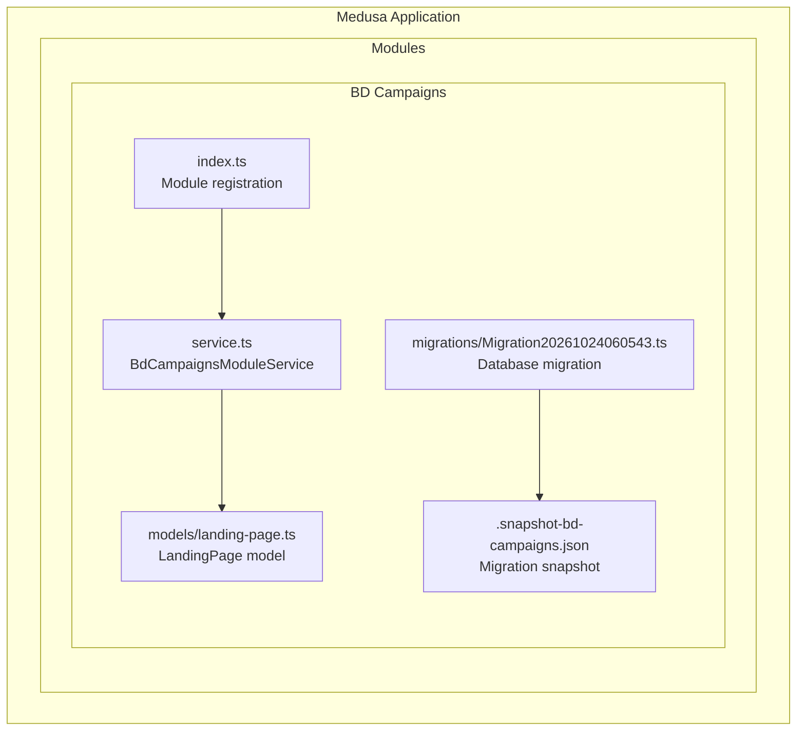
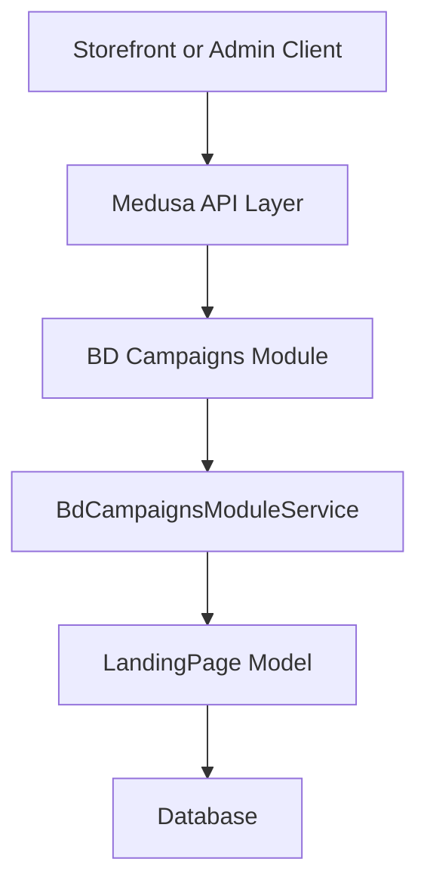
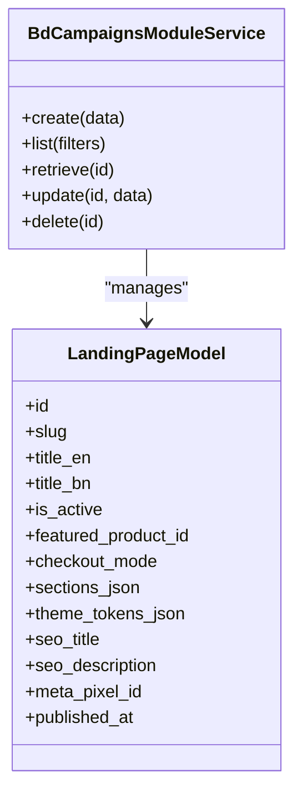
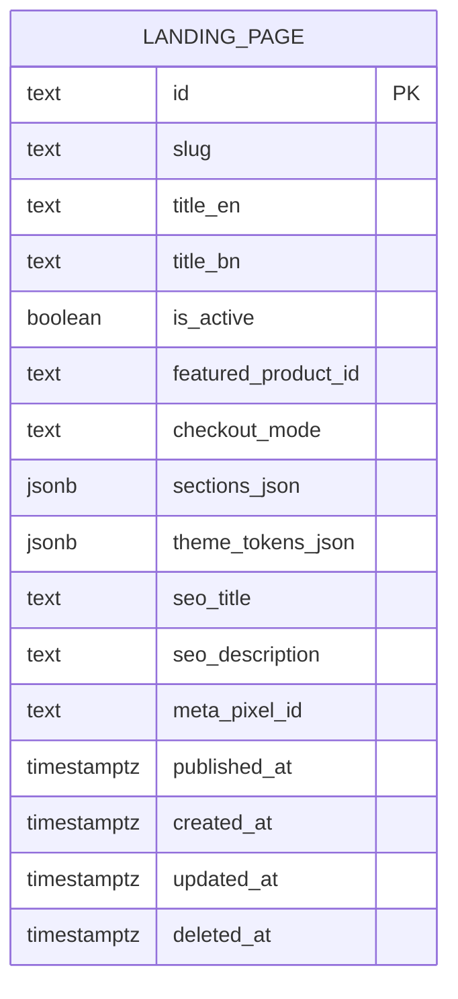
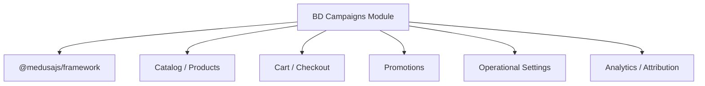

# Campaign Management Module

<cite>
**Referenced Files in This Document**
- [index.ts](file://apps/medusa/src/modules/bd-campaigns/index.ts)
- [service.ts](file://apps/medusa/src/modules/bd-campaigns/service.ts)
- [landing-page.ts](file://apps/medusa/src/modules/bd-campaigns/models/landing-page.ts)
- [Migration20261024060543.ts](file://apps/medusa/src/modules/bd-campaigns/migrations/Migration20261024060543.ts)
- [.snapshot-bd-campaigns.json](file://apps/medusa/src/modules/bd-campaigns/migrations/.snapshot-bd-campaigns.json)
- [prd.md](file://prd.md)
- [database.md](file://database.md)
- [technical-plan.md](file://technical-plan.md)
- [user-journeys.md](file://user-journeys.md)
</cite>

## Table of Contents
1. [Introduction](#introduction)
2. [Project Structure](#project-structure)
3. [Core Components](#core-components)
4. [Architecture Overview](#architecture-overview)
5. [Detailed Component Analysis](#detailed-component-analysis)
6. [Dependency Analysis](#dependency-analysis)
7. [Performance Considerations](#performance-considerations)
8. [Troubleshooting Guide](#troubleshooting-guide)
9. [Conclusion](#conclusion)

## Introduction
The BD Campaigns module is a Medusa v2 custom module that provides the backend foundation for campaign landing pages and their associated configuration. At this stage, it defines a `LandingPage` data model, registers a Medusa module service, and creates the corresponding database table through a migration. The broader product requirements describe how landing pages integrate with checkout modes, promotional offers, attribution, analytics, and performance monitoring, but most of that behavior lives outside this module or is still conceptual in the repository.

This document explains:
- What the module currently implements.
- How the landing page data model supports landing page structure and checkout behavior.
- How the module fits into the overall campaign system described by the project documentation.
- What additional implementation work is needed to fully support campaign targeting rules, conversion tracking, analytics, and direct checkout integration.

## Project Structure
The BD Campaigns module is located under the Medusa application’s modules directory. It follows the standard Medusa module layout: an index file registering the module, a service class extending `MedusaService`, a model definition, and a migration.

**Diagram sources**
- [index.ts:1-9](file://apps/medusa/src/modules/bd-campaigns/index.ts#L1-L9)
- [service.ts:1-9](file://apps/medusa/src/modules/bd-campaigns/service.ts#L1-L9)
- [landing-page.ts:1-20](file://apps/medusa/src/modules/bd-campaigns/models/landing-page.ts#L1-L20)
- [Migration20261024060543.ts:1-17](file://apps/medusa/src/modules/bd-campaigns/migrations/Migration20261024060543.ts#L1-L17)
- [.snapshot-bd-campaigns.json:1-309](file://apps/medusa/src/modules/bd-campaigns/migrations/.snapshot-bd-campaigns.json#L1-L309)

**Section sources**
- [index.ts:1-9](file://apps/medusa/src/modules/bd-campaigns/index.ts#L1-L9)
- [service.ts:1-9](file://apps/medusa/src/modules/bd-campaigns/service.ts#L1-L9)
- [landing-page.ts:1-20](file://apps/medusa/src/modules/bd-campaigns/models/landing-page.ts#L1-L20)
- [Migration20261024060543.ts:1-17](file://apps/medusa/src/modules/bd-campaigns/migrations/Migration20261024060543.ts#L1-L17)

## Core Components
The module currently exposes three main pieces:

| Component | Purpose | Current State |
|---|---|---|
| Module registration | Registers `bd_campaigns` as a Medusa module and wires up the service. | Implemented. |
| Service | Provides CRUD operations for registered models via `MedusaService`. | Implemented for `LandingPage`. |
| Landing Page Model | Defines the schema for campaign landing pages, including content, theme tokens, SEO fields, checkout mode, and publication state. | Implemented. |

Key responsibilities:
- Store landing page metadata such as slug, titles, active status, featured product reference, and publication timestamp.
- Store structured page sections and theme overrides as JSON.
- Record checkout entry mode preference per landing page.
- Provide a base service for future business logic around campaigns.

What is not yet implemented in this module:
- Campaign targeting rules engine.
- Promotional offer validation at checkout.
- Conversion tracking implementation.
- Analytics dashboards or reporting endpoints.
- Admin UI for building landing pages.
- Frontend storefront components for embedded checkout.

**Section sources**
- [index.ts:1-9](file://apps/medusa/src/modules/bd-campaigns/index.ts#L1-L9)
- [service.ts:1-9](file://apps/medusa/src/modules/bd-campaigns/service.ts#L1-L9)
- [landing-page.ts:1-20](file://apps/medusa/src/modules/bd-campaigns/models/landing-page.ts#L1-L20)

## Architecture Overview
At runtime, the BD Campaigns module integrates into Medusa as a named module. Other parts of the system can resolve the `bd_campaigns` service and use its generated CRUD methods for `LandingPage`. The current architecture is intentionally minimal: the module owns persistence and basic service access, while higher-level workflows (checkout, promotions, analytics) are expected to be built around it.

**Diagram sources**
- [index.ts:1-9](file://apps/medusa/src/modules/bd-campaigns/index.ts#L1-L9)
- [service.ts:1-9](file://apps/medusa/src/modules/bd-campaigns/service.ts#L1-L9)
- [landing-page.ts:1-20](file://apps/medusa/src/modules/bd-campaigns/models/landing-page.ts#L1-L20)

## Detailed Component Analysis

### Module Registration
The module exports a constant identifying the module name and registers it with Medusa using the provided service. This makes the service available through Medusa’s dependency injection system.

- Module identifier: `bd_campaigns`.
- Service export: `BdCampaignsModuleService`.
- Integration point: Medusa framework module loader.

**Section sources**
- [index.ts:1-9](file://apps/medusa/src/modules/bd-campaigns/index.ts#L1-L9)

### Service Class
The service extends `MedusaService` and declares `LandingPage` as its managed entity. This automatically generates standard CRUD operations for landing pages unless overridden later.

- Managed entity: `LandingPage`.
- Inherited capabilities: create, list, retrieve, update, delete, and related query helpers.
- Extension point: Custom methods can be added to implement campaign-specific logic.

**Diagram sources**
- [service.ts:1-9](file://apps/medusa/src/modules/bd-campaigns/service.ts#L1-L9)
- [landing-page.ts:1-20](file://apps/medusa/src/modules/bd-campaigns/models/landing-page.ts#L1-L20)

**Section sources**
- [service.ts:1-9](file://apps/medusa/src/modules/bd-campaigns/service.ts#L1-L9)

### Landing Page Data Model
The `LandingPage` model captures the core attributes required for a campaign landing page.

| Field | Type | Meaning |
|---|---|---|
| `id` | Primary key | Unique record identifier. |
| `slug` | Text, unique | URL-friendly identifier for the landing page. |
| `title_en` | Text | English title. |
| `title_bn` | Nullable text | Bangla title. |
| `is_active` | Boolean, default true | Controls whether the landing page is considered active. |
| `featured_product_id` | Nullable text | Reference to a product used by the landing page. |
| `checkout_mode` | Enum: `embedded`, `modal`, `redirect` | Preferred checkout entry behavior. |
| `sections_json` | JSON | Structured content blocks for the landing page builder. |
| `theme_tokens_json` | Nullable JSON | Theme overrides for the landing page. |
| `seo_title` | Nullable text | SEO title. |
| `seo_description` | Nullable text | SEO description. |
| `meta_pixel_id` | Nullable text | Optional Meta Pixel identifier for conversion tracking. |
| `published_at` | Nullable datetime | Publication timestamp. |

#### Landing Page Builder Structure
The landing page builder is represented primarily by `sections_json`. While no strict schema is enforced at the model level, the field is intended to store a structured array of sections. A practical structure would include:

- Section type: hero, product showcase, offer details, variant selector, call-to-action, trust badges, FAQ, footer.
- Content: headings, descriptions, images, links, localized text.
- Behavior: selected product, selected variant options, quantity defaults, CTA action.
- Styling: colors, typography, spacing, responsive hints.
- Validation: required fields, valid product references, safe HTML or rich-text constraints.

This approach allows flexible page composition without requiring a separate section table.

#### Checkout Mode Configuration
The `checkout_mode` field controls how customers proceed from the landing page:

- `embedded`: The checkout experience is embedded on or near the landing page.
- `modal`: A modal-based checkout flow is triggered.
- `redirect`: The user is redirected to the standard checkout flow.

According to the product requirements, both “product-first” and “direct checkout” flows are supported conceptually, and the shared cart must be preserved. The module stores the preferred mode; enforcement should happen in the storefront and server-side workflows.

#### SEO and Tracking Fields
- `seo_title` and `seo_description` allow per-page search engine metadata.
- `meta_pixel_id` allows optional per-page tracking configuration, although the broader documentation indicates a single global pixel policy may apply at the operational settings layer.

#### Publication and Lifecycle
- `is_active` acts as a simple publish/unpublish toggle.
- `published_at` records when the page was published.
- Soft deletion is supported through the inherited `deleted_at` column.

```mermaid
flowchart TD
Start(["Create or Update Landing Page"]) --> ValidateSlug["Validate Slug Uniqueness"]
ValidateSlug --> ValidateSections["Validate Sections JSON"]
ValidateSections --> ValidateProduct{"Featured Product Valid?"}
ValidateProduct --> |No| ErrorProduct["Return Validation Error"]
ValidateProduct --> |Yes| SaveRecord["Save Landing Page Record"]
SaveRecord --> SetPublished["Set Published Timestamp if Needed"]
SetPublished --> End(["Landing Page Ready"])
ErrorProduct --> End
```

**Diagram sources**
- [landing-page.ts:1-20](file://apps/medusa/src/modules/bd-campaigns/models/landing-page.ts#L1-L20)
- [Migration20261024060543.ts:5-10](file://apps/medusa/src/modules/bd-campaigns/migrations/Migration20261024060543.ts#L5-L10)

**Section sources**
- [landing-page.ts:1-20](file://apps/medusa/src/modules/bd-campaigns/models/landing-page.ts#L1-L20)
- [Migration20261024060543.ts:1-17](file://apps/medusa/src/modules/bd-campaigns/migrations/Migration20261024060543.ts#L1-L17)
- [.snapshot-bd-campaigns.json:1-309](file://apps/medusa/src/modules/bd-campaigns/migrations/.snapshot-bd-campaigns.json#L1-L309)

### Migration and Database Schema
The migration creates the `landing_page` table and indexes:

- Primary key on `id`.
- Unique soft-deleted index on `slug`.
- Deleted-at index for soft-delete queries.
- Check constraint ensuring `checkout_mode` is one of the allowed values.
- JSON columns for `sections_json` and `theme_tokens_json`.
- Timestamps for creation, update, and soft deletion.

**Diagram sources**
- [Migration20261024060543.ts:5-10](file://apps/medusa/src/modules/bd-campaigns/migrations/Migration20261024060543.ts#L5-L10)
- [.snapshot-bd-campaigns.json:8-304](file://apps/medusa/src/modules/bd-campaigns/migrations/.snapshot-bd-campaigns.json#L8-L304)

**Section sources**
- [Migration20261024060543.ts:1-17](file://apps/medusa/src/modules/bd-campaigns/migrations/Migration20261024060543.ts#L1-L17)
- [.snapshot-bd-campaigns.json:1-309](file://apps/medusa/src/modules/bd-campaigns/migrations/.snapshot-bd-campaigns.json#L1-L309)

## Dependency Analysis
The BD Campaigns module has very few internal dependencies:

- `@medusajs/framework/utils` for `Module` and `MedusaService`.
- Internal model import for `LandingPage`.

External relationships implied by the broader project documentation include:

- Catalog and product system: referenced indirectly through `featured_product_id`.
- Cart and checkout system: referenced conceptually through checkout modes and shared-cart preservation rules.
- Promotion system: referenced conceptually through offer validity and pricing authority.
- Settings and analytics: referenced conceptually through global Meta Pixel policy and order attribution.

**Diagram sources**
- [index.ts:1-9](file://apps/medusa/src/modules/bd-campaigns/index.ts#L1-L9)
- [prd.md:145-152](file://prd.md#L145-L152)
- [database.md:2357-2366](file://database.md#L2357-L2366)

**Section sources**
- [index.ts:1-9](file://apps/medusa/src/modules/bd-campaigns/index.ts#L1-L9)
- [prd.md:145-152](file://prd.md#L145-L152)
- [database.md:2357-2366](file://database.md#L2357-L2366)

## Performance Considerations
Based on the current implementation and documentation:

- **JSON storage**: `sections_json` and `theme_tokens_json` provide flexibility but require careful validation and indexing strategies. Large or deeply nested sections can increase payload size and parsing cost.
- **Soft deletes**: The `deleted_at` index helps queries filter out soft-deleted records efficiently.
- **Slug uniqueness**: The unique soft-deleted index prevents duplicate slugs while allowing historical cleanup.
- **Checkout mode**: Choosing `embedded` may increase frontend complexity and payload size compared to `redirect`.
- **Future analytics**: Conversion tracking and reporting should avoid heavy synchronous processing during checkout. Asynchronous events and batched writes are recommended.

[No sources needed since this section provides general guidance]

## Troubleshooting Guide

### Common Issues and Resolutions

| Issue | Likely Cause | Resolution |
|---|---|---|
| Duplicate slug error | Multiple landing pages share the same slug. | Ensure each landing page has a unique slug. |
| Invalid checkout mode | `checkout_mode` contains an unsupported value. | Use only `embedded`, `modal`, or `redirect`. |
| Landing page not rendering | `is_active` is false or `published_at` is missing. | Activate the page and set the publication timestamp. |
| Sections not displayed | `sections_json` is malformed or missing required fields. | Validate the JSON structure before saving. |
| Featured product not found | `featured_product_id` points to a non-existent product. | Verify the product exists before linking it. |
| Checkout blocked | Offer expired, product sold out, or validation failed. | Follow product requirements: never honor stale promotional prices. |
| Conversion tracking mismatch | Global pixel policy conflicts with per-page pixel field. | Respect the single-pixel policy defined in operational settings. |

**Section sources**
- [landing-page.ts:1-20](file://apps/medusa/src/modules/bd-campaigns/models/landing-page.ts#L1-L20)
- [Migration20261024060543.ts:5-10](file://apps/medusa/src/modules/bd-campaigns/migrations/Migration20261024060543.ts#L5-L10)
- [prd.md:145-152](file://prd.md#L145-L152)
- [database.md:2357-2366](file://database.md#L2357-L2366)

## Conclusion
The BD Campaigns module currently provides a solid foundation for campaign landing pages by defining the `LandingPage` model, registering a Medusa service, and creating the necessary database schema. It supports structured page content, theme overrides, SEO metadata, checkout mode preferences, and publication state.

To fully realize the campaign management capability described in the product documentation, additional implementation is required:

- A campaign targeting rules engine.
- Promotional offer validation integrated with native promotions.
- Direct checkout workflow enforcing shared-cart preservation and server-side price authority.
- Conversion tracking aligned with the single Meta Pixel policy.
- Analytics and performance monitoring that separates store-recorded sales from ad-platform conversions.
- Admin and storefront interfaces for building and publishing landing pages.

Until those layers are implemented, the BD Campaigns module should be treated as the persistence and service backbone for landing pages, ready to be extended by higher-level campaign workflows.

[No sources needed since this section summarizes without analyzing specific files]