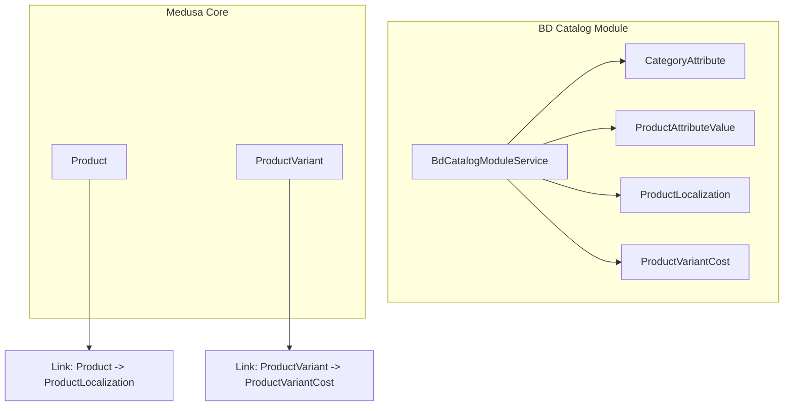
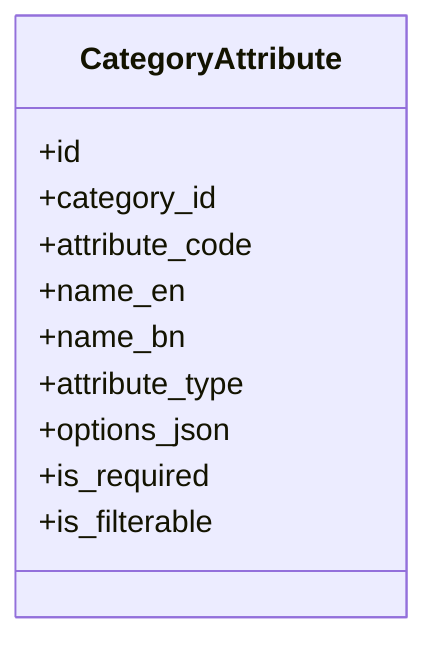
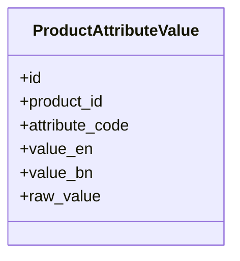
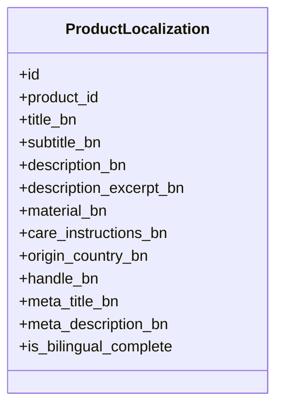
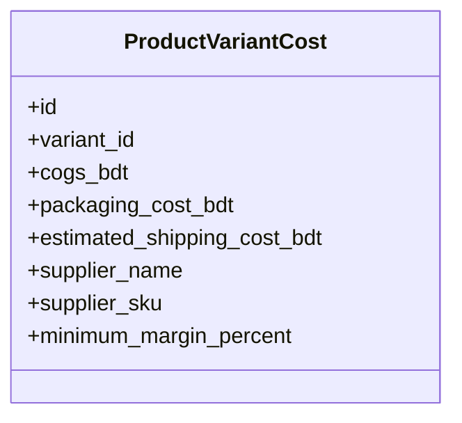
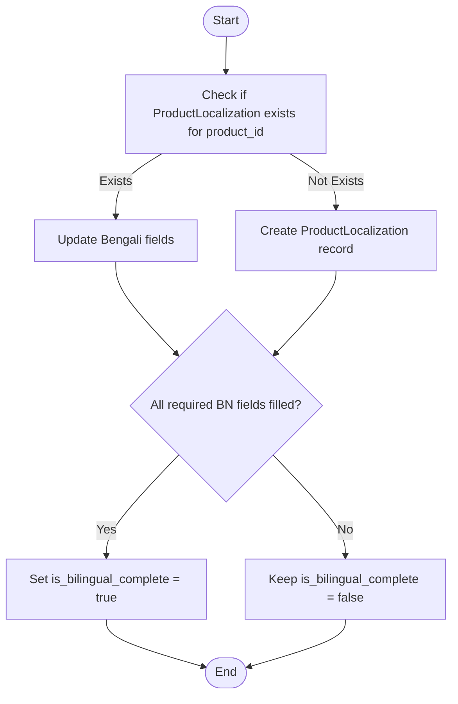
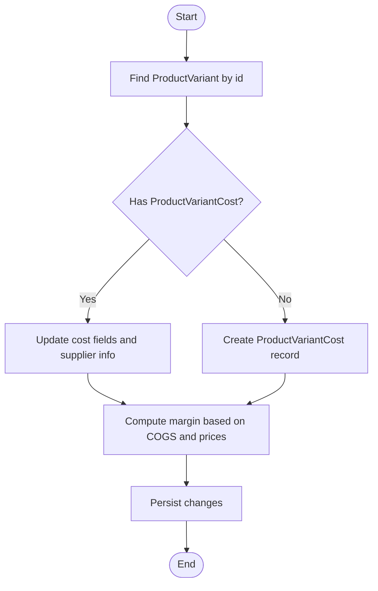
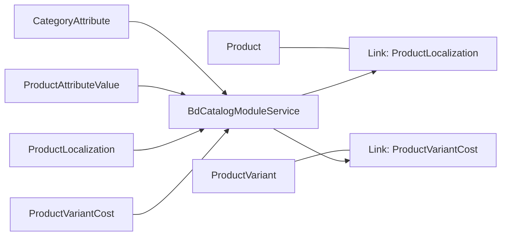

# Catalog Management Module

<cite>
**Referenced Files in This Document**
- [index.ts](file://apps/medusa/src/modules/bd-catalog/index.ts)
- [service.ts](file://apps/medusa/src/modules/bd-catalog/service.ts)
- [category-attribute.ts](file://apps/medusa/src/modules/bd-catalog/models/category-attribute.ts)
- [product-attribute-value.ts](file://apps/medusa/src/modules/bd-catalog/models/product-attribute-value.ts)
- [product-localization.ts](file://apps/medusa/src/modules/bd-catalog/models/product-localization.ts)
- [product-variant-cost.ts](file://apps/medusa/src/modules/bd-catalog/models/product-variant-cost.ts)
- [Migration20261024060539.ts](file://apps/medusa/src/modules/bd-catalog/migrations/Migration20261024060539.ts)
- [product-localization.ts](file://apps/medusa/src/links/product-localization.ts)
- [product-variant-cost.ts](file://apps/medusa/src/links/product-variant-cost.ts)
- [product.ts](file://apps/medusa/src/search/product.ts)
- [pricing.ts](file://apps/medusa/src/search/helpers/pricing.ts)
</cite>

## Table of Contents
1. [Introduction](#introduction)
2. [Project Structure](#project-structure)
3. [Core Components](#core-components)
4. [Architecture Overview](#architecture-overview)
5. [Detailed Component Analysis](#detailed-component-analysis)
6. [Dependency Analysis](#dependency-analysis)
7. [Performance Considerations](#performance-considerations)
8. [Troubleshooting Guide](#troubleshooting-guide)
9. [Conclusion](#conclusion)

## Introduction
This document explains the BD Catalog Management module, which extends Medusa’s product catalog with:
- Category-driven attribute definitions and per-product attribute values
- Multi-language content for products (Bengali localization)
- Variant-level cost tracking for margin and fulfillment planning
- Integration points that link localized content and variant costs to Medusa’s core Product entities

The module is designed to support a hierarchical category system through Medusa’s built-in categories while adding structured attributes and rich localizations. It also tracks variant costs to enable accurate margin calculations and supplier data management.

## Project Structure
The BD Catalog Management module lives under apps/medusa/src/modules/bd-catalog and exposes a service that manages four domain models:
- CategoryAttribute: defines reusable attributes for categories
- ProductAttributeValue: stores per-product attribute values
- ProductLocalization: stores Bengali translations and bilingual completeness flags
- ProductVariantCost: stores cost fields per product variant



**Diagram sources**
- [service.ts:7-12](file://apps/medusa/src/modules/bd-catalog/service.ts#L7-L12)
- [product-localization.ts:5-8](file://apps/medusa/src/links/product-localization.ts#L5-L8)
- [product-variant-cost.ts:5-8](file://apps/medusa/src/links/product-variant-cost.ts#L5-L8)

**Section sources**
- [index.ts:1-9](file://apps/medusa/src/modules/bd-catalog/index.ts#L1-L9)
- [service.ts:1-15](file://apps/medusa/src/modules/bd-catalog/service.ts#L1-L15)

## Core Components
- BdCatalogModuleService: A Medusa service exposing CRUD operations for the four models.
- CategoryAttribute: Defines attribute metadata per category, including type, options, required/filterable flags, and localized names.
- ProductAttributeValue: Stores per-product attribute values with English and Bengali text plus a raw value for programmatic use.
- ProductLocalization: Holds Bengali translations for product titles, descriptions, handles, meta fields, and a flag indicating bilingual completeness.
- ProductVariantCost: Tracks COGS, packaging, estimated shipping, supplier info, minimum margin percent, and raw numeric precision fields.

Key responsibilities:
- Attribute schema enforcement via CategoryAttribute
- Localized product content via ProductLocalization
- Variant cost and margin inputs via ProductVariantCost
- Indexing and search integration via links and search helpers

**Section sources**
- [service.ts:1-15](file://apps/medusa/src/modules/bd-catalog/service.ts#L1-L15)
- [category-attribute.ts:1-16](file://apps/medusa/src/modules/bd-catalog/models/category-attribute.ts#L1-L16)
- [product-attribute-value.ts:1-13](file://apps/medusa/src/modules/bd-catalog/models/product-attribute-value.ts#L1-L13)
- [product-localization.ts:1-20](file://apps/medusa/src/modules/bd-catalog/models/product-localization.ts#L1-L20)
- [product-variant-cost.ts:1-15](file://apps/medusa/src/modules/bd-catalog/models/product-variant-cost.ts#L1-L15)

## Architecture Overview
The module integrates with Medusa’s Product and ProductVariant entities through links. The search index consumes product data and pricing; variant costs are not part of the public search index but can be used internally for margin analysis.

```mermaid
sequenceDiagram
participant Admin as "Admin UI / API"
participant CatalogSvc as "BdCatalogModuleService"
participant ProductMod as "Medusa Product Module"
participant Links as "Links"
participant Search as "Search Index"
Admin->>CatalogSvc : Create/Update CategoryAttribute
Admin->>CatalogSvc : Create/Update ProductAttributeValue
Admin->>CatalogSvc : Create/Update ProductLocalization
Admin->>CatalogSvc : Create/Update ProductVariantCost
Note over ProductMod,Links : Links connect Product <-> ProductLocalization<br/>and ProductVariant <-> ProductVariantCost
ProductMod-->>Search : Events trigger re-index
Search-->>Admin : Searchable product documents
```

**Diagram sources**
- [service.ts:7-12](file://apps/medusa/src/modules/bd-catalog/service.ts#L7-L12)
- [product-localization.ts:5-8](file://apps/medusa/src/links/product-localization.ts#L5-L8)
- [product-variant-cost.ts:5-8](file://apps/medusa/src/links/product-variant-cost.ts#L5-L8)
- [product.ts:130-165](file://apps/medusa/src/search/product.ts#L130-L165)

## Detailed Component Analysis

### Category Attributes System
CategoryAttribute defines reusable attributes for categories. Each attribute includes:
- Type: select, multiselect, text, boolean
- Options JSON for select/multiselect
- Required and filterable flags
- Localized display names (English and Bengali)



**Diagram sources**
- [category-attribute.ts:3-13](file://apps/medusa/src/modules/bd-catalog/models/category-attribute.ts#L3-L13)

Usage patterns:
- Define attributes at the category level to enforce consistent product attributes across all products within that category.
- Use attribute_code as a stable key to map ProductAttributeValue entries.

**Section sources**
- [category-attribute.ts:1-16](file://apps/medusa/src/modules/bd-catalog/models/category-attribute.ts#L1-L16)
- [Migration20261024060539.ts:7-10](file://apps/medusa/src/modules/bd-catalog/migrations/Migration20261024060539.ts#L7-L10)

### Product Attribute Values
ProductAttributeValue stores per-product attribute values with:
- English and Bengali values
- Raw value for machine-readable data (e.g., codes or normalized strings)



**Diagram sources**
- [product-attribute-value.ts:3-10](file://apps/medusa/src/modules/bd-catalog/models/product-attribute-value.ts#L3-L10)

Relationships:
- Linked to Product via product_id
- Mapped to CategoryAttribute via attribute_code

**Section sources**
- [product-attribute-value.ts:1-13](file://apps/medusa/src/modules/bd-catalog/models/product-attribute-value.ts#L1-L13)
- [Migration20261024060539.ts:12-15](file://apps/medusa/src/modules/bd-catalog/migrations/Migration20261024060539.ts#L12-L15)

### Localization Support
ProductLocalization provides Bengali translations for product content and a flag to indicate bilingual completeness. Fields include title, subtitle, description, excerpt, material, care instructions, origin country, handle, and SEO meta fields.



**Diagram sources**
- [product-localization.ts:3-17](file://apps/medusa/src/modules/bd-catalog/models/product-localization.ts#L3-L17)

Integration:
- Linked to Medusa Product via defineLink.

**Section sources**
- [product-localization.ts:1-20](file://apps/medusa/src/modules/bd-catalog/models/product-localization.ts#L1-L20)
- [product-localization.ts:5-8](file://apps/medusa/src/links/product-localization.ts#L5-L8)
- [Migration20261024060539.ts:17-19](file://apps/medusa/src/modules/bd-catalog/migrations/Migration20261024060539.ts#L17-L19)

### Variant Cost Tracking
ProductVariantCost tracks per-variant costs and supplier information:
- COGS, packaging cost, estimated shipping cost in BDT
- Supplier name and SKU
- Minimum margin percentage
- Raw numeric precision fields for currency handling



**Diagram sources**
- [product-variant-cost.ts:3-12](file://apps/medusa/src/modules/bd-catalog/models/product-variant-cost.ts#L3-L12)

Integration:
- Linked to Medusa ProductVariant via defineLink.

**Section sources**
- [product-variant-cost.ts:1-15](file://apps/medusa/src/modules/bd-catalog/models/product-variant-cost.ts#L1-L15)
- [product-variant-cost.ts:5-8](file://apps/medusa/src/links/product-variant-cost.ts#L5-L8)
- [Migration20261024060539.ts:21-23](file://apps/medusa/src/modules/bd-catalog/migrations/Migration20261024060539.ts#L21-L23)

### Category Hierarchy Structure
Categories themselves are managed by Medusa’s core product-category model. The BD Catalog module does not redefine category hierarchy; instead, it attaches attributes to categories via CategoryAttribute.category_id. This allows:
- Hierarchical categories from Medusa
- Attribute schemas scoped to specific categories
- Consistent attribute application across products in those categories

No additional code is needed to manage hierarchy; existing Medusa category APIs apply.

**Section sources**
- [category-attribute.ts:3-13](file://apps/medusa/src/modules/bd-catalog/models/category-attribute.ts#L3-L13)

### Creating Products with Attributes
Recommended workflow:
1. Define CategoryAttribute entries for each category to establish attribute schema.
2. Create products using Medusa’s createProductsWorkflow.
3. For each product, create ProductAttributeValue entries keyed by attribute_code.
4. Optionally set ProductLocalization entries for Bengali content.
5. For variants, create ProductVariantCost entries to track costs and margins.

Example steps (conceptual):
- Define attributes like “Material”, “Fit”, “Sleeve” for a clothing category.
- When creating a product, attach values such as Material=Cotton, Fit=Regular.
- Add Bengali translations for title and description.
- For each variant, record COGS, packaging, shipping, supplier details, and minimum margin.

[No sources needed since this section provides conceptual guidance]

### Managing Translations
To manage multi-language content:
- Update ProductLocalization.title_bn, .description_bn, etc., for each product.
- Set is_bilingual_complete when both English and Bengali content are ready.
- Ensure handle_bn and meta fields are populated for SEO and routing.

Operational flow:



**Diagram sources**
- [product-localization.ts:3-17](file://apps/medusa/src/modules/bd-catalog/models/product-localization.ts#L3-L17)

**Section sources**
- [product-localization.ts:1-20](file://apps/medusa/src/modules/bd-catalog/models/product-localization.ts#L1-L20)

### Handling Variant Costs
To handle variant costs:
- Populate cogs_bdt, packaging_cost_bdt, estimated_shipping_cost_bdt for each variant.
- Record supplier_name and supplier_sku for traceability.
- Set minimum_margin_percent to guide pricing decisions.

Operational flow:



**Diagram sources**
- [product-variant-cost.ts:3-12](file://apps/medusa/src/modules/bd-catalog/models/product-variant-cost.ts#L3-L12)

**Section sources**
- [product-variant-cost.ts:1-15](file://apps/medusa/src/modules/bd-catalog/models/product-variant-cost.ts#L1-L15)

## Dependency Analysis
The BD Catalog module depends on:
- Medusa Product and ProductVariant entities via links
- Search indexing pipeline for product discovery
- Pricing helpers for search price fields (not directly variant costs)



**Diagram sources**
- [service.ts:7-12](file://apps/medusa/src/modules/bd-catalog/service.ts#L7-L12)
- [product-localization.ts:5-8](file://apps/medusa/src/links/product-localization.ts#L5-L8)
- [product-variant-cost.ts:5-8](file://apps/medusa/src/links/product-variant-cost.ts#L5-L8)

**Section sources**
- [service.ts:1-15](file://apps/medusa/src/modules/bd-catalog/service.ts#L1-L15)
- [product-localization.ts:5-8](file://apps/medusa/src/links/product-localization.ts#L5-L8)
- [product-variant-cost.ts:5-8](file://apps/medusa/src/links/product-variant-cost.ts#L5-L8)

## Performance Considerations
- Indexing: The search index rebuilds on product events; ensure efficient ingestion batches to avoid long-running processes.
- Queries: Use indexed fields (product_id, attribute_code, category_id) for fast lookups.
- Pricing: The search helper computes min/max prices per currency; keep pricing data consistent to avoid expensive recalculations.

[No sources needed since this section provides general guidance]

## Troubleshooting Guide
Common issues and resolutions:
- Missing links: If ProductLocalization or ProductVariantCost do not appear linked to Product/ProductVariant, verify the link files are registered.
- Incomplete translations: Use is_bilingual_complete to signal readiness; validate required Bengali fields before marking complete.
- Variant cost gaps: Ensure every variant has a corresponding ProductVariantCost entry to compute accurate margins.

Validation tips:
- Confirm indexes exist for product_id, attribute_code, and category_id.
- Verify unique constraints on variant_id for ProductVariantCost.

**Section sources**
- [Migration20261024060539.ts:7-23](file://apps/medusa/src/modules/bd-catalog/migrations/Migration20261024060539.ts#L7-L23)
- [product-localization.ts:5-8](file://apps/medusa/src/links/product-localization.ts#L5-L8)
- [product-variant-cost.ts:5-8](file://apps/medusa/src/links/product-variant-cost.ts#L5-L8)

## Conclusion
The BD Catalog Management module enhances Medusa’s catalog with structured attributes, robust Bengali localization, and detailed variant cost tracking. By leveraging Medusa’s category hierarchy and search infrastructure, it provides a scalable foundation for managing complex product catalogs with multi-language content and precise cost accounting.

[No sources needed since this section summarizes without analyzing specific files]