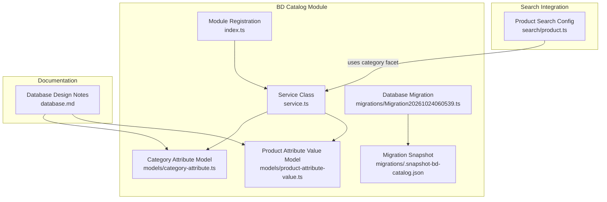
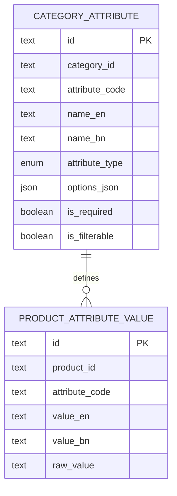
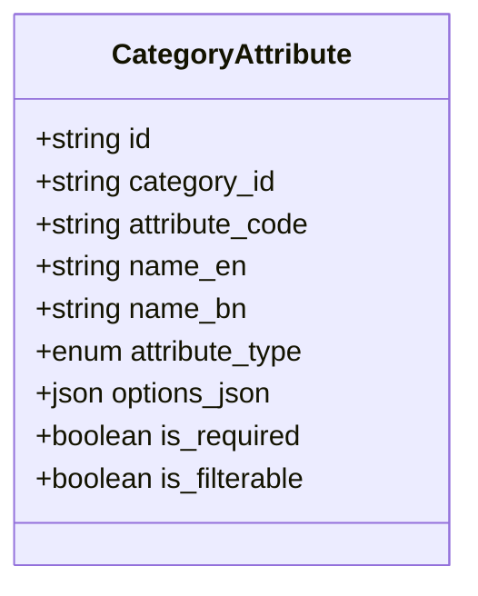
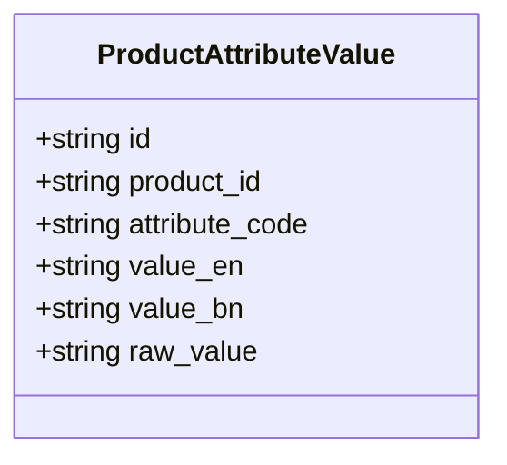
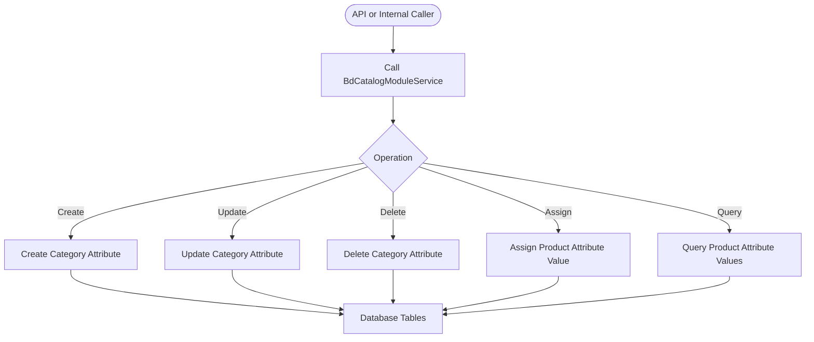
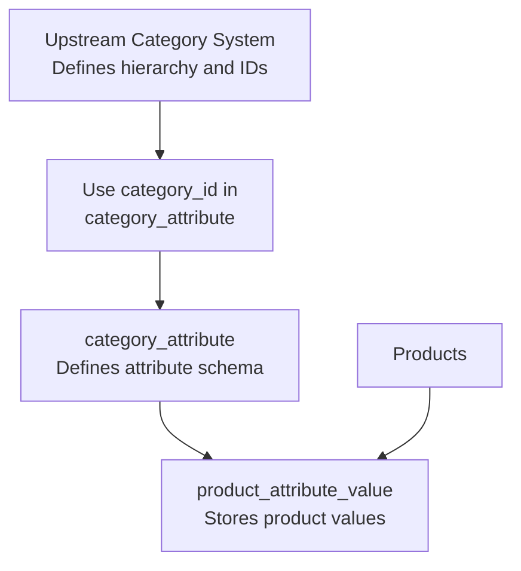
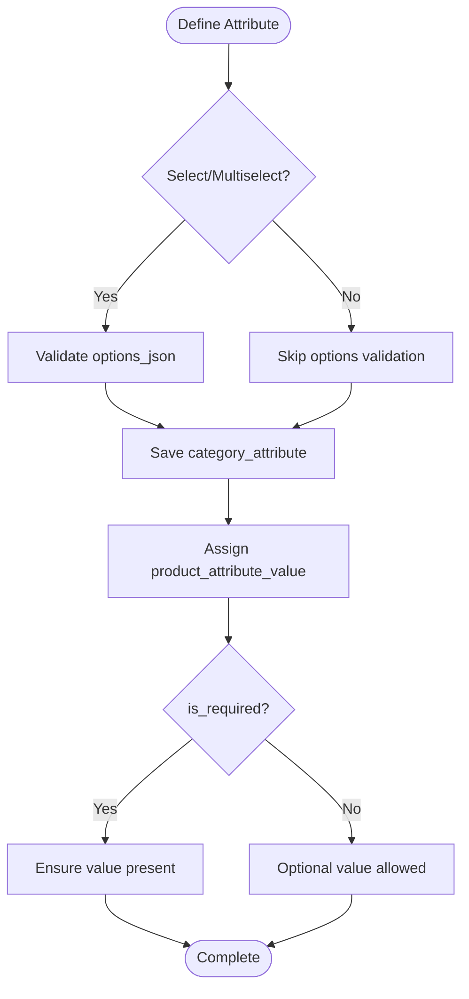
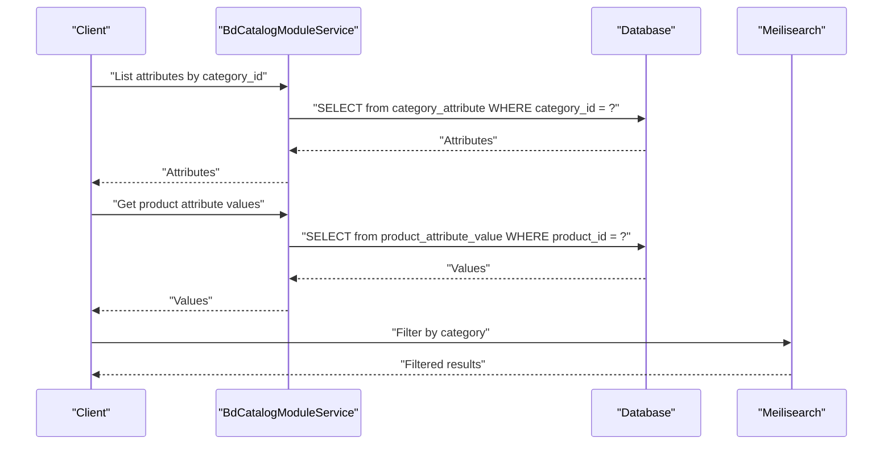
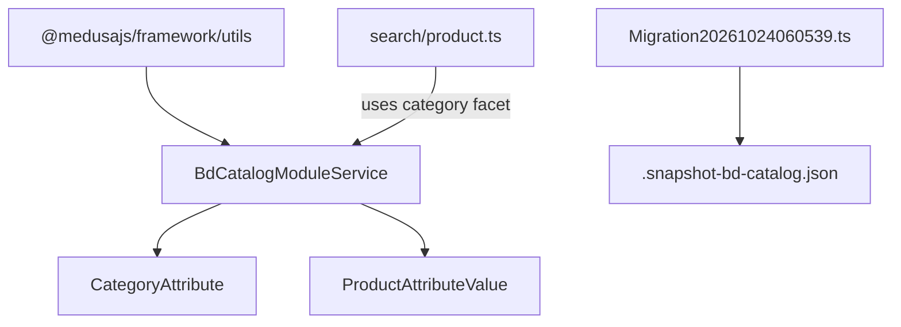

# Category Management System

<cite>
**Referenced Files in This Document**
- [index.ts](file://apps/medusa/src/modules/bd-catalog/index.ts)
- [service.ts](file://apps/medusa/src/modules/bd-catalog/service.ts)
- [category-attribute.ts](file://apps/medusa/src/modules/bd-catalog/models/category-attribute.ts)
- [product-attribute-value.ts](file://apps/medusa/src/modules/bd-catalog/models/product-attribute-value.ts)
- [Migration20261024060539.ts](file://apps/medusa/src/modules/bd-catalog/migrations/Migration20261024060539.ts)
- [.snapshot-bd-catalog.json](file://apps/medusa/src/modules/bd-catalog/migrations/.snapshot-bd-catalog.json)
- [database.md](file://database.md)
- [product.ts](file://apps/medusa/src/search/product.ts)
</cite>

## Table of Contents
1. [Introduction](#introduction)
2. [Project Structure](#project-structure)
3. [Core Components](#core-components)
4. [Architecture Overview](#architecture-overview)
5. [Detailed Component Analysis](#detailed-component-analysis)
6. [Dependency Analysis](#dependency-analysis)
7. [Performance Considerations](#performance-considerations)
8. [Troubleshooting Guide](#troubleshooting-guide)
9. [Conclusion](#conclusion)
10. [Appendices](#appendices)

## Introduction
This document explains the category management system within the BD Catalog module. It focuses on:
- The hierarchical category structure and how categories relate to products
- How category attributes are defined and enforced
- How to create, update, and manage categories with custom attributes
- Examples for defining hierarchies, assigning attributes, and querying data
- Performance considerations for deep category trees and best practices for organization

The current implementation provides a robust foundation for per-category attribute definitions and product-level attribute values. A dedicated category entity is not present in this repository; instead, categories are referenced by identifier and extended through attributes.

## Project Structure
The BD Catalog module is implemented as a Medusa module that exposes service methods for its models. The relevant files include:
- Module registration
- Service class exposing CRUD operations
- Model definitions for category attributes and product attribute values
- Database migration and snapshot
- Documentation describing the intended schema and constraints
- Search configuration referencing category facets

**Diagram sources**
- [index.ts:1-9](file://apps/medusa/src/modules/bd-catalog/index.ts#L1-L9)
- [service.ts:1-15](file://apps/medusa/src/modules/bd-catalog/service.ts#L1-L15)
- [category-attribute.ts:1-16](file://apps/medusa/src/modules/bd-catalog/models/category-attribute.ts#L1-L16)
- [product-attribute-value.ts:1-16](file://apps/medusa/src/modules/bd-catalog/models/product-attribute-value.ts#L1-L16)
- [Migration20261024060539.ts:1-37](file://apps/medusa/src/modules/bd-catalog/migrations/Migration20261024060539.ts#L1-L37)
- [.snapshot-bd-catalog.json:192-280](file://apps/medusa/src/modules/bd-catalog/migrations/.snapshot-bd-catalog.json#L192-L280)
- [database.md:484-523](file://database.md#L484-L523)
- [product.ts:54-54](file://apps/medusa/src/search/product.ts#L54-L54)

**Section sources**
- [index.ts:1-9](file://apps/medusa/src/modules/bd-catalog/index.ts#L1-L9)
- [service.ts:1-15](file://apps/medusa/src/modules/bd-catalog/service.ts#L1-L15)
- [Migration20261024060539.ts:1-37](file://apps/medusa/src/modules/bd-catalog/migrations/Migration20261024060539.ts#L1-L37)
- [database.md:484-523](file://database.md#L484-L523)

## Core Components
- Module registration: Exposes the BD Catalog module under a stable name and registers the service.
- Service class: Extends Medusa’s base service to provide standard CRUD operations for all registered models.
- Category attribute model: Defines per-category attribute metadata such as type, labels, options, and validation flags.
- Product attribute value model: Stores actual attribute values assigned to products.
- Migration and snapshot: Create database tables, indexes, and enforce soft-delete behavior.
- Documentation: Describes the canonical schema including unique constraints and relationships.

Key responsibilities:
- Categories are identified by an external ID reference stored in category attributes.
- Attributes define the shape and validation rules for product attribute values.
- Products store their attribute values against the attribute definition via product_attribute_value.

**Section sources**
- [index.ts:1-9](file://apps/medusa/src/modules/bd-catalog/index.ts#L1-L9)
- [service.ts:1-15](file://apps/medusa/src/modules/bd-catalog/service.ts#L1-L15)
- [category-attribute.ts:1-16](file://apps/medusa/src/modules/bd-catalog/models/category-attribute.ts#L1-L16)
- [product-attribute-value.ts:1-16](file://apps/medusa/src/modules/bd-catalog/models/product-attribute-value.ts#L1-L16)
- [Migration20261024060539.ts:1-37](file://apps/medusa/src/modules/bd-catalog/migrations/Migration20261024060539.ts#L1-L37)
- [database.md:484-523](file://database.md#L484-L523)

## Architecture Overview
The category management architecture centers around two core entities:
- category_attribute: Declares what attributes exist for a given category and how they should be validated.
- product_attribute_value: Records the concrete values for those attributes on individual products.

Categories themselves are referenced by ID rather than modeled as a separate entity in this module. This allows flexible integration with any upstream category system while keeping attribute logic centralized.

**Diagram sources**
- [category-attribute.ts:3-13](file://apps/medusa/src/modules/bd-catalog/models/category-attribute.ts#L3-L13)
- [product-attribute-value.ts:1-16](file://apps/medusa/src/modules/bd-catalog/models/product-attribute-value.ts#L1-L16)

## Detailed Component Analysis

### Category Attribute Model
Purpose:
- Define the schema for category-specific attributes.
- Support multiple input types (select, multiselect, text, boolean).
- Provide bilingual labels and optional JSON options for select-type attributes.
- Control validation and filtering behavior.

Key fields:
- id: Primary key
- category_id: Reference to the category
- attribute_code: Stable code identifying the attribute
- name_en / name_bn: Bilingual display names
- attribute_type: Enumerated input type
- options_json: Options payload for select/multiselect
- is_required: Enforces presence during assignment
- is_filterable: Controls whether the attribute participates in search facets

Indexes:
- category_id
- attribute_code

Constraints and defaults:
- attribute_type defaults to select
- is_required defaults to false
- is_filterable defaults to true

**Diagram sources**
- [category-attribute.ts:3-13](file://apps/medusa/src/modules/bd-catalog/models/category-attribute.ts#L3-L13)

**Section sources**
- [category-attribute.ts:1-16](file://apps/medusa/src/modules/bd-catalog/models/category-attribute.ts#L1-L16)
- [Migration20261024060539.ts:7-10](file://apps/medusa/src/modules/bd-catalog/migrations/Migration20261024060539.ts#L7-L10)
- [.snapshot-bd-catalog.json:207-249](file://apps/medusa/src/modules/bd-catalog/migrations/.snapshot-bd-catalog.json#L207-L249)

### Product Attribute Value Model
Purpose:
- Store product-level values for category-defined attributes.
- Support bilingual values and a raw representation for processing.

Key fields:
- id: Primary key
- product_id: Reference to the product
- attribute_code: Matches the attribute definition
- value_en / value_bn: Bilingual values
- raw_value: Raw representation used by services or integrations

Indexes:
- product_id
- attribute_code

**Diagram sources**
- [product-attribute-value.ts:1-16](file://apps/medusa/src/modules/bd-catalog/models/product-attribute-value.ts#L1-L16)

**Section sources**
- [product-attribute-value.ts:1-16](file://apps/medusa/src/modules/bd-catalog/models/product-attribute-value.ts#L1-L16)
- [Migration20261024060539.ts:12-15](file://apps/medusa/src/modules/bd-catalog/migrations/Migration20261024060539.ts#L12-L15)

### Service Layer
Purpose:
- Provide standardized CRUD operations for category attributes and product attribute values.
- Act as the integration point for other modules and APIs.

Responsibilities:
- Create, read, update, delete category attributes
- Assign and manage product attribute values
- Serve as the source of truth for catalog attribute metadata and values

**Diagram sources**
- [service.ts:1-15](file://apps/medusa/src/modules/bd-catalog/service.ts#L1-L15)

**Section sources**
- [service.ts:1-15](file://apps/medusa/src/modules/bd-catalog/service.ts#L1-L15)

### Category Hierarchy and Relationship with Products
Current state:
- There is no dedicated category entity in this module.
- Categories are referenced by ID in category_attribute.category_id.
- Products are linked to attributes via product_attribute_value.product_id and attribute_code.

Recommended approach:
- Maintain category hierarchy in your upstream category system.
- Use category_id consistently across category_attribute rows to group attributes by category.
- When assigning attributes to products, ensure attribute_code matches a valid category_attribute definition for that category.

[No sources needed since this diagram shows conceptual workflow, not actual code structure]

### Creating and Managing Categories with Custom Attributes
Conceptual steps:
- Define category attributes for each category using category_attribute.
- For select/multiselect types, populate options_json with available choices.
- Set is_required and is_filterable according to business needs.
- Assign attribute values to products using product_attribute_value.

Validation flow:

**Diagram sources**
- [category-attribute.ts:9-12](file://apps/medusa/src/modules/bd-catalog/models/category-attribute.ts#L9-L12)
- [product-attribute-value.ts:1-16](file://apps/medusa/src/modules/bd-catalog/models/product-attribute-value.ts#L1-L16)

**Section sources**
- [category-attribute.ts:1-16](file://apps/medusa/src/modules/bd-catalog/models/category-attribute.ts#L1-L16)
- [product-attribute-value.ts:1-16](file://apps/medusa/src/modules/bd-catalog/models/product-attribute-value.ts#L1-L16)

### Querying Category Data
Common queries:
- List all attributes for a category: filter by category_id.
- Retrieve product attribute values: filter by product_id and attribute_code.
- Faceted search: use is_filterable to enable Meilisearch facets where applicable.

Search integration:
- The product search configuration includes a category field marked as filterable and facetable, enabling category-based navigation.

**Diagram sources**
- [service.ts:1-15](file://apps/medusa/src/modules/bd-catalog/service.ts#L1-L15)
- [product.ts:54-54](file://apps/medusa/src/search/product.ts#L54-L54)

**Section sources**
- [service.ts:1-15](file://apps/medusa/src/modules/bd-catalog/service.ts#L1-L15)
- [product.ts:54-54](file://apps/medusa/src/search/product.ts#L54-L54)

## Dependency Analysis
The BD Catalog module depends on:
- Medusa framework utilities for service and model definitions
- Database tables created by migrations
- Search configuration for category facets

**Diagram sources**
- [service.ts:1-15](file://apps/medusa/src/modules/bd-catalog/service.ts#L1-L15)
- [Migration20261024060539.ts:1-37](file://apps/medusa/src/modules/bd-catalog/migrations/Migration20261024060539.ts#L1-L37)
- [.snapshot-bd-catalog.json:192-280](file://apps/medusa/src/modules/bd-catalog/migrations/.snapshot-bd-catalog.json#L192-L280)
- [product.ts:54-54](file://apps/medusa/src/search/product.ts#L54-L54)

**Section sources**
- [service.ts:1-15](file://apps/medusa/src/modules/bd-catalog/service.ts#L1-L15)
- [Migration20261024060539.ts:1-37](file://apps/medusa/src/modules/bd-catalog/migrations/Migration20261024060539.ts#L1-L37)
- [.snapshot-bd-catalog.json:192-280](file://apps/medusa/src/modules/bd-catalog/migrations/.snapshot-bd-catalog.json#L192-L280)
- [product.ts:54-54](file://apps/medusa/src/search/product.ts#L54-L54)

## Performance Considerations
- Index usage:
  - category_attribute has indexes on category_id and attribute_code to optimize lookups by category and attribute code.
  - product_attribute_value has indexes on product_id and attribute_code to speed up product-level queries and facet generation.
- Soft deletes:
  - Both tables include deleted_at columns with partial indexes to improve query performance when excluding soft-deleted records.
- Facets and search:
  - is_filterable controls whether attributes participate in search facets; limit the number of highly cardinality attributes to reduce index size and query cost.
- Deep category trees:
  - Since categories are referenced by ID, avoid joining large category hierarchies at query time. Cache category metadata and precompute common aggregations if necessary.
- Batch operations:
  - Prefer batch inserts/updates for assigning many product attribute values to reduce transaction overhead.

**Section sources**
- [Migration20261024060539.ts:7-15](file://apps/medusa/src/modules/bd-catalog/migrations/Migration20261024060539.ts#L7-L15)
- [.snapshot-bd-catalog.json:207-249](file://apps/medusa/src/modules/bd-catalog/migrations/.snapshot-bd-catalog.json#L207-L249)
- [database.md:484-523](file://database.md#L484-L523)

## Troubleshooting Guide
Common issues and resolutions:
- Missing category_id:
  - Ensure every category_attribute row references a valid category_id from your upstream category system.
- Duplicate attribute codes:
  - The documented design enforces uniqueness per category; verify application-level checks align with database constraints.
- Invalid select/multiselect options:
  - Validate options_json against expected schema before saving category_attribute.
- Required attributes missing on products:
  - Enforce is_required checks when assigning product_attribute_value.
- Search facet inconsistencies:
  - Confirm is_filterable is set appropriately and that product_attribute_value entries exist for queried attributes.

Operational checks:
- Verify indexes exist for category_id and attribute_code on both tables.
- Confirm soft-delete behavior is consistent across reads and writes.
- Align application validation rules with documented constraints.

**Section sources**
- [Migration20261024060539.ts:7-15](file://apps/medusa/src/modules/bd-catalog/migrations/Migration20261024060539.ts#L7-L15)
- [database.md:484-523](file://database.md#L484-L523)

## Conclusion
The BD Catalog module provides a solid foundation for managing category attributes and product attribute values. While categories themselves are not modeled as entities here, the design supports flexible integration with any upstream category system. By leveraging category_attribute for schema definition and product_attribute_value for concrete values, you can implement rich, filterable catalogs with strong validation and performance characteristics. Follow the best practices outlined above to maintain consistency, scalability, and clarity in your category organization.

## Appendices

### Best Practices for Category Organization
- Keep category_id stable and globally unique across systems.
- Normalize attribute codes and reuse them across categories where appropriate.
- Limit high-cardinality filterable attributes to maintain search performance.
- Use options_json for structured select/multiselect definitions and validate thoroughly.
- Mark attributes as required only when essential to product completeness.

### Example Scenarios
- Defining a “Material” attribute for a clothing category:
  - attribute_type: select
  - options_json: predefined materials
  - is_required: true
  - is_filterable: true
- Assigning material values to products:
  - product_attribute_value.product_id points to the product
  - product_attribute_value.attribute_code matches “material”
  - value_en/value_bn contain localized display values

[No sources needed since this section provides general guidance]