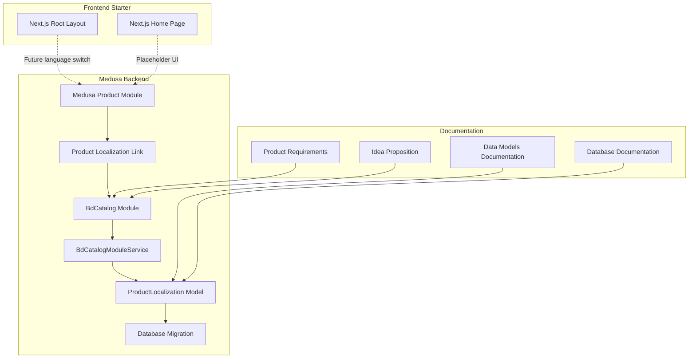
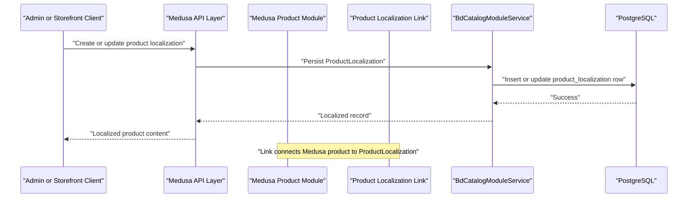
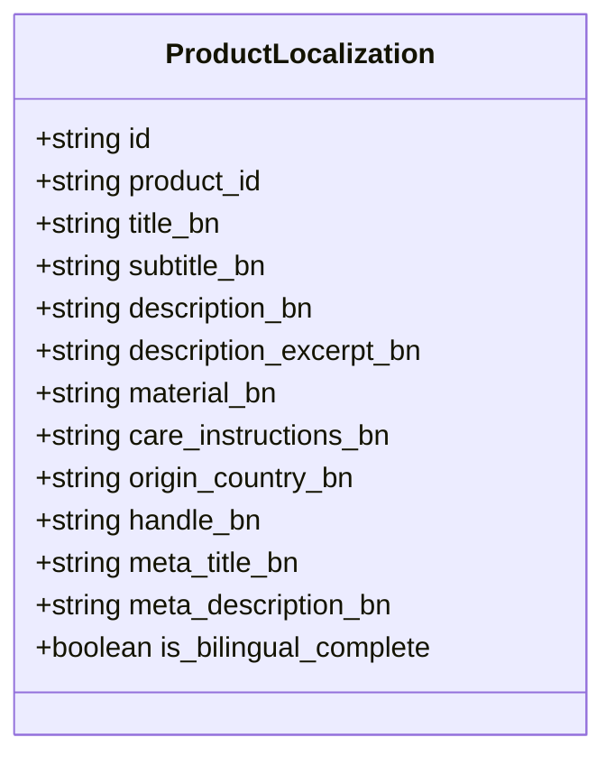
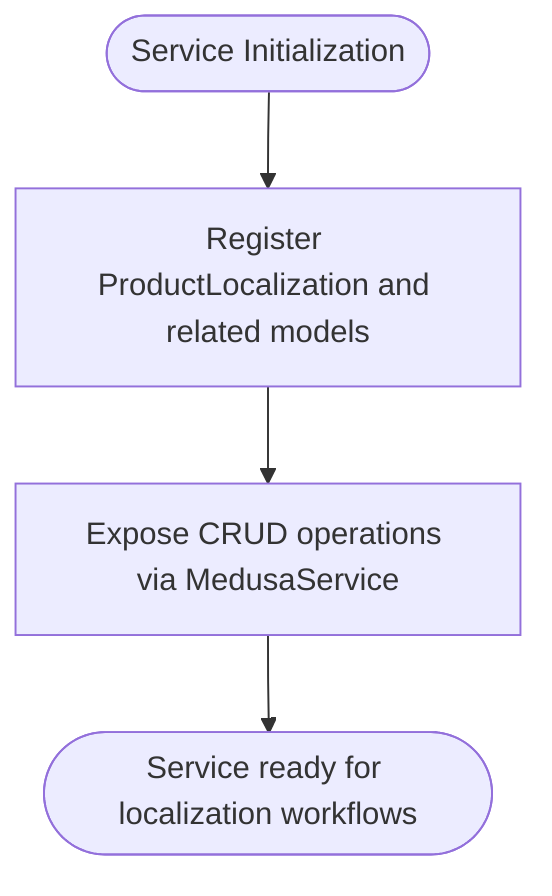
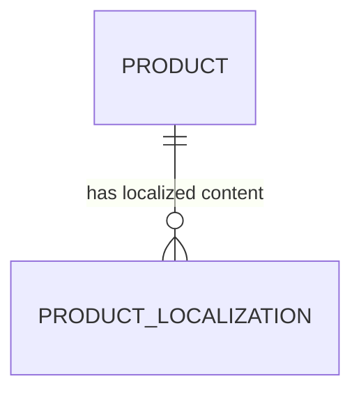
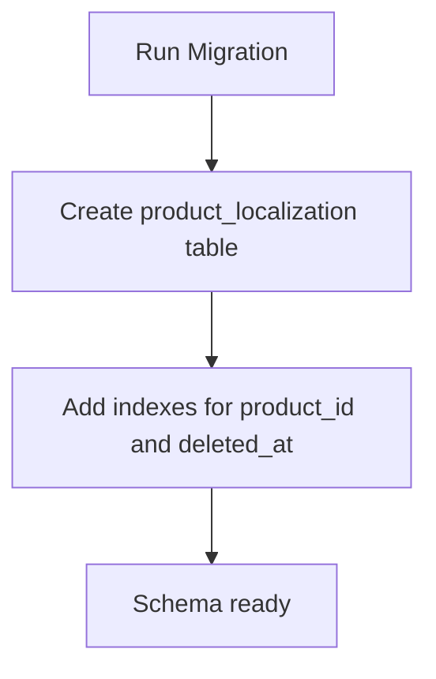
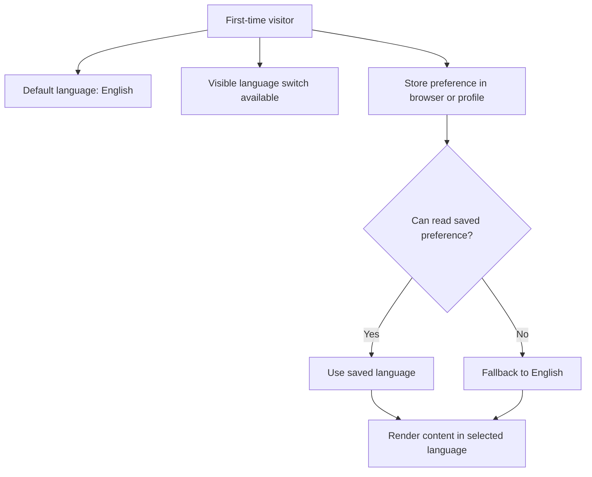
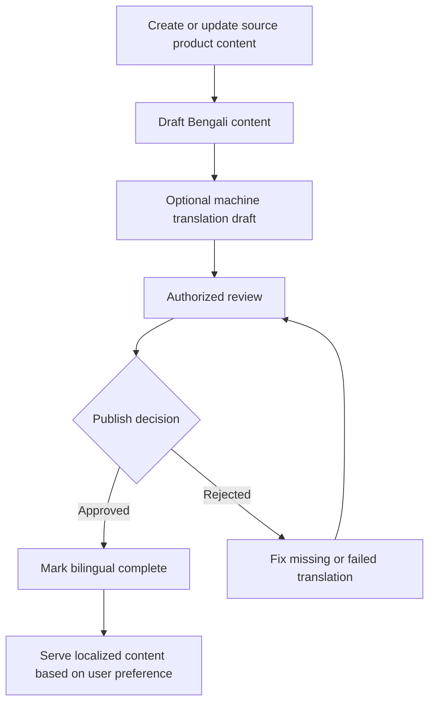
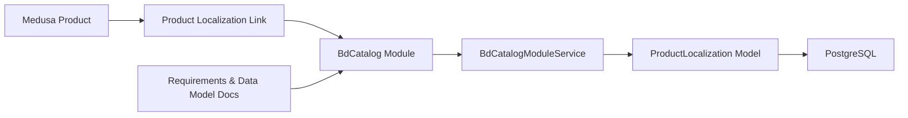

# Multi-language Content Management

<cite>
**Referenced Files in This Document**
- [product-localization.ts](file://apps/medusa/src/modules/bd-catalog/models/product-localization.ts)
- [service.ts](file://apps/medusa/src/modules/bd-catalog/service.ts)
- [product-localization.ts](file://apps/medusa/src/links/product-localization.ts)
- [Migration20261024060539.ts](file://apps/medusa/src/modules/bd-catalog/migrations/Migration20261024060539.ts)
- [data-models.md](file://docs/data-models.md)
- [database.md](file://database.md)
- [prd.md](file://prd.md)
- [ideaproposition.md](file://ideaproposition.md)
- [layout.tsx](file://apps/web/src/app/layout.tsx)
- [page.tsx](file://apps/web/src/app/page.tsx)
</cite>

## Table of Contents
1. [Introduction](#introduction)
2. [Project Structure](#project-structure)
3. [Core Components](#core-components)
4. [Architecture Overview](#architecture-overview)
5. [Detailed Component Analysis](#detailed-component-analysis)
6. [Dependency Analysis](#dependency-analysis)
7. [Performance Considerations](#performance-considerations)
8. [Troubleshooting Guide](#troubleshooting-guide)
9. [Conclusion](#conclusion)

## Introduction
This document explains how the BD Commerce Platform manages multi-language content, focusing on Bangla and English product content. The system supports:
- Storing Bengali editorial fields alongside native Medusa product data.
- Linking localized content to products through a dedicated module.
- Enforcing translation completeness with a bilingual flag.
- Defining language-switch behavior, default preferences, and fallback rules at the product level.
- Preparing for future storefront and Admin localization workflows.

The current implementation provides the data model, database migration, service registration, and link between Medusa’s product entity and the new `ProductLocalization` entity. Storefront language switching is defined as a requirement but not yet implemented in the Next.js starter page.

## Project Structure
The multi-language capability lives primarily in the Medusa backend under the custom `bd-catalog` module, with documentation describing the intended data model and requirements.

**Diagram sources**
- [product-localization.ts:1-20](file://apps/medusa/src/modules/bd-catalog/models/product-localization.ts#L1-L20)
- [service.ts:1-15](file://apps/medusa/src/modules/bd-catalog/service.ts#L1-L15)
- [product-localization.ts:1-9](file://apps/medusa/src/links/product-localization.ts#L1-L9)
- [Migration20261024060539.ts:1-37](file://apps/medusa/src/modules/bd-catalog/migrations/Migration20261024060539.ts#L1-L37)
- [data-models.md:71-96](file://docs/data-models.md#L71-L96)
- [database.md:411-435](file://database.md#L411-L435)
- [prd.md:357-391](file://prd.md#L357-L391)
- [ideaproposition.md:189-206](file://ideaproposition.md#L189-L206)
- [layout.tsx:1-22](file://apps/web/src/app/layout.tsx#L1-L22)
- [page.tsx:1-81](file://apps/web/src/app/page.tsx#L1-L81)

**Section sources**
- [product-localization.ts:1-20](file://apps/medusa/src/modules/bd-catalog/models/product-localization.ts#L1-L20)
- [service.ts:1-15](file://apps/medusa/src/modules/bd-catalog/service.ts#L1-L15)
- [product-localization.ts:1-9](file://apps/medusa/src/links/product-localization.ts#L1-L9)
- [Migration20261024060539.ts:1-37](file://apps/medusa/src/modules/bd-catalog/migrations/Migration20261024060539.ts#L1-L37)
- [data-models.md:71-96](file://docs/data-models.md#L71-L96)
- [database.md:411-435](file://database.md#L411-L435)
- [prd.md:357-391](file://prd.md#L357-L391)
- [ideaproposition.md:189-206](file://ideaproposition.md#L189-L206)
- [layout.tsx:1-22](file://apps/web/src/app/layout.tsx#L1-L22)
- [page.tsx:1-81](file://apps/web/src/app/page.tsx#L1-L81)

## Core Components
The multi-language system is built around these core components:

| Component | Responsibility | Current Status |
|---|---|---|
| `ProductLocalization` model | Defines Bengali product fields and completion flag | Implemented |
| `BdCatalogModuleService` | Exposes CRUD operations for localization entities via Medusa service layer | Implemented |
| Product localization link | Connects Medusa’s product entity to `ProductLocalization` | Implemented |
| Database migration | Creates the `product_localization` table and indexes | Implemented |
| Documentation | Describes model intent, constraints, and workflow expectations | Implemented |
| Storefront language switch | User-facing language selection and preference handling | Defined by requirements; not yet implemented in starter code |

Key design principles:
- Native product title, subtitle, description, and material are managed by Medusa’s translatable mechanism and must not be duplicated here.
- Bengali editorial fields are stored separately in `product_localization`.
- A boolean flag tracks whether the bilingual content is considered complete.
- Searchable fields include Bengali title and description.

**Section sources**
- [product-localization.ts:1-20](file://apps/medusa/src/modules/bd-catalog/models/product-localization.ts#L1-L20)
- [service.ts:1-15](file://apps/medusa/src/modules/bd-catalog/service.ts#L1-L15)
- [product-localization.ts:1-9](file://apps/medusa/src/links/product-localization.ts#L1-L9)
- [database.md:411-435](file://database.md#L411-L435)
- [data-models.md:71-96](file://docs/data-models.md#L71-L96)

## Architecture Overview
At runtime, the architecture separates concerns between Medusa’s product domain and the custom catalog module:

**Diagram sources**
- [product-localization.ts:1-9](file://apps/medusa/src/links/product-localization.ts#L1-L9)
- [service.ts:1-15](file://apps/medusa/src/modules/bd-catalog/service.ts#L1-L15)
- [product-localization.ts:1-20](file://apps/medusa/src/modules/bd-catalog/models/product-localization.ts#L1-L20)
- [Migration20261024060539.ts:17-19](file://apps/medusa/src/modules/bd-catalog/migrations/Migration20261024060539.ts#L17-L19)

## Detailed Component Analysis

### ProductLocalization Model
The `ProductLocalization` model defines Bengali-specific product fields and a completion flag. It is designed for editorial content rather than duplicating native translatable fields.

Design notes:
- `title_bn` and `description_bn` are marked searchable, supporting Bengali search indexing.
- `origin_country_bn` has a default value indicating Bangladesh.
- `is_bilingual_complete` is a derived convenience flag maintained by workflows.
- The model does not include machine-translation metadata such as source hash or review status in the current schema, although those concepts appear in documentation.

**Diagram sources**
- [product-localization.ts:1-20](file://apps/medusa/src/modules/bd-catalog/models/product-localization.ts#L1-L20)

**Section sources**
- [product-localization.ts:1-20](file://apps/medusa/src/modules/bd-catalog/models/product-localization.ts#L1-L20)
- [data-models.md:71-96](file://docs/data-models.md#L71-L96)
- [database.md:411-435](file://database.md#L411-L435)

### Service Layer
The `BdCatalogModuleService` extends Medusa’s service base and registers the localization model along with other catalog-related models. This exposes standard service methods for creating, updating, querying, and deleting localized records.

**Diagram sources**
- [service.ts:1-15](file://apps/medusa/src/modules/bd-catalog/service.ts#L1-L15)

**Section sources**
- [service.ts:1-15](file://apps/medusa/src/modules/bd-catalog/service.ts#L1-L15)

### Link Between Product and Localization
The link connects Medusa’s product entity to the `ProductLocalization` entity, enabling relational queries and consistent data access patterns.

**Diagram sources**
- [product-localization.ts:1-9](file://apps/medusa/src/links/product-localization.ts#L1-L9)

**Section sources**
- [product-localization.ts:1-9](file://apps/medusa/src/links/product-localization.ts#L1-L9)

### Database Schema and Migration
The migration creates the `product_localization` table, including Bengali fields, timestamps, soft delete support, and indexes for product lookup and deletion filtering.

**Diagram sources**
- [Migration20261024060539.ts:17-19](file://apps/medusa/src/modules/bd-catalog/migrations/Migration20261024060539.ts#L17-L19)

**Section sources**
- [Migration20261024060539.ts:1-37](file://apps/medusa/src/modules/bd-catalog/migrations/Migration20261024060539.ts#L1-L37)

### Language Switching and Preferences
The product requirements define clear behavior for language switching, default preferences, and fallback rules:
- Default storefront language is English.
- A visible language switch should preserve current state.
- Guest preferences may be stored in the browser; account users can sync preferences.
- Admin language preference is separate from storefront preference.
- If a saved preference cannot be read, fall back to English.

The Next.js starter layout currently sets the root HTML language to English and does not implement dynamic language switching.

**Diagram sources**
- [prd.md:357-391](file://prd.md#L357-L391)
- [ideaproposition.md:189-206](file://ideaproposition.md#L189-L206)
- [layout.tsx:1-22](file://apps/web/src/app/layout.tsx#L1-L22)

**Section sources**
- [prd.md:357-391](file://prd.md#L357-L391)
- [ideaproposition.md:189-206](file://ideaproposition.md#L189-L206)
- [layout.tsx:1-22](file://apps/web/src/app/layout.tsx#L1-L22)
- [page.tsx:1-81](file://apps/web/src/app/page.tsx#L1-L81)

### Translation Workflow and Completeness
The documentation describes a translation workflow that includes manual entry, optional machine-drafted translations, review, publishing, and failure handling. The current schema focuses on editorial fields and a completion flag; additional workflow metadata such as translation source, status, reviewer, and failure reason appears in documentation but is not present in the active model.

**Diagram sources**
- [database.md:411-435](file://database.md#L411-L435)
- [prd.md:357-391](file://prd.md#L357-L391)
- [product-localization.ts:1-20](file://apps/medusa/src/modules/bd-catalog/models/product-localization.ts#L1-L20)

**Section sources**
- [database.md:411-435](file://database.md#L411-L435)
- [prd.md:357-391](file://prd.md#L357-L391)
- [product-localization.ts:1-20](file://apps/medusa/src/modules/bd-catalog/models/product-localization.ts#L1-L20)

## Dependency Analysis
The localization feature depends on:
- Medusa’s product module for the primary product entity.
- The custom `bd-catalog` module for Bengali editorial fields.
- PostgreSQL for persistence.
- Documentation artifacts defining requirements and model intent.

**Diagram sources**
- [product-localization.ts:1-9](file://apps/medusa/src/links/product-localization.ts#L1-L9)
- [service.ts:1-15](file://apps/medusa/src/modules/bd-catalog/service.ts#L1-L15)
- [product-localization.ts:1-20](file://apps/medusa/src/modules/bd-catalog/models/product-localization.ts#L1-L20)
- [data-models.md:71-96](file://docs/data-models.md#L71-L96)
- [database.md:411-435](file://database.md#L411-L435)

**Section sources**
- [product-localization.ts:1-9](file://apps/medusa/src/links/product-localization.ts#L1-L9)
- [service.ts:1-15](file://apps/medusa/src/modules/bd-catalog/service.ts#L1-L15)
- [product-localization.ts:1-20](file://apps/medusa/src/modules/bd-catalog/models/product-localization.ts#L1-L20)
- [data-models.md:71-96](file://docs/data-models.md#L71-L96)
- [database.md:411-435](file://database.md#L411-L435)

## Performance Considerations
For large catalogs with multiple translations, consider the following approaches aligned with the current design:

- Prefer fetching only the needed language fields. Since Bengali fields are stored separately, avoid loading all localized columns when serving English-only content.
- Use the existing index on `product_id` to quickly locate the localization record for a given product.
- Cache localized product responses at the API or CDN layer when content changes infrequently.
- Keep search fields limited to necessary columns; the model marks Bengali title and description as searchable, which can improve search performance if integrated with a search engine.
- Avoid duplicating native translatable fields; rely on Medusa’s translation mechanism for English content and use `product_localization` only for Bengali editorial fields.
- Monitor query plans for joins between products and localization records, especially when filtering by Bengali slugs or SEO metadata.

[No sources needed since this section provides general guidance]

## Troubleshooting Guide
Common issues and resolutions:

| Issue | Likely Cause | Resolution |
|---|---|---|
| Bengali content not appearing | Missing `ProductLocalization` record for the product | Create or update the localization record for the product ID |
| Bilingual completeness not updated | Workflow not maintaining `is_bilingual_complete` | Ensure the workflow updates the flag after successful review/publish |
| Search returns unexpected results | Search integration not scoped to Bengali fields | Verify search queries target `title_bn` and `description_bn` where appropriate |
| Slug conflicts | Duplicate or inconsistent `handle_bn` values | Enforce uniqueness checks and regenerate slugs when needed |
| Default country not applied | Service logic not setting default | Confirm service applies default origin country when creating localization records |
| Language switch does nothing | Frontend not implemented yet | Implement language preference handling per requirements; update Next.js layout and pages |

**Section sources**
- [product-localization.ts:1-20](file://apps/medusa/src/modules/bd-catalog/models/product-localization.ts#L1-L20)
- [database.md:411-435](file://database.md#L411-L435)
- [prd.md:357-391](file://prd.md#L357-L391)

## Conclusion
The BD Commerce Platform’s multi-language foundation centers on a dedicated `ProductLocalization` model linked to Medusa’s product entity. The current implementation provides the data structure, service exposure, and database schema required to store Bengali editorial content and track bilingual completeness. Requirements clearly define language switching, default preferences, and translation workflow expectations, while the Next.js starter remains a placeholder for frontend localization. Future work should implement storefront language switching, integrate search with Bengali fields, and extend the model or workflow to support machine translation metadata and review states as described in the documentation.

[No sources needed since this section summarizes without analyzing specific files]