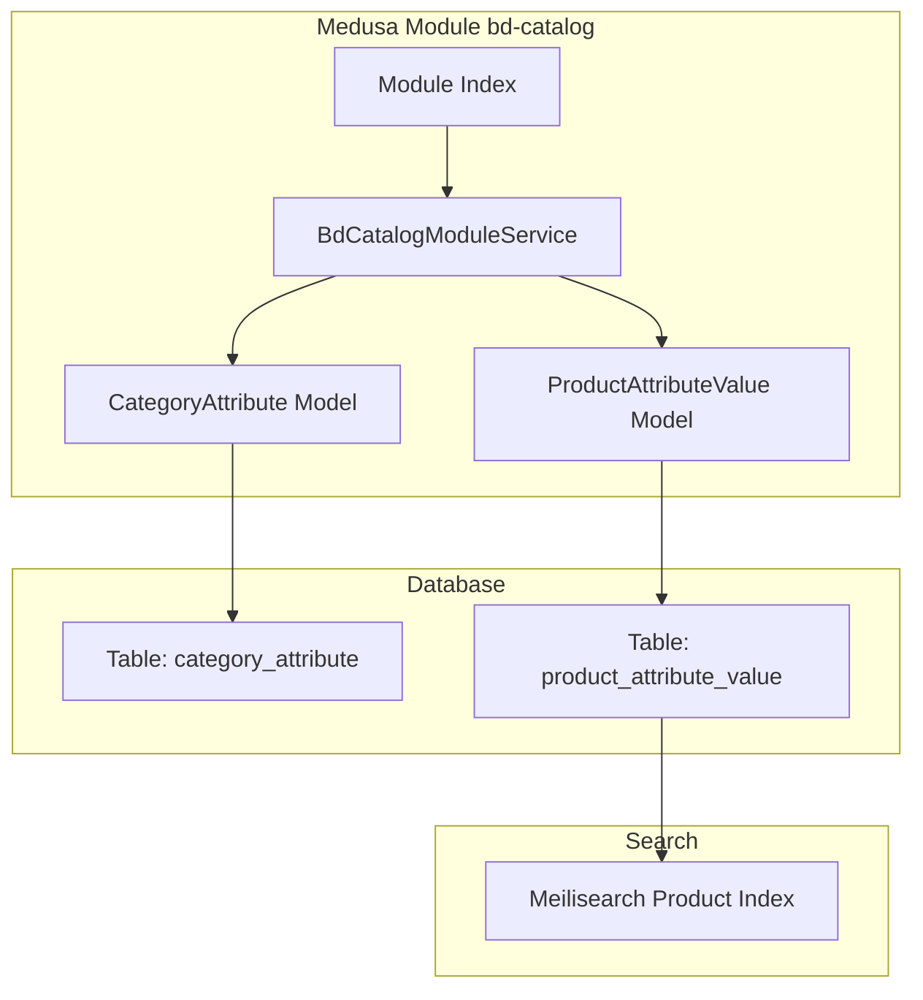
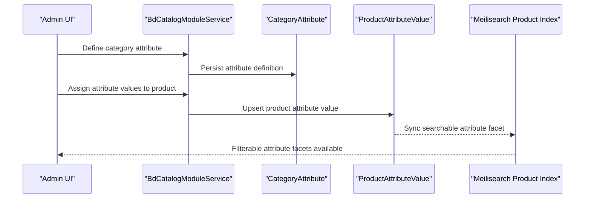
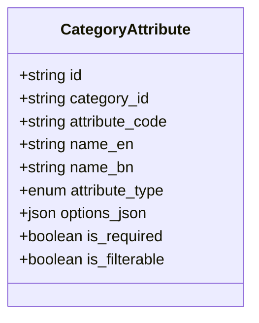
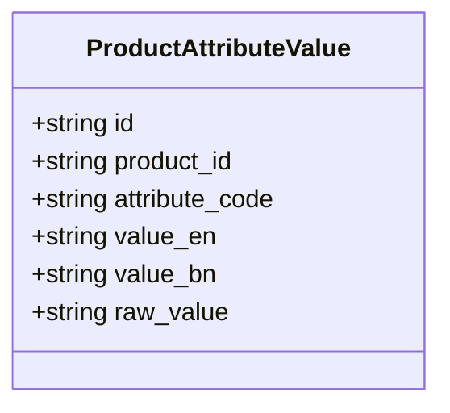
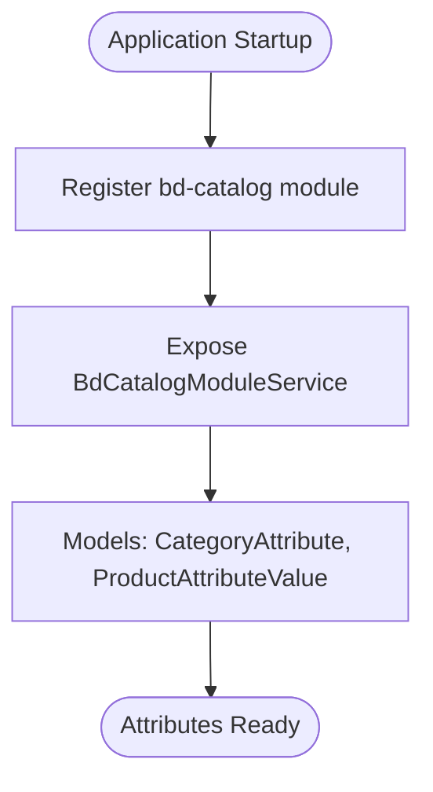
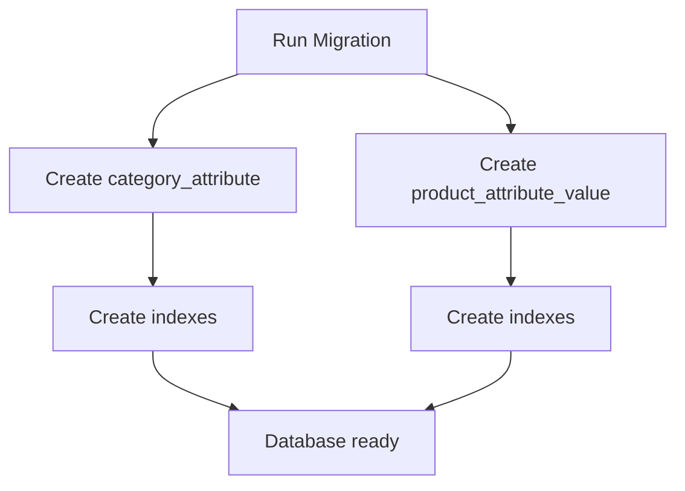
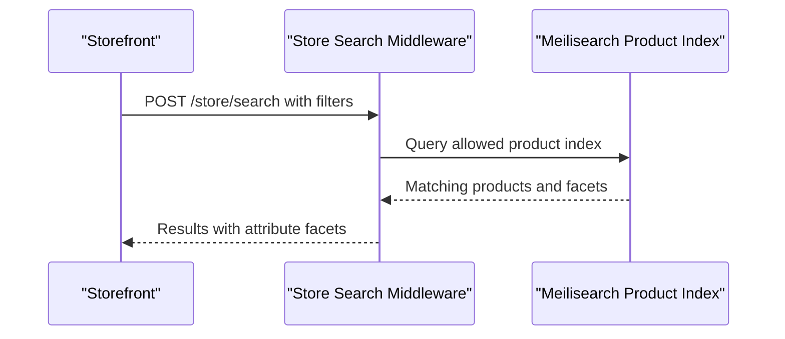
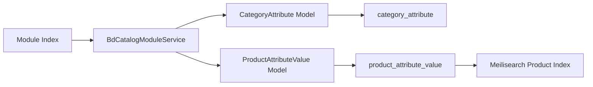
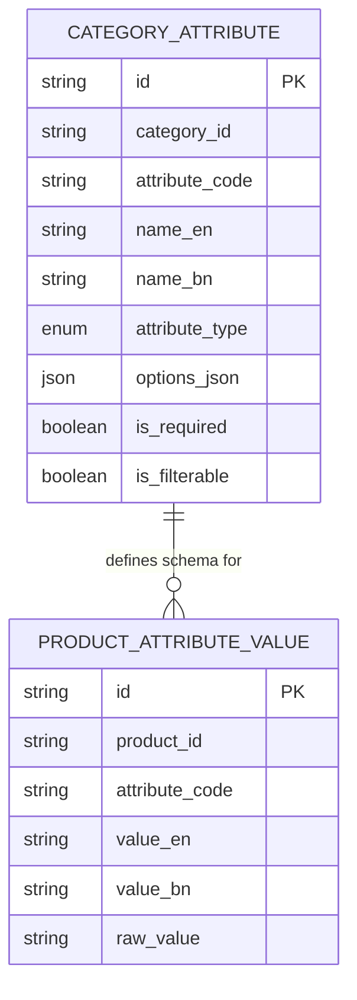

# Product Attributes System

<cite>
**Referenced Files in This Document**
- [category-attribute.ts](file://apps/medusa/src/modules/bd-catalog/models/category-attribute.ts)
- [product-attribute-value.ts](file://apps/medusa/src/modules/bd-catalog/models/product-attribute-value.ts)
- [service.ts](file://apps/medusa/src/modules/bd-catalog/service.ts)
- [index.ts](file://apps/medusa/src/modules/bd-catalog/index.ts)
- [Migration20261024060539.ts](file://apps/medusa/src/modules/bd-catalog/migrations/Migration20261024060539.ts)
- [.snapshot-bd-catalog.json](file://apps/medusa/src/modules/bd-catalog/migrations/.snapshot-bd-catalog.json)
- [data-models.md](file://docs/data-models.md)
- [database.md](file://database.md)
- [architecture.md](file://docs/architecture.md)
- [product.ts](file://apps/medusa/src/search/product.ts)
- [middlewares.ts](file://apps/medusa/src/api/middlewares.ts)
</cite>

## Table of Contents
1. [Introduction](#introduction)
2. [Project Structure](#project-structure)
3. [Core Components](#core-components)
4. [Architecture Overview](#architecture-overview)
5. [Detailed Component Analysis](#detailed-component-analysis)
6. [Dependency Analysis](#dependency-analysis)
7. [Performance Considerations](#performance-considerations)
8. [Troubleshooting Guide](#troubleshooting-guide)
9. [Conclusion](#conclusion)
10. [Appendices](#appendices)

## Introduction
This document explains the product attributes system used by the Bangladesh single-vendor e-commerce platform. It covers how to define category-scoped dynamic attributes, assign attribute values to products, manage attribute types, and integrate attribute data with search faceting. It also documents validation rules, data integrity constraints, and practical workflows for creating products with text, number, boolean, and select attributes.

The current implementation provides:
- Category-level attribute definitions using a Medusa DML model.
- Per-product attribute value records keyed by an attribute code.
- Database indexes optimized for product lookups and attribute filtering.
- Search configuration that exposes filterable fields, including attribute facets.

## Project Structure
The product attributes feature lives inside the `bd-catalog` module. The relevant pieces are:
- DML models for category attribute definitions and per-product attribute values.
- A Medusa service exposing these models through the module.
- Module registration wiring the service into the framework.
- Database migrations defining tables and indexes.
- Documentation describing entity semantics and constraints.
- Search index configuration enabling attribute-based filtering.

**Diagram sources**
- [service.ts:7-12](file://apps/medusa/src/modules/bd-catalog/service.ts#L7-L12)
- [category-attribute.ts:3-13](file://apps/medusa/src/modules/bd-catalog/models/category-attribute.ts#L3-L13)
- [product-attribute-value.ts:3-10](file://apps/medusa/src/modules/bd-catalog/models/product-attribute-value.ts#L3-L10)
- [Migration20261024060539.ts:7-15](file://apps/medusa/src/modules/bd-catalog/migrations/Migration20261024060539.ts#L7-L15)
- [product.ts:43-68](file://apps/medusa/src/search/product.ts#L43-L68)

**Section sources**
- [service.ts:1-15](file://apps/medusa/src/modules/bd-catalog/service.ts#L1-L15)
- [index.ts:1-9](file://apps/medusa/src/modules/bd-catalog/index.ts#L1-L9)
- [Migration20261024060539.ts:1-37](file://apps/medusa/src/modules/bd-catalog/migrations/Migration20261024060539.ts#L1-L37)

## Core Components
The attributes system is built around two core entities:

- CategoryAttribute defines reusable attribute schemas scoped to a product category. It includes:
  - A stable attribute code.
  - Bilingual display names.
  - An input type such as select, multiselect, text, or boolean.
  - Optional permitted options.
  - Flags controlling requirement and search faceting.

- ProductAttributeValue stores one attribute value per product per attribute code. It includes:
  - The product identifier.
  - The matching attribute code.
  - English and Bengali display values.
  - A normalized raw value for faceted search matching.

These models are exposed through the catalog module service and persisted via database migrations.

**Section sources**
- [category-attribute.ts:3-13](file://apps/medusa/src/modules/bd-catalog/models/category-attribute.ts#L3-L13)
- [product-attribute-value.ts:3-10](file://apps/medusa/src/modules/bd-catalog/models/product-attribute-value.ts#L3-L10)
- [service.ts:7-12](file://apps/medusa/src/modules/bd-catalog/service.ts#L7-L12)
- [data-models.md:102-127](file://docs/data-models.md#L102-L127)

## Architecture Overview
The attributes architecture connects category definitions, product values, and search faceting:

- Administrators define attributes at the category level.
- Products inherit required attributes from their assigned category.
- Merchants assign values to each attribute on a product.
- Attribute values are indexed for fast filtering and faceted search.

**Diagram sources**
- [service.ts:7-12](file://apps/medusa/src/modules/bd-catalog/service.ts#L7-L12)
- [category-attribute.ts:3-13](file://apps/medusa/src/modules/bd-catalog/models/category-attribute.ts#L3-L13)
- [product-attribute-value.ts:3-10](file://apps/medusa/src/modules/bd-catalog/models/product-attribute-value.ts#L3-L10)
- [product.ts:43-68](file://apps/medusa/src/search/product.ts#L43-L68)

## Detailed Component Analysis

### CategoryAttribute Model
The category attribute model defines reusable attribute schemas tied to a product category. Key aspects:
- Primary key and indexing on category and attribute code.
- Bilingual labels for display.
- Enumerated input type supporting select, multiselect, text, and boolean.
- JSON field for permitted option values when applicable.
- Boolean flags for requirement and search faceting.

**Diagram sources**
- [category-attribute.ts:3-13](file://apps/medusa/src/modules/bd-catalog/models/category-attribute.ts#L3-L13)

**Section sources**
- [category-attribute.ts:3-13](file://apps/medusa/src/modules/bd-catalog/models/category-attribute.ts#L3-L13)
- [data-models.md:102-115](file://docs/data-models.md#L102-L115)

### ProductAttributeValue Model
The product attribute value model stores one row per product per attribute code. Key aspects:
- Indexed foreign keys for product and attribute code.
- Bilingual display values.
- Normalized raw value for faceted search matching.

**Diagram sources**
- [product-attribute-value.ts:3-10](file://apps/medusa/src/modules/bd-catalog/models/product-attribute-value.ts#L3-L10)

**Section sources**
- [product-attribute-value.ts:3-10](file://apps/medusa/src/modules/bd-catalog/models/product-attribute-value.ts#L3-L10)
- [data-models.md:117-127](file://docs/data-models.md#L117-L127)

### Module Service and Registration
The catalog module service registers the attribute models so they can be queried and updated through Medusa’s service layer. The module index wires the service into the framework under a stable module key.

**Diagram sources**
- [index.ts:4-8](file://apps/medusa/src/modules/bd-catalog/index.ts#L4-L8)
- [service.ts:7-12](file://apps/medusa/src/modules/bd-catalog/service.ts#L7-L12)

**Section sources**
- [index.ts:1-9](file://apps/medusa/src/modules/bd-catalog/index.ts#L1-L9)
- [service.ts:1-15](file://apps/medusa/src/modules/bd-catalog/service.ts#L1-L15)

### Database Schema and Constraints
The migration creates the attribute tables and indexes. Important points:
- Tables for category attributes and product attribute values.
- Indexes on category_id, attribute_code, product_id, and deleted_at for efficient queries.
- The snapshot confirms table structure and indexes.

**Diagram sources**
- [Migration20261024060539.ts:7-15](file://apps/medusa/src/modules/bd-catalog/migrations/Migration20261024060539.ts#L7-L15)
- [.snapshot-bd-catalog.json:207-232](file://apps/medusa/src/modules/bd-catalog/migrations/.snapshot-bd-catalog.json#L207-L232)
- [.snapshot-bd-catalog.json:399-442](file://apps/medusa/src/modules/bd-catalog/migrations/.snapshot-bd-catalog.json#L399-L442)

**Section sources**
- [Migration20261024060539.ts:1-37](file://apps/medusa/src/modules/bd-catalog/migrations/Migration20261024060539.ts#L1-L37)
- [.snapshot-bd-catalog.json:207-232](file://apps/medusa/src/modules/bd-catalog/migrations/.snapshot-bd-catalog.json#L207-L232)
- [.snapshot-bd-catalog.json:399-442](file://apps/medusa/src/modules/bd-catalog/migrations/.snapshot-bd-catalog.json#L399-L442)

### Search Integration and Filtering
The product search index declares filterable fields. While the current index explicitly lists several fields, the architecture documentation indicates attribute facets should be exposed as `attribute_*`. The store search middleware enables querying allowed indexes.

**Diagram sources**
- [middlewares.ts:5-18](file://apps/medusa/src/api/middlewares.ts#L5-L18)
- [product.ts:43-68](file://apps/medusa/src/search/product.ts#L43-L68)
- [architecture.md:435-442](file://docs/architecture.md#L435-L442)

**Section sources**
- [middlewares.ts:1-19](file://apps/medusa/src/api/middlewares.ts#L1-L19)
- [product.ts:43-68](file://apps/medusa/src/search/product.ts#L43-L68)
- [architecture.md:435-442](file://docs/architecture.md#L435-L442)

### Practical Workflows

#### Defining Custom Attributes
- Choose a category and create a category attribute with a stable attribute code.
- Set bilingual display names.
- Select the appropriate input type:
  - Text for free-form values.
  - Number for numeric values (use a normalized representation).
  - Boolean for yes/no toggles.
  - Select for predefined options.
- Mark the attribute as required if it must be present on every product in the category.
- Enable faceting if the attribute should appear in storefront filters.

Validation and integrity guidance:
- Ensure attribute codes are unique within a category.
- For select attributes, populate permitted options.
- Keep is_filterable aligned with whether you want the attribute in search facets.

**Section sources**
- [category-attribute.ts:3-13](file://apps/medusa/src/modules/bd-catalog/models/category-attribute.ts#L3-L13)
- [data-models.md:102-115](file://docs/data-models.md#L102-L115)

#### Assigning Attribute Values to Products
- For each product, insert or update a ProductAttributeValue record for each required attribute.
- Store both display values and a normalized raw value for consistent faceting.
- Use the same attribute code defined at the category level.

Validation and integrity guidance:
- Enforce exactly one meaningful value per attribute type:
  - Text attributes use the text value field.
  - Numeric attributes use a normalized numeric representation.
  - Boolean attributes use the boolean flag.
  - Select attributes reference a valid option code.
- Maintain referential consistency between product attribute values and category attribute definitions.

**Section sources**
- [product-attribute-value.ts:3-10](file://apps/medusa/src/modules/bd-catalog/models/product-attribute-value.ts#L3-L10)
- [data-models.md:117-127](file://docs/data-models.md#L117-L127)

#### Creating Products with Various Attribute Types
- Text attribute example:
  - Define a text attribute such as material description.
  - Assign localized display values and a normalized slug for search.
- Number attribute example:
  - Define a numeric attribute such as weight.
  - Normalize units and precision before storing.
- Boolean attribute example:
  - Define a boolean attribute such as organic certification.
  - Ensure only true/false values are stored.
- Select attribute example:
  - Define a select attribute with permitted options.
  - Assign one of the predefined option codes.

**Section sources**
- [category-attribute.ts:3-13](file://apps/medusa/src/modules/bd-catalog/models/category-attribute.ts#L3-L13)
- [product-attribute-value.ts:3-10](file://apps/medusa/src/modules/bd-catalog/models/product-attribute-value.ts#L3-L10)

#### Filtering Products by Attributes
- Use the store search endpoint to filter by attribute facets.
- Ensure attributes marked as filterable are included in the search index.
- Prefer normalized raw values for robust matching across languages and formatting variations.

**Section sources**
- [middlewares.ts:5-18](file://apps/medusa/src/api/middlewares.ts#L5-L18)
- [product.ts:43-68](file://apps/medusa/src/search/product.ts#L43-L68)
- [architecture.md:435-442](file://docs/architecture.md#L435-L442)

#### Inherited Attributes from Parent Categories
- The current models tie attributes directly to a category via category_id.
- Inheritance logic is not implemented in the provided models; it should be resolved at the service layer by walking the category hierarchy and merging inherited attributes.
- When implementing inheritance:
  - Resolve parent categories until no parent remains.
  - Merge attributes while respecting child overrides.
  - Validate required attributes after inheritance resolution.

[No sources needed since this section describes conceptual inheritance behavior not present in the current models]

### Validation Rules and Data Integrity Constraints
Recommended validation rules:
- Uniqueness:
  - Attribute code uniqueness per category.
  - One attribute value per product per attribute code.
- Type enforcement:
  - Text attributes: non-empty string.
  - Number attributes: normalized numeric value with unit and precision metadata.
  - Boolean attributes: strict true/false.
  - Select attributes: value must match a permitted option code.
- Faceting:
  - Only mark attributes as filterable when intended for search.
  - Populate raw_value consistently for faceted matching.
- Localization:
  - Provide English display values; Bengali values are optional but recommended.
- Soft deletes:
  - Respect deleted_at timestamps in queries and indexes.

Operational safeguards:
- Service-layer checks before persisting attribute values.
- Nightly validators to detect orphaned select option references.
- Audit logging for changes to attribute definitions and critical product attribute updates.

**Section sources**
- [database.md:484-523](file://database.md#L484-L523)
- [Migration20261024060539.ts:7-15](file://apps/medusa/src/modules/bd-catalog/migrations/Migration20261024060539.ts#L7-L15)

## Dependency Analysis
The following diagram shows how the module, models, database, and search components depend on each other.

**Diagram sources**
- [index.ts:4-8](file://apps/medusa/src/modules/bd-catalog/index.ts#L4-L8)
- [service.ts:7-12](file://apps/medusa/src/modules/bd-catalog/service.ts#L7-L12)
- [category-attribute.ts:3-13](file://apps/medusa/src/modules/bd-catalog/models/category-attribute.ts#L3-L13)
- [product-attribute-value.ts:3-10](file://apps/medusa/src/modules/bd-catalog/models/product-attribute-value.ts#L3-L10)
- [product.ts:43-68](file://apps/medusa/src/search/product.ts#L43-L68)

**Section sources**
- [index.ts:1-9](file://apps/medusa/src/modules/bd-catalog/index.ts#L1-L9)
- [service.ts:1-15](file://apps/medusa/src/modules/bd-catalog/service.ts#L1-L15)

## Performance Considerations
- Index usage:
  - Queries by product_id and attribute_code benefit from existing indexes.
  - Facet queries should leverage normalized raw_value for consistent matching.
- Minimize unnecessary joins:
  - Cache category attribute definitions where possible.
  - Avoid loading full product objects when only attribute facets are needed.
- Search optimization:
  - Keep attribute facets small and well-defined.
  - Use precomputed raw_value to reduce runtime normalization.
- Batch operations:
  - Upsert attribute values in batches during product import or bulk edits.

[No sources needed since this section provides general guidance]

## Troubleshooting Guide
Common issues and resolutions:
- Attribute not appearing in search facets:
  - Verify is_filterable is enabled on the category attribute.
  - Confirm the attribute has a populated raw_value.
  - Check that the store search middleware allows the product index.
- Select option mismatch:
  - Ensure the selected option code exists in the permitted options.
  - Run nightly validation to detect orphaned references.
- Missing required attributes:
  - Enforce requirement checks at the service layer during product creation or update.
- Slow attribute queries:
  - Confirm indexes exist on product_id and attribute_code.
  - Avoid scanning deleted rows by filtering on deleted_at.

**Section sources**
- [middlewares.ts:5-18](file://apps/medusa/src/api/middlewares.ts#L5-L18)
- [Migration20261024060539.ts:7-15](file://apps/medusa/src/modules/bd-catalog/migrations/Migration20261024060539.ts#L7-L15)
- [database.md:484-523](file://database.md#L484-L523)

## Conclusion
The product attributes system centers on category-scoped attribute definitions and per-product attribute values. With proper validation, normalization, and faceting, it supports flexible product modeling and efficient storefront filtering. Future enhancements should include category inheritance, stricter type enforcement, and comprehensive audit trails for attribute lifecycle management.

[No sources needed since this section summarizes without analyzing specific files]

## Appendices

### Appendix A: Entity Relationship Overview

**Diagram sources**
- [category-attribute.ts:3-13](file://apps/medusa/src/modules/bd-catalog/models/category-attribute.ts#L3-L13)
- [product-attribute-value.ts:3-10](file://apps/medusa/src/modules/bd-catalog/models/product-attribute-value.ts#L3-L10)