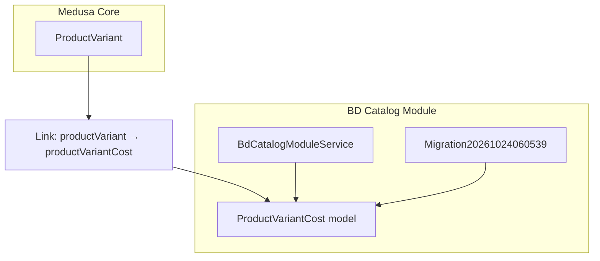
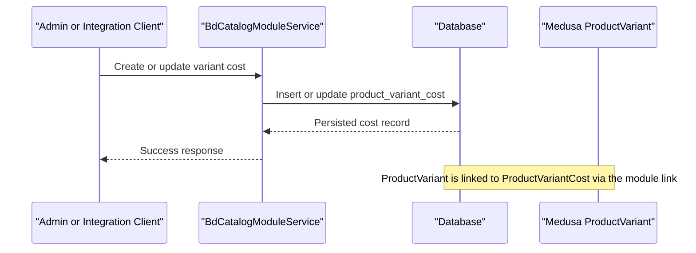
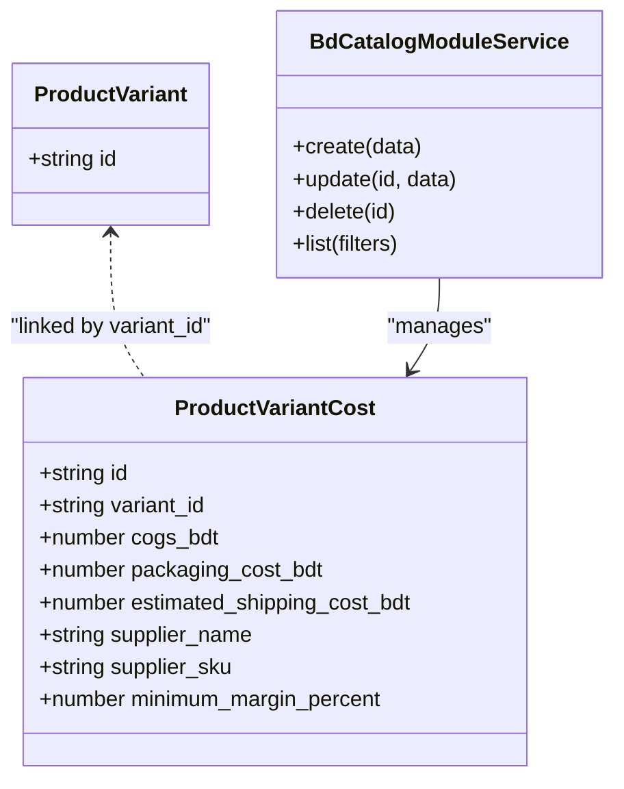
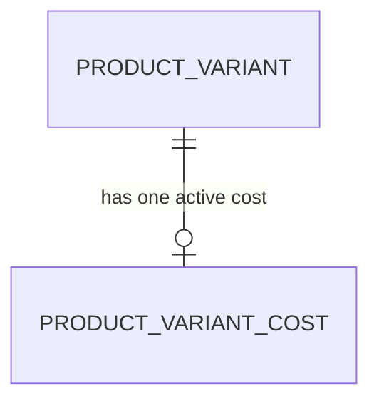
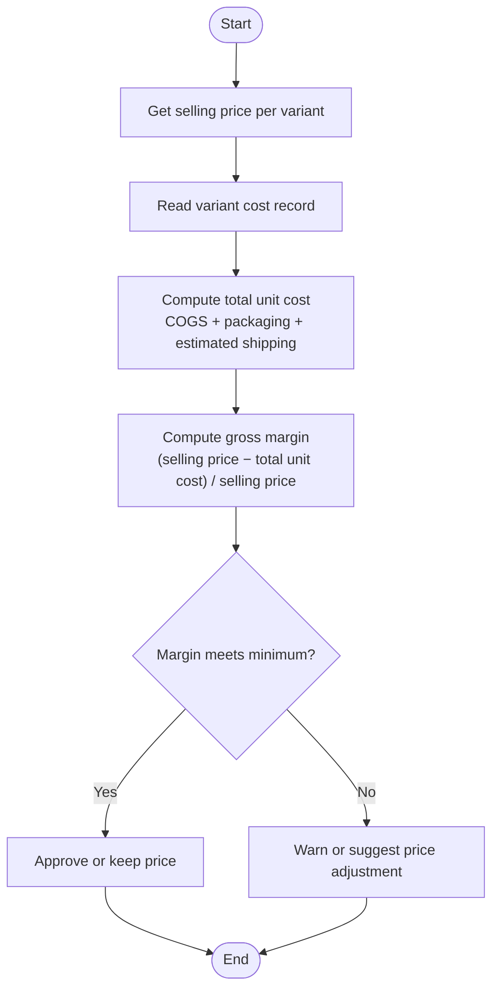
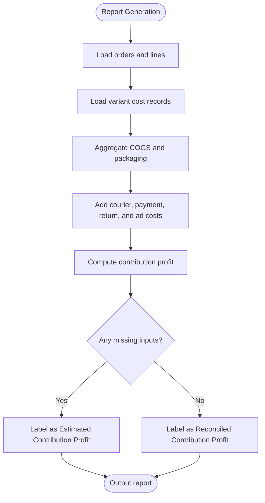
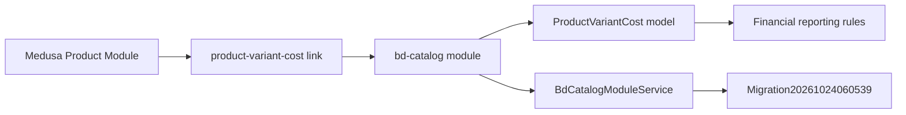

# Product Variant Cost Management

<cite>
**Referenced Files in This Document**
- [product-variant-cost.ts](file://apps/medusa/src/modules/bd-catalog/models/product-variant-cost.ts)
- [service.ts](file://apps/medusa/src/modules/bd-catalog/service.ts)
- [Migration20261024060539.ts](file://apps/medusa/src/modules/bd-catalog/migrations/Migration20261024060539.ts)
- [product-variant-cost.ts](file://apps/medusa/src/links/product-variant-cost.ts)
- [data-models.md](file://docs/data-models.md)
- [database.md](file://database.md)
- [pricing.ts](file://apps/medusa/src/search/helpers/pricing.ts)
- [technical-plan.md](file://technical-plan.md)
- [prd.md](file://prd.md)
- [ideaproposition.md](file://ideaproposition.md)
</cite>

## Table of Contents
1. [Introduction](#introduction)
2. [Project Structure](#project-structure)
3. [Core Components](#core-components)
4. [Architecture Overview](#architecture-overview)
5. [Detailed Component Analysis](#detailed-component-analysis)
6. [Dependency Analysis](#dependency-analysis)
7. [Performance Considerations](#performance-considerations)
8. [Troubleshooting Guide](#troubleshooting-guide)
9. [Conclusion](#conclusion)
10. [Appendices](#appendices)

## Introduction
This document explains the product variant cost tracking system used by the platform to manage unit costs, supplier information, and minimum margin targets for each product variant. It covers how variant costs relate to pricing, how profit margins are calculated conceptually, how bulk updates can be implemented, and how cost data integrates with financial reporting and contribution-profit calculations.

The current implementation provides a Medusa module that stores per-variant cost records and links them to Medusa product variants. The broader documentation defines how these costs should flow into order-level financial reports and highlights important constraints such as currency units, security restrictions, and estimated versus final figures.

## Project Structure
The variant cost feature lives primarily in the `bd-catalog` module:

- Model definition: `apps/medusa/src/modules/bd-catalog/models/product-variant-cost.ts`
- Module service: `apps/medusa/src/modules/bd-catalog/service.ts`
- Database migration: `apps/medusa/src/modules/bd-catalog/migrations/Migration20261024060539.ts`
- Link to Medusa product variants: `apps/medusa/src/links/product-variant-cost.ts`

**Diagram sources**
- [product-variant-cost.ts:1-15](file://apps/medusa/src/modules/bd-catalog/models/product-variant-cost.ts#L1-L15)
- [service.ts:1-15](file://apps/medusa/src/modules/bd-catalog/service.ts#L1-L15)
- [Migration20261024060539.ts:1-37](file://apps/medusa/src/modules/bd-catalog/migrations/Migration20261024060539.ts#L1-L37)
- [product-variant-cost.ts:1-9](file://apps/medusa/src/links/product-variant-cost.ts#L1-L9)

**Section sources**
- [product-variant-cost.ts:1-15](file://apps/medusa/src/modules/bd-catalog/models/product-variant-cost.ts#L1-L15)
- [service.ts:1-15](file://apps/medusa/src/modules/bd-catalog/service.ts#L1-L15)
- [Migration20261024060539.ts:1-37](file://apps/medusa/src/modules/bd-catalog/migrations/Migration20261024060539.ts#L1-L37)
- [product-variant-cost.ts:1-9](file://apps/medusa/src/links/product-variant-cost.ts#L1-L9)

## Core Components
The core component is the `ProductVariantCost` entity. It stores one active cost record per product variant and includes:

- A unique identifier for the cost row.
- A foreign reference to the Medusa product variant.
- Unit cost fields in BDT paisa: COGS, packaging cost, and estimated shipping cost.
- Supplier metadata: supplier name and supplier SKU.
- A minimum target gross margin percentage.

The module service exposes standard CRUD operations through Medusa’s service layer. The database migration creates the table, numeric cost columns, JSONB raw-value columns, timestamps, soft delete support, and indexes. The link file connects Medusa’s product variant to this cost record.

Key responsibilities:
- Store variant-level cost inputs.
- Enforce one active cost record per variant at the database level.
- Provide a foundation for downstream pricing and financial reporting.

**Section sources**
- [product-variant-cost.ts:1-15](file://apps/medusa/src/modules/bd-catalog/models/product-variant-cost.ts#L1-L15)
- [service.ts:1-15](file://apps/medusa/src/modules/bd-catalog/service.ts#L1-L15)
- [Migration20261024060539.ts:21-23](file://apps/medusa/src/modules/bd-catalog/migrations/Migration20261024060539.ts#L21-L23)
- [product-variant-cost.ts:1-9](file://apps/medusa/src/links/product-variant-cost.ts#L1-L9)
- [data-models.md:131-150](file://docs/data-models.md#L131-L150)

## Architecture Overview
At runtime, the architecture has three main layers:

1. **Data Layer**: The `product_variant_cost` table holds cost records linked to product variants.
2. **Module Layer**: The `bd-catalog` module exposes a service that manages these records.
3. **Integration Layer**: The link connects Medusa’s product variant to the cost record, enabling Medusa-style queries and relationships.

**Diagram sources**
- [service.ts:1-15](file://apps/medusa/src/modules/bd-catalog/service.ts#L1-L15)
- [product-variant-cost.ts:1-15](file://apps/medusa/src/modules/bd-catalog/models/product-variant-cost.ts#L1-L15)
- [product-variant-cost.ts:1-9](file://apps/medusa/src/links/product-variant-cost.ts#L1-L9)

## Detailed Component Analysis

### ProductVariantCost Data Model
The model defines the schema for variant cost tracking. Important characteristics:

- `id`: Primary key for the cost row.
- `variant_id`: Unique reference to a Medusa product variant.
- `cogs_bdt`: Unit COGS in BDT paisa.
- `packaging_cost_bdt`: Packaging cost per unit in BDT paisa.
- `estimated_shipping_cost_bdt`: Estimated merchant delivery cost per unit in BDT paisa.
- `supplier_name`: Optional vendor or factory name.
- `supplier_sku`: Optional manufacturer SKU or barcode.
- `minimum_margin_percent`: Target minimum gross margin percentage.

The migration also adds JSONB columns for raw values, timestamps, and soft-delete support. A unique index enforces one active cost row per variant.

**Diagram sources**
- [product-variant-cost.ts:1-15](file://apps/medusa/src/modules/bd-catalog/models/product-variant-cost.ts#L1-L15)
- [service.ts:1-15](file://apps/medusa/src/modules/bd-catalog/service.ts#L1-L15)
- [Migration20261024060539.ts:21-23](file://apps/medusa/src/modules/bd-catalog/migrations/Migration20261024060539.ts#L21-L23)

**Section sources**
- [product-variant-cost.ts:1-15](file://apps/medusa/src/modules/bd-catalog/models/product-variant-cost.ts#L1-L15)
- [Migration20261024060539.ts:21-23](file://apps/medusa/src/modules/bd-catalog/migrations/Migration20261024060539.ts#L21-L23)
- [data-models.md:131-150](file://docs/data-models.md#L131-L150)

### Currency and Precision Notes
The model uses BDT paisa for cost fields. Documentation clarifies that these values represent paisa rather than whole taka. For example, a value representing ৳1,600 is stored as 160,000 paisa. The migration also stores raw JSONB values alongside numeric fields, which can help preserve precision and audit original input formats.

Important implications:
- Always treat cost fields as paisa when calculating totals.
- Avoid mixing paisa and whole-taka values in calculations.
- Use the documented definitions for contribution profit and ensure missing inputs are flagged as estimates.

**Section sources**
- [data-models.md:131-150](file://docs/data-models.md#L131-L150)
- [Migration20261024060539.ts:21-23](file://apps/medusa/src/modules/bd-catalog/migrations/Migration20261024060539.ts#L21-L23)

### Relationship Between Variants and Costs
The link file connects Medusa’s product variant to the `ProductVariantCost` record. This means:

- Each product variant can have one associated cost record.
- Queries can traverse from a variant to its cost data through the Medusa linkable API.
- Business logic can enforce that cost updates apply to the correct variant.

**Diagram sources**
- [product-variant-cost.ts:1-9](file://apps/medusa/src/links/product-variant-cost.ts#L1-L9)
- [product-variant-cost.ts:1-15](file://apps/medusa/src/modules/bd-catalog/models/product-variant-cost.ts#L1-L15)

**Section sources**
- [product-variant-cost.ts:1-9](file://apps/medusa/src/links/product-variant-cost.ts#L1-L9)

### Pricing Strategy and Profit Margin Calculation
The current codebase does not implement automatic price calculation based on `minimum_margin_percent`. Instead, it provides the cost baseline and a target margin field for business use. Pricing logic in the search helper focuses on Medusa’s pricing module and indexed price fields; it does not compute profit from COGS.

Conceptual profit-margin workflow:

Business rules from the project documentation emphasize:
- Contribution profit must distinguish revenue, COGS, packaging, courier fees, payment fees, returns, and ad spend.
- Missing cost inputs must be labeled as estimates.
- “Net profit” should not be shown unless all required overheads are included and validated.

**Diagram sources**
- [product-variant-cost.ts:1-15](file://apps/medusa/src/modules/bd-catalog/models/product-variant-cost.ts#L1-L15)
- [technical-plan.md:629-647](file://technical-plan.md#L629-L647)
- [prd.md:470-478](file://prd.md#L470-L478)
- [ideaproposition.md:326-356](file://ideaproposition.md#L326-L356)

**Section sources**
- [pricing.ts:1-177](file://apps/medusa/src/search/helpers/pricing.ts#L1-L177)
- [technical-plan.md:629-647](file://technical-plan.md#L629-L647)
- [prd.md:470-478](file://prd.md#L470-L478)
- [ideaproposition.md:326-356](file://ideaproposition.md#L326-L356)

### Bulk Cost Updates
The current service is a generic Medusa service without custom bulk-update methods. To support bulk updates:

- Implement a batch endpoint in the `bd-catalog` service that accepts an array of variant IDs and cost payloads.
- Validate that each payload contains valid paisa values and respects the minimum margin policy.
- Update existing rows where `variant_id` matches, creating new rows only if none exist.
- Audit changes using the audit log entity type for variant COGS.

Recommended validation rules:
- Reject negative cost values.
- Ensure `minimum_margin_percent` is between 0 and 100.
- Require `variant_id` to exist before updating.
- Log actor, reason, old values, and new values for compliance.

**Section sources**
- [service.ts:1-15](file://apps/medusa/src/modules/bd-catalog/service.ts#L1-L15)
- [Migration20261024060539.ts:21-23](file://apps/medusa/src/modules/bd-catalog/migrations/Migration20261024060539.ts#L21-L23)

### Cost History Tracking
The current model does not include effective-dated history fields such as `effective_from`, `effective_to`, `change_reason`, or `changed_by`. However, the broader documentation describes an intended design where cost changes close the previous row and insert a new immutable historical row.

Current state:
- One active cost row per variant enforced by a unique index.
- No built-in history table or effective-dating fields in the model.

Recommended approach aligned with documentation:
- Add effective-dated fields to the cost model.
- On update, set `effective_to` on the previous open row.
- Insert a new row with `effective_from` and leave `effective_to` null.
- Keep historical rows immutable.
- Orders should snapshot cost values at sale time instead of joining back to live cost records.

**Section sources**
- [product-variant-cost.ts:1-15](file://apps/medusa/src/modules/bd-catalog/models/product-variant-cost.ts#L1-L15)
- [Migration20261024060539.ts:21-23](file://apps/medusa/src/modules/bd-catalog/migrations/Migration20261024060539.ts#L21-L23)
- [database.md:525-543](file://database.md#L525-L543)

### Generating Cost Reports
Reports should combine variant cost data with order-level financial data. The contribution-profit formula requires:

- Net delivered sales revenue.
- COGS for sold units.
- Packaging and fulfillment costs.
- Actual courier delivery fees.
- Payment gateway fees.
- Return and RTO costs.
- Attributed advertising spend.

The system must label results as estimated when any input is missing and must never present “net profit” unless all required overheads are included.

**Diagram sources**
- [technical-plan.md:629-647](file://technical-plan.md#L629-L647)
- [database.md:2391-2410](file://database.md#L2391-L2410)
- [prd.md:470-478](file://prd.md#L470-L478)

**Section sources**
- [technical-plan.md:629-647](file://technical-plan.md#L629-L647)
- [database.md:2391-2410](file://database.md#L2391-L2410)
- [prd.md:470-478](file://prd.md#L470-L478)
- [ideaproposition.md:326-356](file://ideaproposition.md#L326-L356)

## Dependency Analysis
The variant cost feature depends on:

- Medusa product module for variant identity and linking.
- The `bd-catalog` module for model and service exposure.
- Database migrations for schema creation and indexing.
- Broader financial documentation for reporting rules.

**Diagram sources**
- [product-variant-cost.ts:1-9](file://apps/medusa/src/links/product-variant-cost.ts#L1-L9)
- [service.ts:1-15](file://apps/medusa/src/modules/bd-catalog/service.ts#L1-L15)
- [product-variant-cost.ts:1-15](file://apps/medusa/src/modules/bd-catalog/models/product-variant-cost.ts#L1-L15)
- [Migration20261024060539.ts:1-37](file://apps/medusa/src/modules/bd-catalog/migrations/Migration20261024060539.ts#L1-L37)

**Section sources**
- [product-variant-cost.ts:1-9](file://apps/medusa/src/links/product-variant-cost.ts#L1-L9)
- [service.ts:1-15](file://apps/medusa/src/modules/bd-catalog/service.ts#L1-L15)
- [product-variant-cost.ts:1-15](file://apps/medusa/src/modules/bd-catalog/models/product-variant-cost.ts#L1-L15)
- [Migration20261024060539.ts:1-37](file://apps/medusa/src/modules/bd-catalog/migrations/Migration20261024060539.ts#L1-L37)

## Performance Considerations
- Use the unique index on `variant_id` to ensure fast lookups for the active cost row.
- Avoid expensive joins in storefront responses; strip cost data from public APIs as documented.
- When generating reports, aggregate COGS and related costs at the database level where possible.
- If implementing history, partition or index by `variant_id` and effective dates to keep queries efficient.
- Batch updates should minimize round trips and avoid N+1 queries.

[No sources needed since this section provides general guidance]

## Troubleshooting Guide
Common issues and resolutions:

- **Duplicate variant cost rows**: The unique index on `variant_id` prevents duplicate active rows. If you see constraint errors, check whether multiple rows exist or whether soft deletes are interfering.
- **Incorrect paisa values**: Ensure all cost fields are in BDT paisa. Mixing whole taka and paisa will distort margins and reports.
- **Missing cost data in reports**: Reports must flag missing inputs as estimates. Verify that COGS, packaging, courier, payment, return, and ad-spend inputs are available.
- **Security exposure**: Cost data must not be indexed in search and must be stripped from public storefront responses.
- **Auditability**: Changes to variant COGS should be recorded in the audit log with actor, entity type, action, old/new values, and reason.

**Section sources**
- [data-models.md:131-150](file://docs/data-models.md#L131-L150)
- [Migration20261024060539.ts:21-23](file://apps/medusa/src/modules/bd-catalog/migrations/Migration20261024060539.ts#L21-L23)
- [database.md:2391-2410](file://database.md#L2391-L2410)

## Conclusion
The product variant cost management system currently provides a solid foundation for storing per-variant unit costs, supplier details, and minimum margin targets. It integrates with Medusa through a link to product variants and exposes a service for managing cost records. While automatic pricing and history tracking are not fully implemented in the current model, the broader documentation defines clear expectations for contribution-profit reporting, estimated versus final figures, and historical cost behavior. Extending the model with effective-dated history, adding bulk update endpoints, and enforcing audit trails will align the implementation with the intended financial reporting requirements.

[No sources needed since this section summarizes without analyzing specific files]

## Appendices

### Example Workflows

#### Setting Up Variant Costs
- Identify the Medusa product variant ID.
- Create or update the corresponding `ProductVariantCost` record.
- Enter COGS, packaging cost, and estimated shipping cost in BDT paisa.
- Optionally set supplier name, supplier SKU, and minimum margin percent.
- Verify that the unique index allows only one active row per variant.

**Section sources**
- [product-variant-cost.ts:1-15](file://apps/medusa/src/modules/bd-catalog/models/product-variant-cost.ts#L1-L15)
- [Migration20261024060539.ts:21-23](file://apps/medusa/src/modules/bd-catalog/migrations/Migration20261024060539.ts#L21-L23)

#### Calculating Profit Margins
- Retrieve the variant’s selling price from the pricing system.
- Read the variant cost record for COGS, packaging, and estimated shipping.
- Compute total unit cost and gross margin percentage.
- Compare against `minimum_margin_percent` and warn or adjust pricing accordingly.

**Section sources**
- [product-variant-cost.ts:1-15](file://apps/medusa/src/modules/bd-catalog/models/product-variant-cost.ts#L1-L15)
- [technical-plan.md:629-647](file://technical-plan.md#L629-L647)

#### Generating Cost Reports
- Aggregate net delivered sales, COGS, packaging, courier, payment, return, and ad costs.
- Compute contribution profit.
- Label the result as estimated if any input is missing.
- Never label it “net profit” unless all required overheads are included.

**Section sources**
- [technical-plan.md:629-647](file://technical-plan.md#L629-L647)
- [database.md:2391-2410](file://database.md#L2391-L2410)
- [prd.md:470-478](file://prd.md#L470-L478)