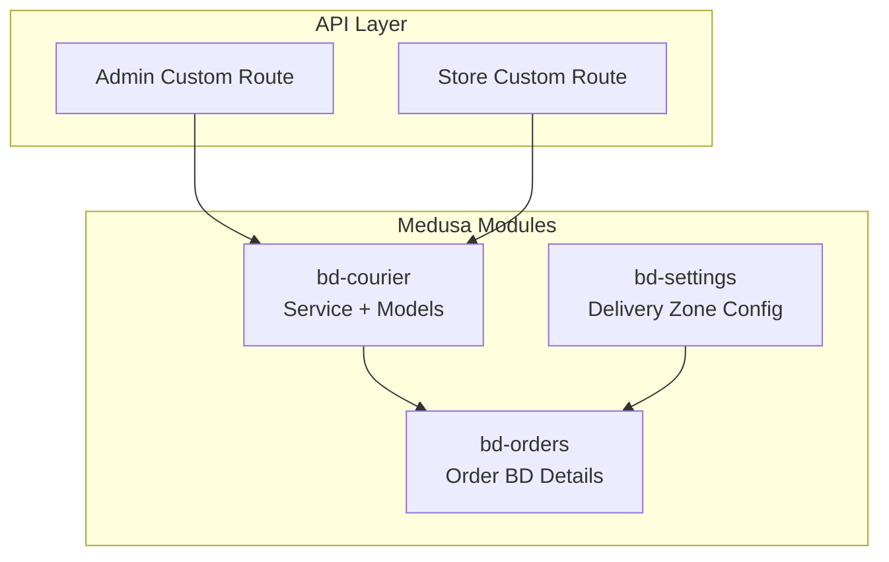
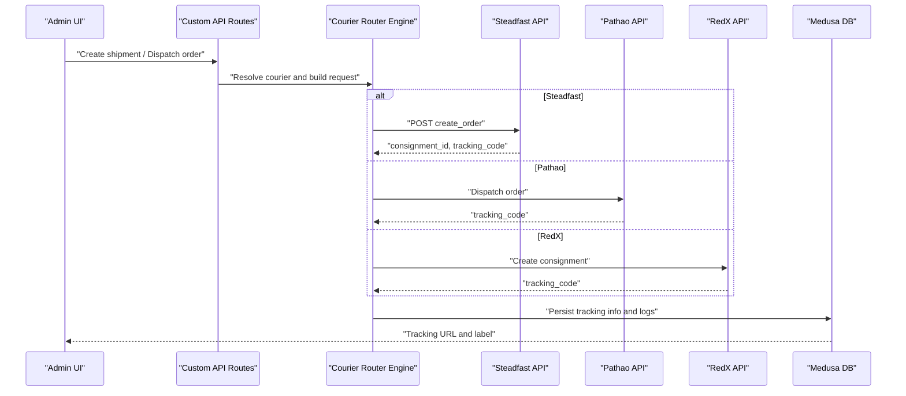
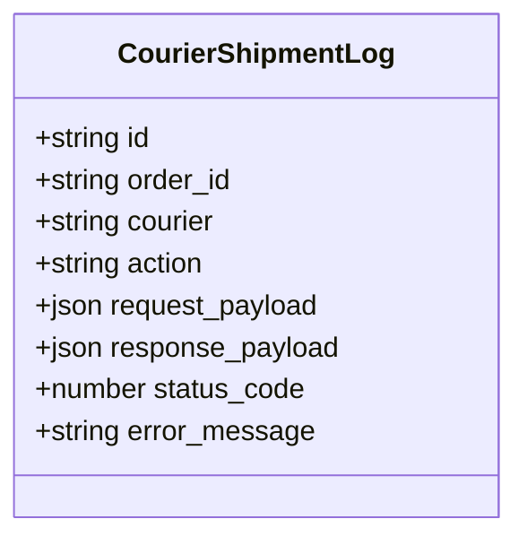
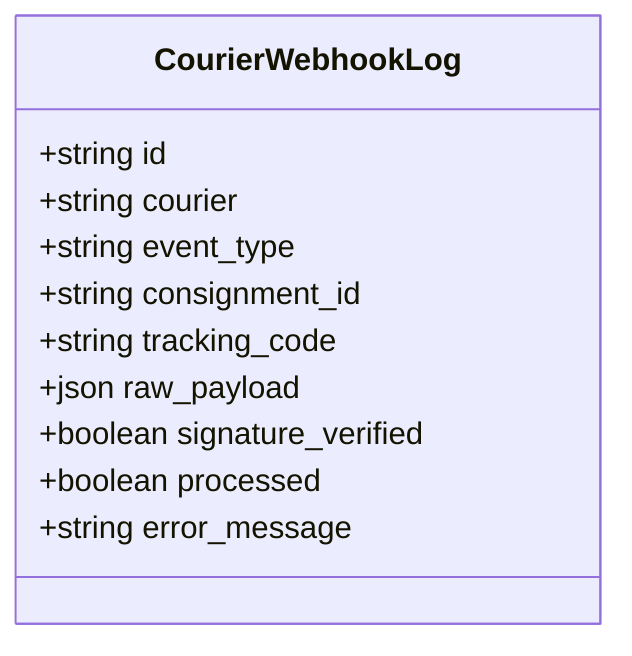
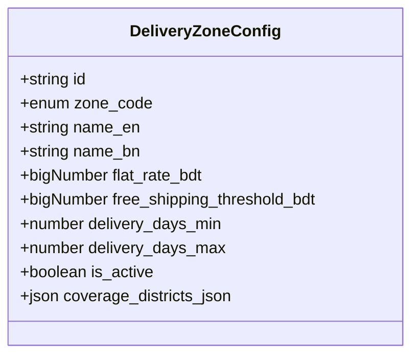
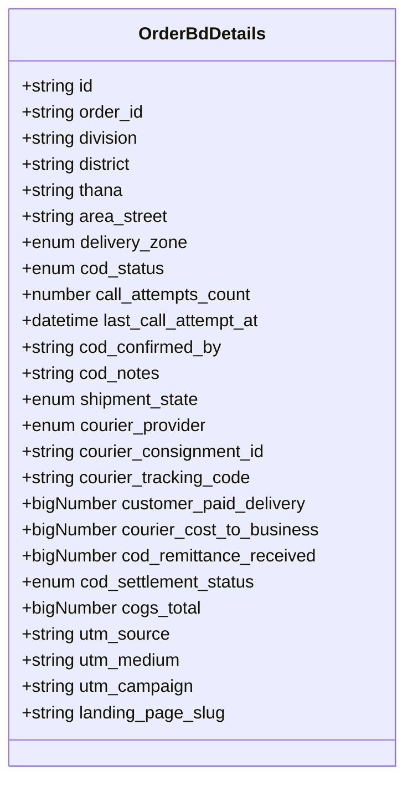
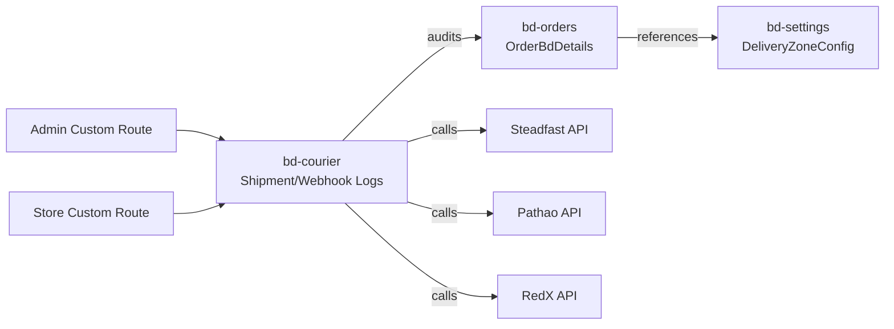

# Courier & Logistics Module

<cite>
**Referenced Files in This Document**
- [service.ts](file://apps/medusa/src/modules/bd-courier/service.ts)
- [index.ts](file://apps/medusa/src/modules/bd-courier/index.ts)
- [courier-shipment-log.ts](file://apps/medusa/src/modules/bd-courier/models/courier-shipment-log.ts)
- [courier-webhook-log.ts](file://apps/medusa/src/modules/bd-courier/models/courier-webhook-log.ts)
- [Migration20261024060541.ts](file://apps/medusa/src/modules/bd-courier/migrations/Migration20261024060541.ts)
- [delivery-zone-config.ts](file://apps/medusa/src/modules/bd-settings/models/delivery-zone-config.ts)
- [service.ts](file://apps/medusa/src/modules/bd-settings/service.ts)
- [Migration20261024060544.ts](file://apps/medusa/src/modules/bd-settings/migrations/Migration20261024060544.ts)
- [order-bd-details.ts](file://apps/medusa/src/modules/bd-orders/models/order-bd-details.ts)
- [service.ts](file://apps/medusa/src/modules/bd-orders/service.ts)
- [route.ts](file://apps/medusa/src/api/admin/custom/route.ts)
- [route.ts](file://apps/medusa/src/api/store/custom/route.ts)
- [technical-plan.md](file://technical-plan.md)
- [dfd.md](file://dfd.md)
- [architecture.md](file://docs/architecture.md)
</cite>

## Table of Contents
1. [Introduction](#introduction)
2. [Project Structure](#project-structure)
3. [Core Components](#core-components)
4. [Architecture Overview](#architecture-overview)
5. [Detailed Component Analysis](#detailed-component-analysis)
6. [Dependency Analysis](#dependency-analysis)
7. [Performance Considerations](#performance-considerations)
8. [Troubleshooting Guide](#troubleshooting-guide)
9. [Conclusion](#conclusion)

## Introduction
This document explains the BD Courier & Logistics module, focusing on:
- Shipment tracking and lifecycle management
- Courier webhook integration for status updates
- Delivery zone configuration and flat-rate shipping logic
- Logistics coordination with Steadfast, Pathao, RedX, and manual dispatch
- End-to-end flows for shipment creation, tracking updates, webhook processing, and delivery status management

The module is implemented as a Medusa v2 custom module that persists courier-related logs and integrates with order data to reflect courier provider, consignment identifiers, and tracking codes. Delivery zones are configured via a separate settings module.

## Project Structure
The relevant code resides under apps/medusa/src/modules:
- bd-courier: Courier logging models and service
- bd-settings: Delivery zone configuration model and service
- bd-orders: Order details including courier provider and tracking fields
- api: Placeholder routes for admin/store custom endpoints

**Diagram sources**
- [index.ts:1-9](file://apps/medusa/src/modules/bd-courier/index.ts#L1-L9)
- [service.ts:1-11](file://apps/medusa/src/modules/bd-courier/service.ts#L1-L11)
- [delivery-zone-config.ts:1-17](file://apps/medusa/src/modules/bd-settings/models/delivery-zone-config.ts#L1-L17)
- [order-bd-details.ts:1-42](file://apps/medusa/src/modules/bd-orders/models/order-bd-details.ts#L1-L42)
- [route.ts:1-9](file://apps/medusa/src/api/admin/custom/route.ts#L1-L9)
- [route.ts:1-9](file://apps/medusa/src/api/store/custom/route.ts#L1-L9)

**Section sources**
- [index.ts:1-9](file://apps/medusa/src/modules/bd-courier/index.ts#L1-L9)
- [service.ts:1-11](file://apps/medusa/src/modules/bd-courier/service.ts#L1-L11)
- [delivery-zone-config.ts:1-17](file://apps/medusa/src/modules/bd-settings/models/delivery-zone-config.ts#L1-L17)
- [order-bd-details.ts:1-42](file://apps/medusa/src/modules/bd-orders/models/order-bd-details.ts#L1-L42)
- [route.ts:1-9](file://apps/medusa/src/api/admin/custom/route.ts#L1-L9)
- [route.ts:1-9](file://apps/medusa/src/api/store/custom/route.ts#L1-L9)

## Core Components
- BdCourierModuleService: Exposes CRUD operations over courier log entities (shipment and webhook logs).
- CourierShipmentLog: Records outbound API calls to couriers (create, track, cancel), including payloads and responses.
- CourierWebhookLog: Ingests and records inbound webhooks from couriers, including signature verification flags and processing state.
- DeliveryZoneConfig: Defines delivery zones (inside Dhaka, Dhaka suburbs, outside Dhaka) with flat rates, free shipping thresholds, delivery windows, and coverage districts.
- OrderBdDetails: Stores per-order logistics metadata such as courier provider, consignment ID, tracking code, and shipment state.

Key responsibilities:
- Persisting all courier interactions for auditability and troubleshooting
- Enabling webhook ingestion and processing pipelines
- Providing configuration for delivery zones used by fulfillment/shipping calculations

**Section sources**
- [service.ts:1-11](file://apps/medusa/src/modules/bd-courier/service.ts#L1-L11)
- [courier-shipment-log.ts:1-15](file://apps/medusa/src/modules/bd-courier/models/courier-shipment-log.ts#L1-L15)
- [courier-webhook-log.ts:1-16](file://apps/medusa/src/modules/bd-courier/models/courier-webhook-log.ts#L1-L16)
- [delivery-zone-config.ts:1-17](file://apps/medusa/src/modules/bd-settings/models/delivery-zone-config.ts#L1-L17)
- [order-bd-details.ts:1-42](file://apps/medusa/src/modules/bd-orders/models/order-bd-details.ts#L1-L42)

## Architecture Overview
The module supports automated and manual dispatch workflows across multiple couriers. The design includes:
- A courier router engine that maps orders to courier-specific APIs
- Webhook ingestion for status changes (e.g., in transit, out for delivery, delivered, RTO)
- Delivery zone configuration driving shipping fees and SLAs

**Diagram sources**
- [technical-plan.md:549-596](file://technical-plan.md#L549-L596)
- [dfd.md:298-303](file://dfd.md#L298-L303)

**Section sources**
- [technical-plan.md:549-596](file://technical-plan.md#L549-L596)
- [dfd.md:298-303](file://dfd.md#L298-L303)

## Detailed Component Analysis

### Courier Shipment Log Model
Purpose:
- Audit every outbound interaction with courier providers during shipment creation, tracking, and cancellation.
- Capture request/response payloads, HTTP status codes, and error messages for diagnostics.

Data highlights:
- order_id links to the originating order
- courier identifies the provider
- action describes the operation (e.g., create, track, cancel)
- request_payload/response_payload store raw JSON for traceability
- status_code/error_message capture outcomes

**Diagram sources**
- [courier-shipment-log.ts:1-15](file://apps/medusa/src/modules/bd-courier/models/courier-shipment-log.ts#L1-L15)

**Section sources**
- [courier-shipment-log.ts:1-15](file://apps/medusa/src/modules/bd-courier/models/courier-shipment-log.ts#L1-L15)

### Courier Webhook Log Model
Purpose:
- Record inbound webhook events from couriers, enabling reconciliation and downstream processing.
- Track whether signatures were verified and whether the event was processed.

Data highlights:
- courier identifies the source provider
- event_type captures the webhook event
- consignment_id/tracking_code link to specific shipments
- raw_payload stores the original payload
- signature_verified/processed flags control workflow progression

**Diagram sources**
- [courier-webhook-log.ts:1-16](file://apps/medusa/src/modules/bd-courier/models/courier-webhook-log.ts#L1-L16)

**Section sources**
- [courier-webhook-log.ts:1-16](file://apps/medusa/src/modules/bd-courier/models/courier-webhook-log.ts#L1-L16)

### Delivery Zone Configuration
Purpose:
- Define shipping zones with flat rates, free shipping thresholds, delivery windows, and district coverage.
- Support multilingual names and active/inactive toggles.

Data highlights:
- zone_code enumerates inside_dhaka, dhaka_suburbs, outside_dhaka
- flat_rate_bdt and free_shipping_threshold_bdt drive shipping cost logic
- delivery_days_min/max define SLA ranges
- coverage_districts_json allows precise geographic scoping

**Diagram sources**
- [delivery-zone-config.ts:1-17](file://apps/medusa/src/modules/bd-settings/models/delivery-zone-config.ts#L1-L17)

**Section sources**
- [delivery-zone-config.ts:1-17](file://apps/medusa/src/modules/bd-settings/models/delivery-zone-config.ts#L1-L17)

### Order BD Details (Courier Fields)
Purpose:
- Store per-order logistics metadata, including courier provider selection, consignment identifiers, tracking codes, and shipment state transitions.

Data highlights:
- courier_provider enum supports steadfast, pathao, redx, manual
- courier_consignment_id and courier_tracking_code persist courier-provided identifiers
- shipment_state tracks lifecycle stages from pending_confirmation to delivered or RTO paths

**Diagram sources**
- [order-bd-details.ts:1-42](file://apps/medusa/src/modules/bd-orders/models/order-bd-details.ts#L1-L42)

**Section sources**
- [order-bd-details.ts:1-42](file://apps/medusa/src/modules/bd-orders/models/order-bd-details.ts#L1-L42)

### Service Layer
- BdCourierModuleService exposes services for CourierShipmentLog and CourierWebhookLog.
- BdSettingsModuleService exposes services for DeliveryZoneConfig and VatConfig.
- BdOrdersModuleService exposes services for OrderBdDetails and related models.

These services provide standard CRUD capabilities and can be extended with domain logic for courier routing, webhook processing, and delivery zone calculations.

**Section sources**
- [service.ts:1-11](file://apps/medusa/src/modules/bd-courier/service.ts#L1-L11)
- [service.ts:1-11](file://apps/medusa/src/modules/bd-settings/service.ts#L1-L11)
- [service.ts:1-13](file://apps/medusa/src/modules/bd-orders/service.ts#L1-L13)

### API Entry Points
- Admin and Store custom routes are scaffolded but currently return simple success responses. They serve as extension points for future courier and logistics endpoints.

**Section sources**
- [route.ts:1-9](file://apps/medusa/src/api/admin/custom/route.ts#L1-L9)
- [route.ts:1-9](file://apps/medusa/src/api/store/custom/route.ts#L1-L9)

## Dependency Analysis
The following diagram shows how modules depend on each other and where external integrations occur.

**Diagram sources**
- [order-bd-details.ts:1-42](file://apps/medusa/src/modules/bd-orders/models/order-bd-details.ts#L1-L42)
- [delivery-zone-config.ts:1-17](file://apps/medusa/src/modules/bd-settings/models/delivery-zone-config.ts#L1-L17)
- [courier-shipment-log.ts:1-15](file://apps/medusa/src/modules/bd-courier/models/courier-shipment-log.ts#L1-L15)
- [courier-webhook-log.ts:1-16](file://apps/medusa/src/modules/bd-courier/models/courier-webhook-log.ts#L1-L16)
- [route.ts:1-9](file://apps/medusa/src/api/admin/custom/route.ts#L1-L9)
- [route.ts:1-9](file://apps/medusa/src/api/store/custom/route.ts#L1-L9)
- [technical-plan.md:549-596](file://technical-plan.md#L549-L596)

**Section sources**
- [order-bd-details.ts:1-42](file://apps/medusa/src/modules/bd-orders/models/order-bd-details.ts#L1-L42)
- [delivery-zone-config.ts:1-17](file://apps/medusa/src/modules/bd-settings/models/delivery-zone-config.ts#L1-L17)
- [courier-shipment-log.ts:1-15](file://apps/medusa/src/modules/bd-courier/models/courier-shipment-log.ts#L1-L15)
- [courier-webhook-log.ts:1-16](file://apps/medusa/src/modules/bd-courier/models/courier-webhook-log.ts#L1-L16)
- [route.ts:1-9](file://apps/medusa/src/api/admin/custom/route.ts#L1-L9)
- [route.ts:1-9](file://apps/medusa/src/api/store/custom/route.ts#L1-L9)
- [technical-plan.md:549-596](file://technical-plan.md#L549-L596)

## Performance Considerations
- Indexing: Ensure frequent query fields (order_id, tracking_code, consignment_id) are indexed to optimize lookups.
- Payload size: Keep request/response payloads concise; consider truncation policies for large bodies.
- Webhook throughput: Process webhooks asynchronously to avoid blocking incoming events.
- Database writes: Batch updates when possible to reduce write contention.
[No sources needed since this section provides general guidance]

## Troubleshooting Guide
Common issues and resolutions:
- Missing tracking code after dispatch:
  - Verify courier adapter returned tracking_code and persisted it to OrderBdDetails.
  - Check CourierShipmentLog for status_code and error_message.
- Webhook not processed:
  - Inspect CourierWebhookLog.signature_verified and processed flags.
  - Validate webhook signature and retry failed events.
- Incorrect shipping fee:
  - Confirm DeliveryZoneConfig values and ensure order’s delivery_zone matches expectations.
- Manual fallback:
  - Use manual courier entry to set courier_provider and tracking fields when APIs are unavailable.

Operational references:
- RTO handling and manual fallback are documented in architecture and DFD materials.

**Section sources**
- [courier-shipment-log.ts:1-15](file://apps/medusa/src/modules/bd-courier/models/courier-shipment-log.ts#L1-L15)
- [courier-webhook-log.ts:1-16](file://apps/medusa/src/modules/bd-courier/models/courier-webhook-log.ts#L1-L16)
- [delivery-zone-config.ts:1-17](file://apps/medusa/src/modules/bd-settings/models/delivery-zone-config.ts#L1-L17)
- [order-bd-details.ts:1-42](file://apps/medusa/src/modules/bd-orders/models/order-bd-details.ts#L1-L42)
- [architecture.md:523-544](file://docs/architecture.md#L523-L544)

## Conclusion
The BD Courier & Logistics module provides a solid foundation for multi-courier shipment management, webhook ingestion, and delivery zone configuration. With clear data models for shipment and webhook logs, and robust order-level logistics fields, the system supports both automated and manual workflows. Extending the API layer and service layer will enable full automation of booking, tracking, and status synchronization across Steadfast, Pathao, and RedX while maintaining operational visibility through comprehensive logging.