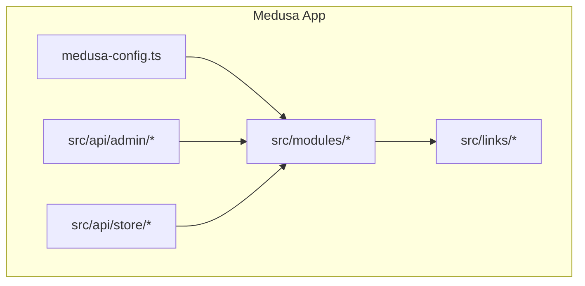
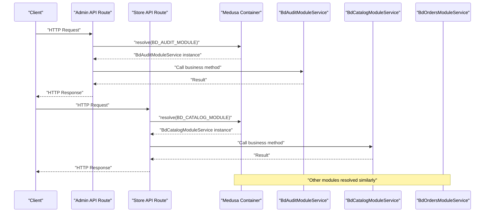
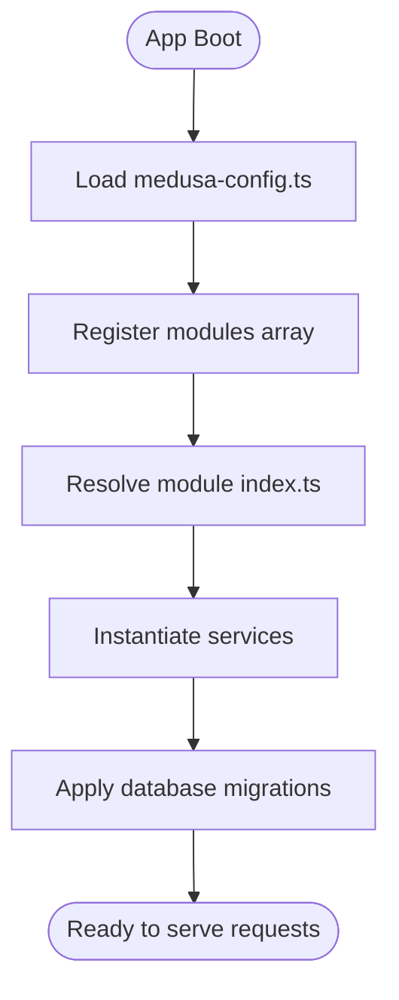
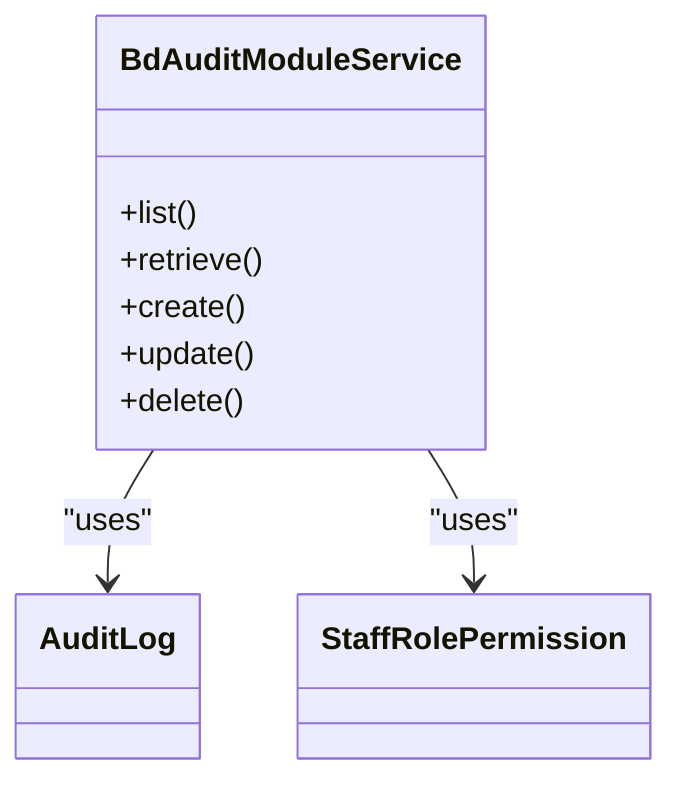
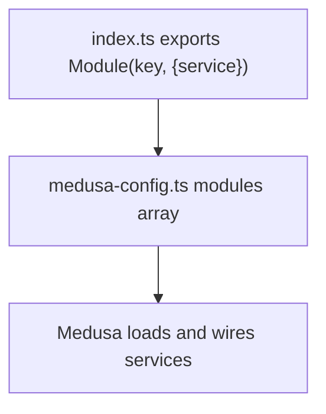
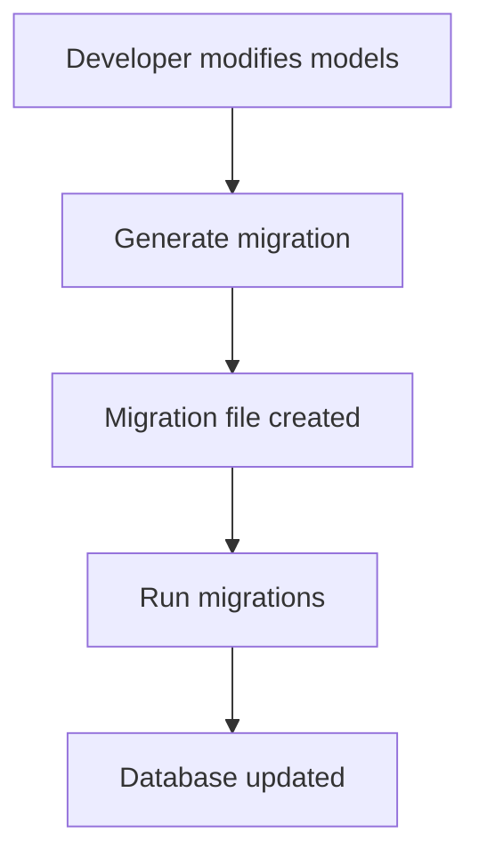
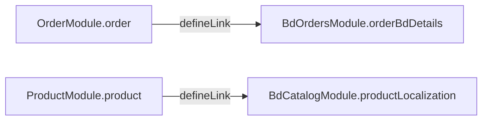
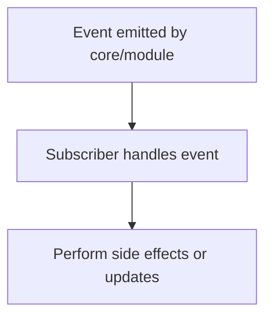
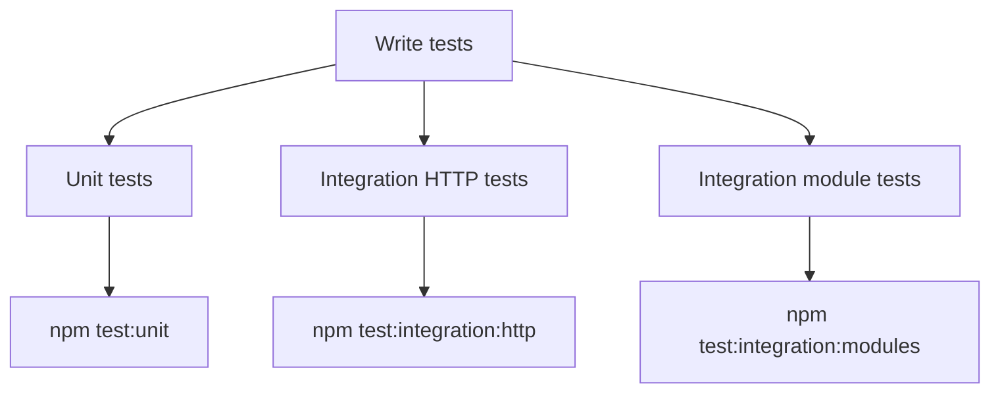
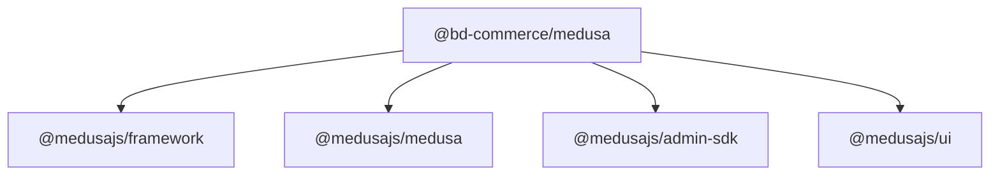

# Module Development Guide

<cite>
**Referenced Files in This Document**
- [medusa-config.ts](file://apps/medusa/medusa-config.ts)
- [modules README.md](file://apps/medusa/src/modules/README.md)
- [bd-audit/index.ts](file://apps/medusa/src/modules/bd-audit/index.ts)
- [bd-audit/service.ts](file://apps/medusa/src/modules/bd-audit/service.ts)
- [bd-audit/models/audit-log.ts](file://apps/medusa/src/modules/bd-audit/models/audit-log.ts)
- [bd-audit/migrations/Migration20261024060545.ts](file://apps/medusa/src/modules/bd-audit/migrations/Migration20261024060545.ts)
- [bd-catalog/index.ts](file://apps/medusa/src/modules/bd-catalog/index.ts)
- [bd-catalog/service.ts](file://apps/medusa/src/modules/bd-catalog/service.ts)
- [bd-catalog/models/product-localization.ts](file://apps/medusa/src/modules/bd-catalog/models/product-localization.ts)
- [bd-orders/index.ts](file://apps/medusa/src/modules/bd-orders/index.ts)
- [bd-orders/service.ts](file://apps/medusa/src/modules/bd-orders/service.ts)
- [bd-orders/models/order-bd-details.ts](file://apps/medusa/src/modules/bd-orders/models/order-bd-details.ts)
- [links/order-bd-details.ts](file://apps/medusa/src/links/order-bd-details.ts)
- [links/product-localization.ts](file://apps/medusa/src/links/product-localization.ts)
- [api/admin/custom/route.ts](file://apps/medusa/src/api/admin/custom/route.ts)
- [api/store/custom/route.ts](file://apps/medusa/src/api/store/custom/route.ts)
- [migration-scripts/region-store-policies.ts](file://apps/medusa/src/migration-scripts/region-store-policies.ts)
- [package.json](file://apps/medusa/package.json)
</cite>

## Table of Contents
1. Introduction
2. Project Structure
3. Core Components
4. Architecture Overview
5. Detailed Component Analysis
6. Dependency Analysis
7. Performance Considerations
8. Troubleshooting Guide
9. Conclusion
10. Appendices

## Introduction
This guide explains how to develop custom MedusaJS v2 modules using the patterns and examples present in this repository. It covers the module lifecycle, service layer implementation, repository pattern via MedusaService, data modeling, migrations, module exports, configuration in medusa-config.ts, linking with other modules, event handling patterns, and testing strategies. The guidance is grounded in the existing modules (bd-audit, bd-catalog, bd-orders) and the project’s configuration and scripts.

## Project Structure
The Medusa application resides under apps/medusa. Custom modules are organized under apps/medusa/src/modules/<module-name>, each containing:
- models: Data model definitions
- service.ts: Service class extending MedusaService
- index.ts: Module definition exporting the service and a module key
- migrations: Database migration files generated by the CLI

Module registration occurs in apps/medusa/medusa-config.ts. Cross-module relationships are defined in apps/medusa/src/links. API routes for admin and store live under apps/medusa/src/api/admin and apps/medusa/src/api/store respectively.

**Diagram sources**
- [medusa-config.ts:22-44](file://apps/medusa/medusa-config.ts#L22-L44)
- [links/order-bd-details.ts:1-9](file://apps/medusa/src/links/order-bd-details.ts#L1-L9)
- [links/product-localization.ts:1-9](file://apps/medusa/src/links/product-localization.ts#L1-L9)

**Section sources**
- [medusa-config.ts:1-46](file://apps/medusa/medusa-config.ts#L1-L46)
- [modules README.md:1-118](file://apps/medusa/src/modules/README.md#L1-L118)

## Core Components
- Data Models: Define entities using model.define within each module’s models directory. Examples include audit_log and product_localization.
- Services: Each module provides a service class extending MedusaService with its models. This enables repository-style operations (list, retrieve, create, update, delete).
- Module Definition: Each module exports an index.ts that registers the service and exposes a module key constant.
- Configuration: Modules are registered in medusa-config.ts under the modules array.
- Links: Cross-module relationships are declared in src/links using defineLink.
- Migrations: Generated per module; applied via CLI commands.

Key examples:
- Audit module: models/audit-log.ts, service.ts, index.ts, migrations/Migration20261024060545.ts
- Catalog module: models/product-localization.ts, service.ts, index.ts
- Orders module: models/order-bd-details.ts, service.ts, index.ts

**Section sources**
- [bd-audit/models/audit-log.ts:1-43](file://apps/medusa/src/modules/bd-audit/models/audit-log.ts#L1-L43)
- [bd-audit/service.ts:1-11](file://apps/medusa/src/modules/bd-audit/service.ts#L1-L11)
- [bd-audit/index.ts:1-9](file://apps/medusa/src/modules/bd-audit/index.ts#L1-L9)
- [bd-audit/migrations/Migration20261024060545.ts:1-26](file://apps/medusa/src/modules/bd-audit/migrations/Migration20261024060545.ts#L1-L26)
- [bd-catalog/models/product-localization.ts:1-20](file://apps/medusa/src/modules/bd-catalog/models/product-localization.ts#L1-L20)
- [bd-catalog/service.ts:1-15](file://apps/medusa/src/modules/bd-catalog/service.ts#L1-L15)
- [bd-catalog/index.ts:1-9](file://apps/medusa/src/modules/bd-catalog/index.ts#L1-L9)
- [bd-orders/models/order-bd-details.ts:1-42](file://apps/medusa/src/modules/bd-orders/models/order-bd-details.ts#L1-L42)
- [bd-orders/service.ts:1-13](file://apps/medusa/src/modules/bd-orders/service.ts#L1-L13)
- [bd-orders/index.ts:1-9](file://apps/medusa/src/modules/bd-orders/index.ts#L1-L9)

## Architecture Overview
At runtime, Medusa loads modules from medusa-config.ts, instantiates their services, and wires them into the dependency container. API routes resolve services from the container using the module keys. Links enable querying across modules as if related entities were part of the same graph.

**Diagram sources**
- [api/admin/custom/route.ts:1-9](file://apps/medusa/src/api/admin/custom/route.ts#L1-L9)
- [api/store/custom/route.ts:1-9](file://apps/medusa/src/api/store/custom/route.ts#L1-L9)
- [bd-audit/index.ts:1-9](file://apps/medusa/src/modules/bd-audit/index.ts#L1-L9)
- [bd-catalog/index.ts:1-9](file://apps/medusa/src/modules/bd-catalog/index.ts#L1-L9)
- [bd-orders/index.ts:1-9](file://apps/medusa/src/modules/bd-orders/index.ts#L1-L9)

## Detailed Component Analysis

### Module Lifecycle
- Registration: Modules are listed in medusa-config.ts. Medusa resolves each path and loads the default export from the module’s index.ts.
- Instantiation: Medusa creates service instances based on the service property in the module definition.
- Initialization: During bootstrap, Medusa applies pending migrations and sets up links.
- Runtime: Services are available via the container and can be resolved by module keys in routes, workflows, or other services.

**Diagram sources**
- [medusa-config.ts:22-44](file://apps/medusa/medusa-config.ts#L22-L44)
- [bd-audit/index.ts:1-9](file://apps/medusa/src/modules/bd-audit/index.ts#L1-L9)
- [bd-catalog/index.ts:1-9](file://apps/medusa/src/modules/bd-catalog/index.ts#L1-L9)
- [bd-orders/index.ts:1-9](file://apps/medusa/src/modules/bd-orders/index.ts#L1-L9)

**Section sources**
- [medusa-config.ts:1-46](file://apps/medusa/medusa-config.ts#L1-L46)
- [modules README.md:44-76](file://apps/medusa/src/modules/README.md#L44-L76)

### Data Models and Repository Pattern
- Model Definition: Use model.define to declare tables and fields. Examples include audit_log and product_localization.
- Repository Pattern: Extend MedusaService with your models to gain repository methods (e.g., list, retrieve, create, update, soft-delete).
- Indexing and Constraints: Add indexes and constraints at the model level; migrations reflect these changes.

**Diagram sources**
- [bd-audit/service.ts:1-11](file://apps/medusa/src/modules/bd-audit/service.ts#L1-L11)
- [bd-audit/models/audit-log.ts:1-43](file://apps/medusa/src/modules/bd-audit/models/audit-log.ts#L1-L43)

**Section sources**
- [bd-audit/models/audit-log.ts:1-43](file://apps/medusa/src/modules/bd-audit/models/audit-log.ts#L1-L43)
- [bd-catalog/models/product-localization.ts:1-20](file://apps/medusa/src/modules/bd-catalog/models/product-localization.ts#L1-L20)
- [bd-orders/models/order-bd-details.ts:1-42](file://apps/medusa/src/modules/bd-orders/models/order-bd-details.ts#L1-L42)
- [bd-audit/service.ts:1-11](file://apps/medusa/src/modules/bd-audit/service.ts#L1-L11)
- [bd-catalog/service.ts:1-15](file://apps/medusa/src/modules/bd-catalog/service.ts#L1-L15)
- [bd-orders/service.ts:1-13](file://apps/medusa/src/modules/bd-orders/service.ts#L1-L13)

### Module Exports and Configuration
- Export Module Definition: Each module’s index.ts exports a module key and the default Module definition with the service.
- Configure Modules: Add each module to the modules array in medusa-config.ts with a relative path.

**Diagram sources**
- [bd-audit/index.ts:1-9](file://apps/medusa/src/modules/bd-audit/index.ts#L1-L9)
- [bd-catalog/index.ts:1-9](file://apps/medusa/src/modules/bd-catalog/index.ts#L1-L9)
- [bd-orders/index.ts:1-9](file://apps/medusa/src/modules/bd-orders/index.ts#L1-L9)
- [medusa-config.ts:22-44](file://apps/medusa/medusa-config.ts#L22-L44)

**Section sources**
- [bd-audit/index.ts:1-9](file://apps/medusa/src/modules/bd-audit/index.ts#L1-L9)
- [bd-catalog/index.ts:1-9](file://apps/medusa/src/modules/bd-catalog/index.ts#L1-L9)
- [bd-orders/index.ts:1-9](file://apps/medusa/src/modules/bd-orders/index.ts#L1-L9)
- [medusa-config.ts:22-44](file://apps/medusa/medusa-config.ts#L22-L44)

### Database Migrations
- Generation: Use the CLI to generate migrations per module.
- Execution: Run migrations to apply schema changes.
- Migration Files: Contain up/down logic to add/drop tables and indexes.

**Diagram sources**
- [modules README.md:78-90](file://apps/medusa/src/modules/README.md#L78-L90)
- [bd-audit/migrations/Migration20261024060545.ts:1-26](file://apps/medusa/src/modules/bd-audit/migrations/Migration20261024060545.ts#L1-L26)

**Section sources**
- [modules README.md:78-90](file://apps/medusa/src/modules/README.md#L78-L90)
- [bd-audit/migrations/Migration20261024060545.ts:1-26](file://apps/medusa/src/modules/bd-audit/migrations/Migration20261024060545.ts#L1-L26)
- [package.json:15-24](file://apps/medusa/package.json#L15-L24)

### Integrating with Other Modules (Links)
Links connect entities across modules so they can be queried together. For example:
- Link OrderModule.order to BdOrdersModule.orderBdDetails
- Link ProductModule.product to BdCatalogModule.productLocalization

**Diagram sources**
- [links/order-bd-details.ts:1-9](file://apps/medusa/src/links/order-bd-details.ts#L1-L9)
- [links/product-localization.ts:1-9](file://apps/medusa/src/links/product-localization.ts#L1-L9)

**Section sources**
- [links/order-bd-details.ts:1-9](file://apps/medusa/src/links/order-bd-details.ts#L1-L9)
- [links/product-localization.ts:1-9](file://apps/medusa/src/links/product-localization.ts#L1-L9)

### Event Handling Patterns
- Subscribers Directory: The repository includes a subscribers folder intended for event listeners.
- Scripts and Workflows: The presence of migration-scripts and workflows directories indicates additional integration points for background tasks and processes.

[No sources needed since this diagram shows conceptual workflow, not actual code structure]

**Section sources**
- [modules README.md:92-118](file://apps/medusa/src/modules/README.md#L92-L118)

### Testing Strategies
- Unit Tests: Use the provided test script to run unit tests.
- Integration Tests: HTTP and module integration tests are configured.
- Test Utilities: The package includes @medusajs/test-utils for bootstrapping containers and services in tests.

**Diagram sources**
- [package.json:15-24](file://apps/medusa/package.json#L15-L24)

**Section sources**
- [package.json:15-24](file://apps/medusa/package.json#L15-L24)

## Dependency Analysis
- Module Dependencies: Modules are independent packages but can interact via links and shared services through the container.
- External Dependencies: Medusa framework packages provide the module system, ORM, and utilities.
- Coupling: Strong cohesion within modules; loose coupling between modules via well-defined links and APIs.

**Diagram sources**
- [package.json:25-39](file://apps/medusa/package.json#L25-L39)

**Section sources**
- [package.json:1-61](file://apps/medusa/package.json#L1-L61)

## Performance Considerations
- Indexes: Ensure frequently filtered columns have appropriate indexes (e.g., entity_type, actor_id, action in audit_log).
- Big Numbers: Use bigNumber types for monetary values to avoid precision issues.
- Query Optimization: Prefer targeted queries and leverage links to reduce N+1 problems when fetching related data.
- Soft Deletes: Utilize built-in soft delete behavior where applicable to maintain query performance and data integrity.

[No sources needed since this section provides general guidance]

## Troubleshooting Guide
- Module Not Found: Verify the module path in medusa-config.ts matches the actual directory and that index.ts exports the Module correctly.
- Migration Errors: Check migration files for SQL syntax and ensure they align with model definitions.
- Link Resolution Issues: Confirm that linkable identifiers match the model names exported by the respective modules.
- Environment Variables: Ensure DATABASE_URL and REDIS_URL are set appropriately for the environment.

**Section sources**
- [medusa-config.ts:1-18](file://apps/medusa/medusa-config.ts#L1-L18)
- [bd-audit/migrations/Migration20261024060545.ts:1-26](file://apps/medusa/src/modules/bd-audit/migrations/Migration20261024060545.ts#L1-L26)
- [links/order-bd-details.ts:1-9](file://apps/medusa/src/links/order-bd-details.ts#L1-L9)
- [links/product-localization.ts:1-9](file://apps/medusa/src/links/product-localization.ts#L1-L9)

## Conclusion
By following the patterns demonstrated in the bd-audit, bd-catalog, and bd-orders modules, you can build robust, modular extensions for MedusaJS v2. Define clear data models, implement services via MedusaService, register modules in medusa-config.ts, manage migrations with the CLI, and integrate across modules using links. Leverage the provided scripts and test utilities to maintain quality and reliability.

[No sources needed since this section summarizes without analyzing specific files]

## Appendices

### Step-by-Step Example: Creating a Complete Module
1. Create a new module directory under apps/medusa/src/modules/<your-module>.
2. Define data models in models/*.ts using model.define.
3. Implement service.ts extending MedusaService with your models.
4. Export the module in index.ts with Module(key, { service }).
5. Register the module in medusa-config.ts under modules[].
6. Generate and run migrations using the CLI.
7. Optionally, create links to connect with other modules.
8. Write tests using the provided scripts and utilities.

**Section sources**
- [modules README.md:7-90](file://apps/medusa/src/modules/README.md#L7-L90)
- [medusa-config.ts:22-44](file://apps/medusa/medusa-config.ts#L22-L44)
- [package.json:15-24](file://apps/medusa/package.json#L15-L24)

### Running Migration Scripts
The repository includes example scripts for data seeding and policy updates. These demonstrate how to use the Medusa container and query graph to perform bulk updates.

**Section sources**
- [migration-scripts/region-store-policies.ts:1-33](file://apps/medusa/src/migration-scripts/region-store-policies.ts#L1-L33)