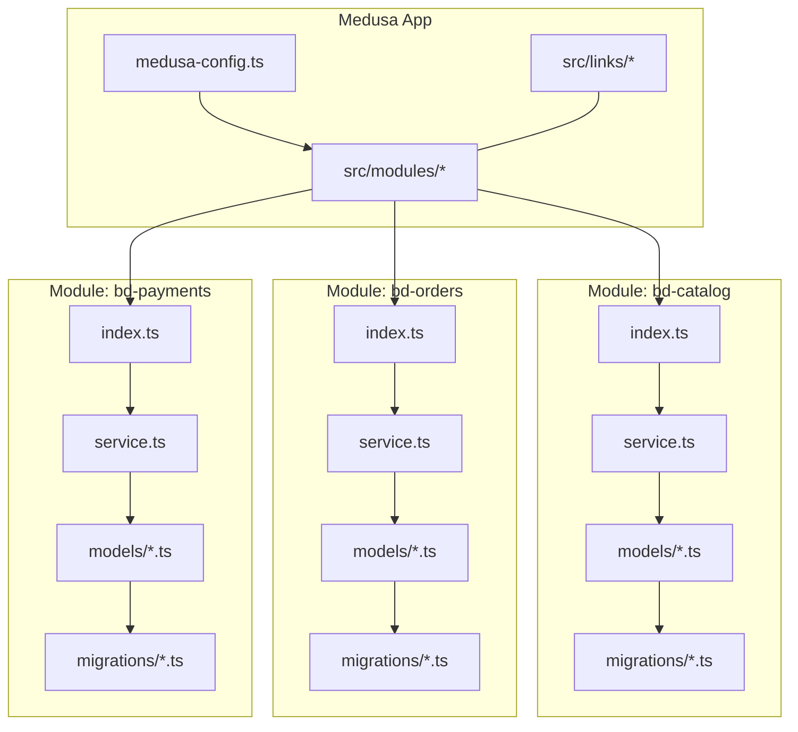
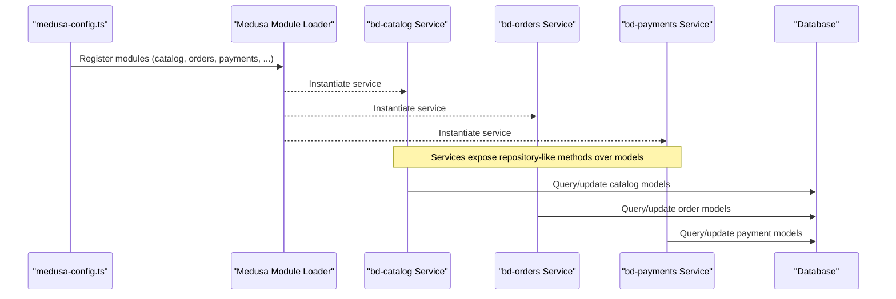
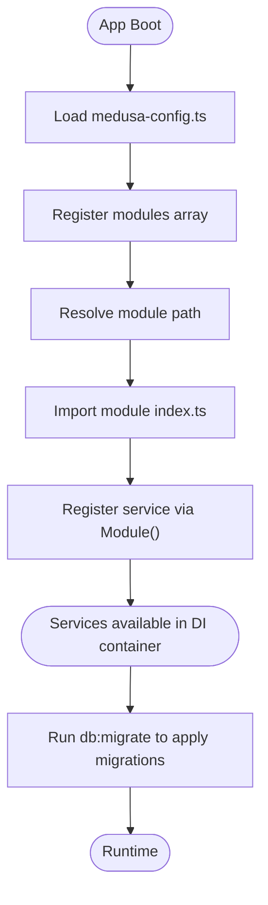
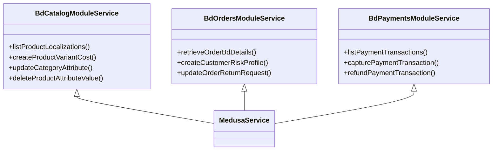
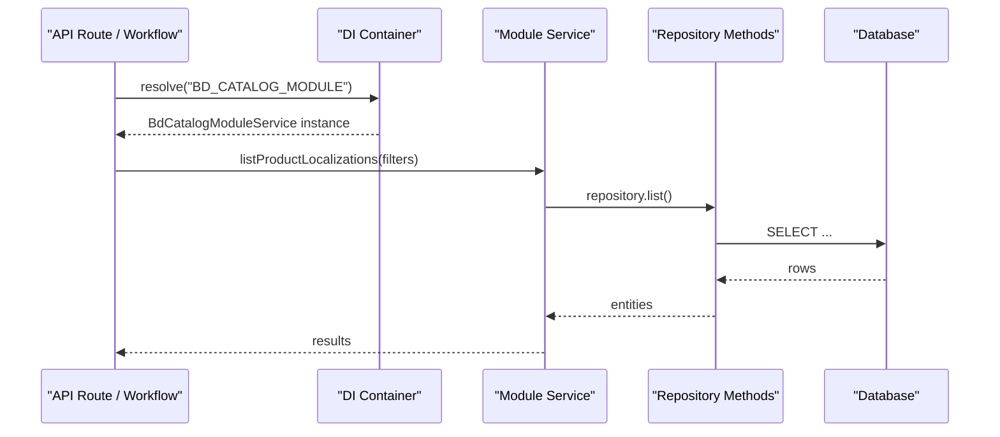
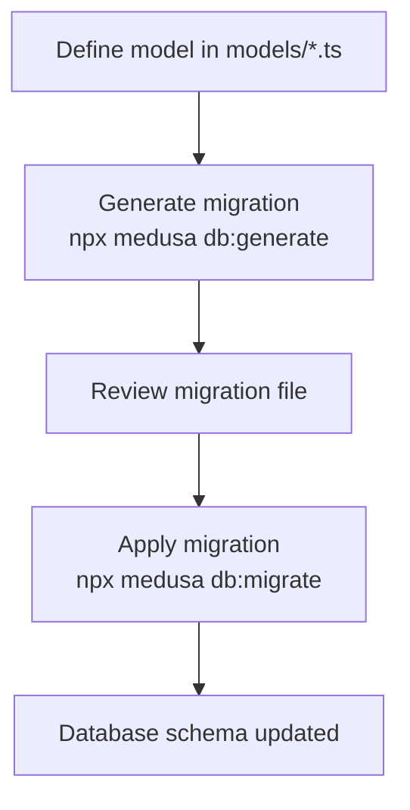
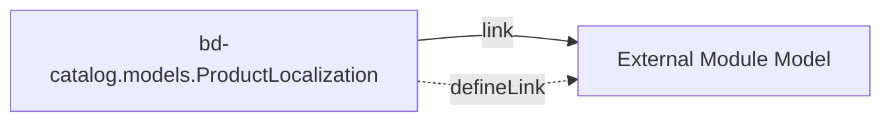
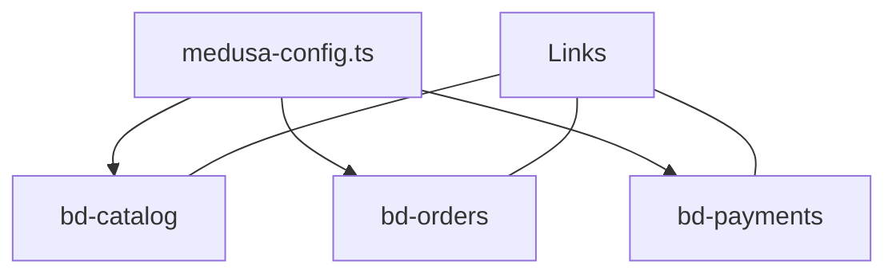

# Module System Architecture

<cite>
**Referenced Files in This Document**
- [README.md](file://apps/medusa/src/modules/README.md)
- [medusa-config.ts](file://apps/medusa/medusa-config.ts)
- [index.ts (bd-catalog)](file://apps/medusa/src/modules/bd-catalog/index.ts)
- [service.ts (bd-catalog)](file://apps/medusa/src/modules/bd-catalog/service.ts)
- [product-localization.ts](file://apps/medusa/src/modules/bd-catalog/models/product-localization.ts)
- [index.ts (bd-orders)](file://apps/medusa/src/modules/bd-orders/index.ts)
- [service.ts (bd-orders)](file://apps/medusa/src/modules/bd-orders/service.ts)
- [order-bd-details.ts](file://apps/medusa/src/modules/bd-orders/models/order-bd-details.ts)
- [index.ts (bd-payments)](file://apps/medusa/src/modules/bd-payments/index.ts)
- [service.ts (bd-payments)](file://apps/medusa/src/modules/bd-payments/service.ts)
- [payment-transaction.ts](file://apps/medusa/src/modules/bd-payments/models/payment-transaction.ts)
- [Migration20261024060539.ts](file://apps/medusa/src/modules/bd-catalog/migrations/Migration20261024060539.ts)
- [Migration20261024060540.ts](file://apps/medusa/src/modules/bd-orders/migrations/Migration20261024060540.ts)
- [Migration20261024060542.ts](file://apps/medusa/src/modules/bd-payments/migrations/Migration20261024060542.ts)
- [README.md (links)](file://apps/medusa/src/links/README.md)
</cite>

## Table of Contents
1. [Introduction](#introduction)
2. [Project Structure](#project-structure)
3. [Core Components](#core-components)
4. [Architecture Overview](#architecture-overview)
5. [Detailed Component Analysis](#detailed-component-analysis)
6. [Dependency Analysis](#dependency-analysis)
7. [Performance Considerations](#performance-considerations)
8. [Troubleshooting Guide](#troubleshooting-guide)
9. [Conclusion](#conclusion)

## Introduction
This document explains the MedusaJS v2 module system architecture as implemented in this project. It covers how modules are defined, registered, and used; how services encapsulate business logic over data models; how repository-like access is provided via MedusaService; and how migrations and links integrate with the database. It also provides guidance for creating custom modules, defining services and repositories, handling migrations, managing dependencies, emitting and listening to events, and communicating across modules.

## Project Structure
The Medusa application under apps/medusa organizes domain features as modules under src/modules. Each module typically contains:
- index.ts: module definition and service registration
- service.ts: service class extending MedusaService
- models/: data model definitions using the framework’s model DSL
- migrations/: generated migration files for schema changes

**Diagram sources**
- [medusa-config.ts:22-44](file://apps/medusa/medusa-config.ts#L22-L44)
- [index.ts (bd-catalog):1-9](file://apps/medusa/src/modules/bd-catalog/index.ts#L1-L9)
- [service.ts (bd-catalog):1-15](file://apps/medusa/src/modules/bd-catalog/service.ts#L1-L15)
- [index.ts (bd-orders):1-9](file://apps/medusa/src/modules/bd-orders/index.ts#L1-L9)
- [service.ts (bd-orders):1-13](file://apps/medusa/src/modules/bd-orders/service.ts#L1-L13)
- [index.ts (bd-payments):1-9](file://apps/medusa/src/modules/bd-payments/index.ts#L1-L9)
- [service.ts (bd-payments):1-11](file://apps/medusa/src/modules/bd-payments/service.ts#L1-L11)

**Section sources**
- [medusa-config.ts:1-46](file://apps/medusa/medusa-config.ts#L1-L46)
- [README.md (modules):1-118](file://apps/medusa/src/modules/README.md#L1-L118)

## Core Components
- Module Definition: Each module exports a default definition that registers its primary service with the Medusa container. The module name constant is exported for resolution elsewhere.
- Service Layer: Services extend MedusaService and declare which models they manage. MedusaService provides repository-like methods (CRUD, list, retrieve, update, delete, etc.) out of the box.
- Data Models: Models are defined using the framework’s model DSL and represent tables in the database. They include typed fields, indexes, defaults, and enums.
- Migrations: Generated per module to keep the database schema in sync with models.
- Links: Optional associations between models across modules while preserving isolation.

Key implementation patterns:
- Module registration via Module(name, { service })
- Service extends MedusaService({ ModelA, ModelB, ... })
- Models use model.define(...) with typed fields
- Migrations live under each module’s migrations directory
- Links define cross-module relationships

**Section sources**
- [README.md (modules):1-118](file://apps/medusa/src/modules/README.md#L1-L118)
- [index.ts (bd-catalog):1-9](file://apps/medusa/src/modules/bd-catalog/index.ts#L1-L9)
- [service.ts (bd-catalog):1-15](file://apps/medusa/src/modules/bd-catalog/service.ts#L1-L15)
- [product-localization.ts:1-20](file://apps/medusa/src/modules/bd-catalog/models/product-localization.ts#L1-L20)
- [index.ts (bd-orders):1-9](file://apps/medusa/src/modules/bd-orders/index.ts#L1-L9)
- [service.ts (bd-orders):1-13](file://apps/medusa/src/modules/bd-orders/service.ts#L1-L13)
- [order-bd-details.ts:1-42](file://apps/medusa/src/modules/bd-orders/models/order-bd-details.ts#L1-L42)
- [index.ts (bd-payments):1-9](file://apps/medusa/src/modules/bd-payments/index.ts#L1-L9)
- [service.ts (bd-payments):1-11](file://apps/medusa/src/modules/bd-payments/service.ts#L1-L11)
- [payment-transaction.ts:1-18](file://apps/medusa/src/modules/bd-payments/models/payment-transaction.ts#L1-L18)

## Architecture Overview
At runtime, Medusa loads modules declared in medusa-config.ts, instantiates their services, and exposes them through the dependency injection container. Services act as the single source of truth for domain operations and provide repository-like access to their models. Cross-module relationships are expressed via links, and schema evolution is handled by migrations.

**Diagram sources**
- [medusa-config.ts:22-44](file://apps/medusa/medusa-config.ts#L22-L44)
- [service.ts (bd-catalog):1-15](file://apps/medusa/src/modules/bd-catalog/service.ts#L1-L15)
- [service.ts (bd-orders):1-13](file://apps/medusa/src/modules/bd-orders/service.ts#L1-L13)
- [service.ts (bd-payments):1-11](file://apps/medusa/src/modules/bd-payments/service.ts#L1-L11)

## Detailed Component Analysis

### Module Lifecycle
- Registration: Modules are declared in medusa-config.ts under modules[].resolve pointing to each module’s root directory.
- Instantiation: Medusa resolves each module, imports its default export, and registers the specified service into the container.
- Resolution: Consumers resolve services by module name constants (e.g., BD_CATALOG_MODULE).
- Migration: Running db:migrate applies pending migrations from each module’s migrations folder.

**Diagram sources**
- [medusa-config.ts:22-44](file://apps/medusa/medusa-config.ts#L22-L44)
- [README.md (modules):44-90](file://apps/medusa/src/modules/README.md#L44-L90)

**Section sources**
- [medusa-config.ts:22-44](file://apps/medusa/medusa-config.ts#L22-L44)
- [README.md (modules):44-90](file://apps/medusa/src/modules/README.md#L44-L90)

### Service Layer Implementation
Each module defines a service class extending MedusaService and passing the models it manages. This provides built-in repository-like methods for those models.

Examples:
- bd-catalog service manages ProductLocalization, ProductVariantCost, CategoryAttribute, ProductAttributeValue
- bd-orders service manages OrderBdDetails, CustomerRiskProfile, OrderReturnRequest
- bd-payments service manages PaymentTransaction, PaymentWebhookLog

**Diagram sources**
- [service.ts (bd-catalog):1-15](file://apps/medusa/src/modules/bd-catalog/service.ts#L1-L15)
- [service.ts (bd-orders):1-13](file://apps/medusa/src/modules/bd-orders/service.ts#L1-L13)
- [service.ts (bd-payments):1-11](file://apps/medusa/src/modules/bd-payments/service.ts#L1-L11)

**Section sources**
- [service.ts (bd-catalog):1-15](file://apps/medusa/src/modules/bd-catalog/service.ts#L1-L15)
- [service.ts (bd-orders):1-13](file://apps/medusa/src/modules/bd-orders/service.ts#L1-L13)
- [service.ts (bd-payments):1-11](file://apps/medusa/src/modules/bd-payments/service.ts#L1-L11)

### Repository Pattern Usage
MedusaService acts as a repository layer for the models passed to it. Consumers call service methods instead of querying models directly. This centralizes queries, enforces consistency, and simplifies testing.

Typical usage pattern:
- Resolve the module service by its name constant from the request scope or container
- Call repository-like methods on the service to read/write data

**Diagram sources**
- [README.md (modules):92-118](file://apps/medusa/src/modules/README.md#L92-L118)
- [service.ts (bd-catalog):1-15](file://apps/medusa/src/modules/bd-catalog/service.ts#L1-L15)

**Section sources**
- [README.md (modules):92-118](file://apps/medusa/src/modules/README.md#L92-L118)

### Data Models and Migrations
Models define the schema using the framework’s model DSL. Migrations are generated per module and applied during deployment.

Examples:
- product-localization.ts defines localized product fields with searchable text and booleans
- order-bd-details.ts defines order-specific fields including enums for delivery zones, COD status, and shipment state
- payment-transaction.ts defines transaction records with provider and gateway details

Migrations:
- Each module includes a generated migration file under migrations/
- Run db:generate to create migrations after model changes
- Run db:migrate to apply migrations

**Diagram sources**
- [product-localization.ts:1-20](file://apps/medusa/src/modules/bd-catalog/models/product-localization.ts#L1-L20)
- [order-bd-details.ts:1-42](file://apps/medusa/src/modules/bd-orders/models/order-bd-details.ts#L1-L42)
- [payment-transaction.ts:1-18](file://apps/medusa/src/modules/bd-payments/models/payment-transaction.ts#L1-L18)
- [README.md (modules):78-90](file://apps/medusa/src/modules/README.md#L78-L90)

**Section sources**
- [product-localization.ts:1-20](file://apps/medusa/src/modules/bd-catalog/models/product-localization.ts#L1-L20)
- [order-bd-details.ts:1-42](file://apps/medusa/src/modules/bd-orders/models/order-bd-details.ts#L1-L42)
- [payment-transaction.ts:1-18](file://apps/medusa/src/modules/bd-payments/models/payment-transaction.ts#L1-L18)
- [Migration20261024060539.ts:1-200](file://apps/medusa/src/modules/bd-catalog/migrations/Migration20261024060539.ts#L1-L200)
- [Migration20261024060540.ts:1-200](file://apps/medusa/src/modules/bd-orders/migrations/Migration20261024060540.ts#L1-L200)
- [Migration20261024060542.ts:1-200](file://apps/medusa/src/modules/bd-payments/migrations/Migration20261024060542.ts#L1-L200)
- [README.md (modules):78-90](file://apps/medusa/src/modules/README.md#L78-L90)

### Creating Custom Modules
Follow these steps:
1. Create a data model under models/
2. Create a service under service.ts extending MedusaService with your models
3. Export the module definition in index.ts with Module(name, { service })
4. Add the module to medusa-config.ts under modules[]
5. Generate and run migrations

Reference example structure and commands are documented in the modules README.

**Section sources**
- [README.md (modules):1-118](file://apps/medusa/src/modules/README.md#L1-L118)
- [medusa-config.ts:22-44](file://apps/medusa/medusa-config.ts#L22-L44)

### Module Dependencies and Inter-Module Communication
- Dependency Injection: Resolve other modules’ services by their name constants within workflows, routes, or services.
- Links: Use defineLink to associate models across modules while keeping them isolated. Links are synced via db:migrate.

**Diagram sources**
- [README.md (links):1-26](file://apps/medusa/src/links/README.md#L1-L26)

**Section sources**
- [README.md (links):1-26](file://apps/medusa/src/links/README.md#L1-L26)

### Event Handling
While not shown in the current module code, Medusa supports event emission and subscription patterns. Typical approach:
- Emit events from services or workflows when domain actions occur
- Subscribe to events in subscribers/ to perform side effects (notifications, integrations)

[No sources needed since this section provides general guidance]

## Dependency Analysis
Modules are independent but can communicate via:
- DI container resolution by module name
- Links for cross-module model associations
- Events for asynchronous communication

**Diagram sources**
- [medusa-config.ts:22-44](file://apps/medusa/medusa-config.ts#L22-L44)
- [README.md (links):1-26](file://apps/medusa/src/links/README.md#L1-L26)

**Section sources**
- [medusa-config.ts:22-44](file://apps/medusa/medusa-config.ts#L22-L44)
- [README.md (links):1-26](file://apps/medusa/src/links/README.md#L1-L26)

## Performance Considerations
- Prefer service/repository calls over direct model queries to leverage caching and query optimization provided by Medusa.
- Use indexes on frequently filtered fields (already present in some models like product_id, courier_tracking_code, gateway_transaction_id).
- Batch operations where possible (e.g., bulk create/update via repository methods).
- Avoid N+1 queries by selecting related data efficiently; consider links and preloading strategies supported by the framework.
- Keep migrations small and incremental to reduce downtime.

[No sources needed since this section provides general guidance]

## Troubleshooting Guide
Common issues and resolutions:
- Module not found: Ensure the module is added to medusa-config.ts under modules[].resolve and the path is correct.
- Service not resolvable: Verify the module’s index.ts exports the Module definition with the service and that the name constant matches what you resolve.
- Migration errors: Regenerate migrations after model changes and review the generated migration before applying.
- Link not syncing: After adding a link, run db:migrate to sync association tables.

**Section sources**
- [medusa-config.ts:22-44](file://apps/medusa/medusa-config.ts#L22-L44)
- [README.md (modules):44-90](file://apps/medusa/src/modules/README.md#L44-L90)
- [README.md (links):1-26](file://apps/medusa/src/links/README.md#L1-L26)

## Conclusion
This project implements a clean MedusaJS v2 module architecture with well-defined services, typed models, and per-module migrations. Services abstract repository-like access to data, enabling consistent business logic and easier testing. Cross-module relationships are managed via links, and configuration-driven module registration keeps the system modular and extensible. Following the patterns outlined here will help you add new modules, maintain data integrity, and scale the platform effectively.