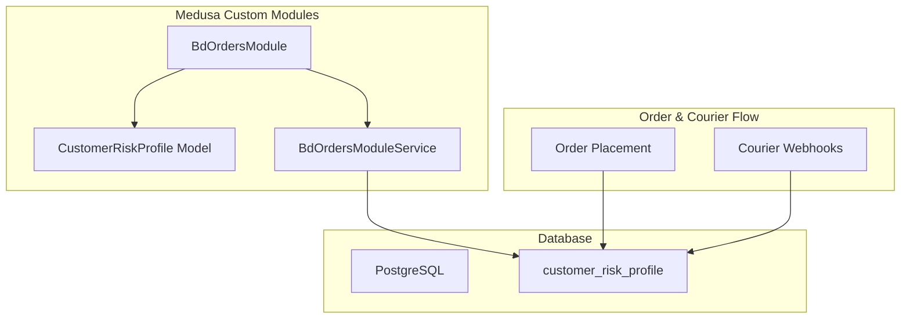
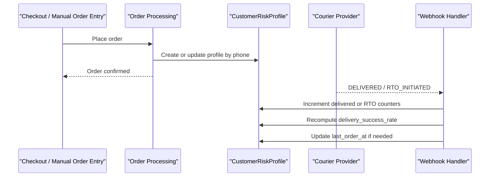
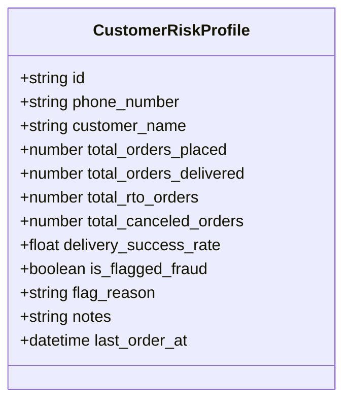
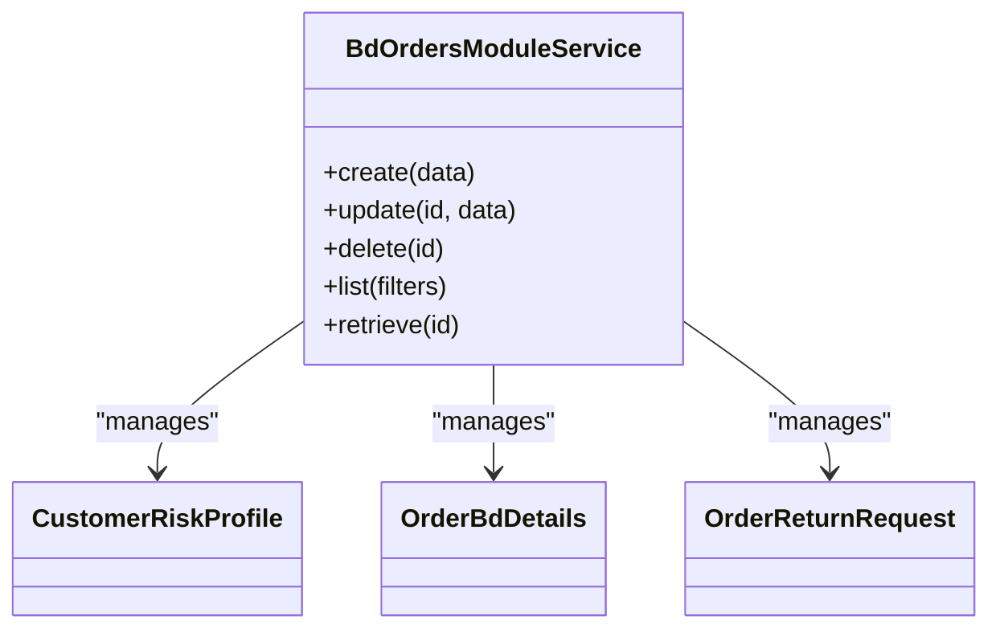
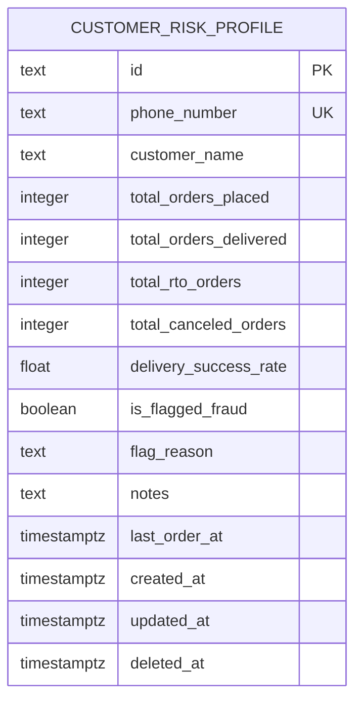
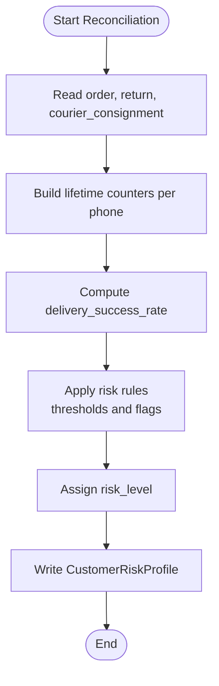
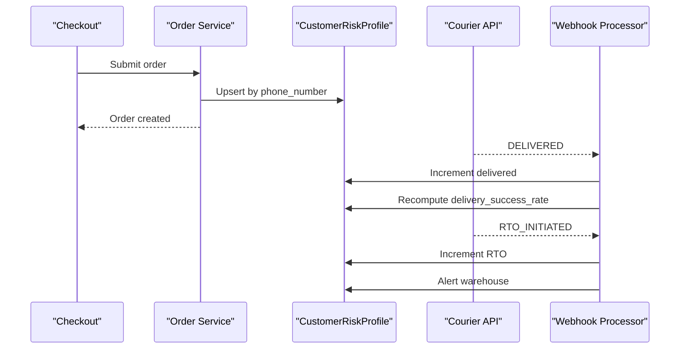
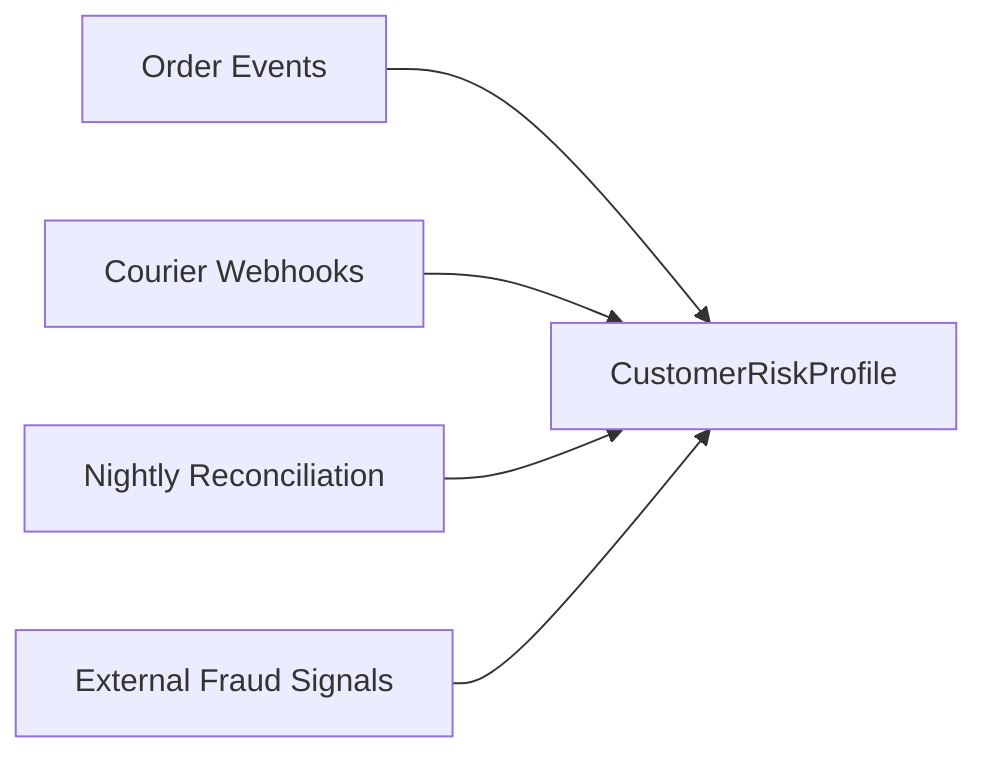

# Customer Risk Profiling System

<cite>
**Referenced Files in This Document**
- [customer-risk-profile.ts](file://apps/medusa/src/modules/bd-orders/models/customer-risk-profile.ts)
- [service.ts](file://apps/medusa/src/modules/bd-orders/service.ts)
- [Migration20261024060540.ts](file://apps/medusa/src/modules/bd-orders/migrations/Migration20261024060540.ts)
- [.snapshot-bd-orders.json](file://apps/medusa/src/modules/bd-orders/migrations/.snapshot-bd-orders.json)
- [data-models.md](file://docs/data-models.md)
- [database.md](file://database.md)
- [dfd.md](file://dfd.md)
</cite>

## Table of Contents
1. [Introduction](#introduction)
2. [Project Structure](#project-structure)
3. [Core Components](#core-components)
4. [Architecture Overview](#architecture-overview)
5. [Detailed Component Analysis](#detailed-component-analysis)
6. [Dependency Analysis](#dependency-analysis)
7. [Performance Considerations](#performance-considerations)
8. [Troubleshooting Guide](#troubleshooting-guide)
9. [Privacy, Retention, and Compliance](#privacy-retention-and-compliance)
10. [Conclusion](#conclusion)

## Introduction
This document explains the customer risk profiling system used by the Bangladesh commerce platform. It focuses on how a phone-keyed `CustomerRiskProfile` is modeled, how it integrates with order and courier workflows, and what scoring and evaluation mechanisms are defined or planned. The current codebase provides the data model and module wiring; detailed scoring algorithms, threshold configuration, and fraud detection integration are documented as design requirements and future implementation targets.

## Project Structure
The risk profile lives in the custom `bd-orders` Medusa module:
- Model definition: `apps/medusa/src/modules/bd-orders/models/customer-risk-profile.ts`
- Module service wiring: `apps/medusa/src/modules/bd-orders/service.ts`
- Database migration and snapshot: `apps/medusa/src/modules/bd-orders/migrations/Migration20261024060540.ts`, `.snapshot-bd-orders.json`
- Domain documentation: `docs/data-models.md`, `database.md`
- Data flow diagram showing RTO-driven risk updates: `dfd.md`

**Diagram sources**
- [customer-risk-profile.ts:3-16](file://apps/medusa/src/modules/bd-orders/models/customer-risk-profile.ts#L3-L16)
- [service.ts:6-10](file://apps/medusa/src/modules/bd-orders/service.ts#L6-L10)
- [Migration20261024060540.ts:5-10](file://apps/medusa/src/modules/bd-orders/migrations/Migration20261024060540.ts#L5-L10)
- [dfd.md:498-501](file://dfd.md#L498-L501)

**Section sources**
- [customer-risk-profile.ts:1-18](file://apps/medusa/src/modules/bd-orders/models/customer-risk-profile.ts#L1-L18)
- [service.ts:1-13](file://apps/medusa/src/modules/bd-orders/service.ts#L1-L13)
- [Migration20261024060540.ts:1-31](file://apps/medusa/src/modules/bd-orders/migrations/Migration20261024060540.ts#L1-L31)
- [data-models.md:171-191](file://docs/data-models.md#L171-L191)
- [database.md:566-588](file://database.md#L566-L588)
- [dfd.md:498-501](file://dfd.md#L498-L501)

## Core Components
- `CustomerRiskProfile` model defines a phone-keyed projection that tracks lifetime order outcomes and basic fraud flags.
- `BdOrdersModuleService` exposes repository-like access to `CustomerRiskProfile`, `OrderBdDetails`, and `OrderReturnRequest`.
- Migration creates the `customer_risk_profile` table with a soft-delete index and a unique partial index on `phone_number`.

Key responsibilities:
- Maintain per-phone counters for placed, delivered, returned-to-origin (RTO), and canceled orders.
- Track delivery success rate.
- Support manual or automated fraud flagging with reason notes.
- Record last order timestamp for recency signals.

**Section sources**
- [customer-risk-profile.ts:3-16](file://apps/medusa/src/modules/bd-orders/models/customer-risk-profile.ts#L3-L16)
- [service.ts:6-10](file://apps/medusa/src/modules/bd-orders/service.ts#L6-L10)
- [Migration20261024060540.ts:5-10](file://apps/medusa/src/modules/bd-orders/migrations/Migration20261024060540.ts#L5-L10)

## Architecture Overview
The risk profile is a denormalized projection keyed by normalized phone number. It is updated when order lifecycle events occur, especially courier webhook events such as delivery and RTO initiation. The design documents also define an intended richer schema including `risk_level`, `evaluated_at`, and reconciliation timestamps, which represent the target state for scoring and auditing.

**Diagram sources**
- [dfd.md:498-501](file://dfd.md#L498-L501)
- [database.md:566-588](file://database.md#L566-L588)

## Detailed Component Analysis

### CustomerRiskProfile Model
The model defines a lightweight, phone-keyed risk projection. It includes:
- Identity and contact fields: `id`, `phone_number`, `customer_name`
- Lifetime counters: `total_orders_placed`, `total_orders_delivered`, `total_rto_orders`, `total_canceled_orders`
- Derived metric: `delivery_success_rate`
- Fraud controls: `is_flagged_fraud`, `flag_reason`
- Operational notes: `notes`
- Recency signal: `last_order_at`

**Diagram sources**
- [customer-risk-profile.ts:3-16](file://apps/medusa/src/modules/bd-orders/models/customer-risk-profile.ts#L3-L16)

**Section sources**
- [customer-risk-profile.ts:1-18](file://apps/medusa/src/modules/bd-orders/models/customer-risk-profile.ts#L1-L18)
- [data-models.md:171-191](file://docs/data-models.md#L171-L191)

### Module Service Wiring
The module service registers the risk profile entity alongside other domain entities, enabling standard CRUD and query operations through the Medusa service layer.

**Diagram sources**
- [service.ts:6-10](file://apps/medusa/src/modules/bd-orders/service.ts#L6-L10)

**Section sources**
- [service.ts:1-13](file://apps/medusa/src/modules/bd-orders/service.ts#L1-L13)

### Database Schema and Indexing
The migration creates the `customer_risk_profile` table with:
- Primary key `id`
- Unique partial index on `phone_number` where `deleted_at IS NULL`
- Soft-delete index on `deleted_at`

The database design document describes the intended richer schema, including:
- Phone-level uniqueness and regex checks
- Additional counters and timestamps
- `risk_level` enum values: `low`, `medium`, `high`, `blocked`
- Evaluation and reconciliation timestamps

**Diagram sources**
- [Migration20261024060540.ts:5-10](file://apps/medusa/src/modules/bd-orders/migrations/Migration20261024060540.ts#L5-L10)
- [.snapshot-bd-orders.json:250-284](file://apps/medusa/src/modules/bd-orders/migrations/.snapshot-bd-orders.json#L250-L284)

**Section sources**
- [Migration20261024060540.ts:1-31](file://apps/medusa/src/modules/bd-orders/migrations/Migration20261024060540.ts#L1-L31)
- [.snapshot-bd-orders.json:250-284](file://apps/medusa/src/modules/bd-orders/migrations/.snapshot-bd-orders.json#L250-L284)
- [database.md:566-588](file://database.md#L566-L588)

### Risk Evaluation and Scoring Mechanisms
Current implementation status:
- The runtime scoring algorithm is not implemented in the provided files.
- The design specifies that counters should be rebuilt nightly from order, return, and courier consignment data, and that `delivery_success_rate` is computed rather than written manually.
- The target schema includes `risk_level` and evaluation timestamps, indicating a planned scoring run that records `evaluated_at`.

Planned scoring inputs:
- Lifetime counters: placed, delivered, RTO, canceled
- Delivery success rate: derived from delivered vs RTO
- Recency: last order timestamp
- Fraud flag: manual or external signal

Planned scoring outputs:
- `risk_level`: low, medium, high, blocked
- `evaluated_at`: timestamp of last scoring run
- Optional additional fields such as `reconciled_at` for counter rebuilds

**Diagram sources**
- [database.md:566-588](file://database.md#L566-L588)

**Section sources**
- [database.md:566-588](file://database.md#L566-L588)
- [data-models.md:171-191](file://docs/data-models.md#L171-L191)

### Order Processing Integration
During order placement, the system can create or update the risk profile using the phone number. During fulfillment, courier webhooks update counters:
- Delivery events increment delivered counts and may update success rate.
- RTO-initiated events increment RTO counts and trigger warehouse alerts.

**Diagram sources**
- [dfd.md:498-501](file://dfd.md#L498-L501)

**Section sources**
- [dfd.md:498-501](file://dfd.md#L498-L501)

### Risk Evaluation Scenarios
Examples of scenarios supported by the model and design:
- New phone with no history: default counters and zero success rate; risk level starts low until sufficient history exists.
- High RTO ratio: elevated risk level due to frequent returns to origin.
- Recent successful deliveries: improved success rate and potentially lower risk level.
- Manual fraud flag: immediate block or high risk based on `is_flagged_fraud` and `flag_reason`.

These scenarios are conceptual and rely on the planned scoring rules referenced in the design documents.

[No sources needed since this section presents conceptual scenarios]

### Threshold Configuration
Thresholds for risk levels and fraud handling are part of the design but not yet implemented in the provided source files. The design indicates:
- A `risk_level` enum with four states.
- Nightly reconciliation to compute counters and rates.
- An `evaluated_at` field to record scoring runs.

Implementation guidance:
- Store thresholds in a settings or configuration store.
- Use configurable cutoffs for RTO ratio, delivery success rate, recency decay, and fraud flag overrides.
- Ensure all threshold changes are audited.

**Section sources**
- [database.md:566-588](file://database.md#L566-L588)

### Integration with Fraud Detection Systems
The current model supports a manual fraud flag (`is_flagged_fraud`) and reason (`flag_reason`). Future integration points include:
- External fraud detection services returning phone-based risk scores.
- Automated rule engine updating `risk_level` and `is_flagged_fraud`.
- Audit logging for every fraud-related change.

Integration pattern:
- Ingest fraud signals via webhook or batch job.
- Normalize phone numbers to E.164.
- Merge external risk score with internal metrics.
- Enforce business policy (e.g., block orders for blocked risk level).

**Section sources**
- [customer-risk-profile.ts:11-13](file://apps/medusa/src/modules/bd-orders/models/customer-risk-profile.ts#L11-L13)
- [database.md:566-588](file://database.md#L566-L588)

## Dependency Analysis
The risk profile depends on:
- Order lifecycle events for placing and canceling orders.
- Courier webhook events for delivery and RTO transitions.
- Design-defined reconciliation jobs for nightly counter rebuilds.

**Diagram sources**
- [dfd.md:498-501](file://dfd.md#L498-L501)
- [database.md:566-588](file://database.md#L566-L588)

**Section sources**
- [dfd.md:498-501](file://dfd.md#L498-L501)
- [database.md:566-588](file://database.md#L566-L588)

## Performance Considerations
- Phone-number lookup should use the unique partial index to avoid full-table scans.
- Counter updates should be atomic and idempotent to handle duplicate webhooks.
- Nightly reconciliation should be partitioned by phone ranges or batches to reduce lock contention.
- Avoid recomputing success rate on every write; batch updates during reconciliation or after webhook bursts.

[No sources needed since this section provides general guidance]

## Troubleshooting Guide
Common issues and resolutions:
- Duplicate phone entries: ensure normalization to E.164 and enforce uniqueness at the application layer before DB constraints.
- Incorrect success rate: verify that only delivered and RTO counters are used in the denominator and that manual writes are disabled.
- Missing risk level: confirm that scoring job ran and wrote `risk_level` and `evaluated_at`.
- Stale counters: trigger reconciliation and compare against order, return, and courier consignment tables.

**Section sources**
- [Migration20261024060540.ts:5-10](file://apps/medusa/src/modules/bd-orders/migrations/Migration20261024060540.ts#L5-L10)
- [database.md:566-588](file://database.md#L566-L588)

## Privacy, Retention, and Compliance
Privacy considerations:
- Phone numbers are sensitive personal data; normalize and protect them at rest and in transit.
- Limit access to `notes` and `flag_reason` to authorized staff roles.
- Mask sensitive fields in exports and logs.

Retention policies:
- Follow organizational retention schedules for risk assessment data.
- Keep audit trails immutable and secure.
- Honor deletion requests where applicable, while preserving required compliance records.

Compliance requirements:
- Log all changes to risk profiles and fraud flags.
- Provide data subject access and correction processes.
- Ensure scoring decisions are explainable and auditable.

**Section sources**
- [database.md:566-588](file://database.md#L566-L588)
- [data-models.md:171-191](file://docs/data-models.md#L171-L191)

## Conclusion
The customer risk profiling system is centered on a phone-keyed `CustomerRiskProfile` model that captures lifetime order outcomes and basic fraud indicators. The current codebase provides the model, service wiring, and migration; the design documents specify the intended scoring architecture, including nightly reconciliation, computed success rates, and risk levels. Implementation should focus on robust webhook processing, idempotent counter updates, configurable thresholds, and strong privacy and audit controls.

[No sources needed since this section summarizes without analyzing specific files]