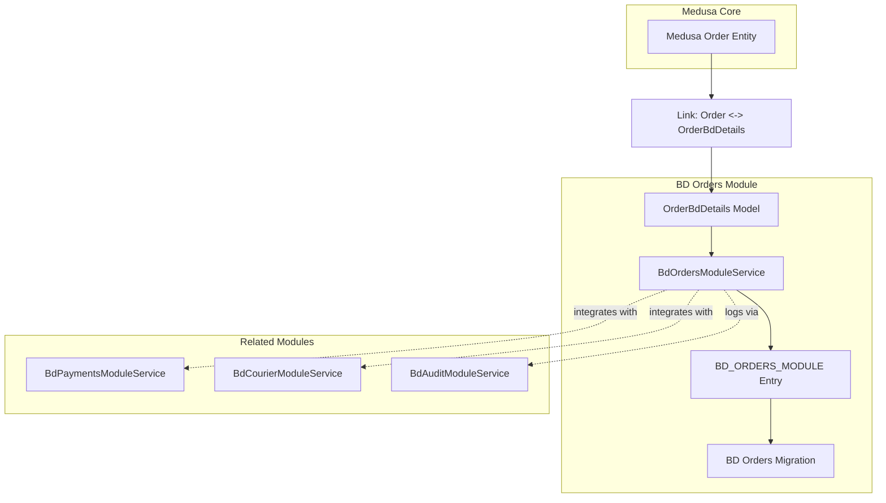
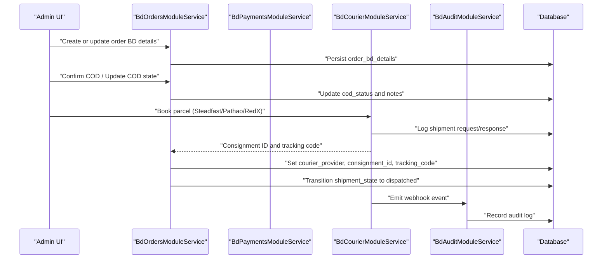
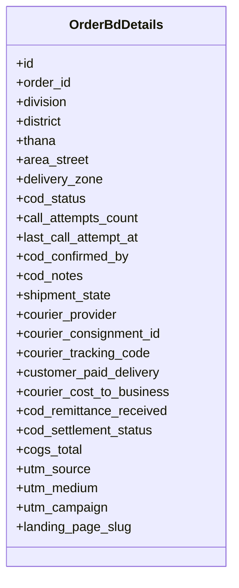
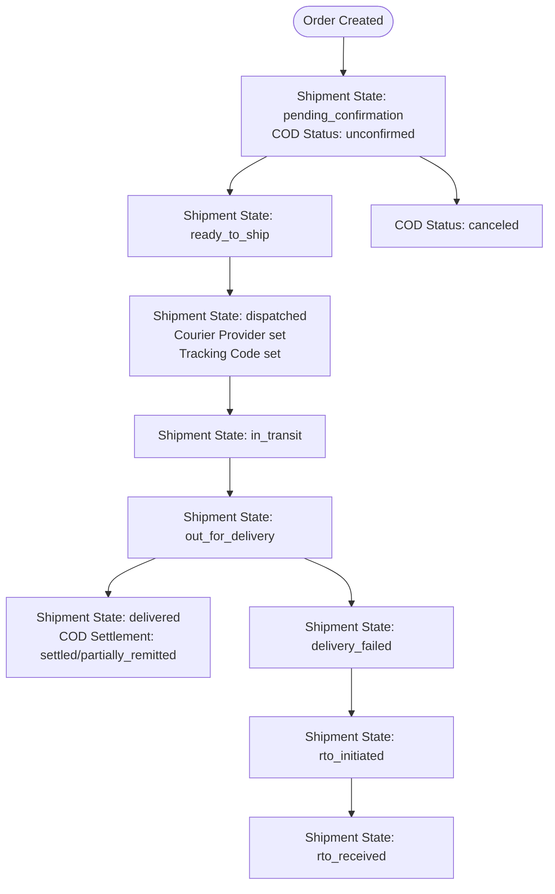
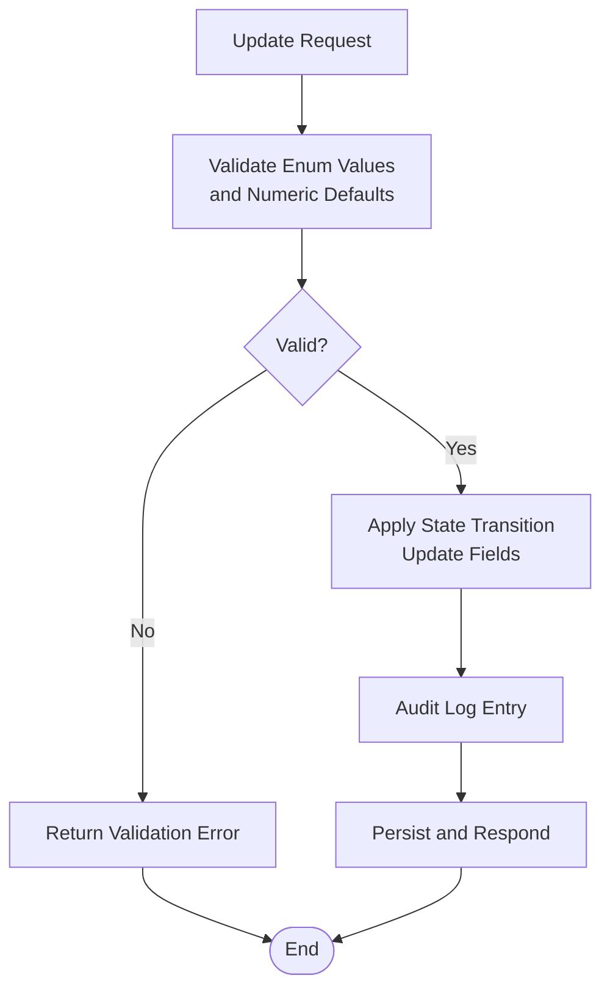
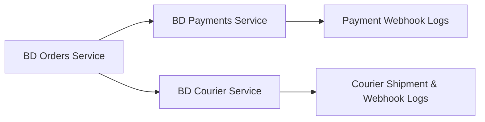
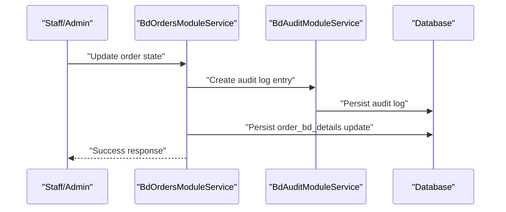
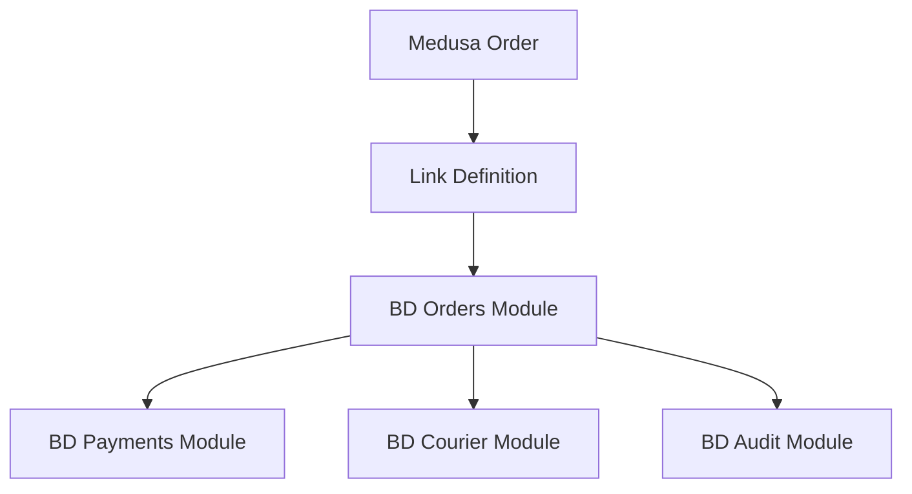

# Order Lifecycle Management

<cite>
**Referenced Files in This Document**
- [order-bd-details.ts](file://apps/medusa/src/modules/bd-orders/models/order-bd-details.ts)
- [service.ts](file://apps/medusa/src/modules/bd-orders/service.ts)
- [index.ts](file://apps/medusa/src/modules/bd-orders/index.ts)
- [Migration20261024060540.ts](file://apps/medusa/src/modules/bd-orders/migrations/Migration20261024060540.ts)
- [order-bd-details link](file://apps/medusa/src/links/order-bd-details.ts)
- [bd-payments service.ts](file://apps/medusa/src/modules/bd-payments/service.ts)
- [bd-courier service.ts](file://apps/medusa/src/modules/bd-courier/service.ts)
- [bd-audit service.ts](file://apps/medusa/src/modules/bd-audit/service.ts)
- [technical-plan.md](file://technical-plan.md)
- [quality-checklist.md](file://quality-checklist.md)
</cite>

## Table of Contents
1. [Introduction](#introduction)
2. [Project Structure](#project-structure)
3. [Core Components](#core-components)
4. [Architecture Overview](#architecture-overview)
5. [Detailed Component Analysis](#detailed-component-analysis)
6. [Dependency Analysis](#dependency-analysis)
7. [Performance Considerations](#performance-considerations)
8. [Troubleshooting Guide](#troubleshooting-guide)
9. [Conclusion](#conclusion)

## Introduction
This document explains the order lifecycle management for the BD Orders module within the Medusa-based commerce platform. It covers how orders are created, validated, transitioned through fulfillment states, and integrated with payment and courier systems. The focus is on the `OrderBdDetails` model, its fields, business rules, status transitions, error handling, and audit logging.

The implementation currently provides:
- A dedicated BD Orders module exposing a service and an extended order details model.
- A database schema defining Bangladesh-specific delivery zones, COD state, shipment state, courier metadata, and financial tracking fields.
- Links to Medusa’s core Order entity so that BD-specific details can be associated with each order.
- Supporting modules for payments, couriers, and audit logging.

## Project Structure
The BD Orders module is implemented as a Medusa module under `apps/medusa/src/modules/bd-orders`. It defines:
- A data model for BD-specific order details.
- A module service extending Medusa’s base service.
- A module entry point exporting the module configuration.
- A database migration creating the underlying tables and indexes.



**Diagram sources**
- [order-bd-details link:1-9](file://apps/medusa/src/links/order-bd-details.ts#L1-L9)
- [index.ts:1-9](file://apps/medusa/src/modules/bd-orders/index.ts#L1-L9)
- [service.ts:1-13](file://apps/medusa/src/modules/bd-orders/service.ts#L1-L13)
- [bd-payments service.ts:1-11](file://apps/medusa/src/modules/bd-payments/service.ts#L1-L11)
- [bd-courier service.ts:1-11](file://apps/medusa/src/modules/bd-courier/service.ts#L1-L11)
- [bd-audit service.ts:1-11](file://apps/medusa/src/modules/bd-audit/service.ts#L1-L11)

**Section sources**
- [index.ts:1-9](file://apps/medusa/src/modules/bd-orders/index.ts#L1-L9)
- [service.ts:1-13](file://apps/medusa/src/modules/bd-orders/service.ts#L1-L13)
- [Migration20261024060540.ts:1-31](file://apps/medusa/src/modules/bd-orders/migrations/Migration20261024060540.ts#L1-L31)

## Core Components
- **BD Orders Module**: Exposes a named module (`bd_orders`) and a service managing BD-specific entities.
- **OrderBdDetails Model**: Defines BD-specific order attributes including address segmentation, delivery zone, COD state, shipment lifecycle state, courier metadata, and financial fields.
- **Database Migration**: Creates the `order_bd_details` table with constraints, defaults, and indexes.
- **Link to Medusa Order**: Connects the BD order details to the core Medusa Order entity.

Key responsibilities:
- Persist BD-specific order context alongside Medusa’s order.
- Provide a foundation for downstream workflows such as COD confirmation, dispatch, tracking, settlement, and returns.

**Section sources**
- [index.ts:1-9](file://apps/medusa/src/modules/bd-orders/index.ts#L1-L9)
- [order-bd-details.ts:1-42](file://apps/medusa/src/modules/bd-orders/models/order-bd-details.ts#L1-L42)
- [Migration20261024060540.ts:1-31](file://apps/medusa/src/modules/bd-orders/migrations/Migration20261024060540.ts#L1-L31)
- [order-bd-details link:1-9](file://apps/medusa/src/links/order-bd-details.ts#L1-L9)

## Architecture Overview
At runtime, the BD Orders module extends Medusa’s order domain with BD-specific details. Fulfillment and logistics are coordinated by related modules:
- Payments module tracks transactions and webhooks.
- Courier module logs shipments and webhook events.
- Audit module records operational changes.



**Diagram sources**
- [service.ts:1-13](file://apps/medusa/src/modules/bd-orders/service.ts#L1-L13)
- [bd-payments service.ts:1-11](file://apps/medusa/src/modules/bd-payments/service.ts#L1-L11)
- [bd-courier service.ts:1-11](file://apps/medusa/src/modules/bd-courier/service.ts#L1-L11)
- [bd-audit service.ts:1-11](file://apps/medusa/src/modules/bd-audit/service.ts#L1-L11)

## Detailed Component Analysis

### OrderBdDetails Model
The `OrderBdDetails` model captures BD-specific order context. Its primary purpose is to store:
- Geographic segmentation: division, district, thana, area/street.
- Delivery zone classification: inside Dhaka, Dhaka suburbs, outside Dhaka.
- Cash-on-Delivery (COD) lifecycle: applicability, confirmation workflow, escalation, cancellation.
- Shipment lifecycle: from pending confirmation through delivery or return-to-origin (RTO).
- Courier metadata: provider selection, consignment ID, tracking code.
- Financial tracking: delivery charges paid by customer, courier cost to business, COD remittance received, COGS total.
- Marketing attribution: UTM source, medium, campaign, landing page slug.



**Diagram sources**
- [order-bd-details.ts:1-42](file://apps/medusa/src/modules/bd-orders/models/order-bd-details.ts#L1-L42)

#### Field Definitions and Business Rules
- Geographic fields:
  - `division`, `district`, `thana`, `area_street`: Required textual address components used for routing and delivery zone determination.
- Delivery zone:
  - Enumerated values: `inside_dhaka`, `dhaka_suburbs`, `outside_dhaka`. Used to determine delivery rates and courier eligibility.
- COD status:
  - Enumerated values: `not_applicable`, `unconfirmed`, `confirmed`, `escalated`, `canceled`. Default is `unconfirmed`.
  - Tracks whether COD was attempted, confirmed, escalated, or canceled.
- Call attempts:
  - `call_attempts_count`: Integer counter for call attempts.
  - `last_call_attempt_at`: Timestamp of last call attempt.
  - `cod_confirmed_by`: Staff identifier who confirmed COD.
  - `cod_notes`: Free-text notes for COD confirmation or escalation.
- Shipment state:
  - Enumerated values: `pending_confirmation`, `ready_to_ship`, `dispatched`, `in_transit`, `out_for_delivery`, `delivery_failed`, `rto_initiated`, `rto_received`, `delivered`. Default is `pending_confirmation`.
  - Represents the physical movement and delivery outcome of the order.
- Courier metadata:
  - `courier_provider`: Enumerated values: `steadfast`, `pathao`, `redx`, `manual`. Nullable to allow manual fallback.
  - `courier_consignment_id`: External consignment reference.
  - `courier_tracking_code`: Indexed tracking code for fast lookup.
- Financial fields:
  - `customer_paid_delivery`: Amount paid by customer for delivery.
  - `courier_cost_to_business`: Cost incurred by business for shipping.
  - `cod_remittance_received`: Amount remitted back from courier for COD orders.
  - `cod_settlement_status`: Enumerated values: `pending`, `partially_remitted`, `settled`, `disputed`.
  - `cogs_total`: Cost of goods sold for the order.
- Marketing attribution:
  - `utm_source`, `utm_medium`, `utm_campaign`, `landing_page_slug`: Track marketing campaigns and landing pages.

Validation and integrity:
- Database-level checks enforce allowed enum values for `delivery_zone`, `cod_status`, `shipment_state`, `courier_provider`, and `cod_settlement_status`.
- Unique index on `order_id` ensures one BD detail record per order.
- Index on `courier_tracking_code` supports efficient tracking queries.

**Section sources**
- [order-bd-details.ts:1-42](file://apps/medusa/src/modules/bd-orders/models/order-bd-details.ts#L1-L42)
- [Migration20261024060540.ts:1-31](file://apps/medusa/src/modules/bd-orders/migrations/Migration20261024060540.ts#L1-L31)

### Order Lifecycle and Status Transitions
The order lifecycle spans creation, COD confirmation, dispatch, transit, delivery, and post-delivery settlement. The following diagram maps the supported transitions based on the model’s enums and documented expectations.



Business rules governing transitions:
- Creation:
  - An order is linked to `OrderBdDetails` via the defined link.
  - Defaults apply: `cod_status = unconfirmed`, `shipment_state = pending_confirmation`.
- COD Confirmation:
  - Staff may confirm COD after calling the customer; updates include `cod_status = confirmed`, optional `cod_confirmed_by`, and `cod_notes`.
  - If calls fail repeatedly, `call_attempts_count` increments and `last_call_attempt_at` is updated.
- Dispatch:
  - When a courier is selected (automated or manual), system sets `courier_provider`, `courier_consignment_id`, and `courier_tracking_code`.
  - Shipment state transitions to `dispatched`.
- Transit and Delivery:
  - Webhooks or manual updates move the order through `in_transit` and `out_for_delivery`.
  - On successful delivery, shipment state becomes `delivered`; COD settlement status moves toward `settled` or `partially_remitted`.
- Failure and RTO:
  - If delivery fails, shipment state becomes `delivery_failed`.
  - Return-to-origin flow transitions to `rto_initiated` then `rto_received`.

Integration points:
- Payment integration: COD remittance and settlement status are tracked in `OrderBdDetails`; payment module services handle transaction records and webhook logs.
- Courier integration: Automated booking via Steadfast, Pathao, RedX, or manual fallback; webhook ingestion updates shipment state and triggers downstream actions.

**Diagram sources**
- [order-bd-details.ts:11-33](file://apps/medusa/src/modules/bd-orders/models/order-bd-details.ts#L11-L33)
- [technical-plan.md:549-596](file://technical-plan.md#L549-L596)
- [quality-checklist.md:364-401](file://quality-checklist.md#L364-L401)

**Section sources**
- [order-bd-details.ts:11-33](file://apps/medusa/src/modules/bd-orders/models/order-bd-details.ts#L11-L33)
- [technical-plan.md:549-596](file://technical-plan.md#L549-L596)
- [quality-checklist.md:364-401](file://quality-checklist.md#L364-L401)

### Order Creation Workflow
Creation involves associating BD-specific details with a Medusa order:
- Create or retrieve the Medusa Order.
- Create or update the corresponding `OrderBdDetails` record with geographic and initial state fields.
- Ensure unique constraint on `order_id` is satisfied.

```mermaid
sequenceDiagram
participant Admin as "Admin UI"
participant OrdersSvc as "BdOrdersModuleService"
participant Link as "Order <-> OrderBdDetails Link"
participant DB as "Database"
Admin->>OrdersSvc : "Create order BD details"
OrdersSvc->>Link : "Associate with Medusa Order"
OrdersSvc->>DB : "Insert order_bd_details"
DB-->>OrdersSvc : "Persisted record"
OrdersSvc-->>Admin : "Success"
```

**Diagram sources**
- [order-bd-details link:1-9](file://apps/medusa/src/links/order-bd-details.ts#L1-L9)
- [service.ts:1-13](file://apps/medusa/src/modules/bd-orders/service.ts#L1-L13)

**Section sources**
- [order-bd-details link:1-9](file://apps/medusa/src/links/order-bd-details.ts#L1-L9)
- [service.ts:1-13](file://apps/medusa/src/modules/bd-orders/service.ts#L1-L13)

### Status Updates and Validation
Status updates occur during COD confirmation, dispatch, transit, delivery, failure, and RTO. Validation includes:
- Enum validation enforced at the database level for all state fields.
- Numeric field defaults ensure consistent financial accounting.
- Indexes support performance for tracking and deletion queries.



**Diagram sources**
- [Migration20261024060540.ts:12-15](file://apps/medusa/src/modules/bd-orders/migrations/Migration20261024060540.ts#L12-L15)

**Section sources**
- [Migration20261024060540.ts:12-15](file://apps/medusa/src/modules/bd-orders/migrations/Migration20261024060540.ts#L12-L15)

### Integration with Payment and Courier Systems
- Payments:
  - The BD Payments module exposes services for payment transactions and webhook logs.
  - COD settlement status in `OrderBdDetails` aligns with payment capture and remittance reconciliation.
- Couriers:
  - The BD Courier module exposes services for shipment logs and webhook logs.
  - Automated booking and tracking integrate with providers like Steadfast, Pathao, and RedX; manual fallback is supported.



**Diagram sources**
- [bd-payments service.ts:1-11](file://apps/medusa/src/modules/bd-payments/service.ts#L1-L11)
- [bd-courier service.ts:1-11](file://apps/medusa/src/modules/bd-courier/service.ts#L1-L11)

**Section sources**
- [bd-payments service.ts:1-11](file://apps/medusa/src/modules/bd-payments/service.ts#L1-L11)
- [bd-courier service.ts:1-11](file://apps/medusa/src/modules/bd-courier/service.ts#L1-L11)

### Audit Logging
Operational changes should be recorded using the BD Audit module:
- Audit logs capture who performed actions, what changed, and when.
- Recommended practice: log every significant state transition and integration callback.



**Diagram sources**
- [bd-audit service.ts:1-11](file://apps/medusa/src/modules/bd-audit/service.ts#L1-L11)
- [service.ts:1-13](file://apps/medusa/src/modules/bd-orders/service.ts#L1-L13)

**Section sources**
- [bd-audit service.ts:1-11](file://apps/medusa/src/modules/bd-audit/service.ts#L1-L11)
- [service.ts:1-13](file://apps/medusa/src/modules/bd-orders/service.ts#L1-L13)

## Dependency Analysis
The BD Orders module depends on:
- Medusa’s core Order entity via the link definition.
- Related modules for payments, couriers, and audit logging.



**Diagram sources**
- [order-bd-details link:1-9](file://apps/medusa/src/links/order-bd-details.ts#L1-L9)
- [index.ts:1-9](file://apps/medusa/src/modules/bd-orders/index.ts#L1-L9)
- [bd-payments service.ts:1-11](file://apps/medusa/src/modules/bd-payments/service.ts#L1-L11)
- [bd-courier service.ts:1-11](file://apps/medusa/src/modules/bd-courier/service.ts#L1-L11)
- [bd-audit service.ts:1-11](file://apps/medusa/src/modules/bd-audit/service.ts#L1-L11)

**Section sources**
- [order-bd-details link:1-9](file://apps/medusa/src/links/order-bd-details.ts#L1-L9)
- [index.ts:1-9](file://apps/medusa/src/modules/bd-orders/index.ts#L1-L9)

## Performance Considerations
- Indexing:
  - `courier_tracking_code` is indexed to accelerate tracking queries.
  - `deleted_at` indexes support soft-delete filtering across tables.
- Defaults:
  - Numeric fields have default values to prevent null-related issues and simplify reporting.
- Enum constraints:
  - Database-level checks reduce invalid state mutations and improve consistency.

Recommendations:
- Use composite indexes where frequent queries combine `order_id` and `shipment_state`.
- Partition large tables by time if historical order volume grows significantly.
- Cache frequently accessed delivery zone configurations to avoid repeated lookups.

[No sources needed since this section provides general guidance]

## Troubleshooting Guide
Common issues and resolutions:
- Duplicate `order_id`:
  - Cause: Attempting to create multiple BD details for the same order.
  - Resolution: Ensure only one `OrderBdDetails` record exists per order; handle uniqueness errors gracefully.
- Invalid enum values:
  - Cause: Updating fields with unsupported values.
  - Resolution: Validate against allowed enums before persisting; use admin UI dropdowns to restrict inputs.
- Missing courier tracking code:
  - Cause: Automated booking failed or manual entry omitted.
  - Resolution: Retry booking or enter manual tracking; log the failure in courier shipment logs.
- COD settlement mismatch:
  - Cause: Remittance not reconciled with payment records.
  - Resolution: Reconcile with payment module; update `cod_settlement_status` accordingly; log discrepancies.

Operational best practices:
- Always log state transitions and integration callbacks.
- Provide clear error messages to staff when external APIs fail.
- Maintain manual fallback options for courier operations.

**Section sources**
- [Migration20261024060540.ts:12-15](file://apps/medusa/src/modules/bd-orders/migrations/Migration20261024060540.ts#L12-L15)
- [technical-plan.md:549-596](file://technical-plan.md#L549-L596)
- [quality-checklist.md:364-401](file://quality-checklist.md#L364-L401)

## Conclusion
The BD Orders module establishes a robust foundation for managing order lifecycles specific to Bangladesh’s logistics and payment environment. The `OrderBdDetails` model encapsulates critical geographic, operational, and financial attributes, while the module integrates with payments, couriers, and audit logging. With well-defined enums, database constraints, and planned integration patterns, the system supports both automated and manual workflows, ensuring resilience and traceability throughout the order lifecycle.

[No sources needed since this section summarizes without analyzing specific files]