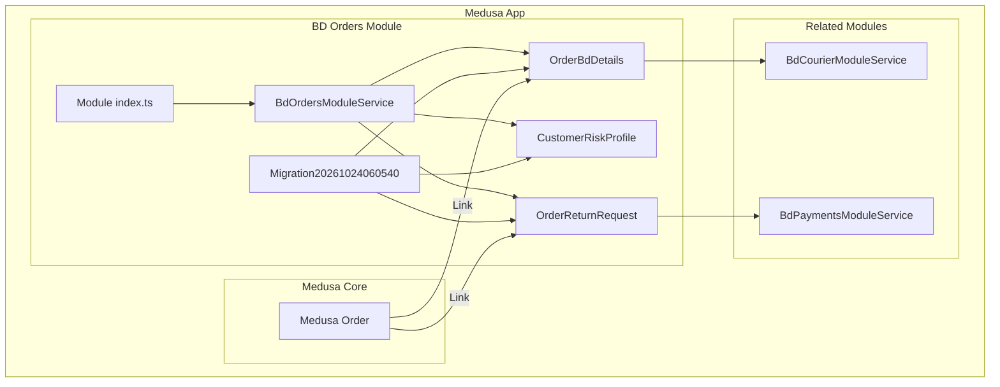
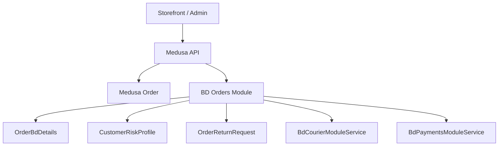
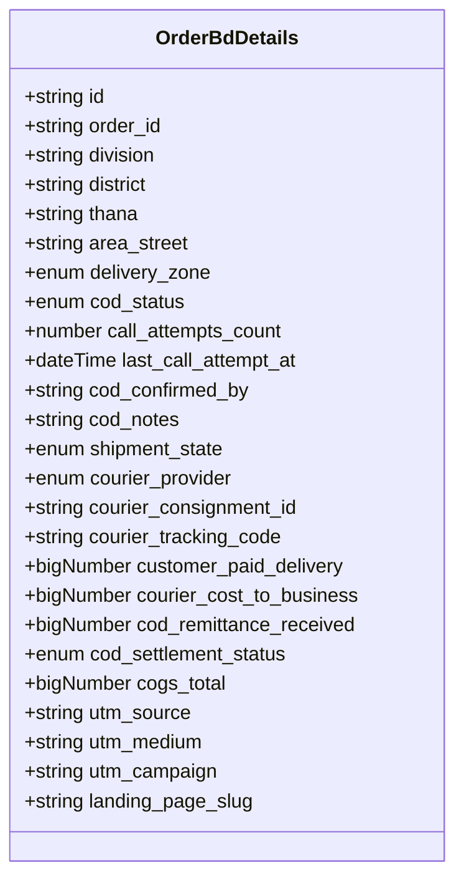
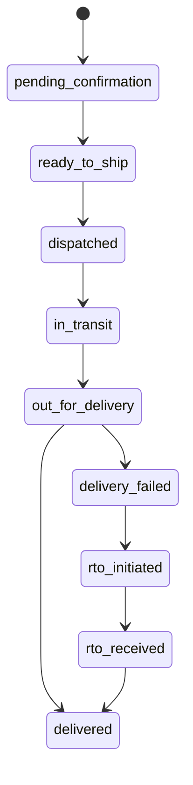
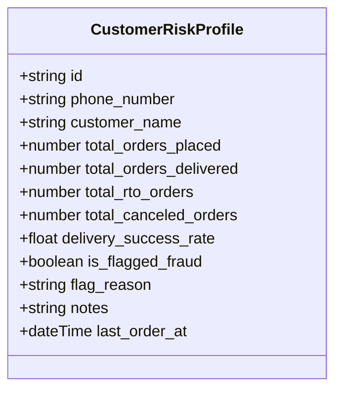
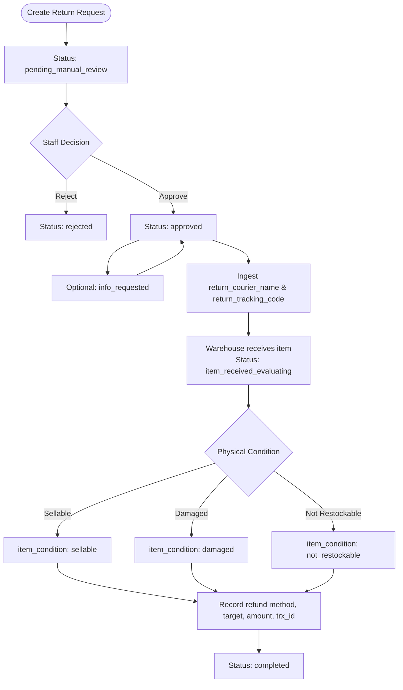
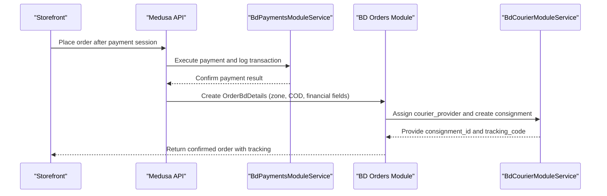
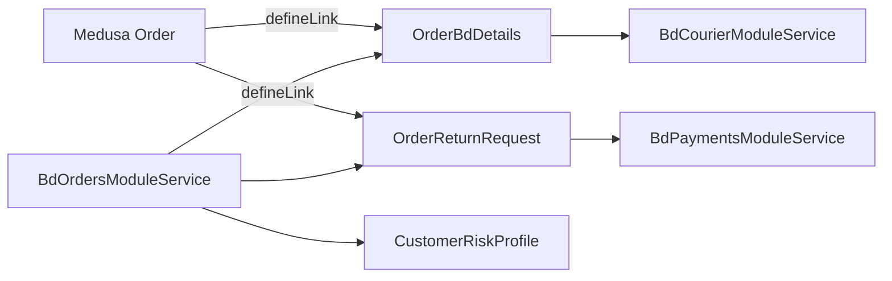

# Order Management Module

<cite>
**Referenced Files in This Document**
- [service.ts](file://apps/medusa/src/modules/bd-orders/service.ts)
- [order-bd-details.ts](file://apps/medusa/src/modules/bd-orders/models/order-bd-details.ts)
- [customer-risk-profile.ts](file://apps/medusa/src/modules/bd-orders/models/customer-risk-profile.ts)
- [order-return-request.ts](file://apps/medusa/src/modules/bd-orders/models/order-return-request.ts)
- [Migration20261024060540.ts](file://apps/medusa/src/modules/bd-orders/migrations/Migration20261024060540.ts)
- [index.ts](file://apps/medusa/src/modules/bd-orders/index.ts)
- [order-bd-details link](file://apps/medusa/src/links/order-bd-details.ts)
- [order-return-request link](file://apps/medusa/src/links/order-return-request.ts)
- [bd-courier service.ts](file://apps/medusa/src/modules/bd-courier/service.ts)
- [bd-payments service.ts](file://apps/medusa/src/modules/bd-payments/service.ts)
- [data-models.md](file://docs/data-models.md)
- [dfd.md](file://dfd.md)
</cite>

## Table of Contents
1. [Introduction](#introduction)
2. [Project Structure](#project-structure)
3. [Core Components](#core-components)
4. [Architecture Overview](#architecture-overview)
5. [Detailed Component Analysis](#detailed-component-analysis)
6. [Dependency Analysis](#dependency-analysis)
7. [Performance Considerations](#performance-considerations)
8. [Troubleshooting Guide](#troubleshooting-guide)
9. [Conclusion](#conclusion)

## Introduction
The BD Orders module extends Medusa’s core order domain with Bangladesh-specific order details, customer risk profiling, and return request processing. It does not replace the Medusa order lifecycle; instead, it adds a parallel set of operational states for COD verification, courier dispatch, delivery outcomes, settlement reconciliation, and manual return/refund handling.

Key responsibilities:
- Store Bangladesh address, delivery zone, COD status, shipment state, courier provider, tracking code, and financial split fields per order.
- Maintain a phone-keyed customer risk profile used to flag high-risk or fraudulent behavior.
- Track independent return requests with manual review, physical inspection, condition evaluation, and refund recording.
- Link these entities to Medusa’s native `Order` through Medusa links.

This documentation explains the data model, status workflows, integration points with payment and courier modules, and practical examples of how orders are created, evaluated, returned, and updated.

## Project Structure
The BD Orders module is implemented as a Medusa module under `apps/medusa/src/modules/bd-orders`. It exposes:
- A module entry point exporting the service.
- Three domain models: order details, customer risk profile, and return request.
- Database migration defining tables, constraints, and indexes.
- Links connecting Medusa’s `Order` to order details and return requests.

**Diagram sources**
- [index.ts:1-8](file://apps/medusa/src/modules/bd-orders/index.ts#L1-L8)
- [service.ts:1-13](file://apps/medusa/src/modules/bd-orders/service.ts#L1-L13)
- [order-bd-details.ts:1-42](file://apps/medusa/src/modules/bd-orders/models/order-bd-details.ts#L1-L42)
- [customer-risk-profile.ts:1-19](file://apps/medusa/src/modules/bd-orders/models/customer-risk-profile.ts#L1-L19)
- [order-return-request.ts:1-28](file://apps/medusa/src/modules/bd-orders/models/order-return-request.ts#L1-L28)
- [Migration20261024060540.ts:1-31](file://apps/medusa/src/modules/bd-orders/migrations/Migration20261024060540.ts#L1-L31)
- [order-bd-details link:1-9](file://apps/medusa/src/links/order-bd-details.ts#L1-L9)
- [order-return-request link:1-9](file://apps/medusa/src/links/order-return-request.ts#L1-L9)
- [bd-courier service.ts:1-11](file://apps/medusa/src/modules/bd-courier/service.ts#L1-L11)
- [bd-payments service.ts:1-11](file://apps/medusa/src/modules/bd-payments/service.ts#L1-L11)

**Section sources**
- [index.ts:1-8](file://apps/medusa/src/modules/bd-orders/index.ts#L1-L8)
- [service.ts:1-13](file://apps/medusa/src/modules/bd-orders/service.ts#L1-L13)
- [Migration20261024060540.ts:1-31](file://apps/medusa/src/modules/bd-orders/migrations/Migration20261024060540.ts#L1-L31)

## Core Components
The module centers on three domain entities exposed by the service:

- OrderBdDetails: Bangladesh-specific order extension including address, delivery zone, COD workflow, shipment state, courier details, and financial reconciliation fields.
- CustomerRiskProfile: Phone-keyed customer scoring and fraud-flagging record.
- OrderReturnRequest: Independent return request lifecycle with manual review, tracking, inspection, and refund recording.

The service class inherits from Medusa’s base service and registers these models so they can be queried and managed through Medusa’s module system.

**Section sources**
- [service.ts:1-13](file://apps/medusa/src/modules/bd-orders/service.ts#L1-L13)
- [order-bd-details.ts:1-42](file://apps/medusa/src/modules/bd-orders/models/order-bd-details.ts#L1-L42)
- [customer-risk-profile.ts:1-19](file://apps/medusa/src/modules/bd-orders/models/customer-risk-profile.ts#L1-L19)
- [order-return-request.ts:1-28](file://apps/medusa/src/modules/bd-orders/models/order-return-request.ts#L1-L28)

## Architecture Overview
The BD Orders module integrates with:
- Medusa Order: via links that associate order details and return requests to the core order entity.
- BdCourierModuleService: for courier provider selection, consignment IDs, tracking codes, and shipment state updates.
- BdPaymentsModuleService: for payment transactions and webhook logs related to order payments and refunds.

**Diagram sources**
- [order-bd-details link:1-9](file://apps/medusa/src/links/order-bd-details.ts#L1-L9)
- [order-return-request link:1-9](file://apps/medusa/src/links/order-return-request.ts#L1-L9)
- [service.ts:1-13](file://apps/medusa/src/modules/bd-orders/service.ts#L1-L13)
- [bd-courier service.ts:1-11](file://apps/medusa/src/modules/bd-courier/service.ts#L1-L11)
- [bd-payments service.ts:1-11](file://apps/medusa/src/modules/bd-payments/service.ts#L1-L11)

## Detailed Component Analysis

### Order Details Extension: OrderBdDetails
OrderBdDetails extends Medusa’s order with Bangladesh-specific operational data:
- Address and delivery zone: division, district, thana, area_street, delivery_zone.
- COD workflow: cod_status, call_attempts_count, last_call_attempt_at, cod_confirmed_by, cod_notes.
- Shipment lifecycle: shipment_state covering confirmation, fulfillment, transit, delivery failure, RTO initiation/receipt, and final delivery.
- Courier integration: courier_provider, courier_consignment_id, courier_tracking_code.
- Financial reconciliation: customer_paid_delivery, courier_cost_to_business, cod_remittance_received, cod_settlement_status, cogs_total.
- Marketing attribution: utm_source, utm_medium, utm_campaign, landing_page_slug.

**Diagram sources**
- [order-bd-details.ts:1-42](file://apps/medusa/src/modules/bd-orders/models/order-bd-details.ts#L1-L42)

**Section sources**
- [order-bd-details.ts:1-42](file://apps/medusa/src/modules/bd-orders/models/order-bd-details.ts#L1-L42)
- [data-models.md:193-224](file://docs/data-models.md#L193-L224)

#### Order Status Workflow
The shipment_state enum defines the order lifecycle within this module:
- pending_confirmation: initial state before fulfillment.
- ready_to_ship: order prepared for dispatch.
- dispatched: handed off to courier.
- in_transit: parcel moving toward destination.
- out_for_delivery: local delivery attempt.
- delivery_failed: failed delivery event.
- rto_initiated: return-to-origin initiated.
- rto_received: RTO parcel received back.
- delivered: successful delivery completion.

**Diagram sources**
- [order-bd-details.ts:16-26](file://apps/medusa/src/modules/bd-orders/models/order-bd-details.ts#L16-L26)

**Section sources**
- [order-bd-details.ts:16-26](file://apps/medusa/src/modules/bd-orders/models/order-bd-details.ts#L16-L26)

### Customer Risk Profiling System
CustomerRiskProfile maintains a phone-keyed projection of customer behavior:
- Identifiers: phone_number (unique), customer_name.
- Counters: total_orders_placed, total_orders_delivered, total_rto_orders, total_canceled_orders.
- Derived metrics: delivery_success_rate.
- Fraud controls: is_flagged_fraud, flag_reason, notes.
- Temporal marker: last_order_at.

**Diagram sources**
- [customer-risk-profile.ts:1-19](file://apps/medusa/src/modules/bd-orders/models/customer-risk-profile.ts#L1-L19)

**Section sources**
- [customer-risk-profile.ts:1-19](file://apps/medusa/src/modules/bd-orders/models/customer-risk-profile.ts#L1-L19)
- [data-models.md:171-192](file://docs/data-models.md#L171-L192)

#### Risk Assessment Algorithms
The current repository implementation provides the data model and counters but does not include explicit algorithmic logic in the BD Orders service. The design supports:
- Counter-based signals: placed, delivered, RTO, canceled counts.
- Derived success rate: delivery_success_rate.
- Fraud flagging: is_flagged_fraud with reason and notes.

Recommended assessment approach (conceptual):
- Compute delivery_success_rate from delivered vs RTO counts.
- Apply thresholds for high RTO ratio or low success rate.
- Flag accounts with repeated cancellations or suspicious patterns.
- Use flag_reason to document policy decisions.

[No sources needed since this section describes conceptual algorithm guidance without analyzing specific files]

### Return Request Processing Pipeline
OrderReturnRequest tracks an independent return lifecycle:
- Status progression: none, pending_manual_review, approved, rejected, info_requested, item_received_evaluating, completed.
- Reason and logistics: reason, return_courier_name, return_tracking_code.
- Inspection outcome: item_condition (uninspected, sellable, damaged, not_restockable).
- Refund details: refund_method, refund_target_account, refund_amount_bdt, refund_trx_id.
- Auditability: reviewed_by, reviewed_at.

**Diagram sources**
- [order-return-request.ts:1-28](file://apps/medusa/src/modules/bd-orders/models/order-return-request.ts#L1-L28)

**Section sources**
- [order-return-request.ts:1-28](file://apps/medusa/src/modules/bd-orders/models/order-return-request.ts#L1-L28)
- [dfd.md:305-308](file://dfd.md#L305-L308)
- [dfd.md:504-554](file://dfd.md#L504-L554)

#### Manual-Only Policy
Return and refund actions must be manually reviewed and recorded:
- No automatic approval or refund initiation based on order/payment/courier events.
- Authorized staff perform decisions and record audit information.
- Return status is independent from order and payment statuses.

**Section sources**
- [prd.md:225-234](file://prd.md#L225-L234)

### Integration with Payment and Courier Systems
- Payment integration: The BD Orders module links to BdPaymentsModuleService for transaction and webhook logging. Order creation typically occurs after successful payment execution, and refund recording ties into return request completion.
- Courier integration: The BD Orders module uses courier_provider, courier_consignment_id, and courier_tracking_code to coordinate with BdCourierModuleService. Shipment_state transitions reflect courier events such as dispatch, transit, delivery attempts, failures, and RTO flows.

**Diagram sources**
- [bd-payments service.ts:1-11](file://apps/medusa/src/modules/bd-payments/service.ts#L1-L11)
- [bd-courier service.ts:1-11](file://apps/medusa/src/modules/bd-courier/service.ts#L1-L11)
- [order-bd-details.ts:16-33](file://apps/medusa/src/modules/bd-orders/models/order-bd-details.ts#L16-L33)

**Section sources**
- [bd-payments service.ts:1-11](file://apps/medusa/src/modules/bd-payments/service.ts#L1-L11)
- [bd-courier service.ts:1-11](file://apps/medusa/src/modules/bd-courier/service.ts#L1-L11)
- [order-bd-details.ts:16-33](file://apps/medusa/src/modules/bd-orders/models/order-bd-details.ts#L16-L33)

## Dependency Analysis
The BD Orders module depends on:
- Medusa Order: linked via defineLink to associate order details and return requests.
- Related modules: BdCourierModuleService and BdPaymentsModuleService provide external integration capabilities.

**Diagram sources**
- [order-bd-details link:1-9](file://apps/medusa/src/links/order-bd-details.ts#L1-L9)
- [order-return-request link:1-9](file://apps/medusa/src/links/order-return-request.ts#L1-L9)
- [service.ts:1-13](file://apps/medusa/src/modules/bd-orders/service.ts#L1-L13)
- [bd-courier service.ts:1-11](file://apps/medusa/src/modules/bd-courier/service.ts#L1-L11)
- [bd-payments service.ts:1-11](file://apps/medusa/src/modules/bd-payments/service.ts#L1-L11)

**Section sources**
- [order-bd-details link:1-9](file://apps/medusa/src/links/order-bd-details.ts#L1-L9)
- [order-return-request link:1-9](file://apps/medusa/src/links/order-return-request.ts#L1-L9)
- [service.ts:1-13](file://apps/medusa/src/modules/bd-orders/service.ts#L1-L13)

## Performance Considerations
- Indexing: courier_tracking_code is indexed to support fast lookup during tracking queries.
- Soft deletes: All three tables include deleted_at columns with soft-delete indexes, enabling efficient cleanup and filtering.
- Numeric precision: bigNumber fields store monetary values; raw JSONB variants exist in the migration snapshot for precision metadata.
- Concurrency: Return and refund operations are manual, reducing risk of automated race conditions.

**Section sources**
- [order-bd-details.ts:29-33](file://apps/medusa/src/modules/bd-orders/models/order-bd-details.ts#L29-L33)
- [Migration20261024060540.ts:12-19](file://apps/medusa/src/modules/bd-orders/migrations/Migration20261024060540.ts#L12-L19)

## Troubleshooting Guide
Common issues and checks:
- COD escalation: If call_attempts_count increases without confirmation, verify cod_status and last_call_attempt_at; escalate if necessary.
- Delivery failures: When shipment_state becomes delivery_failed, check whether rto_initiated follows and ensure rto_received is recorded upon warehouse receipt.
- Settlement discrepancies: Compare customer_paid_delivery, courier_cost_to_business, and cod_remittance_received against cod_settlement_status; investigate disputed cases.
- Return delays: Ensure return_courier_name and return_tracking_code are captured after approval; confirm item_received_evaluating is set when the warehouse scans the parcel.
- Refund recording: Validate refund_method, refund_target_account, refund_amount_bdt, and refund_trx_id before marking status completed.

**Section sources**
- [order-bd-details.ts:11-33](file://apps/medusa/src/modules/bd-orders/models/order-bd-details.ts#L11-L33)
- [order-return-request.ts:6-24](file://apps/medusa/src/modules/bd-orders/models/order-return-request.ts#L6-L24)

## Conclusion
The BD Orders module provides a robust extension to Medusa’s order domain tailored for Bangladesh e-commerce operations. It captures detailed order attributes, supports a clear shipment lifecycle, maintains customer risk profiles for fraud prevention, and enforces a manual-only return and refund pipeline. Integration with payment and courier modules enables end-to-end traceability from payment confirmation through delivery and returns. Future enhancements should implement explicit risk-scoring algorithms and automate state transitions where safe, while preserving manual oversight for financial and compliance-sensitive actions.