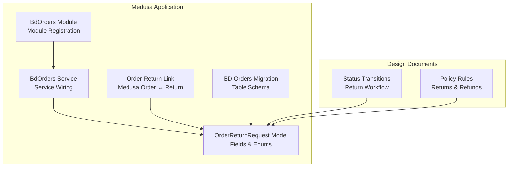
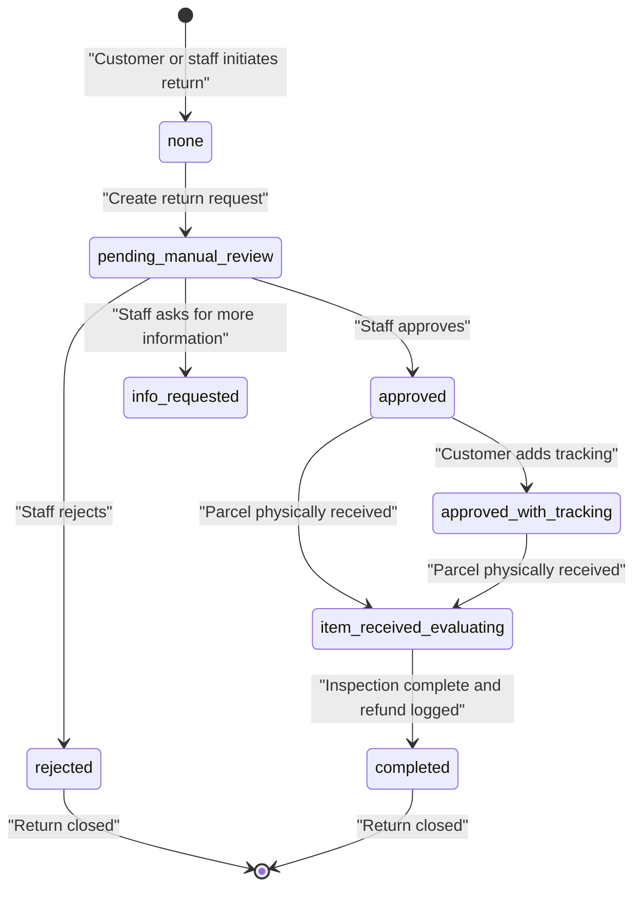
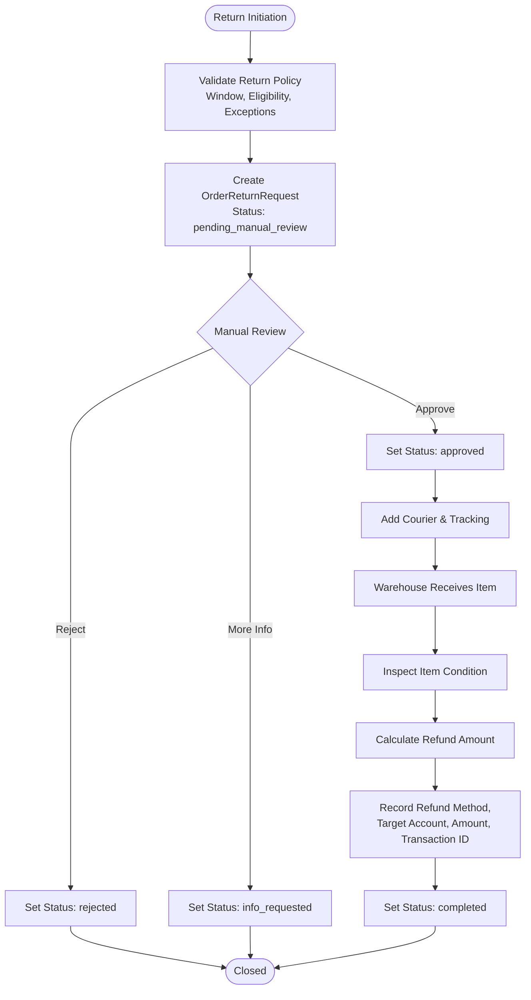
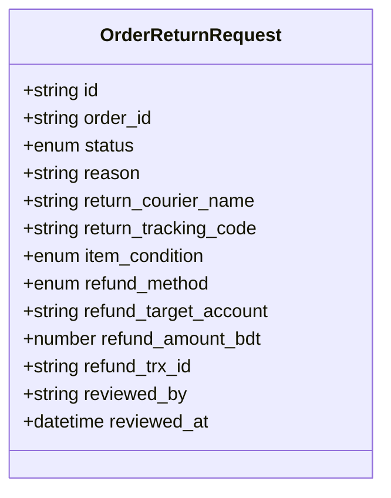
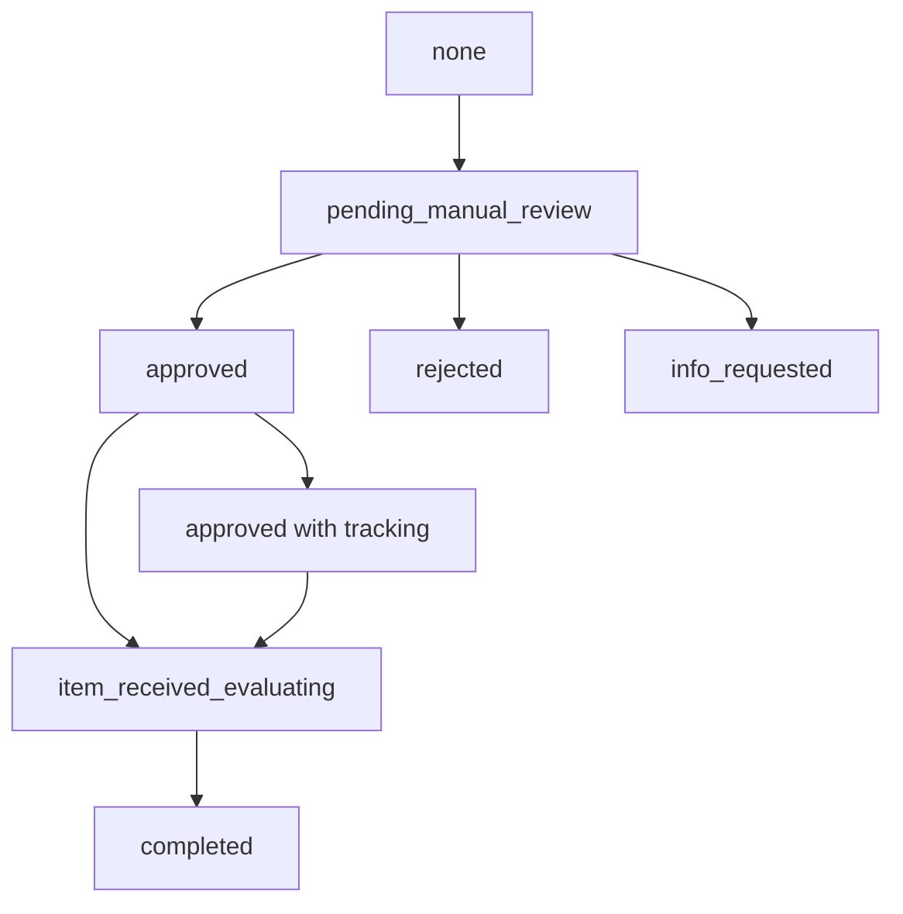
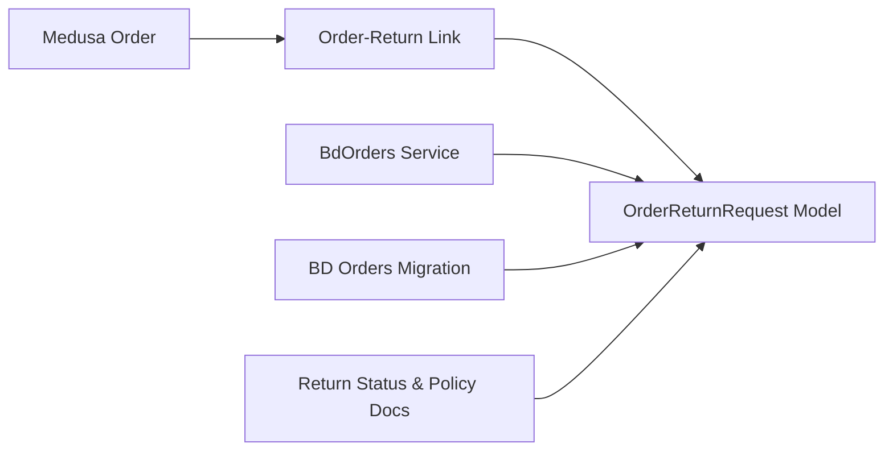

# Return Request Processing

<cite>
**Referenced Files in This Document**
- [order-return-request.ts](file://apps/medusa/src/modules/bd-orders/models/order-return-request.ts)
- [service.ts](file://apps/medusa/src/modules/bd-orders/service.ts)
- [index.ts](file://apps/medusa/src/modules/bd-orders/index.ts)
- [order-return-request.ts](file://apps/medusa/src/links/order-return-request.ts)
- [Migration20261024060540.ts](file://apps/medusa/src/modules/bd-orders/migrations/Migration20261024060540.ts)
- [dfd.md](file://docs/dfd.md)
- [prd.md](file://prd.md)
- [database.md](file://database.md)
</cite>

## Table of Contents
1. [Introduction](#introduction)
2. [Project Structure](#project-structure)
3. [Core Components](#core-components)
4. [Architecture Overview](#architecture-overview)
5. [Detailed Component Analysis](#detailed-component-analysis)
6. [Dependency Analysis](#dependency-analysis)
7. [Performance Considerations](#performance-considerations)
8. [Troubleshooting Guide](#troubleshooting-guide)
9. [Conclusion](#conclusion)

## Introduction
This document explains the return request processing system for the Bangladesh commerce platform. It focuses on:
- The `OrderReturnRequest` data model and its fields
- Return workflow states and allowed transitions
- Manual approval, rejection, information requests, inspection, and completion
- Integration points with orders, inventory, refunds, couriers, and customer communication
- Policy enforcement rules, refund calculations, and operational constraints

The current implementation provides a strong data model and state machine foundation. Business logic for automatic workflows is not yet implemented; most operations are designed to be manual and auditable.

## Project Structure
Return-related code is primarily located under the Medusa application:
- Model definition for return requests
- Module registration and service wiring
- Link between core Medusa orders and BD-specific return requests
- Database migration creating the return table
- Design documents describing status transitions and policy rules

**Diagram sources**
- [index.ts:1-9](file://apps/medusa/src/modules/bd-orders/index.ts#L1-L9)
- [service.ts:1-13](file://apps/medusa/src/modules/bd-orders/service.ts#L1-L13)
- [order-return-request.ts](file://apps/medusa/src/modules/bd-orders/models/order-return-request.ts)
- [order-return-request.ts](file://apps/medusa/src/links/order-return-request.ts)
- [Migration20261024060540.ts:17-19](file://apps/medusa/src/modules/bd-orders/migrations/Migration20261024060540.ts#L17-L19)
- [dfd.md:795-802](file://docs/dfd.md#L795-L802)
- [database.md:2300-2314](file://database.md#L2300-L2314)

**Section sources**
- [index.ts:1-9](file://apps/medusa/src/modules/bd-orders/index.ts#L1-L9)
- [service.ts:1-13](file://apps/medusa/src/modules/bd-orders/service.ts#L1-L13)
- [order-return-request.ts](file://apps/medusa/src/modules/bd-orders/models/order-return-request.ts)
- [order-return-request.ts](file://apps/medusa/src/links/order-return-request.ts)
- [Migration20261024060540.ts:17-19](file://apps/medusa/src/modules/bd-orders/migrations/Migration20261024060540.ts#L17-L19)
- [dfd.md:795-802](file://docs/dfd.md#L795-L802)
- [database.md:2300-2314](file://database.md#L2300-L2314)

## Core Components
The return system centers on the `OrderReturnRequest` model and its lifecycle.

### OrderReturnRequest Model
Key responsibilities:
- Track one return request per order
- Record reason, courier, tracking, item condition, refund method, target account, refund amount, and audit fields
- Enforce default values and enum constraints at the database level

Important fields:
- `id`: Primary key
- `order_id`: Foreign reference to the original order
- `status`: Lifecycle state with defaults and allowed values
- `reason`: Text explanation for the return
- `return_courier_name`, `return_tracking_code`: Courier and tracking details
- `item_condition`: Inspection result after receiving the returned item
- `refund_method`: Allowed payout channels
- `refund_target_account`: Destination account for refund
- `refund_amount_bdt`: Numeric refund amount
- `refund_trx_id`: External payment transaction identifier
- `reviewed_by`, `reviewed_at`: Audit fields for staff actions

**Section sources**
- [order-return-request.ts:3-25](file://apps/medusa/src/modules/bd-orders/models/order-return-request.ts#L3-L25)
- [Migration20261024060540.ts:17-19](file://apps/medusa/src/modules/bd-orders/migrations/Migration20261024060540.ts#L17-L19)

### BdOrders Module and Service
Responsibilities:
- Register the `bd_orders` module
- Expose a service that includes `OrderReturnRequest` alongside other BD order entities
- Provide a base Medusa service layer for future business logic

Current state:
- The service is a thin wrapper around Medusa’s service framework
- No custom return methods are implemented yet

**Section sources**
- [index.ts:1-9](file://apps/medusa/src/modules/bd-orders/index.ts#L1-L9)
- [service.ts:1-13](file://apps/medusa/src/modules/bd-orders/service.ts#L1-L13)

### Link Between Orders and Returns
Purpose:
- Connect Medusa’s core `order` entity to the BD-specific `orderReturnRequest`
- Enable querying returns by order through Medusa’s linkable API

**Section sources**
- [order-return-request.ts](file://apps/medusa/src/links/order-return-request.ts)

## Architecture Overview
The return request process is modeled as an independent fourth dimension of order state. It does not overwrite order or payment statuses. Instead, it tracks the lifecycle of a return from creation through inspection and refund recording.

**Diagram sources**
- [dfd.md:795-802](file://docs/dfd.md#L795-L802)
- [order-return-request.ts:6-14](file://apps/medusa/src/modules/bd-orders/models/order-return-request.ts#L6-L14)

### High-Level Process Flow

[No sources needed since this diagram shows conceptual workflow, not actual code structure]

## Detailed Component Analysis

### Data Model and Constraints
The `OrderReturnRequest` model defines:
- Enumerated status values
- Default status
- Enumerated item condition
- Enumerated refund method
- Numeric refund amount
- Nullable courier and tracking fields
- Audit fields for reviewer identity and timestamp

Database-level constraints ensure:
- Valid status values
- Valid item condition values
- Valid refund method values
- Indexed lookup by `order_id`
- Soft delete support via `deleted_at`

**Diagram sources**
- [order-return-request.ts:3-25](file://apps/medusa/src/modules/bd-orders/models/order-return-request.ts#L3-L25)
- [Migration20261024060540.ts:17-19](file://apps/medusa/src/modules/bd-orders/migrations/Migration20261024060540.ts#L17-L19)

**Section sources**
- [order-return-request.ts:3-25](file://apps/medusa/src/modules/bd-orders/models/order-return-request.ts#L3-L25)
- [Migration20261024060540.ts:17-19](file://apps/medusa/src/modules/bd-orders/migrations/Migration20261024060540.ts#L17-L19)

### Return Workflow States and Transitions
Allowed states:
- `none`
- `pending_manual_review`
- `approved`
- `rejected`
- `info_requested`
- `item_received_evaluating`
- `completed`

Default state:
- `pending_manual_review`

Transitions:
- Creation moves from `none` to `pending_manual_review`
- Staff approval moves to `approved`
- Staff rejection moves to `rejected`
- Information request moves to `info_requested`
- Adding tracking updates the approved request
- Physical receipt moves to `item_received_evaluating`
- Inspection and refund logging move to `completed`

**Diagram sources**
- [dfd.md:795-802](file://docs/dfd.md#L795-L802)
- [order-return-request.ts:6-14](file://apps/medusa/src/modules/bd-orders/models/order-return-request.ts#L6-L14)

**Section sources**
- [dfd.md:795-802](file://docs/dfd.md#L795-L802)
- [order-return-request.ts:6-14](file://apps/medusa/src/modules/bd-orders/models/order-return-request.ts#L6-L14)

### Approval and Rejection Workflows
Business rules:
- Return requests are never automatically approved
- Refunds are never automatically approved, initiated, or marked completed
- An authorized staff member must manually review each request
- Every action records the responsible user, action taken, timestamp, reason, and resulting status change

Operational implications:
- Admin or staff interfaces should expose approve, reject, and request-more-information actions
- Audit logs must capture reviewer identity and timestamps
- Customer-facing tracking should reflect request status and staff-provided updates

**Section sources**
- [prd.md:211-234](file://prd.md#L211-L234)

### Return Initiation and Validation
Validation requirements:
- Return window starts at delivery
- Policy must be explicitly configured before allowing returns
- Product or category exceptions can block returns
- Partial returns are supported per line item
- Policy snapshots make history immutable

Implementation guidance:
- Before creating a return, validate the order’s delivery status and return window
- Load the active return policy and check eligibility
- Apply product/category exception rules
- Block creation if policy is not configured or eligibility fails
- Snapshot policy details with the return request

**Section sources**
- [database.md:2300-2314](file://database.md#L2300-L2314)

### Inventory and Inspection Integration
After the returned item is received:
- Warehouse staff inspect the item
- Set `item_condition` to one of:
  - `uninspected`
  - `sellable`
  - `damaged`
  - `not_restockable`
- Restocking decisions depend on condition:
  - `sellable` → central warehouse
  - `damaged` or `not_restockable` → quarantine location

Integration points:
- Update inventory levels based on condition
- Move stock to appropriate locations
- Record inspection results in the return request
- Proceed to refund calculation only after inspection

**Section sources**
- [order-return-request.ts:18-18](file://apps/medusa/src/modules/bd-orders/models/order-return-request.ts#L18-L18)
- [database.md:2300-2314](file://database.md#L2300-L2314)

### Refund Calculation and Payment Integration
Refund rules:
- Refund occurs only after approval and verification
- COD RTO may have no customer refund unless a prepaid amount exists
- Prepaid refund methods intersect with configured payment providers
- Manual payout is allowed with bank transfer
- Refund completion requires manual verification and recording

Data fields used:
- `refund_method`: bkash, nagad, bank, store_credit
- `refund_target_account`: destination account
- `refund_amount_bdt`: calculated refund amount
- `refund_trx_id`: external transaction identifier

Payment integration:
- Use payment provider APIs only when explicitly configured
- Do not assume automated refunds are available
- Treat automated refund execution as a separate configurable integration

**Section sources**
- [order-return-request.ts:19-22](file://apps/medusa/src/modules/bd-orders/models/order-return-request.ts#L19-L22)
- [database.md:2300-2314](file://database.md#L2300-L2314)
- [prd.md:211-234](file://prd.md#L211-L234)

### Customer Communication Workflows
Requirements:
- Customers can see return request status wherever order tracking is supported
- Staff-provided updates should be visible to customers
- SMS notifications are part of the broader notification system
- Notification dispatch must avoid rate-limiting issues and unreliable side effects

Operational guidance:
- Emit status update events for return lifecycle changes
- Queue notifications rather than sending them synchronously where possible
- Respect SMS rate limits and retry policies
- Ensure notifications are sent only after successful state transitions

**Section sources**
- [prd.md:211-234](file://prd.md#L211-L234)

### Automated Return Processing Rules
Current state:
- No automated approval or refund execution is implemented
- All approvals, rejections, inspections, and refund recordings are manual
- Automation opportunities should be additive and configurable

Recommended automation boundaries:
- Automate validation checks against policy without changing status
- Automate reminders for pending reviews or missing tracking
- Automate internal alerts for high-risk returns
- Avoid automating final approval or refund payout until explicitly required and configured

**Section sources**
- [prd.md:211-234](file://prd.md#L211-L234)

## Dependency Analysis
The return system depends on:
- Medusa core order entity
- BD orders module service
- Database schema for return requests
- Design documents defining status transitions and policy rules

**Diagram sources**
- [order-return-request.ts](file://apps/medusa/src/links/order-return-request.ts)
- [service.ts:1-13](file://apps/medusa/src/modules/bd-orders/service.ts#L1-L13)
- [order-return-request.ts](file://apps/medusa/src/modules/bd-orders/models/order-return-request.ts)
- [Migration20261024060540.ts:17-19](file://apps/medusa/src/modules/bd-orders/migrations/Migration20261024060540.ts#L17-L19)
- [dfd.md:795-802](file://docs/dfd.md#L795-L802)

**Section sources**
- [order-return-request.ts](file://apps/medusa/src/links/order-return-request.ts)
- [service.ts:1-13](file://apps/medusa/src/modules/bd-orders/service.ts#L1-L13)
- [order-return-request.ts](file://apps/medusa/src/modules/bd-orders/models/order-return-request.ts)
- [Migration20261024060540.ts:17-19](file://apps/medusa/src/modules/bd-orders/migrations/Migration20261024060540.ts#L17-L19)
- [dfd.md:795-802](file://docs/dfd.md#L795-L802)

## Performance Considerations
- Indexes on `order_id` and `deleted_at` improve query performance for returns by order and soft-delete filtering
- Large refund amounts should use numeric types with precision metadata to avoid rounding errors
- Avoid synchronous external calls during critical state transitions; prefer queued jobs for courier and payment integrations
- Keep return policy lookups cached where appropriate to reduce database load during validation

[No sources needed since this section provides general guidance]

## Troubleshooting Guide
Common issues and resolutions:
- Return blocked because policy is not configured:
  - Configure return window, conditions, and eligible refund methods in admin
  - Verify policy scope for categories and products
- Invalid status transition:
  - Ensure manual review occurs before approval or rejection
  - Confirm physical receipt before moving to inspection
- Missing refund details:
  - Validate refund method, target account, and amount before completing
  - Record external transaction ID after payment provider confirmation
- Courier tracking not updated:
  - Add tracking after approval and before or after physical receipt depending on process
  - Validate courier name and tracking format
- Audit gaps:
  - Record reviewer identity and timestamp for every status change
  - Ensure all actions are logged for compliance

**Section sources**
- [prd.md:211-234](file://prd.md#L211-L234)
- [database.md:2300-2314](file://database.md#L2300-L2314)

## Conclusion
The return request processing system currently provides a robust data model and well-defined state machine. The design emphasizes manual review, auditability, and policy enforcement. Future work should implement:
- Return initiation and validation services
- Approval, rejection, and information-request workflows
- Inspection and restocking logic
- Refund calculation and payment integration
- Customer communication and notification workflows
- Configurable automation boundaries that do not violate the manual-only approval and refund rules