# Payment Processing Module

<cite>
**Referenced Files in This Document**
- [index.ts](file://apps/medusa/src/modules/bd-payments/index.ts)
- [service.ts](file://apps/medusa/src/modules/bd-payments/service.ts)
- [payment-transaction.ts](file://apps/medusa/src/modules/bd-payments/models/payment-transaction.ts)
- [payment-webhook-log.ts](file://apps/medusa/src/modules/bd-payments/models/payment-webhook-log.ts)
- [Migration20261024060542.ts](file://apps/medusa/src/modules/bd-payments/migrations/Migration20261024060542.ts)
- [route.ts (store)](file://apps/medusa/src/api/store/custom/route.ts)
- [route.ts (admin)](file://apps/medusa/src/api/admin/custom/route.ts)
- [technical-plan.md](file://technical-plan.md)
- [prd.md](file://prd.md)
- [architecture.md](file://docs/architecture.md)
- [dfd.md](file://dfd.md)
</cite>

## Table of Contents
1. [Introduction](#introduction)
2. [Project Structure](#project-structure)
3. [Core Components](#core-components)
4. [Architecture Overview](#architecture-overview)
5. [Detailed Component Analysis](#detailed-component-analysis)
6. [Dependency Analysis](#dependency-analysis)
7. [Performance Considerations](#performance-considerations)
8. [Security, Verification, and Reconciliation](#security-verification-and-reconciliation)
9. [Troubleshooting Guide](#troubleshooting-guide)
10. [Conclusion](#conclusion)

## Introduction
This document explains the BD Payments module within the Bangladesh commerce platform. The module is a Medusa v2 custom module that provides:
- Multi-payment method support for Cash on Delivery, bKash, and Nagad.
- Transaction tracking through a dedicated payment transaction table.
- Webhook logging infrastructure for provider callbacks.
- A zero-orphan payment redirect architecture designed to avoid orphan orders and dangling inventory when customers abandon or lose connectivity during online gateway flows.

At this stage, the repository contains the module skeleton, data models, migration, and design documentation. Concrete provider SDK calls, webhook handlers, and admin/store endpoints are not yet implemented in source code; they are defined by requirements and technical plans.

## Project Structure
The BD Payments module lives under `apps/medusa/src/modules/bd-payments`. It follows Medusa’s module pattern:
- An entry point exports the module name and service.
- A service extends `MedusaService` with the module’s entities.
- Entities define database tables for transactions and webhook logs.
- A migration creates the actual database schema.

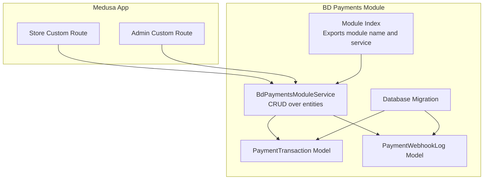

**Diagram sources**
- [index.ts:1-9](file://apps/medusa/src/modules/bd-payments/index.ts#L1-L9)
- [service.ts:1-11](file://apps/medusa/src/modules/bd-payments/service.ts#L1-L11)
- [payment-transaction.ts:1-18](file://apps/medusa/src/modules/bd-payments/models/payment-transaction.ts#L1-L18)
- [payment-webhook-log.ts:1-18](file://apps/medusa/src/modules/bd-payments/models/payment-webhook-log.ts#L1-L18)
- [Migration20261024060542.ts:1-23](file://apps/medusa/src/modules/bd-payments/migrations/Migration20261024060542.ts#L1-L23)

**Section sources**
- [index.ts:1-9](file://apps/medusa/src/modules/bd-payments/index.ts#L1-L9)
- [service.ts:1-11](file://apps/medusa/src/modules/bd-payments/service.ts#L1-L11)
- [Migration20261024060542.ts:1-23](file://apps/medusa/src/modules/bd-payments/migrations/Migration20261024060542.ts#L1-L23)

## Core Components
The module exposes three core building blocks:

| Component | Purpose | Current State |
|---|---|---|
| Module index | Registers `bd_payments` and wires the service into Medusa | Implemented |
| Service | Provides CRUD operations over payment transactions and webhook logs via `MedusaService` | Implemented as a thin wrapper |
| Data models | Define `payment_transaction` and `payment_webhook_log` tables | Implemented |
| Migration | Creates tables, indexes, constraints, and soft-delete columns | Implemented |

Key model characteristics:
- `PaymentTransaction` tracks provider ID, transaction type, BDT amount, gateway identifiers, gateway status, raw response payload, and whether server-to-server verification was performed.
- `PaymentWebhookLog` records provider, endpoint, HTTP method, headers, payload, IP address, signature validation result, processing state, and error messages.

**Section sources**
- [service.ts:1-11](file://apps/medusa/src/modules/bd-payments/service.ts#L1-L11)
- [payment-transaction.ts:1-18](file://apps/medusa/src/modules/bd-payments/models/payment-transaction.ts#L1-L18)
- [payment-webhook-log.ts:1-18](file://apps/medusa/src/modules/bd-payments/models/payment-webhook-log.ts#L1-L18)
- [Migration20261024060542.ts:1-23](file://apps/medusa/src/modules/bd-payments/migrations/Migration20261024060542.ts#L1-L23)

## Architecture Overview
The intended payment architecture centers on a zero-orphan redirect flow for online providers and a deferred capture model for COD.

### High-Level Flow
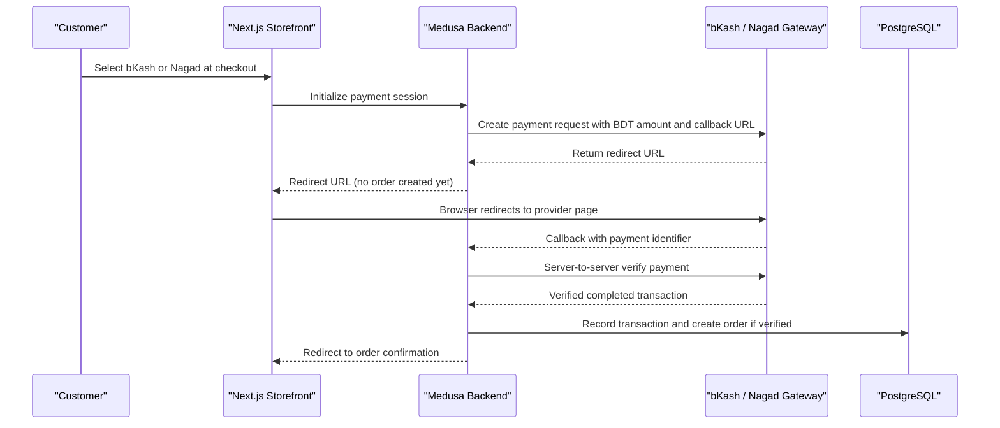

**Diagram sources**
- [prd.md:267-274](file://prd.md#L267-L274)
- [architecture.md:467-478](file://docs/architecture.md#L467-L478)
- [dfd.md:284-394](file://dfd.md#L284-L394)

### Zero-Orphan Design Rules
- Online payments initialize only a payment session before redirecting.
- No Medusa Order is created until server-to-server verification succeeds.
- If the customer cancels or abandons the gateway, the cart remains open and no order or stock reservation is created.
- Dropped browser callbacks are recovered by a background polling worker that queries provider status and completes order placement asynchronously.

**Section sources**
- [prd.md:267-274](file://prd.md#L267-L274)
- [architecture.md:467-478](file://docs/architecture.md#L467-L478)
- [dfd.md:284-394](file://dfd.md#L284-L394)

## Detailed Component Analysis

### Payment Transaction Model
The transaction model captures every provider interaction needed for reconciliation and auditability.

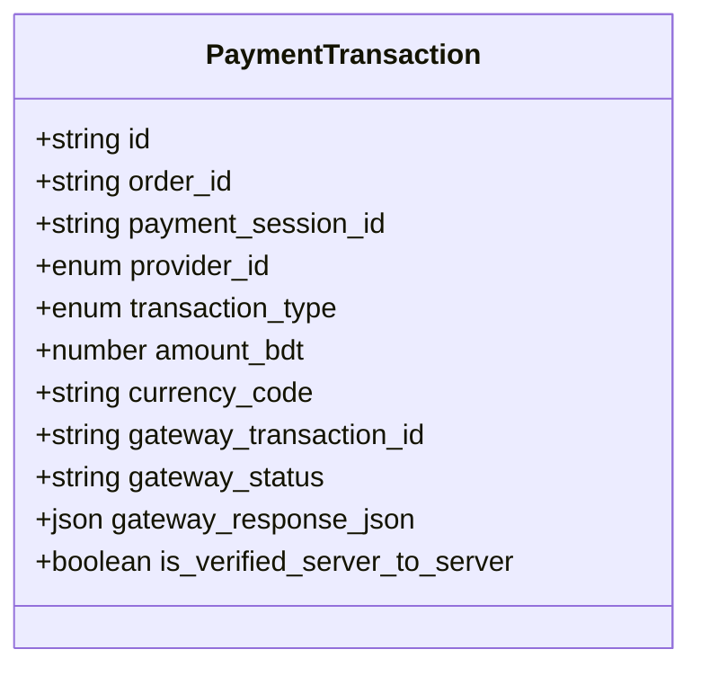

**Diagram sources**
- [payment-transaction.ts:1-18](file://apps/medusa/src/modules/bd-payments/models/payment-transaction.ts#L1-L18)
- [Migration20261024060542.ts:5-10](file://apps/medusa/src/modules/bd-payments/migrations/Migration20261024060542.ts#L5-L10)

Important fields and constraints:
- `provider_id` supports `pp_cod`, `pp_bkash`, and `pp_nagad`.
- `transaction_type` supports authorization, capture, refund, and status query.
- Amounts are stored in BDT with a default currency code.
- Gateway identifiers and responses are persisted for traceability.
- A flag indicates whether server-to-server verification was performed.
- The migration adds indexes on `order_id`, `payment_session_id`, and `gateway_transaction_id`, plus soft-delete support.

**Section sources**
- [payment-transaction.ts:1-18](file://apps/medusa/src/modules/bd-payments/models/payment-transaction.ts#L1-L18)
- [Migration20261024060542.ts:5-10](file://apps/medusa/src/modules/bd-payments/migrations/Migration20261024060542.ts#L5-L10)

### Webhook Log Model
The webhook log model records incoming provider notifications for auditing and debugging.

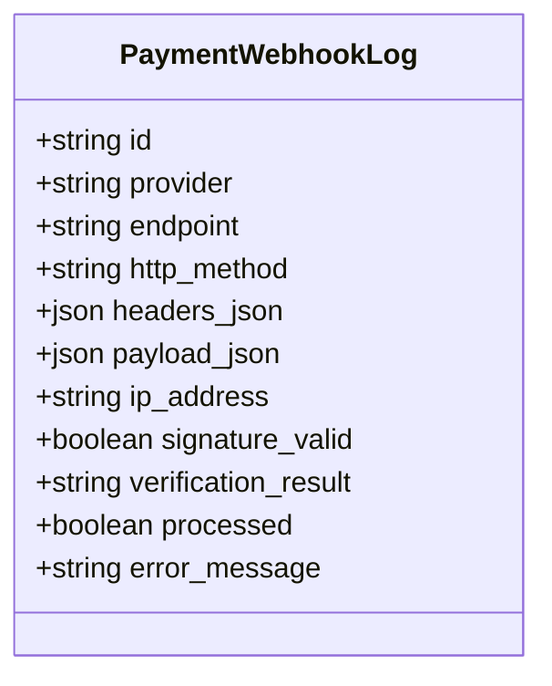

**Diagram sources**
- [payment-webhook-log.ts:1-18](file://apps/medusa/src/modules/bd-payments/models/payment-webhook-log.ts#L1-L18)
- [Migration20261024060542.ts:12-13](file://apps/medusa/src/modules/bd-payments/migrations/Migration20261024060542.ts#L12-L13)

Design notes:
- Stores provider name, endpoint, HTTP method, headers, payload, and client IP.
- Tracks signature validation and processing outcome.
- Includes an error message field for failed processing.
- Uses soft delete and timestamps.

**Section sources**
- [payment-webhook-log.ts:1-18](file://apps/medusa/src/modules/bd-payments/models/payment-webhook-log.ts#L1-L18)
- [Migration20261024060542.ts:12-13](file://apps/medusa/src/modules/bd-payments/migrations/Migration20261024060542.ts#L12-L13)

### Module Entry Point and Service
The module registers itself with Medusa and exposes a service that manages the two entities.

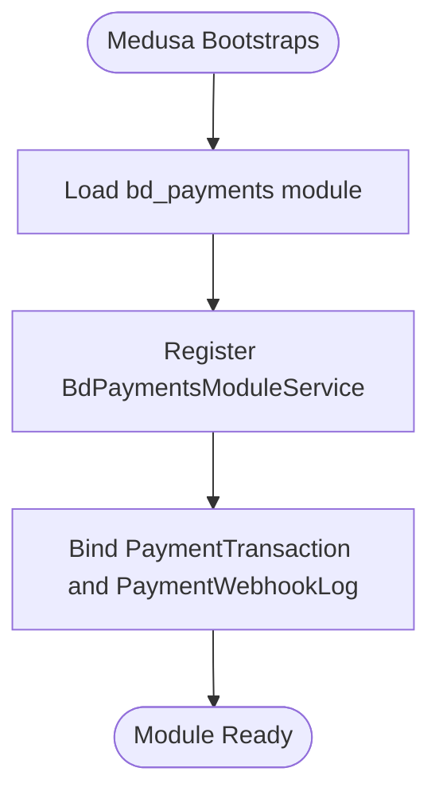

**Diagram sources**
- [index.ts:1-9](file://apps/medusa/src/modules/bd-payments/index.ts#L1-L9)
- [service.ts:1-11](file://apps/medusa/src/modules/bd-payments/service.ts#L1-L11)

Current implementation:
- The module name is `bd_payments`.
- The service extends `MedusaService` with both entities.
- No custom business logic is present yet; it relies on Medusa’s generated CRUD methods.

**Section sources**
- [index.ts:1-9](file://apps/medusa/src/modules/bd-payments/index.ts#L1-L9)
- [service.ts:1-11](file://apps/medusa/src/modules/bd-payments/service.ts#L1-L11)

### API Route Placeholders
Both store and admin custom routes currently return a simple success response. They are placeholders for future payment initiation, configuration, and webhook handling endpoints.

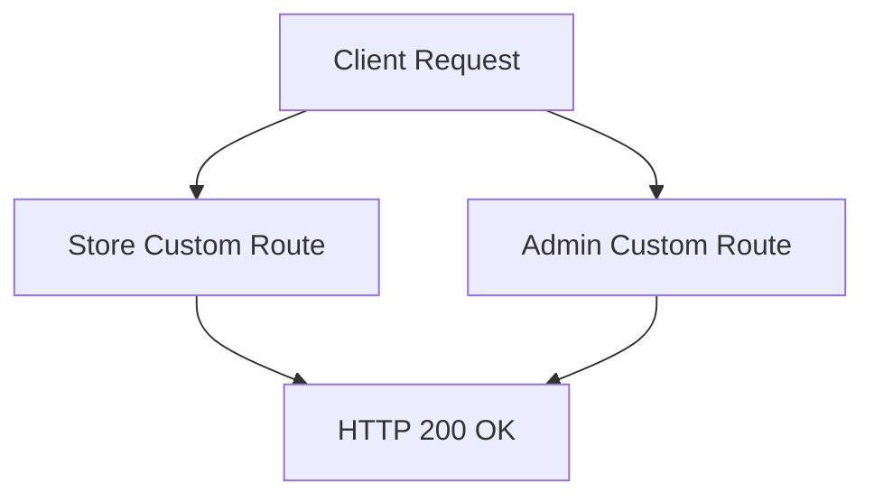

**Diagram sources**
- [route.ts (store):1-9](file://apps/medusa/src/api/store/custom/route.ts#L1-L9)
- [route.ts (admin):1-9](file://apps/medusa/src/api/admin/custom/route.ts#L1-L9)

**Section sources**
- [route.ts (store):1-9](file://apps/medusa/src/api/store/custom/route.ts#L1-L9)
- [route.ts (admin):1-9](file://apps/medusa/src/api/admin/custom/route.ts#L1-L9)

### Provider Integration Patterns

#### Cash on Delivery
- Provider ID: `pp_cod`.
- Authorization behavior: immediate success with authorized status; amount recorded as pending collection.
- Capture behavior: automatic upon courier delivery webhook or manual staff action.

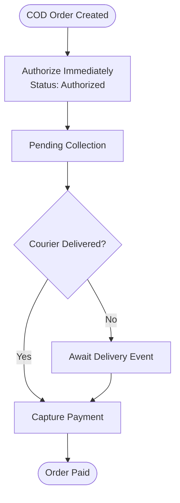

**Diagram sources**
- [technical-plan.md:535-538](file://technical-plan.md#L535-L538)
- [payment-transaction.ts:7-8](file://apps/medusa/src/modules/bd-payments/models/payment-transaction.ts#L7-L8)

**Section sources**
- [technical-plan.md:535-538](file://technical-plan.md#L535-L538)

#### bKash
- Provider ID: `pp_bkash`.
- Protocol:
  - Authorization calls the provider’s create payment endpoint with order ID, BDT amount, and callback URL.
  - Returns a redirect URL or gateway URL.
  - Capture verifies completed status, currency equals BDT, and exact amount.
  - Stores gateway transaction identifiers and wallet information in session data.

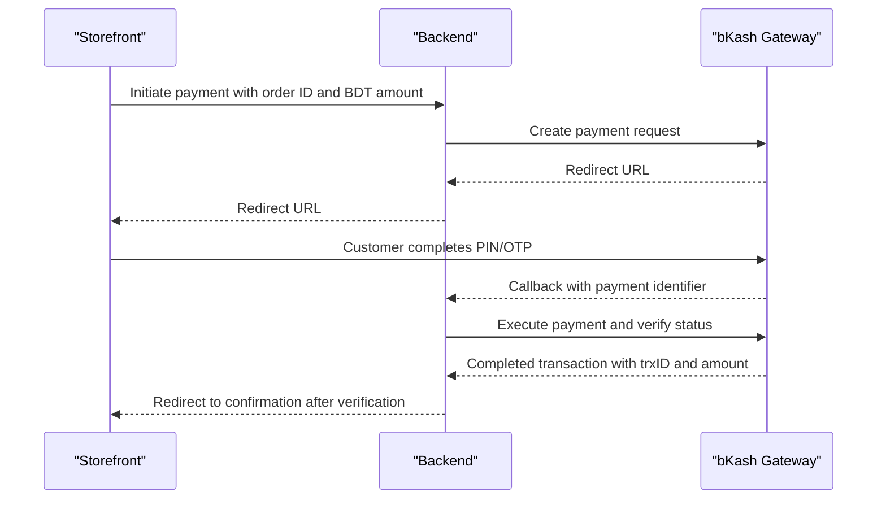

**Diagram sources**
- [technical-plan.md:539-544](file://technical-plan.md#L539-L544)
- [prd.md:267-274](file://prd.md#L267-L274)

**Section sources**
- [technical-plan.md:539-544](file://technical-plan.md#L539-L544)
- [prd.md:267-274](file://prd.md#L267-L274)

#### Nagad
- Provider ID: `pp_nagad`.
- Protocol:
  - Generates a cryptographic payload signed with the merchant private key.
  - Calls the provider’s checkout initialization endpoint.
  - Handles payment verification callback using the provider’s public key.

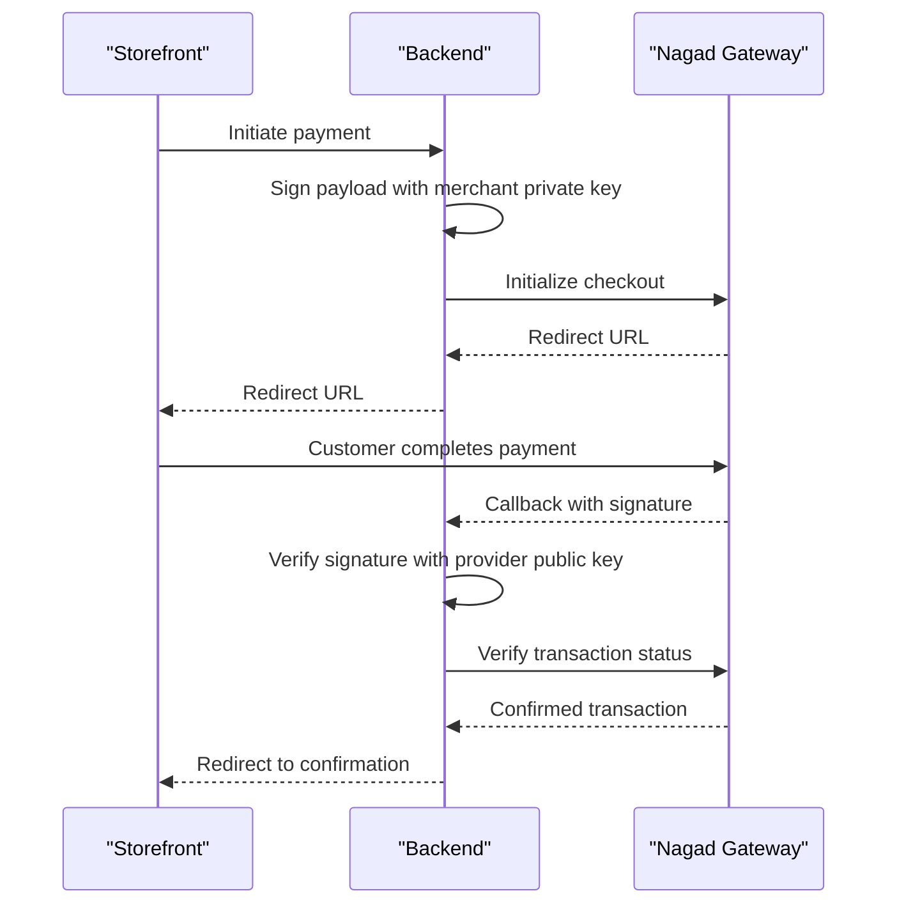

**Diagram sources**
- [technical-plan.md:545-547](file://technical-plan.md#L545-L547)

**Section sources**
- [technical-plan.md:545-547](file://technical-plan.md#L545-L547)

#### SSLCommerz and Stripe
- Not present in the current module models or migrations.
- No provider IDs, transaction types, or integration code exist for SSLCommerz or Stripe in the repository.
- These providers would require new enum values, provider-specific services, webhook handlers, and configuration management before being supported.

[No sources needed since this section confirms absence rather than analyzing specific files]

## Dependency Analysis
The BD Payments module has minimal internal coupling and clear external boundaries.

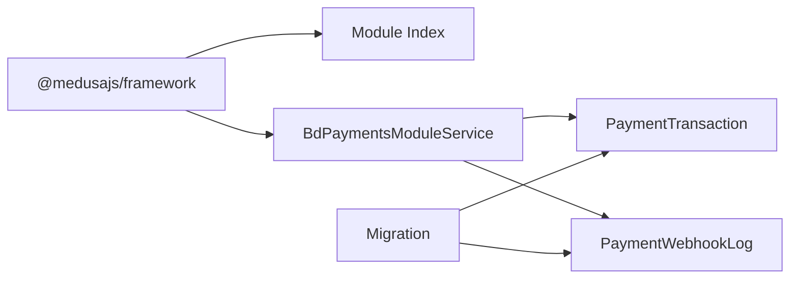

**Diagram sources**
- [index.ts:1-9](file://apps/medusa/src/modules/bd-payments/index.ts#L1-L9)
- [service.ts:1-11](file://apps/medusa/src/modules/bd-payments/service.ts#L1-L11)
- [payment-transaction.ts:1-18](file://apps/medusa/src/modules/bd-payments/models/payment-transaction.ts#L1-L18)
- [payment-webhook-log.ts:1-18](file://apps/medusa/src/modules/bd-payments/models/payment-webhook-log.ts#L1-L18)
- [Migration20261024060542.ts:1-23](file://apps/medusa/src/modules/bd-payments/migrations/Migration20261024060542.ts#L1-L23)

Observations:
- Cohesion is high within the module: all payment-related persistence is centralized.
- Coupling to Medusa is intentional and expected.
- External provider integrations are not yet wired into the service; they should be added as provider adapters behind the service layer.
- No circular dependencies are visible in the current code.

**Section sources**
- [index.ts:1-9](file://apps/medusa/src/modules/bd-payments/index.ts#L1-L9)
- [service.ts:1-11](file://apps/medusa/src/modules/bd-payments/service.ts#L1-L11)
- [Migration20261024060542.ts:1-23](file://apps/medusa/src/modules/bd-payments/migrations/Migration20261024060542.ts#L1-L23)

## Performance Considerations
- Use indexed lookup fields for frequent queries: `order_id`, `payment_session_id`, and `gateway_transaction_id` are already indexed in the migration.
- Avoid storing large provider payloads directly in primary tables unless necessary; the existing JSON fields can grow quickly and should be monitored.
- Implement idempotent processing for webhooks and retries to prevent duplicate orders or duplicate captures.
- For dropped callback recovery, use a bounded polling window and exponential backoff when querying provider status APIs.
- Separate write-heavy operations such as webhook ingestion from order creation workflows using queues where possible.

[No sources needed since this section provides general guidance]

## Security, Verification, and Reconciliation

### Security Requirements
- Never trust client-side redirect parameters alone. Always perform server-to-server verification with the provider.
- Validate currency is BDT and amounts match expected totals.
- Validate provider signatures using the correct public/private keys per provider.
- Restrict webhook endpoints to trusted IPs where supported by the provider.
- Keep credentials out of source control; manage them through secure configuration.

**Section sources**
- [prd.md:267-274](file://prd.md#L267-L274)

### Payment Verification Flow
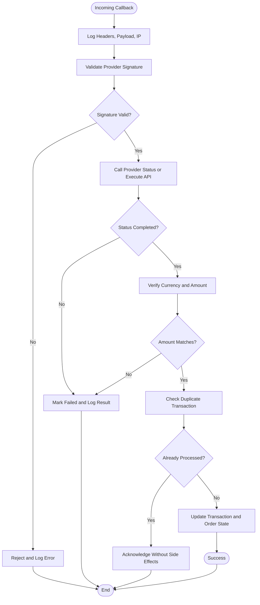

**Diagram sources**
- [prd.md:267-274](file://prd.md#L267-L274)
- [payment-webhook-log.ts:1-18](file://apps/medusa/src/modules/bd-payments/models/payment-webhook-log.ts#L1-L18)
- [payment-transaction.ts:1-18](file://apps/medusa/src/modules/bd-payments/models/payment-transaction.ts#L1-L18)

### Reconciliation Process
Reconciliation should compare:
- Internal `PaymentTransaction` records.
- Provider transaction reports or export files.
- Courier delivery confirmations for COD.
- Finance settlement statements.

Recommended reconciliation steps:
1. Extract daily provider settlement files.
2. Match provider transaction IDs with `gateway_transaction_id`.
3. Compare captured amounts, currencies, and statuses.
4. Investigate mismatches flagged by `is_verified_server_to_server` and `gateway_status`.
5. Mark discrepancies for manual review and adjust finance records accordingly.

[No sources needed since this section provides general guidance]

## Troubleshooting Guide

### Common Issues and Resolutions

| Issue | Symptom | Likely Cause | Resolution |
|---|---|---|---|
| Dropped browser callback | Payment debited but no order created | Network failure before provider redirect | Enable background polling to query provider status and complete order placement |
| Duplicate webhook processing | Multiple orders or captures | Missing idempotency | Deduplicate by provider transaction ID and process once |
| Wrong amount captured | Order mismatch with cart total | Missing amount/currency validation | Enforce strict BDT amount and currency checks |
| Invalid signature | Webhook rejected | Incorrect provider public key or tampered payload | Verify signature algorithm and keys; reject invalid requests |
| COD not captured | Order remains unpaid after delivery | Missing courier webhook handler or manual capture | Wire courier delivery events to COD capture workflow |
| SSLCommerz or Stripe unavailable | Method not selectable or missing integration | Provider not configured | Add provider configuration and integration before enabling |

**Section sources**
- [prd.md:267-274](file://prd.md#L267-L274)
- [dfd.md:284-394](file://dfd.md#L284-L394)

## Conclusion
The BD Payments module provides a solid foundation for multi-provider payment processing in the Bangladesh commerce platform. It defines the module structure, transaction tracking, and webhook logging, while the project documentation specifies the intended zero-orphan payment flow, provider protocols, and security requirements.

The next implementation priorities are:
- Implement provider adapters for bKash, Nagad, and COD.
- Add store and admin endpoints for payment initiation, configuration, and monitoring.
- Implement webhook handlers with signature verification and idempotent processing.
- Add background polling for dropped callback recovery.
- Extend provider enums and models if SSLCommerz or Stripe are added later.

[No sources needed since this section summarizes without analyzing specific files]