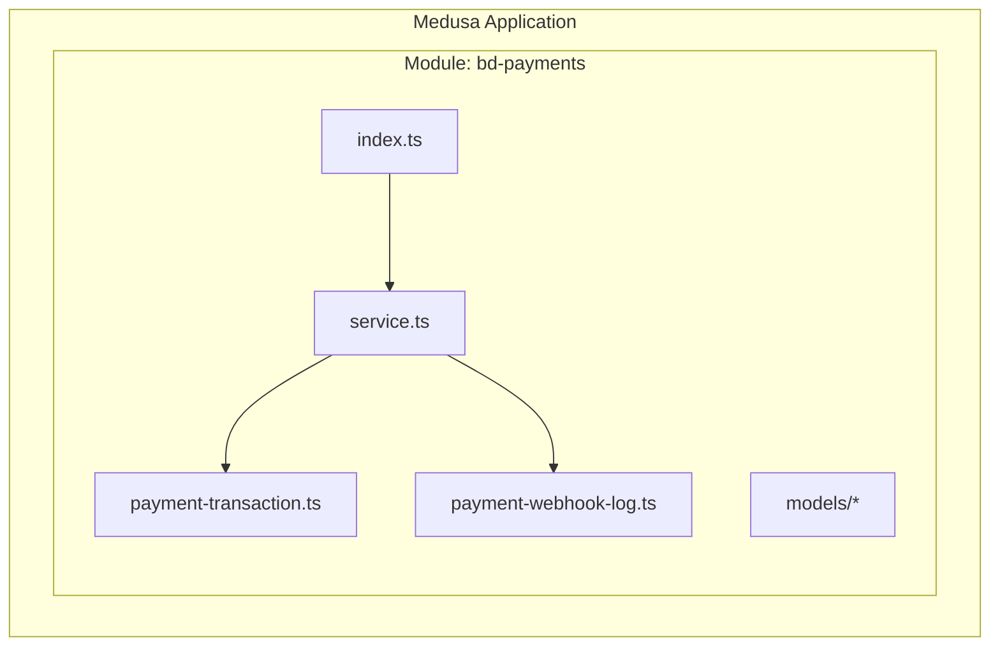
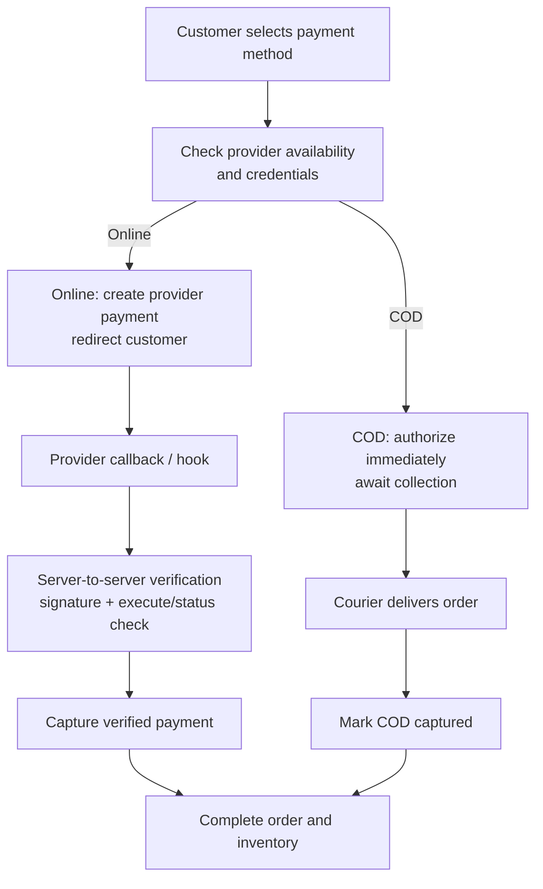
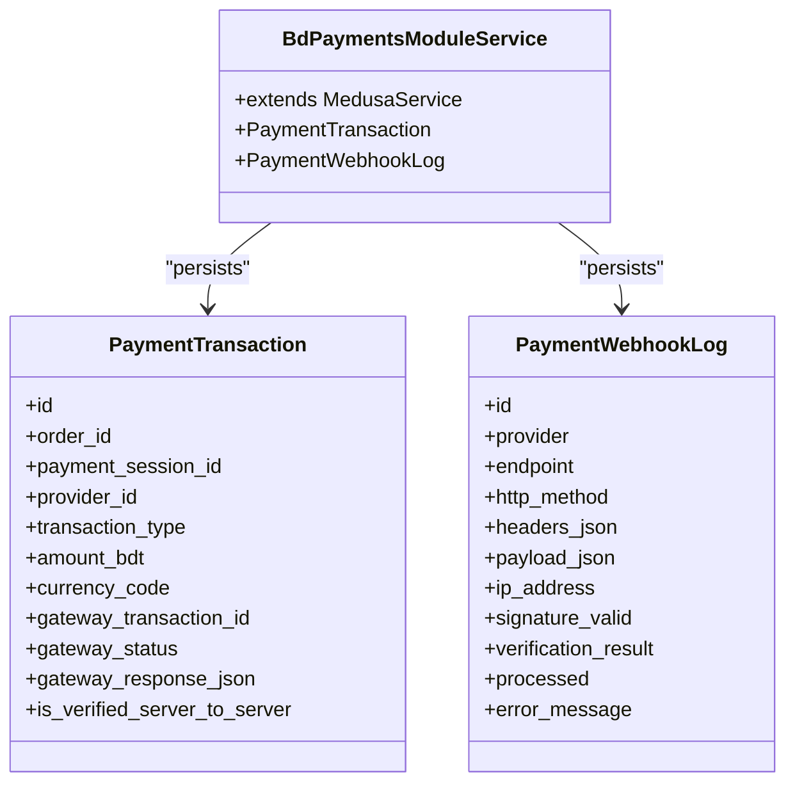
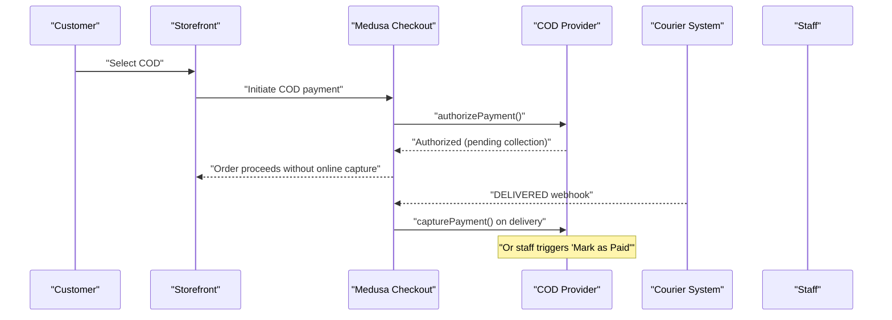
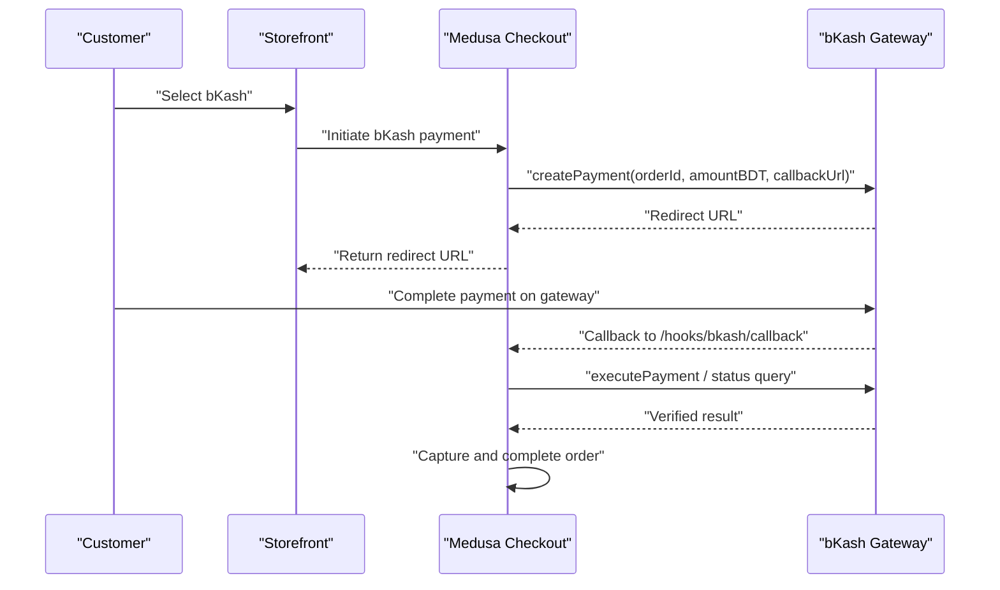
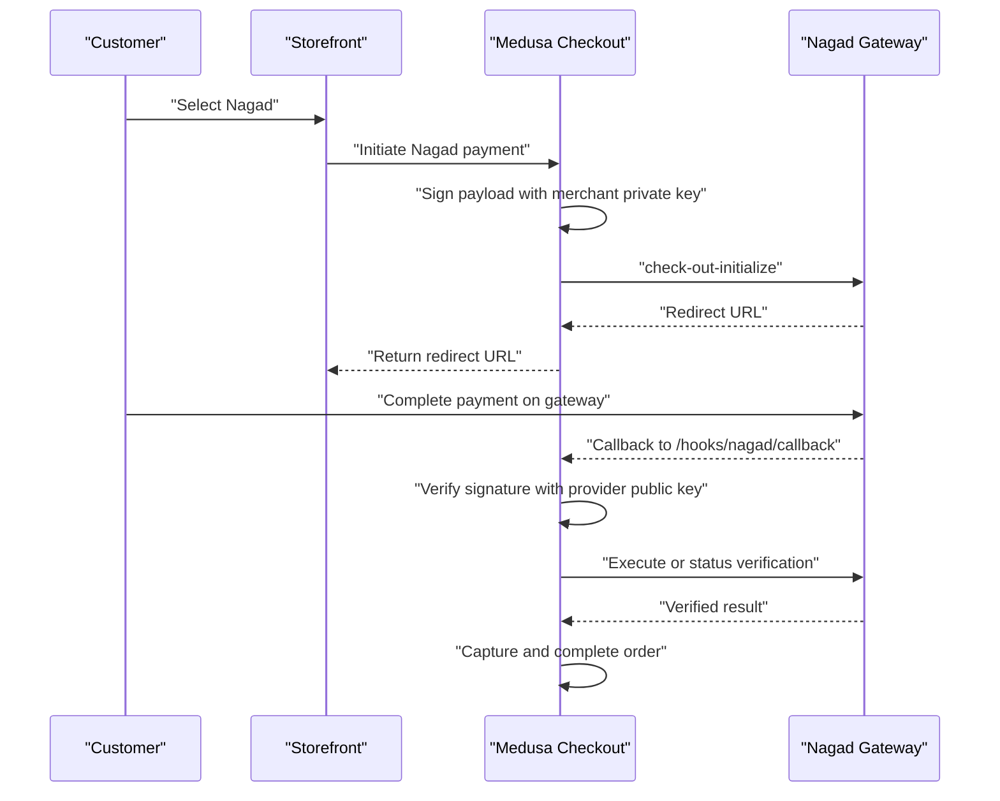
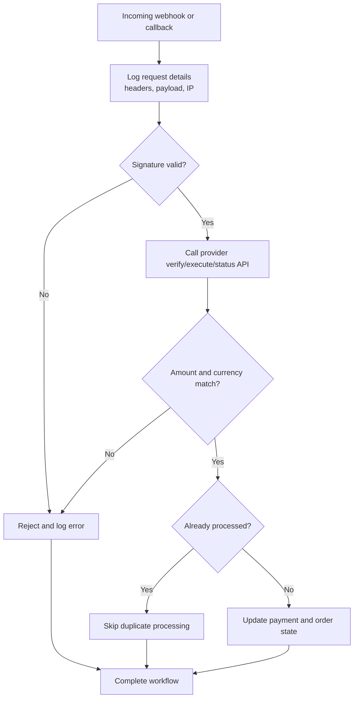
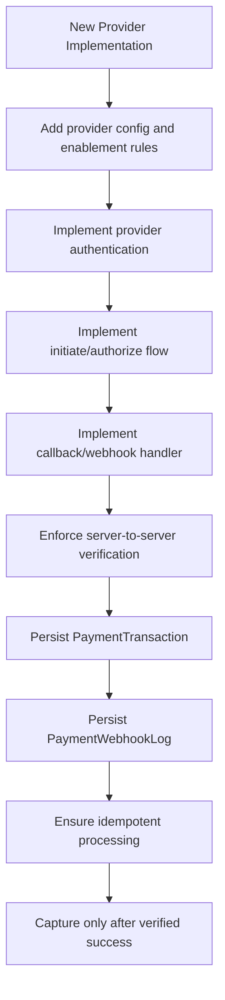
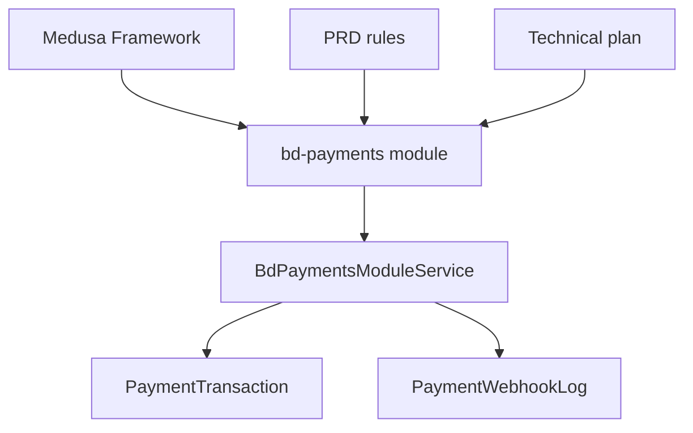

# Payment Provider Integrations

<cite>
**Referenced Files in This Document**
- [technical-plan.md](file://technical-plan.md)
- [prd.md](file://prd.md)
- [database.md](file://database.md)
- [data-models.md](file://docs/data-models.md)
- [index.ts](file://apps/medusa/src/modules/bd-payments/index.ts)
- [service.ts](file://apps/medusa/src/modules/bd-payments/service.ts)
- [payment-transaction.ts](file://apps/medusa/src/modules/bd-payments/models/payment-transaction.ts)
- [payment-webhook-log.ts](file://apps/medusa/src/modules/bd-payments/models/payment-webhook-log.ts)
</cite>

## Table of Contents
1. [Introduction](#introduction)
2. [Project Structure](#project-structure)
3. [Core Components](#core-components)
4. [Architecture Overview](#architecture-overview)
5. [Detailed Component Analysis](#detailed-component-analysis)
6. [Dependency Analysis](#dependency-analysis)
7. [Performance Considerations](#performance-considerations)
8. [Troubleshooting Guide](#troubleshooting-guide)
9. [Conclusion](#conclusion)
10. [Appendices](#appendices)

## Introduction
This document explains how the BD Commerce Platform integrates payment providers and how its custom `bd-payments` module standardizes provider behavior. The platform is designed for direct merchant integrations with bKash and Nagad, supports Cash on Delivery (COD), and provides a structured abstraction layer so that new providers can be added consistently.

At this stage:
- COD (`pp_cod`) is modeled as an immediate authorization with capture triggered by delivery or manual confirmation.
- bKash (`pp_bkash`) and Nagad (`pp_nagad`) are modeled as online providers requiring redirect/callback flows and server-to-server verification before capture.
- SSLCommerz and Stripe are not present in the current codebase; they are outside scope unless explicitly implemented later.

The documentation focuses on:
- Provider configuration and availability rules.
- Authentication and signature verification requirements.
- Transaction initiation, callback handling, and idempotent capture.
- Data models used to record transactions and webhook logs.
- Patterns for implementing new providers using Medusa’s provider abstraction.

## Project Structure
Payment-related implementation lives under the Medusa application module:

**Diagram sources**
- [index.ts:1-8](file://apps/medusa/src/modules/bd-payments/index.ts#L1-L8)
- [service.ts:1-10](file://apps/medusa/src/modules/bd-payments/service.ts#L1-L10)
- [payment-transaction.ts:1-18](file://apps/medusa/src/modules/bd-payments/models/payment-transaction.ts#L1-L18)
- [payment-webhook-log.ts:1-18](file://apps/medusa/src/modules/bd-payments/models/payment-webhook-log.ts#L1-L18)

**Section sources**
- [index.ts:1-8](file://apps/medusa/src/modules/bd-payments/index.ts#L1-L8)
- [service.ts:1-10](file://apps/medusa/src/modules/bd-payments/service.ts#L1-L10)

## Core Components
The `bd-payments` module exposes:
- A Medusa module definition that registers the payment domain.
- A service extending Medusa’s service base for transaction and webhook log persistence.
- Two core data models:
  - `PaymentTransaction`: records every provider interaction, including authorization, capture, refund, status queries, gateway IDs, amounts, and server-to-server verification flags.
  - `PaymentWebhookLog`: records incoming provider callbacks, headers, payloads, IP addresses, signature validation results, processing outcomes, and errors.

Provider identifiers currently supported at the schema level are:
- `pp_cod`
- `pp_bkash`
- `pp_nagad`

These identifiers are also referenced in project documentation describing provider behavior and database seed values.

**Section sources**
- [index.ts:1-8](file://apps/medusa/src/modules/bd-payments/index.ts#L1-L8)
- [service.ts:1-10](file://apps/medusa/src/modules/bd-payments/service.ts#L1-L10)
- [payment-transaction.ts:1-18](file://apps/medusa/src/modules/bd-payments/models/payment-transaction.ts#L1-L18)
- [payment-webhook-log.ts:1-18](file://apps/medusa/src/modules/bd-payments/models/payment-webhook-log.ts#L1-L18)
- [technical-plan.md:511-547](file://technical-plan.md#L511-L547)
- [database.md:1461](file://database.md#L1461)

## Architecture Overview
The payment architecture follows these principles:
- Providers are abstracted behind a consistent interface pattern based on Medusa’s provider model.
- Online providers (bKash, Nagad) use redirect/callback flows with strict server-to-server verification.
- COD uses an internal workflow where capture happens after delivery confirmation or manual staff action.
- Webhooks and callbacks are logged and validated before any state change.
- Order creation for online payments occurs only after verified capture, preventing orphan orders.

**Diagram sources**
- [technical-plan.md:511-547](file://technical-plan.md#L511-L547)
- [prd.md:267-274](file://prd.md#L267-L274)

**Section sources**
- [technical-plan.md:511-547](file://technical-plan.md#L511-L547)
- [prd.md:267-274](file://prd.md#L267-L274)

## Detailed Component Analysis

### Abstraction Layer and Module Registration
The module registration defines the payment domain name and binds it to a service class. The service extends Medusa’s service base and exposes repository-like access to the payment models. This structure is the foundation for building provider implementations that integrate with Medusa’s payment collection flow.

Key responsibilities:
- Register the `bd_payments` module.
- Provide a service instance for transaction and webhook log operations.
- Keep provider-specific logic separate from persistence concerns.

**Diagram sources**
- [service.ts:1-10](file://apps/medusa/src/modules/bd-payments/service.ts#L1-L10)
- [payment-transaction.ts:1-18](file://apps/medusa/src/modules/bd-payments/models/payment-transaction.ts#L1-L18)
- [payment-webhook-log.ts:1-18](file://apps/medusa/src/modules/bd-payments/models/payment-webhook-log.ts#L1-L18)

**Section sources**
- [index.ts:1-8](file://apps/medusa/src/modules/bd-payments/index.ts#L1-L8)
- [service.ts:1-10](file://apps/medusa/src/modules/bd-payments/service.ts#L1-L10)

### Provider Configuration and Availability Rules
Provider configuration is managed through Admin settings. Requirements include:
- Enabling/disabling each payment method independently.
- Storing provider secrets securely.
- Hiding methods from checkout when required credentials are missing.
- Ensuring online methods are never presented as operational until merchant approval and live configuration are complete.

These rules prevent customers from selecting unavailable or unconfigured payment methods and ensure historical orders retain their original payment context even if a method is later disabled.

**Section sources**
- [prd.md:262-274](file://prd.md#L262-L274)

### Cash on Delivery (COD) Provider (`pp_cod`)
COD is treated as an internal payment provider:
- Authorization succeeds immediately with zero fee.
- The amount is recorded as pending collection.
- Capture is triggered either automatically when a courier webhook reports delivery or manually by authorized staff.

This design keeps order placement simple while deferring financial settlement until physical delivery or administrative confirmation.

**Diagram sources**
- [technical-plan.md:535-538](file://technical-plan.md#L535-L538)

**Section sources**
- [technical-plan.md:535-538](file://technical-plan.md#L535-L538)

### bKash Provider (`pp_bkash`)
bKash integration follows a direct merchant API approach:
- `authorizePayment` calls the provider’s payment creation endpoint with order ID, BDT amount, and callback URL.
- The system returns a redirect URL or gateway URL to the customer.
- On callback return, the backend must call the provider’s execution or status verification endpoint.
- Verification checks include transaction status, currency, and exact amount.
- Relevant provider fields such as transaction ID, payment ID, and wallet information are stored in session or transaction records.

**Diagram sources**
- [technical-plan.md:539-544](file://technical-plan.md#L539-L544)
- [prd.md:271-274](file://prd.md#L271-L274)

**Section sources**
- [technical-plan.md:539-544](file://technical-plan.md#L539-L544)
- [prd.md:271-274](file://prd.md#L271-L274)

### Nagad Provider (`pp_nagad`)
Nagad integration is modeled as a direct merchant provider:
- The system generates a cryptographic payload signed with the merchant private key.
- It calls the provider’s checkout initialization endpoint.
- Callback handling verifies signatures using the provider’s public key.
- Like bKash, success must be confirmed via server-to-server verification before capture.

**Diagram sources**
- [technical-plan.md:545-547](file://technical-plan.md#L545-L547)
- [prd.md:271-274](file://prd.md#L271-L274)

**Section sources**
- [technical-plan.md:545-547](file://technical-plan.md#L545-L547)
- [prd.md:271-274](file://prd.md#L271-L274)

### SSLCommerz and Stripe
SSLCommerz and Stripe are not represented in the current repository code or documented provider list. They are therefore out of scope for this release. If added later, they should follow the same patterns:
- New provider identifier.
- Provider-specific configuration and credential management.
- Redirect/callback or API-based authentication.
- Server-to-server verification before capture.
- Recording in `PaymentTransaction` and webhook logging.

[No sources needed since this section describes future scope rather than existing code]

### Provider-Specific Parameters and Error Handling
Provider-specific parameters include:
- Provider identifier (`provider_id`).
- External gateway transaction identifier (`gateway_transaction_id`).
- Gateway-reported status (`gateway_status`).
- Raw gateway response payload (`gateway_response_json`).
- Whether the event was verified server-to-server (`is_verified_server_to_server`).

Error handling and reliability requirements include:
- Never trusting client-side redirects alone.
- Always performing server-to-server verification.
- Handling repeated webhooks idempotently.
- Keeping payment status and order status separate.
- Logging raw webhook payloads, signature validation results, and processing errors.

**Diagram sources**
- [prd.md:271-274](file://prd.md#L271-L274)
- [payment-webhook-log.ts:1-18](file://apps/medusa/src/modules/bd-payments/models/payment-webhook-log.ts#L1-L18)
- [payment-transaction.ts:1-18](file://apps/medusa/src/modules/bd-payments/models/payment-transaction.ts#L1-L18)

**Section sources**
- [payment-transaction.ts:1-18](file://apps/medusa/src/modules/bd-payments/models/payment-transaction.ts#L1-L18)
- [payment-webhook-log.ts:1-18](file://apps/medusa/src/modules/bd-payments/models/payment-webhook-log.ts#L1-L18)
- [prd.md:271-274](file://prd.md#L271-L274)

### Implementing a New Payment Provider
To add a new provider safely and consistently:
1. Define a new provider identifier following the existing naming convention.
2. Add provider configuration fields in Admin settings and enforce enabled/disabled behavior.
3. Implement provider-specific authentication:
   - For redirect-based providers: generate secure payloads, sign requests, and handle callbacks.
   - For API-only providers: implement token issuance, signing, and status polling.
4. Ensure all callbacks perform server-to-server verification before updating state.
5. Record every attempt in `PaymentTransaction`.
6. Log all incoming webhooks in `PaymentWebhookLog`, including signature validation and processing outcome.
7. Make the provider idempotent against duplicate events.
8. Keep payment status independent from order status.
9. Do not create orders or deduct stock until online payment is verified and captured.

[No sources needed since this diagram shows conceptual implementation guidance]

## Dependency Analysis
The payment domain depends on:
- Medusa’s module and service infrastructure.
- Database models for transaction and webhook logging.
- Project-wide business rules defining provider behavior, security, and order lifecycle constraints.

**Diagram sources**
- [index.ts:1-8](file://apps/medusa/src/modules/bd-payments/index.ts#L1-L8)
- [service.ts:1-10](file://apps/medusa/src/modules/bd-payments/service.ts#L1-L10)
- [payment-transaction.ts:1-18](file://apps/medusa/src/modules/bd-payments/models/payment-transaction.ts#L1-L18)
- [payment-webhook-log.ts:1-18](file://apps/medusa/src/modules/bd-payments/models/payment-webhook-log.ts#L1-L18)
- [prd.md:267-274](file://prd.md#L267-L274)
- [technical-plan.md:511-547](file://technical-plan.md#L511-L547)

**Section sources**
- [index.ts:1-8](file://apps/medusa/src/modules/bd-payments/index.ts#L1-L8)
- [service.ts:1-10](file://apps/medusa/src/modules/bd-payments/service.ts#L1-L10)
- [payment-transaction.ts:1-18](file://apps/medusa/src/modules/bd-payments/models/payment-transaction.ts#L1-L18)
- [payment-webhook-log.ts:1-18](file://apps/medusa/src/modules/bd-payments/models/payment-webhook-log.ts#L1-L18)
- [prd.md:267-274](file://prd.md#L267-L274)
- [technical-plan.md:511-547](file://technical-plan.md#L511-L547)

## Performance Considerations
- Avoid synchronous blocking calls during checkout redirects; prefer asynchronous verification and background processing where appropriate.
- Cache provider configuration and capability checks to reduce repeated secret resolution.
- Use idempotency keys or unique provider transaction IDs to prevent duplicate processing.
- Limit sensitive data in logs; store only necessary fields in `gateway_response_json` and avoid logging secrets.
- Monitor webhook retry storms and apply rate limiting at the webhook ingestion layer.

[No sources needed since this section provides general guidance]

## Troubleshooting Guide
Common issues and diagnostics:
- **Unverified callback:** Check `PaymentWebhookLog.signature_valid` and `verification_result`.
- **Duplicate webhook processing:** Confirm idempotency logic and whether the event was already marked processed.
- **Amount mismatch:** Compare `amount_bdt` with provider-provided amounts and currency codes.
- **Missing provider credentials:** Ensure the provider is enabled only when required configuration exists.
- **Order created too early for online payments:** Verify that order creation occurs after successful capture, not after redirect.

Useful diagnostic tables:

| Area | What to inspect | Expected behavior |
|---|---|---|
| Webhook integrity | `signature_valid`, `verification_result`, `payload_json` | Valid signature and successful verification before processing |
| Transaction evidence | `gateway_transaction_id`, `gateway_status`, `gateway_response_json` | Consistent external provider reference and status |
| Verification flag | `is_verified_server_to_server` | True only after provider-side verification |
| Provider availability | Admin payment settings | Disabled when credentials are incomplete |

**Section sources**
- [payment-webhook-log.ts:1-18](file://apps/medusa/src/modules/bd-payments/models/payment-webhook-log.ts#L1-L18)
- [payment-transaction.ts:1-18](file://apps/medusa/src/modules/bd-payments/models/payment-transaction.ts#L1-L18)
- [prd.md:267-274](file://prd.md#L267-L274)

## Conclusion
The BD Commerce Platform’s payment architecture centers on a clear abstraction layer, strong verification requirements, and robust auditability. COD, bKash, and Nagad are modeled with distinct workflows but share common principles:
- Provider configuration controls availability.
- Online payments require redirect/callback flows with server-to-server verification.
- All interactions are persisted in transaction and webhook log models.
- Idempotency and separation of payment and order status protect financial integrity.

Future providers such as SSLCommerz or Stripe should adopt the same patterns to maintain consistency, security, and operability.

[No sources needed since this section summarizes without analyzing specific files]

## Appendices

### Data Model Reference: Payment Domain
This appendix summarizes the two core entities used by the payment domain.

| Entity | Key Fields | Purpose |
|---|---|---|
| `PaymentTransaction` | `provider_id`, `transaction_type`, `amount_bdt`, `gateway_transaction_id`, `gateway_status`, `gateway_response_json`, `is_verified_server_to_server` | Records every payment attempt, verification, and settlement event |
| `PaymentWebhookLog` | `provider`, `endpoint`, `http_method`, `headers_json`, `payload_json`, `ip_address`, `signature_valid`, `verification_result`, `processed`, `error_message` | Ingests and audits incoming provider callbacks |

**Section sources**
- [payment-transaction.ts:1-18](file://apps/medusa/src/modules/bd-payments/models/payment-transaction.ts#L1-L18)
- [payment-webhook-log.ts:1-18](file://apps/medusa/src/modules/bd-payments/models/payment-webhook-log.ts#L1-L18)
- [data-models.md:242-277](file://docs/data-models.md#L242-L277)