# Transaction Management & Tracking

<cite>
**Referenced Files in This Document**
- [payment-transaction.ts](file://apps/medusa/src/modules/bd-payments/models/payment-transaction.ts)
- [payment-webhook-log.ts](file://apps/medusa/src/modules/bd-payments/models/payment-webhook-log.ts)
- [service.ts](file://apps/medusa/src/modules/bd-payments/service.ts)
- [Migration20261024060542.ts](file://apps/medusa/src/modules/bd-payments/migrations/Migration20261024060542.ts)
- [data-models.md](file://docs/data-models.md)
- [dfd.md](file://dfd.md)
- [database.md](file://database.md)
</cite>

## Table of Contents
1. [Introduction](#introduction)
2. [Project Structure](#project-structure)
3. [Core Components](#core-components)
4. [Architecture Overview](#architecture-overview)
5. [Detailed Component Analysis](#detailed-component-analysis)
6. [Dependency Analysis](#dependency-analysis)
7. [Performance Considerations](#performance-considerations)
8. [Troubleshooting Guide](#troubleshooting-guide)
9. [Conclusion](#conclusion)

## Introduction
This document explains the payment transaction management and tracking system implemented in the `bd-payments` module. It focuses on the `PaymentTransaction` model, its lifecycle states, status transitions, and how transactions are created, validated, persisted, queried, reconciled, and audited. It also provides guidance for monitoring transaction health and debugging failed transactions.

The current implementation defines the data model and a Medusa service that exposes standard CRUD operations over `PaymentTransaction` and `PaymentWebhookLog`. Business workflows such as gateway callbacks, server-to-server verification, order placement, reconciliation, and audit logging are described at the repository level through design documents and database constraints.

## Project Structure
The payment-related code lives under the Medusa application:

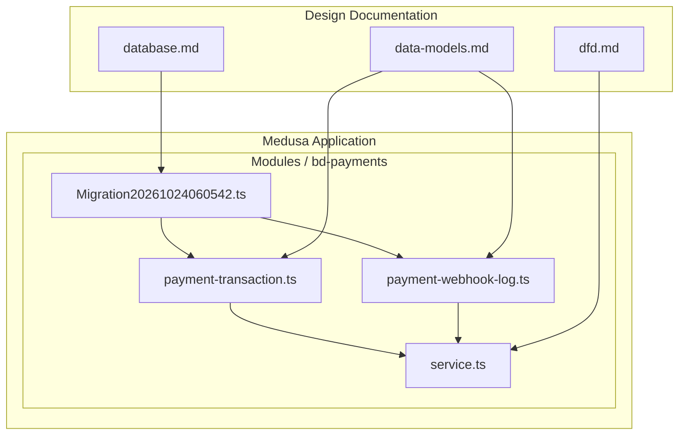

**Diagram sources**
- [payment-transaction.ts:3-15](file://apps/medusa/src/modules/bd-payments/models/payment-transaction.ts#L3-L15)
- [payment-webhook-log.ts:3-15](file://apps/medusa/src/modules/bd-payments/models/payment-webhook-log.ts#L3-L15)
- [service.ts:5-8](file://apps/medusa/src/modules/bd-payments/service.ts#L5-L8)
- [Migration20261024060542.ts:5-13](file://apps/medusa/src/modules/bd-payments/migrations/Migration20261024060542.ts#L5-L13)
- [data-models.md:242-279](file://docs/data-models.md#L242-L279)
- [dfd.md:327-393](file://dfd.md#L327-L393)
- [database.md:1783-1800](file://database.md#L1783-L1800)

**Section sources**
- [payment-transaction.ts:3-15](file://apps/medusa/src/modules/bd-payments/models/payment-transaction.ts#L3-L15)
- [payment-webhook-log.ts:3-15](file://apps/medusa/src/modules/bd-payments/models/payment-webhook-log.ts#L3-L15)
- [service.ts:5-8](file://apps/medusa/src/modules/bd-payments/service.ts#L5-L8)
- [Migration20261024060542.ts:5-13](file://apps/medusa/src/modules/bd-payments/migrations/Migration20261024060542.ts#L5-L13)
- [data-models.md:242-279](file://docs/data-models.md#L242-L279)

## Core Components
The `bd-payments` module centers on two entities and one service:

- `PaymentTransaction`: Records each payment attempt, provider interaction, amount, currency, gateway identifiers, gateway response, and whether the result was verified via server-to-server execution.
- `PaymentWebhookLog`: Captures raw inbound webhook events, signature verification results, processing state, and error messages.
- `BdPaymentsModuleService`: A Medusa service exposing standard persistence operations for both models.

Key responsibilities:
- Persisting immutable evidence of payment interactions.
- Supporting querying by order, session, provider, and gateway transaction ID.
- Enabling reconciliation between gateway responses and internal records.
- Providing an audit trail through webhook logs and transaction metadata.

**Section sources**
- [payment-transaction.ts:3-15](file://apps/medusa/src/modules/bd-payments/models/payment-transaction.ts#L3-L15)
- [payment-webhook-log.ts:3-15](file://apps/medusa/src/modules/bd-payments/models/payment-webhook-log.ts#L3-L15)
- [service.ts:5-8](file://apps/medusa/src/modules/bd-payments/service.ts#L5-L8)
- [data-models.md:242-279](file://docs/data-models.md#L242-L279)

## Architecture Overview
The payment architecture follows a zero-trust, evidence-first approach:

1. The storefront initiates a payment session with a selected provider.
2. The backend creates or retrieves a payment session and redirects the customer to the gateway.
3. The gateway calls back to the backend; the backend logs the webhook payload and verifies it.
4. The backend performs a server-to-server query to the gateway to confirm the actual financial state.
5. On confirmed success, the backend proceeds with inventory checks, order creation, and transaction recording.
6. Background polling recovers from dropped callbacks.
7. Reconciliation jobs compare gateway records with internal records and resolve inconsistencies.

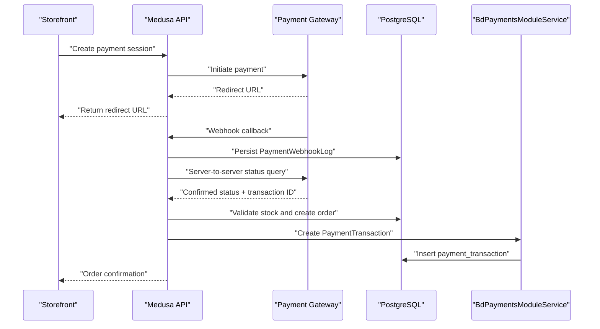

**Diagram sources**
- [dfd.md:327-393](file://dfd.md#L327-L393)
- [service.ts:5-8](file://apps/medusa/src/modules/bd-payments/service.ts#L5-L8)
- [payment-webhook-log.ts:3-15](file://apps/medusa/src/modules/bd-payments/models/payment-webhook-log.ts#L3-L15)
- [payment-transaction.ts:3-15](file://apps/medusa/src/modules/bd-payments/models/payment-transaction.ts#L3-L15)

## Detailed Component Analysis

### PaymentTransaction Model
`PaymentTransaction` is the central record for payment activity. Its fields capture:

- Identity and relationships:
  - `id`: Primary key.
  - `order_id`: Associated order when available.
  - `payment_session_id`: Associated Medusa payment session.
- Provider and action context:
  - `provider_id`: Enumerated provider identifier.
  - `transaction_type`: Action type such as authorization, capture, refund, or status query.
- Financial details:
  - `amount_bdt`: Amount in BDT paisa.
  - `currency_code`: Currency code, defaulting to BDT.
- Gateway linkage and evidence:
  - `gateway_transaction_id`: External transaction reference.
  - `gateway_status`: Status returned by the gateway.
  - `gateway_response_json`: Raw JSON payload from the gateway.
- Verification flag:
  - `is_verified_server_to_server`: Indicates whether the backend independently verified the result.

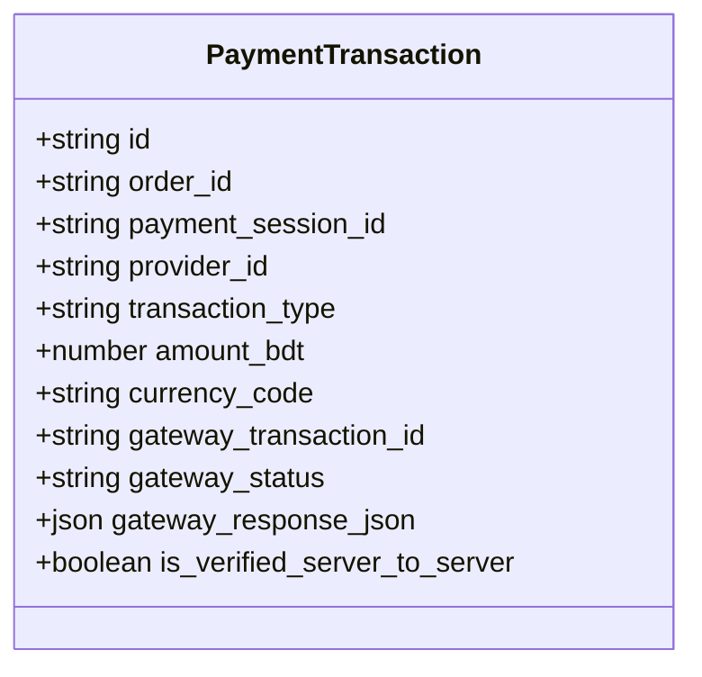

**Diagram sources**
- [payment-transaction.ts:3-15](file://apps/medusa/src/modules/bd-payments/models/payment-transaction.ts#L3-L15)
- [data-models.md:242-259](file://docs/data-models.md#L242-L259)

**Section sources**
- [payment-transaction.ts:3-15](file://apps/medusa/src/modules/bd-payments/models/payment-transaction.ts#L3-L15)
- [data-models.md:242-259](file://docs/data-models.md#L242-L259)

### PaymentWebhookLog Model
`PaymentWebhookLog` captures every incoming webhook event:

- Provider and endpoint context:
  - `provider`: Payment provider name.
  - `endpoint`: Webhook route path.
  - `http_method`: HTTP method used by the provider.
- Request evidence:
  - `headers_json`: Incoming headers.
  - `payload_json`: Request body or parameters.
  - `ip_address`: Originating IP address.
- Processing state:
  - `signature_valid`: Whether signature or credential validation passed.
  - `verification_result`: Summary of verification execution.
  - `processed`: Whether the workflow successfully processed the event.
  - `error_message`: Failure reason if processing failed.

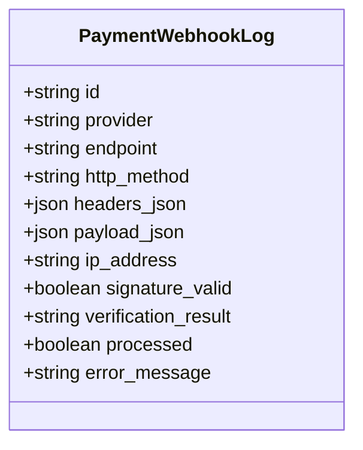

**Diagram sources**
- [payment-webhook-log.ts:3-15](file://apps/medusa/src/modules/bd-payments/models/payment-webhook-log.ts#L3-L15)
- [data-models.md:261-279](file://docs/data-models.md#L261-L279)

**Section sources**
- [payment-webhook-log.ts:3-15](file://apps/medusa/src/modules/bd-payments/models/payment-webhook-log.ts#L3-L15)
- [data-models.md:261-279](file://docs/data-models.md#L261-L279)

### BdPaymentsModuleService
The service extends Medusa’s base service and registers both models. It provides standard persistence methods such as creating, updating, retrieving, listing, and deleting records. In this module, the service acts as the integration point for higher-level business logic to persist payment evidence without duplicating ORM logic.

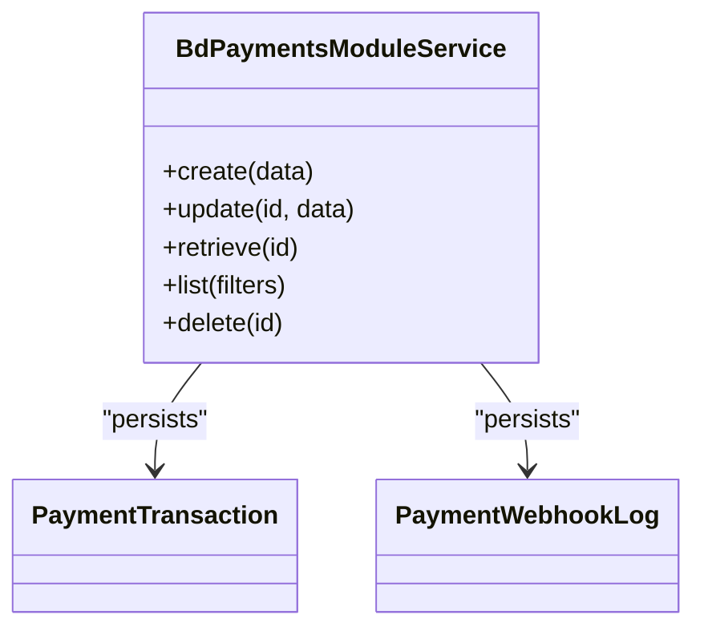

**Diagram sources**
- [service.ts:5-8](file://apps/medusa/src/modules/bd-payments/service.ts#L5-L8)
- [payment-transaction.ts:3-15](file://apps/medusa/src/modules/bd-payments/models/payment-transaction.ts#L3-L15)
- [payment-webhook-log.ts:3-15](file://apps/medusa/src/modules/bd-payments/models/payment-webhook-log.ts#L3-L15)

**Section sources**
- [service.ts:5-8](file://apps/medusa/src/modules/bd-payments/service.ts#L5-L8)

### Database Schema and Indexes
The migration defines the `payment_transaction` table and several indexes:

- Columns include identity, order/session links, provider, transaction type, amount, currency, gateway identifiers, gateway status, raw response, verification flag, timestamps, and soft delete support.
- Indexes exist for:
  - `order_id`
  - `payment_session_id`
  - `gateway_transaction_id`
  - `deleted_at`

These indexes support efficient querying by order, session, external transaction ID, and soft-deleted rows.

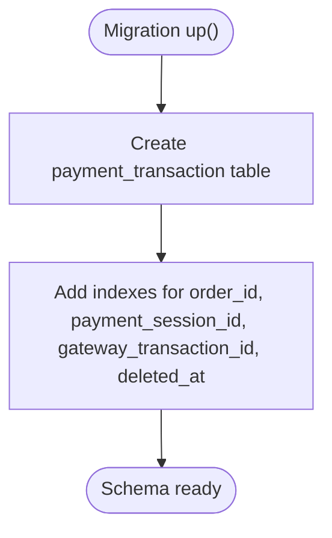

**Diagram sources**
- [Migration20261024060542.ts:5-13](file://apps/medusa/src/modules/bd-payments/migrations/Migration20261024060542.ts#L5-L13)

**Section sources**
- [Migration20261024060542.ts:5-13](file://apps/medusa/src/modules/bd-payments/migrations/Migration20261024060542.ts#L5-L13)

### Lifecycle States and Status Transitions
The current `PaymentTransaction` model does not define a dedicated lifecycle state field. Instead, transaction state is represented by:

- `transaction_type`: Authorization, capture, refund, or status query.
- `gateway_status`: The status returned by the gateway.
- `is_verified_server_to_server`: Whether the backend independently verified the outcome.
- `gateway_response_json`: Full gateway response for forensic analysis.

The broader system design describes payment status transitions at the order and payment layer:

- Payment status moves from pending to captured after successful gateway execution or background polling.
- Captured payments may transition to partially refunded or fully refunded based on returns or manual adjustments.

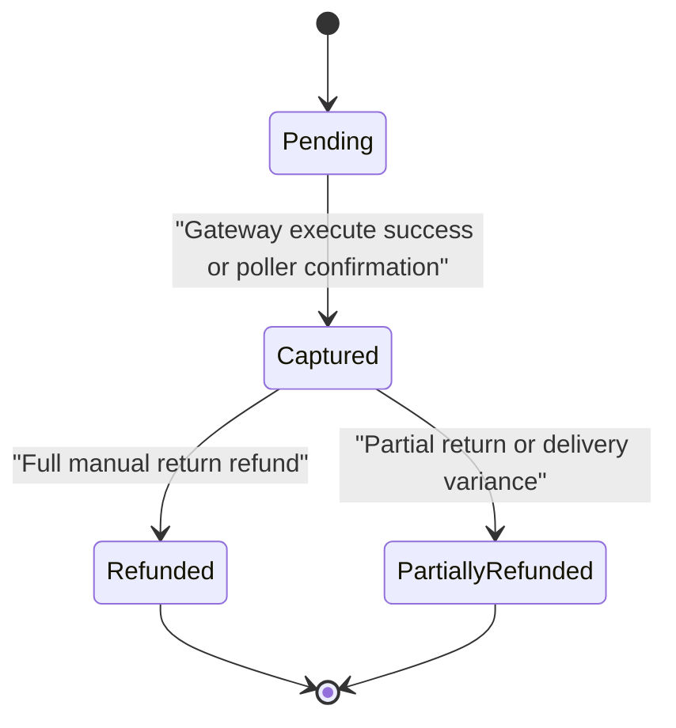

**Diagram sources**
- [dfd.md:762-802](file://dfd.md#L762-L802)

**Section sources**
- [payment-transaction.ts:3-15](file://apps/medusa/src/modules/bd-payments/models/payment-transaction.ts#L3-L15)
- [dfd.md:762-802](file://dfd.md#L762-L802)

### Transaction Creation, Validation, Persistence, and Retrieval
Transaction creation should follow these principles:

- Create a `PaymentTransaction` row for each meaningful payment action:
  - Authorization request.
  - Capture request.
  - Refund request.
  - Status query.
- Populate:
  - `provider_id` from the selected payment provider.
  - `transaction_type` according to the action.
  - `amount_bdt` and `currency_code` from the checkout snapshot.
  - `gateway_transaction_id` once the gateway returns an external transaction ID.
  - `gateway_status` from the gateway response.
  - `gateway_response_json` with the complete raw payload.
  - `is_verified_server_to_server` only after a server-to-server query confirms the financial state.
- Validation rules:
  - Ensure `amount_bdt` is positive and matches the expected checkout amount.
  - Validate `provider_id` against allowed values.
  - Validate `transaction_type` against allowed values.
  - Require `gateway_status` before marking a transaction as completed.
- Persistence:
  - Use the service’s create method within a transaction boundary when linking to orders or sessions.
- Retrieval:
  - Query by `order_id`, `payment_session_id`, `provider_id`, `transaction_type`, `gateway_transaction_id`, or `created_at`.
  - Filter by `is_verified_server_to_server` to distinguish verified vs unverified attempts.

Example queries (conceptual):

- Find all transactions for an order:
  - Filter by `order_id`.
- Find unverified transactions older than a threshold:
  - Filter by `is_verified_server_to_server = false` and `created_at < now() - interval`.
- Find duplicate gateway transactions:
  - Group by `provider_id` and `gateway_transaction_id`; detect multiple rows.

**Section sources**
- [payment-transaction.ts:3-15](file://apps/medusa/src/modules/bd-payments/models/payment-transaction.ts#L3-L15)
- [service.ts:5-8](file://apps/medusa/src/modules/bd-payments/service.ts#L5-L8)
- [Migration20261024060542.ts:5-13](file://apps/medusa/src/modules/bd-payments/migrations/Migration20261024060542.ts#L5-L13)

### Transaction Querying and Filtering
Recommended filtering strategies:

| Goal | Filter | Notes |
|---|---|---|
| Order-based audit trail | `order_id` | Use with `created_at DESC` for chronological view |
| Session recovery | `payment_session_id` | Useful for dropped-callback recovery |
| Provider-specific reporting | `provider_id` | Supports COD, bKash, Nagad |
| Action-type analysis | `transaction_type` | Separate authorization, capture, refund, status_query |
| Gateway reconciliation | `gateway_transaction_id` | Identify duplicates and missing confirmations |
| Verification status | `is_verified_server_to_server` | Track server-to-server verification progress |
| Time-bounded reports | `created_at` range | Support daily, weekly, monthly reconciliation |

**Section sources**
- [payment-transaction.ts:3-15](file://apps/medusa/src/modules/bd-payments/models/payment-transaction.ts#L3-L15)
- [Migration20261024060542.ts:5-13](file://apps/medusa/src/modules/bd-payments/migrations/Migration20261024060542.ts#L5-L13)

### Audit Trail Generation
Audit trails can be generated by combining:

- `PaymentWebhookLog` entries for inbound webhook events.
- `PaymentTransaction` entries for recorded payment actions.
- Timestamps and raw payloads for forensic analysis.

A practical audit report includes:

- Webhook receipt time and source IP.
- Signature verification result.
- Whether the webhook was processed.
- Error messages from webhook handling.
- Corresponding transaction rows linked by order or session.
- Server-to-server verification flag and gateway response.

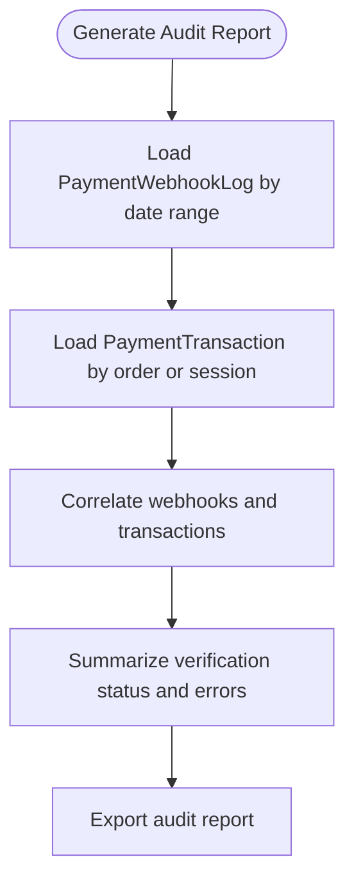

**Diagram sources**
- [payment-webhook-log.ts:3-15](file://apps/medusa/src/modules/bd-payments/models/payment-webhook-log.ts#L3-L15)
- [payment-transaction.ts:3-15](file://apps/medusa/src/modules/bd-payments/models/payment-transaction.ts#L3-L15)

**Section sources**
- [payment-webhook-log.ts:3-15](file://apps/medusa/src/modules/bd-payments/models/payment-webhook-log.ts#L3-L15)
- [payment-transaction.ts:3-15](file://apps/medusa/src/modules/bd-payments/models/payment-transaction.ts#L3-L15)

### Transaction Reconciliation Processes
Reconciliation compares gateway records with internal records:

1. Extract gateway settlement or transaction reports.
2. Match by `provider_id` and `gateway_transaction_id`.
3. Compare amounts, currencies, statuses, and timestamps.
4. Flag mismatches:
   - Missing internal transaction.
   - Duplicate gateway transaction.
   - Amount mismatch.
   - Status mismatch.
5. Resolve discrepancies:
   - Create missing transaction records.
   - Mark duplicates as ignored.
   - Escalate unresolved mismatches.

Duplicate prevention mechanisms at the repository level include unique partial indexes and idempotency keys across related tables. For payment transactions, the presence of `gateway_transaction_id` and indexing supports deduplication checks.

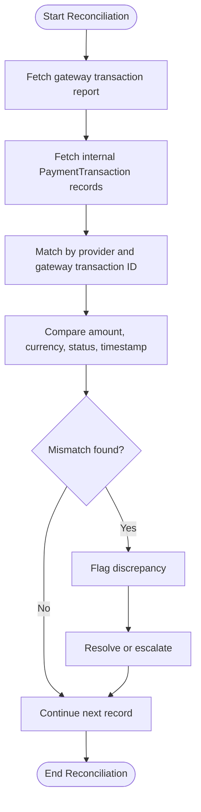

**Diagram sources**
- [payment-transaction.ts:3-15](file://apps/medusa/src/modules/bd-payments/models/payment-transaction.ts#L3-L15)
- [database.md:1783-1800](file://database.md#L1783-L1800)

**Section sources**
- [payment-transaction.ts:3-15](file://apps/medusa/src/modules/bd-payments/models/payment-transaction.ts#L3-L15)
- [database.md:1783-1800](file://database.md#L1783-L1800)

### Duplicate Prevention and Data Consistency
Duplicate prevention relies on:

- Unique partial indexes where applicable.
- Idempotency keys for critical operations.
- Server-to-server verification to avoid trusting client-side or callback-only state.
- Atomic workflows for order placement and payment confirmation.

Data consistency mechanisms include:

- Authoritative state held in core payment and order entities.
- Transaction and webhook records treated as evidence rather than state authority.
- Nightly drift checks and reconciliation jobs.
- Strict isolation levels for sensitive financial transactions.

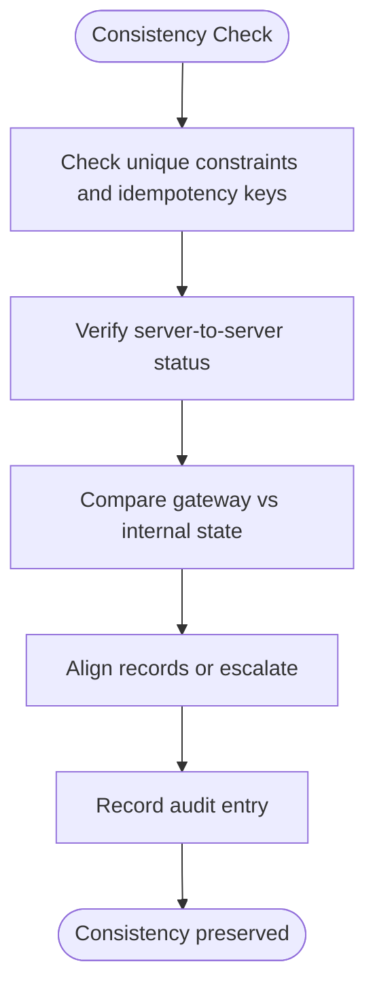

**Diagram sources**
- [database.md:2111-2145](file://database.md#L2111-L2145)
- [database.md:2180-2195](file://database.md#L2180-L2195)
- [payment-transaction.ts:3-15](file://apps/medusa/src/modules/bd-payments/models/payment-transaction.ts#L3-L15)

**Section sources**
- [database.md:2111-2145](file://database.md#L2111-L2145)
- [database.md:2180-2195](file://database.md#L2180-L2195)
- [payment-transaction.ts:3-15](file://apps/medusa/src/modules/bd-payments/models/payment-transaction.ts#L3-L15)

## Dependency Analysis
The `bd-payments` module has minimal internal dependencies but integrates with broader system processes:

- `BdPaymentsModuleService` depends on `PaymentTransaction` and `PaymentWebhookLog`.
- The migration defines the database schema and indexes.
- Design documents describe how payment flows interact with orders, webhooks, polling, and reconciliation.

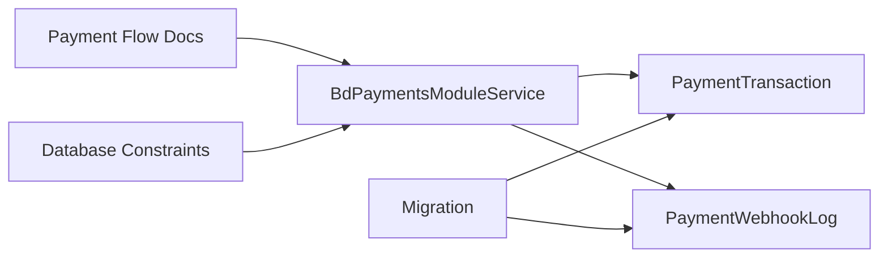

**Diagram sources**
- [service.ts:5-8](file://apps/medusa/src/modules/bd-payments/service.ts#L5-L8)
- [payment-transaction.ts:3-15](file://apps/medusa/src/modules/bd-payments/models/payment-transaction.ts#L3-L15)
- [payment-webhook-log.ts:3-15](file://apps/medusa/src/modules/bd-payments/models/payment-webhook-log.ts#L3-L15)
- [Migration20261024060542.ts:5-13](file://apps/medusa/src/modules/bd-payments/migrations/Migration20261024060542.ts#L5-L13)
- [dfd.md:327-393](file://dfd.md#L327-L393)
- [database.md:1783-1800](file://database.md#L1783-L1800)

**Section sources**
- [service.ts:5-8](file://apps/medusa/src/modules/bd-payments/service.ts#L5-L8)
- [Migration20261024060542.ts:5-13](file://apps/medusa/src/modules/bd-payments/migrations/Migration20261024060542.ts#L5-L13)
- [dfd.md:327-393](file://dfd.md#L327-L393)
- [database.md:1783-1800](file://database.md#L1783-L1800)

## Performance Considerations
To keep transaction operations performant:

- Use indexed columns for frequent filters:
  - `order_id`
  - `payment_session_id`
  - `gateway_transaction_id`
- Avoid scanning full tables by adding time-bounded filters:
  - `created_at` ranges for daily reconciliation.
- Limit raw JSON payload size where possible while retaining enough detail for audits.
- Batch reconciliation queries instead of issuing per-row lookups.
- Use server-to-server verification sparingly and cache short-lived results when safe.
- Monitor slow queries on large date ranges and add appropriate composite indexes if needed.

[No sources needed since this section provides general guidance]

## Troubleshooting Guide
Common issues and debugging steps:

| Symptom | Likely Cause | Diagnostic Steps | Resolution |
|---|---|---|---|
| No transaction record after successful payment | Callback dropped or server-to-server verification not executed | Check `PaymentWebhookLog` for webhook receipt; check `is_verified_server_to_server` | Run recovery poller; verify gateway status; create missing transaction |
| Duplicate gateway transaction | Provider replayed callback or retry | Search by `gateway_transaction_id` and `provider_id` | Deduplicate using unique constraint or idempotency key |
| Amount mismatch | Checkout snapshot changed or incorrect amount recorded | Compare `amount_bdt` with gateway response and order totals | Investigate checkout flow; correct snapshot logic |
| Unverified transactions accumulating | Poller not running or gateway query failing | Filter by `is_verified_server_to_server = false` and old `created_at` | Fix poller; monitor gateway connectivity |
| Failed webhook processing | Invalid signature or malformed payload | Inspect `signature_valid`, `verification_result`, `error_message` | Validate provider credentials; log and alert |

Monitoring recommendations:

- Alert on high volumes of failed webhooks.
- Alert on unverified transactions older than a threshold.
- Alert on amount mismatches during reconciliation.
- Track gateway response latency and failure rates.
- Retain raw payloads for forensic analysis according to retention policy.

**Section sources**
- [payment-webhook-log.ts:3-15](file://apps/medusa/src/modules/bd-payments/models/payment-webhook-log.ts#L3-L15)
- [payment-transaction.ts:3-15](file://apps/medusa/src/modules/bd-payments/models/payment-transaction.ts#L3-L15)
- [dfd.md:327-393](file://dfd.md#L327-L393)

## Conclusion
The `bd-payments` module provides a solid foundation for payment transaction tracking through the `PaymentTransaction` and `PaymentWebhookLog` models and a Medusa service that persists them. While the current code defines the data model and basic persistence, the broader system design documents describe the intended lifecycle, reconciliation, duplicate prevention, and audit mechanisms. Operational teams should implement creation, validation, retrieval, reconciliation, and monitoring logic around these models, following the zero-trust, evidence-first principles documented across the repository.

[No sources needed since this section summarizes without analyzing specific files]