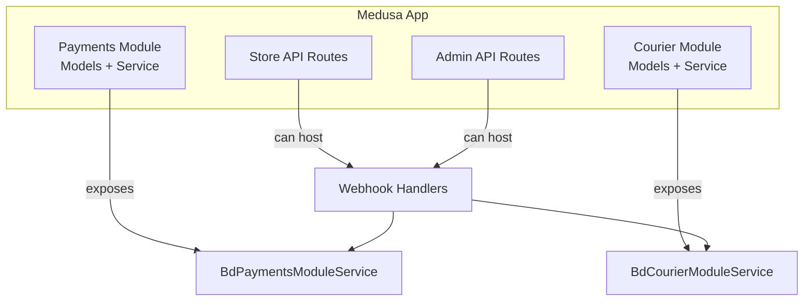
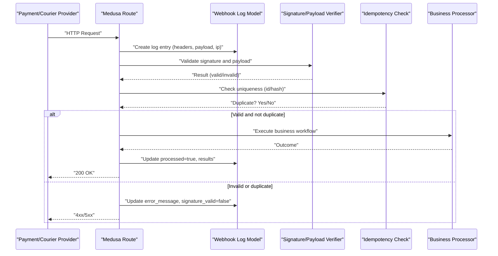
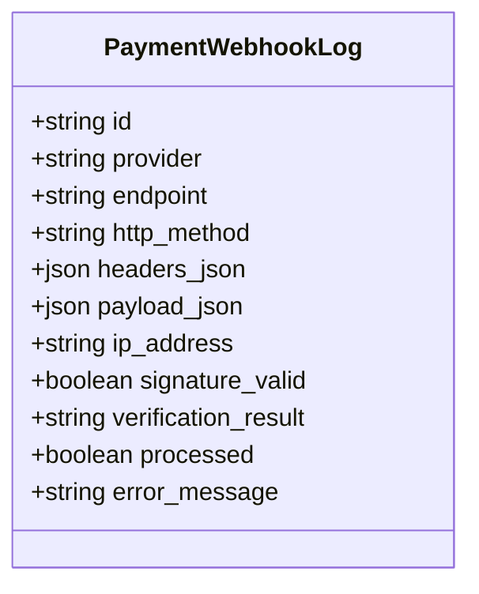
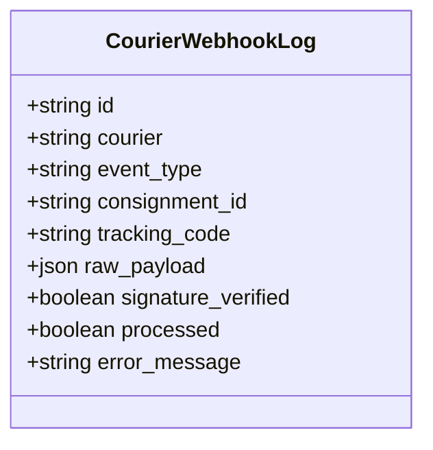
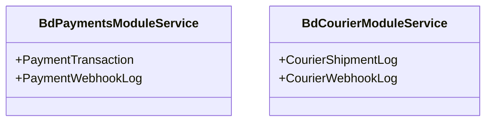
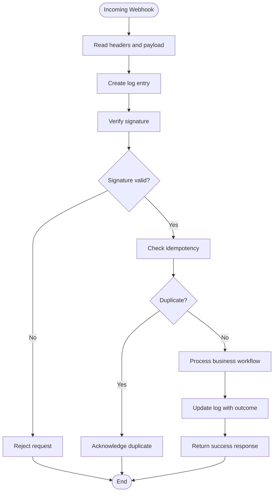
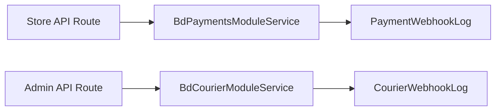

# Webhook Processing & Security

<cite>
**Referenced Files in This Document**
- [payment-webhook-log.ts](file://apps/medusa/src/modules/bd-payments/models/payment-webhook-log.ts)
- [service.ts (Payments)](file://apps/medusa/src/modules/bd-payments/service.ts)
- [Migration20261024060542.ts (Payments)](file://apps/medusa/src/modules/bd-payments/migrations/Migration20261024060542.ts)
- [data-models.md](file://docs/data-models.md)
- [courier-webhook-log.ts](file://apps/medusa/src/modules/bd-courier/models/courier-webhook-log.ts)
- [service.ts (Courier)](file://apps/medusa/src/modules/bd-courier/service.ts)
- [route.ts (Store API)](file://apps/medusa/src/api/store/custom/route.ts)
- [route.ts (Admin API)](file://apps/medusa/src/api/admin/custom/route.ts)
</cite>

## Table of Contents
1. [Introduction](#introduction)
2. [Project Structure](#project-structure)
3. [Core Components](#core-components)
4. [Architecture Overview](#architecture-overview)
5. [Detailed Component Analysis](#detailed-component-analysis)
6. [Dependency Analysis](#dependency-analysis)
7. [Performance Considerations](#performance-considerations)
8. [Troubleshooting Guide](#troubleshooting-guide)
9. [Conclusion](#conclusion)

## Introduction
This document explains how webhooks are processed and secured within the platform, focusing on the PaymentWebhookLog model for tracking payment webhook events, signature verification, payload validation, endpoint security, replay attack prevention, idempotency, error recovery, retry strategies, monitoring, logging best practices, and security considerations such as payload encryption, signature validation, and access control. It also provides guidance for implementing webhook handlers and integrating with Medusa’s HTTP layer.

## Project Structure
The repository organizes webhook-related logic under feature modules:
- Payments module: defines the PaymentWebhookLog model and exposes it via a service.
- Courier module: defines a parallel CourierWebhookLog model for courier notifications.
- API routes: placeholder endpoints exist under store and admin APIs where webhook handlers can be implemented.

**Diagram sources**
- [service.ts (Payments):5-8](file://apps/medusa/src/modules/bd-payments/service.ts#L5-L8)
- [service.ts (Courier):5-8](file://apps/medusa/src/modules/bd-courier/service.ts#L5-L8)
- [route.ts (Store API):3-8](file://apps/medusa/src/api/store/custom/route.ts#L3-L8)
- [route.ts (Admin API):3-8](file://apps/medusa/src/api/admin/custom/route.ts#L3-L8)

**Section sources**
- [service.ts (Payments):1-11](file://apps/medusa/src/modules/bd-payments/service.ts#L1-L11)
- [service.ts (Courier):1-11](file://apps/medusa/src/modules/bd-courier/service.ts#L1-L11)
- [route.ts (Store API):1-9](file://apps/medusa/src/api/store/custom/route.ts#L1-L9)
- [route.ts (Admin API):1-9](file://apps/medusa/src/api/admin/custom/route.ts#L1-L9)

## Core Components
- PaymentWebhookLog: Captures incoming payment webhooks with provider, endpoint, HTTP method, headers, payload, IP address, signature validity, verification result, processing status, and error messages.
- BdPaymentsModuleService: Exposes services for PaymentTransaction and PaymentWebhookLog entities.
- CourierWebhookLog: Captures courier webhook events with courier name, event type, consignment/tracking identifiers, raw payload, signature verification flag, processing status, and error message.
- BdCourierModuleService: Exposes services for CourierShipmentLog and CourierWebhookLog entities.

These components provide the foundation for secure ingestion, verification, and auditability of webhook events.

**Section sources**
- [payment-webhook-log.ts:3-15](file://apps/medusa/src/modules/bd-payments/models/payment-webhook-log.ts#L3-L15)
- [service.ts (Payments):5-8](file://apps/medusa/src/modules/bd-payments/service.ts#L5-L8)
- [courier-webhook-log.ts:3-13](file://apps/medusa/src/modules/bd-courier/models/courier-webhook-log.ts#L3-L13)
- [service.ts (Courier):5-8](file://apps/medusa/src/modules/bd-courier/service.ts#L5-L8)

## Architecture Overview
A typical webhook flow includes:
- Ingress: External provider sends an HTTP request to a Medusa route.
- Logging: The system records the request metadata and payload into a log model.
- Verification: Signature and optional payload integrity checks are performed.
- Idempotency: Duplicate or replayed requests are detected using unique IDs or hashes.
- Processing: Business workflows update orders, transactions, or shipments.
- Response: A stable response is returned; failures are retried asynchronously.

[No diagram sources needed since this diagram shows conceptual workflow, not actual code structure]

## Detailed Component Analysis

### PaymentWebhookLog Model
The PaymentWebhookLog model captures comprehensive details about each incoming payment webhook:
- Identification: primary key id.
- Context: provider, endpoint, http_method, ip_address.
- Payload: headers_json and payload_json for full request context.
- Security: signature_valid and verification_result to record verification outcomes.
- Processing: processed flag and error_message for operational visibility.

**Diagram sources**
- [payment-webhook-log.ts:3-15](file://apps/medusa/src/modules/bd-payments/models/payment-webhook-log.ts#L3-L15)

**Section sources**
- [payment-webhook-log.ts:3-15](file://apps/medusa/src/modules/bd-payments/models/payment-webhook-log.ts#L3-L15)
- [data-models.md:261-279](file://docs/data-models.md#L261-L279)

### CourierWebhookLog Model
The CourierWebhookLog model tracks courier webhook events:
- Identification: primary key id.
- Context: courier, event_type, consignment_id, tracking_code.
- Payload: raw_payload for complete event data.
- Security: signature_verified flag.
- Processing: processed flag and error_message.

**Diagram sources**
- [courier-webhook-log.ts:3-13](file://apps/medusa/src/modules/bd-courier/models/courier-webhook-log.ts#L3-L13)

**Section sources**
- [courier-webhook-log.ts:3-13](file://apps/medusa/src/modules/bd-courier/models/courier-webhook-log.ts#L3-L13)

### Service Exposure
Both modules expose their models through Medusa services:
- BdPaymentsModuleService exposes PaymentTransaction and PaymentWebhookLog.
- BdCourierModuleService exposes CourierShipmentLog and CourierWebhookLog.

**Diagram sources**
- [service.ts (Payments):5-8](file://apps/medusa/src/modules/bd-payments/service.ts#L5-L8)
- [service.ts (Courier):5-8](file://apps/medusa/src/modules/bd-courier/service.ts#L5-L8)

**Section sources**
- [service.ts (Payments):1-11](file://apps/medusa/src/modules/bd-payments/service.ts#L1-L11)
- [service.ts (Courier):1-11](file://apps/medusa/src/modules/bd-courier/service.ts#L1-L11)

### Webhook Handler Implementation Example
Implement webhook handlers in Medusa routes:
- Use GET/POST handlers to accept provider callbacks.
- Record request metadata and payload into the appropriate log model.
- Perform signature verification and payload validation.
- Enforce idempotency by checking uniqueness (e.g., provider event ID or hash).
- Execute business workflows and update log entries with processing results.

[No diagram sources needed since this diagram shows conceptual workflow, not actual code structure]

### Endpoint Security
- Restrict webhook endpoints to trusted providers:
  - Validate signatures using provider-specific algorithms and secrets.
  - Optionally validate TLS client certificates or allow-list IPs.
- Protect against unauthorized access:
  - Apply authentication middleware for internal endpoints.
  - Use environment variables to manage secrets securely.
- Sanitize inputs:
  - Validate JSON schema for payloads.
  - Limit payload size and header count.

[No sources needed since this section provides general guidance]

### Replay Attack Prevention and Idempotency
- Require a unique identifier from the provider (e.g., event_id, transaction_id).
- Compute a deterministic hash over critical fields if no unique ID exists.
- Store processed flags in logs and enforce uniqueness constraints at the database level.
- On duplicates, return a stable acknowledgment without reprocessing.

[No sources needed since this section provides general guidance]

### Error Recovery and Retry Mechanisms
- Immediate errors:
  - Return appropriate HTTP status codes (e.g., 4xx for invalid input, 5xx for transient failures).
  - Log detailed error messages for diagnostics.
- Asynchronous retries:
  - Queue failed processing tasks and retry with exponential backoff.
  - Track retry attempts and final failure reasons in logs.
- Dead-letter handling:
  - Move persistently failing events to a dead-letter queue for manual inspection.

[No sources needed since this section provides general guidance]

### Monitoring and Logging Best Practices
- Capture comprehensive context:
  - Provider, endpoint, HTTP method, headers, payload, IP address.
  - Signature verification result and processing status.
- Structured logging:
  - Include correlation IDs and timestamps.
  - Avoid logging sensitive data unless encrypted or masked.
- Metrics and alerts:
  - Monitor success/failure rates, latency, and volume spikes.
  - Alert on repeated signature failures or high error rates.

**Section sources**
- [payment-webhook-log.ts:3-15](file://apps/medusa/src/modules/bd-payments/models/payment-webhook-log.ts#L3-L15)
- [data-models.md:261-279](file://docs/data-models.md#L261-L279)

### Security Considerations
- Payload encryption:
  - Prefer HTTPS/TLS for transport security.
  - Encrypt sensitive payload fields at rest if required by policy.
- Signature validation:
  - Implement provider-specific signature verification before processing.
  - Fail fast on invalid signatures and log verification details.
- Access control:
  - Restrict webhook endpoints to known providers.
  - Use secret management and least-privilege principles.

[No sources needed since this section provides general guidance]

## Dependency Analysis
The payments and courier modules define independent log models and expose them via services. API routes act as entry points that can integrate with these services to process webhooks.

**Diagram sources**
- [route.ts (Store API):3-8](file://apps/medusa/src/api/store/custom/route.ts#L3-L8)
- [route.ts (Admin API):3-8](file://apps/medusa/src/api/admin/custom/route.ts#L3-L8)
- [service.ts (Payments):5-8](file://apps/medusa/src/modules/bd-payments/service.ts#L5-L8)
- [service.ts (Courier):5-8](file://apps/medusa/src/modules/bd-courier/service.ts#L5-L8)
- [payment-webhook-log.ts:3-15](file://apps/medusa/src/modules/bd-payments/models/payment-webhook-log.ts#L3-L15)
- [courier-webhook-log.ts:3-13](file://apps/medusa/src/modules/bd-courier/models/courier-webhook-log.ts#L3-L13)

**Section sources**
- [route.ts (Store API):1-9](file://apps/medusa/src/api/store/custom/route.ts#L1-L9)
- [route.ts (Admin API):1-9](file://apps/medusa/src/api/admin/custom/route.ts#L1-L9)
- [service.ts (Payments):1-11](file://apps/medusa/src/modules/bd-payments/service.ts#L1-L11)
- [service.ts (Courier):1-11](file://apps/medusa/src/modules/bd-courier/service.ts#L1-L11)
- [payment-webhook-log.ts:1-18](file://apps/medusa/src/modules/bd-payments/models/payment-webhook-log.ts#L1-L18)
- [courier-webhook-log.ts:1-16](file://apps/medusa/src/modules/bd-courier/models/courier-webhook-log.ts#L1-L16)

## Performance Considerations
- Minimize synchronous work in webhook handlers; offload heavy processing to background jobs.
- Use indexes on frequently queried fields (e.g., consignment_id, tracking_code) to optimize lookups.
- Batch updates when possible to reduce database write amplification.
- Cache configuration and secrets to avoid repeated I/O during verification.

[No sources needed since this section provides general guidance]

## Troubleshooting Guide
Common issues and resolutions:
- Signature validation failures:
  - Verify provider secrets and algorithm configuration.
  - Inspect verification_result and error_message in logs.
- Duplicate processing:
  - Ensure idempotency keys are present and enforced.
  - Review processed flags and deduplication logic.
- Payload parsing errors:
  - Validate JSON schema and handle malformed payloads gracefully.
  - Log raw_payload for forensic analysis while masking sensitive fields.
- High error rates:
  - Monitor metrics and set up alerts for anomalies.
  - Investigate upstream provider changes or network issues.

**Section sources**
- [payment-webhook-log.ts:3-15](file://apps/medusa/src/modules/bd-payments/models/payment-webhook-log.ts#L3-L15)
- [courier-webhook-log.ts:3-13](file://apps/medusa/src/modules/bd-courier/models/courier-webhook-log.ts#L3-L13)

## Conclusion
The platform provides robust foundations for webhook processing and security through dedicated log models and service exposure. By implementing signature verification, payload validation, idempotency, and structured logging, teams can ensure reliable, secure, and observable webhook integrations. Adhering to best practices for endpoint security, error recovery, and monitoring will help maintain stability and trust in external provider integrations.