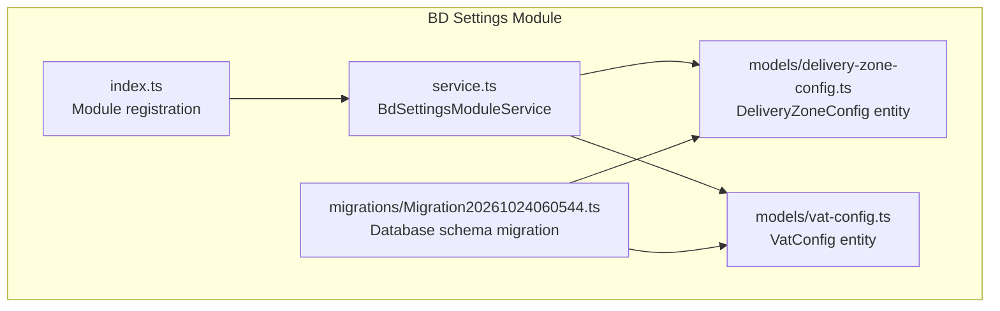
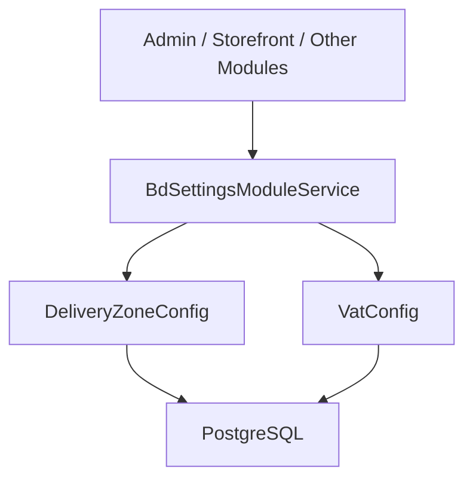
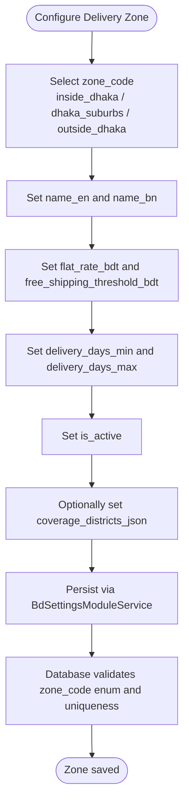
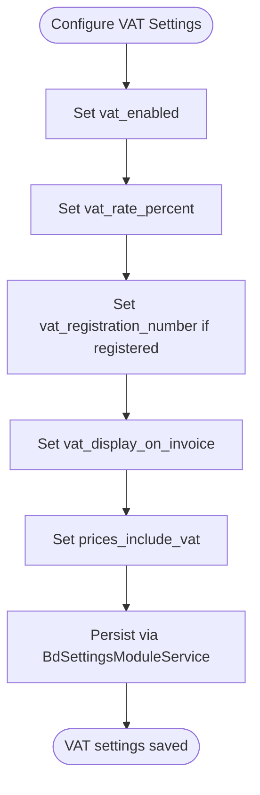
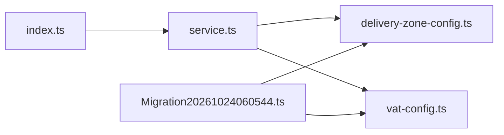

# Settings Management Module

<cite>
**Referenced Files in This Document**   
- [service.ts](file://apps/medusa/src/modules/bd-settings/service.ts)
- [index.ts](file://apps/medusa/src/modules/bd-settings/index.ts)
- [delivery-zone-config.ts](file://apps/medusa/src/modules/bd-settings/models/delivery-zone-config.ts)
- [vat-config.ts](file://apps/medusa/src/modules/bd-settings/models/vat-config.ts)
- [Migration20261024060544.ts](file://apps/medusa/src/modules/bd-settings/migrations/Migration20261024060544.ts)
- [data-models.md](file://docs/data-models.md)
- [database.md](file://database.md)
- [prd.md](file://prd.md)
- [agent.md](file://agent.md)
</cite>

## Table of Contents
1. [Introduction](#introduction)
2. [Project Structure](#project-structure)
3. [Core Components](#core-components)
4. [Architecture Overview](#architecture-overview)
5. [Detailed Component Analysis](#detailed-component-analysis)
6. [Dependency Analysis](#dependency-analysis)
7. [Performance Considerations](#performance-considerations)
8. [Troubleshooting Guide](#troubleshooting-guide)
9. [Compliance and Regulatory Guidance](#compliance-and-regulatory-guidance)
10. [Conclusion](#conclusion)

## Introduction
The BD Settings module provides Bangladesh-specific configuration for delivery zones, VAT settings, and foundational business rules used across the commerce platform. It is implemented as a Medusa v2 custom module that exposes:

- Delivery zone configuration for Inside Dhaka, Dhaka Suburbs, and Outside Dhaka.
- VAT configuration flags, rates, registration number, invoice display behavior, and pricing inclusion behavior.
- A service layer built on `MedusaService` to manage these entities.

This documentation explains how the module is structured, what data it stores, how it aligns with Bangladesh-specific requirements, and how administrators can configure delivery zones, VAT, and regional business rules.

## Project Structure
The BD Settings module lives under `apps/medusa/src/modules/bd-settings`. Its structure is intentionally small and focused:

**Diagram sources**
- [index.ts:1-9](file://apps/medusa/src/modules/bd-settings/index.ts#L1-L9)
- [service.ts:1-11](file://apps/medusa/src/modules/bd-settings/service.ts#L1-L11)
- [delivery-zone-config.ts:1-17](file://apps/medusa/src/modules/bd-settings/models/delivery-zone-config.ts#L1-L17)
- [vat-config.ts:1-13](file://apps/medusa/src/modules/bd-settings/models/vat-config.ts#L1-L13)
- [Migration20261024060544.ts:1-22](file://apps/medusa/src/modules/bd-settings/migrations/Migration20261024060544.ts#L1-L22)

**Section sources**
- [index.ts:1-9](file://apps/medusa/src/modules/bd-settings/index.ts#L1-L9)
- [service.ts:1-11](file://apps/medusa/src/modules/bd-settings/service.ts#L1-L11)

## Core Components
The module has three core building blocks:

| Component | Purpose | Key Behavior |
|---|---|---|
| `BD_SETTINGS_MODULE` | Registers the module with Medusa | Exposes `bd_settings` service namespace |
| `BdSettingsModuleService` | Service class extending `MedusaService` | Provides CRUD access to delivery zone and VAT configuration entities |
| Data Models | Define database schema for delivery zones and VAT settings | Enforce constraints, defaults, and indexes via migrations |

### Module Registration
The module exports a constant `BD_SETTINGS_MODULE` and registers the service through Medusa's `Module` helper. This makes the service available to other modules or admin/store APIs.

**Section sources**
- [index.ts:1-9](file://apps/medusa/src/modules/bd-settings/index.ts#L1-L9)

### Service Layer
`BdSettingsModuleService` extends `MedusaService` and wires up two models:

- `DeliveryZoneConfig`
- `VatConfig`

This means the service inherits standard repository operations for both entities without additional implementation.

**Section sources**
- [service.ts:1-11](file://apps/medusa/src/modules/bd-settings/service.ts#L1-L11)

## Architecture Overview
At runtime, the BD Settings module acts as a configuration source for Bangladesh-specific business logic. Other parts of the system can query delivery zones and VAT settings through the service. The current implementation focuses on data modeling and service exposure; integration points such as checkout pricing, courier routing, and invoice generation are expected to consume this module.

**Diagram sources**
- [service.ts:1-11](file://apps/medusa/src/modules/bd-settings/service.ts#L1-L11)
- [delivery-zone-config.ts:1-17](file://apps/medusa/src/modules/bd-settings/models/delivery-zone-config.ts#L1-L17)
- [vat-config.ts:1-13](file://apps/medusa/src/modules/bd-settings/models/vat-config.ts#L1-L13)

## Detailed Component Analysis

### Delivery Zone Configuration
Delivery zones define shipping charges, free-shipping thresholds, delivery SLAs, active status, and optional coverage districts.

#### Entity Model
The delivery zone model includes:

| Field | Meaning | Notes |
|---|---|---|
| `id` | Primary key | Unique zone identifier |
| `zone_code` | Zone identifier | Enumerated values: `inside_dhaka`, `dhaka_suburbs`, `outside_dhaka` |
| `name_en` | English name | Human-readable label |
| `name_bn` | Bengali name | Localized label |
| `flat_rate_bdt` | Flat shipping charge | Default value represents BDT paisa; documentation treats it as paisa-level precision |
| `free_shipping_threshold_bdt` | Free shipping threshold | Default value represents BDT paisa; documentation treats it as paisa-level precision |
| `delivery_days_min` | Minimum delivery days | Business-day SLA lower bound |
| `delivery_days_max` | Maximum delivery days | Business-day SLA upper bound |
| `is_active` | Zone enabled flag | Defaults to active |
| `coverage_districts_json` | Optional district/thana list | JSON field for matching coverage |

The PRD requires at least Inside Dhaka and Outside Dhaka zones. The model also supports a finer `dhaka_suburbs` zone.

**Section sources**
- [delivery-zone-config.ts:1-17](file://apps/medusa/src/modules/bd-settings/models/delivery-zone-config.ts#L1-L17)
- [data-models.md:151-170](file://docs/data-models.md#L151-L170)
- [prd.md:392-398](file://prd.md#L392-L398)
- [agent.md:108-117](file://agent.md#L108-L117)

#### Database Schema and Constraints
The migration creates the `delivery_zone_config` table with:

- A check constraint limiting `zone_code` to the three allowed values.
- A unique index on `zone_code` scoped to non-deleted rows.
- An index on `deleted_at` for soft-delete queries.
- Numeric fields for flat rate and free shipping threshold.
- JSON storage for coverage districts.

**Diagram sources**
- [delivery-zone-config.ts:1-17](file://apps/medusa/src/modules/bd-settings/models/delivery-zone-config.ts#L1-L17)
- [Migration20261024060544.ts:5-12](file://apps/medusa/src/modules/bd-settings/migrations/Migration20261024060544.ts#L5-L12)

#### Example: Configuring Delivery Zones
Administrators should follow these steps when setting up delivery zones:

1. Create one record per zone code.
2. Use `inside_dhaka` for Dhaka district deliveries.
3. Use `outside_dhaka` for the remaining districts.
4. Optionally add `dhaka_suburbs` if the business needs a separate suburban tier.
5. Set `flat_rate_bdt` according to the business’s BDT pricing policy.
6. Set `free_shipping_threshold_bdt` to enable free shipping above a cart subtotal.
7. Configure realistic `delivery_days_min` and `delivery_days_max` based on courier SLAs.
8. Keep `is_active` true while testing and disable zones during maintenance.
9. If needed, populate `coverage_districts_json` with district or thana identifiers for precise routing.

Bangladesh administrative hierarchy guidance recommends using Division → District → Upazila/Thana → Area/Street Address. Delivery zone routing should bind to administrative codes rather than free-text spelling.

**Section sources**
- [delivery-zone-config.ts:1-17](file://apps/medusa/src/modules/bd-settings/models/delivery-zone-config.ts#L1-L17)
- [data-models.md:151-170](file://docs/data-models.md#L151-L170)
- [agent.md:108-117](file://agent.md#L108-L117)

### VAT Settings Management
VAT configuration controls whether VAT is enabled, its percentage, registration number, invoice display behavior, and whether prices include VAT.

#### Entity Model
The VAT configuration model includes:

| Field | Meaning | Notes |
|---|---|---|
| `id` | Primary key | Unique VAT config identifier |
| `vat_enabled` | VAT enabled flag | Defaults to disabled |
| `vat_rate_percent` | VAT rate percentage | Defaults to zero |
| `vat_registration_number` | Business VAT registration number | Nullable public identifier |
| `vat_display_on_invoice` | Show VAT line on invoice | Defaults to false |
| `prices_include_vat` | Prices already include VAT | Defaults to false |

The PRD states that VAT settings are admin-configurable and that the system does not assume VAT applies until the business confirms its obligation.

**Section sources**
- [vat-config.ts:1-13](file://apps/medusa/src/modules/bd-settings/models/vat-config.ts#L1-L13)
- [prd.md:392-398](file://prd.md#L392-L398)

#### Database Schema and Constraints
The migration creates the `vat_config` table with:

- Boolean flags for enabling VAT and controlling invoice display.
- A float field for the VAT rate percentage.
- A nullable text field for the registration number.
- Indexes on `deleted_at` for soft-delete queries.

**Diagram sources**
- [vat-config.ts:1-13](file://apps/medusa/src/modules/bd-settings/models/vat-config.ts#L1-L13)
- [Migration20261024060544.ts:11-12](file://apps/medusa/src/modules/bd-settings/migrations/Migration20261024060544.ts#L11-L12)

#### Example: Setting Up VAT Rates
Administrators should follow these steps when configuring VAT:

1. Leave `vat_enabled` false until VAT registration or legal obligation is confirmed.
2. When ready, set `vat_enabled` to true.
3. Enter the correct `vat_rate_percent`.
4. Add the business’s `vat_registration_number` if applicable.
5. Decide whether VAT lines should appear on invoices by setting `vat_display_on_invoice`.
6. Set `prices_include_vat` only if displayed prices already include VAT.
7. Review order totals and invoices after changes to ensure compliance.

Note: The broader project documentation describes a more advanced VAT design involving native tax regions and tax rates. The current BD Settings module provides a simpler configuration surface. Integration layers must reconcile these designs and avoid duplicating rate authority.

**Section sources**
- [vat-config.ts:1-13](file://apps/medusa/src/modules/bd-settings/models/vat-config.ts#L1-L13)
- [database.md:1097-1112](file://database.md#L1097-L1112)
- [database.md:2327-2335](file://database.md#L2327-L2335)

### System Preferences and Regional Business Rules
Beyond delivery zones and VAT, the BD Settings module supports Bangladesh-specific preferences:

- Currency: BDT (৳).
- Administrative address hierarchy: Division → District → Upazila/Thana → Area/Street Address.
- Delivery zone routing tied to administrative codes.
- Order invoice summary including delivery charges; VAT lines appear only when configured.

These rules inform how delivery zones and VAT settings should be applied across the platform.

**Section sources**
- [agent.md:108-143](file://agent.md#L108-L143)
- [prd.md:392-398](file://prd.md#L392-L398)

## Dependency Analysis
The BD Settings module has minimal internal coupling:

- `index.ts` registers the module and service.
- `service.ts` depends on the two model definitions.
- Migrations depend on the same model definitions to create tables and indexes.

**Diagram sources**
- [index.ts:1-9](file://apps/medusa/src/modules/bd-settings/index.ts#L1-L9)
- [service.ts:1-11](file://apps/medusa/src/modules/bd-settings/service.ts#L1-L11)
- [delivery-zone-config.ts:1-17](file://apps/medusa/src/modules/bd-settings/models/delivery-zone-config.ts#L1-L17)
- [vat-config.ts:1-13](file://apps/medusa/src/modules/bd-settings/models/vat-config.ts#L1-L13)
- [Migration20261024060544.ts:1-22](file://apps/medusa/src/modules/bd-settings/migrations/Migration20261024060544.ts#L1-L22)

There are no circular dependencies within the module. External consumers should use the service rather than accessing models directly.

**Section sources**
- [index.ts:1-9](file://apps/medusa/src/modules/bd-settings/index.ts#L1-L9)
- [service.ts:1-11](file://apps/medusa/src/modules/bd-settings/service.ts#L1-L11)

## Performance Considerations
- Delivery zone lookups should be keyed by `zone_code`, which has a unique index.
- Soft-delete patterns use `deleted_at`; queries should filter out deleted records where appropriate.
- Large JSON payloads in `coverage_districts_json` should be kept concise to avoid unnecessary storage and serialization overhead.
- VAT configuration is typically singleton-like; caching at the application layer may reduce repeated reads if many components need VAT settings frequently.

[No sources needed since this section provides general guidance]

## Troubleshooting Guide

### Common Delivery Zone Issues
- **Invalid zone_code**: The database enforces allowed values. Ensure new zones use one of the defined codes.
- **Duplicate zone_code**: The unique index prevents duplicate active zones. Update existing records instead of creating duplicates.
- **Wrong currency units**: Documentation treats `flat_rate_bdt` and `free_shipping_threshold_bdt` as BDT paisa-level values. Verify unit expectations before entering amounts.
- **Inactive zones**: Orders may fail to calculate delivery if the selected zone is inactive.

**Section sources**
- [delivery-zone-config.ts:1-17](file://apps/medusa/src/modules/bd-settings/models/delivery-zone-config.ts#L1-L17)
- [Migration20261024060544.ts:5-12](file://apps/medusa/src/modules/bd-settings/migrations/Migration20261024060544.ts#L5-L12)
- [data-models.md:151-170](file://docs/data-models.md#L151-L170)

### Common VAT Configuration Issues
- **VAT unexpectedly applied**: Check `vat_enabled`. If true, the system may apply VAT depending on integration logic.
- **Missing VAT line on invoice**: Verify `vat_display_on_invoice`.
- **Incorrect price display**: Confirm `prices_include_vat` matches whether displayed prices include VAT.
- **Registration number missing**: For compliance reporting, ensure `vat_registration_number` is set when required.

**Section sources**
- [vat-config.ts:1-13](file://apps/medusa/src/modules/bd-settings/models/vat-config.ts#L1-L13)
- [Migration20261024060544.ts:11-12](file://apps/medusa/src/modules/bd-settings/migrations/Migration20261024060544.ts#L11-L12)

### Migration and Schema Issues
- **Table creation failures**: Ensure the migration runs successfully and that the database supports JSONB and numeric types.
- **Index conflicts**: The migration drops an older unique constraint before creating the new table and indexes. Re-running migrations should be idempotent.

**Section sources**
- [Migration20261024060544.ts:1-22](file://apps/medusa/src/modules/bd-settings/migrations/Migration20261024060544.ts#L1-L22)

## Compliance and Regulatory Guidance
The BD Settings module should be treated as part of a broader compliance strategy:

- **VAT activation**: Do not enable VAT until the business has confirmed registration or legal obligation.
- **Rate authority**: Avoid storing conflicting VAT rates alongside Medusa’s native tax engine. Prefer a single source of truth for tax calculation.
- **Invoice transparency**: Only show VAT lines when configured and legally required.
- **Historical integrity**: Changing VAT settings should not alter historical order snapshots or invoices.
- **Currency and localization**: Use BDT consistently and localize labels where required.

The broader project documentation outlines a more comprehensive VAT design involving native tax regions, tax rates, registration status, effective dates, and snapshotting. The BD Settings module currently offers a simpler configuration surface; integration layers must reconcile these designs carefully.

**Section sources**
- [prd.md:392-398](file://prd.md#L392-L398)
- [database.md:1097-1112](file://database.md#L1097-L1112)
- [database.md:2327-2335](file://database.md#L2327-L2335)

## Conclusion
The BD Settings module provides a focused foundation for Bangladesh-specific delivery zone and VAT configuration. It defines clear entities, enforces constraints through migrations, and exposes a simple service layer. Administrators should configure delivery zones according to the business’s shipping policy and activate VAT only when legally required. Future integrations should respect the module’s data model while aligning with the broader project’s tax and compliance architecture.

[No sources needed since this section summarizes without analyzing specific files]