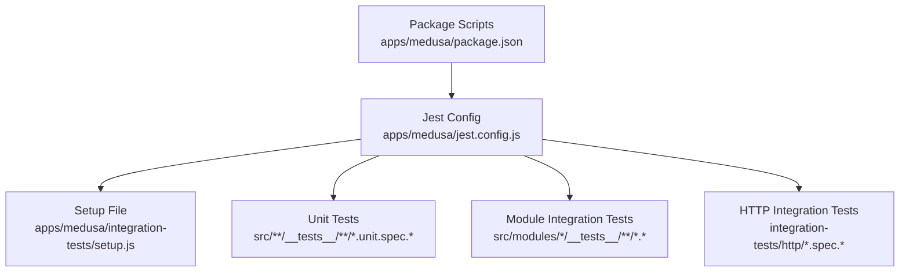
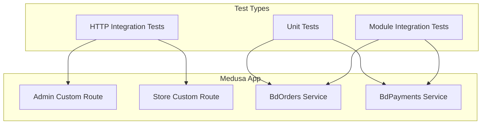
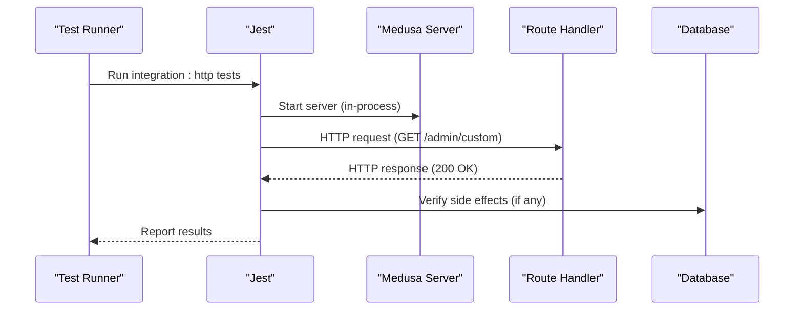
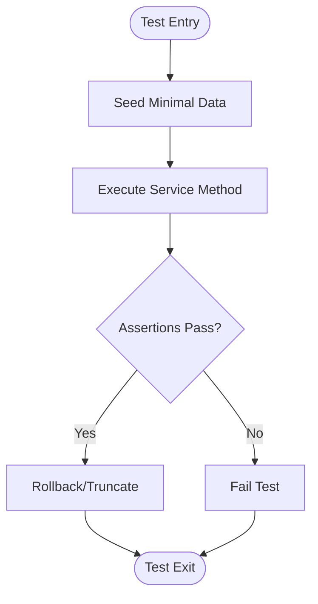
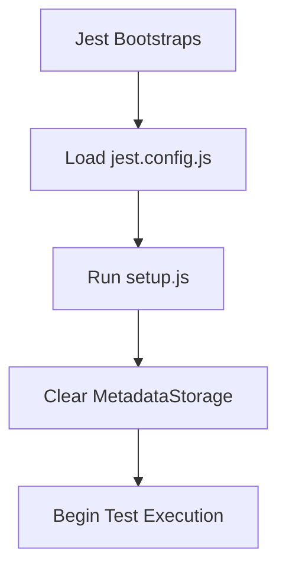
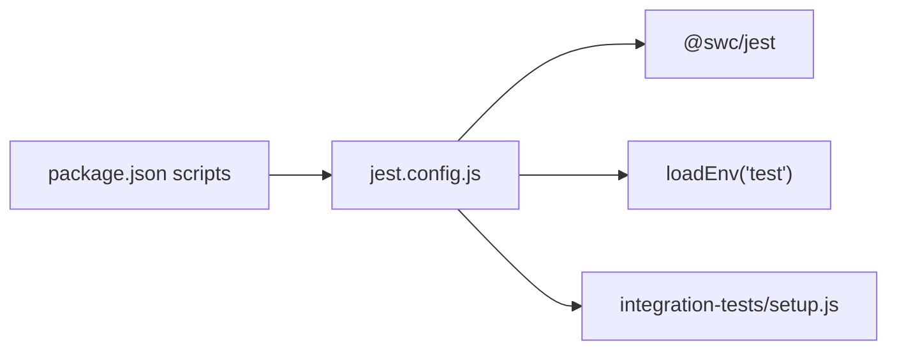

# Testing Strategy & Implementation

<cite>
**Referenced Files in This Document**
- [jest.config.js](file://apps/medusa/jest.config.js)
- [setup.js](file://apps/medusa/integration-tests/setup.js)
- [package.json](file://apps/medusa/package.json)
- [service.ts (bd-orders)](file://apps/medusa/src/modules/bd-orders/service.ts)
- [service.ts (bd-payments)](file://apps/medusa/src/modules/bd-payments/service.ts)
- [route.ts (admin/custom)](file://apps/medusa/src/api/admin/custom/route.ts)
- [route.ts (store/custom)](file://apps/medusa/src/api/store/custom/route.ts)
</cite>

## Table of Contents
1. Introduction
2. Project Structure
3. Core Components
4. Architecture Overview
5. Detailed Component Analysis
6. Dependency Analysis
7. Performance Considerations
8. Troubleshooting Guide
9. Conclusion

## Introduction
This document explains the testing strategy and implementation for the Medusa commerce engine within this project. It covers unit, integration, and end-to-end testing approaches; test environment setup; mocking techniques; test data management; examples for custom modules, API endpoints, and database operations; continuous integration practices; and test coverage requirements. The guidance is grounded in the repository’s Jest configuration, scripts, and module structure.

## Project Structure
The testing infrastructure is centered around Jest with environment-driven test selection and a shared setup file to initialize the ORM metadata before tests run. Test suites are organized by type:
- Unit tests under src/**/__tests__/**/*.unit.spec.[jt]s
- Module integration tests under src/modules/*/__tests__/**/*.[jt]s
- HTTP integration tests under integration-tests/http/*.spec.[jt]s

**Diagram sources**
- [jest.config.js:1-28](file://apps/medusa/jest.config.js#L1-L28)
- [setup.js:1-4](file://apps/medusa/integration-tests/setup.js#L1-L4)
- [package.json:15-24](file://apps/medusa/package.json#L15-L24)

**Section sources**
- [jest.config.js:1-28](file://apps/medusa/jest.config.js#L1-L28)
- [setup.js:1-4](file://apps/medusa/integration-tests/setup.js#L1-L4)
- [package.json:15-24](file://apps/medusa/package.json#L15-L24)

## Core Components
- Jest configuration defines TypeScript transformation via @swc/jest, sets the Node test environment, ignores build artifacts, and loads a setup file that clears MikroORM metadata between runs.
- Environment-based test matching selects which test files to execute based on TEST_TYPE:
  - integration:http
  - integration:modules
  - unit
- Package scripts provide convenient commands to run each test type with appropriate flags.

Key responsibilities:
- Transform TS/JS using SWC for performance.
- Isolate test execution per type via testMatch patterns.
- Ensure clean ORM state at test start.

**Section sources**
- [jest.config.js:1-28](file://apps/medusa/jest.config.js#L1-L28)
- [package.json:15-24](file://apps/medusa/package.json#L15-L24)

## Architecture Overview
The testing architecture follows a layered approach:
- Unit layer: Pure logic and service methods without external dependencies.
- Module integration layer: Validates module services against the application’s ORM and migrations.
- HTTP integration layer: Exercises the full HTTP stack through real routes.

**Diagram sources**
- [route.ts (admin/custom):1-9](file://apps/medusa/src/api/admin/custom/route.ts#L1-L9)
- [route.ts (store/custom):1-9](file://apps/medusa/src/api/store/custom/route.ts#L1-L9)
- [service.ts (bd-orders):1-13](file://apps/medusa/src/modules/bd-orders/service.ts#L1-L13)
- [service.ts (bd-payments):1-11](file://apps/medusa/src/modules/bd-payments/service.ts#L1-L11)

## Detailed Component Analysis

### Unit Testing Patterns
- Target: Business logic inside module services and helpers.
- Approach:
  - Place unit tests under src/**/__tests__/**/*.unit.spec.[jt]s so they match the unit testMatch pattern.
  - Use dependency injection or constructor-level mocks to isolate pure logic from ORM and external services.
  - Validate inputs/outputs, error paths, and edge cases.
- Example targets:
  - BdOrdersService and BdPaymentsService methods derived from MedusaService base class.

Best practices:
- Keep tests deterministic and fast.
- Avoid starting the full server for unit tests.
- Mock only external collaborators (e.g., payment gateways, email providers).

**Section sources**
- [jest.config.js:21-27](file://apps/medusa/jest.config.js#L21-L27)
- [service.ts (bd-orders):1-13](file://apps/medusa/src/modules/bd-orders/service.ts#L1-L13)
- [service.ts (bd-payments):1-11](file://apps/medusa/src/modules/bd-payments/service.ts#L1-L11)

### Module Integration Testing Approaches
- Target: Module services interacting with the database via MedusaService and MikroORM.
- Approach:
  - Place tests under src/modules/*/__tests__/**/*.[jt]s to match the integration:modules pattern.
  - Use the app’s migration snapshots to ensure schema consistency.
  - Seed minimal test data per test case and roll back or truncate after each test.
- Validation points:
  - CRUD operations on entities defined in each module.
  - Query filters, relations, and transactions.

Data management:
- Create fixtures in-memory or via seed functions.
- Use transactional wrappers where possible to avoid cross-test pollution.

**Section sources**
- [jest.config.js:23-24](file://apps/medusa/jest.config.js#L23-L24)
- [service.ts (bd-orders):1-13](file://apps/medusa/src/modules/bd-orders/service.ts#L1-L13)
- [service.ts (bd-payments):1-11](file://apps/medusa/src/modules/bd-payments/service.ts#L1-L11)

### HTTP Integration Testing Strategies
- Target: Admin and Store API endpoints.
- Approach:
  - Place tests under integration-tests/http/*.spec.[jt]s to match the integration:http pattern.
  - Start the Medusa server in-process or use a test harness to issue HTTP requests against live routes.
  - Assert status codes, response bodies, headers, and side effects (e.g., DB changes).
- Example endpoints:
  - GET /admin/custom
  - GET /store/custom

Sequence flow:

**Diagram sources**
- [route.ts (admin/custom):1-9](file://apps/medusa/src/api/admin/custom/route.ts#L1-L9)
- [route.ts (store/custom):1-9](file://apps/medusa/src/api/store/custom/route.ts#L1-L9)

**Section sources**
- [jest.config.js:21-22](file://apps/medusa/jest.config.js#L21-L22)
- [route.ts (admin/custom):1-9](file://apps/medusa/src/api/admin/custom/route.ts#L1-L9)
- [route.ts (store/custom):1-9](file://apps/medusa/src/api/store/custom/route.ts#L1-L9)

### Database Operations Testing
- Pattern:
  - Use module services to exercise entity persistence and queries.
  - Leverage existing migrations and snapshots to keep schemas aligned.
  - Wrap test scenarios in transactions when supported to ensure isolation.
- Focus areas:
  - Entity creation, updates, deletions.
  - Complex queries and joins across related entities.
  - Error handling for constraint violations and invalid states.

[No sources needed since this diagram shows conceptual workflow, not actual code structure]

**Section sources**
- [service.ts (bd-orders):1-13](file://apps/medusa/src/modules/bd-orders/service.ts#L1-L13)
- [service.ts (bd-payments):1-11](file://apps/medusa/src/modules/bd-payments/service.ts#L1-L11)

### Test Environment Setup and Initialization
- The setup file clears MikroORM MetadataStorage before tests run to prevent stale metadata across test suites.
- Jest loads this setup file via setupFiles.

**Diagram sources**
- [jest.config.js:18-18](file://apps/medusa/jest.config.js#L18-L18)
- [setup.js:1-4](file://apps/medusa/integration-tests/setup.js#L1-L4)

**Section sources**
- [jest.config.js:18-18](file://apps/medusa/jest.config.js#L18-L18)
- [setup.js:1-4](file://apps/medusa/integration-tests/setup.js#L1-L4)

### Mocking Techniques
- For unit tests:
  - Mock external services injected into module services.
  - Stub network calls and third-party SDKs.
- For integration tests:
  - Prefer real integrations over mocks to validate behavior end-to-end.
  - If mocking is necessary, mock only unstable or non-deterministic components (e.g., payment provider webhooks).

Guidelines:
- Keep mocks close to their collaborators.
- Assert both inputs and outputs of mocked interactions.
- Avoid over-mocking business logic.

[No sources needed since this section provides general guidance]

### Test Data Management
- Use small, focused fixtures per test.
- Prefer in-memory objects for unit tests.
- For integration tests, seed only what is required and reset state after each test.
- Align fixture versions with migration snapshots to avoid drift.

[No sources needed since this section provides general guidance]

### Continuous Integration Practices
Recommended CI pipeline stages:
- Install dependencies.
- Build the Medusa app.
- Run unit tests: npm run test:unit
- Run module integration tests: npm run test:integration:modules
- Run HTTP integration tests: npm run test:integration:http
- Generate and upload test reports and coverage.

Notes:
- Each script uses --runInBand and --forceExit to ensure deterministic execution and proper cleanup.
- Consider parallelizing independent jobs (unit vs integration) in CI.

**Section sources**
- [package.json:15-24](file://apps/medusa/package.json#L15-L24)

### Test Coverage Requirements
- Enforce minimum coverage thresholds in Jest config (to be added if not present).
- Track coverage trends in CI to prevent regressions.
- Prioritize coverage for critical paths: order lifecycle, payment flows, and admin/store APIs.

[No sources needed since this section provides general guidance]

## Dependency Analysis
The testing system depends on:
- Jest runtime and Node environment.
- SWC for TypeScript transformation.
- Medusa utilities for environment loading and framework integration.
- Package scripts to orchestrate test types.

**Diagram sources**
- [package.json:15-24](file://apps/medusa/package.json#L15-L24)
- [jest.config.js:1-18](file://apps/medusa/jest.config.js#L1-L18)

**Section sources**
- [package.json:15-24](file://apps/medusa/package.json#L15-L24)
- [jest.config.js:1-18](file://apps/medusa/jest.config.js#L1-L18)

## Performance Considerations
- Use SWC transform for faster TS compilation during tests.
- Run tests sequentially (--runInBand) to avoid concurrency issues with shared resources like databases.
- Isolate test databases or use transactions to reduce setup time.
- Limit HTTP integration tests to essential flows to keep CI fast.

[No sources needed since this section provides general guidance]

## Troubleshooting Guide
Common issues and resolutions:
- Stale ORM metadata between tests:
  - Ensure setup.js clears MetadataStorage and is loaded via setupFiles.
- Wrong test files running:
  - Verify TEST_TYPE matches the intended testMatch pattern in jest.config.js.
- Slow or flaky tests:
  - Reduce scope of HTTP integration tests; prefer unit/module integration where possible.
- Environment variables missing:
  - Confirm loadEnv("test") is executed and .env.test exists with required values.

**Section sources**
- [jest.config.js:1-18](file://apps/medusa/jest.config.js#L1-L18)
- [setup.js:1-4](file://apps/medusa/integration-tests/setup.js#L1-L4)

## Conclusion
The testing strategy leverages Jest with environment-driven test selection and a clean initialization step for ORM metadata. Unit tests focus on pure logic, module integration tests validate service-layer behavior against the database, and HTTP integration tests verify API endpoints. With clear folder conventions, package scripts, and separation of concerns, the suite scales across unit, integration, and end-to-end scenarios while remaining maintainable and CI-friendly.